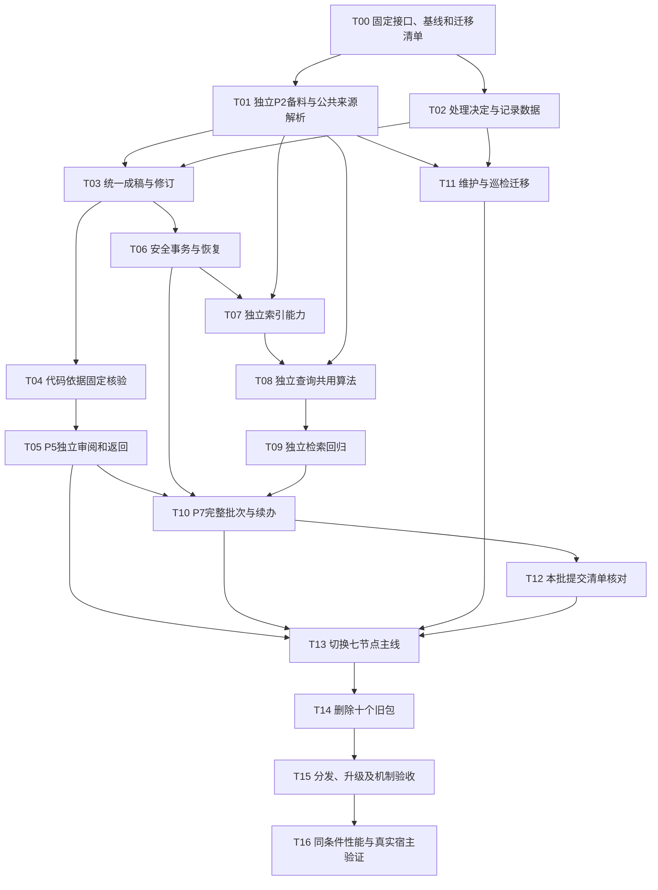

# ingest 七阶段重构任务计划

状态：全部任务未开始。本文件只做SDD规划，不授权或记录已实施。基线与需求见 `2026-10-28-ingest-seven-stage-requirements.md`；目标公开集合9包：保留原方案的8包，新增P2独立备料包 `hs-knowledge-source-prepare`（暂定名），原18包中的10个旧包仍在迁移验证后删除。P1／P2拆分已接受，其余动作名及兼容细节在T00固定。

**文档位置：**本次六份 SDD 暂存项目根并纳入 Git；开发完成后按后续指示移入文档忽略目录。入口见[SDD 总览](ingest七阶段重构SDD计划.md)。

## 执行方式

采用“先补替代能力→逐项迁移消费者→切换主线→删除旧包”。旧接口只在迁移期并存，不用长期兼容壳掩盖未完成清理。每票须交付可从公开入口验证的行为及相关说明／回归；先把原有测试的业务断言迁到新入口，再删除旧入口测试。

每项按单独执行上下文组织；若发现一项包含过多独立能力，应继续拆票，不用一张“重构公共库”任务包住所有变化。下列动作名称表示用途，最终CLI名称先在T00固定。

## 任务依赖

## 总表

| 任务 | 交付的可用行为 | 阻塞项 | 主要需求 |
|---|---|---|---|
| T00 | 新旧能力、公开动作、输入输出和历史恢复基线可追溯 | 无 | R01/R05/R07/R08/R10 |
| T01 | 新source-prepare独立完成原prepare及source-capture的实际备料／捕获／恢复能力，P1只扫描；公共来源函数供其他保留能力直接复用 | T00 | R01/R04/R05/R06/R09 |
| T02 | P3固定逐单元决定，P6完整转写，记录批和维护单元表达闭合 | T00 | R01/R02/R05/R06 |
| T03 | P4一次组织完整稿件，返回修订复用同一生产入口并保留关联 | T01/T02 | R01/R04/R05/R08 |
| T04 | lint可确定性核对代码审阅材料的结构、证据和实际内容绑定，独立检查可用 | T01/T02/T03 | R02/R04/R05/R09 |
| T05 | 独立reviewer在P5一次审内容及必要代码并执行固定lint，按问题退回 | T04 | R01/R02/R08/R09 |
| T06 | 新P7事务入口安全写入及恢复，未重跑整库质量检查，旧入口结果含义不静默降级 | T02/T03 | R03/R04/R05/R07 |
| T07 | apply的仅索引入口可供干净消费端独立构建／核验／启用索引 | T01/T06 | R03/R04/R05/R06/R09 |
| T08 | query不调用其他Skill，现有用途、来源、材料及同代读取语义保持 | T01/T07 | R04/R05/R06/R09 |
| T09 | apply可独立执行明确检索断言和同代读取、按原基线启用候选 | T07/T08 | R03/R04/R05/R09 |
| T10 | 一个P7公开动作完成事务、索引、查询和启用，重启后按真实停点续办 | T05/T06/T07/T09 | R01/R03/R04/R07/R08 |
| T11 | maintain和P1共享必要观察算法，事件、状态和只读巡检不丢用途且无Skill嵌套调用 | T01/T02 | R01/R04/R05/R06/R09 |
| T12 | 完成输出包含本批正式文件清单，明确请求时可只读核对真实提交 | T06/T10 | R05/R07/R09 |
| T13 | ingest主线七节点、explore路由、lint巡检、共享说明统一到目标入口 | T05/T10/T11/T12 | R01/R02/R04/R10 |
| T14 | 删前隔离安装验证仅9包及旧18包升级路径，替代能力验收后删除10包，迁测试、模板和指引并清活跃引用 | T01—T13全部覆盖 | R04/R05/R07/R10 |
| T15 | 删除后的最终9包分发、原规则恢复、干净clone、完整公开入口机制复验有实际结果 | T14 | R01—R07/R09/R10 |
| T16 | 相同材料／断言下的新旧性能对比和真实宿主分层结果 | T15及实际环境可用 | R01/R02/R03/R08/R09 |

## 每项的验收与限制

### T00 接口和原始基线

- 固定当前18个active Skill、23份产物契约、18份运行锁及18份开发锁，列出全部公开动作、现行Workflow和关键公共测试；这些是现状，不改写成目标9包，也不将两个无SKILL.md的残留目录算新增能力。
- 在实现前锁定最终9包的接口和成功含义：主线使用source-scan、source-prepare（暂定名）、change-plan、view-materialize、lint、apply六包，另保留query／explore／maintain三包。所有旧动作映射到保留入口／公共函数／被明确放弃的行为；未经说明不能省略功能。
- 明确P1扫描清单与P2材料包的业务数据接口、显式目标独立备料输入及本次所用来源／配置／规则的指纹边界；P2不以P1通过票据或运行身份放行。P5普通补料只返回P2，发现所用输入漂移才按新扫描／新操作规则处理。
- 固定原prepare与source-capture迁入新包的API、产物／模板、测试和运行依赖；公共来源算法供P2、query、maintain等直接复用，不经兄弟CLI。P6暂沿用source-scan.record，本票另审其合理归属和兼容，不在此次拆P1／P2时擅自扩大迁移决定。
- 固定原18加新1减旧10的删除清单、9包干净安装及旧安装升级条件，明确新包的SKILL／CLI／references／artifact／测试和环境锁，以及explore.setup依赖集合与宿主安装／Workflow引用的配套改动。
- 保存原配套版本和恢复指引，记录旧未完成操作的处理方式；不改旧业务记录。当前基线测试和性能在后续执行时记录，不填入虚构通过数字。

### T01 新建独立 P2 source-prepare

- 新建 `hs-knowledge-source-prepare`（暂定名），直接合入原source-scan.prepare和source-capture的实际能力：raw／附件／配置内代码捕获、严格编码、原字节／提取／定位、确切bundle与source恢复、旧卡及新旧材料整理和缺口输出。不委派旧source-scan.prepare或source-capture CLI，也不导入其私有脚本。
- P1继续由source-scan扫描、判定变化与续办；P2只按扫描产生的实际清单或用户提供的明确目标备料。显式目标可以独立备料，不强制先全库扫描，不检查上游passed或Workflow身份；P6暂沿source-scan.record。
- P5因缺材料返回时只补P2相关材料，不重新扫描全库。若本次实际采用的来源、配置、规则等输入已漂移，不能沿旧清单冒充补齐，须按T00固定规则形成新扫描／新操作，再重新准备受影响材料。
- 历史精读、P2和maintain/query等直接复用公共来源函数，不启动source-prepare、source-capture或source-scan的兄弟CLI；共享算法不复制到多个Skill。
- 新包具备独立SKILL、公开CLI/API说明、材料产物及错误契约、适用模板、测试、运行锁和开发锁；首次依赖准备继续复用explore.setup，不另建setup体系。原prepare和source-capture的业务断言迁到新入口，含显式目标、扫描清单、定向补料、漂移和缺材料反例。
- 老source-capture及原prepare在本票迁移期间仍可用；新旧入口对同一业务事实输出可比较，原文件不变，路径／授权／版本未知等断言保留。最终新9包的生产路径不得依赖这两个旧入口。

### T02 作者决定与记录

- P3在写稿前输出逐单元决定、维护单元及查询预期，覆盖新增／变化／欠账、实质skip和用户明确修订。
- P6只转写既定决定和实际事实，新记录结构／绑定可验证；材料不足的仅记录批能保存欠账，不伪造内容通过。
- 正式记录及前序链不改写，shared pending和使用限制的重建行为有独立断言。

### T03 统一成稿与修订

- 一个公开生产动作消费作者决定和实际卡片，保存卡、导航、来源登记、写删与前后版本、输入描述和处置预览。
- 新建、更新、合并、拆分、退役、暂缓、依赖修订及仅记录批有现有业务断言的替代覆盖；修订保留旧稿引用和理由，新操作不覆盖旧稿。
- 生产过程不递归生成同一写入清单，不调用change-plan/inspect/revise/handoff等兄弟CLI；机器质量审查仍由P5执行。

### T04 代码核验归 lint

- local-check及merge-check的逐断言理由、代码／配置身份、原文位置、静态／构建／运行材料、历史与当前用途边界迁到lint对应用途和共用规则。
- 普通空findings不能冒充代码支持；独立候选检查可提供实际材料进行核验。
- 正式库lint／CI不因缺生产者私人复核材料而失败；CI入口仍是可信固定脚本，不能改造成模型或身份票据门禁。

### T05 P5统一审阅

- 说明、产物和返回协议覆盖计划／归卡／实质skip／成稿及代码，保留采样与未审范围；宿主使用独立reviewer。
- 正常一个候选版本只执行一次完整lint；内容已经阻断时明确哪些固定项未执行，不返回完整通过。
- 缺材料仅回独立P2定向备料，不默认重扫P1；本次所用输入漂移时按新扫描／新操作规则处理。内容决定错回P3、稿件表达错回P4；运行故障保留候选，P5自身不修改稿件或驱动另一个Workflow。

### T06 安全事务与恢复

- 新主线事务路径无整库质量full/逐卡全库关系重验，输入合法性、允许目标、来源及旧版本、锁／事务屏障／备份／回读不丢。
- 写前、备份后、安装后及提交前故障和外部改动均保留相应保护；旧未终态事务有明确原配套恢复路径。
- pending记录与实际applied/recorded状态分别验证，事务完成不能冒称P5／CI／Git已通过；旧run等动作保持原结果语义直至明确退役。

### T07 独立索引能力

- 仅索引用途不要求view、P3计划、P6记录或生产者journal，也不写knowledge；可从正式资产及实际材料重建、全验和启用。
- 保留local/shared、实际来源与代码材料、仓库快照及显式签名发布数据的必要核验；快照真实性不宣称语义／CI通过。
- 拆开必要解码与整库知识质量规则，避免从解析路径带回P5的全部检查；保留数据库实际完整性和最终落位字节核验。

### T08 查询无兄弟CLI

- 共享查询、来源恢复和索引读取算法，公开search/read/receipt不调用source-scan、source-capture或index-build CLI。
- 不变的预期包括用途、范围、当前代码／材料、依赖限制、历史恢复、同代正文／Claim、截断和错误码；不重引入日常查询的全库通过门槛。
- 并发读取使用独立操作／输出；来源或代次变化可明确拒绝，不以串行所有查询掩盖问题。

### T09 独立回归

- 原query-regression所有公开用途迁入apply：非空有明确预期的案例、命中／排除／顺序、用途、同代精读、截断处理、原活动指针基线与结果报告。
- 独立运行不要求原生产者view或passed报告，可以用明确案例；报告复验与真正启用保持区别。
- 未命中或故障不能放宽预期、改用途或替换原活动指针；不嵌套query/index CLI。

### T10 完整P7与续办

- 同一公开动作在同进程组合安全事务、实际索引、冻结查询和启用；子步骤保留真实持久结果。
- 正常连续执行共享确切快照和已核验数据，消除紧邻重复完整索引核验；进程重启后对实际候选代重新核验。
- 分开写前旧正式区和写后候选代的输入描述；SSH结果不明先核进程／journal／代次／启用观察。已落位不重复apply，已完成启用有实际回读事实。

### T11 维护、扫描和巡检

- maintain的inspect-context、状态、变化事件登记／恢复、机械限制解除和audit保留；只读动作无事件／水位／索引写入。
- P1观察必要变化和债务，不把未检查说成无变化；不再借历史停点发现重复全验所有旧索引。选择实际P7续办后再核其确切代次。
- lint巡检仍通过两个保留能力完成；readonly audit内部直接复用公共解析，query和maintain结果用途一致。

### T12 提交辅助

- 将publish-handoff的本批文件清单及明确请求的真实commit/blob／删除范围核对迁入apply的输出／可选动作。
- 独立readiness、实际submitted与本地事务／整批完成分开，不执行Git写入、push、merge或安装CI。
- governance-handoff仅候选摘要由P4输出，不能升级成角色交棒资格。

### T13 七节点切换

- 模板、布局、节点owner、返回和恢复出口均采用七阶段；P5是独立reviewer，其余节点不伪装为独立审阅。
- 输入输出、产物模板、explore路由、使用说明、详细设计和主入口清单互相一致；P1绑定source-scan、P2绑定新source-prepare，P6暂沿source-scan.record。主线六包加query／explore／maintain共9包，不以新增通过票据替代已移除的节点。
- 此时旧十包及原source-scan.prepare只用于尚未完成的兼容迁移，不再被新主线或最终9包的生产路径调用。

### T14 收缩删除

- 删除源码目录前，先在隔离安装中排除旧十包，包含新source-prepare和原八个保留包，验证目标9包干净安装、旧18包安装升级及所有替代入口；该删前验证归本任务，不以等待T15形成循环前置。
- 对迁移矩阵每一行逐项核对新公开入口、模板、说明和测试均到位；旧测试迁调用但保业务oracle，不因路径消失删除重要负向断言。
- 删除原18包中的十个明确旧包；原prepare的现行引用、宿主产物契约及测试迁到source-prepare，source-scan保留扫描和暂定record用途。清理活跃引用、过时产物契约、环境依赖集合和结构计数；不删除共享业务历史或原件。
- 没有原配套恢复方案的旧未结束操作时，不宣布这项可发布完成；不能靠删除本机日志消除阻塞。

### T15 分发与机制验收

- 在T14删除后，对最终交付产物再次验证仅9包和所需共享领域资产的安装／发现及全部公开用途；包括新P2的独立备料、P5定向补料、旧安装升级和explore.setup依赖核对。不能以删前隔离测试代替最终产物复验，也不能在旧18包目录仍在场时宣称已无依赖。
- 干净clone只含共享资产和所需历史／材料，来源解析、索引建立／查询和增量扫描可用；原机私有执行记录不成为前置。
- 规则／能力版本、旧事务配套归档、外部宿主旧能力副本／模板更新及回退步骤有实际清单；不新增不存在的installer或catalog机制。

### T16 性能和真实环境

- 基线与新版同一来源字节、卡／断言／查询、库规模、解释器和硬件条件比较；同时列模型等待、SSH、脚本执行和交棒数据能否取得。
- 先验证断言等价和目标结构，再看耗时；不减案例／放宽资格来取得提速，不把1次样本称P50/P95。
- 公司API和真实OpenFlow不可用时明确留缺口；脚本基准不外推真实模型端到端时延，真实宿主角色隔离、取消及权限分别验收。

## 删除和交付的完成定义

本次规划完成只表示这些任务、迁移归属和测试计划已写清。实现完成需要T01—T15实际结果；性能改善和宿主结论需要T16的实际证据。单独发布设计文档不表示新版已部署，也不表示获准在用户未要求实施时开始删除。
