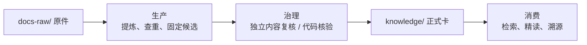

# WiFi 知识库

WiFi 知识库将原始材料提炼为可追溯知识卡，通过独立内容复核、核验和检索回归后供 Agent 使用。文档用 `repo/` 表示项目根目录，知识库位于其下的 `aiotbot-knowledge-wifi-mp/`，Git 操作统一在项目根执行；布局见[总体设计 §5.3](docs-llm-wiki/AIoTBot知识库架构设计.md#53-aiotbot-knowledge目录架构)。

| 目录 | 存放内容 |
|---|---|
| `docs-raw/` | conventions、chips、storys、specs、protocols 五类原件；`sources/` 留作后续接入 |
| `knowledge/` | 七类正式知识卡及逐层导航，唯一知识正文根 |
| `governance/` | Schema、契约、受控枚举、卡模板、规范及来源锁 |
| `../skills/common/knowledge/` | 项目根的节点 Skill、执行脚本、参考说明与产物模板 |
| `../workflows/common/knowledge/` | 项目根的单一 ingest 工作流，串起生产与本地入库 |
| `.build/` | 本地候选与转换暂存，生成内容不上库 |
| `logs/` | 操作、复核、来源快照及恢复记录 |
| `evals/` | 检索案例、契约与流程回归 |
| `artifacts/` | 可重建索引与报告，生成内容不上库 |
| `docs-llm-wiki/` | 架构、概要与详细设计、使用说明及 SDD 工件 |

从[架构设计](docs-llm-wiki/AIoTBot知识库架构设计.md)了解目录与三条链路，从[概要与详细设计](docs-llm-wiki/知识库详细设计.md)了解节点判断和文件分工，操作见[使用说明](docs-llm-wiki/使用说明.md)。贡献规则见 [CONTRIBUTING.md](CONTRIBUTING.md)，实现任务与实际验证记录见 [SDD](docs-llm-wiki/sdd/knowledge-v3/README.md)。

默认将知识库与代码放在同一业务工作区；独立放置时，以本机 `config.env` 的 `project_root` 解析代码引用。路径基准见[工作区路径与部署边界](docs-llm-wiki/知识库详细设计.md#7-工作区路径与部署边界)。

外层 `config.yml` 以模块路径和归属整理逻辑 Target／pair；实际宏、构建与版本由明确材料支持，未知项保持 unknown。纯文档经独立 Agent 内容复核和完整固定检查后 stable；代码卡在 ingest 内完成本地只读核验，上库 CI 复用确定性检查。目录结构和设计本身不代表真实业务、宿主或权限隔离已接入。
