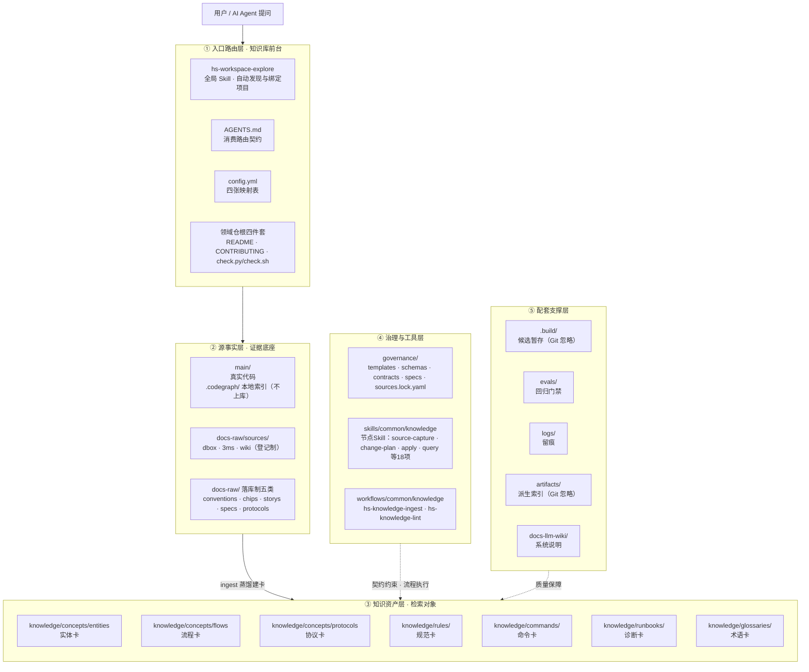
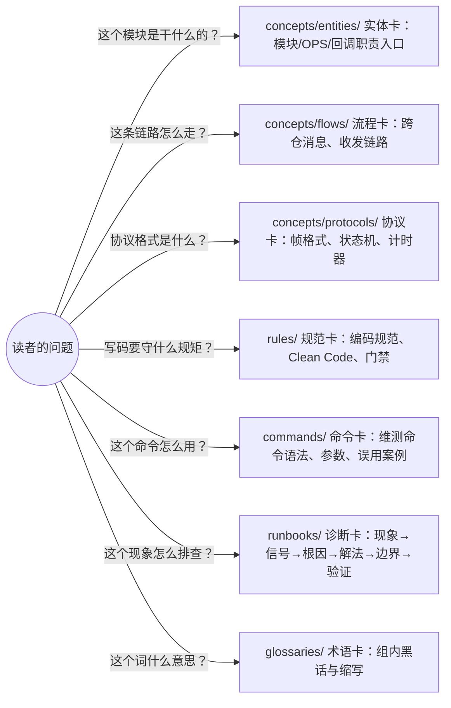
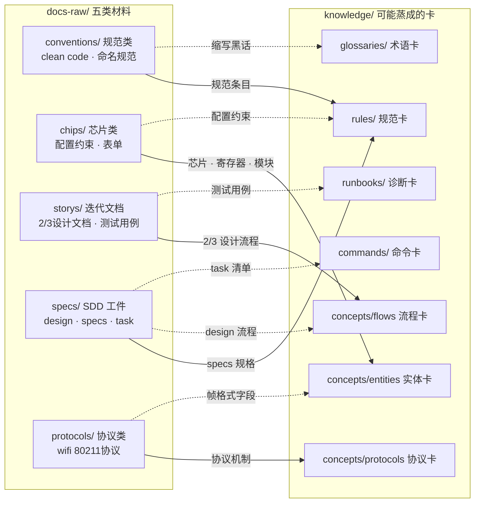
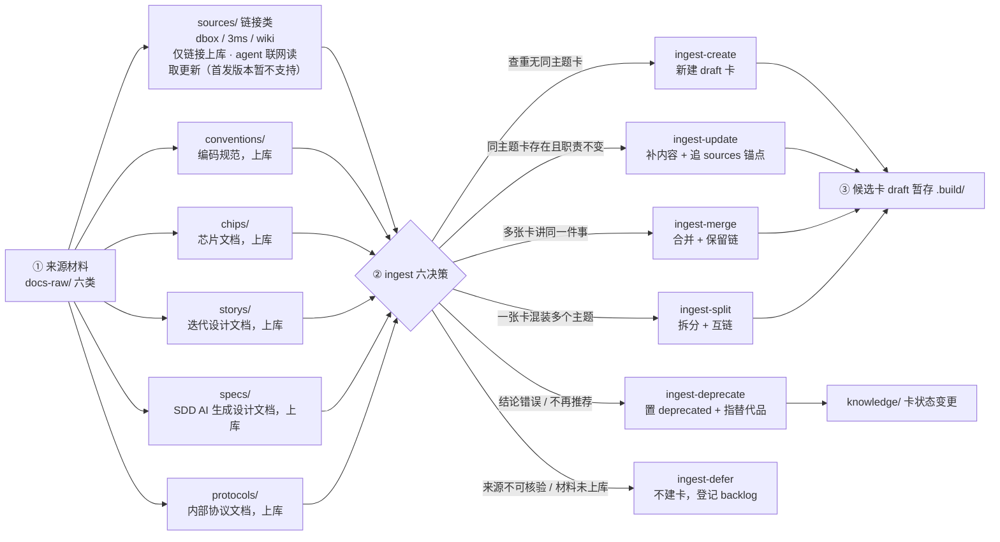
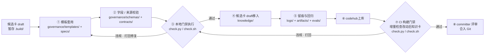
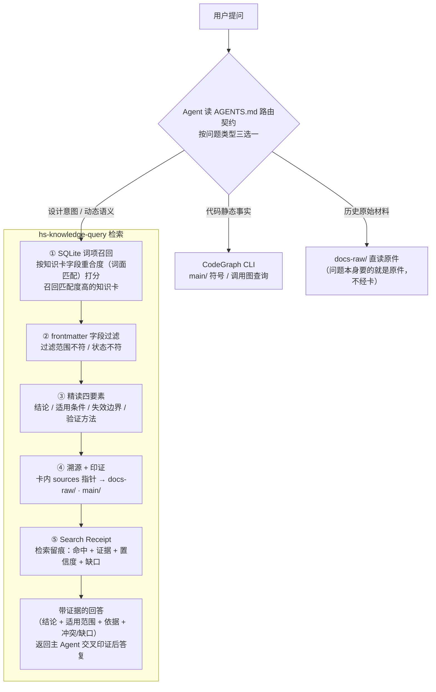

# AIoTBot知识库架构设计

## 5.3 AIoTBot knowledge目录架构

aiotbot-knowledge知识库仓目录结构如下所示。

- AGENTS.md：项目绑定后的消费路由契约
- config.yml：四张映射表，把代码仓、架构元素、领域知识实体、符号别名集中登记为一份配置事实
- main/：真实代码工作区
- aiot-knowledge/：领域知识仓根，下一级是 domain，一领域一仓，内部目录完全同构
  - knowledge/：知识卡，唯一检索对象，处理后知识的仓库
  - docs-raw/：源文档，原始证据层（LLM 只读）
  - governance/：治理文件夹，存放契约，模板，规范等
  - .build/ · logs/ · evals/ · artifacts/ · docs-llm-wiki/：配套支撑层

```
skills/
└── common/
    └── knowledge/
        ├── hs-workspace-explore/  # 绑定项目
        ├── hs-knowledge-source-capture/  # 固定来源
        ├── hs-knowledge-change-plan/  # 六决策计划
        ├── hs-knowledge-view-materialize/  # 物化最终视图
        ├── hs-knowledge-governance-handoff/  # 移交治理
        ├── hs-knowledge-candidate-inspect/  # 检查候选身份
        ├── hs-knowledge-confirmation-prepare/  # 准备真人展示
        ├── hs-knowledge-confirmation-record/  # 记录真实动作
        ├── hs-knowledge-local-check/  # 代码本地核验
        ├── hs-knowledge-candidate-revise/  # 修订或缩窄
        ├── hs-knowledge-apply/  # 精确事务落位
        ├── hs-knowledge-recover/  # 恢复事务
        ├── hs-knowledge-index-build/  # 构建验证和激活索引
        ├── hs-knowledge-query-regression/  # 回归候选代
        ├── hs-knowledge-publish-handoff/  # 移交发布
        ├── hs-knowledge-merge-check/  # 最新代码合入复验
        ├── hs-knowledge-maintain/  # 维护与阻断复核
        └── hs-knowledge-query/  # 消费知识
workflows/
└── common/
    └── knowledge/
        ├── hs-knowledge-ingest/  # 生产：来源到候选与治理交接
        └── hs-knowledge-lint/    # 治理：分流确认/检查、事务、索引与发布交接
AGENTS.md                            # 入口：领域/流程路由、卡契约指针、config.yml 说明
config.yml                           # 代码仓 ↔ 架构元素 ↔ 领域知识实体 ↔ 符号映射
main/                                # 真实代码工作区
├── device/
│   ├── bfgx/ common/ dpa/ platform/ sensorhub/
│   └── wifi/
│       ├── mp1x/
│       │   ├── .codegraph/          # [新增]代码图谱db文件，本地生成不上库
│       │   └── …
│       ├── mp12/
│       │   ├── .codegraph/          # [新增]代码图谱db文件，本地生成不上库
│       │   └── …
│       └── …
├── drivers/
│   ├── bfgx/ common/ dpa/ platform/ sensorhub/
│   └── wifi/
│       ├── .codegraph/              # [新增]代码图谱db文件，本地生成不上库
│       └── …
└── …
aiotbot-knowledge-wifi-mp/          # WiFi 领域知识仓；以下展开内部结构
├── AGENTS.md                    # 知识边界、规则指针与技能入口
├── README.md                    # 定位、实际能力、资料导航
├── CONTRIBUTING.md              # 生产、核验和贡献流程
├── check.py / check.sh          # 结构、来源完整性及历史导入快照检查
├── docs-raw/                    # 知识所在的原始文档
│   ├── sources/                 # 来源登记表（md）：每条 = 链接 + 版本 + hash + 密级
│   │   ├── dbox                 # dbox设计文档，链接到dbox，与薪火平台共管理
│   │   ├── 3ms                  # 3ms文档，链接到3ms，与薪火平台共管理
│   │   └── wiki                 # wiki文档，链接到wiki，与薪火平台共管理
│   ├── conventions              # clean code、编码规范等，内部公开，上库git仓
│   ├── chips                    # 芯片相关文档，内部公开，上库git仓
│   ├── storys                   # 迭代设计文档，内部公开，上库git仓
│   ├── specs                    # sdd流程AI生成设计文档，内部公开，上库git仓
│   └── protocols                # 内部公开协议文档，内部公开，上库git仓
├── governance/
│   ├── AGENTS.md / index.md     # 共享治理维护规则与任务导航
│   ├── templates/               # 9类 draft 卡、目录导航、复核和维护记录模板
│   ├── sources.lock.yaml        # source → 声明版本/落点/hash/bytes/恢复说明；当前空锁
│   ├── schemas/
│   │   ├── frontmatter.schema.json
│   │   ├── sources.schema.json  # 来源锁字段形状
│   │   ├── profiles.yaml
│   │   └── registries.yaml      # 本地来源根等注册项
│   ├── contracts/               # knowledge、source_resources 与共享 validation
│   └── specs/                   # 共享契约及编写、复核、生命周期规范
├── knowledge/                   # 唯一知识正文根；
│   ├── AGENTS.md                # WiFi 领域规则，不虚构实际模块与 Target
│   ├── index.md                 # 当前仅入口，无技术卡；以下 Profile 随真实建卡创建
│   ├── concepts/                # 原理、机制及概念卡
│   │   ├── entities/            # 实体卡：模块/OPS/回调职责入口（dbox、storys、specs、chips 设计文档蒸馏）
│   │   ├── flows/               # 流程卡：跨仓消息、收发链路（dbox、storys、specs 设计文档蒸馏）
│   │   └── protocols/           # 协议卡：802.11 帧格式、状态机、计时器（协议蒸馏）
│   ├── rules/                   # 规范卡：编码规范、Clean Code、门禁约束（conventions 蒸馏）
│   ├── commands/                # 命令卡：维测命令语法、参数、典型输出、误用案例（wiki 蒸馏）
│   ├── runbooks/                # 诊断卡：现象→信号→根因→解法→边界→验证（wiki 经验蒸馏）
│   └── glossaries/              # 术语卡：组内黑话与缩写
├── .build/                      # ignored 转换、规范化、候选暂存，按需产生
├── logs/                        # 按日期记录已发生的导入与维护
├── docs-llm-wiki/               # LLM WIKI系统说明（design_principles / installation_and_usage）；禁止成为第二份领域事实库
├── evals/                       # 检索案例、回归执行与接受/拒绝测试
└── artifacts/                   # 本地派生索引、验证报告，Git 忽略
```

knowledge相关节点Skill和Workflow（源码在本仓，与main同级）：

上述skills/和workflows/直接位于FactumCore根，与main同级，使用当前远端且不放嵌套.git。18个Skill各负责一个可复用节点动作；`hs-knowledge-ingest`、`hs-knowledge-lint`只作为两个Workflow名称，不再注册同名聚合Skill。真实人工批准保留user Gate，由准备/记录Skill桥接可信动作，不能用Skill代替用户决定。


# 11 AIoTBot知识库架构

前文"AIoTBot knowledge目录架构"回答的是"有哪些目录"，本章回答三个问题：**每个目录是干什么的？为什么要有这个目录？目录之间怎么协作？** 阅读顺序：11.1 建立动机认知（为什么需要知识库）→ 11.2 仓库架构（分层模型 + 目录职责）→ 11.3 知识生命周期（三条链路看目录协作）。

## 11.1 知识库收益

AIoT 业务横跨 WiFi、BGLE、定位、雷达、SLP、NFC、NPU、MCU 等十几个领域，代码规模大、协议密集、芯片迭代快，领域知识散落在 dbox/3ms/wiki 设计文档、迭代 story、内部协议和代码注释中。没有知识库时，Agent 每次任务都从零开始读代码、读文档：上下文爆炸、检索无门、结论无法溯源；多人多 agent 各自沉淀的经验无法复用，同样的坑反复踩。

知识库带来的收益：

| 收益 | 说明 |
|------|------|
| 检索增强 | 词面召回 + frontmatter 范围过滤，Agent 先路由再消费，把上下文预算花在刀刃上 |
| 结论可溯源 | 每张卡带 sources 锚点，回答可回溯到原始证据，抑制幻觉 |
| 经验可沉淀 | 一次调试经验固化为 runbook 卡，跨项目、跨 agent 复用 |
| 质量可治理 | lint 门禁 + 检索回归评测，知识有生命周期而非一次性文档 |
| 权限可控 | 领域独立建仓，保密要求不同的知识各自管理、互不越界 |

## 11.2 知识库架构

知识库的目录划分不是文件夹的随意归置，而是治理规则的物理落地。四条原则各对应一对目录：

| 原则 | 回答的问题 | 对应目录 |
|------|-----------|---------|
| 事实与证据分离 | 卡片结论从哪里来？ | `knowledge/`（结论）↔ `docs-raw/`（证据） |
| 事实与规则分离 | 什么才算一张合格的卡？ | `knowledge/`（领域事实）↔ `governance/`（元规则） |
| 人读与机读分离 | 谁来浏览、谁来召回？ | `index.md`（人读导航）↔ `artifacts/`（机器索引） |
| 沉淀与暂存分离 | 什么入库、什么忽略？ | 上库目录 ↔ `.build/`（暂存，Git 忽略） |

知识库仓的目录架构按"层"组织：每层回答一个问题、承载一组目录，层与层之间靠三条链路协作。总体架构如下：



各层与目录的对应关系：

| 层 | 一句话职责 | 承载目录/文件 |
|---|---|---|
| ① 入口路由层 | 自动绑定项目，先路由再消费 | `hs-workspace-explore` · `AGENTS.md` · `config.yml` · 领域仓根四件套（`README.md` · `CONTRIBUTING.md` · `check.py/check.sh`） |
| ② 源事实层 | 证据底座：代码事实 + 原始材料，喂知识层 | `main/` · `docs-raw/` |
| ③ 知识资产层 | 唯一检索对象：治理后的知识卡 | `knowledge/` |
| ④ 治理与工具层 | 契约约束知识层，三流程执行体 | `governance/` · `.skills/` · `.workflows/` |
| ⑤ 配套支撑层 | 候选暂存 · 回归门禁 · 留痕 · 派生索引 | `.build/` · `evals/` · `logs/` · `artifacts/` · `docs-llm-wiki/` |

递进一句话：证据层喂知识层，契约层束知识层，技能层跑知识层，配套层验知识层，入口层路由知识层。

### 11.2.1 根目录架构

#### AGENTS.md —— 消费路由契约

Agent 会话入口。作用是"先路由，再消费"：代码静态事实走 CodeGraph CLI，设计意图/动态语义走知识卡，历史原始材料走 raw，禁止全库扫描。没有这个入口，Agent 每次都要猜路径；有了它，一次会话的上下文预算花在刀刃上。

仓外启动时先由全局 `hs-workspace-explore` 按目标代码路径定位 `config.yml` 与知识仓，再读取适用 `AGENTS.md`；不假定提示词中出现路径就已自动加载项目规则。

参与链路：消费链路（前置路由）。生产、治理链路不经过它——ingest / lint 是显式触发，不走会话路由。

#### config.yml —— 四张映射表

repos / architecture / wiki_entities / symbol_aliases 四张表，把"代码仓在哪、架构怎么划、卡片页叫什么、符号别名是什么"集中登记。这些内容是**配置事实而非领域知识**，集中一处，人和 Agent 共用同一份真相；决策引擎段（shadow/assist）也在此声明。

参与链路：消费链路——路由的判断依据就是这四张表。

#### main/ —— 真实代码工作区

device 侧 + host 侧真实代码。`.codegraph/` 是代码图谱索引，**本地生成不上库**：它是按仓可重建的派生物，且可能包含内部符号信息，保持 Git 干净。知识卡结论必须能锚定到代码（`[函数](路径:行号)`），检索-印证-回写闭环因此要求代码与知识同工作区可达。

参与链路：生产链路（代码事实作为来源材料之一）+ 消费链路（codegraph 交叉印证）。

#### `skills/common/knowledge`/ —— 全局入口与节点级能力

知识库的"操作说明书"，不装任何领域事实：

| 技能 | 职责 | 一句话 |
|------|------|--------|
| `hs-workspace-explore/` | 绑定项目 | bind_project |
| `hs-knowledge-source-capture/` | 固定来源 | capture_raw |
| `hs-knowledge-change-plan/` | 六决策计划 | plan_change |
| `hs-knowledge-view-materialize/` | 物化最终视图 | materialize_view |
| `hs-knowledge-governance-handoff/` | 移交治理 | governance_handoff |
| `hs-knowledge-candidate-inspect/` | 检查候选身份 | inspect_candidate |
| `hs-knowledge-confirmation-prepare/` | 准备真人展示 | prepare_confirmation |
| `hs-knowledge-confirmation-record/` | 记录真实动作 | record_confirmation |
| `hs-knowledge-local-check/` | 代码本地核验 | local_check |
| `hs-knowledge-candidate-revise/` | 修订或缩窄 | revise_candidate |
| `hs-knowledge-apply/` | 精确事务落位 | apply_view |
| `hs-knowledge-recover/` | 恢复事务 | recover_transaction |
| `hs-knowledge-index-build/` | 构建验证和激活索引 | rebuild_index |
| `hs-knowledge-query-regression/` | 回归候选代 | query_regression |
| `hs-knowledge-publish-handoff/` | 移交发布 | publish_handoff |
| `hs-knowledge-merge-check/` | 最新代码合入复验 | verify_merge |
| `hs-knowledge-maintain/` | 维护与阻断复核 | maintain_knowledge |
| `hs-knowledge-query/` | 消费知识 | query_knowledge |

参与链路：生产、治理由两个Workflow编排多个节点Skill；消费由hs-knowledge-query及来源/索引相关节点能力完成。多个节点可复用同一Skill，节点数不等于新增实现份数。

#### `workflows/common/knowledge`/ —— 增量更新与治理工作流

知识库的"操作说明书"，不装任何领域事实：

| 技能 | 职责 | 一句话 |
|------|------|--------|
| `hs-knowledge-ingest/` | Agent 建卡、融合和统一收尾流程 | 怎么进 |
| `hs-knowledge-lint/` | 结构、来源检查与语义复核流程 | 怎么验 |

参与链路：hs-knowledge-ingest 跑生产、hs-knowledge-lint 跑治理

#### aiot-knowledge/ —— 领域知识仓

本次只建设aiotbot-knowledge-wifi-mp，业务代码槽位、知识及节点Skill/Workflow在FactumCore同一Git仓开发和发布；不建立其他领域或中间容器。目录和忽略规则不构成ACL，资料/安装发行仍按实际授权处理。

参与链路：**三条链路全程**——每个领域仓内部跑完整的"生产 → 治理上库 → 消费"。

### 11.2.2 各领域仓目录架构（以 wifi 为例）

#### 领域仓根四件套

| 文件 | 职责 | 消费者 |
|------|------|--------|
| `AGENTS.md` | 知识边界、规则指针与技能入口 | Agent 会话第一步 |
| `README.md` | 定位、实际能力、资料导航 | 人 |
| `CONTRIBUTING.md` | 生产、核验和贡献流程 | 贡献者 |
| `check.py / check.sh` | 结构、来源完整性及历史导入快照检查 | 本地门禁 + CI 门禁共用入口 |

四个文件都是"入口与门禁"，不承载知识内容——它们把消费路由到 `knowledge/`，把贡献路由到 `governance/`。

参与链路：`README.md` / `CONTRIBUTING.md` 生产链路贡献者入口；`check.py / check.sh` 治理链路本地门禁 + CI 门禁共用入口；`AGENTS.md` 消费路由。

#### knowledge/ —— 知识正文根（唯一检索对象）

整个知识库中**唯一参与检索的目录**。子目录按"读者带着什么问题来"切分，而非按代码目录切分：



目录来源标注了蒸馏出处（dbox、storys、specs、conventions、wiki），建卡时按材料类型对号入座。`AGENTS.md` + `index.md` 是领域规则与逐层导航。

**上库管理标准**：知识卡正文随仓提交、进评审流程，仓库里沉淀的是卡片、导航、规则、模板与评测全量事实；不上库的只有可重建的派生物（`artifacts/` 索引、验证报告）与暂存区（`.build/`），Git 历史只承载"人确认过的知识"。

参与链路：治理链路（卡片落位上库）+ 消费链路（定位 / 精读）。

#### docs-raw/ —— 原始证据层（LLM 只读）

知识卡正文只写"结论 + sources 指针"，不复制原文段落；被指向的原始材料统一落在 `docs-raw/`。这一层的组织逻辑是**按材料性质分类，而不是按项目、时间或团队分类**——因为下游建卡时，第一个判断就是"这份材料是什么性质、该蒸成什么卡"。

两套存放形态：

- **登记制（`sources/`）**：不好落到本地的文件（dbox、3ms、wiki），按公司三个文档管理工具分类登记"链接 + 版本 + hash + 密级"，原件仍由源系统持有，与薪火平台共管理；`governance/sources.lock.yaml` 锁声明版本与恢复说明。（首发版本暂不支持）
- **落库制（conventions / chips / storys / specs / protocols）**：内部公开、上库 Git 仓的文件，按 WiFi 组可能用到的材料类型分五类。

##### 分类对知识卡生成的影响

**分类不是仅"方便人管理"，它是知识生产-消费链的第一环**——材料分类决定建卡路由，建卡路由决定卡片元数据，卡片元数据决定检索召回：



实线 = 主路由（材料性质决定的默认去处），虚线 = 兼路由（材料中夹带的其他可蒸内容）——一类材料可蒸多种卡，但路由目标由材料性质唯一决定，不是 Agent 临场发挥。

| 影响点 | 链路环节 | 分类错位后果 |
|--------|----------|--------------|
| 决定卡类型路由 | 生产：材料性质 → 卡 Profile（映射见上图） | 材料进错类 → 卡 type 判断错 → 卡结构（必填章节）错 |
| 决定溯源锚点 | 治理：卡片 `sources` 必须指向固定可核验位置 | 分类漂移 → 溯源路径漂移 → lint 机器化检查失效 |
| 决定召回过滤 | 消费：query 按 platform/technology/lifecycle 过滤 | 范围声明混乱 → "未知范围伪装通用"或漏召回 |

同时划清边界：**分类不保证卡的内容正确**——内容正确性靠蒸馏与人工复核；分类保证的是"每张卡能被路由到正确类型、溯源到固定位置、过滤出正确范围"三件可机器化审计的事。

参与链路：生产链路（材料分类与登记）+ 消费链路（溯源）。

#### governance/ —— 治理规则层（契约 SSOT）

`templates/`（9 类 draft 卡模板）、`schemas/`（frontmatter / sources schema、profiles、registries）、`contracts/`（knowledge、source_resources 与共享 validation）、`specs/`（编写、复核、生命周期规范）、`sources.lock.yaml`（来源锁：声明版本/落点/hash/bytes/恢复说明，当前空锁）。生产、治理、消费**共用同一契约**，Skill 不维护私有例外——这是对 cannbot-knowledge "统一知识契约"优势的直接落地。

参与链路：生产链路（建卡时套它的模板）+ 治理链路（契约为治理全程供给规则）+ 消费链路（过滤时按它的规范）。

#### 配套设施

| 目录 | 一句话职责 | 为什么单独设 |
|------|-----------|--------------|
| `.build/` | 转换、规范化、候选暂存（ignored） | 生产过程的半成品不该出现在检索结果里 |
| `evals/` | 检索案例、回归执行与接受/拒绝测试 | 质量门禁：改索引/改契约必须先过回归 |
| `logs/` | 按日期记录已发生的导入与维护 | 审计留痕；只追加，不代替原始 trace |
| `artifacts/` | 本地派生索引、验证报告（Git 忽略） | 机器召回的产物，可随时从卡片全量重建 |
| `docs-llm-wiki/` | LLM WIKI 系统说明 | 讲"系统怎么用"；禁止成为第二份领域事实库 |

参与链路：`.build/` 生产链路暂存；`evals/` 治理链路回归 · CI 门禁复跑；`logs/` 治理链路留痕；`artifacts/` 消费链路机器召回；`docs-llm-wiki/` 不参与链路，讲链路本身。

## 11.3 知识库使用链路

知识库里所有目录，都是为三条链路服务的。先看链路、再看目录，每个目录"参与哪条链路、卡在哪一环"顺着图就能对上号。

### 链路一：生产 —— ingest 六决策

输入是来源材料，输出是 `.build/` 里的候选卡：



### 链路二：治理上库 —— lint 门禁

输入是 `.build/` 里的候选卡，输出是**合入 Git 的 stable 卡**。`hs-knowledge-lint` Workflow编排节点能力并定义流程，`governance/` 提供契约，`check.py / check.sh` 是执行入口。两道门禁、一套契约——本地门禁查 `.build/` 候选卡，CI 门禁在上库合入时全库重校验：



**①② 是"查"不是"改"**：契约校验只判定卡是否合规，不改写内容——违规卡的修复由 Agent 按 lint 违规清单改，改完重新走门禁。

**⑥⑦⑧ 两道门禁的分工**：①-⑤ 是本地门禁——查 `.build/` 候选卡，通过后卡片平移到 `knowledge/`（置 stable、`index.md` 回填一行），这只是**本地变更，还不是上库**；⑥⑦⑧ 是 CI 门禁——提 PR 触发 CI，服务器拉取待合入代码，按**改动的 knowledge 卡**重跑同一套契约校验（全库 lint + 索引核验 + 检索回归 + 单测），违规打回，committer 评审后合入 Git。

### 链路三：消费 —— query 五步法

输入是提问（与目标代码路径），输出是带证据的回答。Agent 收到问题先读 `AGENTS.md` 路由契约，按**问题类型**三选一：



#### 目录 × 链路参与矩阵

| 目录/文件 | 生产（材料 → 候选卡） | 治理上库（候选卡 → 合入） | 消费（卡 → 答案） |
|---|---|---|---|
| `hs-workspace-explore` | 显式流程可复用项目绑定 | 同一绑定上下文 | 前置：自动发现与加载 |
| `AGENTS.md` | 不参与 | 不参与 | 前置：路由 |
| `config.yml` | — | — | 前置：路由依据 |
| `main/` | 来源之一（代码事实） | — | ④ 交叉印证 |
| `skills/` | ② 六决策执行 | ③ 门禁执行 · ⑦ CI 门禁 | ①-⑤ 全程执行体 |
| `workflows/` | ② 六决策执行 | ③ 门禁执行 · ⑦ CI 门禁 | — |
| `knowledge/` | — | ④ 平移落位 | ① 定位 / ③ 精读 |
| `docs-raw/` | ① 来源材料 | — | ④ 溯源 |
| `governance/` | — | ①② 契约供给 | — |
| `.build/` | ③ 候选暂存 | — | — |
| `evals/` | — | ⑤ 回归 · ⑦ CI 门禁 | — |
| `logs/` | — | ⑤ 留痕 | — |
| `artifacts/` | — | ⑤ 索引重建 · ⑦ 全量核验 | ① 机器召回 |
| `docs-llm-wiki/` | — | — | 人读说明 |
