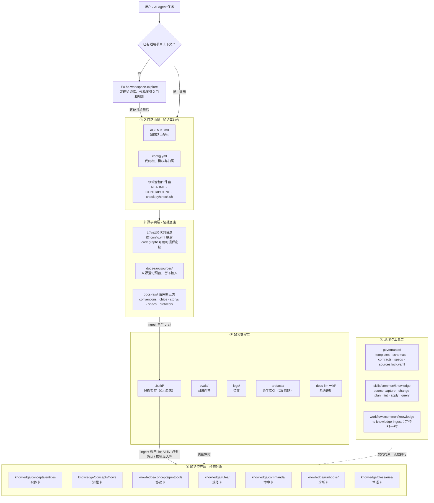
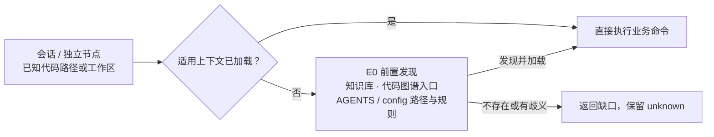
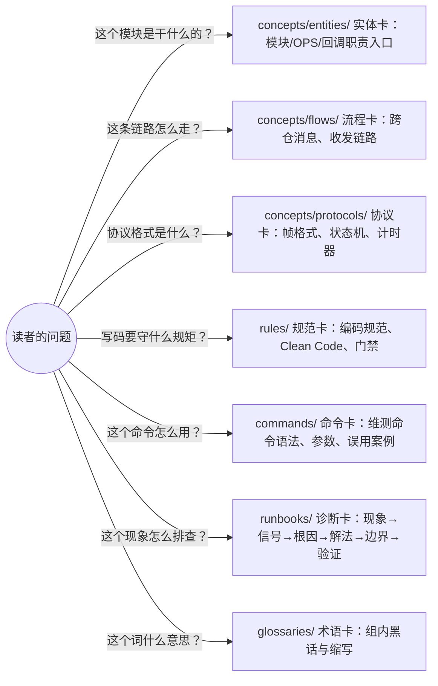
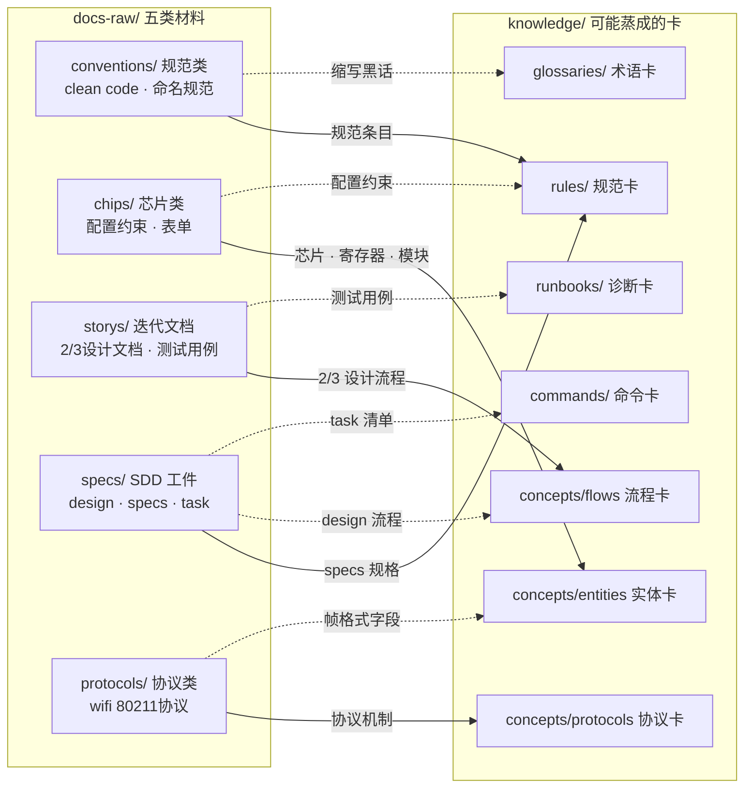
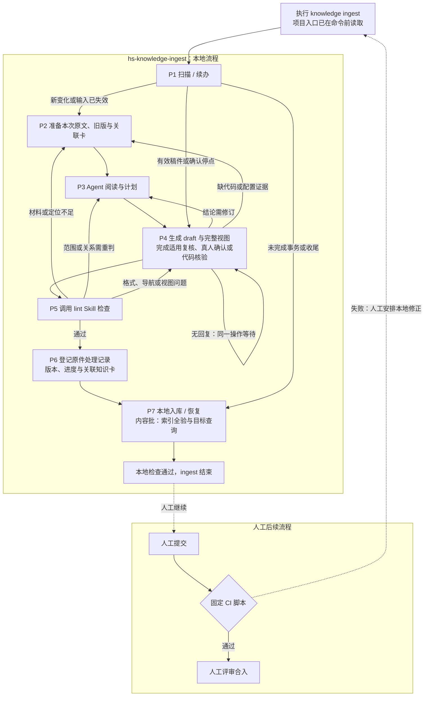
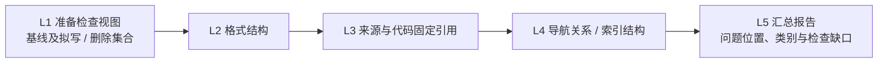
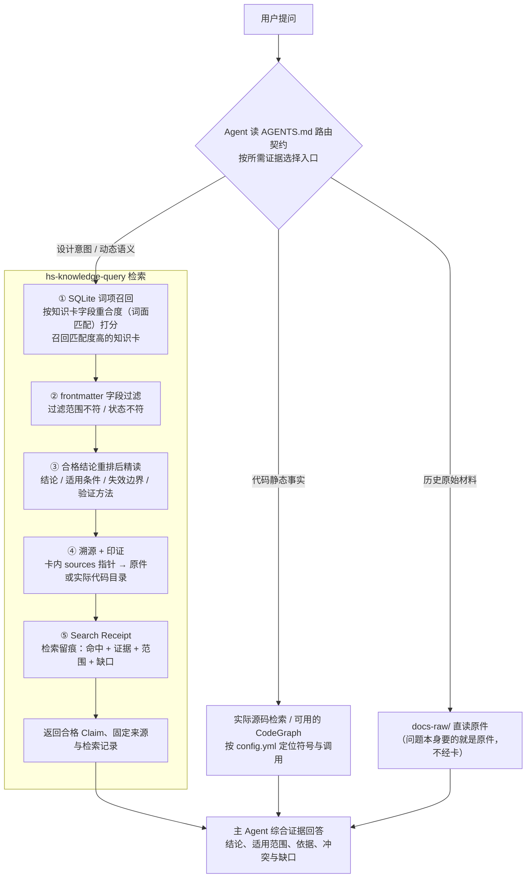

# AIoTBot知识库架构设计

## 5.3 AIoTBot knowledge目录架构

aiotbot-knowledge知识库仓目录结构如下所示。

本节目录树描述FactumCore的开发布局。默认将`aiotbot-knowledge-wifi-mp/`放在业务工作区根目录，与代码及配套能力共同管理。业务工作区可包含Host、Device、特性和算法等多个代码模块；知识库按配置中的相对路径读取实际文件，以内容指纹核对引用。

需要独立放置知识库时，由本地`config.env`中的`project_root`提供代码相对引用的基准。默认部署按工作区根目录的配置读取已落地模块文件。路径约定与部署边界见[详细设计第7章](知识库详细设计.md#7-工作区路径与部署边界)。

- AGENTS.md：本工作区的消费路由契约
- config.yml：项目架构映射，登记代码根、模块相对路径及芯片／端／特性／用途
- main/：真实代码工作区
- skills/common/knowledge/：项目根的节点能力
- workflows/common/knowledge/：项目根的 ingest 工作流
- aiotbot-knowledge-wifi-mp/：WiFi 领域根，集中维护原件、知识与治理
  - knowledge/：知识卡，唯一检索对象，处理后知识的仓库
  - docs-raw/：源文档，原始证据层（LLM 只读）
  - governance/：治理文件夹，存放契约，模板，规范等
  - .build/ · logs/ · evals/ · artifacts/ · docs-llm-wiki/：配套支撑层

```text
FactumCore/
├── AGENTS.md                      # 项目入口与消费路由
├── config.yml                     # 代码根、模块相对路径与归属
├── main/                          # 业务代码工作区，可包含多个模块
├── skills/common/knowledge/   # 节点级能力
│   ├── hs-workspace-explore/             # E0：缺上下文时前置发现
│   ├── hs-knowledge-source-scan/         # 增量扫描、材料与处理记录
│   ├── hs-knowledge-source-capture/      # 保存本次原文副本与定位
│   ├── hs-knowledge-change-plan/         # 六决策计划
│   ├── hs-knowledge-view-materialize/    # 物化最终视图
│   ├── hs-knowledge-governance-handoff/  # 登记稿件与检查上下文
│   ├── hs-knowledge-lint/                # 只读确定性检查 Skill
│   ├── hs-knowledge-candidate-inspect/   # 检查候选身份
│   ├── hs-knowledge-confirmation-prepare/ # 准备真人展示
│   ├── hs-knowledge-confirmation-record/ # 记录真实动作
│   ├── hs-knowledge-local-check/         # 代码本地核验
│   ├── hs-knowledge-candidate-revise/    # 修订或缩窄
│   ├── hs-knowledge-apply/               # 精确事务落位
│   ├── hs-knowledge-recover/             # 恢复事务
│   ├── hs-knowledge-index-build/         # 构建、验证与激活索引
│   ├── hs-knowledge-query-regression/    # 回归候选代
│   ├── hs-knowledge-publish-handoff/     # 外部发布材料辅助
│   ├── hs-knowledge-merge-check/         # 固定代码视图复核辅助
│   ├── hs-knowledge-maintain/            # 变更影响与阻断复核
│   └── hs-knowledge-query/               # 消费知识
├── workflows/common/knowledge/
│   └── hs-knowledge-ingest/   # P1—P7：原件到 stable 的完整流程
└── aiotbot-knowledge-wifi-mp/       # WiFi 领域根，无嵌套 .git
    ├── AGENTS.md / README.md / CONTRIBUTING.md
    ├── check.py / check.sh         # 固定 CI 入口，复用共用检查函数
    ├── docs-raw/                 # 原始证据，Agent 只读
    │   ├── conventions/          # 编码规范
    │   ├── chips/                # 芯片材料
    │   ├── storys/               # 迭代设计和测试材料
    │   ├── specs/                # 项目需求与设计原件
    │   ├── protocols/            # 内部协议
    │   └── sources/              # dbox、3ms、wiki 登记，暂不接入
    ├── governance/
    │   ├── AGENTS.md / index.md
    │   ├── templates/            # 七类卡、导航与人工复核模板
    │   ├── schemas/              # 字段形状、Profile 和受控枚举
    │   ├── contracts/            # 共享机器规则
    │   ├── specs/                # 编写、复核和生命周期规范
    │   └── sources.lock.yaml     # 逻辑来源、固定版本和恢复信息
    ├── knowledge/                # 唯一知识正文根
    │   ├── AGENTS.md / index.md
    │   ├── concepts/
    │   │   ├── entities/         # 模块、OPS、回调职责
    │   │   ├── flows/            # 跨仓消息和收发链路
    │   │   └── protocols/        # 帧格式、状态机和计时器
    │   ├── rules/                # 规范
    │   ├── commands/             # 命令
    │   ├── runbooks/             # 排障
    │   └── glossaries/           # 术语
    ├── .build/                   # 候选暂存，Git 忽略
    ├── logs/                     # 来源、确认、操作和恢复留痕
    ├── evals/                    # 检索案例和回归门禁
    ├── artifacts/                # 可重建索引和报告，Git 忽略
    └── docs-llm-wiki/             # 系统设计、使用说明与 SDD
```

节点 Skill 和 Workflow 随 WiFi 知识库维护：

`skills/common/knowledge/` 和 `workflows/common/knowledge/` 位于 FactumCore 根，与 `AGENTS.md`、`config.yml` 同级管理，不包含嵌套 `.git`。一条 `hs-knowledge-ingest` Workflow 完成 P1—P7；`hs-knowledge-lint` 位于 Skill 目录，只执行只读检查。真实人工批准保留 user Gate，由准备和记录 Skill 连接可信动作。


# 11 AIoTBot知识库架构

知识库随代码仓一并拉取，无需独立初始化命令或常驻服务。`ingest` 默认处理五类允许 raw，从提炼 draft 连续完成检查、修订、必要真人确认或代码核验，最后将 stable 卡落位到 `knowledge/`；`lint` 是可单独调用的只读确定性检查入口，供手动修改和 CI 复用，不自动修稿或入库；`query` 消费知识。本地入库及查询验证完成后，由人提交、触发固定 CI 并评审合入。`ingest --source` 可选限定来源；命令格式见[详细设计 §1.1](知识库详细设计.md#11-从命令进入流程)，实际注册和续办由宿主适配层负责。

ingest 是原件到本地正式知识的完整流程；lint 是可被 ingest、独立命令和 CI 复用的只读检查 Skill，query 负责消费。三者不是必须由用户顺序启动的三个 Workflow。

前文"AIoTBot knowledge目录架构"回答的是"有哪些目录"，本章回答三个问题：**每个目录是干什么的？为什么要有这个目录？目录之间怎么协作？** 阅读顺序：11.1 建立动机认知（为什么需要知识库）→ 11.2 仓库架构（分层模型 + 目录职责）→ 11.3 知识生命周期（三条链路看目录协作）。

## 11.1 知识库收益

AIoT 业务横跨 WiFi、BGLE、定位、雷达、SLP、NFC、NPU、MCU 等十几个领域，代码规模大、协议密集、芯片迭代快，领域知识散落在 dbox/3ms/wiki 设计文档、迭代 story、内部协议和代码注释中。没有知识库时，Agent 每次任务都从零开始读代码、读文档：上下文爆炸、检索无门、结论无法溯源；多人多 agent 各自沉淀的经验无法复用，同样的坑反复踩。

知识库带来的收益：

| 收益 | 说明 |
|------|------|
| 检索增强 | 词面召回 + frontmatter 范围过滤，Agent 先路由再消费，把上下文预算花在刀刃上 |
| 结论可溯源 | 每张卡带 sources 锚点，回答可回溯到原始证据，抑制幻觉 |
| 经验可沉淀 | 一次调试经验固化为 runbook 卡，跨项目、跨 agent 复用 |
| 质量可治理 | lint 门禁 + 检索回归评测，知识有生命周期而非一次性文档 |
| 权限可控 | 按授权范围部署原件、知识卡和派生索引，由仓库与运行环境实施访问控制 |

## 11.2 知识库架构

知识库的目录划分不是文件夹的随意归置，而是治理规则的物理落地。四条原则各对应一对目录：

| 原则 | 回答的问题 | 对应目录 |
|------|-----------|---------|
| 事实与证据分离 | 卡片结论从哪里来？ | `knowledge/`（结论）↔ `docs-raw/`（证据） |
| 事实与规则分离 | 什么才算一张合格的卡？ | `knowledge/`（领域事实）↔ `governance/`（元规则） |
| 人读与机读分离 | 谁来浏览、谁来召回？ | `index.md`（人读导航）↔ `artifacts/`（机器索引） |
| 沉淀与暂存分离 | 什么入库、什么忽略？ | 上库目录 ↔ `.build/`（暂存，Git 忽略） |

项目与知识库按层协作：下图的 `AGENTS.md`、`config.yml`、`skills/`、`workflows/` 相对项目根，`docs-raw/`、`knowledge/`、`governance/` 及运行支撑目录相对知识根 K。`main/` 是本仓代码工作区，真实业务目录按 `config.yml` 映射。总体架构如下：



各层与目录的对应关系：

| 层 | 一句话职责 | 承载目录/文件 |
|---|---|---|
| ① 入口路由层 | 已知上下文直接路由；缺失时先发现 | `AGENTS.md` · `config.yml` · 领域仓根四件套；`hs-workspace-explore` 作为可选前置 E0 |
| ② 源事实层 | 证据底座：代码事实 + 原始材料，喂知识层 | `main/` · `docs-raw/` |
| ③ 知识资产层 | 唯一检索对象：治理后的知识卡 | `knowledge/` |
| ④ 治理与工具层 | 契约约束知识层，三流程执行体 | `governance/` · `skills/` · `workflows/` |
| ⑤ 配套支撑层 | 候选暂存 · 回归门禁 · 留痕 · 派生索引 | `.build/` · `evals/` · `logs/` · `artifacts/` · `docs-llm-wiki/` |

递进一句话：证据层喂知识层，契约层束知识层，技能层跑知识层，配套层验知识层，入口层路由知识层。

### 11.2.1 根目录架构

#### hs-workspace-explore —— 会话前置发现 E0

Agent 已加载项目入口、知道知识库和代码图谱入口时，直接复用上下文执行 `ingest`、`lint` 或 `query`。会话尚未加载项目约定、未知这些能力位置，或独立 Workflow 节点只收到代码仓信息时，才先用 E0 补齐上下文；触发取决于信息是否缺失，不取决于当前目录是否在仓内。



发现依据显式配置、有限祖先路径或受信工作区登记，不整盘猜测，不创建图谱、不伪造配置。入口线索与索引、服务实际可用性分别核实；未核实的图谱能力保留缺口。E0 发生在业务命令之前，可由独立节点在缺上下文时复用；它不是生产、治理或消费链路节点，也不是每条命令的必调步骤。用户无需先选项目、执行 `init` 或登记绑定。

#### AGENTS.md —— 消费路由契约

Agent 会话入口。作用是"先路由，再消费"：代码静态事实读取实际源码，可用时借助 CodeGraph 定位；设计意图和机制背景读取知识卡，历史原始材料读取确切原件，按问题范围取得证据。没有这个入口，Agent 每次都要猜路径；有了它，一次会话的上下文预算花在刀刃上。

默认复用已打开项目中加载的 `AGENTS.md`、`config.yml` 与知识库、代码图谱位置；只有上下文缺失才调用前置 E0。仓外会话按已有代码路径发现项目，仓外知识库部署仍按详细设计第 7.3 节解析代码根；两种情况均不要求用户另选项目。

参与链路：消费以它进行前置路由；生产和治理也读取同一本仓约定。

#### config.yml —— 项目代码架构映射

`code_root` 指定相对项目根的代码工作区，`modules` 登记相对代码根的模块路径，以及可选的 `chips`、`sides`、`features`、`description`。同一模块可覆盖多个子仓，共享模块可关联多个芯片和端；这些是配置事实，人和 Agent 共用一份架构说明。

无需手填仓库绝对路径、六 Target／三 pair 或重复代码根授权。取证按已登记范围读取实际代码文件，固定内容指纹和定位。版本只采用明确提供的材料，未知版本不阻断当前文件静态核验；模块标签帮助定位，不证明宏开启、构建或协议适用。参与链路：生产准备源码、本地核验、查询路由及变化维护共用同一套映射，具体规则见[详细设计第 7 章](知识库详细设计.md#7-工作区路径与部署边界)。

#### main/ —— 真实代码工作区

`main/` 是默认业务代码工作区；`config.yml` 以模块相对路径记录芯片、Host／Device、特性及用途，未知接入保持 unknown。业务代码保留实际目录结构，知识根和能力目录不另建嵌套 Git 仓。可用的 `.codegraph/` 提供代码定位，**本地生成不上库**：它是按目录可重建的派生物，且可能包含内部符号信息。知识卡结论必须能锚定到确切代码（`[函数](路径:行号)`）。首选部署使代码与知识在同一repo工作区可达；仓外手动部署按[部署与视图配置说明](知识库详细设计.md#7-工作区路径与部署边界)处理。

参与链路：生产取证、本地代码语义核验、CI 固定身份比对及消费的代码交叉印证。

#### `skills/common/knowledge/` —— 项目入口与节点级能力

知识库的"操作说明书"，不装任何领域事实：

| 技能 | 职责 | 一句话 |
|------|------|--------|
| `hs-workspace-explore/` | E0：缺上下文时发现知识库、代码图谱与入口规则 | 业务命令前可选调用 |
| `hs-knowledge-source-scan/` | P1 扫描、P2 材料、P6 处理记录及进度查询 | scan / prepare / record / status |
| `hs-knowledge-source-capture/` | 保存本次原文副本，恢复旧版阅读材料 | capture_raw |
| `hs-knowledge-change-plan/` | 六决策计划 | plan_change |
| `hs-knowledge-view-materialize/` | 物化最终视图 | materialize_view |
| `hs-knowledge-governance-handoff/` | 登记稿件与检查上下文 | governance_handoff |
| `hs-knowledge-lint/` | L1—L5 只读确定性检查 | lint |
| `hs-knowledge-candidate-inspect/` | 检查候选身份 | inspect_candidate |
| `hs-knowledge-confirmation-prepare/` | 准备真人展示 | prepare_confirmation |
| `hs-knowledge-confirmation-record/` | 记录真实动作 | record_confirmation |
| `hs-knowledge-local-check/` | 代码本地核验 | local_check |
| `hs-knowledge-candidate-revise/` | 修订或缩窄 | revise_candidate |
| `hs-knowledge-apply/` | 精确事务落位 | apply_view |
| `hs-knowledge-recover/` | 恢复事务 | recover_transaction |
| `hs-knowledge-index-build/` | 构建验证和激活索引 | rebuild_index |
| `hs-knowledge-query-regression/` | 回归候选代 | query_regression |
| `hs-knowledge-publish-handoff/` | 外部发布材料辅助 | publish_handoff |
| `hs-knowledge-merge-check/` | 固定代码视图复核辅助 | verify_merge |
| `hs-knowledge-maintain/` | 维护与阻断复核 | maintain_knowledge |
| `hs-knowledge-query/` | 消费知识 | query_knowledge |

参与流程：ingest 编排 P1—P7，内部调用 lint Skill；query 使用知识、来源和索引能力。上表是能力清单，不表示上库必须逐个执行；固定 CI 复用 lint 的确定性检查函数。hs-workspace-explore 是命令前按需调用的 E0。

#### `workflows/common/knowledge/` —— 增量更新与治理工作流

知识库的"操作说明书"，不装任何领域事实：

| 技能 | 职责 | 一句话 |
|------|------|--------|
| `hs-knowledge-ingest/` | P1 扫描或续办→P2 材料→P3 阅读计划→P4 稿件及适用复核→P5 lint→P6 处理记录→P7 入库、索引与目标查询 | 一次入口完成本地闭环 |

ingest 不另分独立的生产和治理流程；它在 P5 调用 `skills/common/knowledge/hs-knowledge-lint/`，由返回的问题决定补材料、重判或修稿，再继续检查。lint 不建立 Workflow。

#### aiotbot-knowledge-wifi-mp/ —— WiFi 领域知识库

WiFi 原件、知识与治理集中放在 `aiotbot-knowledge-wifi-mp/`，节点 Skill/Workflow 位于项目根的 `skills/`、`workflows/`，业务代码工作区通过同级 `config.yml` 关联。业务部署按第5.3节及详细设计第7章选择 repo 根内或仓外方式。目录和忽略规则不构成 ACL，资料与能力分发按实际授权处理。

参与流程：ingest 负责原件到本地知识，lint 检查固定资产，query 消费合格结论。

### 11.2.2 各领域仓目录架构（以 wifi 为例）

#### 领域仓根四件套

| 文件 | 职责 | 消费者 |
|------|------|--------|
| `AGENTS.md` | 知识边界、规则指针与技能入口 | Agent 会话第一步 |
| `README.md` | 定位、实际能力、资料导航 | 人 |
| `CONTRIBUTING.md` | 生产、核验和贡献流程 | 贡献者 |
| `check.py / check.sh` | 固定 CI 检查入口，复用格式、导航、引用和索引构建规则 | 提交后的 CI 作业 |

四个文件都是"入口与门禁"，不承载知识内容——它们把消费路由到 `knowledge/`，把贡献路由到 `governance/`。

参与链路：`README.md` / `CONTRIBUTING.md` 是贡献者入口；`check.py / check.sh` 用于提交后的固定 CI 检查；`AGENTS.md` 提供消费路由，生产、治理也加载同一本仓约定。

#### knowledge/ —— 知识正文根（唯一检索对象）

整个知识库中**唯一参与检索的目录**。子目录按"读者带着什么问题来"切分，而非按代码目录切分：



目录来源标注了蒸馏出处（dbox、storys、specs、conventions、wiki），建卡时按材料类型对号入座。`AGENTS.md` + `index.md` 是领域规则与逐层导航。

**上库管理标准**：正式卡、导航、来源锁和 `logs/ingest/` 处理记录按本批清单提交；规则、模板和测试按项目版本管理。`.build/`、派生索引、私有恢复备份及原始确认／证据日志不整体提交。文档须有真人确切内容确认，代码结论须有独立 Agent 内容复核；固定 CI 仅检查确定性项，详见[保存与提交边界](知识库详细设计.md#64-哪些内容上库哪些用于本机执行)。

参与链路：治理链路（卡片落位上库）+ 消费链路（定位 / 精读）。

#### docs-raw/ —— 原始证据层（LLM 只读）

知识卡正文只写"结论 + sources 指针"，不复制原文段落；被指向的原始材料统一落在 `docs-raw/`。这一层的组织逻辑是**按材料性质分类，而不是按项目、时间或团队分类**——因为下游建卡时，第一个判断就是"这份材料是什么性质、该蒸成什么卡"。

两套存放形态：

- **登记制（`sources/`）**：不好落到本地的文件（dbox、3ms、wiki），按公司三个文档管理工具分类登记"链接 + 版本 + hash + 密级"，原件仍由源系统持有，与薪火平台共管理；`governance/sources.lock.yaml` 锁声明版本与恢复说明。（首发版本暂不支持）
- **落库制（conventions / chips / storys / specs / protocols）**：内部公开、上库 Git 仓的文件，按 WiFi 组可能用到的材料类型分五类。

##### 分类对知识卡生成的影响

**分类不是仅"方便人管理"，它是知识生产-消费链的第一环**——材料分类决定建卡路由，建卡路由决定卡片元数据，卡片元数据决定检索召回：



实线是默认提炼方向，虚线是兼路由。一类材料可产生多类卡，最终按具体结论的性质选择 Profile；目录分类不能替代对正文、来源和适用范围的判断。

| 影响点 | 链路环节 | 分类错位后果 |
|--------|----------|--------------|
| 决定卡类型路由 | 生产：材料性质 → 卡 Profile（映射见上图） | 材料进错类 → 卡 type 判断错 → 卡结构（必填章节）错 |
| 决定溯源锚点 | 治理：卡片 `sources` 必须指向固定可核验位置 | 分类漂移 → 溯源路径漂移 → lint 机器化检查失效 |
| 决定召回过滤 | 消费：query 按 Claim 用途、Target／条件、状态、来源和依赖资格过滤 | 范围声明混乱 → "未知范围伪装通用"或漏召回 |

同时划清边界：**分类不保证卡的内容正确**——内容正确性靠蒸馏与人工复核；分类保证的是"每张卡能被路由到正确类型、溯源到固定位置、过滤出正确范围"三件可机器化审计的事。

参与链路：生产链路（材料分类与登记）+ 消费链路（溯源）。

#### governance/ —— 治理规则层（契约 SSOT）

`templates/`（七类卡、导航与人工复核模板）、`schemas/`（frontmatter / sources schema、profiles、registries）、`contracts/`（knowledge、source_resources 与共享 validation）、`specs/`（编写、复核、生命周期规范）、`sources.lock.yaml`（来源锁：声明版本/落点/hash/bytes/恢复说明）。生产、治理、消费**共用同一契约**，Skill 不维护私有例外。

参与链路：生产链路（建卡时套它的模板）+ 治理链路（契约为治理全程供给规则）+ 消费链路（过滤时按它的规范）。

#### 配套设施

| 目录 | 一句话职责 | 为什么单独设 |
|------|-----------|--------------|
| `.build/` | 转换、规范化、候选暂存（ignored） | 生产过程的半成品不该出现在检索结果里 |
| `evals/` | 检索案例、回归执行与接受/拒绝测试 | 质量门禁：改索引/改契约必须先过回归 |
| `logs/` | 按日期记录已发生的导入与维护 | 审计留痕；只追加，不代替原始 trace |
| `artifacts/` | 本地派生索引、验证报告（Git 忽略） | 机器召回的产物，可随时从卡片全量重建 |
| `docs-llm-wiki/` | LLM WIKI 系统说明 | 讲"系统怎么用"；禁止成为第二份领域事实库 |

参与链路：`.build/` 生产链路暂存；`evals/` 治理链路回归 · CI 门禁复跑；`logs/` 治理链路留痕；`artifacts/` 消费链路机器召回；`docs-llm-wiki/` 不参与链路，讲链路本身。

## 11.3 知识库使用链路

目录共同支撑完整 ingest、只读 lint 和 query。先看各自的输入、动作与输出，再对应资产位置；提交后的固定 CI 是独立作业。

### 流程一：ingest —— 从原件到本地正式知识

Agent 已在命令前读取项目 `AGENTS.md`、获知代码仓与知识库入口后，才执行 ingest；缺上下文时由前置 E0 辅助发现，不作为 ingest 的节点。ingest 从 P1 扫描原件开始，是完整的 P1—P7 Workflow。P4 的 draft 和修改预览是中间产物，完成适用的内容复核、真人确认或代码核验后继续 P5，不要求用户另启动入库流程。



P1 对照原件处理记录发现新增、修改、缺失与未完成事项，只判断文件变化；P3 读取新旧原文和关联卡，再选择 create、update、merge、split、deprecate 或 defer。原件处理记录分别保留本次看到的版本、正式卡采用的版本及实际停点；保存副本、某卡引用原件均不表示整份原件已全部提炼。仅记录批在 P6 对账并由 P7 保存记录后结束，不写卡或重建索引。记录和阅读材料见[详细设计](知识库详细设计.md)。

续办先核对原件、规则、代码和相关基线，稿件及依据未变才复用原操作与视图，不重新全量扫描或写稿。新视图须重新完成 P4 适用复核和 P5，旧确认不覆盖新内容；无回复停 P4。P6 只登记处理记录；未完成事务在 P7 恢复，已入库只补未完成的索引／查询，不重复写入。

只有同范围完整扫描成功，才能把原有路径未出现列为缺失；不可读、扫描中断或 `--source` 范围外不推断删除。缺失项读各关联卡实际引用的旧原文，不自动删知识。

### 流程二：lint Skill —— 只读检查并汇总问题

`skills/common/knowledge/hs-knowledge-lint/` 是 Skill 包，内部调用固定脚本。ingest 的 P5、独立 lint 命令及 C1 共用确定性规则；lint 不理解语义、不修稿、不确认、不 apply。



L3 核对快照、文件指纹、路径、行页段及范围绑定，能定位不表示支持结论。代码内容复核和文档真人确认由 P4 完成，混合卡不能整体免核验。L4 检查受管导航和派生结构，必要时临时构建验证，不切换活动索引。

C1 位于提交之后，复用这些确定性检查及必要的 SQLite 构建验证；代码变化只核已固定文件的 hash、路径和范围。不匹配则失败返回本地修正，不自动修稿或重新组织 Agent 语义复审。
### 流程三：query —— 知识消费

输入是问题与已有项目上下文，可补 Target 或指定历史版本，输出是带证据的回答。Agent 收到问题先读 `AGENTS.md` 路由契约，按**所需证据**选择入口：



图中展示证据入口，主 Agent 根据问题综合材料；代码事实以所问版本的实际源码确认。下表沿用项目根／知识根 K 的路径基准。

#### 目录 × 链路参与矩阵

| 目录/文件 | ingest（原件 → 本地正式知识） | lint / 固定 CI（只读检查） | query（卡 → 答案） |
|---|---|---|---|
| `AGENTS.md` / `config.yml` | 项目约定、代码根与模块归属 | 适用规则、实际代码上下文和条件缺口 | 路由与范围依据 |
| 实际业务代码目录 | 代码取证与 P4 内容复核 | 固定引用与文件身份检查 | 源码交叉印证 |
| `skills/` | P2—P7 的材料、计划、lint、确认、核验及入库能力 | lint Skill 与共用确定性规则 | 查询、精读、来源恢复 |
| `workflows/` | 一条 ingest 编排 P1—P7 | — | — |
| `knowledge/` | 查重、关联卡和 P7 精确入库 | 正式卡格式与引用检查 | 唯一正文检索对象 |
| `docs-raw/` | 只读原件 | 来源一致性复核 | 原件与证据溯源 |
| `governance/` | 模板、来源和卡契约 | 共同规则、来源锁与记录约束 | 范围、来源、依赖及证明规则 |
| `.build/` | draft、计划和完整视图 | 只读检查视图 | 检索操作暂存 |
| `evals/` | — | 索引和检索回归 | 回归用例 |
| `logs/` | 原文、确认、核验、事务与续办记录 | 只读核对固定记录 | 资格证明及证据恢复 |
| `artifacts/` | 查重时使用已有索引 | CI 内部构建、验证的派生索引 | 机器召回与同代正文 |
| `docs-llm-wiki/` | 系统设计与操作说明 | 系统设计与操作说明 | 系统使用说明 |
