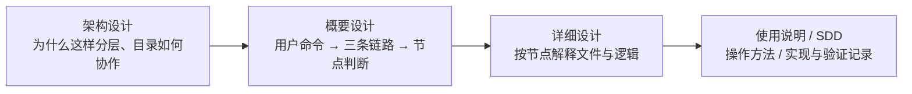

# AIoTBot 设计与使用入口

| 文件 / 目录 | 阅读目的 |
|---|---|
| [AIoTBot知识库架构设计.md](AIoTBot知识库架构设计.md) | 目录架构、分层职责与生产、治理、消费三条链路 |
| [知识库详细设计.md](知识库详细设计.md) | 第 1 节说明前置发现和命令；第 2.1 节画完整 ingest P1—P7，第 3.1 节展开 lint 检查，第 3.2 节说明固定 CI，第 4 节说明查询；第 5 节起按节点解释文件设计 |
| [使用说明.md](使用说明.md) | Windows／Linux 运行依赖准备，以及部署后的入库、查询、检查、增量更新与续办命令 |
| [AGENTS.md](AGENTS.md) | Agent 阅读入口和文档修改边界 |
| [task.md](task.md) 与 [sdd/](sdd/knowledge-v3/README.md) | 实现任务、需求、测试计划、发布与实际验收记录 |

文档用 `repo/` 表示项目根目录的示意名称。业务代码工作区、`AGENTS.md`、`config.yml`、`skills/` 与 `workflows/` 位于该根目录；WiFi 原件、知识和治理位于 `aiotbot-knowledge-wifi-mp/`。能力目录分别为项目根的 `skills/common/knowledge/` 和 `workflows/common/knowledge/`，不包含嵌套 `.git`。业务代码可包含多个实际代码仓或模块目录。本目录只存系统说明与开发工件，正式领域知识只进入 `../knowledge/`。

当前安装器和命令入口将知识库与代码放在同一业务工作区。独立存放知识库需要另行完成宿主部署适配，默认入口不读取 `config.env`。知识库按模块相对路径读取已落地文件，见[工作区路径与部署边界](知识库详细设计.md#7-工作区路径与部署边界)。

`config.yml` 维护代码根和模块相对路径，以及芯片、Host／Device、特性和用途；共享模块可关联多芯片、多端。无需逐项填写六 Target、三 pair 或重复代码根授权，取证按路径读取实际文件并固定内容指纹。配置填法见[使用说明](使用说明.md#配置项目代码架构)，实现与验证边界见[多仓工作区映射](sdd/knowledge-v3/workspace-mapping.md)。

设计文档描述职责、流程与边界，能力安装、实际宿主、六 Target、CI 合入和权限验证以 SDD 记录为准。历史工件保留其原始版本身份，不据此推断当前部署状态。

详设中的 `knowledge ...` 是统一入口名称。部署完成后，按[使用说明](使用说明.md)向 Agent 点名调用 Workflow 或 Skill；底层接口参数见相应能力的 `SKILL.md` 与 `references/`。

`knowledge ingest` 默认扫描五类允许 raw 并选择新增、变化及待处理来源；`--source` 仅为限制本次范围的可选参数，首次导入和日常增量使用相同入口。

日常入口 `ingest` 用一条工作流完成扫描、写稿、独立内容复核和适用代码核验、调用 lint、登记处理记录和本地入库，`query` 消费正式知识。`hs-knowledge-lint` 是可复用的只读检查 Skill，既供 ingest 调用，也可手动或定期检查；发现问题由 ingest 返回对应节点修订，暂停后按原操作续办。

文档与代码内容均由独立 Agent 在不同于作者的上下文中阅读原件／源码及稿件，代码结论另记录逐 Claim 理由；脚本校验记录、引用和确切内容绑定，不要求复核者公钥或密码学签名。lint 与 CI 继续只检查确定性项。

用户可在执行中要求退回，也可在入库后要求修改已有卡；原件未变的明确修订仍走新操作，重新完成复核、检查与入库。

本地入库、完整索引验证、本批目标查询通过，且该代次成功激活后 ingest 结束；之后由人提交并触发固定 CI，复用 lint 的格式、导航、引用和索引检查脚本，通过后人工合入；见[上库流程](知识库详细设计.md#32-上库固定-ci-检查后合入)。

`hs-workspace-explore` 是业务命令之前的保底发现能力：Agent 未加载项目约定，或独立 Workflow 节点尚不知道仓内知识库、代码图谱和入口时才补齐信息；已有上下文直接复用，不属于生产 P1 或各命令必调节点。
