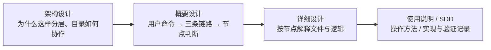

# AIoTBot 设计与使用入口

| 文件 / 目录 | 阅读目的 |
|---|---|
| [AIoTBot知识库架构设计.md](AIoTBot知识库架构设计.md) | 目录架构、分层职责与生产、治理、消费三条链路 |
| [知识库详细设计.md](知识库详细设计.md) | 第 1 节说明前置发现和命令；第 2.1 节画完整 ingest P1—P7，第 3.1 节展开 lint 检查，第 3.2 节说明固定 CI，第 4 节说明查询；第 5 节起按节点解释文件设计 |
| [使用说明.md](使用说明.md) | 日常生产治理、查询与维护；另列开发者 CLI 环境准备、能力接入及排错 |
| [AGENTS.md](AGENTS.md) | Agent 阅读入口和文档修改边界 |
| [task.md](task.md) 与 [sdd/](sdd/knowledge-v3/README.md) | 实现任务、需求、测试计划、发布与实际验收记录 |

业务代码工作区和配置位于 FactumCore 根；WiFi 知识、节点 Skill 与 Workflow 位于 `aiotbot-knowledge-wifi-mp/`。能力目录分别为 `skills/common/knowledge/` 和 `workflows/common/knowledge/`，不包含嵌套 `.git`。本目录只存系统说明与开发工件，正式领域知识只进入 `../knowledge/`。

部署首选在业务 repo 工作区根目录随代码共同拉取；受限环境可仓外手动拉取，以本地 `config.env` 的 `project_root` 指定业务代码根。项目 manifest 视图由各项目适配，见[部署与视图配置](知识库详细设计.md#7-部署方式与manifest视图配置)。

设计文档描述职责、流程与边界，能力安装、实际宿主、六 Target、CI 合入和权限验证以 SDD 记录为准。历史工件保留其原始版本身份，不据此推断当前部署状态。

详设中的 `knowledge ...` 是统一入口的接口建议，须由宿主适配注册。实际安装、Workflow 和节点 CLI 的调用方式以[使用说明](使用说明.md)为准，不能直接把建议命令当作已有终端程序。

`knowledge ingest` 默认扫描五类允许 raw 并选择新增、变化及待处理来源；`--source` 仅为限制本次范围的可选参数，首次导入和日常增量使用相同入口。

日常入口 `ingest` 用一条工作流完成扫描、写稿及必要确认／代码核验、调用 lint、登记处理记录和本地入库，`query` 消费正式知识。`hs-knowledge-lint` 设计为可复用的只读检查 Skill，既供 ingest 调用，也可手动或定期检查；发现问题由 ingest 返回对应节点修订，暂停后按原操作续办。

本地入库后提交变更，由固定 CI 脚本复用格式、导航、引用和索引构建检查，通过后合入；见[上库流程](知识库详细设计.md#32-上库固定-ci-检查后合入)。

`hs-workspace-explore` 是业务命令之前的保底发现能力：Agent 未加载项目约定，或独立 Workflow 节点尚不知道仓内知识库、代码图谱和入口时才补齐信息；已有上下文直接复用，不属于生产 P1 或各命令必调节点。
