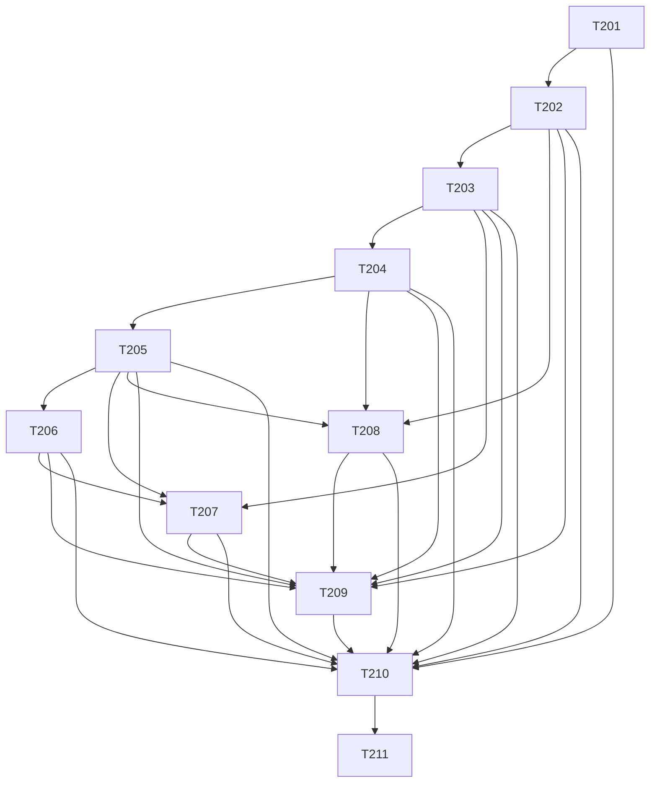

# 节点能力设计与依赖

设计真源：[详设v4](../../知识库详细设计.md)。K保存知识/规则/运行状态，W根skills/和workflows/保存节点包与编排；节点间只用固定包摘要的公开JSON CLI。所有领域字段/范围/来源/记录规则由K/governance/contracts单点解释，不复制到节点。

18Skill在[节点映射](traceability.json)逐项绑定T201–T211；两个Workflow ID为hs-knowledge-ingest/hs-knowledge-lint，不注册同名聚合Skill。每包有SKILL.md、scripts/cli.py、scripts/support.py、本包业务模块、tests/test*.py、requirements.lock.txt、requirements-dev.lock.txt及artifacts/result.yaml/templates/result.md/writing-guide.md/review-guide.md；实际逐文件职责与路径见详设和files追踪。跨节点只调用受信公开CLI，不恢复_shared。

公开请求--input/--output，领域动作显式--knowledge-root/--rules-digest，可选可信--catalog/--action。对象用产品2.0和特定record_kind，摘要排除自身digest；ResultEnvelope包含status/phase/真实工具与规则身份。0仅已处理、2非法输入、3前提阻断。

纯文档：capture→plan→materialize→handoff→inspect→prepare→真实user Gate→record→apply→index build/verify→regression/activate。无可信真人事件/陈旧视图/部分接受不落位；文档不调用代码门禁。代码：同一精确视图→local-check→apply；上库由merge-check按最新允许代码只读复验，实际committer合入后才可shared。

单一引擎owner：apply含事务/恢复，recover通过公开recovery action；local-check含检查引擎，merge-check通过公开merge action；index-build含建库/验证/激活，regression复用query和index-build；maintain含事件/阻断/水位，capture只调用幂等阻断子接口。不得跨Skill私有导入或复制引擎。

安全与恢复：所有path ref在K内安全子树，代码源依真实配置只读；操作临时区为.build/operations/O，持久journal/备份/人确认在logs，派生索引/正文/receipt在artifacts。Writer锁与全写集CAS保护合作程序，无法宣称阻止同用户任意进程。索引按同代正文读取，当前权限/阻断代际外持续生效；原子切active不等于跨文件原子提交。

当前票据均pending，历史v1不提供新路径已完成证明；真实宿主、实际人动作、六Target工程、CI合入/共享与权限负测统一在T211分别验收。节点包与领域集成发布身份分别记录，当前Git远端为Robin-hhc/FactumCore，不另建能力远端。
