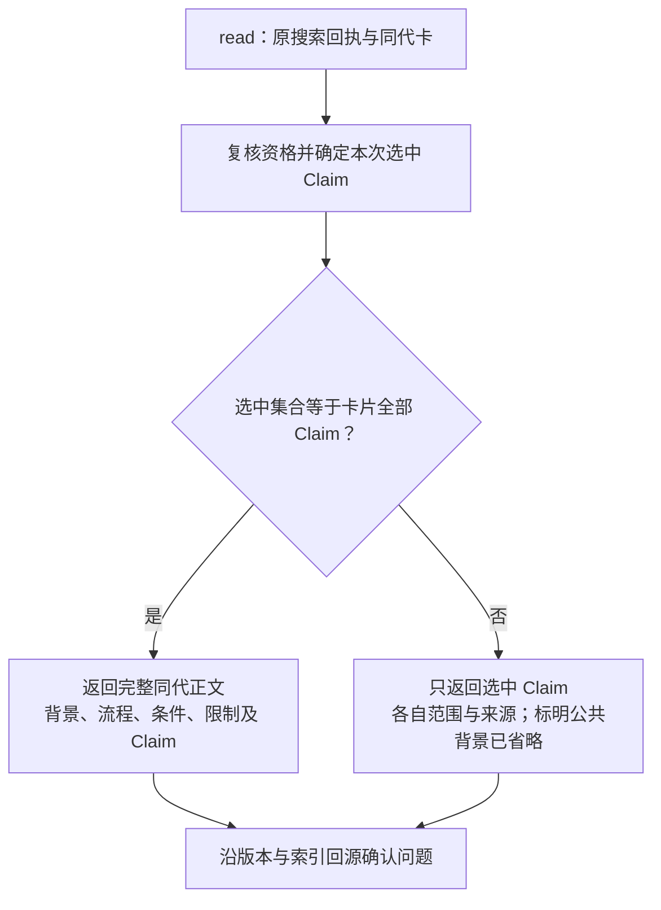
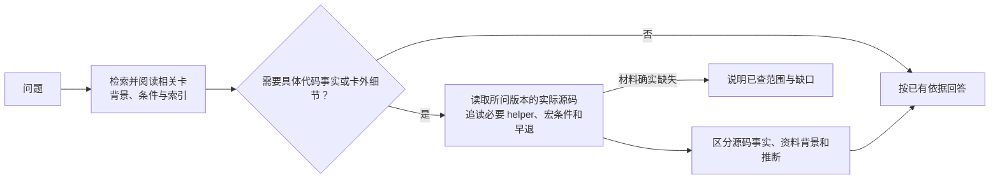
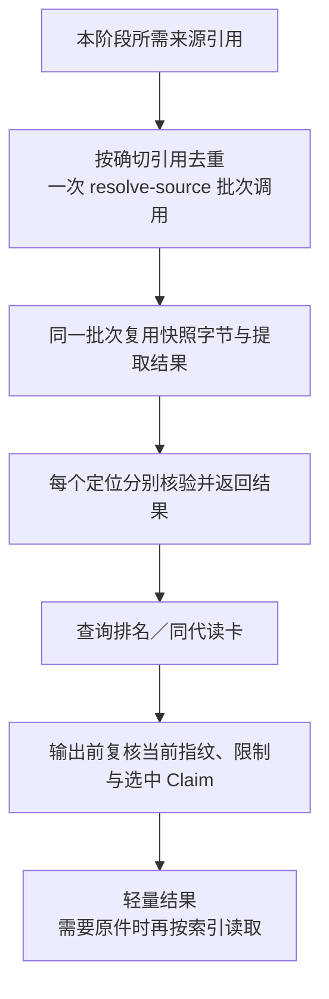

# 背景知识与代码定位：查询调整设计

状态：待确认。依据用户对卡片用途和初期验收重点的说明，承接[扩展试验](expanded-corpus-trial.md)。实现基线为 `3d853a9`，文档基线为 `cc5dd95`。本页给出接口与详细设计同步方案；查询正文、批次恢复和返回精简尚未实施。

## 1. 目标与范围

1. 作为查询 Agent，我需要卡片提供机制背景、适用条件和具体索引，以便找到并理解相关原件或代码。
2. 作为代码问题的处理 Agent，我需要沿索引读取所问版本的实际源码，以便确认细节及条件，而不要求卡片预先写全答案。
3. 作为知识库维护者，我需要查询、增量插入和治理继续完整运行，以便优先保证内容和定位准确。
4. 作为调用方，我需要复用已经核验的来源并按需取原件，以便避免重复恢复和大体积返回。

沿用 ingest P1—P7、独立 lint、人工提交／CI／合入。P5 验候选、P7 验实际落盘和索引，职责各自保留。此次不调整排序算法，不增加卡片粒度要求、检索引擎、用户命令或跨请求缓存。

卡片是否独立答全不作为验收指标；先验证背景与索引正确、回源可用、答案与实际证据一致。旧报告中的 5 秒／32 KiB 是当时建议，本次不采用这组硬指标。

## 2. 读卡补齐背景与边界

| 返回内容 | 最小调整 |
|---|---|
| 原有 `claims / sources / gaps` | 保留；Claim 增加实际 `scope` 和明确的 `source_refs` 关联 |
| `body_mode` | `full` 或 `claims_only`；由最终选中集合决定，不由调用者绕过资格检查 |
| `body / body_digest` | 仅 `full` 返回；从已验证索引代的不可变卡字节解析，保留原正文，不重新拼写摘要 |
| `background_omitted` | 子集或部分资格读取时记 `partial_claim_selection`，供 Agent 识别背景缺口 |
| 身份绑定 | 沿用 generation、card_digest 和原搜索回执；新增字段也进入实际结果摘要 |

所有 Claim 都合格，但原回执或本次带回执请求只选择一部分时，仍按 `claims_only` 返回。不得从当前 `knowledge/` 同名文件补旧代正文；部分读取不返回整卡公共章节，也不返回其他 Claim 的来源。

复用 `contracts/knowledge.py` 的现有解析结果及索引保存的卡字节；不增加卡片 Schema、SQLite 表或段落权限映射。

## 3. Agent 按背景与索引继续读代码

查询 Skill 负责候选、资格、同代读取与索引；主 Agent 负责选择证据并形成答案。纯定位问题仍可直接检索源码；只有需要背景时才查卡，不把每个代码问题强制变成固定串行步骤。

- `guidance` 用于背景资料，`historical` 用于指定历史版本；当前实现问题还须核对实际代码和条件。背景读取不赋予历史结论当前实现资格。
- 卡没有展开细节时，沿函数、状态、消息和来源定位继续查；多流程问题读取相关的多个命中，不只依赖首位。
- 老快照和当前代码不同则区分版本。实际材料不足才报告缺口，不为回答问题自动触发 ingest。

小改可先实施：在 `hs-knowledge-query/SKILL.md` 补足上述消费职责，并在现有 writing-guide 中明确回答应保留来源版本、限制及回源依据。此改动不声称当前 `read` 已返回完整正文。

## 4. 来源批次恢复与轻量返回

| 层次 | 设计 |
|---|---|
| 来源公开能力 | 扩展现有 `resolve-source`，允许 `source_refs` 批次；单项 `source_ref` 请求及返回形状保持兼容，两种输入互斥 |
| 返回体积 | 增加可选 `include_bytes`，缺省 `true` 保持直接来源调用兼容；query／maintain 内部传 `false`，省略整文件 `bytes_b64` |
| 批次结果 | 保留每项原始 `source_ref`（含 evidence_ref／locator）与成功或诊断的映射；单个坏定位只限制相关 Claim，不让一条来源失败吞掉整批其他合法结果；规则或授权根等共同前提失败则整批未完成 |
| 查询输出 | search 保留卡身份、摘要、合格 Claim、来源版本、路径、hash、定位和限制；read 再提供所选正文及对应定位片段；不逐定位内联整份原件 |
| 按需原件 | 继续使用已有 `resolve-source` 取得确切原件；代码细节可由 Agent 在授权代码根按实际路径读取，不增加用户命令 |
| 复用范围 | 限同次操作、同一检查阶段；在来源 CLI 内按授权根、规则、来源锁身份、快照及提取器／定位映射指纹复用不可变字节和提取结果，每个定位独立检查 |
| 输出前复核 | 核对当前代码、配置、来源及有效性状态；条件变化则重算或拒绝，不把最初资格缓存当最终结论；不要求跨阶段共享进程内缓存 |

query 的资格阶段与输出前复核各自批量调用；先减少同阶段的重复恢复，不取消最后一次变化检测。maintain 的 `inspect-context` 复用相同批次入口，并按真实身份合并重复代码核验。能力调用仍通过受信公开入口，规则继续由 governance 提供。

## 5. 主详细设计待同步范围

以下为建议替换要点；主[详细设计](../../知识库详细设计.md)尚未修改，原 SHA-256 为 `f0a245aadfce77e2a97c1cf3e0f006370a6057620230c58ac5ec65967c3b2134`。

| 位置 | 拟同步内容 |
|---|---|
| §4.1 图与 Q4／Q5 说明 | 保留现有路由，补出“卡片背景与索引 → 所问版本源码确认 → 回答”的衔接，避免把卡查询和代码读取画成只能二选一 |
| §5.9 节点详细设计 | 说明完整／部分读卡、轻量搜索与定位片段、按需原件、Agent 回源职责；用流程图表达，不在正文堆接口字段 |
| §5.10 有效性比较 | 补一句：同次同阶段可复用确切不可变对象，当前代码／配置和限制变化仍须在输出前核对 |
| §6.2 共享函数分工 | 明确同代正文复用现有解析；批次来源恢复与逐定位核验共用来源能力，不在 query／maintain 复制算法 |

§2.1 ingest 主图、§3 lint／人工 CI、§5.1—5.8 生产节点职责均无需改动。批次接口字段和兼容策略记在本页及相应公开 API，不扩写人读设计。确认后同步使用说明，保留历史证据和冻结设计原字节。

## 6. 实施与验证

实施顺序：Skill 指引小改 → 确认上述同步范围 → 补真实公开接口失败用例 → 读卡返回 → 来源轻量／批次复用 → 相关回归与真实回源样例。安装器按实际能力字节生成新摘要，运行目录需正常重新安装，不改旧 catalog 冒充同一能力。

| 验证 | 必须观察到的行为 |
|---|---|
| 完整与部分读取 | 完整读取含背景／条件／限制；带回执请求的子集、回执子集或部分资格时不泄漏其他正文及来源 |
| 同代与变化 | 切换 active 后仍读原搜索代；卡字节篡改、规则／配置／代码或阻断状态变化仍按原合同限制或拒绝 |
| 单项与批次 | 相同引用结果一致；重复快照只在同批恢复一次，各定位仍独立验证；一个坏定位不放行相关 Claim，也不误伤合法项 |
| 轻量输出 | 查询结果无逐定位整文件 base64，保留来源版本／hash／定位；显式来源读取仍能取回确切原字节 |
| Agent 回源 | 认证 seq2、A-MSDU 封装、跨 RX/TX 等卡外问题能沿索引找到真实证据；包含真实材料不足样例，不能靠背景编造实现 |
| 链路回归 | 沿用公开 CLI 的资格、同代读取、来源变化拒绝、增量入库与治理用例；P5、P7 和纯文档真人确认边界不变 |

记录实际调用数、返回体积和耗时，与原试验条件分开报告；不以卡内答全率、首位必命中或固定秒数／字节数作为初期门槛。宿主自动触发、真人确认与人工上库仍按各自实际证据说明。

本次已落实查询 Skill 的回源指引与写作指南小改。已通过 Skill 校验、新目录安装（20 个 Skill／1 个 Workflow，查询包摘要一致）、19 处本地链接检查和 3 张新 Mermaid 图的解析／渲染检查。两项独立设计复核通过；主详细设计及原扩展试验报告逐字节未变。尚未修改查询程序或规则，因此本次未重跑机制全回归，也未将设计检查算作上述 API 的运行验收。
