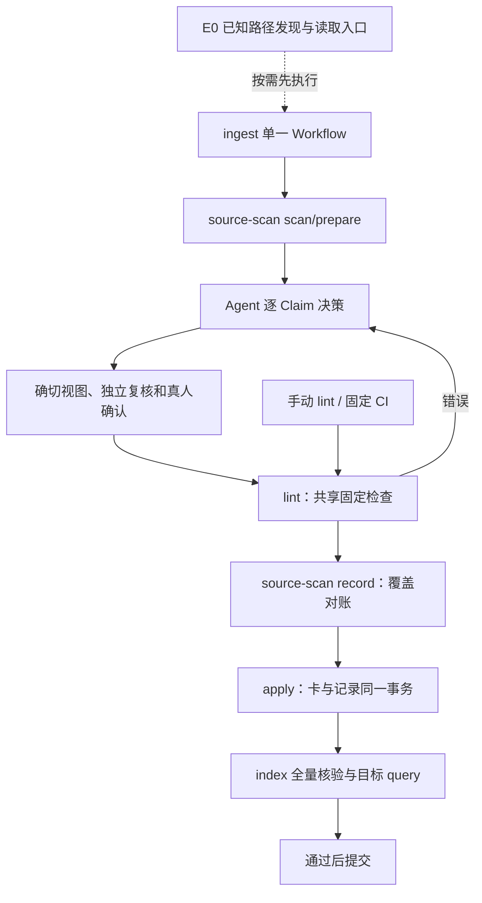

# 实现对齐设计

本文件说明批准设计到代码接口的落点，不替代批准文档。

| 模块 | 接口与职责 |
|---|---|
| `source-scan` | 公开 scan/prepare/record；scan 固定范围和清单，prepare 提供 reading candidates 和逐卡旧版本，record 调共用契约生成共享事实 |
| `change-plan` | 校验 Agent 提交的逐 Claim 判断、单写者计划与目标查询，不用脚本猜语义；旧传输协议兼容，新工作流要求新字段 |
| `contracts.records` | 固定 scan/ingest 形状、覆盖、版本/进度、关联、复核抽样及真实 apply 补记校验；不把摘要当第二份卡来源真相 |
| `contracts.checks` | `run(view, rules, inputs, scope)` 返回 CheckReport；输入为正式库或合成全视图，纯读，不修复/确认/apply |
| `contracts.indexing` | `build_database(cards, rules_digest, path)`、`verify_database(cards, rules_digest, path)`；重算完整表集合与值，供正式构建和临时验核共用 |
| `lint` | 公开适配器，报告 complete/status/作用范围/逐检查 findings；退出 0 完整无阻断、1 阻断、2 未完成。旧节点传输 0/2/3 保持分层 |
| `apply/recover` | 保留 CAS、writer lock、备份和 journal；额外记录集合有明确允许前缀与验证；记录补记不改变已确认的卡/nav/lock 字节 |
| `publish-handoff` | 验证真实 apply 和收尾证据，索引/目标查询缺失禁止提交；只记录重试停点，不重复旧 apply |
| `check.py` | 受保护规则与 runner 在候选根外；候选仅为数据，显式原件/代码/config 输入，复用 checks/indexing，不调用旧 merge Skill |

新纯模块同步加入摘要锁和可信 loader；保持确切规则身份。正式索引继续保留来源、资格、同代正文与 active CAS，临时检查索引不切换活动代。真实业务、宿主、签名主体和远端 CI 输入缺失保持未完成，不用本机 fixture 填充。

M-only 修订不伪造 raw：当原件清单为空但当前代码/配置限制了已有 Claim 时，P3 从固定 `scan.current_context.affected_claims` 引用独立维护单元，仍需逐 Claim 裁决、确切稿件与适用核验和目标查询。P2 可组合公开代码捕获产生的新版本材料；P6 对实际 raw 清单逐项对账，同时保存维护计划与实际应用摘要。

同一 Skill 在不同节点复用时，产物合同按上游原生 `applies_to.node_ids` 限定节点及其成功出口，避免把扫描/材料/记录等不同动作的所有出口强加给每个节点。使用真实固定 OpenFlow loader 验证，不修改或模拟上游规则。

跨机的待复核限制由正式处理记录重建：明确的 Card/Claim pending、维护 defer/失败等负事实保留到同 Claim 的后继复核；不把整个原件 partial 进度等同于已审核 Claim 失效。query 在当前用途过滤这些限制，背景/历史读取提示问题，并观察处理记录摘要防止一次查询混用前后状态。它不要求复制旧机器 events，也不增加本轮暂缓的索引时效检测。
