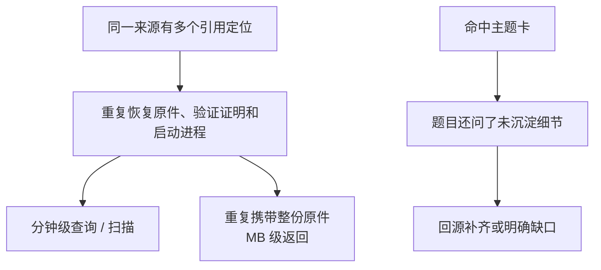
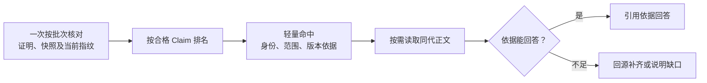

# 扩展真实语料验证与调整方案

实现基线已先提交并推送为 [`3d853a9`](https://github.com/Robin-hhc/FactumCore/commit/3d853a91e98378187374f0ac521ec5d7ba2f3718)。以下试验使用这份实现，未修改主详细设计、Skill 程序、Workflow 或规则包；本页的调整尚未实施。原有完整机制回归为 379 通过、1 跳过，不能替代下面的真实语料结果。

## 1. 样本与验证层次

真实代码固定为 `E:\Hi1105\wifi` 的 `ef69ead1d69e9d56a4a925c3aec065f4e54961be`。592 份文件、15,028,757 字节在原仓、`main/` 导出与隔离代码副本之间逐字节核对。协议使用已落地的 RFC 1042、8325、5416 原字节，不将其扩展为完整 802.11 规范或本仓产品实现。

| 样本 | 卡片主题 | 最终状态 |
|---|---|---|
| 10 张历史源码卡、31 条 Claim | 普通扫描、PNO、Join、认证、关联、ADDBA、DELBA、接收重组、发送 A-MSDU、发送 QoS | 独立复核、lint、记录、实际入库、索引激活与本批目标查询全部完成 |
| 4 张协议卡、12 条 Claim | LLC/SNAP、DSCP→UP、UP→AC、Split/Local MAC | 内容复核与预检通过，实际到达 `manual_ready`；缺真人事件时 `awaiting`，未正式入库 |

选择 14 张是为了覆盖 10 个业务流程，并形成普通/PNO、认证/关联、BA 建立/拆除、RX 重组/TX 聚合、代码 QoS/协议建议等相近主题竞争。它足以暴露本轮问题，不是统计意义上的完整语料规模。详见[卡片清单](records/expanded-corpus-20261026/card-manifest.json)。

| 验证层 | 范围与结果 | 能证明什么 |
|---|---|---|
| 实际公开节点 | 10 卡本地入库；10 道本批目标查询及同代读取通过 | 本批代码内容分支实际完成 |
| 实际公开 `search/read` | 32 道冻结问题，26 次正文读取 | 正式卡的资格、召回与读取；不是最终回答准确率 |
| 候选临时索引 | 14 卡、44 道冻结问题 | 词面排序组件；文档、混合题没有正式准入成绩 |
| 正文覆盖审计 | 38 道正向题与 6 道拒绝/限缩题 | 卡片本身是否写出了所问细节 |
| 证据限定回答 | 14 个实际检索样本，独立回源审核 | 该小样回答的依据、引用与范围 |
| 生命周期探针 | 20 个唯一用例最终到达固定目标；13 个真实基线副本、7 个合成治理 fixture | 增量、记录、拒绝及已提交记录事务的 recover inspect；不证明 WiFi 语义 |

44 道新题由未读候选、旧题答案或检索结果的 Agent 根据原件预先冻结，SHA 为 `c14dff76cbacd88e2ae96f9d47838372b559cb47aedee7d4b0c16143fcea95b2`。完整题目与预期[原字节保留](records/expanded-corpus-20261026/queries-frozen.json)，没有按结果修改。

## 2. 实际结果

### 2.1 能找到卡，也暴露了排序与覆盖差别

| 指标 | 实际结果 |
|---|---|
| 正式代码题首位至少命中一张所需卡 | 23 / 26 |
| 正式代码题前 3 名包含全部所需卡 | 25 / 26 |
| 正式代码题前 5 名包含全部所需卡 | 26 / 26 |
| 命中后的同代、同指纹正文读取 | 26 / 26 |
| 负向题满足预设空召回 | 4 / 6 |
| 仅靠卡片正文即可完整回答的正向题 | 17 / 38 |
| 14 个回答小样 | 6 完整、5 部分、3 拒答；均有输入依据、源码一致、引用合法，未发现无依据事实断言 |

三个首位偏差涉及 PNO 函数名、认证超时宏、英文重组问句。组合题 C25 的 RX 重组卡排第 5，前 3 名不足以凑齐两条流程。精确符号和英文问法仍会被通用词重合压过。

N05（未覆盖的 MLO/EMLSR）与 N06（要求仅靠 DSCP/UP 保证端到端时延）仍返回近邻，**强空召回断言的两项失败保留**，正式查询断言结果为 30/32。回答 Agent 对两题均拒绝无依据推断。因此“返回弱相关候选”和“最终编造答案”应分别评价，不能合成一个通过率。

正文覆盖审计中，21 道正向题仍需回源；5 题所问细节基本没有写入卡，包括 Join 内部参数、认证 seq2 接收、A-MSDU 封装、Add WLAN 配置字段。多数超出了现有卡明确声明的范围，主题命中不能代表细节已经沉淀。[公开结果](records/expanded-corpus-20261026/public-metrics.json)、[正文覆盖](records/expanded-corpus-20261026/answer-coverage.json)、[回答审核](records/expanded-corpus-20261026/answer-audit-summary.json)分别保留。

回答样本使用真实 `search` 命中及同代冻结 Claim，并保留实际来源版本元数据；不是自动宿主 Q5 调用。公开 `read` 另行实际执行。14 题是小样，不是全系统准确率。

### 2.2 性能问题在数据库之外

| 测量 | 实际数据 | 范围 |
|---|---|---|
| 32 次公开搜索 | 中位 172.992 秒，最长 191.610 秒 | 3 个查询 worker，部分期间同时有 2 个探针 worker |
| 搜索输出 | 中位 3,053,481 字节，最大 4,331,651 字节 | 包含重复原件字节 |
| 26 次公开读取 | 中位 27.406 秒，最长 47.391 秒 | 与上述查询同一试验 |
| P7 本批 10 组目标搜索/读取 | 486.657 秒 | 本地入库收尾，不含 Git/CI |
| 随后的实际 P1 扫描 | 67.250 秒 | 仅 31 条历史 Claim，源码未变化 |
| 1/5/10 卡数据库组件 | 构建及全验约 51/57/70 毫秒；热词项查找中位约 0.017/0.019/0.022 毫秒 | 仅 SQLite 组件，省略资格、来源、子进程等，不是完整查询耗时 |

调用记录证实，同一来源按多个定位重复恢复，search/read 的首次资格检查、输出前复核与刷新又重复这些动作；每次跨 Skill 调用启动进程并核对能力包/规则。P1 的上下文检查也重复核对已有 Claim 的证明。本轮没有分段 CPU 计时，不将所有秒数武断归到某个函数。[调用放大记录](records/expanded-corpus-20261026/call-amplification.json)、[数据库单独测量](records/expanded-corpus-20261026/database-component-performance.json)与完整节点耗时分开保存。

### 2.3 内容复核和治理分支确实起作用

独立源码复核退回 5 条结论：扫描完成的 HMAC VAP 缺失早退、BA 计数为零时的早退，以及把“调用接收句柄复位函数”写成“复位已经完成”。修订后 31 条 Claim、59 处来源引用重新核对并绑定最终视图。首稿保留，代码复核没有要求公钥或签名。

协议原件中，RFC8325 的 Broadcast Video 正文和汇总表存在 CS4/CS3 差异，卡片保留疑点并明确引用 §4.3 表。RFC TXT 的换页符还会造成 `rg` 与 `splitlines()` 行号不同；卡片按实际 capture 映射核对，题目元数据中的定位偏移另行披露，不静默改题。

20 个治理/增量目标覆盖新增、变化、缺失、窄范围、partial 续办、无复核 skip 拒绝、P5 后改稿、格式/导航/定位/hash 拒绝、损坏索引重建、来源谱系、merge/split/deprecate、缺真人确认及已提交记录事务的 recover inspect。本批没有实跑中断 resume/rollback。首轮为 10 pass、9 fail、1 blocked；后续修正测试请求装配后，共 32 次尝试达到 20 个固定目标，重试不计作新用例。操作 ID、旧卡对象输入、必填关系字段等装配错误及原结果均[原样保留](records/expanded-corpus-20261026/lifecycle-summary.json)，未归成产品故障。

## 3. 调整设计

现有 ingest P1—P7、独立 lint Skill、query 入口及人工提交/CI/合入边界保持。调整集中在节点内部，先处理机械开销，再处理排序和内容覆盖。

| 顺序 | 调整 | 逻辑与落点 |
|---|---|---|
| 1 | 批次核对证明和来源 | 在 maintain/query/index-build 内按唯一证明、快照及定位分组；一次调用处理一批引用。同一操作复用已核对的不可变对象，输出前仍重核实际配置、代码指纹及有效性状态。共享固定规则继续在 `governance/contracts/`，跨节点能力通过公开批次入口复用 |
| 1 | 先做静态资格过滤 | 已能从冻结元数据判定 usage、状态或范围不适用时，先排除相应 Claim，再进行重证明/来源核对；仍对实际参与排名的 Claim 完整核验，保持合法全局 topK 语义 |
| 1 | 搜索/读取返回轻量数据 | 搜索返回卡/Claim 身份、摘要、范围、资格与来源引用；读取返回同代 Claim 正文和必要的 commit/hash/locator。整份原件字节改为显式按需取得，不在每个定位重复内联。精简输出必须保留版本依据；不能只剩无来源的 Claim 文本 |
| 2 | 改进精确符号和跨流程排序 | 提升函数名/宏名精确匹配的作用，降低通用词重复的影响，补正常中英文别名。Q1 对多流程问题拆分检索，Q5 按依据合并；无法支持目标协议或性能保证时明确限缩，不把 lint/CI 改成语义判断器 |
| 2 | 对齐卡片范围与代表问题 | P3 除了列预期卡，还要指出哪些 Claim 能回答哪些子问；独立复核检查调用与效果的区别，并追读必要 helper。未沉淀细节走 Q1/Q4 回源。下一批可补 Join 执行、认证帧接收、A-MSDU 封装、WLAN 配置等明确缺口，保持卡片粒度清楚 |
| 3 | 由 P2 输出机械装配结果 | 现行 Skill 允许 Agent/宿主另行装配完整代码 context，本次没有遗漏其他公开 producer。可在既有 `prepare` 内聚合真实配置、仓库身份和捕获文件指纹，返回新的 `context_ref`；E0 继续只做命令前发现。同步提供实际 locator、适用复核单元和历史正文对象输入，调用方直接传递前节点产物 |

完整代码 context 当前确实由外部装配，属于现行约定，并非本次发现的规格违约；[产出责任核对](records/expanded-corpus-20261026/context-producer-audit.json)给出具体文件位置。旧卡历史对象目前也有明确的 `historical_card_objects` 输入合同；应让 P2/P4 的真实旧正文与 lint 输入衔接，减少手填 SHA 映射。固定 CI 继续复用同一历史正文解析和检查函数，不增加另一套检查算法或业务编译任务。

缓存只能在明确的操作、规则、授权根和源版本内复用，键须区分 extractor/locator 身份；当前字节、配置、权限或规则变化后重新核对。保留原来的来源变更、P5 后改稿、hash/定位、未知 Target 和真实确认拒绝用例，不能以缓存或精简输出绕过。

建议先验收第 1 组：同机 10 卡场景的 P1/单次查询以 5 秒内、搜索响应以 32 KiB 内为优化目标，随后与本页基线做同条件对照；这是目标，尚未达到。先验证结果集合、同代读取和变化拒绝行为不变，再做第 2 组排序/回源调整，并增加未参与本次选题的新题，避免只针对这 44 题调分。

## 4. 留存与边界

- [证据清单与 SHA](records/expanded-corpus-20261026/manifest.json)包含冻结题、实际查询、独立复核、回答审核、20 个机制用例及原字节保护结论。
- 本机完整调用与卡片在 `.scratch/ex26/`。10 张正式代码卡位于试验根的 `knowledge/concepts/flows/`；4 张协议最终候选位于 `.build/operations/ex26-doc-candidates-r2/final-view/knowledge/concepts/protocols/`。它们没有直接填入项目正式知识根。
- 纯文档实际完成 `confirmation-prepare: awaiting_human`，随后未提供真人事件时 `confirmation-record: awaiting`。候选中拟写的 stable 不等于已入库，代码卡、活动索引和原件没有被该分支修改。
- 首轮测试装配失败、候选修订、初始 Claim-only 回答小样及最终保留来源元数据的回答小样分开留存，不改旧记录。没有把本机 catalog、配置、原件字节、索引或原始 base64 输出提交为证据。

这些结果仅覆盖固定历史源码、三份 RFC 和所列测试。未知产品 Target、宏组合、业务编译、设备执行、宿主自动 Workflow 触发、远端 CI 部署与权限隔离仍各自按实际证据判断。当前实现和[主详细设计](../../知识库详细设计.md)保持已确认版本；本页是下一步调整依据。
