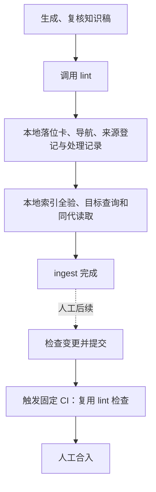

# 本地 ingest 与人工上库的边界

依据：用户明确 ingest 在本地入库和验证后结束；提交、触发固定 CI、合入均属于人工后续操作。主详细设计按这一决定更新，原有上库流程保留。原冻结快照与既有验收记录保留原字节，不将本次结果写回历史成绩。

| 要求 | 实现与验收 |
|---|---|
| 本地完成不要求 Git 提交 | 内容批完成本地事务、索引与目标查询即结束；仅记录批完成记录事务即结束。提交验证保留为独立工具 |
| 源码核对不统一要求编译产物 | 有实际 Target 的静态源码结论可以仅做源码语义复核；无 Target 的历史／指导性结论只能保留 unknown 范围，不推断产品适用 |
| 断言要求与证明相符 | 声称编译或运行效果的断言必须提供对应真实证据；已有构建证据必须核验且变化后失效。独立复核、签名、确切视图和源文件身份继续绑定 |
| 查询与维护沿用同一身份规则 | 本地通过的源码分析不能随后因共享校验仍统一要求构建产物而失去资格；源码或条件变化仍触发限制 |
| 原件不要求预先提交 | 本地采用的原件必须能从确切、经过 hash 和大小核对的捕获对象恢复；可跨机恢复的来源与提交清单由人工上库准备核实 |
| CI 复用 lint | 保留原有固定入口和共享格式、导航、来源／代码引用与临时索引检查，不新增 CI 能力或独立业务编译任务 |

验证采用公开 CLI 和实际固定 Workflow loader。先保留失败用例，再修改实现；机制测试与真实试验分别记录。未取得真实最终内容确认或受信语义复核时，继续记录实际停点，不伪造接纳结果。

真实旧代码另做一张冻结首稿、四条 Claim、三份 GB18030 源码的回探。新捕获与原 Git blob、`main/` 字节一致，公开材料准备、计划、视图及 lint 通过。代码核验已不再要求未知 Target／编译产物；实际停点为缺少受信逐 Claim 语义复核。试验上下文由 harness 根据真实捕获另行固定，明确不冒充 E0 原产物或真实宿主适配；没有正式入库、活动索引、真人动作或远端构建结果。

最终完整回归 21 组、369 项，**368 通过、1 跳过、0 失败／错误**。跳过项为当前 Windows 账号缺少普通符号链接创建权限，junction 及越界拒绝用例实际通过。固定 OpenFlow loader 实际加载 20 Skills、24 contracts、1 Workflow；Ruff 和 `git diff --check` 通过。

公开用例覆盖未初始化知识仓 Git 的新原件捕获、复核、lint、记录、本地 apply、索引、目标查询及同代 read；缺失、篡改和越界原件仍在写入前拒绝。静态源码历史／指导结论及已知 Target 的 current 结论可不依赖编译产物，编译／运行断言缺证据仍拒绝；已有构建证据变化继续失效。测试中的信任适配均明确隔离，不充当真实内容确认。

文档检查：40 个本地链接及锚点有效，22 个 Mermaid 解析通过，8 张改动图实际渲染通过；2.1 主图布局及箭头保持原样，仅更新 P7 文字。标准轴与规格轴独立复核后无剩余阻断项。原始源码与 `main/` 的 592 个文件、六份冻结首稿、原设计快照及 123 份历史 SDD 文件保持原字节。

首轮因补出“主动提供构建证据时本地／查询条件不一致”的问题中止，第二轮因所选临时根过长，安装 fixture 创建目录触发 Windows `WinError 206`；两轮记录保留。修正逻辑并选用短输出根后重新运行整套 21 组，没有将局部复跑拼成完整成绩。最终原始结果在本机 `.scratch/ib3/`，可分发的[验证汇总](records/local-ingest-boundary-20261026/verification.json)、[完整结果](records/local-ingest-boundary-20261026/full-summary.json)、[真实源码回探](records/local-ingest-boundary-20261026/real-probe.json)分别记录范围与限制。

本次没有提交或推送 Git，没有运行远端 CI、业务编译或人工合入，也没有将真实首稿正式接纳。
