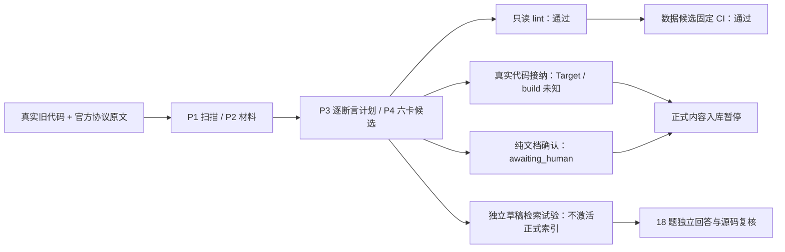

# 真实 WiFi 语料试验（2026-10-25）

真实试跑暴露了合成测试未覆盖的接入和升级问题。草稿能提供有依据的历史代码知识，但首稿的调用链和条件覆盖仍不完整；正式内容入库尚未完成。原有机制验收与本次真实内容效果分开记录。

试验起点为 FactumCore `3c7941a7301e16b4095e1a9c17c7413dee50600a`。冻结详设及其快照、123 份 v1/v2 工件保持原字节；后续实现修复使用新的规则锁和安装目录，不改写历史验收成绩。

最终 21 组完整回归共 353 项：**352 通过、1 跳过、0 失败/错误**。跳过项是当前 Windows 账号无普通符号链接创建权限；junction/越界另有实际用例。Ruff、diff 检查及固定 OpenFlow loader 通过。前一次 323 项完整回归的恢复失败保留原始记录，修复后重新跑完全部组，没有把定向复跑累计成新用例数。

结果与证据入口：[验证汇总](records/real-corpus-20261025/verification.json)、[最终完整结果](records/real-corpus-20261025/final-full-summary.json)、[首轮失败结果](records/real-corpus-20261025/first-full-summary.json)、[本次实现指纹](records/real-corpus-20261025/implementation-after.json)。本次修复尚未创建提交或推送。

| 输入 | 固定身份与实际处理 |
|---|---|
| 真实代码 | `E:\Hi1105\wifi`，Git `ef69ead1d69e9d56a4a925c3aec065f4e54961be`；原仓保持干净，只读 |
| `main/` | 592 份 tracked Git blob 的精确导出，15,028,757 字节；逐文件 SHA-256 核对，没有复制 `.git`、图谱缓存或初始化伪 Git |
| 编码观察 | 115 份可严格 UTF-8 解码；477 份非 UTF-8、可严格 GB18030 解码。原件未转码；实际选用文件显式声明提取编码 |
| 代码边界 | HI1105 Host 与 HI1102 Device；README 明确只补了部分 RX 事件兼容，不能据此证明完整配对、全部 ABI 或六 Target 适用 |
| 协议原件 | 官方 RFC Editor 的三份 TXT，原字节和 SHA-256 留存；落地到隔离 K 的 `docs-raw/protocols/` 后再摄入 |
| 工作需求 | 本次用户要求原样记录到隔离 `docs-raw/storys/`，仅作为任务触发材料，不作为技术事实证据 |

三份协议分别为：[RFC 1042](https://www.rfc-editor.org/rfc/rfc1042.txt) 的 IEEE 802 LLC/SNAP 封装、[RFC 8325](https://www.rfc-editor.org/rfc/rfc8325.txt) 的 Diffserv 与 IEEE 802.11 QoS 映射、[RFC 5416](https://www.rfc-editor.org/rfc/rfc5416.txt) 的 CAPWAP 802.11 绑定。它们没有组成完整 IEEE 802.11 标准，也没有提供完整 ADDBA/DELBA 规范。

`main/` 是无 Git 元数据的导出。试验捕获节点仍核验原只读 Git 仓的原有 commit/blob，以证明与 `main/` 相同的确切字节。没有将导出本身伪装成 Git checkout；直接使用 export 根的持久恢复能力仍有边界。

| 实际执行 | 结果与含义 |
|---|---|
| installer / E0 | 真正安装固定包、加载注册配置；六 Target 的真实映射与构建保持 unknown |
| P1 / P2 | 无 `source` 扫描、原件捕获、13 份实际代码捕获与组合材料准备；确切 Git 恢复、GB18030 正文和行定位成功 |
| P3 / P4 | 公开 CLI 固定逐 Claim 计划，产生六卡、20 Claim 的候选完整视图；未直接写正式卡 |
| P5 | 候选全视图 lint 通过；格式、来源、导航、关系及临时索引可检查，不代表语义完整 |
| 本地固定 CI | 同一真实候选导出为只含数据的根，17 个确切来源对象；正向 exit 0，坏导航 exit 1 / `BROKEN_LINK`，越界引用 exit 1 / `INVALID_SOURCE_LOCATOR` |
| 代码核验 | `incomplete`，实际缺口为 `fixed repositories and a real Target are required`；未造 build、宏、语义签名或芯片映射 |
| 文档确认 | 已生成确切展示，`awaiting_human`；没有拿用户最初的试验要求冒充对最终稿的确认 |
| P6 / P7 | 记录局部覆盖与待办；仅记录批已实际事务落位。内容批未接纳，正式业务卡仍为零 |
| 正式 query | 没有已接纳内容和 active generation，实际拒绝查询；错误诊断仍显露底层缺文件，易用性可继续改善 |

固定 CI 使用 `uncommitted-view:<digest>` 标识候选，没有声称存在真实提交、受保护远端作业或合入结果。历史/指导用途使 current-code 检查不适用，不等于 Target/build 核验通过。

首稿由知识作者独立阅读代码和协议产生，未读取预先固定的评估答案。另一个无会话历史的回答 Agent 只读取每题实际返回的前三张卡及 Claim；最后由独立复核者回到源码和规范核对。没有读取受限 gold，也没有用题目补写首稿的搜索词或内容。

这是首批选用 13 份代码的试验，没有对 592 份文件全量提炼。三份 RFC 均仅使用已列段落，未将整份原件登记为 completed。

| 效果项 | 首轮结果 |
|---|---|
| 草稿 | 6 卡、20 Claim：扫描、BA、RX 跨端边界、QoS、LLC/SNAP、CAPWAP 边界 |
| 可回答主题检索 | 14 题，首位命中 12，前三命中 14 |
| 正例实际回答 | 9 完整、3 部分、2 缺关键材料 |
| 明确拒答 | 4 题全部正确拒绝：六 Target 推广、完整跨代 ABI、宏启用/编译运行等未提供依据 |
| 源码复核 | 核对实际使用的 19 条 Claim、37 个原始引用范围，并继续展开关键 callee；未发现明确虚构事实或严重跨 Target/跨二进制误说 |

这里使用真实生产的共享 SQLite 构建/核验、分词、`score_card` 与按 hash 读取函数做**未接纳草稿的组件试验**。没有伪造 qualification、正式 receipt、stable 或 active 指针。公开 P2 材料绑定后重新运行，六份草稿正文和 18 题检索结果与首轮完全一致。

| 内容缺口 | 具体影响 |
|---|---|
| 扫描从 HMAC 中段开始 | 缺普通 cfg80211/WAL 入口、配置事件注册、调试入口差别；Q01 部分回答 |
| 缺 WAL 启动失败收尾 | Q03、X01 无法回答先启保护 timer 的竞态原因，以及失败后的资源、timer、完成标志清理 |
| DELBA 数字角色未展开 | 能说 recipient/另一方向，却未给出题目所问 initiator 0/1；Q06 部分回答 |
| HE 窗口停在初始选择 | 未继续展开后置 `hmac_btcoex_set_addba_rsp_ba_param` 对窗口位的条件覆盖；Q07 部分回答 |
| 精确符号排序 | X01 首位为 CAPWAP、相关扫描卡第二；X02 首位为扫描、BA 第二。回答者使用实际相关项，没有沿首位误主题编造 |

这组结果说明：主题命中、引用合法和 lint 通过，都不足以证明问题已经回答完整。后续提炼应补齐入口/注册/被调用函数/常量定义，并在 P3 规划真实问题；只调整排序不能补出尚未写进卡里的流程。

工具耗时也有成本：本机这批的 P2 组合材料约 27 秒，计划固定约 42 秒、完整视图约 46 秒、确认展示约 45 秒。这些数来自请求/结果文件时间，且同时运行机制回归，只是本次观测；不作为吞吐或跨机器性能结论。

本次发现的实现问题和修复证据：

| 问题 | 修复原则 |
|---|---|
| 清空 Git 全局配置后，真实仓的所有者白名单丢失；子目录选择又错误放行子目录 | 每次只读命令仅放行已授权的确切仓根，子目录仅作为读取位置；保留 origin/top-level 检查，不写用户全局配置 |
| GBK 旧代码没有可读正文和行定位 | 增加显式 `text_encoding: gb18030`，固定提取器；严格解码、保留原字节、拒绝未知编码/NUL/损坏输入；Git 重建与 lint/CI 使用相同规则 |
| 待处理状态覆盖了真实文件变化，处理进度丢失 | 可比较的新旧字节变化仍输出 changed，同时保留 blocked/partial/pending；不把进度混成文件观测 |
| 升级后旧规则的未完成扫描阻断所有新扫描 | 验证旧清单自身身份与当前五类 raw 边界，只提取待办路径提示；不恢复旧执行、改 hash 或推断已完成 |
| 旧规则终态 journal 阻断新操作 | 候选检查、apply 和索引需按一致原则只读识别无关的已结束操作；旧未完成事务仍要求恢复，新内容仍须自己的确切视图与有效证明 |
| 更长 Windows 路径下恢复委托误判无结果 | 原响应长 262 字符，原生路径检查修复后在最长 269 字符响应上通过完整恢复；真实硬退出、外改保留、恢复及备份原字节断言保留 |

增量扰动只发生在隔离 raw 副本，原协议下载件和原代码不变：改字节、移除文件、新增真实 README 副本均实际触发；限定单文件范围不会推断范围外删除。修复后观测到 `changed + blocked`，删除为 missing，新文件为 new；全部扰动已恢复。

本次运行产物留在本机 `.scratch/wifi-real-trial-20261025/`，不作为正式知识、生产配置或源码提交。可阅读[首稿问答](../../../../.scratch/wifi-real-trial-20261025/preview/first-pass/answers.md)、[独立源码审计](../../../../.scratch/wifi-real-trial-20261025/review/answer-audit.md)、[本地 CI 试验](../../../../.scratch/wifi-real-trial-20261025/ci-trial/README.md)；这些本机链接不随 Git 发布。机器结果与实现指纹见上面的验证记录。

新原件还有一处实际使用障碍：这次新下载的三份 RFC 只有本机原对象，而 P7 当前要求原件已经具有确切 Git 版本。因此，即使补上内容确认，首次落地文档仍会被这一提交前条件拦住；需要确认原件先登记版本还是与知识同批提交的设计次序。未为通过试验而初始化假 Git 或修改接纳条件。

仍需分开解决的使用边界：宿主的统一命令注册与实际 Workflow 运行；真实内容确认/语义复核适配；历史静态源码是否需要区别于当前产品实现的接纳规则；无 Git export 的持久原版恢复。本次升级试验只处理待办提示和旧终态的让路，不代表旧已接纳知识已经完成规则迁移。更深的试验临时根还触发过其他节点的 `mkdir` 路径上限，本次恢复修复只声明实际验证过的范围。

当前不能把这次草稿试验表述为“真实业务全流程已经开箱可用”。
