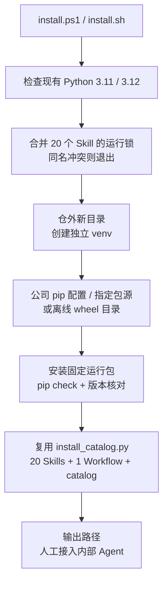

# 运行依赖安装

用户部署环境为 Windows 和 Linux，已有 Python 3.11；只准备包环境，不安装解释器。入口放在项目根，与 AGENTS/config 及配套能力同级。日常命令和 ingest／lint／query 判断保持原设计。

## 文件与行为

| 文件 | 职责 |
|---|---|
| 根 `install.ps1`、`install.sh` | 定位源目录和解释器，保留空格路径，转交参数和退出码 |
| `hs-workspace-explore/scripts/install_environment.py` | 只用标准库启动；合并真实 runtime locks，建 venv、装包、检查并调用现有安装器 |
| 各 Skill `requirements.lock.txt` | 精确运行版本的唯一输入；不另维护一套安装锁 |
| `install_catalog.py` | 原有能力完整性、摘要、独立目录、配置与规则登记；不重复实现 |
| `tests/test_environment.py` | 锁冲突、离线调用、安装失败不发布、旧目录保护及版本检查 |

默认沿用机器的 pip 配置，不写死公网镜像；支持明确指定公司源或 `--wheelhouse` 离线目录，两者互斥。只安装运行锁，不安装 pytest/ruff，不升级系统包或 pip。所有依赖要求有对应 wheel，避免内网临时准备编译器。支持范围以两平台实际验证为准，不把 x64 测试推断为其他 CPU／发行版已验收。

沿用包源、认证和证书设置；安装前拒绝环境或 pip 配置中的 `target`、`prefix`、`root`、`python` 重定向，并使用明确的 venv prefix 和 `--no-user`，防止机器原配置将包写到项目、系统或旧环境。配置输出只在进程内检查键名，不打印可能含认证信息的值。

新环境包含 `venv/`、合并生成的 `requirements.runtime.lock.txt`、`capabilities/` 和成功后才写入的 `installation.json`。venv 使用 `--copies`，满足现有 catalog 对解释器不为链接的检查。默认以源目录身份、时间和随机后缀生成新目录；显式指定已有目录立即拒绝。失败保留本次目录用于排错，不生成成功清单，不覆盖旧环境。

项目采用[多仓模块映射](workspace-mapping.md)时，安装器登记工作区和规则位置；执行时按 `code_root`／`modules` 读取实际代码文件并固定内容指纹。人工配置只维护相对路径和模块归属，不要求额外安装或执行仓管理工具，也不要求两份绝对代码根授权。

Python 3.11 没有 `Path.is_junction()`；相关目录检查统一使用兼容的 reparse 属性判断，避免静默跳过 Windows 目录联接。来源抽取依赖版本变化会改变 extractor 身份和快照标识，按新版本重新捕获，不重写历史快照。

## 版本选择与验证

常规依赖采用已有使用积累的稳定版本，全部精确锁定；依赖元数据解析已确认组合满足 Python 3.11 和上游约束。

| 运行包 | 固定版本 | 用途与选择 |
|---|---|---|
| PyYAML | 6.0.3 | 安全读取 YAML；2025 年稳定版本 |
| jsonschema | 4.25.1 | Schema 校验；2025 年稳定版本 |
| python-docx | 1.2.0 | DOCX 原件抽取；沿用 2025 年版本 |
| attrs | 25.3.0 | jsonschema 配套依赖 |
| jsonschema-specifications | 2025.4.1 | Schema 规范资源 |
| referencing | 0.36.2 | Schema 引用解析 |
| rpds-py | 0.25.1 | Schema 引用的数据结构支撑 |
| typing_extensions | 4.14.1 | 类型兼容支撑 |
| cffi | 2.0.0 | 满足 cryptography 对 CFFI ≥2.0 的要求 |
| pycparser | 2.23 | CFFI 配套解析依赖 |
| cryptography | 50.0.2 | 沿用现锁，保留安全修复及 wheel 的 OpenSSL 更新 |
| pypdf | 6.21.2 | PDF 抽取；补齐旧 6.10.0 之后的解析安全修复 |
| lxml | 6.1.3 | DOCX XML 支撑；修复默认外部参数实体解析问题 |

前十项均选择 2025 年发布的稳定版本。版本与 Python 支持依据来自 [PyYAML](https://pypi.org/project/PyYAML/6.0.3/)、[jsonschema](https://pypi.org/project/jsonschema/4.25.1/)、[python-docx](https://pypi.org/project/python-docx/1.2.0/) 及各依赖的官方 PyPI 元数据；安全例外依据 [cryptography 变更](https://cryptography.io/en/latest/changelog/#v50-0-2)、[pypdf 变更](https://pypdf.readthedocs.io/en/stable/meta/CHANGELOG.html)、[lxml 6.1.3 发布说明](https://pypi.org/project/lxml/6.1.3/)。选择较旧版本不代表上游承诺长期维护，后续升级需重新固定和回归。

CFFI 2.1 修复过删除指针／buffer 切片时的崩溃；本项目仅由 cryptography 间接使用 CFFI，未调用该接口，本次保留符合约束的 2.0.0。若后续直接使用该类接口，应重新评估版本。[官方修复](https://github.com/python-cffi/cffi/pull/235)

验证覆盖：两端现有 Python 3.11 的真实 venv 和依赖安装，含空格路径；完整 catalog 产物；离线缺包拒绝；重复安装保护；业务原件、配置及规则原字节保持；完整机制回归。安装完成仅代表依赖与配套能力准备完成，真实内部 Agent 接入和公司 CI 仍需部署环境验证。

## 实际验证

以下记录安装脚本首次上库版本 `43ad226` 的验证事实，摘要见[安装与回归记录](records/runtime-installation-20261026.json)。后续多仓配置适配的验证单独记入[工作区映射](workspace-mapping.md)，不将本节旧成绩视为新接口已通过。

| 验证范围 | 结果 |
|---|---|
| Windows x64 / Python 3.11.9 离线完整安装 | 13 个包版本、pip check、实际 import、20 Skills／1 Workflow、包摘要和 20 个 CLI 启动均通过 |
| WSL Ubuntu x64 / Python 3.11.15 离线完整安装 | 同上；为真实 Linux 进程，未以 Git Bash 代替 |
| 两端失败与保护场景 | 重复目标原字节保持；空 wheel 目录无正式 catalog；环境与 pip 配置的 target 重定向均拒绝且受保护目录不变 |
| Windows Python 3.11 全量机制与集成回归 | 21 组、436 通过、1 跳过，零失败；跳过原因为普通符号链接创建权限，40 个节点目录联接专项通过 |
| Linux Python 3.11 定向功能回归 | 87 通过、2 个 Windows 专用测试跳过，覆盖 PDF／DOCX 实际抽取、引用定位及安装／环境边界 |
| 静态与文档 | Ruff、PowerShell 解析、Bash 语法、本次文档本地链接及 Mermaid 均通过；新图已渲染检查 |

功能回归中的原件为测试文件；以上不证明公司主机、内部包源、内部 Agent、真实业务语义、六 Target、公司 CI 或权限隔离已验收。主架构与详细设计未改，真实业务源码、原件、正式知识、治理规则和 config 保持原字节。
