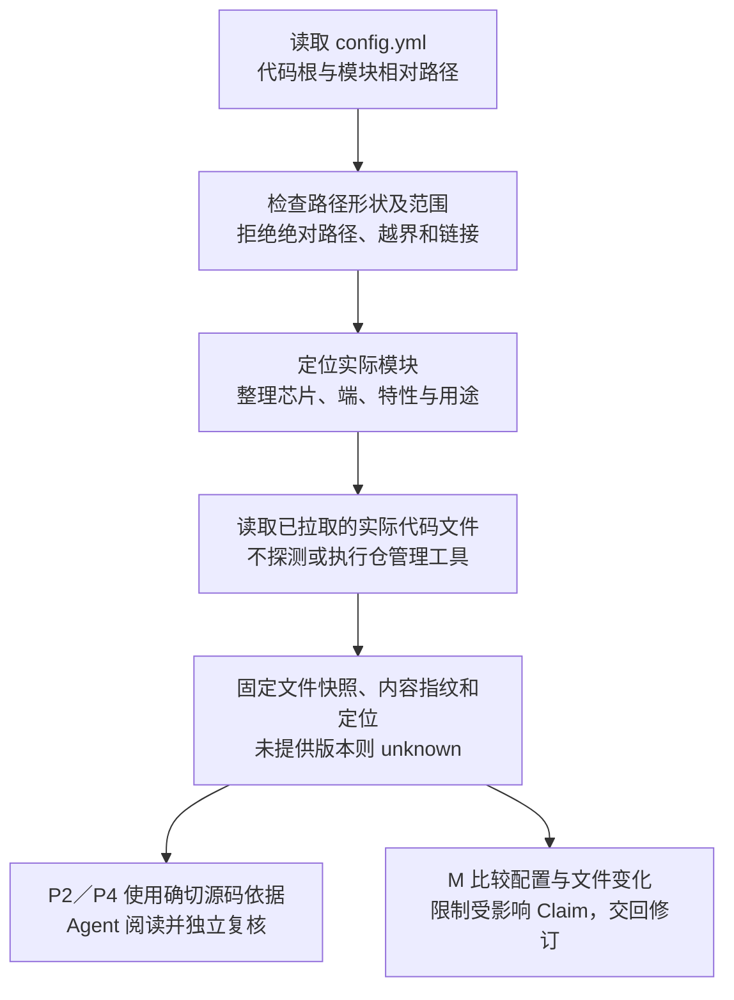

# 多仓工作区与模块映射

用户的业务代码位于 `main/`，由公司既有系统统一拉取，包含 Host、Device、多个芯片、公共特性及算法仓。公开配置只维护项目架构；知识库运行时只读取实际文件并固定内容指纹，不涉及业务仓管理操作。

## 需求与边界

| 需求 | 行为 |
|---|---|
| 少量人工配置 | `code_root` 指定代码工作区，`modules` 登记相对目录与可选的芯片、端、特性和用途 |
| 适配多仓 | 模块以逻辑文件范围表达，单模块覆盖多个内部代码仓及共享算法目录均可使用；不探测仓边界 |
| 自动采集依据 | 工具只读取得实际文件快照、内容指纹与定位；版本只采用明确提供的材料，缺失时保持 unknown |
| 取消重复登记 | 新配置不要求用户填写仓身份、六个 Target、三组 pair 或两份代码根授权 |
| 保留精确核验 | 路径范围、配置字节、来源快照、实际文件和版本变化仍需核对；目录标签不证明宏、构建、协议或运行结果 |
| 沿用业务流程 | E0 仍在业务命令前按需使用；ingest、lint、query 的节点顺序和本地结束边界保持现行设计 |

固定脚本不探测 `.git` 或读取 Git 元数据，不执行 Git、mm、manifest、构建命令或来源中的指令，不预设公司内部命令及视图格式。公司既有系统继续管理拉取和版本；知识库以实际可读文件形成依据。未知版本不阻断当前文件源码逻辑的核验。纯文档真人确认、独立 Agent 内容复核及人工后续提交／CI 分别沿用现行规则。

Agent 可按公司既有约定读取实际状态输出（例如 `git mm st`），保留原文及出处，记录其中明确给出的 ChangeID／视图等类型化版本标签。来源捕获沿用可选 `version` 字段，不新增配置、必选步骤或固定命令解析器。ChangeID 不冒充 commit，缺失状态不推断；版本观察不替代文件快照、内容指纹及定位。

## 公开配置

```yaml
schema_version: '2.0'
workspace_id: aiotbot-wifi-v1
knowledge_roots:
  wifi: aiotbot-knowledge-wifi-mp
code_root: main
modules: []
query:
  default_channel: local
  allowed_channels: [local, shared]
```

`code_root` 相对 `config.yml` 所在工作区；每个模块的 `path` 相对 `code_root`。模块可填 `chips`、`sides`、`features`、`description`，多值表示关联或共享；未知项可省略。空模块清单允许先使用文档知识，不把代码根下所有目录自动当作已登记模块。根配置不提供虚构源码目录或芯片接入事实。

## 处理逻辑



映射只在项目已登记范围内解析。运行时共享一套路径和模块规则，采集结果绑定原始配置字节；不能把原件内的路径或自报上下文当作仓外读取授权。模块标签用于导航和归属，具体产品的当前实现仍须核对该 Claim 的实际源码与条件；构建或运行断言才要求相应真实证据。

## 实现分工与任务

| 任务 | 落点 | 验收重点 |
|---|---|---|
| W1 配置与共用解析 | `config.yml`、workspace Schema、共享 Contract | 新配置可用，旧历史工件原字节保留；相对路径的基准唯一 |
| W2 发现与取证 | workspace-explore、source-capture、安装登记 | 模块范围只读定位；原始配置与确切代码文件可追踪，不涉及仓管理操作 |
| W3 核验与消费 | local-check、来源引用规则、query／维护调用 | 无重复授权登记；版本与文件变更仍会使旧证据失效或限制用途 |
| W4 文档与验证 | 使用说明、详细设计第 5 章起与第 7 章、当前入口 | 人工只填架构；详细设计第 4 章及之前保持原字节 |

共享解析统一使用 `validation.workspace_layout`、`normalize_workspace` 和 `workspace_file_allowed`；运行视图由原始配置派生，不改写用户配置，也不要求人工登记内部 scope ID。

## 测试计划

| 场景 | 必须观察的结果 |
|---|---|
| 最小配置与空模块 | 无旧字段也可安装、读取入口及处理文档；不宣称业务代码已接入 |
| 多仓、同目录多模块、公共算法模块 | 路径和逻辑归属正确；各代码仓按普通目录透明处理，不需要仓边界 |
| 不同仓管理布局和普通源码目录 | 不探测或执行 Git／mm／manifest，所选文件可核对；未提供版本保持未知且不阻断当前文件静态核验 |
| 绝对路径、`..`、链接／junction、缺失目录 | 越界和链接拒绝；缺失报告明确，不猜其他仓或静默扩大范围 |
| 多芯片／多端及省略标签 | 不把未知当通配，不从目录标签推断宏开启、构建成功或协议兼容 |
| 配置、文件改动、删除与替换 | 基于内容指纹发现实际变化，不依赖提交状态；旧证明不能继续支持当前用途，历史依据仍可按原快照读取 |
| 完整流程回归 | 新配置贯通 capture、复核、lint、本地入库、索引与查询；原人工确认和 CI 边界不变 |

测试使用隔离目录与测试代码；公司真实代码目录、业务语义和内部 Agent 接入仍需实机验证，不新增仓管理或 manifest 解析适配任务。

## 实际验证

2026-10-26 按最终源码验证，摘要见[模块映射验收记录](records/workspace-mapping-20261026.json)。

| 范围 | 实际结果 |
|---|---|
| Windows Python 3.11 全量机制与集成回归 | 21 组，495 通过、1 个普通符号链接权限用例跳过，零失败 |
| Agent 观察版本标签 | 另 1 项公开捕获用例通过：原样记录标签，revision 保持未知，不解析或调用仓管理命令 |
| WSL Ubuntu Python 3.11 定向回归 | 核心 31、捕获 8、E0 5、代码核验 20，共 64 通过，零失败、零跳过 |
| 两平台安装 | 新配置与空模块清单可安装；13 个运行包、20 Skills／1 Workflow、规则与能力摘要匹配 |
| 新文件模式公开调用链 | PATH 清空且 Git 不可发现；捕获 → 独立复核记录检查 → 本地事务入库 → 正式库完整 lint → 索引核验／激活 → 当前查询与同回执读取通过 |
| 失效与历史 | 修改源码后当前实现查询命中归零，历史查询仍命中并可读取保留对象；模块删除、被文件替换或变成链接后，历史对象仍可恢复，当前用途拒绝 |
| 独立复核 | 修复并验证 filesystem merge 的旧 Git 分支及历史恢复错误依赖当前布局问题，两轴复核通过 |
| 文档与流程 | 本次文档本地链接有效；32 个 Mermaid 已检查；详设前 4 章原字节和 Workflow 19 节点拓扑／非 prompt 字段保持 |

公开调用链使用隔离合成代码、独立复核声明和兼容 apply，入库后完整 lint 六组检查通过。它不证明完整新配置 `v3_required` ingest 的 P1—P3、真实 Agent 语义、真人确认、公司业务实机或内部 CI 已验收。工作流不执行项目拉取、提交或推送；人工后续边界保持。
