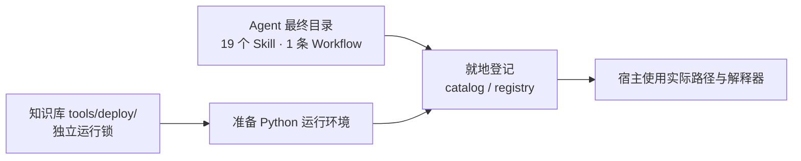
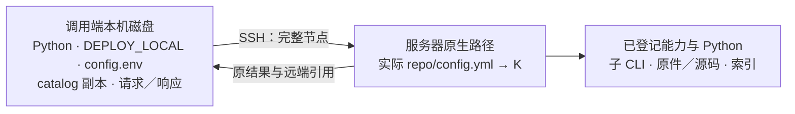
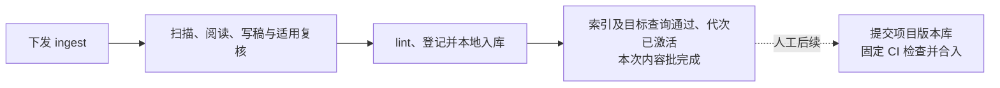

# AIoTBot 知识库日常使用

默认知识库已放入实际项目，Skill 与 Workflow 已接入 Agent 宿主，原件也已加入。下面的命令直接发给当前项目的 Agent；它们是对话任务文本，宿主如已提供快捷入口，也可使用对应入口。

项目根已有 `AGENTS.md` 和 `config.yml`，以登记的配置位置为准；`aiotbot-knowledge-wifi-mp/` 存放原件、知识、治理和独立部署工具。Skill／Workflow 手工放到 Agent 自己的最终目录，项目根不必保留能力源码目录。迁入真实项目时保留原有开发约定，并补齐实际业务映射。

本文用 `repo/` 表示项目根目录的示意名称，不要求修改实际目录名；`K` 表示该项目 `config.yml` 中 `knowledge_roots.wifi` 解析出的知识根。未另行标注的项目安装命令在实际执行机器的 `repo/` 下运行，相对路径以此为基准；SSH 调用端示例使用本机私有目录，文档链接仍相对当前文档。

服务器工作区的配置阅读、安装、能力登记及日常命令统一经 SSH 在服务器原生路径执行；Windows／Linux 调用端不通过 Samba／UNC／映射盘遍历或运行项目。下文 Windows 安装命令适用于真正位于 Windows 本机磁盘的独立部署；远程 Linux 项目使用服务器上的 Linux 命令。SSH 配置见[执行方式](#选择-windowslinux-或-ssh-执行)。

## 配置项目代码架构

`config.yml` 主要说明代码在哪里、归属哪些芯片和端，以及模块的特性和用途。默认代码工作区为 `main/`，其中可以有多个代码仓或模块目录；同一模块也可以覆盖多个子目录。

在 `modules` 中登记真实目录即可。下面只是字段示意，部署时替换成项目中确实存在的相对路径：

```yaml
code_root: main
modules:
  - path: device/实际驱动仓目录
    chips: [chip12]
    sides: [device]
    description: Device 侧驱动

  - path: host/实际公共仓目录
    chips: [chip12, chip08]
    sides: [host]
    description: Host 侧公共代码

  - path: 实际算法仓目录
    sides: [host, device]
    features: [实际特性名]
    description: 公共算法实现
```

| 字段 | 填写方式 |
|---|---|
| `code_root` | 相对 `config.yml` 所在目录，当前保留 `main` |
| `path` | 必填，相对 `code_root`；指向实际已拉取的模块目录 |
| `chips` | 可选，填写已确认关联的芯片；多个值表示共享或关联 |
| `sides` | 可选，`host`、`device`，可以同时填写 |
| `features`、`description` | 可选，分别说明特性标签和模块用途 |

`schema_version`、`workspace_id`、`knowledge_roots` 可以先保留现值。`query.default_channel`、`query.allowed_channels` 当前不控制查询选用的频道，也不提供访问权限隔离；实际由调用请求的 `channel` 决定，省略时为 `local`。未知芯片、端或特性省略即可，不把未知当作全适用。只准备文档知识时，`modules: []` 可先保持空；工具不会把 `main/` 下所有文件自动当成已登记代码。

知识根也可以嵌套，例如 `repo/aiotbot/aiotbot-knowledge-wifi-mp/`。此时将 `knowledge_roots.wifi` 改为 `aiotbot/aiotbot-knowledge-wifi-mp`，`config.yml` 仍在项目根，`code_root` 仍相对该配置。下面安装示例采用默认平铺布局；嵌套时替换工具路径，并显式提供 Windows `-WorkspaceConfig '.\config.yml'` 或 Linux `--workspace-config config.yml`。登记仍使用该项目根配置；不要先填假路径登记、再改回实际值。移动后须重新登记。

无需手填每个仓的绝对路径、六个 Target、三组 pair 或重复代码根授权。代码引用绑定已登记范围内的实际文件内容与定位；未提供版本时保持 unknown，也可以核验当前文件表达的逻辑。

有明确版本材料时，可通过来源捕获的可选 `version` 记录版本标签，并保留材料出处。标签的含义以原材料为准；缺失字段保持未知，版本标签不替代文件内容指纹核验。

模块标签帮助 Agent 找代码，实际宏是否开启、当前行为和构建结果仍要读取相应代码及证据。目录请使用普通项目内相对路径，不使用绝对路径、`..` 或链接／junction 跳出工作区。填好最终项目位置和配置后，再准备运行依赖及接入 Agent 宿主。

## 首次准备运行依赖

部署分为环境准备和能力登记。两步都使用知识库 `tools/deploy/` 中的工具，不执行 Skill 包内安装脚本，也不依赖项目根存在 `skills/` 或 `workflows/`。

服务器首次部署时，先由部署者核验 SSH 主机指纹并配置可用认证，再通过 SSH 进入服务器实际 `repo/`，执行下面的 Linux 环境准备和登记命令。此时尚无 catalog，不需要先运行 `run_node.py`；登记完成后才配置调用端。所用账号必须能读取项目与能力，并在远端运行目录写入产物。真正本机磁盘上的独立部署直接在当地执行对应系统命令。



**1. 准备环境。** 机器已有 Python **3.11** 时，在项目根执行以下命令；3.12 也兼容。工具读取自己的[运行锁](../tools/deploy/requirements.runtime.lock.txt)，创建仓外独立环境并安装运行包，使用现有 pip 配置中的包源，无需管理员权限。

| 系统 | 使用已配置的包源 | 指定包源 |
|---|---|---|
| Windows PowerShell | `.\aiotbot-knowledge-wifi-mp\tools\deploy\install.ps1` | 在左侧命令后加 `-IndexUrl https://<包源>/simple` |
| Linux Bash | `bash aiotbot-knowledge-wifi-mp/tools/deploy/install.sh` | 在左侧命令后加 `--index-url https://<包源>/simple` |

如果机器存在多个 Python，可按实际位置指定解释器，例如 Windows 增加 `-Python '..\python311\python.exe'`，Linux 增加 `--python ../python311/bin/python3.11`。示例中的 `python311/` 与 `repo/` 同级；Linux 的 Python 需带 `venv` 和 `ensurepip`，缺失时由部署方补齐对应系统组件。

完全离线时，把**匹配当前系统、CPU 和所用 Python 版本**的运行 wheel 放到同一目录。以下以 `repo/` 同级的 `offline-wheels/` 为例：

```powershell
.\aiotbot-knowledge-wifi-mp\tools\deploy\install.ps1 -Wheelhouse '..\offline-wheels'
```

```bash
bash aiotbot-knowledge-wifi-mp/tools/deploy/install.sh --wheelhouse ../offline-wheels
```

安装只接受 wheel，不临时编译依赖。Windows 与 Linux 的二进制包不能混用；缺包时报告失败，不生成成功报告。项目自身的 SDD 选择与验证记录仅在本地保存，不是部署输入。

若提示 `PIP_DESTINATION_OVERRIDE`，清除 pip 中的 `target`、`prefix`、`root`、`python` 重定向设置后重试；包源、认证和证书配置可以保留。脚本会强制把运行包装进本次的新虚拟环境。

仅准备环境时，输出 `status: runtime_ready`；`installation.json` 给出实际 `python` 和工作区 registry，此时 `catalog`、`skills`、`workflows` 为空。安装器不自动移动或注册 Agent 的能力。

**2. 登记最终能力。** 手工将完整的 **19 个 Skill（18 个 CLI 节点和 1 个 CodeGraph setup 说明包）及 1 条 ingest Workflow** 放到 Agent 的最终目录，再使用上一步输出的 Python 就地登记。下面以 `repo/` 同级的 `agent-skills/`、`agent-workflows/` 为示例父目录；内部直接包含各个 `hs-*` 包。命令将相对布局解析为接口所需的实际绝对路径，元数据写入仓外全新目录。

Windows PowerShell：

```powershell
$runtimePython = '<installation.json 中的 python 值>'
& $runtimePython -X utf8 .\aiotbot-knowledge-wifi-mp\tools\deploy\install_catalog.py `
    --register-existing --skills-root (Resolve-Path '..\agent-skills').Path `
    --workflows-root (Resolve-Path '..\agent-workflows').Path `
    --workspace-config (Resolve-Path '.\config.yml').Path --python $runtimePython `
    --destination (Join-Path (Resolve-Path '..').Path 'knowledge-registration-new')
```

Linux Bash：

```bash
runtime_python='<installation.json 中的 python 值>'
"$runtime_python" -X utf8 aiotbot-knowledge-wifi-mp/tools/deploy/install_catalog.py \
    --register-existing --skills-root "$(realpath ../agent-skills)" \
    --workflows-root "$(realpath ../agent-workflows)" \
    --workspace-config "$(realpath config.yml)" --python "$runtime_python" \
    --destination "$(realpath ..)/knowledge-registration-new"
```

登记工具只读最终能力并记录位置、包摘要、解释器及配套规则，不复制、移动能力或修改宿主配置。把登记输出的 catalog／registry、能力最终目录和该 Python 接入宿主；作者与复核者仍需安排到不同的独立上下文。纯文档完成独立内容复核和固定检查后本地入库，代码卡另做适用源码核验；环境准备和登记成功不代替真实宿主运行验证。

若能力已放到最终位置，也可在第 1 步同时提供 Windows `-SkillsRoot '..\agent-skills' -WorkflowsRoot '..\agent-workflows'`，或 Linux `--skills-root ../agent-skills --workflows-root ../agent-workflows`，装包后直接完成登记；两个目录参数须成对提供。

默认环境位于用户目录的 `.factumcore/` 下，每次使用新目录并输出完整路径；也可用 Windows `-Destination` 或 Linux `--destination` 指定一个**仓外新目录**。环境和登记目标均不覆盖已有目录，失败目录保留以便排错。项目配置、能力位置或解释器变化后重新登记并成套切换宿主引用；已有未完成事务先核对配套规则与真实状态，再按恢复要求处理。

### 选择 Windows、Linux 或 SSH 执行

服务器工作区统一使用 SSH 执行整个公开节点，节点的 Python、能力、知识根、代码和子 CLI 均在服务器原生路径；调用端可以是 Windows 或另一台 Linux。真正本机磁盘上的 Windows／Linux 部署仍可本机执行；服务器本机 Linux Agent 直接用当地能力即可。每台执行机器准备配套 Python、能力与 catalog，不能跨系统照搬解释器绝对路径。



**1. 准备调用端文件。** 将受信分发包中配套的完整 `tools/deploy/` 副本放到本机磁盘目录（下称 `DEPLOY_LOCAL`），至少保持 `run_node.py` 与 `install_catalog.py` 同目录配套。调用端准备本机 Python 3.11／3.12 和 OpenSSH 客户端，无需把服务器知识根复制到本地，也不在调用端再次登记服务器路径。服务器的实际 `K/tools/deploy/` 仍须保留配套文件，供远端 worker 使用。

将 [config.env.example](../tools/deploy/config.env.example) 保存到另一个本机私有目录，命名为 `config.env`，按下表填写。它只在命令显式传入 `--config-env` 时读取，与项目架构映射 `config.yml` 分开。真实 `config.env` 在本仓已忽略；迁入其他项目时也须由部署者排除提交，不能把主机或凭据填回分发模板。

| 字段 | 填什么、以哪台机器为准 |
|---|---|
| `EXECUTION_MODE` | 服务器工作区填 `ssh` |
| `SSH_HOST` | 服务器 IPv4、主机名或已配置的可信 OpenSSH 主机别名 |
| `SSH_USER` | 服务器账号；可留空沿用主机配置 |
| `SSH_PORT` | 实际 SSH 端口，范围 1—65535；可留空沿用主机配置 |
| `SSH_IDENTITY_FILE` | 调用端本地私钥文件路径；可留空沿用既有认证配置，不填写私钥正文或密码 |
| `REMOTE_PROJECT_ROOT` | 服务器上含实际 `config.yml` 的项目根绝对 POSIX 路径，不能填 K 或调用端映射盘 |
| `REMOTE_CATALOG` | 上一步在服务器登记后输出的 `catalog.json` 文件绝对 POSIX 路径，不是能力父目录 |
| `EXPECTED_CATALOG` | 该 catalog 的确切原字节在调用端的本机副本，例如 `catalog.server.json` |
| `REMOTE_PYTHON`、`RULES_DIGEST` | 通常省略，分别从匹配登记取得解释器和规则摘要；特殊启动器或显式一致性限制见[执行说明](../tools/deploy/EXECUTION.md) |

SSH 配置不要同时填写本机模式的 `PROJECT_ROOT`、`CATALOG`、`KNOWLEDGE_ROOT`。配置文件内部的**调用端路径**可用绝对路径、`~` 或相对 `config.env` 所在目录的路径；`REMOTE_*` 路径使用服务器实际绝对 POSIX 路径。数据格式是一行一个 `KEY=VALUE`，允许整行注释和整个值的引号，不支持 `export`、变量展开、转义、行尾注释或重复／未知键，也不会 shell source/eval。旧 JSON `--profile` 保持兼容，具体格式集中见[执行说明](../tools/deploy/EXECUTION.md)。

**2. 取回精确 catalog。** 以下 PowerShell 在调用端本地执行；先替换全部尖括号内容，所填账号、主机、端口、密钥及远端 catalog 与 `config.env` 一致。示例使用显式账号和密钥；若用可信 SSH 主机别名，可只保留该别名，并省略相应的 `-P`／`-i` 参数。所示本机目录须已存在，且不能是 UNC、映射盘或 junction。

```powershell
$callerPython = '<调用端本机 Python 的绝对路径>'
$deployLocal = (Resolve-Path '<本机 DEPLOY_LOCAL 目录>').Path
$privateDir = (Resolve-Path '<本机私有配置与请求目录>').Path
$sshTarget = '<SSH_USER>@<SSH_HOST>'
$sshPort = '<SSH_PORT>'
$sshKey = '<SSH_IDENTITY_FILE 的本机绝对路径>'
$remoteCatalog = '<REMOTE_CATALOG 的服务器绝对 POSIX 路径>'
$catalogLocal = Join-Path $privateDir 'catalog.server.json'
ssh -T -p $sshPort -i $sshKey -o BatchMode=yes -o StrictHostKeyChecking=yes -- $sshTarget true
if ($LASTEXITCODE -ne 0) { throw 'SSH 认证或主机核验失败；请先处理连接配置' }
if (Test-Path -LiteralPath $catalogLocal) { throw '请选择一个全新的 catalog 副本文件名' }
scp -B -P $sshPort -i $sshKey -o StrictHostKeyChecking=yes -- "${sshTarget}:${remoteCatalog}" $catalogLocal
if ($LASTEXITCODE -ne 0) { throw 'catalog 取回失败；请先排查连接或文件权限' }
```

这里 `scp` 的端口参数是大写 `-P`，原始 `ssh` 命令是小写 `-p`。示例要求 OpenSSH 的 SFTP 文件传输可用；参数含义见 [scp 官方说明](https://man.openbsd.org/scp.1)。按文件原字节传输，不用编辑器重存或文本管道转码。把 `EXPECTED_CATALOG` 填为该新副本名；首次运行时，worker 会再次比较服务器 catalog 的原字节摘要、规则与实际能力身份，副本过期会拒绝执行。catalog 中的 Linux 路径留作远端使用，不改成调用端盘符。

**3. 发起 status 和 query。** 在上例 `$privateDir` 中保存两个 UTF-8 请求文件。下面的 operation_id 仅为独立 status／query 调用示意，后续独立操作更换 ID，并选择全新的响应文件名。同一 ingest 的各节点沿用其原 operation_id，以 Workflow 的 run/node/attempt 身份或执行目录 UUID 区分调用尝试。

`status.request.json`：

```json
{"operation_id":"status-check-001"}
```

`query.request.json`，将问题替换为实际资料主题：

```json
{"operation_id":"query-background-001","query":"连接流程规范","purpose":"guidance"}
```

继续在调用端 PowerShell 执行；这些参数均为本机文件路径，远端入口由 `config.env` 确定：

```powershell
$configEnv = Join-Path $privateDir 'config.env'
& $callerPython -X utf8 (Join-Path $deployLocal 'run_node.py') --config-env $configEnv `
    --skill hs-knowledge-source-scan --action status `
    --input (Join-Path $privateDir 'status.request.json') --output (Join-Path $privateDir 'status.response-001.json')
& $callerPython -X utf8 (Join-Path $deployLocal 'run_node.py') --config-env $configEnv `
    --skill hs-knowledge-query --action search `
    --input (Join-Path $privateDir 'query.request.json') --output (Join-Path $privateDir 'query.response-001.json')
```

Linux 调用端使用相同参数。例如从本机私有目录发起 status，先把下面两个变量替换为该调用端实际路径：

```bash
caller_python='<调用端本机 Python 的绝对路径>'
deploy_local='<调用端本机 DEPLOY_LOCAL 的绝对路径>'
"$caller_python" -X utf8 "$deploy_local/run_node.py" --config-env ./config.env \
    --skill hs-knowledge-source-scan --action status \
    --input ./status.request.json --output ./status.response-001.json
```

status 只返回已保存的实际阶段事实；查看特定旧操作时在请求中添加 `target_operation_id`。首次尚无内容或索引时，status 成功只验证该条调用可用，query 需等 ingest 完成索引及活动代激活后再验收。检查退出码和响应中的 `status`、`phase`、`diagnostics`；空命中或错误不算查询验证通过。背景问题显式使用 `guidance`，其他用途见[怎么查询和追代码](#3-怎么查询和追代码)。

SSH 返回的 `receipt_ref`、`view_ref`、`apply_result_ref` 及 lint 的 `data.report_ref` 等继续按**服务器 K** 解析；请求中引用这些产物时，不填写本机响应副本。执行端持久请求／结果位于 `K/.build/operations/<operation_id>/execution/<unique-call-id>/`，调用端 `--output` 只是一份原响应副本。lint 返回的绝对 `data.report_ref` 在填入后续节点要求相对引用的 `lint_ref` 前，须按服务器 K 计算相对路径，不重签报告。稿件及附件通过 SSH／SCP 定点传到服务器预期 `.build/` 位置；读取原件和源码也经 SSH，不在调用端遍历共享盘或镜像知识根后重跑。

**4. 更新与排错。** 能力字节（包括 `SKILL.md`）、解释器、项目配置、规则或位置变化后，先按[更新规则包后怎么复验](#更新规则包后怎么复验)核对未完成操作，再在服务器用新目标目录重新登记，成套切换宿主引用。同步配套 `DEPLOY_LOCAL` 工具，通过 SSH／SCP 取回新 catalog 到本机新文件，并更新 `EXPECTED_CATALOG` 等实际绑定；不要改旧摘要来伪装成原包，也不要在运行中的同一操作内混用新旧配置。切换后先验证 status，再用实际内容验证目标 query。

| 提示或现象 | 下一步 |
|---|---|
| `SSH_RESULT_UNAVAILABLE_REMOTE_STATE_UNKNOWN` | 保留 operation_id，经 SSH 核对远端进程、上述 execution 目录、`logs/operations/<operation_id>/journal.json` 和活动索引；未拿到结果不证明远端未执行，不盲目重放有副作用的节点 |
| `REMOTE_FILESYSTEM_REQUIRES_SSH` | 把调用器及配置／请求／响应放回真正本机磁盘，服务器项目使用 SSH；不回退 Samba、不复制 K 到本地重跑 |
| `EXECUTION_STORAGE_TYPE_UNAVAILABLE` | Windows 无法确认卷类型，先检查实际本机磁盘与路径，不把未知卷当作本地盘 |
| `CATALOG_CHANGED`、`PACKAGE_DIGEST_MISMATCH`、规则不匹配 | 核对实际部署版本、重新登记并取回精确副本，不编辑既有回执或摘要 |
| `OUTPUT_EXISTS_USE_UNIQUE_ATTEMPT` | 为本次调用使用新的响应文件路径，保留既有结果供核对 |

连接失败不自动换端或重试。服务器本机 Linux Agent 与真正本地 Windows／Linux 部署可改用模板中的 `EXECUTION_MODE=local`、`PROJECT_ROOT`、`CATALOG`，由当地登记解析实际 K；不用保留 SSH 字段，也不要求服务器再建立 loopback SSH。Windows guard 覆盖 UNC、网络映射盘和链接入口；Linux 原生外观的 CIFS 挂载及完整本地副本的来源无法仅靠路径自动识别，部署者和 Agent 仍须遵守执行位置约束。

SSH 执行和连接保活不改变节点现有 timeout 预算，也不承诺既有长任务超时已经解决。需要调整该问题时保留实际节点、耗时和诊断码另行分析，不从断连现象推断执行超时。

服务器工作区统一 SSH 不等待性能报告。已有 `benchmark_execution.py` 和 SMB 配对报告保留为历史实验材料，不能授权当前入口绕过网络路径拒绝；后续测量用于观察真实收益和优化，不恢复常规 Samba 直跑。报告按实际输入、配置、版本、状态与结果等价解释，来源读取或公网隧道数据不代表内部整个 ingest 的速度。

### 首次准备 CodeGraph（需要代码图谱时）

CodeGraph 独立于知识库 Python 运行环境；其安装与接入参考[官方说明](https://colbymchenry.github.io/codegraph/getting-started/installation/)。填好真实模块并将新 Skill 放入 Agent 最终目录后，发给 Agent：

```text
请使用 hs-codegraph-setup，按当前项目 config.yml 中已登记的模块逐项准备 CodeGraph。
复用可用索引，初始化缺失项，并检查当前 Agent 的官方 MCP 接入。
汇报每个模块的状态、projectPath 和待处理问题，并说明后续如何查询。
```

这是首次准备能力，不是每次 query 的前置步骤。`modules: []` 时只返回未登记代码模块，不扫描整个 `main/`。CLI 尚未安装或宿主尚未加载时会明确报告缺口；生成 MCP 片段与完成实际调用分别判断，需要写宿主配置时可在请求中明确宿主和接入范围。

后续代码定位直接使用官方 `codegraph_explore` MCP，并传入实际模块的绝对 `projectPath`。服务器项目的准备命令、索引及官方 MCP 进程也在服务器，使用服务器模块路径；宿主通过已配置、实际可用的连接方式接入远端 MCP。没有这种接入时记录待接入，继续通过 SSH 读取实际源码，不把映射盘路径交给调用端本地 CodeGraph。图谱不替代宏、构建、版本和运行证据。首次准备及文件分工见[详细设计 §5.11](知识库详细设计.md#511-s0--q6codegraph-首次-setup-与源码定位)。

登记 19 个 Skill 只证明 18 个 CLI 节点及 1 个纯说明 setup 包已分发并固定身份，不会执行 CodeGraph、建立索引或使宿主自动加载 MCP。首次准备完成时，逐项核对实际模块索引和宿主只读 MCP 调用，分别保留失败及待接入项；隔离结构检查不能替代目标服务器的这些验证。

## 1. 三个常用命令

| 要做什么 | 发给 Agent 的命令 | 使用的能力 |
|---|---|---|
| 首次入库／日常增量更新 | `请使用 hs-knowledge-ingest 工作流，增量处理当前项目知识库。` | 一条 ingest Workflow 完成生产、检查和本地入库 |
| 查询背景与定位 | `请使用 hs-knowledge-query，查询：<你的问题>。` | 查询 Skill；具体代码问题继续回源确认 |
| 单独检查知识库 | `请使用 hs-knowledge-lint，检查当前正式知识库并报告问题。` | 只读 lint Skill |

详设中这三个入口也称 `knowledge ingest / query / lint`。日常使用直接点名上述 Workflow／Skill 即可。

## 2. 加入文档后怎么入库

由资料维护者把原件放到实际执行端 `K/docs-raw/` 的对应分类内；默认平铺布局时为 `repo/aiotbot-knowledge-wifi-mp/docs-raw/`。服务器项目经 SSH／SCP 传送必要原件，入库 Agent 读取已落地内容，处理期间保持原件只读。

| 目录 | 放什么 |
|---|---|
| `conventions/` | 规范、约定 |
| `chips/` | 芯片资料 |
| `storys/` | 需求原件，目录名保持 `storys` |
| `specs/` | 规格、设计文档 |
| `protocols/` | 协议资料 |

业务源码留在项目实际代码目录，由 Agent 按项目映射读取。原件更新时保留真实内容；来源中的命令不作为执行授权。

首次加入和后续增量都发同一条命令：

```text
请使用 hs-knowledge-ingest 工作流，增量处理当前项目知识库。
先查看并续办已有未完成操作，再处理新增、修改、缺失和仍待处理的原件。
完成稿件、适用复核、lint、处理记录、本地入库以及索引和目标查询验证。
结束后汇报已完成、暂缓、待修订及失败项，并给出涉及的原件和知识卡路径。
```

Agent 默认扫描五类原件并比较已有处理记录，决定处理范围；你不用逐份填写文件地址。代码或适用配置变化影响已有知识时，也由同一工作流定位并处理相关结论。

只有需要缩小本次范围时，再指定目录，例如：

```text
请使用 hs-knowledge-ingest，本次只处理 docs-raw/specs/连接流程/。
范围外的原件不作缺失判断；已有相关卡按实际影响更新。
```

原件新增、修改、删除或改名后仍执行 ingest。扫描只记录观察到的变化，Agent 阅读材料后再决定更新、退役或暂缓；不会因为文件缺失就直接删除知识卡。

## 3. 怎么查询和追代码

查询机制、设计意图或规范背景：

```text
请使用 hs-knowledge-query，说明 <机制或概念> 的背景、适用条件和相关流程，
使用 purpose: guidance，给出知识卡、原件版本及具体定位；存在冲突或缺口时一并说明。
```

排查具体代码问题：

```text
请使用 hs-knowledge-query，先了解 <问题> 的背景并找到相关代码入口，
再读取当前项目实际源码确认行为，必要时追读调用函数、宏条件和早退分支。
回答时给出源码路径和定位，区分资料背景、实际代码事实及推断。
```

例如：

```text
请查一下扫描完成后，扫描忙标志在哪些条件下被清除。
先查相关知识卡，再读本项目源码确认各分支，并给出具体位置。
```

卡片主要提供背景和索引，细节未写入卡时继续读代码。跨流程问题可使用多张相关卡。查询历史版本时说明版本；未知芯片、宏或构建条件保持未知，历史依据不直接当作当前实现。

卡片正文没有可点击链接时，仍可利用头部结构化来源追查。以 roam 等流程的关键步骤为例，让 Agent 按下列顺序操作：

1. search 流程并保留原始 `receipt_ref`、命中 `card_id` 和 `claim_ids`；背景使用 `guidance`，当前实现按实际范围选择用途。
2. read 时传入原 `receipt_ref`、该卡 ID 和关键步骤的单个 `claim_ids`。若尚不清楚各 ID 对应哪个步骤，先只传原回执与卡 ID 读取合格正文，根据 `claims[].text` 确认，再缩小范围。下例是精读请求的数据形状，占位值从本次结果取得；使用新的操作 ID 和响应文件，调用方式沿用前述 SSH／本机入口并加 `--action read`。

   ```json
   {"operation_id":"read-flow-step-001","receipt_ref":"<原 search 的 receipt_ref>","card_id":"<命中 card_id>","claim_ids":["<该步骤的合格 Claim ID>"]}
   ```

3. 查看 `data.sources[]`：`source_kind: code` 的 `resource.repo_id` 与 `resource.path` 给出逻辑仓／模块和相对文件，`source_ref.locator` 给出行段，`text` 是已恢复片段；`snapshot` 保留摘要与已知版本，`current_source_matches` 和 `limitations` 说明当前字节匹配及读取限制，不能单凭字节匹配判定产品适用或代码语义。search 的 `data.matches[].sources[]` 也已包含恢复结果，通常不必再次调用 `resolve-source`。
4. 用已有可信项目上下文将 `repo_id` 匹配到授权代码 scope 根，先结合 `resource.path` 解析源码文件的真实绝对路径，再按当前 `config.yml` 选择包含该文件的已登记模块根作为官方 MCP 的 `projectPath`。新布局的 scope 通常就是 `code_root` 下对应模块，旧配置可能是更大的代码仓，不能直接把相对文件拼到任意模块根。随后沿行段与实际函数名分析调用、条件及早退。服务器使用服务器原生路径和已接入的远端 MCP；没有接入时经 SSH 读取实际文件，按缺口报告图谱状态。

当前一次 read 多个 Claim 会返回它们的来源并集，未逐项重复 `source_refs`；原回执加单 Claim read 可以缩小到该步骤的直接来源。无原回执的 read 不按 `claim_ids` 缩小。卡头若只有文档依据或过宽定位，Agent 仍需继续查实际源码；不能据流程名称猜函数，也不把每条断言都附全卡来源。关键步骤可以分别引用所需原文与代码，正文链接不是此用法的前提。

来源快照和已知 commit 不会使 CodeGraph 自动读取旧版本。图谱与固定证据版本不一致时，只把图谱当定位线索；历史问题继续核对确切旧证据，当前实现核对实际源码，不为查询自动切分支或更改 Git 状态。

查询只消费知识，不会为了补答案自动启动 ingest。确实缺少原件或源码时，Agent 应说明查过哪里、还缺什么。

用途必须与问题匹配：设计或规范背景使用 `guidance`，明确历史版本使用 `historical`；`current` 和 `implementation` 需要对应的当前证据与范围。省略用途仍默认为 `current`，不会自动包含 guidance 卡。P3 为每个目标查询显式写用途，P7 沿用原计划；用途拼错会提前报错，不能通过放宽资格或自动降级消除未命中。

同一知识库同时最多运行一个 ingest；多个 query 可以并发，各 Agent 使用独立操作 ID、Workflow 运行身份和输出路径。search 后 read 使用原回执，活动索引切换后仍读原代；如果来源或当前资格变化，读取可能明确拒绝或要求重试。服务器项目的写入、替换和读取均在服务器本地文件系统执行；实际并发和内部 Agent 接入仍按目标服务器验证。

## 4. 怎么单独检查

日常检查：

```text
请使用 hs-knowledge-lint，对当前正式知识库做完整只读检查。
检查格式、导航与链接、来源和代码引用、关系及索引一致性。
按卡片路径、问题位置和原因列出结果，并区分检查失败与材料不足。
```

lint 只检查和报告，不修稿、不做内容语义复核、不入库。它检查可由固定脚本判断的内容，卡片语义仍由内容复核负责。

发现问题并希望修正时，再下发：

```text
请按刚才的 lint 报告，使用 hs-knowledge-ingest 修订受影响内容，
补齐材料或修改稿件后重新检查，通过后完成本地入库和查询验证。
```

## 5. 退回、材料不足和中断怎么继续

| 情况 | 你怎么处理 |
|---|---|
| 需要退回文档或代码稿 | 告诉 Agent 问题与依据；改稿时建立新操作和新视图，回到对应节点重新复核、检查 |
| ingest 完成后发现问题 | 要求 Agent 按原卡路径和问题新建更新操作；即使原件未变也要处理，重新完成复核、lint、入库和查询验证 |
| 代码卡需要复核 | 由工作流中的独立 Agent 阅读实际源码并复核，随后执行固定校验；无需另行提供复核公钥 |
| 原件或代码材料不足 | 补充 Agent 列出的材料后，要求续办原操作；无法补齐的保留暂缓和原因 |
| 进程中断或上次未完成 | 先查看实际进度，再从有效停点续办 |
| 卡已入库，但索引、目标查询或激活失败 | 只补未完成的收尾；若发现内容错误则新建修订操作，不重复原事务 |

例如，要求修订已入库卡：

```text
请使用 hs-knowledge-ingest，修订 <知识卡路径>：<问题、修正要求及依据>。
原件即使未变，也请重新读取相关原件和旧卡，建立新的更新操作，
完成独立内容复核、lint、本地入库，以及索引验证、目标查询和活动代激活。
保留旧操作与处理记录，返回修订后的卡片路径和验证结果。
```

查看进度：

```text
请使用 hs-knowledge-source-scan 的 status 能力，查看当前知识库未完成操作，
列出各操作的实际停点、待修订事项、缺失材料和下一步。
```

材料补齐或运行故障排除，且稿件、输入和基线未变时：

```text
请续办刚才的知识库 ingest 操作，先核对原件、稿件、规则和代码是否仍有效，
从实际停点继续；已经完成的入库不要重复执行。
```

换会话时附上 Agent 上次返回的操作标识。用户可在执行中要求停止或退回；Agent 先核对实际事务状态，已落位内容以新操作修订，未落位稿件需要改写时也建立新操作和新视图，再返回对应节点。只有稿件、输入及相关基线未变时才续办原操作。

旧版本停在真人确认处的稿件保留为历史操作；使用当前安装包与规则重新创建操作，完成独立内容复核和检查。不要直接重放旧批准记录或重复已落位事务。

### 更新规则包后怎么复验

受锁定契约更新后，安装新配套能力、重新登记 catalog，并从新锁取得规则摘要。旧记录保留原字节，不改摘要、不复制旧通过结果。升级前先检查事务：真正未结束的写入用原配套规则恢复终态；已经 committed、只差索引收尾的操作保留其写入事实，不当成未写入重新提交。

新规则下需要重新取得资格时，新建 operation，显式选择原件和已有卡，即使内容未变也完成当前规则的独立内容复核、适用代码核验、lint、处理记录与本地入库，再构建索引、运行目标查询并激活。扫描中的 `unfinished` 和 `rules_changed` 维护单元均应在 P3/P6 如实处理，不按“原件未变”跳过。不能直接拿旧 active、旧 apply-result 或旧 proof 授权新规则查询。

```text
请使用当前规则复验这些已有卡：<卡片列表>。先检查并恢复旧事务，再新建操作，
读取原件和已有卡，完整处理扫描及 rules_changed 维护单元。
内容仍准确时保留原文，重新完成独立复核、适用核验、lint、入库及索引查询验证，
保留全部旧记录，不改写历史摘要或复用旧通过结果。
```

## 6. 怎么判断本次结束

要求 Agent 在结束时给出：

- 处理了哪些原件，新增、修改或退役了哪些知识卡。
- 哪些材料已完成，哪些仍待修订、暂缓或失败，以及具体原因。
- 内容批的 lint、处理记录、本地入库、完整索引验证、目标查询与活动代激活结果。
- 涉及的卡片路径、记录路径和可续办的操作标识。



内容批完成本地入库、完整索引验证和目标查询，且该代次成功激活后，ingest 结束。候选代查询通过但活动代未切换时，仍需补完收尾。只有处理记录的批次保存记录后结束；未完成项仍如实保留。提交、CI 和合入由人后续处理，CI 复用 lint 的固定检查。

流程与节点分工见[详细设计](知识库详细设计.md)。
