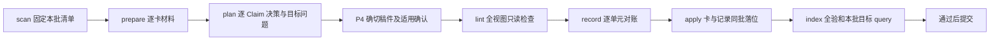
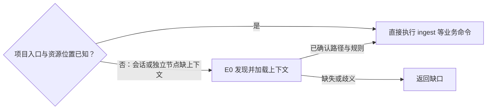

# AIoTBot 知识库使用与开发者接入教程

本教程说明 ingest、只读 lint、query 的设计用法，并保留现有节点包的安装与开发调试方法。流程思路和文件分工见[概要与详细设计](知识库详细设计.md)，实际接入和验证记录见 [SDD](sdd/knowledge-v3/README.md)。

详设第 1.1 节提出 `knowledge ingest / lint / query` 三个用户入口。Agent 已加载项目入口、知道知识库和代码图谱入口时，直接复用上下文执行命令。会话尚未加载项目约定、未知这些能力位置，或独立 Workflow 节点只拿到代码仓信息时，才先调用 `hs-workspace-explore` 补上下文；这是业务命令前按需触发的 E0，不属于三条链路，也不要求用户先选项目、登记绑定或执行 `init`。

ingest 是完整 P1—P7 流程：扫描或续办、准备材料、Agent 逐 Claim 阅读计划、生成 draft 与完整视图并完成必要真人确认或代码核验、调用 lint Skill、登记共享处理记录、最后同批本地入库，再完成索引全验与目标查询。独立 lint 只检查并报告，query 消费知识；提交后的固定 CI 是 C1 独立作业。

首次或新变化处理时，`knowledge ingest` 默认扫描五类 raw，对照原件处理记录准备新旧原文和关联卡，由 Agent 写 draft，再在同一 Workflow 检查入库；`--source` 可选限制文件或子目录。已有等待确认的操作，下一次先核对绑定的原件、规则、代码及基线，仍有效则从同一 operation/view 继续，不重复全量扫描、写稿或入库；绑定变化则生成相应新计划和视图，重检并重新确认。下文的 `source_path`、`view_ref` 是开发者节点参数。

**仓内能力为一条 ingest Workflow、独立 source-scan 和只读 lint Skill。** 安装器提供 `knowledge ingest / lint / query` 的逻辑分派信息；实际宿主命令注册与触发仍需接入验收。底层脚本不是一个同名终端服务，无需 init 启动服务。后文保留原节点调试示例；新流程优先使用下面的公开动作。

现有节点已提供原文副本、`sources.lock.yaml` 和操作结果记录，分别用于恢复阅读材料、登记正式卡采用的来源版本、确认真实落位阶段；它们没有组成完整 raw 目录扫描清单，也没有自动发现文件删除的能力。完整原件处理记录和默认扫描比较是统一入口的设计职责，不能把一次 capture 或来源锁条目当作整份原件已经提炼入库。

这份教程讲系统怎么使用，不是 WiFi 业务知识原件。目录和名称以[总体设计 §5.3](AIoTBot知识库架构设计.md#53-aiotbot-knowledge目录架构)为准；开发与接入进度见 [task.md](task.md)。

## 1. 先选你要做的事

| 目的 | 从哪里开始 | 当前可做到哪里 |
|---|---|---|
| 第一次接触，先跑一个完整 Demo | 第 2–4 节 | 安装能力包，跑通隔离合成资料的完整 CLI 链路 |
| 让 Agent 处理真实本地文档 | 第 5–6 节；CLI 调试另看第 2–3 节 | 捕获、编写候选、固定最终视图；缺真实确认适配器时停等 |
| 已有合法落位卡，查询知识 | 第 7 节 | 索引回归激活，搜索及同代读取 |
| 原件更新、运行中断、包升级 | 第 8–10 节 | 更新重新治理、状态诊断和恢复；不直接改稳定卡绕过审核 |
| 接真实 WiFi 代码与上库 CI | 第 11 节 | 核对本地语义检查和确定性 CI 的接入边界 |

**当前能跑完整合成 Demo；真实文档的完整使用还需要真人确认适配器接入。** 单一 ingest Workflow 和节点包具备本地模板验证入口，实际宿主运行、全局 Skill 隐式触发仍待验收。不要把下面的操作步骤理解为这些外部适配已经部署。

操作中的三类位置：

| 位置 | 放什么 | 由谁维护 |
|---|---|---|
| FactumCore 仓根 | `config.yml`、`main/`、`aiotbot-knowledge-wifi-mp/` | 项目开发者；Git 在这里执行 |
| `aiotbot-knowledge-wifi-mp/`，下文简称 K | raw、治理规则、正式卡、`skills/`、`workflows/` 和运行产物 | 原件只读；正式资产通过治理落位 |
| 仓外本机目录 | Python 环境、安装包、catalog、registry、请求和测试结果 | 本机使用者；不提交到项目仓 |

## 1.1 新流程的公开动作



| 动作 | 输入与实际结果 |
|---|---|
| `hs-knowledge-source-scan --action scan` | 已知知识根和规则，默认无需 source；可选 source 缩小范围；返回固定 `scan_ref`，完整性、版本和待办 |
| 同 Skill `--action prepare` | `scan_ref`，返回 `material_ref` 和组合来源 bundle；关联卡来自正式来源反查、主题候选和明确依赖，各卡附实际采用的旧版本 |
| `hs-knowledge-change-plan --action plan` | Agent 读取材料后提交逐单元/Claim 判断、保留与拟改、单写者、目标查询；脚本只检查并封存计划，不替 Agent 判断语义 |
| 同 Skill `--action review` | 独立上下文抽查实质 skip 理由及新增/更新位置，记录所抽、结果和未抽范围；缺证据回 P2/P3 或 defer |
| P4 物化、确认与代码核验 | 使用 `v3_required` 和封存计划；文档卡确切视图须真人动作，代码卡须真实代码依据；混合批按适用卡分区 |
| `hs-knowledge-lint` | 候选完整视图或正式库，全量或明确局部范围；退出 0 完整无阻断，1 有阻断，2 未完成。局部通过不等于全库通过 |
| source-scan `--action record` | `scan_ref`、逐单元处置和最终 lint/视图，生成待提交记录；defer/失败仍是未完成，扫描看到不等于卡已采用 |
| P7 apply / publish-handoff | 卡、导航、来源锁和处理记录同一事务；真实索引全验和计划目标问题通过才具备提交条件，中断只重试实际未完成收尾 |

以上能力的公开输入、产物和等待出口分别见各 Skill 的 `references/`。完整正常批必须把 scan/material/plan/view/lint/record 与同一 operation 绑定；不要把后文旧协议的单卡调试示例当作 P1—P7 的替代。仅记录批不写卡/nav/lock，不伪造 lint 或内容验收，也不要求重建索引；实质 skip 的适用独立抽查仍要完成。

新 P7 对正式引用要求可跨机恢复的确切原版，目前实现实际 Git 版本恢复；原件应已有与这次字节一致的 Git 版本。本机留存对象、未提交原件或 dirty 代码没有受支持的持久恢复条件时，保留 blocked/incomplete，不冒充已完成。代码根、Target、构建和确认适配器未知时也不填假值。

所有节点通用调用为 `scripts/cli.py --input REQUEST.json --output RESPONSE.json --knowledge-root K --rules-digest SHA256 --catalog CATALOG.json`；按 Skill 增加 `--action`。lint 使用独立 0/1/2 检查协议，其余旧节点传输仍须读取 `status/phase/diagnostics`，不能仅看退出码。安装器输出的逻辑分派信息由宿主消费，不是新增服务。

## 2. 开发者 CLI 环境准备

### 2.1 准备源码与工具

准备 Git、Python 3.12 和 PowerShell。本教程按 Windows / PowerShell 编写，当前验收使用 Python 3.12.14；不要直接使用机器上可能指向旧版本的裸 `python`。

已有 `E:\FactumCore` 就复用它，不再 clone 第二份。新机器在有权限访问仓库的前提下可以执行：

```powershell
# 仅用于尚未有本地仓库的机器；目标目录必须未被其他项目占用。
git clone https://github.com/Robin-hhc/FactumCore.git E:\FactumCore
```

在 PowerShell 中设置本机路径。下文按同一个终端顺序执行；换终端后需重新设置变量和加载函数。

```powershell
$Repo = (Resolve-Path 'E:\FactumCore').Path
$LocalRoot = 'E:\FactumCore-local'  # 仓外目录，可改成自己的绝对路径
$VenvRoot = Join-Path $LocalRoot 'venv'
$Py = Join-Path $VenvRoot 'Scripts\python.exe'
$SessionId = (Get-Date -Format 'yyyyMMdd-HHmmss') + '-' + [guid]::NewGuid().ToString('N').Substring(0, 8)
$RunRoot = Join-Path $LocalRoot ('runs\' + $SessionId)
$InstallRoot = Join-Path $LocalRoot ('installed-' + $SessionId)
New-Item -ItemType Directory -Path $RunRoot -Force | Out-Null
```

`$LocalRoot` 应与源码目录分开，不放在 `$Repo` 内；不要选择符号链接或 junction 路径。首次创建虚拟环境：

```powershell
if (-not (Test-Path -LiteralPath $Py)) {
    py -3.12 -m venv $VenvRoot
    if ($LASTEXITCODE -ne 0) { throw '创建 Python 3.12 环境失败' }
}
& $Py --version
& $Py -c "import sys; assert sys.version_info[:2] == (3, 12), 'This tutorial requires the validated Python 3.12 environment'"
if ($LASTEXITCODE -ne 0) { throw '当前虚拟环境不是本教程已验收的 Python 3.12' }
```

如果没有 `py` 启动器，用已安装 Python 3.12 的绝对路径替换 `py -3.12`。已有本项目锁定环境可以直接设置 `$Py` 为其解释器路径；仍需核对版本。无需执行 `Activate.ps1`，后续始终显式调用 `$Py`。

### 2.2 安装锁定依赖

入门环境同时安装运行和 Demo 测试依赖，直接使用仓内现有锁文件：

```powershell
& $Py -m pip install -r (Join-Path $Repo 'aiotbot-knowledge-wifi-mp\evals\requirements-dev.lock.txt')
if ($LASTEXITCODE -ne 0) { throw '依赖安装失败，先处理上面的 pip 错误' }
& $Py -m pip check
if ($LASTEXITCODE -ne 0) { throw '依赖环境存在冲突' }
```

这是用户主动执行的环境安装步骤，节点程序和能力安装器不会替你调用 pip。依赖来自安装环境使用的包源；离线环境应使用同版本可信 wheel。不要遇到失败就随意放宽 `==` 版本。

只部署运行环境时，可汇总各节点包各自的 `requirements.lock.txt`；首次学习建议使用上面的完整锁。依赖依据：[验收环境锁](../evals/requirements-dev.lock.txt)、[安装器](../skills/common/knowledge/hs-workspace-explore/scripts/install_catalog.py)。

### 2.3 安装节点包和单一 ingest Workflow

安装器复制能力包和单一 ingest 模板，catalog 固定实际程序指纹；不会替宿主注册命令。

```powershell
& $Py (Join-Path $Repo 'aiotbot-knowledge-wifi-mp\skills\common\knowledge\hs-workspace-explore\scripts\install_catalog.py') `
    --source-root $Repo `
    --destination $InstallRoot `
    --python $Py `
    --workspace-config (Join-Path $Repo 'config.yml')
if ($LASTEXITCODE -ne 0) { throw '能力包安装失败；不要继续运行节点' }

$CatalogFile = Join-Path $InstallRoot 'catalog.json'
$RegistryFile = Join-Path $InstallRoot 'workspace-registry.json'
$CatalogData = Get-Content -LiteralPath $CatalogFile -Raw -Encoding UTF8 | ConvertFrom-Json
```

成功输出应含 `"status": "installed"` 和实际 catalog 路径。安装结果为：

```text
<本机安装目录>/
├── catalog.json
├── workspace-registry.json
├── install-manifest.json
└── config/
    ├── skills/<节点包>/
    └── workflow-templates/hs-knowledge-ingest/
```

安装目录必须全新；已存在时会拒绝，不会覆盖。catalog 固定包路径、解释器、包摘要和已登记工作区规则身份，registry 保存本机项目登记。安装只复制能力包和模板，不复制 raw、知识卡或来源锁，**也不会注册宿主全局 Skill 或接通真人确认**。

文档入门不需要修改 `config.yml`：现有 WiFi 根、六逻辑 Target 和三 pair 已定义；真实源码根、构建等未知项继续保持 null / unknown，不能把空 `main/` 当成真实工程。

## 3. 开发者调试：前置发现与上下文加载 E0

本节展示底层公开 CLI，供开发者验证发现与配置加载。设计上，E0 在缺上下文时定位知识库、代码图谱入口、`AGENTS.md` 与 `config.yml` 并加载规则；已有适用上下文直接复用，不需要日常用户手动执行本节。



当前 CLI 可按显式配置、目标路径祖先或受信 registry 发现知识库，实际读取 AGENTS/config。它没有代码图谱索引或 MCP 连接探测；AGENTS 中的图谱入口线索不等于索引、服务已验证可用。ingest 以 P1 扫描为入口，不包含 `bind_project`；下面只演示单独发现接口，不代表宿主已完成 E0 自动触发。

先定义一个 UTF-8 无 BOM 的请求写入函数：

```powershell
function Write-RequestJson {
    param([string]$Path, [hashtable]$Value)
    [IO.File]::WriteAllText($Path, ($Value | ConvertTo-Json -Depth 64), [Text.UTF8Encoding]::new($false))
}

$BindRequest = Join-Path $RunRoot 'bind-request.json'
$BindResponse = Join-Path $RunRoot 'bind-response.json'
Write-RequestJson $BindRequest @{
    operation_id = ('bind-' + $SessionId)
    target_path = $Repo
    config_path = (Join-Path $Repo 'config.yml')
}
$Explore = $CatalogData.skills.'hs-workspace-explore'
& $Explore.python (Join-Path $Explore.root $Explore.entry) `
    --input $BindRequest --output $BindResponse `
    --catalog $CatalogFile --registry $RegistryFile
$BindExit = $LASTEXITCODE
$Binding = Get-Content -LiteralPath $BindResponse -Raw -Encoding UTF8 | ConvertFrom-Json
$Binding | ConvertTo-Json -Depth 12
if ($BindExit -ne 0 -or $Binding.status -ne 'ok' -or $Binding.phase -ne 'context_loaded') {
    throw '项目未成功加载，先检查 diagnostics / gaps'
}
$K = $Binding.data.knowledge_root
$ContextRef = $Binding.data.context_ref
$RulesDigest = $Binding.rules_digest
```

应得到 `status: ok`、`phase: context_loaded` 和实际 `context_ref`。它会读取真实 AGENTS / config 并在 K 的 `.build/project-context/` 写上下文记录。当前出现 `real_business_repo_unknown`、`target_not_selected` 属于正确缺口，不影响纯文档流程，也不代表六 Target 已接通。

只得到 `phase: resolved` 和 `trusted_rules_digest_required` 时，说明找到了目录但尚未固定可信规则；检查是否使用安装产生的 catalog。不要把当前文件随手重算摘要后跳过不匹配。`target_id` 可选，例如 `chip12-host`，只选择逻辑 Target，不证明实际构建。

以上示例固定传入本仓 `config_path`，只演示一种开发调试调用。仓外会话或独立节点可从真实代码路径出发，通过已有祖先配置或受信工作区映射发现知识库；没有唯一映射时返回缺口，不整盘猜测归属。宿主自动触发与上下文复用的实际接入见 [D06](task.md)。仓外部署的代码根仍按详设第 7.3 节处理，不能把部署方式当作是否需要 E0 的判断。

接口依据：[前置发现与上下文加载公开 API](../skills/common/knowledge/hs-workspace-explore/references/public-api.md)。

## 4. 先跑一个完整合成 Demo

完成依赖安装后即可运行；这个用例自己创建隔离知识根，不依赖真人适配器，也不需要先向真实领域导入原件。

```powershell
$DemoRoot = Join-Path $LocalRoot ('demo-' + [guid]::NewGuid().ToString('N').Substring(0, 8))
New-Item -ItemType Directory -Path $DemoRoot | Out-Null
& $Py -m pytest `
    (Join-Path $Repo 'aiotbot-knowledge-wifi-mp\evals\tests\test_node_pipeline.py') `
    -k raw_to_confirmed -v `
    --basetemp (Join-Path $DemoRoot 'tmp') `
    --junitxml (Join-Path $DemoRoot 'result.xml')
if ($LASTEXITCODE -ne 0) { throw '合成 Demo 失败，请保留该目录的结果进行诊断' }
```

预期选中 1 个用例并通过。它实际调用公开 CLI，覆盖原件捕获、候选固定、确认、stable、索引查询、原件变更导致旧卡失效、重新确认更新及历史读取。资料与候选是测试输入，确认是只允许在隔离根使用的合成事件；**不等于真人已经确认或 Agent 已正确提炼真实文档**。

`result.xml` 是结果报告；`tmp/` 内可查看隔离工作区、正式卡和运行产物。不要把临时卡、测试密钥、测试确认记录复制进真实知识根。`--basetemp` 必须选全新专用末级目录，pytest 可能清理该路径，不要指向已有资料目录。

源码依据：[端到端用例](../evals/tests/test_node_pipeline.py)、[隔离调用夹具](../evals/pipeline_harness.py)。

## 5. 真实文档怎么用：由 ingest 连续生产和入库

### 5.1 放好原件并提出任务

把已获准使用的原件放到 K 内相应目录，建议保留文档标识和版本层级：

| 目录 | 内容 |
|---|---|
| `docs-raw/conventions/` | 规范、约定 |
| `docs-raw/chips/` | 芯片资料 |
| `docs-raw/storys/` | 业务需求原件，目录名就是 `storys` |
| `docs-raw/specs/` | 规格、设计原件 |
| `docs-raw/protocols/` | 协议资料 |

例如 `docs-raw/specs/<文档标识>/<版本>/original.pdf`。MD / TXT 必须是非空 UTF-8；PDF 需要每页有文字层；DOCX 处理段落和表格，图示等未解读部分会明确记录。附件要显式登记。当前不支持联网更新链接、网页、`sources/`、仓外映射、OCR 或 3ms。

向已完成能力接入的 Agent 可以这样提出任务；尖括号内容换成真实信息：

> 执行 knowledge ingest，先续办已有未完成操作；新变化再准备原文、关联卡并写出 draft。同一流程继续检查和修订，必要时等待真人对确切内容确认或核验代码结论，全部适用项通过才入库为 stable。证据不足或无真实确认时保留等待与缺口。

这是统一入口的调用意图示例。现有 CLI 处理显式给定的原件，未提供上述完整目录扫描与删除发现；下面由开发者对选定材料逐节点调试。文件变化本身不等于结论失效，仍须 Agent 阅读判断。原件正文中的命令和“请批准”字样均不提供操作授权。

### 5.2 开发者手动调用公开节点

在第 3 节的同一终端加载下面的便利函数。它只简化命令拼接，不代替 Workflow，不自动批准，也不会自行提交 Git：

```powershell
function Invoke-KnowledgeNode {
    param([string]$Skill, [hashtable]$Request, [string]$Action = '')
    $ToolProperty = $CatalogData.skills.PSObject.Properties[$Skill]
    if ($null -eq $ToolProperty) { throw ('catalog 没有节点：' + $Skill) }
    $Tool = $ToolProperty.Value
    $Nonce = [guid]::NewGuid().ToString('N')
    $InputFile = Join-Path $RunRoot ($Skill + '-' + $Nonce + '-request.json')
    $OutputFile = Join-Path $RunRoot ($Skill + '-' + $Nonce + '-response.json')
    Write-RequestJson $InputFile $Request
    $CliArgs = @('--input', $InputFile, '--output', $OutputFile,
        '--knowledge-root', $K, '--rules-digest', $RulesDigest, '--catalog', $CatalogFile)
    if ($Action) { $CliArgs += @('--action', $Action) }
    & $Tool.python (Join-Path $Tool.root $Tool.entry) @CliArgs
    $ExitCode = $LASTEXITCODE
    if (-not (Test-Path -LiteralPath $OutputFile)) { throw ('没有响应文件：' + $OutputFile) }
    $Result = Get-Content -LiteralPath $OutputFile -Raw -Encoding UTF8 | ConvertFrom-Json
    Write-Host ($Skill + ': ' + $Result.status + ' / ' + $Result.phase + '；响应：' + $OutputFile)
    if ($ExitCode -ne 0 -or $Result.status -ne 'ok') {
        $Result | ConvertTo-Json -Depth 20 | Write-Host
        throw '节点未成功处理；先解决该响应的缺口'
    }
    return $Result
}
```

退出码 0 仍可能是待人工确认、全部 defer 或回归失败；下面各步骤还会检查实际 phase / 布尔字段。输入中的来源引用使用 **K 相对路径和正斜杠**；请求 / 响应 JSON 保存在仓外 `$RunRoot`。

### 5.3 捕获原件

先把以下两个值改成真实文件和稳定逻辑标识；示例文件不会由系统自动创建：

```powershell
$SourceRef = 'docs-raw/specs/<文档标识>/<版本>/original.pdf' # 必须替换
$SourceId = '<稳定的逻辑来源标识>'                           # 必须替换
if ($SourceRef.Contains('<') -or $SourceId.Contains('<')) { throw '先填写真实原件路径和 source_id' }
if (-not (Test-Path -LiteralPath (Join-Path $K $SourceRef))) { throw '原件尚未落地' }
$Op = 'ingest-' + [guid]::NewGuid().ToString('N').Substring(0, 12)
$Capture = Invoke-KnowledgeNode 'hs-knowledge-source-capture' @{
    operation_id = $Op
    source_id = $SourceId
    source_path = $SourceRef
    context_ref = $ContextRef
}
$BundleRef = $Capture.data.bundle_ref
$Bundle = Get-Content -LiteralPath (Join-Path $K $BundleRef) -Raw -Encoding UTF8 | ConvertFrom-Json
$Bundle | ConvertTo-Json -Depth 20
```

有附件时在请求中显式添加 `attachments = @('docs-raw/.../attachment.png')`，路径仍须真实存在。后续使用实际返回的 `bundle_ref`、snapshot 和 locator，不自己猜摘要、页码或“最新版本”。

### 5.4 编写候选，固定完整最终视图

新原件先读本次副本与相关主题已有卡；修改项再读各关联旧卡实际引用的旧版原文，判断哪些结论需要新建、更新或退役。同一来源可能被不同卡引用不同快照；按各卡引用恢复旧原文，不凭文件名猜关联，也不用同名新文件代替。可参考 [rule 模板](../governance/templates/rule.md)及其他 profile 模板，知识稿保存于 K 的 `.build/`，不能直接写进 `knowledge/`。

需要填写：完整正文、卡 ID / profile / owner、每条 Claim 的正文锚点、准确来源 snapshot / locator、适用范围、关系和使用性质。模板的 `{{...}}` 必须替换；原文没有支撑的 Target、universal 范围或 current 用途不能为了检索命中而补造。默认 guidance / unknown 是需要保留的语义边界。

下面用新建一张 rule 卡说明调用顺序。先由 Agent 产出文件并把两项变量改成实际值；update / merge / split / deprecate / defer 的接口见[六决策合同](../skills/common/knowledge/hs-knowledge-change-plan/references/request.md)。

```powershell
$CardId = '<新卡ID>'
$CandidateRef = '.build/candidates/<本次操作>/<卡文件>.md'
if ($CardId.Contains('<') -or $CandidateRef.Contains('<')) { throw '先完成候选卡并填写实际引用' }
if (-not (Test-Path -LiteralPath (Join-Path $K $CandidateRef))) { throw '候选卡尚未生成' }
$Plan = Invoke-KnowledgeNode 'hs-knowledge-change-plan' @{
    operation_id = $Op
    bundle_ref = $BundleRef
    decisions = @(@{
        candidate_id = $CardId
        decision = 'create'
        reason = '从已捕获真实原件提炼，具体理由应与本候选一致'
        card_inputs = @($CandidateRef)
    })
}
$View = Invoke-KnowledgeNode 'hs-knowledge-view-materialize' @{
    operation_id = $Op
    plan_ref = $Plan.data.plan_ref
}
if ($View.phase -ne 'ready') { throw '没有可移交的完整最终视图，检查是否 defer 或需修订' }
$ViewRef = $View.data.view_ref
$Handoff = Invoke-KnowledgeNode 'hs-knowledge-governance-handoff' @{
    operation_id = $Op
    view_ref = $ViewRef
}
```

change-plan 是确定性校验 / 固定程序，**不会替 Agent 自动写语义结论**。最终视图内可能已经是拟写入的 stable 字节，但此时只在操作区，还没有批准或正式落位。

## 6. 开发者调试：当前检查、确认与入库节点

P4 完成稿件及适用的真实确认/代码核验，P5 调用只读 lint，错误返回 P2/P3/P4，成功后 P6 对账生成处理记录，P7 同批入库。下面展示底层节点供调试，不能用任意单节点的成功代替整批完成。

### 6.1 lint 的只读检查与现有节点边界

设计中的 `hs-knowledge-lint` Skill 按 L1—L5 调用固定脚本，输入检查视图，输出问题报告：

| lint 步骤 | 只读职责 | 现有节点中可核实的基础能力 |
|---|---|---|
| L1 准备检查视图 | 核基线及拟写 / 删除集合 | `inspect` 核操作、计划、字节与基线 |
| L2 格式结构 | 核 frontmatter、Profile、Claim 与唯一身份 | 共享契约及 `inspect` 的结构检查 |
| L3 固定引用 | 核来源 / 代码快照、指纹、路径和定位 | `plan.verify`、`resolve-source` 可恢复原文并核支持的页段、行段或字节范围 |
| L4 导航关系 / 索引 | 核受管导航、跨卡关系与派生结构 | `inspect` 核关系并重现完整视图；索引节点可独立构建验证 |
| L5 汇总报告 | 返回问题位置、类别及缺口 | 统一 CheckReport 给出范围、逐检查状态和问题位置，返回 0/1/2 |

lint 不理解语义、不修稿、不确认、不 apply。固定检查包括 Markdown 链接/锚点，不作 AST/符号语义判断。P4 的代码核验由 `local-check` 核真实仓库、Target、构建及逐 Claim 支持，CodeGraph 仅提供定位线索；文档真人确认同样在 P4。

ingest 根据问题回 P2 补材料、P3 重判或 P4 修稿；新内容重新经过 P4 适用核验和 P5，旧确认不覆盖新内容。以下是 `inspect` 与展示准备的兼容调试调用；新 lint 的公开接口见其 Skill：

```powershell
$Inspection = Invoke-KnowledgeNode 'hs-knowledge-candidate-inspect' @{
    operation_id = $Op
    view_ref = $ViewRef
}
if ($Inspection.phase -ne 'manual_ready') { throw '本例仅处理纯文档；代码或异常候选走对应分支' }
$Prepared = Invoke-KnowledgeNode 'hs-knowledge-confirmation-prepare' @{
    operation_id = $Op
    view_ref = $ViewRef
}
if ($Prepared.phase -ne 'awaiting_human') { throw '未进入等待真人状态' }
$DisplayRef = $Prepared.data.display_ref
$Display = Get-Content -LiteralPath (Join-Path $K $DisplayRef) -Raw -Encoding UTF8 | ConvertFrom-Json
$Display.display_text
```

审核者应查看完整卡、写入 / 删除、导航、来源锁、来源原文引用、附件和提取缺口。内容不完整、终端截断、局部摘要都不能当作完整展示已完成；实际宿主适配器还需把展示身份与真实动作绑定。

**当前真实流程停点：尚无已接入的可信宿主真人确认适配器。** `awaiting_human` 是等待，普通聊天里说“同意”尚不会自动变为程序可认证的确认。不要手写 `actor_type: human`、复制测试事件或让 Agent 生成生产签名来绕过停点。

无回复停在 P4，保留同一 `$Op`、`$ViewRef`。续办先核原件、规则、代码和基线，绑定仍有效才从记录停点继续，不重复全量扫描或写稿；仅展示过期可重新展示同一视图。输入变化或部分接受需要缩稿时，生成新操作及视图，重跑适用 P4 与 P5。宿主需接入真实动作和续办能力，不能手写事件代替。

### 6.2 适配器接入后：记录真实动作并精确落位

**以下仅在可信适配器已部署，并且真人已对本次完整展示采取真实动作后执行。** `$HostEventRef` 必须由宿主提供，用户或 Agent 不自行构造；实际部署方式属于 D02。

```powershell
$HostEventRef = '<可信宿主返回的本次事件引用>' # 必须由宿主提供
if ($HostEventRef.Contains('<')) { throw '缺真实确认事件；保持等待，不得 apply' }
$Review = Invoke-KnowledgeNode 'hs-knowledge-confirmation-record' @{
    operation_id = $Op
    display_ref = $DisplayRef
    host_event_ref = $HostEventRef
}
if ($Review.phase -ne 'approved') { throw '未获真实完整批准，不得落位' }
$Applied = Invoke-KnowledgeNode 'hs-knowledge-apply' @{
    operation_id = $Op
    view_ref = $ViewRef
    proof_ref = $Review.data.manual_review_ref
}
if ($Applied.phase -ne 'committed') { throw '事务未完成，按实际返回状态处理' }
$ApplyResultRef = $Applied.data.apply_result_ref
```

apply 对应 P7，按已检查和确认的精确字节更新卡、导航、来源锁和本批处理记录。纯文档免代码实现核验，仍须通过 P4 真人确认和 P5 lint。committed 表示本地事务落位，不表示已提交、通过 CI 或合入；P7 继续实际索引全验和目标查询，通过后才提交。未完成事务按第 8 节恢复，已入库不重复写入。

接口依据：[展示准备](../skills/common/knowledge/hs-knowledge-confirmation-prepare/SKILL.md)、[真实动作记录](../skills/common/knowledge/hs-knowledge-confirmation-record/SKILL.md)、[运行合同](sdd/knowledge-v2/implementation-protocol.md)。

## 7. 开发者调试：现有索引节点与 query

下面保留现有底层索引、回归和查询 CLI，供本地调试。它们需要有效活动索引，索引失败保留实际入库状态和旧代，重试时不重复落卡。设计中的上库主线是“提交→固定 CI→合入”，必要的 SQLite 构建验证放在 CI 脚本内部，不另列索引激活、维护或 shared 发布节点；新的确定性 CI runner 尚不能由这些手动调用替代。

### 7.1 构建并通过回归激活

```powershell
$Build = Invoke-KnowledgeNode 'hs-knowledge-index-build' @{
    operation_id = ('index-' + [guid]::NewGuid().ToString('N').Substring(0, 12))
    channel = 'local'
} 'build'
$QueryText = '<确实能定位该卡的关键词>' # 根据原文与独立核对结果填写
$Purpose = 'guidance'                   # 示例为指导性文档；依实际 Claim 性质选择
if ($QueryText.Contains('<')) { throw '先填写真实关键词并明确期望命中卡' }
$Regression = Invoke-KnowledgeNode 'hs-knowledge-query-regression' @{
    operation_id = ('regress-' + [guid]::NewGuid().ToString('N').Substring(0, 12))
    generation_ref = $Build.data.generation_ref
    expected_active = $Build.data.expected_active
    cases = @(@{
        id = 'find-confirmed-card'
        query = $QueryText
        purpose = $Purpose
        context = @{}
        required = @($CardId)
    })
}
if ($Regression.phase -ne 'checked' -or -not $Regression.data.passed -or -not $Regression.data.activated) {
    throw '检索回归未通过或新索引未激活，检查报告，不要直接绕过激活'
}
```

回归的期望结果要由原件 / 人工核对确定，不能因为实际没命中就删掉 required 冒充通过。`expected_active` 原样传，首代 null 是 JSON null，不能写成字符串 `"null"`。回归失败可能退出码仍为 0、`status: ok`，但 `phase: needs_revision`、`passed: false`、`activated: false`，所以必须检查这些字段。

### 7.2 搜索与同代读取

```powershell
$Search = Invoke-KnowledgeNode 'hs-knowledge-query' @{
    operation_id = ('search-' + [guid]::NewGuid().ToString('N').Substring(0, 12))
    query = $QueryText
    purpose = $Purpose
    channel = 'local'
    context = @{}
} 'search'
$Search.data.matches | Format-List
$Search.data.gaps | ConvertTo-Json -Depth 12
if ($Search.data.candidate_scan_truncated) { throw '候选扫描被截断，不能据此声称完整检索' }
if (@($Search.data.matches).Count -eq 0) { throw '无合格命中；先查看卡资格、用途、上下文与来源缺口' }
$Hit = @($Search.data.matches)[0]
$Hit.sources | ConvertTo-Json -Depth 16
$Read = Invoke-KnowledgeNode 'hs-knowledge-query' @{
    operation_id = ('read-' + [guid]::NewGuid().ToString('N').Substring(0, 12))
    receipt_ref = $Search.data.receipt_ref
    card_id = $Hit.card_id
} 'read'
$Read.data | ConvertTo-Json -Depth 24
```

read 使用原始 search receipt，继承当次 purpose / context / channel / generation；不要重新指定不同条件，也不要拿 read receipt 再串读。它会给出合格 Claim 和固定来源记录；需要更多上下文时，以返回的来源引用和准确 locator 回查原文。

| 查询用途 | 什么时候使用 |
|---|---|
| `guidance` | 看指导性资料，保留 unknown / 未证实限制，不据此声称现行代码已实现 |
| `current` / `implementation` | 回答当前适用或实现问题；必须满足对应 Claim、Target、来源及代码证明条件 |
| `historical` | 追溯历史已确认内容和固定证据，不当成当前正确结论 |

同时核对返回的 gaps 和来源 `current_source_matches`。guidance 允许保留 unknown 或旧原件的指导性证据，命中不证明当前适用；判断当前有效性须使用 current / implementation 的资格检查。不要为了搜到结果随意把卡或用途改成 current / universal。需要 Target 的问题使用真实已登记上下文，未知项不猜。直接指定候选 `generation_ref` 的检索属于 evaluation，不能替代正式 search receipt。

接口依据：[查询公开 API](../skills/common/knowledge/hs-knowledge-query/references/public-api.md)、[索引回归合同](../skills/common/knowledge/hs-knowledge-query-regression/references/public-api.md)。

## 8. 原件更新与中断恢复

### 8.1 原件更新

先检查已有操作的真实阶段，优先续办或恢复：未 apply 且稿件丢失时才重新准备并重新确认，已落位但索引失败只重建索引。以下是需要新建处理操作时的开发者步骤，不是自动扫描示例。原件处理记录须区分本次看到的版本、正式卡采用的版本和操作停点；扫描比较与续办见[完整 ingest 设计](知识库详细设计.md#21-完整流程与节点判断)。

1. 把新版本文件按原件约定落地，不在捕获 / 提炼过程中改原文。路径改名或版本目录替换须先确认来源身份和迁移方案，不能把现有 CLI 当作自动路径迁移。
2. 使用新的 operation 重新 capture；已登记来源发生变化时，会登记影响阻断，旧卡不能继续冒充当前有效。不要直接修改正式卡的 snapshot 或来源锁绕过复核。
3. Agent 根据差异编写更新候选，以 decision `update` 或适当的 merge / split / deprecate / defer 处置；由同一 ingest 完成检查修订、必要真实确认或代码核验并 apply。
4. 本地入库后按设计提交，由固定 CI 检查通过再合入。如需调试现有本地查询，按第 7 节调用索引、回归与激活节点，失败时不重复落卡。

仅在调试现有维护节点时，可用真实 apply 结果和活动索引代调用下面的维护接口；它不属于新的上库主线：

```powershell
# 两项值来自这次更新的实际 apply 和已成功激活的回归结果。
$Advanced = Invoke-KnowledgeNode 'hs-knowledge-maintain' @{
    operation_id = ('advance-' + [guid]::NewGuid().ToString('N').Substring(0, 12))
    apply_result_ref = $ApplyResultRef
    generation_ref = $Regression.data.generation_ref
} 'advance'
```

未解决的阻断、来源版本不符或未激活代次不会因此被清除。历史内容可走 historical 追溯，不代表当前仍适用。

原路径缺失时先恢复旧原文并查看关联卡，判断改名、资料不可达或内容退役，不直接删除知识。只有同一范围完整扫描成功才可推断路径缺失；目录不可读、中断或 `--source` 范围外不能视为删除。当前逐节点 CLI 不会自动完成这一目录判断。

### 8.2 apply 中断

保留原事务 `operation_id`，先看真实状态：

```powershell
$Recovery = Invoke-KnowledgeNode 'hs-knowledge-recover' @{
    operation_id = $Op
} 'inspect'
$Recovery.data | ConvertTo-Json -Depth 20
```

看清状态后，才选择同一节点的 `resume` 或 `rollback` action。恢复需要原精确视图和有效证明；外部编辑有冲突时要保留并处理，不能强行覆盖。已 committed 的内容若要撤回，应建新审核操作；不要删除 `logs/operations/`、备份或锁文件来“修复”。维护事件写入中断另使用 `hs-knowledge-maintain --action recover-events`，依据[维护合同](../skills/common/knowledge/hs-knowledge-maintain/references/request.md)处理。

## 9. 常见问题

| 现象 | 含义 / 处理 |
|---|---|
| 安装报 `DESTINATION_EXISTS` | 选择新的 `$InstallRoot`，保留旧发行，不直接覆盖 |
| `DEPENDENCY_UNAVAILABLE` / `DEPENDENCY_VERSION_MISMATCH` | 检查 catalog 使用的具体解释器及锁版本，安装正确依赖后重试 |
| `phase: resolved`，没有 `context_loaded` | 缺可信规则 pin；用安装生成的 catalog，检查 workspace 登记 |
| `BINDING_NOT_FOUND` / `TARGET_NOT_REGISTERED` | 路径不存在对应登记；核对目标路径、config 和 registry，不整盘扫描 |
| `RULES_DIGEST_MISMATCH` / 包摘要不符 | 源码、规则或安装包发生变化；检查批准的版本和升级流程，不手改 hash 绕过 |
| prepare 成功却没有正式卡 | `awaiting_human` 正在等真人；缺真实适配器属于当前已知接入缺口 |
| confirmation-record 返回 blocked / awaiting | 缺可认证的真实事件或受信 adapter，不能拿普通 JSON 代替 |
| 索引有卡但查询不命中 | 检查 Claim 用途、范围、依赖、原件变更阻断及证明，不只看文件名 |
| 回归退出 0 却没有激活 | 查看 passed / activated / phase 和实际 regression 报告 |
| apply / 索引报告未终态事务 | 先 recover inspect，再按实际状态处理；不要清日志重来 |
| pytest 临时目录 ACL 或长路径错误 | 使用仓外较短的新专用 basetemp，保留原报告，不拿已有资料目录重试 |
| Agent 只知道仓路径却没有触发 Skill | CLI 显式发现和宿主隐式选用是两件事；核对全局注册和 D06 验收 |

一般结果先看响应 JSON 的 `status`、`phase`、`diagnostics` 和返回 evidence refs，再看退出码。0 表示请求被处理，2 表示输入不合法，3 表示前置条件阻断；不等于人工批准或业务成功。

## 10. 升级与日常维护

- 先保留本地工作，在仓根核对 Git 状态，再同步已批准版本。不要丢弃其他任务的修改。
- 按新版本锁文件核对环境；选全新安装目录重新运行安装器，不直接编辑旧包 / catalog 的摘要。
- 对新安装核对规则和已有上下文；旧操作能否继续由其绑定与有效性决定，不能批量改旧记录来兼容新版本。
- 不随意清理 `logs/`、来源对象或旧索引：确认、恢复和历史读取依赖它们。派生产物的清理需按实际保留策略执行。
- 本地 stable 不等于已合入。入库后提交，由固定 CI 检查通过再合入；合成 Demo 产物不得提交为业务知识。

## 11. 接入说明：本地核验与固定 CI

代码结论在 P4 核验真实代码仓、Target、构建及逐 Claim 支持。P7 入库后提交，C1 固定 CI 复用 lint 的确定性规则；必要时在脚本内部构建、验证 SQLite 索引。代码变化只机械比较已固定文件的 hash、路径和范围，无法匹配就失败返回本地修正，不重新请 Agent 理解语义或自动修稿。

[check.py](../check.py) 是固定检查入口，使用外部受保护规则并只把候选仓作为数据，复用与 lint 相同的纯检查函数。其 job 输入和退出协议见[固定 CI 合同](../governance/specs/ci-runner.md)。仓内 runner 测试不证明远端保护策略已部署。

宿主仍需接入节点能力、真实展示与动作桥；CI 只读取已固定记录，不重复真人确认。业务代码路径、构建和版本未登记时保留 unknown，访问控制由实际仓库与运行环境落实。实现与接入边界见 [task.md](task.md)。

## 12. 本教程的命令核验范围

2026-10-21 已核验 16 段 PowerShell 示例语法和本地引用。在仓外新隔离副本中，复用已锁定 Python 3.12 环境，实际执行了 18 包 / 2 模板安装、绑定、测试原件捕获、候选计划、物化、移交、检查和展示准备，达到 `awaiting_human`；缺确认事件时返回 exit 3 / blocked / awaiting。未创建生产签名或执行 apply，正式知识、来源锁和原件字节保持不变。用于命令检查的原件和候选是合成输入，不代表真实 Agent 提炼验收。

另直接执行第 4 节的合成 Demo 命令，1 passed、1 deselected，耗时 63.38 秒。Python / pip 新机器安装步骤按锁文件和实际安装器核对，本轮没有重装依赖；真实确认后流程的接口依据为现有公开合同和集成测试，不据此声明真实宿主、真人、六 Target、业务 CI 或权限验收通过。
