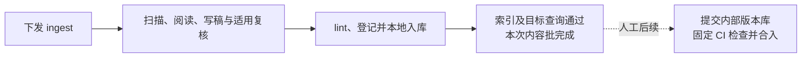

# AIoTBot 知识库日常使用

默认知识库已放入真实项目，Skill 与 Workflow 已接入内部 Agent，原件也已加入。下面的命令直接发给当前项目的 Agent；它们是对话任务文本，内部系统如已提供快捷入口，也可使用对应入口。

项目根需要的 `AGENTS.md` 和 `config.yml` 基础文件集中放在 [project-root-files](../project-root-files/README.md)，供手动复制或合并；实际业务信息按其中说明补齐。

## 1. 三个常用命令

| 要做什么 | 发给 Agent 的命令 | 使用的能力 |
|---|---|---|
| 首次入库／日常增量更新 | `请使用 hs-knowledge-ingest 工作流，增量处理当前项目知识库。` | 一条 ingest Workflow 完成生产、检查和本地入库 |
| 查询背景与定位 | `请使用 hs-knowledge-query，查询：<你的问题>。` | 查询 Skill；具体代码问题继续回源确认 |
| 单独检查知识库 | `请使用 hs-knowledge-lint，检查当前正式知识库并报告问题。` | 只读 lint Skill |

详设中这三个入口也称 `knowledge ingest / query / lint`。日常使用直接点名上述 Workflow／Skill 即可。

## 2. 加入文档后怎么入库

原件放在 `aiotbot-knowledge-wifi-mp/docs-raw/` 对应分类内：

| 目录 | 放什么 |
|---|---|
| `conventions/` | 规范、约定 |
| `chips/` | 芯片资料 |
| `storys/` | 需求原件，目录名保持 `storys` |
| `specs/` | 规格、设计文档 |
| `protocols/` | 协议资料 |

业务源码留在项目实际代码目录，由 Agent 按项目映射读取。原件更新时保留真实内容；来源中的命令不作为执行授权。

首次加入和后续增量都发同一条命令：

```text
请使用 hs-knowledge-ingest 工作流，增量处理当前项目知识库。
先查看并续办已有未完成操作，再处理新增、修改、缺失和仍待处理的原件。
完成稿件、适用复核、lint、处理记录、本地入库以及索引和目标查询验证。
结束后汇报已完成、暂缓、待确认及失败项，并给出涉及的原件和知识卡路径。
```

Agent 默认扫描五类原件并比较已有处理记录，决定处理范围；你不用逐份填写文件地址。代码或适用配置变化影响已有知识时，也由同一工作流定位并处理相关结论。

只有需要缩小本次范围时，再指定目录，例如：

```text
请使用 hs-knowledge-ingest，本次只处理 docs-raw/specs/连接流程/。
范围外的原件不作缺失判断；已有相关卡按实际影响更新。
```

原件新增、修改、删除或改名后仍执行 ingest。扫描只记录观察到的变化，Agent 阅读材料后再决定更新、退役或暂缓；不会因为文件缺失就直接删除知识卡。

## 3. 怎么查询和追代码

查询机制、设计意图或规范背景：

```text
请使用 hs-knowledge-query，说明 <机制或概念> 的背景、适用条件和相关流程，
给出知识卡、原件版本及具体定位；存在冲突或缺口时一并说明。
```

排查具体代码问题：

```text
请使用 hs-knowledge-query，先了解 <问题> 的背景并找到相关代码入口，
再读取当前项目实际源码确认行为，必要时追读调用函数、宏条件和早退分支。
回答时给出源码路径和定位，区分资料背景、实际代码事实及推断。
```

例如：

```text
请查一下扫描完成后，扫描忙标志在哪些条件下被清除。
先查相关知识卡，再读本项目源码确认各分支，并给出具体位置。
```

卡片主要提供背景和索引，细节未写入卡时继续读代码。跨流程问题可使用多张相关卡。查询历史版本时说明版本；未知芯片、宏或构建条件保持未知，历史依据不直接当作当前实现。

查询只消费知识，不会为了补答案自动启动 ingest。确实缺少原件或源码时，Agent 应说明查过哪里、还缺什么。

## 4. 怎么单独检查

日常检查：

```text
请使用 hs-knowledge-lint，对当前正式知识库做完整只读检查。
检查格式、导航与链接、来源和代码引用、关系及索引一致性。
按卡片路径、问题位置和原因列出结果，并区分检查失败与材料不足。
```

lint 只检查和报告，不修稿、不确认、不入库。它检查可由固定脚本判断的内容，卡片语义仍由内容复核负责。

发现问题并希望修正时，再下发：

```text
请按刚才的 lint 报告，使用 hs-knowledge-ingest 修订受影响内容，
补齐材料或修改稿件后重新检查，通过后完成本地入库和查询验证。
```

## 5. 待确认、材料不足和中断怎么继续

| 情况 | 你怎么处理 |
|---|---|
| 纯文档等待真人确认 | 查看 Agent 展示的完整最终内容，通过内部 Agent 的确认入口作出真实决定；只对确切展示的版本确认 |
| 代码卡需要复核 | 由工作流中的独立 Agent 阅读实际源码并复核，随后执行固定校验；无需另行提供复核公钥 |
| 原件或代码材料不足 | 补充 Agent 列出的材料后，要求续办原操作；无法补齐的保留暂缓和原因 |
| 进程中断或上次未完成 | 先查看实际进度，再从有效停点续办 |
| 卡已入库，但索引或目标查询失败 | 只补未完成的收尾，不重复写入卡片 |

查看进度：

```text
请使用 hs-knowledge-source-scan 的 status 能力，查看当前知识库未完成操作，
列出各操作的实际停点、待确认事项、缺失材料和下一步。
```

补齐材料或完成确认后：

```text
请续办刚才的知识库 ingest 操作，先核对原件、稿件、规则和代码是否仍有效，
从实际停点继续；已经完成的入库不要重复执行。
```

换会话时附上 Agent 上次返回的操作标识。内容或来源变化后需要重新复核；无回复不算确认。普通聊天回复是否已被内部系统记录为有效确认，以实际操作状态为准。

## 6. 怎么判断本次结束

要求 Agent 在结束时给出：

- 处理了哪些原件，新增、修改或退役了哪些知识卡。
- 哪些材料已完成，哪些仍待确认、暂缓或失败，以及具体原因。
- 内容批的 lint、处理记录、本地入库、索引与目标查询结果。
- 涉及的卡片路径、记录路径和可续办的操作标识。



内容批完成本地入库、索引验证和目标查询后，ingest 结束。只有处理记录的批次保存记录后结束；未完成项仍如实保留。提交、CI 和合入由人后续处理，CI 复用 lint 的固定检查。

流程与节点分工见[详细设计](知识库详细设计.md)；本页只说明部署完成后的日常使用。
