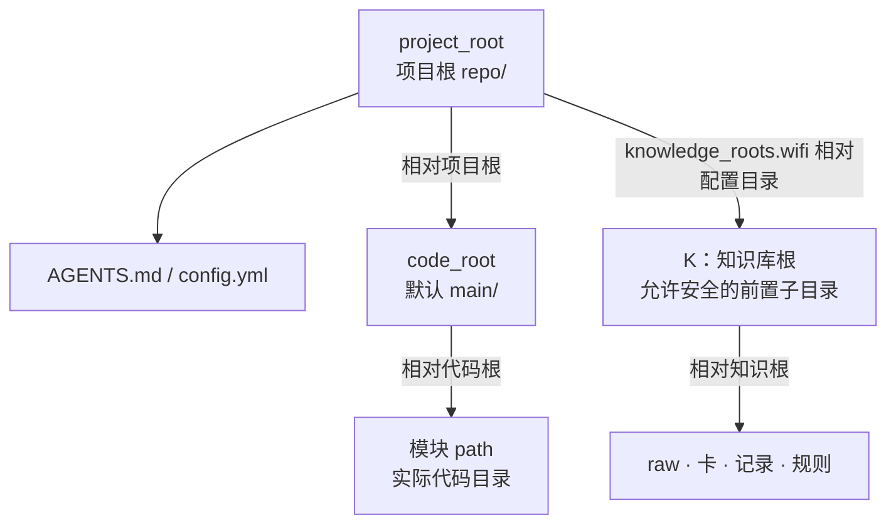
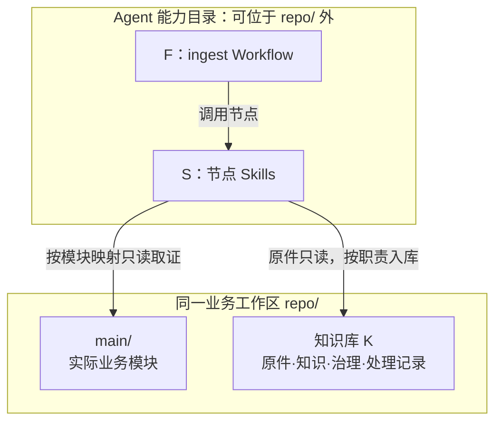
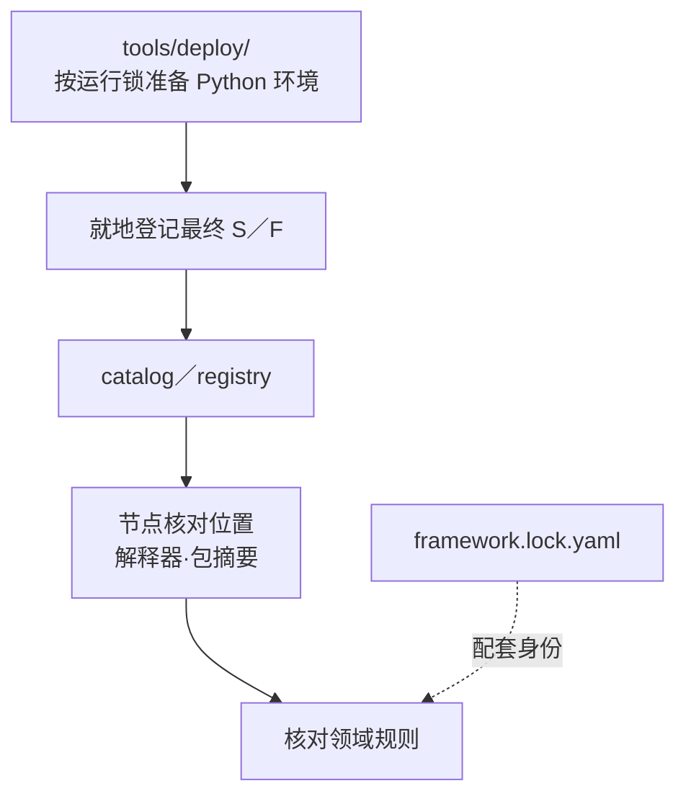
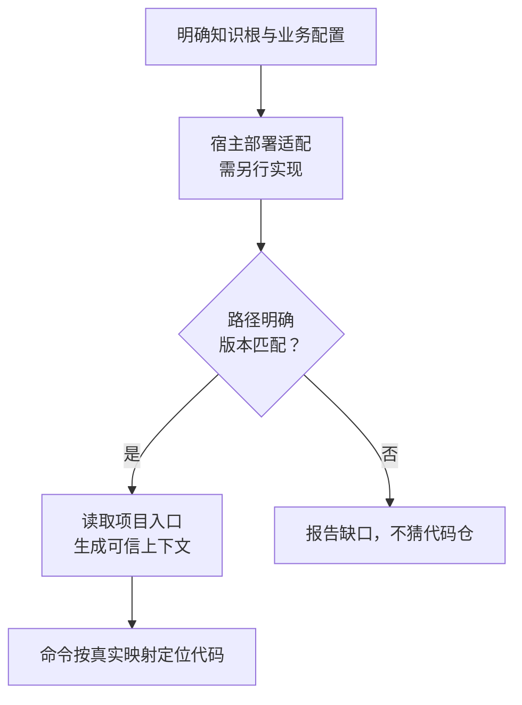
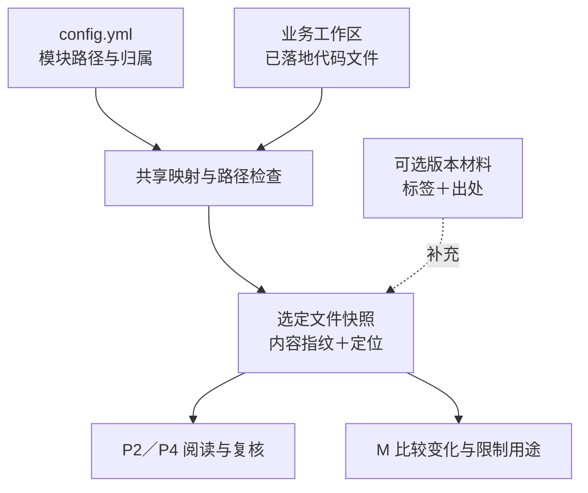

# 知识库关键点

本文集中说明工作区路径、部署方式与文件核验边界。系统分层见[架构设计](AIoTBot知识库架构设计.md)，流程与节点实现见[详细设计](知识库详细设计.md)，安装和操作见[使用说明](使用说明.md)。下文 P2／P4、M 等节点编号沿用详细设计。

## 1. 工作区路径与部署边界

### 1.1 路径基准



| 名称 | 路径含义 |
|---|---|
| `project_root` | 项目根，示意为 `repo/`；放置 `AGENTS.md` 和 `config.yml`，可管理多个 Git 仓 |
| `code_root` | `config.yml` 中的代码根，相对 `project_root`，默认 `main` |
| 模块 `path` | 相对 `code_root` 的实际目录，可覆盖一个或多个子仓 |
| `K` | 知识库根，由 `config.yml` 的 `knowledge_roots.wifi` 相对配置目录解析；默认 `aiotbot-knowledge-wifi-mp/`，可增加安全的前置目录；raw、卡、记录及领域规则使用根内相对路径 |
| `S`、`F` | Agent 实际的 Skill、Workflow 父目录；按最终位置登记，运行不依赖项目根分发源码 |
| `K/tools/deploy/` | 独立环境准备、运行依赖锁及已部署能力登记工具，不属于 Skill 包 |
| 外部版本材料 | 可补充文件的版本标签与出处；不替代实际文件核对 |

### 1.2 默认：知识库与代码位于同一工作区



Agent 阅读项目入口、复用已登记能力后使用知识库命令，不增加业务 `init` 或常驻服务。部署时的环境准备、最终目录登记和宿主接入仍须真实完成。业务代码保留 Host、Device、特性、公共算法等实际目录布局；知识库只读取已登记范围内的代码。`logs/ingest/` 是随知识拉取的处理记录。

开发仓根 `skills/`、`workflows/` 只用于分发，部署后能力可移到 Agent 目录；运行不依赖这些目录仍在项目根，也不另建嵌套 Git 仓。

环境准备和能力登记的关系如下：



登记不复制或移动能力，也不修改宿主注册；开发分发的复制打包接口另行提供。能力、解释器或项目配置迁移后重新登记，不新增业务初始化步骤。操作方法见[使用说明](使用说明.md#首次准备运行依赖)。

节点从 catalog 登记的确切配置取得项目根，并核对其 WiFi 映射确实指向本次 K；不把 K 的父目录当项目根。安装前的缺省发现只有唯一配置时才继续，有多个祖先配置时显式指定；工具所属知识根与登记映射不一致时不发布安装结果。嵌套不能绕过相对路径、越界、链接或配置变化检查。

纯文档的共享消费不强制携带原机器的私有登记。无登记时，可按实际 Git 仓根与已验证的发布内容定位；有非空显式登记时仍须精确匹配，失败不回退。处理记录的历史检查在没有项目配置时也可按确切 Git 历史恢复旧卡，并核对原内容指纹；若已有项目配置错误／歧义／不安全，则不能用该历史分支绕过。这些兼容路径不等于允许猜项目根或任意仓外读取。

服务器工作区统一经 SSH 执行逻辑节点和全部子 CLI，Python、能力、知识根和产物保留在服务器原生路径；调用端的工具副本、Python、配置、请求及响应在本地磁盘，不经 Samba／UNC／映射盘执行或遍历项目。真正本机部署及服务器本机 Agent 使用当地能力。profile 不属于共享架构映射，也不授予任意来源命令执行权。一个 ingest 固定执行端且单写，多 query 使用独立运行身份。具体配置见[执行配置说明](../tools/deploy/EXECUTION.md)。

`config.env` 只在显式 `--config-env` 的执行配置入口读取，保存用户填写的连接和部署位置；不参与 `config.yml` 的业务模块映射。服务器执行是部署规则，不等待性能报告；报告仍按确切配置、规则、能力、状态与 case 解释，不把来源读取的速度当作整个 ingest 的成绩。连接失败先核对原服务器状态，不改走共享盘或本地镜像。

| 配置 | 信任与路径基准 |
|---|---|
| 公共 `config.yml` | 项目架构真源；知识根相对配置目录，模块相对代码根，不放机器连接和凭据 |
| 机器本地 catalog／registry | 固定该执行端的配置、规则、解释器和最终能力路径／包摘要；路径或能力字节变化后重新登记 |
| 调用端 `config.env`／JSON profile | 显式选择执行位置与连接；本机 catalog 副本用于核对远端原字节，不用于在本机执行 Linux 路径 |

本设计中的“本地入库／本机索引”指数据所在的实际执行端；服务器项目就在服务器落位和检索。调用端响应副本、远端绝对路径和 K 内相对引用是不同对象，不能互换。runner 拒绝可识别的 UNC／Windows 网络映射盘入口，但不构成 OS 级全面封锁：原生外观的 Linux 网络挂载、直接 CLI 和第三方工具仍需部署者、Skill／Workflow 与实际权限共同约束。

公开配置只表达项目架构：

```yaml
schema_version: '2.0'
workspace_id: aiotbot-wifi-v1
knowledge_roots:
  wifi: aiotbot-knowledge-wifi-mp
code_root: main
modules: []
```

模块必填 `path`，可按实际补充 `chips`、`sides`、`features` 和 `description`；多值表示共享或关联，未知项可省略。`modules: []` 只表示尚未登记代码模块，可先处理文档；不自动将 `main/` 下所有目录纳入代码范围。逻辑 Target／pair 按模块归属整理，不要求用户手写六个 Target、三个 pair、绝对仓根或重复代码根授权。填法见[使用说明](使用说明.md#配置项目代码架构)。

当前查询频道由请求的 `channel` 选择，缺省为 local；`config.yml` 中已有的 `query.default_channel`／`allowed_channels` 尚不用于运行时默认选择或权限限制，不能作为访问控制。

### 1.3 例外：知识库位于业务仓外

当前安装器及运行节点从 `config.yml` 所在工作区定位知识根和模块；wifi 映射仍要求安全地落在该工作区内。执行器显式读取的 `config.env` 只配置执行端与连接，不扩展这一数据模型。仓外知识库仍需宿主另行适配；下图表示适配边界，新增配置文件本身不代表部署完成。



适配须核对能力／规则版本；执行器从明确可信位置加载，项目入口仍为 `AGENTS.md` 与 `config.yml`。K 内部引用仍相对 K，默认模块解析仍限于已确定工作区的 `code_root`；不新增任意仓外代码读取，也不据此接入仓外 raw 或网页来源。

### 1.4 项目视图与文件核验边界



`config.yml` 维护模块路径、芯片、端、特性与用途。代码目录按统一的文件取证规则处理，同一模块覆盖多个子目录时，分别固定选定文件的内容和定位。

外部版本材料通过可选 `version` 记录明确提供的标签并保留出处，含义以原材料为准。缺失字段保持 unknown，不阻断当前文件的静态源码核验，也不冒充某个已发布产品版本。

当前核验比较原配置、实际路径和文件内容指纹；旧结论不能因目录标签相同就继续有效。缺少真实路径、Target 条件或必要构建依据时由 P2／P3 报告缺口；标签只帮助定位，不能证明宏开启、构建成功或协议兼容。
