# AIoTBot 知识库详细设计

本文承接[架构设计](AIoTBot知识库架构设计.md)，按“用户入口 → 输入与结果 → 流程节点 → 文件职责”展开。生产、治理、消费是职责分段；生产与本地治理合在一条 ingest 工作流中，消费按需查询。上库由人手工提交、触发固定 CI 并评审合入，属于工作流结束后的操作。详细设计沿用概要中的节点顺序。

## 第一部分：概要设计

## 1. 用户入口与流程总览

### 1.0 命令之前：Agent 的项目能力发现

`hs-workspace-explore` 是会话前置的保底发现 Skill：Agent 未在项目仓内加载约定、尚不知道仓内有知识库或代码图谱，或独立 Workflow 节点只获得代码仓信息时，先由它补齐项目上下文，再选择并执行业务命令。已掌握这些信息的 Agent 直接复用，不在每条链路内重复调用。

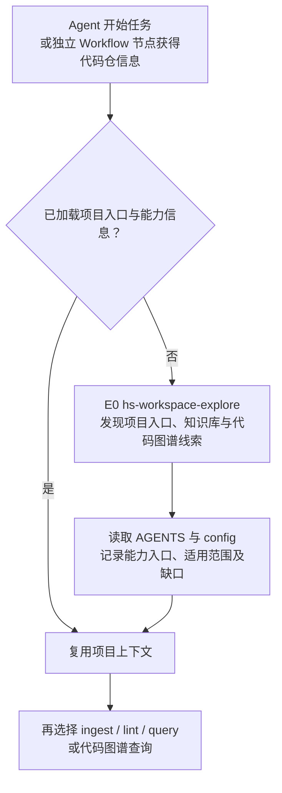

E0 位于三条业务链路之外，解决“Agent 知不知道这些能力在哪”。读取到图谱入口线索不等于已验证索引或服务可用，缺失信息保持缺口。项目内已正常加载入口时，用户仍直接执行命令，无需初始化或手动绑定。

### 1.1 从命令进入流程

统一用户接口以 `knowledge` 为逻辑命令名，职责按下表约定；宿主适配层负责注册和执行，不把 Skill 或 Workflow 目录名自动视为已安装命令。日常下发方式见[使用说明](使用说明.md#1-三个常用命令)，公开节点参数见对应 Skill 文档。

```text
knowledge <入口> [参数]
```

知识库随代码仓一并拉取，工作区根有 `AGENTS.md` 和 `config.yml`，其下 `aiotbot-knowledge-wifi-mp/` 就是知识库。具备项目上下文后直接执行入口，不需要选择项目、绑定知识库、执行 `init` 或启动服务；命令使用已知路径与规则，运行时校验所需输入，不重新执行 E0。raw 路径相对知识库根，代码引用相对业务工作区根。仓外部署例外仅见第 7.3 节，不作为默认流程。

| 用户要做什么 | 命令格式 | 执行什么 | 得到什么、何处停止 |
|---|---|---|---|
| 首次导入或更新知识 | `knowledge ingest [--source <raw文件或目录>]` | `hs-knowledge-ingest` Workflow，P1—P7 | 扫描变化、准备并确认／核验完整稿、调用 lint；登记记录并 stable 入 `knowledge/`，本地索引和目标查询通过后结束；未完成则保留停点 |
| 单独检查已有稿件或知识库 | `knowledge lint [--view <候选视图引用>]` | `hs-knowledge-lint` Skill，L1—L5 | 默认检查正式知识、导航和引用；可指定候选视图，输出问题清单，不修稿、不确认、不入库 |
| 回答知识问题 | `knowledge query "<问题>" [--target <Target>]` | 消费 Q1—Q5 | 带依据、范围和缺口的回答 |

日常用 `ingest` 完成更新，用 `query` 使用知识；`lint` 保留为可独立调用的只读检查入口，复用 ingest 和 CI 中的确定性规则，不单设另一条入库工作流。`status`、`index rebuild`、`recover` 属维护入口，见第 6.3 节。

日常执行 `knowledge ingest` 即可，默认扫描五类允许的 raw 目录。`--source` 仅用于临时缩小到某个文件或子目录；不填写时无需用户逐个指定文件，也无需分别调用五次。

ingest 在 P4 整理 `.build/` 内的完整稿件，展示前复用固定预检，并完成必要真人确认或代码依据核对；P5 再调用 lint 检查确切待入库视图。等待确认或补材料时保存原操作与确切视图，下次 ingest 先续办，不要求用户另启 lint；只有内容或输入改变时才重做对应稿件。原件与业务代码始终只读。

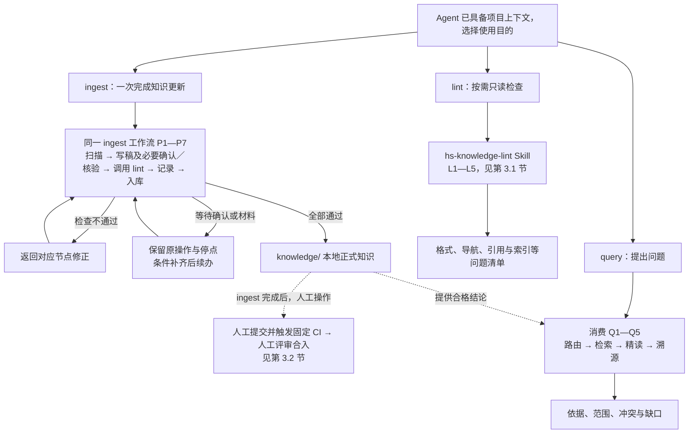

ingest 在 P3／P4 完成内容准备与必要确认／核验，P5 调用只读 lint，P6 登记处理记录，P7 本地入库、完整验证索引并执行本批目标查询后结束。独立 lint 与 CI 复用同一套确定性检查脚本和函数。仅记录批次以记录校验、落位完成为止；defer 或失败事项仍保留未完成状态。无变化则返回无需更新。lint 到报告为止；人工提交、CI 与合入不作为 ingest 的完成条件。

### 1.2 首次建库与增量更新用同一入口

首次提炼原件和后续更新都执行无参数的 `knowledge ingest`：首次没有已治理基线的原件都进入处理，之后只处理新增、变化和未完成事项。不要求用户选择另一条 `init`、`update` 或 `sync` 命令；如果仓库已经带有合格知识卡，未变化的原件无需重新提炼。

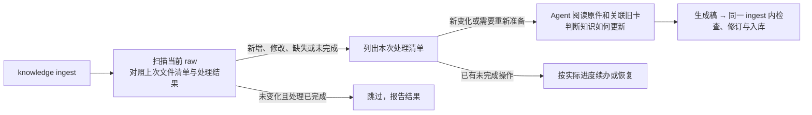

| 场景 | 调用与处理 |
|---|---|
| 第一批原件 | 执行 `knowledge ingest`，自动扫描五类目录；无基线的来源进入首次处理 |
| 新增文件或原件升级 | 仍执行 `knowledge ingest`；自动识别新增与变化，沿用逻辑来源 ID，比较原字节指纹，不只看修改时间 |
| 只想处理一个文件或某个子目录 | 才使用可选的 `--source` 缩小本次范围，其余目录本次不扫描、不推断缺失 |
| 上次已有处理记录但未结束 | 按实际进度续办：复用有效稿、先恢复未完成事务，或仅重试索引；不能因“捕获过”就跳过 |
| 改名、版本目录替换、原件删除 | 先确认是否同一逻辑来源及影响范围，知识退役仍走候选和治理 |
| 目录不可读、离线或扫描未完成 | 报告该范围缺口，不当作文件已删除或无变化，也不推进该范围扫描水位 |
| 仅索引损坏 | 使用 `index rebuild`；不重新提炼 raw，不改知识结论 |

扫描范围固定为 `docs-raw/{conventions,chips,storys,specs,protocols}/`，忽略 `.gitkeep`、`AGENTS.md` 等控制文件，不扩展到 `sources/`、仓外映射、候选区或正式知识区。`--source` 也须落在这些允许根内。

扫描与提炼分开：P1 判断文件有没有变化，不判断知识结论该怎么改。系统保留原件处理记录，Agent 再按清单读取材料；详细记录与步骤见第 2.1 节。输入未变化但处理未结束、治理规则或证明失效时，也不能直接跳过。

### 1.3 能力和资产放在哪里

```text
FactumCore/
├── AGENTS.md / config.yml              项目入口与映射
├── main/                              业务代码工作区
├── skills/common/knowledge/            节点 Skill 源包
├── workflows/common/knowledge/         ingest 端到端编排
└── aiotbot-knowledge-wifi-mp/           知识库根 K
    ├── docs-raw/                       只读原件
    ├── governance/
    │   ├── templates/                  知识卡、导航和复核模板
    │   ├── schemas/ · contracts/       字段约束与共用规则
    │   ├── specs/                      编写与治理规范
    │   └── sources.lock.yaml           正式来源身份
    ├── knowledge/                      正式知识卡和导航
    ├── .build/                         候选与操作暂存
    ├── logs/                          证据快照、确认及事务记录
    ├── artifacts/                     可重建索引与同代正文
    ├── evals/                         检索回归与链路验证
    └── docs-llm-wiki/                  系统设计与使用文档
```

下文领域资产路径以 `K` 为基准；`S` 表示项目根的 `skills/common/knowledge/`，`F` 表示项目根的 `workflows/common/knowledge/`。两类能力与根 `AGENTS.md`、`config.yml` 同级，代码引用按业务工作区 `project_root` 的实际映射解释，见第 7 章；不建立嵌套 Git 仓。

| 组件 | 负责什么 |
|---|---|
| Skill | 一个可复用节点，声明输入、动作、结果和失败原因 |
| Workflow | 节点顺序、判断出口和人工等待点，不复制算法 |
| Template | 提醒作者补齐内容，统一表达，不预填事实或成绩 |
| Script | 固定字节、校验引用、执行受控读写与检索 |

### 1.4 共同设计约束

| 对象 | 设计约束 |
|---|---|
| 文档来源 | 接受 `docs-raw/{conventions,chips,storys,specs,protocols}/` 内已落地原件；链接、网页、仓外映射不进入此链路 |
| 适用范围 | 具体产品结论按 `config.yml` 登记的六 Target、三 pair 核对；历史／指导性源码分析限定到确切源码版本，未知 Target 或构建条件保持 unknown，不推广为产品实现 |
| 纯文档结论 | 完成格式、来源和导航检查，真人确认确切最终视图后可落为 stable；免代码实现核验 |
| 代码结论 | 本地逐条核对源码、引用和实际需要的配置条件后 stable；源码分析不统一要求编译产物。具体 Target 的当前实现须核对实际注册及适用条件；编译、运行或实测效果须有相应证据 |
| 检索资格 | stable、实际合入、当前有效分别判断；来源或依赖失效时限制受影响结论 |
| 权限 | 目录表达职责；访问控制由实际仓库、宿主和工具权限落实 |

## 2. ingest 工作流：从原件变化到本地入库

**入口：**`knowledge ingest`，默认扫描五类 raw；需要缩小范围时才用 `--source`。**输出：**本地 `knowledge/` 中的 stable 知识，或保存了材料、稿件和停点的未完成操作。扫描、写稿、检查、修订及入库由同一工作流完成。

### 2.1 完整流程与节点判断

**流程起点：Agent 已读取项目 `AGENTS.md`，知道代码仓、知识库及能力入口，随后执行 `knowledge ingest`。** 缺少这些信息时，先在命令前由 `hs-workspace-explore` 辅助定位入口、引导 Agent 阅读 `AGENTS.md`（见 §1.0）；它不属于 ingest，也不是 P1。

P1 同时读取“现在目录里有哪些原件”和“这些原件以前怎么处理”，比较路径和内容指纹（hash），并关联已有来源身份，列出新增、修改、缺失及未完成事项。它只发现文件变化；一份原件可能对应多张卡，是否需要改卡、改哪些结论由 Agent 阅读后判断。

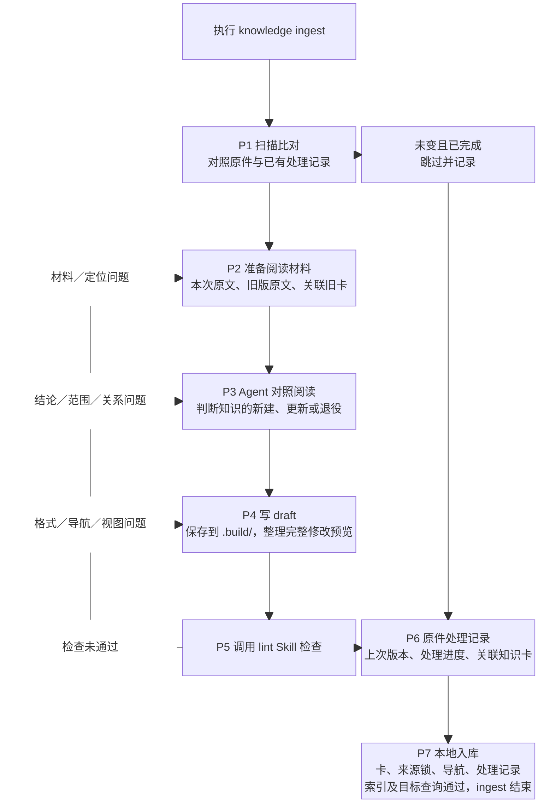

| 节点 | 谁负责 / Skill | 做什么、交付什么 |
|---|---|---|
| P1 扫描比对 | 原件扫描逻辑 | 在已知知识库路径下，对照原件处理记录列出文件变化，合并未完成操作及待修订问题；不发现或绑定项目，不调用 `hs-workspace-explore` |
| P2 准备阅读材料 | `hs-knowledge-source-capture` 及来源恢复接口 | 为新原件保留这次读取的副本与页/段定位；为修改或缺失项取回旧版原文，并从卡内来源引用找关联卡 |
| P3 阅读并判断更新 | 主 Agent + `hs-knowledge-change-plan` | Agent 阅读材料、写明受影响结论和理由；程序检查、保存六决策计划，不代替内容理解 |
| P4 保存知识稿与完整视图 | `hs-knowledge-view-materialize`、`hs-knowledge-governance-handoff` | 将 draft、导航、来源锁的拟写内容及材料引用保存到 `.build/`，登记操作与停点，正式区保持不变 |
| P5 调用 lint 检查 | `hs-knowledge-lint` | 只读检查完整拟写视图，返回格式、引用、导航、索引等问题；内部流程见 §3.1 |
| P6 登记处理记录 | ingest 记录逻辑 | 登记本次来源身份与版本、处理范围、关联卡及变更、检查结果和操作 ID，保存到 `logs/ingest/`，纳入本批待提交内容，不只留下本机操作路径 |
| P7 本地入库 | `hs-knowledge-apply`、`hs-knowledge-recover`、索引与 query 能力 | 将知识卡、导航、来源锁与处理记录同批落位；本地索引全验和目标查询通过后结束。仅记录批次校验并保存记录；中断恢复原事务 |

#### P5 检查失败，直接返回哪里

| 问题 | 返回节点与处理 |
|---|---|
| 原版、定位、代码或配置材料缺失 | P2 补齐；无法取得时交 P3 缩窄或暂缓相关结论 |
| 结论、适用范围、合并／拆分／替代关系有误 | P3 重判并更新计划，再到 P4 生成新稿 |
| frontmatter、章节、链接、导航或视图不一致 | P4 修正；涉及结论与范围的改动先回 P3 |
| 原件、代码、规则或正式基线已变化 | 返回对应材料或计划节点，形成新视图；未完成写入先由 P7 恢复原事务 |

修订由 ingest 调用 `hs-knowledge-candidate-revise`，同步计划、稿件和完整视图，再经 P5 重检。P5 有问题直接返回对应节点；通过后按“P6 登记处理记录 → P7 本地入库与检索验证”执行。未完成操作续办前核对原件、规则、代码及相关基线；已入库返回原结果，不能因重试或暂存丢失重复写入。

需修订的稿件仍返回 P2／P3／P4。若本次只登记跳过、defer 或失败事实，则由 P6 形成“仅记录”批次：知识卡、导航及来源锁的写删集合为空，不携带未通过稿件，也不把 P5 标成通过。记录自身固定校验通过后才交 P7；记录上库不把 defer 或失败改记为处理完成。

#### 原件处理记录保存什么、放在哪里

“原件处理记录”是以下记录的汇总，不依赖 Agent 的会话记忆，也不另手填一份“已入库=true”的事实。扫描和无产卡、失败、暂缓的处理结果同样需要留痕。

| 记录位置 | 记录内容及用途 |
|---|---|
| `logs/ingest/` | 每次扫描范围、是否完整、看到的路径与内容指纹，以及本次处理结果和操作引用；据此发现新增、变化、缺失及未完成项。处理记录纳入版本管理，随知识变更一并上库 |
| `governance/sources.lock.yaml` | 正式卡已经接纳的来源身份和确切版本；保存过原件副本不等于进入这份正式登记 |
| 正式卡内的 `sources` 与 Claim 引用 | 哪些卡、哪些结论使用哪个原件版本；反向关联从正式卡重建，不重复维护另一份关系真源 |
| `.build/operations/` 与 `logs/operations/` | 前者保存待检查稿和操作材料，后者保存真实落位、恢复及结果；台账引用这些记录判定实际进度 |
| `logs/evidence/`、`logs/events/` | 保留可读旧版原文，以及来源变化对已有结论的影响与复核状态 |

要分别记录**本次看到的原件版本**、**已由正式卡接纳的版本**和**当前处理节点**。P6 先登记本次处理结果；P7 实际写入后据实补记“已入库”，再完成适用的本地索引与目标查询，不提前记为完成。人工上库时将记录与知识内容一同提交。跳过、失败、暂缓及未覆盖事项也要保留在处理记录中，提交时一并纳入；某来源被一张卡引用，不表示整份原件已全部提炼。

#### Agent 具体读什么

| P1 发现的情况 | 交给 Agent 的阅读材料 | Agent 的判断 |
|---|---|---|
| 新增原件 | 本次原文及相关主题已有卡 | 是否有可沉淀知识，应该新建还是补充现有卡 |
| 原件修改 | 本次原文、各关联旧卡实际引用的旧版原文、差异和旧卡 | 哪些结论改变、哪些仍成立，选择 update、merge、split 或不改卡并记录理由 |
| 原路径缺失 | 保留的旧原文、关联旧卡和其他可用证据 | 是改名、资料暂不可达还是内容退役；不因文件少了就自动删卡 |
| 原文未变但上次未完成 | 上次操作结果、待检查稿及所需证据 | 先判进度：待检查稿有效则继续，未完成事务先恢复，已落位但索引失败则只重建索引 |

只有尚未开始落位、且已丢失或失效的知识稿才重新准备，并重新检查、确认。不能因 `.build/` 丢失就忽略事务结果、重复入库。旧版原文按各卡引用取回，同一原件可能仍有多个版本被不同卡采用。

举一个示意：某说明把超时从“5 秒”改为“8 秒”，P1 只发现文件内容变了；P2 准备新旧原文和使用该来源的旧卡；P3 由 Agent 核对条件及范围后决定怎样改稿。P4 写稿、P5 检查通过后，P6 登记处理结果，再由 P7 将新版知识与处理记录一并本地入库，并验证索引与目标查询；后续人工上库见 §3.2。

只有在相同范围内完整扫描成功，才能把“上次有、这次没有”的路径列为缺失。目录不可读、扫描中断或 `--source` 范围之外不能推断删除。阅读期间原件或正式卡又变化时，重新准备材料或修改预览；不沿用旧内容继续入库。

### 2.2 六决策如何选择

| 判断 | 决策 | 候选内容 |
|---|---|---|
| 没有同主题卡 | create | 新卡及来源、范围 |
| 同主题卡存在，职责保持一致 | update | 更新原卡，保留稳定身份 |
| 多张卡重复表达同一主题 | merge | 形成主卡，保留旧卡到主卡的替代关系 |
| 一张卡混装独立主题 | split | 拆成多卡，说明旧结论去向与互链 |
| 原结论错误或不再推荐 | deprecate | 标明原因与替代入口，保留追溯关系 |
| 来源不足或不可核验 | defer | 登记原因、责任人与下一步，不生成正式卡 |

已完整阅读本次材料且没有知识增量时，登记 skip 及已审范围、理由；它是无产卡的处理结果，不新增为第七种卡片变更决策。defer 表示仍欠材料或核验，保留未完成事项；不能因已经留记录或已有卡引用该原件就跳过。P1 的“未变且已完成”另注明为扫描跳过，避免与已审无增量混淆。

全部正式变更都须经过候选和治理，废弃也不能直接改 `knowledge/`。Agent 基于已读材料写出结论，脚本检查并固定内容。

### 2.3 五类 raw 如何选择入口与模板

五类资料默认由一次 `knowledge ingest` 共同扫描，差异是提炼问题和卡模板，而不是命令。一个原件可以产生多种卡，按结论性质选择，不按目录名强制唯一 Profile。

| 原件目录 | 优先提炼什么 | 常用模板 | 更新时重点比较 |
|---|---|---|---|
| `docs-raw/conventions/` | 对象、强制约束、建议和例外 | rule、glossary | 规则条款、批准状态、适用范围 |
| `docs-raw/chips/` | 芯片职责、机制、限制和术语 | entity、flow、glossary | 芯片及版本条件，设计声明与实现证据 |
| `docs-raw/storys/` | 场景、流程、设计决策和经验 | flow、entity、runbook | 需求或流程变化，结论是否仍适用 |
| `docs-raw/specs/` | 接口契约、状态、流程和约束 | entity、flow、rule | 接口与行为变更，不能把任务完成标记当代码证据 |
| `docs-raw/protocols/` | 协议机制、字段、状态机和条件 | protocol、entity、glossary | 条款版本，标准规定与产品支持的区别 |

输入格式与资料类别分别判断：非空 UTF-8 MD/TXT、每页有文字层的 PDF、DOCX 段落/表格可提取；扫描图、图中事实或其他不可解读部分记缺口。`docs-raw/sources/` 的链接不进入目录扫描，也不因放在列表内就自动联网。

## 3. lint Skill 与固定 CI

lint 是可复用的只读检查 Skill：ingest 的 P5 自动调用，也可通过 `knowledge lint` 手动调用，或由定期任务调用。它运行固定脚本、汇总结果；内容修订、真人确认、代码语义核验及入库仍由 ingest 负责。

### 3.1 lint 的检查流程

**输入：**P4 生成的完整候选视图，或已有正式知识库；**输出：**绑定检查对象与规则版本的问题报告。候选按“现有正式区 + 拟写入 − 拟删除”组成检查视图，检查链接时不要求候选先落入 `knowledge/`。

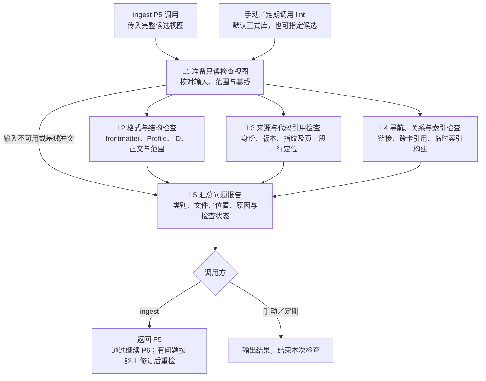

| 检查节点 | 固定脚本的判断逻辑 |
|---|---|
| L1 检查对象 | 正式库直接读取确定版本；候选核对操作、计划、视图、来源集合和拟写字节，拒绝越界、冲突写删或旧基线不一致。未完成事务报告需先恢复，不在 lint 中恢复 |
| L2 格式与结构 | 解析 YAML，校验必填字段、类型、枚举及 Profile 必需章节；核对卡／Claim ID、正文锚点和范围引用，`unknown` 不作全范围适用 |
| L3 源文档引用 | 核对卡与来源锁的身份、版本和定位，候选使用视图内含拟新增登记的来源锁；从确切副本恢复原文，校验指纹及引用的行、页、段、表格或附件可读，不以同名新文件代替旧原版 |
| L3 代码固定引用 | 对提供的确切代码版本核对仓库、路径、文件指纹及行段；检查 Target／构建引用是否符合已登记结构。代码是否支持结论由 ingest 在 P3／P4 判断 |
| L4 导航与关系 | 检查 `index.md`、链接／锚点、唯一 ID、目标卡／Claim、替代关系与依赖环；受管导航须与完整检查视图一致 |
| L4 索引可构建性 | 只在临时目录构建索引，核对结构、记录、正文指纹和卡／Claim 映射；不切换本地查询的活动索引 |
| L5 汇总结果 | 列出已通过、失败、因输入缺失未完成及不适用项；缺材料不能记为通过。候选整体不可用时先报输入问题，其余可执行检查尽量汇总，便于一次修正 |

`index.md` 是纳入检查的导航文件，SQLite 是临时构建的检索产物。正式库模式不要求候选操作、交接材料或安装 catalog；lint 仅可生成临时产物和报告，不改知识、来源锁、确认、维护水位或活动索引。检查通过仅表示所列固定项合规；ingest 接收问题后按 §2.1 修订；必要确认／语义核验在 P3／P4 完成，P6 只登记处理记录。

### 3.2 上库：固定 CI 检查后合入

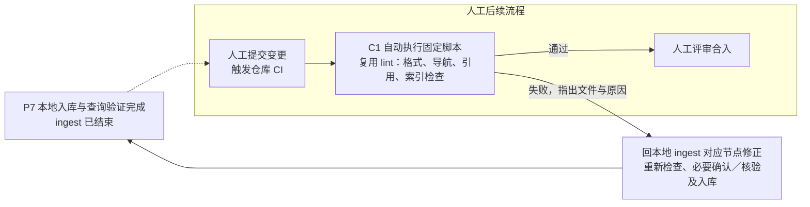

人工提交后触发仓库 CI；CI 自动运行已有 lint 的固定检查脚本和共用函数，不另开发一套检查，也不增加业务代码编译任务。CI 不加载 Agent 或 Workflow，不重新组织真人确认，不自动修改卡片。脚本失败则返回本地修正，再由人提交重跑；通过后由人评审合入。

| CI 检查项 | 复用 lint 的哪部分 | 固定脚本做什么 |
|---|---|---|
| 格式与身份 | L2 | 检查 frontmatter、字段／枚举、Profile 章节、卡与 Claim ID、正文定位及范围引用 |
| 导航与关系 | L4 | 检查 `index.md`、链接／锚点、跨卡／Claim 引用、替代关系与依赖环 |
| 来源登记与引用 | L3 | 检查卡与 `sources.lock.yaml` 的身份、版本和定位结构一致；需要关联当前代码时，对 CI 提供的最新业务代码固定 checkout 核对路径、行段及文件指纹，不符则返回本地重检 |
| 索引可构建性 | 共用索引构建与校验函数 | 在临时目录生成检索索引，检查结构、记录及卡片映射一致性；产物不必提交，不切换查询服务的活动索引 |

CI 输入是本次提交及作业明确提供的代码／原文，不依赖开发机的 `.build/`、安装 catalog 或私人日志。L1 改用提交文件作为检查对象；原文页段恢复仅在取得确切原版时检查，未取得时明确未执行的范围。必需输入缺失则 CI 不通过；本地代码语义判断在 P3／P4 完成，纯文档真人确认在 P4 完成，P6 登记处理结果。

CI 问题绑定提交、文件和位置，作为下一次本地 ingest 的待修订输入，即使 raw 未变也需处理；修复产生新操作，再经 P5—P7。已经完成的入库事务保留原结果，不重新 apply。

## 4. 消费流程：从问题到证据回答

**入口：**`knowledge query "<问题>"`，使用已有项目上下文，可补 Target；**输入：**问题、范围和已治理知识，**输出：**带证据的回答及明确缺口。空库可以正常返回无合格知识，不隐式触发 `ingest` 或自动发布。

### 4.1 路由与检索节点

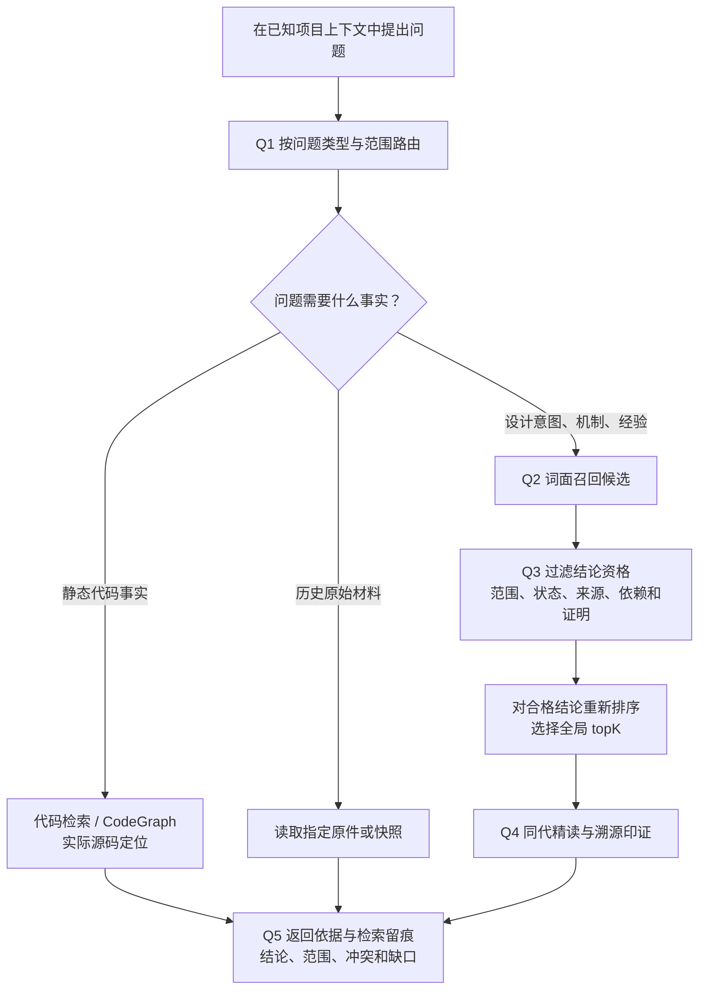

| 节点 | 能力与资源 | 判断逻辑 |
|---|---|---|
| Q1 问题路由 | 主 Agent、已加载的 `AGENTS.md` 与 `config.yml` | 按问题选择知识卡、代码图谱或原件；不推断未知 Target，不重复执行 E0 |
| Q2 词面召回 | `hs-knowledge-query`、SQLite | 只产生候选，得分不表示事实概率 |
| Q3 过滤与排序 | 同一查询 Skill、治理规则和当前证明 | 先筛合格 Claim，再计分取 topK；unknown 不作范围通配 |
| Q4 精读与溯源 | 查询 Skill、同代正文、来源恢复能力 | 阅读结论、条件、失效边界、验证方法，核对确切证据 |
| Q5 回答与留痕 | 查询结果、Search Receipt；主 Agent 综合 | 区分来源陈述、代码事实和推断，报告冲突与缺口 |

### 4.2 变化如何反馈到三条链路

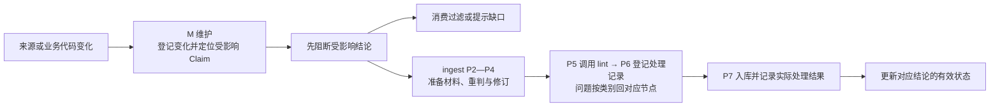

`hs-knowledge-maintain` 是三条链路共用的维护能力。它区分“发现了哪个版本”和“哪个版本已完成复核并用于知识”，不能仅因原件更新就宣称知识已同步。

## 第二部分：详细设计

## 5. 按节点展开文件设计

节点编号沿用 §2.1：P1 扫描、P2 材料、P3 判断、P4 稿件、P5 调用 lint、P6 处理记录、P7 本地入库与检索验证。下文只说明文件承担什么逻辑；Skill 路径相对 `S`，领域文件路径相对 `K`。

### 5.0 入口、Workflow 与共用规则

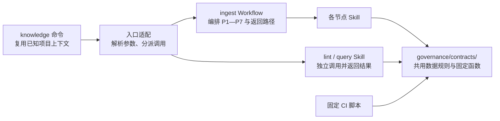

| 文件 / 位置 | 设计职责 |
|---|---|
| 宿主命令适配 | 将 `ingest`、`lint`、`query` 分派到对应能力，传入已有路径与规则；扫描和内容判断交给节点 |
| `F/hs-knowledge-ingest/workflow.yaml` | 编排节点、问题返回、仅记录分支及有界修订／续办；内容通过 P5 后接 P6、P7 |
| 节点 `SKILL.md` | 说明输入、动作、输出与返回原因；脚本执行其中可固定的步骤 |
| `governance/contracts/` | 统一身份、来源、范围、记录和检查规则，供 Skill 与 CI 复用 |

lint 只承担检查，ingest 按问题类别返回 P2／P3／P4，运行故障则保存当前停点。没有知识变更的 skip、defer 或失败可汇总到 P6，只登记真实结果，再由 P7 校验并保存记录；这不代表内容通过 P5。运行节点和等待状态由宿主留存，判断规则统一复用 Contract。

### 5.1 E0：命令前帮助 Agent 阅读项目入口

| 文件 / 对象 | 设计职责 |
|---|---|
| `hs-workspace-explore/SKILL.md` | 定义缺少项目约定、知识库或代码图谱入口时的触发条件；已有上下文直接复用 |
| `hs-workspace-explore/scripts/node.py` | 根据已知仓路径定位适用的 `AGENTS.md` 与 `config.yml`，交付可读取的入口与缺口 |
| Agent | 阅读这些文件，理解代码仓、知识库、图谱和业务命令的使用规则 |
| 项目 `AGENTS.md`、`config.yml` | 分别提供行为约定与唯一映射，不在 Skill 内另存一份项目事实 |

E0 完成后才选择业务命令。它不属于 ingest 的 P1，也不安装能力、绑定项目或启动服务；图谱是否可用由实际查询结果判断。

### 5.2 P1 / P2：扫描原件，准备新旧材料

P1 列出本次待处理原件；P2 找出需要阅读的候选卡，准备新旧对照材料。候选卡附带关联原因，不等于必须修改的卡。

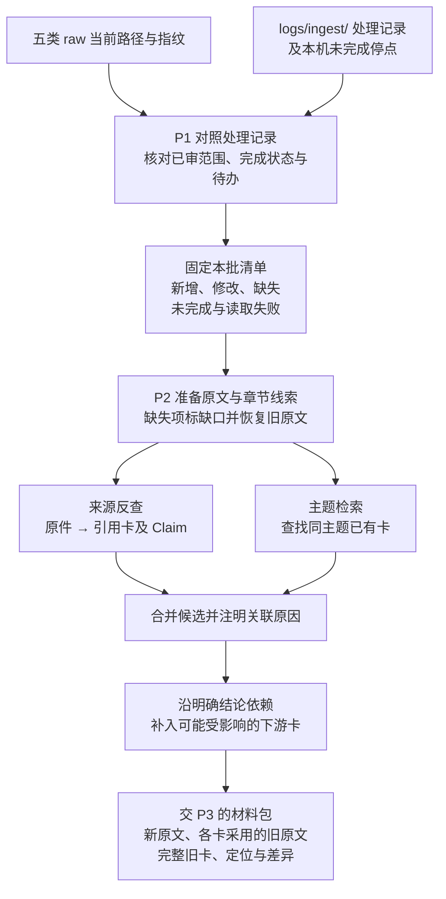

| P2 如何找卡 | 依据与边界 |
|---|---|
| 来源反查 | 以来源身份反查正式卡的 `sources` 与 Claim 引用，找出引用版本和原文定位；处理记录的关联卡摘要可帮助定位，实际关系以卡内引用为准 |
| 主题检索 | 根据标题、章节及初步阅读中的实体、协议、接口、符号和范围检索；新增原件没有历史引用，主要走此路，旧原件新增主题也要补查 |
| 依赖扩展 | 沿明确的跨卡／Claim 依赖查找下游结论；普通“相关链接”不自动扩散，是否受影响由 P3 判断 |

卡内来源须能说明“哪条结论采用哪个版本的哪段原文”。只有整篇引用或定位不清时，将整卡列为阅读候选；不能凭文本差异直接排除其他章节条件变化的影响。P3 读出新主题或依赖时回 P2 补查，检索无命中不直接等于应新建卡。

| 文件 / 位置 | 设计职责 |
|---|---|
| `hs-knowledge-source-scan/scripts/scan.py` | 枚举五类允许目录，按可选 `--source` 缩小范围；对照路径、指纹和处理结果，固定本批清单及扫描完整性，供 P6 对账 |
| `governance/contracts/records.py` | 区分观察版本、已完成范围、实际采用情况与待办，不能因已记录新指纹就跳过未完成项 |
| `hs-knowledge-source-capture/scripts/capture.py`、`governance/contracts/source_resources.py` | 保存本次原字节、可读文本和定位；按各卡实际引用恢复旧原文并准备差异，读取期间变化则重新准备 |
| `governance/contracts/knowledge.py` | 从卡／Claim 引用重建来源反查与明确依赖；派生索引可重建，不另维护关系真源 |
| 主 Agent、`hs-knowledge-query/scripts/node.py` | 按原文线索检索同主题卡并补查；整理用检索覆盖范围内卡的各状态，不能因问答默认过滤而漏掉待修订卡，也不据此赋予回答资格 |
| `hs-knowledge-source-capture/scripts/code_capture.py` | 按真实映射取得所需代码、快照、文件与配置；未知项保留缺口 |
| `.build/operations/<操作>/` | 保存本批清单和材料引用，以及候选卡、关联原因、各卡采用版本及差异，供 P3 阅读 |

旧原文按每张卡实际采用的版本取回，不能统一使用“上次扫描版本”；缺失或读取失败项不伪造本次原文，恢复旧引用并标明缺口交 P3。只有同范围完整扫描成功才推断路径缺失；改名、删文件或删段落不直接等于结论废弃，可能是移位或资料缩编，须由 P3 核实。未变但有欠账或上下文失效的来源仍需处理（见 §5.10）。

| 找卡示例（示意） | P2 的结果 |
|---|---|
| 《认证说明》将 chip12 Host 超时由 5 秒改为 8 秒 | 来源反查找到《超时规则》，沿明确依赖补入《重试流程》；两张卡均待 P3 阅读，尚未决定都改 |
| 新增《认证诊断说明》，尚无任何卡引用它 | 按认证、超时、日志等主题找到已有《认证诊断》；P3 再决定补旧卡还是建立独立新主题卡 |

### 5.3 P3：阅读材料，判断结论与变更计划

P3 先按目标卡归并本批材料，再逐条比较结论的事实、适用条件和依据，最后汇总卡的变更计划。同一卡只交一个作者串行融合，独立卡才并行。

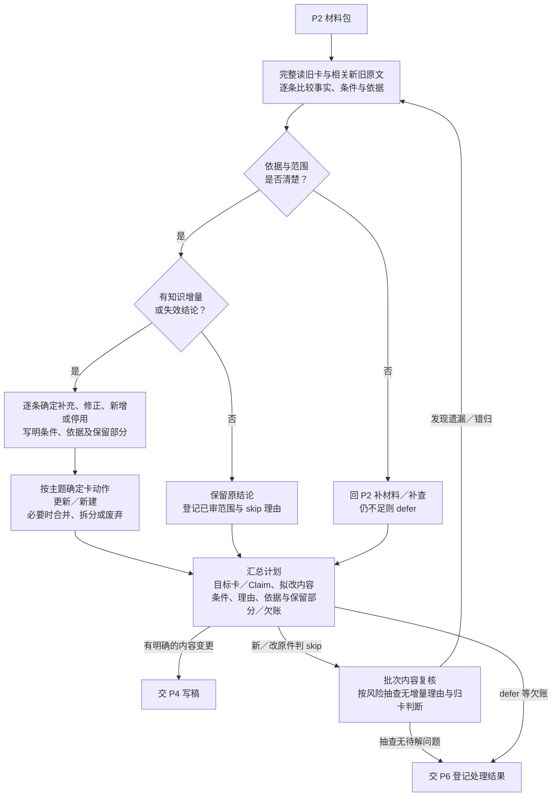

| 逐条比较的结果 | 内容处置与计划 |
|---|---|
| 事实及条件未变，只调整措辞／排版 | 保留；已审无增量记 skip，不因原件版本变化重写所有卡或统一替换来源版本 |
| 新原文补充已有主题 | update，说明补哪条结论、来源和适用条件，融合进旧内容 |
| 原结论的数值、行为或条件改变 | update 受影响 Claim，说明新旧适用范围；其他结论保留，不将一个芯片的变化推广到其他芯片 |
| 出现独立新主题，已有卡无合适归属 | create；先完成查重和主题边界判断，不能仅因来源是新文件就建新卡 |
| 新旧来源冲突或必要依据不足 | 先核对芯片、Host／Device、版本和配置差异；补材料仍无法判断则 defer，不能默认新来源覆盖旧来源 |
| 经核实已有结论失效 | 修订或停用对应 Claim；仅当整卡职责均失效时 deprecate，并说明旧结论去向及替代入口 |

内容判断后再检查卡的组织：同主题卡重复才 merge，一卡混装独立主题才 split，并保留旧 Claim 的去向。普通 update 保持卡的稳定身份，多源重叠合并、互补补全；导航、来源锁和处理记录由编排者统一收尾。多源组织参考 CANNBot 的[同卡实施单元](https://gitcode.com/cann/cannbot-knowledge/blob/c92c66ee695090c44487f56bd051d2607c58b27a/.agents/skills/knowledge-ingest/references/incremental-sync.md#L14)。

批次复核者独立于作者，按风险抽查新／改原件的 skip 理由及 new/update 归属，读取原文、旧卡和计划；遗漏或错归回 P2／P3，材料不足则 defer。实质 skip 在 P3 完成本批抽查，P4 复用未变化的裁决结果。记录抽查范围、结果和未抽项，未抽项不记为复核通过；P1“未变且已完成”的扫描跳过无需重审。

| 文件 / 对象 | 设计职责 |
|---|---|
| 主 Agent、`hs-knowledge-change-plan/SKILL.md` | 按上述顺序阅读、比较与归卡；说明修改和保留的理由，需要新材料或候选时回 P2 |
| `hs-knowledge-change-plan/scripts/planning.py` | 固定处理单元、目标卡／Claim、旧基线、拟修改／保留内容、条件、依据、作者与欠账；只校验计划结构及引用，不代替语义判断 |
| `hs-knowledge-local-check/SKILL.md`、`hs-knowledge-local-check/references/review-guide.md` | 指导批次抽查及内容复核；逐 Claim 核对真实定义、调用和所需宏／Target 条件，缺口缩窄或暂缓；图谱仅提供定位线索 |
| `governance/templates/{entity,flow,protocol,rule,command,runbook,glossary}.md`、`governance/contracts/knowledge.py` | 提供七类卡结构和 Card／Claim／范围／关系表达，供计划与 P4 共用 |

**接续 §5.2 的超时示例：**P3 的计划应细到结论，而非将两张候选卡全部标成 update。

| 目标卡／结论 | 阅读判断 | 给 P4 的计划 |
|---|---|---|
| 《超时规则》：chip12 Host 等待上限 5 秒 | 新原文明示该条件下改为 8 秒 | update 对应 Claim，列出新原文定位及条件；其他芯片结论保留 |
| 《重试流程》：超时后重试，未写具体秒数 | 重试触发条件仍成立 | 保留，记已审理由，不生成该卡的修改 |

若《重试流程》实际写了“5 秒后重试”，该步骤也列入 update。若 8 秒只是文档中的设计要求，计划只表述要求；有实际代码及配置依据后才写成代码事实，无法补齐就缩窄结论或 defer 对应单元。skip 不增加第七种卡变更动作，defer 与未覆盖部分保留欠账，其他已形成明确变更的单元可继续 P4。

### 5.4 P4：形成完整稿件，完成必要内容确认

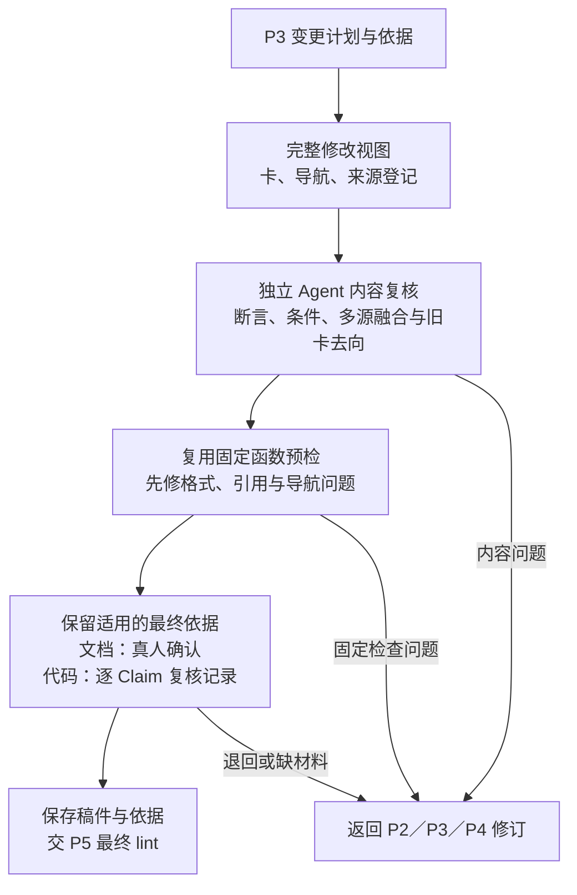

| 文件 / 位置 | 设计职责 |
|---|---|
| `hs-knowledge-view-materialize/scripts/materialize.py` | 按计划整理拟写入／删除清单、旧基线及完整文件内容，形成可重现的视图 |
| `governance/templates/index.md` | 生成随卡修改的导航；来源锁的拟新增版本也纳入同一视图 |
| `hs-knowledge-local-check/references/review-guide.md` | P3/P4 共用复核指南：核对关键断言、条件、多源融合，并抽查本批 skip 与归卡裁决；已有裁决结果未变时复用，问题注明位置、依据及修改原因 |
| `hs-knowledge-local-check/scripts/check.py` | 校验 Agent 复核记录的作者回避、逐 Claim 依据、最终视图与源码上下文绑定；核对引用及所需配置，不自行判断知识语义，也不要求复核者公钥或签名 |
| `hs-knowledge-confirmation-prepare/scripts/prepare.py`、`hs-knowledge-confirmation-record/scripts/confirmation.py` | 复用固定函数预检后，展示纯文档的确切最终内容、来源、差异与缺口，记录真实人的明确动作 |
| `hs-knowledge-governance-handoff/scripts/handoff.py` | 保存本次材料、视图和当前停点，供同一 ingest 继续或续办 |
| `hs-knowledge-candidate-revise/scripts/revise.py` | 根据退回原因同步修订计划、稿件与视图，保留修订理由 |

新增或实质变更代码结论，由独立于作者的新上下文复核者只读卡、原文／代码及计划，输出问题，作者修订至无未解决的阻断项；纯文档按同一准则审阅，并取得真人确认。组织方式参考 community Reference producer 的[独立内容复核](https://gitcode.com/cann/cannbot-skills/blob/d075d3735535399d7fc6a5fa18b43191bb1546a9/plugins-community/cannbot-knowledge/skills/ops-knowledge-reference-ingest/SKILL.md#L65-L73)，固定脚本只检查确定性项。

Agent 的代码复核记录保存作者与复核者、独立上下文、逐 Claim 判断及理由、来源定位和对应稿件。脚本检查记录完整性、作者回避和确切内容绑定；上下文隔离由 Workflow／宿主落实，记录本身不证明复核者身份或知识正确，不设置公钥登记、密码学签名门槛。

历史／指导性源码结论可绑定确切仓库、版本、文件指纹和行段完成独立复核，未知 Target、宏或构建信息保持 unknown。它只说明这份源码表达的逻辑，不证明具体产品当前适用或已编译运行。current／implementation 结论须核对实际注册的 Target 和适用条件，静态源码支持的结论仍不统一要求编译产物；编译、运行或实测断言才要求相应证据。已提供的配置和构建证据必须一致，变化后重新核对。

预检使用 §5.5 同一组固定函数，让确认对象先满足结构要求；P5 对最终视图再次检查。无回复或暂缓保留 P4 停点，Agent 自报或超时不算同意。混合稿满足全部适用要求；内容、来源、规则或基线变化后更新视图，重新复核受影响部分并取得相应确认／依据，不沿用旧字节的同意。

稿件仍位于 `.build/`。视图可预先表达 stable / deprecated 的最终内容，只有 P7 实际落位后才成为正式知识。

### 5.5 P5 / L1—L5：调用只读 lint Skill

ingest 与手动／定期检查调用同一个 `S/hs-knowledge-lint/` Skill；CI 直接复用共用固定函数。检查按 L1—L5 展开，规则由 `checks.py` 静态登记，不能由候选内容声明跳过。

| 节点 | 文件 | 设计职责 |
|---|---|---|
| 入口 | `hs-knowledge-lint/SKILL.md`、`hs-knowledge-lint/scripts/lint.py` | 选择候选／正式库与全库／局部范围，调用固定规则并返回统一报告 |
| L1 检查视图 | `governance/contracts/checks.py` | 候选按“正式区 + 拟写入 − 拟删除”展开，核对操作、文件内容、允许目标及旧基线；正式库直接读取确定版本 |
| L2 格式结构 | `governance/schemas/`、`governance/contracts/{validation.py,knowledge.py}` | 检查 frontmatter、Profile 章节、ID、正文锚点及范围引用 |
| L3 来源引用 | `governance/contracts/source_resources.py` | 核对视图内来源锁、确切原版、指纹、页／段／行定位及代码固定引用；不推断语义支持 |
| L4 导航关系 | `governance/contracts/{checks.py,knowledge.py}` | 检查导航、链接／锚点、跨卡／Claim 引用、替代关系与依赖环 |
| L4 索引 | `governance/contracts/indexing.py` | 前置阻断项清除后临时构建，完整核验版本、集合、正文与查询记录，见 §6.2；不切换活动索引 |
| L5 报告 | `hs-knowledge-lint/scripts/lint.py`、`hs-knowledge-lint/artifacts/templates/result.md` | 输出对象／规则身份、模式／范围、各项执行状态与问题；问题含稳定检查 ID／错误码、等级、文件／位置和原因 |

| 固定检查类别 | 失败／未完成条件 | ingest 的修订位置 |
|---|---|---|
| `view` | 越界路径、重复／冲突写删、内容或旧基线失配 | P4；缺原始材料回 P2 |
| `format` | YAML 重复键、Schema／Profile 不符、ID／范围结构非法、正文冲突标记 | P4；范围选择问题回 P3 |
| `source` | 来源未登记、指纹／定位失配为错误；必需原版未取得或读取失败为未完成 | P2 补材料；引用选择问题回 P3 |
| `relation` | 目标不存在、ID 重复、替代自指、依赖环、导航缺漏、链接／锚点失效 | P3 决定关系，P4 修订表达 |
| `index` | 合格集合漏项／重复、正文或查询记录失配、索引／规则版本不符 | 内容问题回 P3／P4；构建故障停 P5 |

ingest 门禁与 CI 执行完整合成视图的仓库级检查，包括删除／改名后的反向引用、父导航和全局 ID。手动局部检查只对列出的对象负责，报告不得表示全库通过。纯文档的代码检查列不适用；必需输入缺失列未完成，前置失败而未执行的索引检查也须注明。

退出码统一为：`0`＝所选范围内必需项完整执行且无阻断，`1`＝发现阻断问题，`2`＝必需输入未取得，或规则、运行器、报告不可用。材料缺口回 P2，运行故障保存停点；建议项不阻断。空／损坏报告、状态与退出码不一致均按运行失败处理。只有完整全库报告可作为内容进入 P6 的门禁；修订后重跑 P5。结果语义参考 CANNBot 的[检查协议](https://gitcode.com/cann/cannbot-knowledge/blob/c92c66ee695090c44487f56bd051d2607c58b27a/.agents/skills/knowledge-lint/references/checks.md#L34-L48)，独立 lint 到报告为止。

### 5.6 P6：登记唯一的原件处理记录

P6 汇总扫描、跳过、提炼、暂缓和检查结果，形成 `logs/ingest/` 中随知识变更上库的记录。它就是 §2.1 的“原件处理记录”，不另建第二份来源与卡关系真源。

| 文件 / 位置 | 设计职责 |
|---|---|
| `hs-knowledge-source-scan/scripts/record.py` | 将本批清单与各节点结果逐项对账，生成待提交记录；跳过、读取失败和未覆盖事项也有处置 |
| `governance/templates/ingest-record.yaml` | 提供记录结构，不预填检查通过、已入库或已合入 |
| `governance/schemas/records.schema.json`、`governance/contracts/records.py` | 校验结构与覆盖，拒绝漏项、重复及清单外自报完成；产卡项反查最终卡／Claim 的实际来源版本 |
| `logs/ingest/<记录ID>.yaml` | 保存可提交记录；其他人拉取后可直接理解处理事实 |

| 记录内容 | 需要说明什么 |
|---|---|
| 扫描事实 | 本批清单身份、范围、是否完整、原件相对路径、来源身份与看到的版本／指纹 |
| 处理范围与结果 | 各处理单元采用的决策、所覆盖部分、跳过／暂缓／失败理由、欠账及下一步 |
| 关联知识 | 卡／Claim 身份及变更摘要；实际采用的来源版本以卡内引用和来源锁为准 |
| 检查与进度 | 操作 ID、规则与内容视图身份、适用验收结果及代码上下文、实际停点；仅记录批次的卡视图确认／代码依据不适用，适用的 skip 抽查范围与结果仍须记录 |

| 处理结果 | 登记与后续 |
|---|---|
| 内容就绪 | 从 P5 已通过视图核实卡／Claim 与来源绑定，实际入库结果由 P7 补记 |
| skip | 区分扫描跳过与已审无增量，记录版本、范围和理由；实质 skip 按 §5.3 保留本批抽查情况，未抽项不冒充复核通过 |
| defer | 材料或结论不足，保留欠账，不能推进对应范围完成状态 |
| 失败／未覆盖 | 记录问题与未处理部分，保留后续候选和停点 |

每个本批处理单元有唯一处置；P3 拆分单元仍须覆盖原选中范围，未分配部分列未覆盖。一源可以多卡、分段完成，已有一张卡引用或仅观察到新指纹均不代表整份完成。实际采用关系仍以卡／Claim 和来源锁为准。

P6 生成后立即固定校验，错误留 P6 修正；P7 据实补记落位结果后复验，不提前宣称提交／合入，也不要求记录包含自身提交哈希。记录不得改动 P5 已检内容；需要改卡、导航或来源锁则回 P4／P5。观察记录可尚未登记来源，读取失败可缺指纹并说明；“内容检查失败”是合法处理事实，不能据此将失败稿件记为已入库。

### 5.7 P7：知识与处理记录同批本地入库

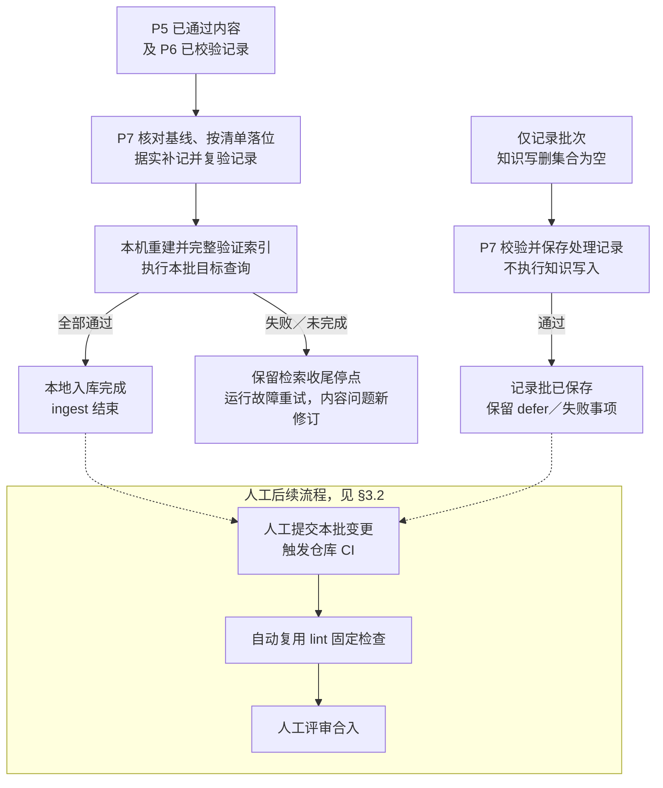

| 文件 / 对象 | 设计职责 |
|---|---|
| `hs-knowledge-apply/scripts/transaction.py` | 正常批核对最终视图、完整检查、适用确认／代码依据、来源恢复条件和旧基线；同批写入卡、导航、来源锁及记录，核验落位并复验补记后的记录 |
| `hs-knowledge-recover/scripts/recover.py` | 根据原事务检查、续做或回滚；保留外部修改，不创建新事务冒充恢复 |
| `logs/operations/<操作>/` | 本机持久事务日志、备份和结果，用于中断恢复 |
| 人工上库清单 | 本地结束时列出本批正式内容及 `logs/ingest/`；由人按清单提交，不整体提交工作区或 `logs/`。可选交接工具不作为 ingest 完成门槛 |
| `hs-knowledge-index-build` 与 query 的固定检查 | 从实际落位内容构建、完整验证本地索引，按本批目标问题检查召回、范围过滤及同代读取；通过即完成内容批的 ingest |

正常批先 P6 登记，再 P7 落位、补记并复验；本机索引完整验证与本批目标查询均通过后，ingest 成功结束并给出本批文件清单。写入失败按原事务保存或恢复，检索检查未完成则保留收尾停点。Git 提交、触发 CI 和合入由人后续执行，不要求工作流先取得提交或 CI 结果。

仅记录批次先保存无法继续事项的停点，卡／导航／来源锁写删集合为空，卡内容视图、确认与代码依据列不适用；适用的实质 skip 先完成 §5.3 的批次抽查，再校验记录与引用并实际落位后结束，无需构建索引、执行目标查询或取得 Git 提交。不携带失败稿件、不伪造 P5 通过；记录保存成功不把 defer 或失败改成已完成，无变化的重复扫描不制造新处理记录。人工提交时沿用同一本批清单。

本地入库按来源锁核对已捕获原件的确切对象、指纹和大小，不要求原件先有 Git 提交。人工上库时须使采用的原版可从约定 Git 版本或同组持久位置恢复，并为固定 CI 提供确切输入；本机临时副本不能作为跨机恢复的唯一依据。

索引完整验证后执行目标查询：新增 stable 内容可召回，draft／deprecated 或不合 Target 的 Claim 不混入，read 读取同代正文。构建或读取故障只重试检索收尾；完整索引上的查询仍不符预期时定位原因，内容错误以新修订回 P3／P4 和 P5—P7，保留原入库事实，不重复原 apply。未完成写入先恢复原事务；人工提交重试先核对 Git，已形成提交不重复执行。

本地 stable、已提交、CI 通过、实际合入分别判断。CI 失败以提交和问题位置形成新修订输入，重新经过 P2／P3／P4 与 P5—P7，保留旧操作结果。

### 5.8 C1：固定 CI 与 lint 共用检查函数

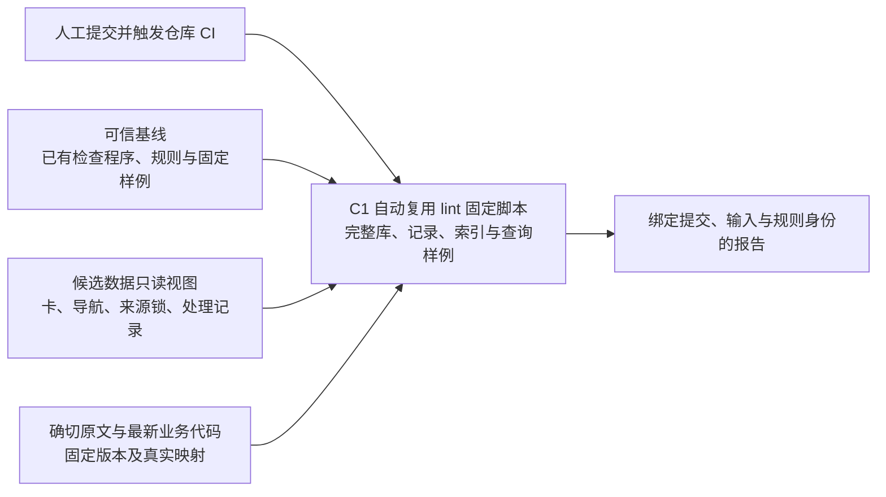

| 文件 / 对象 | 设计职责 |
|---|---|
| `K/check.py` | 从可信版本读取，检查候选完整视图并核验报告；遵循 §5.5 范围、等级与 0／1／2 结果协议 |
| `K/check.sh` | 选择作业提供的 Python 并转调 `check.py`，不实现另一套检查 |
| `governance/contracts/checks.py` | 复用可信版本的格式、导航、关系及来源引用规则；对候选提交适配输入，不依赖本机操作 |
| `governance/contracts/records.py` | 检查记录结构及本批新增／变更记录与来源、卡的关系；历史引用按记录引入时的 Git 内容或明确版本解释 |
| `governance/contracts/indexing.py` | 从候选数据构建临时索引，执行 §6.2 全量核验与固定查询回归，不切换活动索引 |
| 仓库 CI 作业 | 用受保护配置选择可信基线程序／规则，再叠加允许的候选数据；准备固定原文、最新业务代码 checkout 及映射并记录版本 |

候选卡、导航、来源锁与记录是数据，不导入其中的程序；路径解析后仍须在允许根内，拒绝符号链接／子模块逃逸。可信基线由仓库受保护配置指定，候选提交不能替换本次门禁的作业、程序或规则。此边界参考 CANNBot 的[基线检查快照](https://gitcode.com/cann/cannbot-knowledge/blob/c92c66ee695090c44487f56bd051d2607c58b27a/.gitcode/workflows/cannbot-knowledge_actions.yml#L59-L75)，本项目同时覆盖正式来源锁和处理记录。

规则变更按普通代码变更运行固定接受／拒绝样例、现有知识回归和兼容性检查，候选规则仅作为被测对象，不能批准同批知识。新格式不兼容时按“先接纳兼容新旧格式的规则 → 迁移知识 → 退出旧格式”推进；原有拒绝样例不能随候选规则被删除来取得门禁通过。

CI 复用 lint 已有的固定脚本及共用检查函数，`check.py`／`check.sh` 只适配 CI 的输入和调用，不新增独立检查算法或业务代码构建任务。它不运行 Agent、真人确认或写入动作；原文、代码及配置引用以作业明确取得的版本核对，必需输入缺失或规则不兼容则不通过。CI 不依赖开发机 `.build/`、私人日志、原始确认事件或活动索引。

### 5.9 Q1—Q5：路由、查询、同代精读与回答

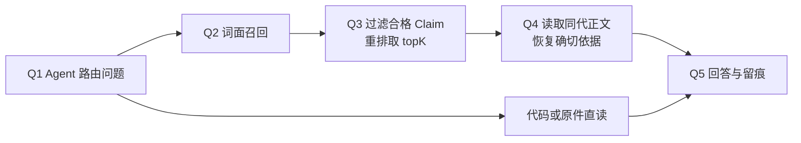

| 文件 / 对象 | 设计职责 |
|---|---|
| 主 Agent、已加载的 `AGENTS.md` 与 `config.yml` | Q1 选择知识卡、代码或原件入口，Q5 综合证据并说明范围、冲突和缺口 |
| `hs-knowledge-query/scripts/node.py` | Q2 召回候选；Q3 按状态、用途、Target／配置／版本、来源、依赖及当前限制过滤，之后重排取全局 topK；查询前触发 §5.10 上下文比较 |
| `governance/contracts/indexing.py`、`artifacts/` | 将索引、正文与指纹绑定到同一代，供 Q4 读取命中时的完整内容 |
| `hs-knowledge-source-capture` 的来源恢复能力 | 按卡的确切来源版本读取原文／代码定位，不替换为同名新文件 |
| `hs-knowledge-query/artifacts/templates/result.md` | 输出结论、引用、范围与检索 Receipt；记录命中、索引代及缺口 |

标题、摘要和关键词同样受 Claim 资格约束；`unknown` 不作范围通配。Q4 沿用查询条件和索引代，并重查当前阻断；活动索引切换后也不能拼接另一代正文。空库、证据不足或扫描预算耗尽都如实报告，不自动触发 ingest。权限由实际仓库、宿主与工具落实，Receipt 只留痕。

跨机使用按仓库评审接纳规则信任正式卡及其验收摘要，再核对内容指纹与当前适用上下文；不要求重演另一台机器的真人动作。缺摘要、指纹失配或上下文未知时限制相应用途，不能仅凭 stable 字段视为当前有效。本地未合入内容继续标明其实际状态，不冒充共享已接纳内容。

### 5.10 M：来源变化与结论有效性

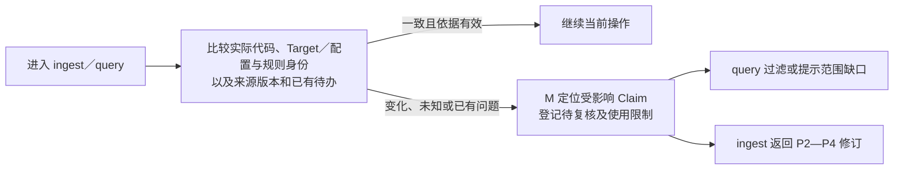

| 文件 / 位置 | 设计职责 |
|---|---|
| `hs-knowledge-maintain/scripts/maintain.py` | 根据原件／代码变化，沿来源、Claim 和依赖定位影响，登记待复核与使用限制 |
| `governance/contracts/knowledge.py`、`records.py` | 共用影响关系、复核对象与结果的表达 |
| `logs/events/` 与本机执行记录 | 保存影响判断、待办及本机应用进度，供查询及时过滤与 ingest 续办 |

P1 负责 raw 变化发现；ingest 开始及 query 使用知识前，另按真实映射比较代码版本／快照、相关文件与 Target／构建配置指纹、规则身份，覆盖未提交改动。M 接收差异，不以“raw 未变”跳过代码变化；只限制受影响或尚不能排除影响的 Claim，不将版本号相同等同于语义必然有效。

限制可从正式引用、共享处理事实与当前上下文重建，不依赖旧机器事件。问题交 P2—P5 修订，P6 登记，P7 同批落位；无影响复核也说明来源、Claim 和判据。相关复核完成且查询状态更新后才解除限制，历史版本问题按其指定上下文解释。

## 6. 共享文件与流程编排

### 6.1 Skill 与 Workflow 的最小文件分工

```text
S/<Skill名>/
├── SKILL.md                       触发、输入、动作与出口
├── scripts/                       固定步骤与公开调用入口
├── references/                    按需放阅读／核验指南
└── artifacts/templates/           按需放结果模板

F/hs-knowledge-ingest/
└── workflow.yaml                  P1—P7、分支、等待与续办
```

Skill 封装可复用能力，Workflow 只编排；一个 Skill 可服务多个节点，例如原件扫描与记录共用来源处理能力。仅在能力需独立复用时保留 Skill，共用解析、检查和数据规则留在 `governance/`，不因增加内部步骤继续拆新 Skill。结果明确通过、失败、缺材料或等待，不能仅凭文件存在或进程退出判断完成。

### 6.2 共用契约、模板与索引函数

| 文件组（均在 `governance/`） | 唯一职责 |
|---|---|
| Schema：`schemas/{frontmatter,sources,workspace,records}.schema.json` | 卡、来源、项目上下文和记录的字段形状、类型及允许字段 |
| Profile：`profiles.yaml` | 七类卡的适用类型、必需字段组合与章节；引用 Schema 字段定义 |
| Registry：`registries.yaml` | 受控名称、允许目录及定位种类；项目实体、代码和六 Target／三 pair 映射仍唯一来自 `config.yml` |
| Contract：`contracts/{knowledge,source_resources,records}.py` | 跨字段／文件的身份、范围、关系、来源恢复和处理记录一致性 |
| `contracts/validation.py` | 共用安全 YAML、Markdown 与路径解析；拒绝重复键和越界，不在各 Skill 复制解析规则 |
| `contracts/checks.py` | 固定检查注册、问题码／等级、作用范围、结果协议及组合，供预检、lint 与 CI 复用 |
| `contracts/indexing.py` | 同一套构建、全量验证和同代正文函数，保持索引写入与 query 读取协议一致 |
| `templates/`、`specs/` | 七类卡、导航、`manual-review.json`、`ingest-record.yaml` 的写法及语义说明，不维护第二套机器枚举或必填规则 |
| `framework.lock.yaml` | 规则包、Schema 与调用能力的配套版本／指纹；报告、停点和索引记录实际使用身份 |

规则职责参考 CANNBot 的[Schema／Profile／Registry／Contract 分工](https://gitcode.com/cann/cannbot-knowledge/blob/c92c66ee695090c44487f56bd051d2607c58b27a/governance/specs/schemas.md#L3-L20)。Markdown 共用解析器保留原行号，排除代码示例中的伪链接；标题锚点按固定规则生成并消歧，Claim 使用稳定锚点。链接必须同时核对文件和目标锚点，不能只剥去 fragment 查文件存在。

| 索引完整核验 | 必需条件 |
|---|---|
| 结构与版本 | 数据库完整性、Schema／分词器版本、规则身份一致 |
| 全量收录集合 | 按同一收录规则重算卡／Claim 集合，无遗漏、重复或多余映射；查询资格另外按当前条件过滤 |
| 内容与查询记录 | 正文／元数据指纹、同代正文及检索记录重算一致，不能仅核对行数 |
| 固定查询回归 | 验证范围过滤、资格限制和同代读取；只证明固定消费行为，不证明内容语义 |

本地由 `hs-knowledge-index-build` 构建、验证后供 query 使用；lint 和 CI 只生成临时产物。P7 再用本批代表性问题验证目标内容可召回，问题与期望卡／Claim 由 P3 计划给出；失败按 §5.7 区分运行故障与内容修订，不改写原入库事实。调用能力与规则不兼容或加载失败时返回未完成，不静默退回旧规则。

### 6.3 命令分派与工作流续办

| 入口 | 分派目标 | 完成边界 |
|---|---|---|
| `ingest` | `F/hs-knowledge-ingest/` | P1 扫描／续办 → P2 材料 → P3 判断 → P4 稿件 → P5 lint → P6 处理记录 → P7 本地入库、索引全验及目标查询；仅记录批保存记录后结束 |
| `lint` | `S/hs-knowledge-lint/` | 手动或定期执行同一只读检查，返回报告；不另设 lint Workflow |
| `query` | 主 Agent + `S/hs-knowledge-query/` | 路由、召回、过滤、同代精读与依据回答 |

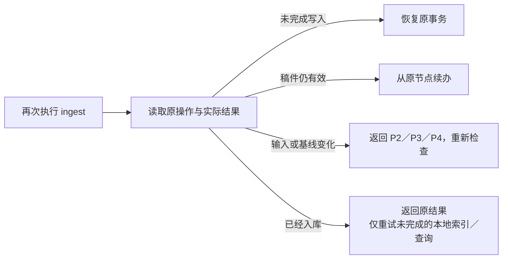

原件、规则、代码及相关基线决定稿件是否仍有效。执行停点随节点结果保存，失败未走到 P6 时也不会丢失；可提交摘要由 P6 汇总。定期 lint 只调度同一个 Skill，不自行触发修订或上库。E0 仅在命令前缺上下文时使用。

| 停点原因 | 续办规则 |
|---|---|
| 可修订内容问题 | Workflow 在有限预算内修订；同一依据下重复同类错误且无进展，或预算耗尽时保存问题与停点 |
| 缺材料／等待真人 | 等新材料或明确回复；再次调用只返回原停点，不把超时当通过 |
| 运行故障／版本不兼容 | 保留失败输入与未执行项，条件恢复或明确重试时继续，不反复改卡消除环境故障 |
| 写入中断 | 优先恢复原事务；已落位部分核对实际结果，不另建事务重复 apply |
| 本地索引／查询未完成 | 运行故障只重试对应收尾，内容错误按 §5.7 形成新修订；不重复已完成的知识写入 |

再次发起 ingest 可推进可恢复失败，但每次仍有修订预算。本次适用的知识与处理记录实际落位，本地索引全验及目标查询通过后，即报告 ingest 完成；仅记录批完成记录校验和落位即可，defer 或失败事项仍标未完成。Git 提交、CI 与合入均为人工后续操作，另据真实仓库结果判断。

`knowledge status` 汇总实际进度；`knowledge index rebuild` 只重建本机索引；`knowledge recover --operation <操作ID> --action <动作>` 检查、续做或回滚原事务。这些是配套维护入口，不代替日常的 ingest／lint／query。

### 6.4 哪些内容上库，哪些用于本机执行

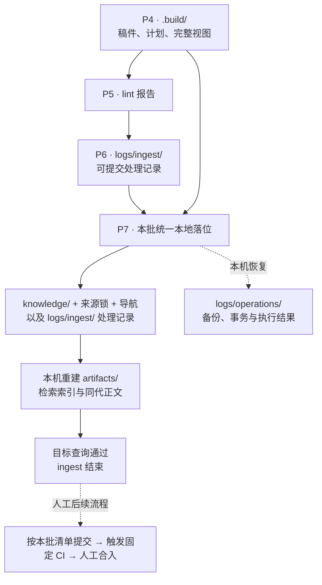

| 内容 | 保存与提交边界 |
|---|---|
| `knowledge/`、`governance/sources.lock.yaml`、`logs/ingest/` | 本批正式内容、来源登记和处理记录，一并纳入版本管理 |
| `.build/operations/` | 本机材料、稿件、视图、检查报告与执行停点，不上库 |
| `logs/operations/`、原始确认／证据日志 | 本机恢复和原始动作留痕，不整体上库；P6 保留绑定内容指纹、来源／代码上下文及验收方式／结果的可共享摘要 |
| `artifacts/`、查询 Receipt | 本机派生索引和查询留痕，可重建或按运行需要保存，不当作正式处理记录 |
| `.gitignore` 与提交清单 | 放行需要提交的 `logs/ingest/`，继续排除暂存、备份和派生索引；提交范围按本批文件列明 |

本地来源锁绑定已捕获的确切原件对象；人工上库时使原版可从 Git 或同组持久位置恢复，其他环境按同一身份取得输入。本机临时副本不能充当跨机恢复的唯一位置。历史处理记录按其对应版本解释，不要求随当前卡变化而重写历史指纹。本机索引状态不传成其他人的处理进度，能力安装包也不携带领域原件、知识和运行日志。

验收摘要由实际完成对应动作的节点据实生成，不允许模板预填通过或 Agent 自报真人同意。共享内容由仓库评审接纳；其他机器按 §5.9 核对摘要与适用范围，CI 继续只检查其结构、引用和一致性。

## 7. 部署方式与manifest视图配置

### 7.1 路径基准

| 名称 | 路径含义 |
|---|---|
| `project_root` | 业务工作区根；代码引用按 `config.yml` 的真实映射解释 |
| `K` | 知识库根 `aiotbot-knowledge-wifi-mp/`；raw、卡、记录及领域规则使用根内相对路径 |
| 项目 manifest | 选择业务仓、版本、checkout 位置与配套知识库版本；不替代实际文件核对 |

### 7.2 默认：知识库随业务代码共同拉取

```text
<project_root>/
├── AGENTS.md / config.yml
├── main/                              业务代码工作区
├── skills/ · workflows/                配套节点能力与工作流
└── aiotbot-knowledge-wifi-mp/           K
    ├── docs-raw/ · knowledge/ · governance/
    └── logs/ingest/                    随知识拉取的处理记录
```

Agent 阅读项目入口后直接使用知识库命令。代码、知识及处理记录通过项目既有拉取方式取得，不增加 init、服务启动或项目绑定。Skill 与 Workflow 位于项目根的 `skills/`、`workflows/`，与项目入口和映射同级管理，不建立嵌套 Git 仓。

同仓能力与领域规则按 `framework.lock.yaml` 核对配套版本；宿主已安装副本过旧时使用本仓受支持版本或升级，报告版本缺口，不新增初始化步骤。

### 7.3 例外：知识库位于业务仓外

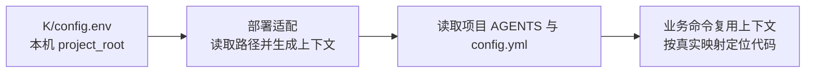

只有仓外部署才由本机 `config.env` 指定 `project_root`，该文件不提交；K 内部引用保持相对 K。部署适配校验配置及配套能力／规则版本，执行器从明确可信位置加载；配置中的路径不授予任意程序执行权。缺失或歧义时报告缺口，不猜另一个代码仓，也不据此接入仓外 raw 或网页来源。

### 7.4 项目 manifest 的适配职责

manifest 负责选择共同拉取的仓库、位置和版本，`config.yml` 负责代码、实体、符号及六 Target／三 pair 的映射。拉取后按实际 checkout 核对，不能仅因版本被列在 manifest 中就认为代码结论仍适用。缺少真实路径、构建或版本时保持 unknown，P2／P3 报告相关证据缺口。
