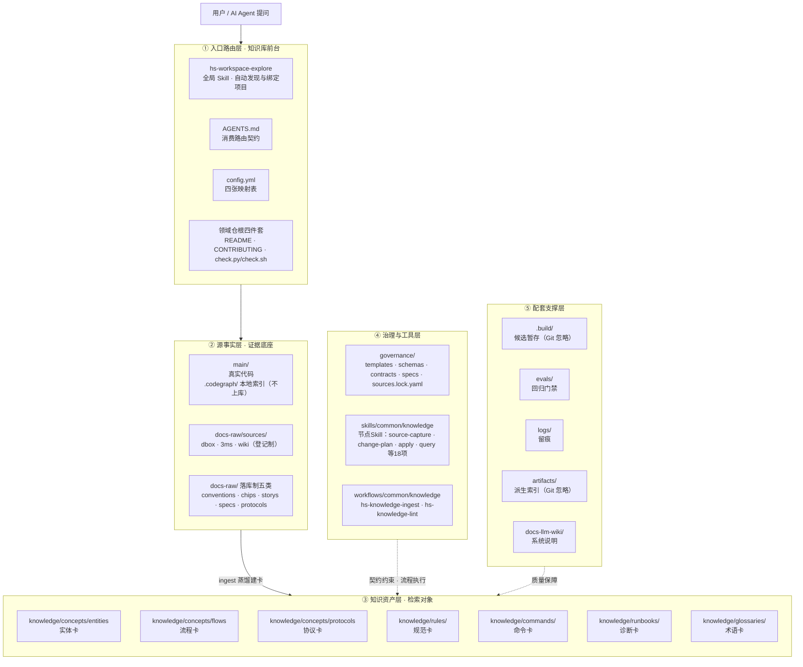
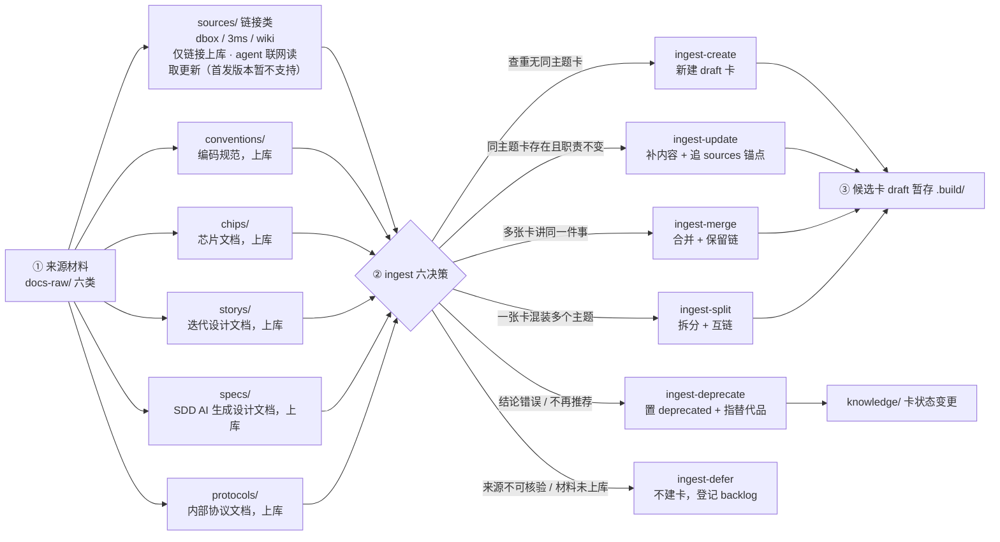
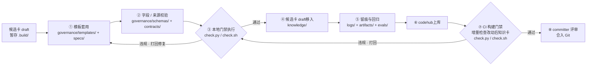
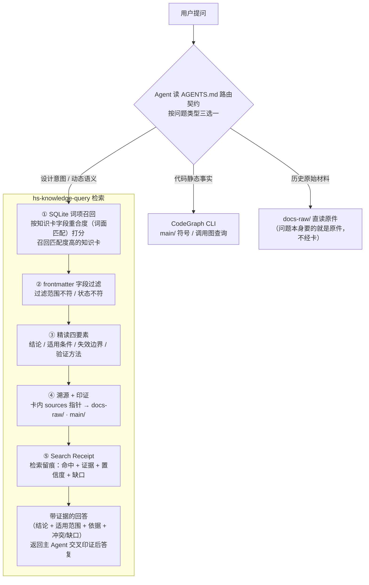

# AIoTBot 知识库详细设计

版本：v4.1；日期：2026-10-21。本文细化[主设计§5.3与第11章](AIoTBot知识库架构设计.md)，采用用户批准的18个节点级Skill与两个Workflow。WiFi唯一根为工作区直属的`aiotbot-knowledge-wifi/`，业务main仍为空；不新增其他领域或中间根。

本轮进入新的[knowledge-v2 SDD](sdd/knowledge-v2/README.md)开发流程，T201–T210已完成开发与隔离机制验收；真实人、宿主、六Target、业务CI与ACL仍由T211独立验收。实际源码、测试和发布身份见[开发记录](sdd/knowledge-v2/records/development-acceptance-20261021.json)。旧knowledge-v1全部原字节保留，历史230项合成测试不表示当前包已交付。节点能力直接在本仓根skills/和workflows/开发，与main同级，使用当前FactumCore远端；不放嵌套.git，不发布个人安装路径。

## 1. 基础架构与实现边界

### 1.1 基础架构

沿用原五层图的节点和连线，仅工具能力标签随节点化更新。



### 1.2 首发范围与既定行为

| 项目 | 具体约定 |
|---|---|
| Workspace | FactumCore 保存代码槽位、配置与知识；Git在根执行；能力由本仓交付，领域目录无嵌套Git |
| 能力与编排 | 本仓能力目录的18个节点Skill 各有自己的 scripts/tests/依赖锁；两 Workflow 仅编排；通用规则只在领域 governance/contracts 实现一次 |
| 代码 | main 当前保持空；采用主设计 bfgx/common/dpa/platform/sensorhub、mp1x/mp12 的物理示意名称；真实代码由 config 关联 |
| Target | 现行 config 的 chip12/chip08/chip07c × host/device 六逻辑 ID 和三 pair 继续未绑定；不猜测其与 mp1x/mp12 的关系 |
| 文档 | 仅五类已落地 raw：conventions/chips/storys/specs/protocols；sources/dbox、3ms、wiki 只作后续保留 |
| 正文 | 七种 Profile：entity/flow/protocol/rule/command/runbook/glossary；九模板为七卡模板加 index/manual-review，不虚构额外正文类型 |
| 文档治理 | 真人确认确切最终视图后 stable；贡献者可自行确认；无回复、超时、Agent自报不是同意；免代码 lint |
| 代码治理 | 本地只读检查通过后 stable；上库按最新授权业务代码只读二次检查；检查不修卡、锁、链接或源码 |
| 消费 | SQLite 普通表词面候选→frontmatter/有效性过滤→过滤后 topK→同代精读→溯源→Search Receipt；无向量服务或 FTS5 |
| 排除项 | 首发不访问远端文档/仓外下载映射，不自动 OCR、不后台轮询，不代管用户 AGENTS，不承诺宿主必然隐式触发或目录提供 ACL |

### 1.3 名称、归属与唯一实现

W为FactumCore，K=W/aiotbot-knowledge-wifi；S=W/skills/common/knowledge，F=W/workflows/common/knowledge。全部固定源码都在本仓，Git操作在W根执行，禁止嵌套.git。现行路径遵循§5.3代码树；主文档通用描述不扩成本次其他域或隐藏.skills/.workflows。hs-knowledge-ingest、hs-knowledge-lint仅为Workflow ID，不再是聚合Skill。`hs-workspace-explore`和17个`hs-knowledge-*`节点Skill都经受信安装catalog解析，不从W相对路径或来源正文猜入口。

领域规则唯一实现仍在governance/contracts；Skill各有公开cli.py、薄support.py、测试和依赖锁。跨Skill只调catalog允许的公开CLI，不导入对方私有模块。事务引擎唯一归apply，recover调用其公开恢复action；检查引擎归local-check，merge-check调用公开merge action；索引引擎归index-build，query-regression复用query与index-build。维护原语归maintain，capture仅调用幂等来源变化阻断接口。不得恢复_shared聚合包或复制这些引擎。

产品协议版本2.0与设计版本v4.1分开。已有1.0规则/适配器是迁移输入，T201必须先冻结新schema/profile/lock/config兼容身份；旧记录只可显式历史读取，不重签成人确认或新代码证明。

## 2. 完整目录与固定文件

### 2.1 标记与当前身份

[F]本仓固定文件，[D]真实资料/技术卡实例，[R]真实运行产物，[P]首发延期，[L]宿主本机私有文件，[X]外部输入，[H]历史原字节。目标文件清单不是已完成声明。每包实际入口、业务模块、测试、资源与依赖锁均在下表逐文件定义。清单快照日期为2026-10-21，覆盖当时Git跟踪文件及本轮范围内待提交源码；后续验收留痕按records实例追加并同步清单。原knowledge-v1的95个文件逐个标H。业务产物只写显式授权K，受信调用者显式--output是宿主响应传输，可在K外；K内响应仅安全.build/logs，安装区只读。

### 2.2 FactumCore完整目标树

```text
FactumCore/
├── aiotbot-knowledge-wifi/
│   ├── .build/
│   │   ├── operations/
│   │   │   └── <operation-id>/
│   │   │       ├── calls/
│   │   │       │   └── <call-id>/
│   │   │       │       ├── request.json [R]
│   │   │       │       └── response.json [R]
│   │   │       ├── candidates/
│   │   │       │   └── <card-id>.md [R]
│   │   │       ├── final-view/
│   │   │       │   └── <relative-path> [R]
│   │   │       ├── index-tmp/
│   │   │       │   └── <temporary-file> [R]
│   │   │       ├── receipts/
│   │   │       │   └── <digest>.json [R]
│   │   │       ├── regression/
│   │   │       │   └── <digest>.json [R]
│   │   │       ├── <action>-<nonce>-request.json [R]
│   │   │       ├── <action>-<nonce>-response.json [R]
│   │   │       ├── capture.json [R]
│   │   │       ├── confirmation-display.json [R]
│   │   │       ├── final-view.json [R]
│   │   │       ├── handoff.json [R]
│   │   │       ├── plan.json [R]
│   │   │       └── revision.json [R]
│   │   ├── project-context/
│   │   │   └── <digest>.json [R]
│   │   └── .gitkeep [F]
│   ├── artifacts/
│   │   ├── indexes/
│   │   │   └── <channel>/
│   │   │       ├── <generation-id>/
│   │   │       │   ├── cards/
│   │   │       │   │   └── <sha256>.md [R]
│   │   │       │   ├── index.sqlite [R]
│   │   │       │   └── manifest.json [R]
│   │   │       └── active.json [R]
│   │   ├── test-tmp/
│   │   │   └── <run-id>/
│   │   │       └── <runner-output> [R]
│   │   └── .gitkeep [F]
│   ├── docs-llm-wiki/
│   │   ├── sdd/
│   │   │   ├── knowledge-v1/
│   │   │   │   ├── modules/
│   │   │   │   │   ├── M01/
│   │   │   │   │   │   ├── design.md [H]
│   │   │   │   │   │   ├── spec.md [H]
│   │   │   │   │   │   └── tasks.md [H]
│   │   │   │   │   ├── M02/
│   │   │   │   │   │   ├── design.md [H]
│   │   │   │   │   │   ├── spec.md [H]
│   │   │   │   │   │   └── tasks.md [H]
│   │   │   │   │   ├── M03/
│   │   │   │   │   │   ├── design.md [H]
│   │   │   │   │   │   ├── spec.md [H]
│   │   │   │   │   │   └── tasks.md [H]
│   │   │   │   │   ├── M04/
│   │   │   │   │   │   ├── design.md [H]
│   │   │   │   │   │   ├── spec.md [H]
│   │   │   │   │   │   └── tasks.md [H]
│   │   │   │   │   ├── M05/
│   │   │   │   │   │   ├── design.md [H]
│   │   │   │   │   │   ├── spec.md [H]
│   │   │   │   │   │   └── tasks.md [H]
│   │   │   │   │   ├── M06/
│   │   │   │   │   │   ├── design.md [H]
│   │   │   │   │   │   ├── spec.md [H]
│   │   │   │   │   │   └── tasks.md [H]
│   │   │   │   │   ├── M07/
│   │   │   │   │   │   ├── design.md [H]
│   │   │   │   │   │   ├── spec.md [H]
│   │   │   │   │   │   └── tasks.md [H]
│   │   │   │   │   ├── M08/
│   │   │   │   │   │   ├── design.md [H]
│   │   │   │   │   │   ├── spec.md [H]
│   │   │   │   │   │   └── tasks.md [H]
│   │   │   │   │   └── M09/
│   │   │   │   │       ├── design.md [H]
│   │   │   │   │       ├── spec.md [H]
│   │   │   │   │       └── tasks.md [H]
│   │   │   │   ├── records/
│   │   │   │   │   ├── design-diagram-20261020.md [H]
│   │   │   │   │   ├── docs-layout-20261020.md [H]
│   │   │   │   │   ├── entry-scope-shared-20261020.md [H]
│   │   │   │   │   ├── first-batch-junit.xml [H]
│   │   │   │   │   ├── first-batch-verification.json [H]
│   │   │   │   │   ├── naming-paths-20261020.md [H]
│   │   │   │   │   ├── naming-paths-verification.json [H]
│   │   │   │   │   ├── original-diagrams-additions-20261020.md [H]
│   │   │   │   │   ├── publication.json [H]
│   │   │   │   │   ├── README.md [H]
│   │   │   │   │   ├── review.md [H]
│   │   │   │   │   ├── second-batch-verification.json [H]
│   │   │   │   │   ├── single-repo-baseline-junit.xml [H]
│   │   │   │   │   ├── single-repo-migration.json [H]
│   │   │   │   │   ├── single-repo-migration.md [H]
│   │   │   │   │   ├── T01-development.md [H]
│   │   │   │   │   ├── T01-red.txt [H]
│   │   │   │   │   ├── T02-development.md [H]
│   │   │   │   │   ├── T03-clean-junit.xml [H]
│   │   │   │   │   ├── T03-development.md [H]
│   │   │   │   │   ├── T03-verification.md [H]
│   │   │   │   │   ├── T05-clean-junit.xml [H]
│   │   │   │   │   ├── T05-verification.md [H]
│   │   │   │   │   ├── T06-clean-junit.xml [H]
│   │   │   │   │   ├── T06-verification.md [H]
│   │   │   │   │   ├── T07-clean-junit.xml [H]
│   │   │   │   │   ├── T07-verification.md [H]
│   │   │   │   │   ├── workspace-layout-20261020.md [H]
│   │   │   │   │   └── workspace-layout-verification.json [H]
│   │   │   │   ├── tickets/
│   │   │   │   │   ├── T01.md [H]
│   │   │   │   │   ├── T02.md [H]
│   │   │   │   │   ├── T03.md [H]
│   │   │   │   │   ├── T04.md [H]
│   │   │   │   │   ├── T05.md [H]
│   │   │   │   │   ├── T06.md [H]
│   │   │   │   │   ├── T07.md [H]
│   │   │   │   │   ├── T08.md [H]
│   │   │   │   │   ├── T09.md [H]
│   │   │   │   │   ├── T10.md [H]
│   │   │   │   │   ├── T11.md [H]
│   │   │   │   │   ├── T12.md [H]
│   │   │   │   │   ├── T13.md [H]
│   │   │   │   │   ├── T14.md [H]
│   │   │   │   │   ├── T15.md [H]
│   │   │   │   │   ├── T16.md [H]
│   │   │   │   │   ├── T17.md [H]
│   │   │   │   │   ├── T18.md [H]
│   │   │   │   │   ├── T19.md [H]
│   │   │   │   │   ├── T20.md [H]
│   │   │   │   │   ├── T21.md [H]
│   │   │   │   │   ├── T22.md [H]
│   │   │   │   │   ├── T23.md [H]
│   │   │   │   │   ├── T24.md [H]
│   │   │   │   │   ├── T25.md [H]
│   │   │   │   │   ├── T26.md [H]
│   │   │   │   │   ├── T27.md [H]
│   │   │   │   │   └── T28.md [H]
│   │   │   │   ├── baseline.json [H]
│   │   │   │   ├── batch-02.md [H]
│   │   │   │   ├── design.md [H]
│   │   │   │   ├── document-chain-usage.md [H]
│   │   │   │   ├── first-slice.md [H]
│   │   │   │   ├── module-map.md [H]
│   │   │   │   ├── README.md [H]
│   │   │   │   ├── requirements.md [H]
│   │   │   │   ├── tasks.md [H]
│   │   │   │   ├── test-plan.md [H]
│   │   │   │   └── traceability.json [H]
│   │   │   └── knowledge-v2/
│   │   │       ├── records/
│   │   │       │   ├── <acceptance-id>.md [R]
│   │   │       │   ├── development-acceptance-20261021.json [F]
│   │   │       │   ├── implementation-manifest.json [F]
│   │   │       │   ├── independent-governance-review-20261021.md [F]
│   │   │       │   ├── publication-20261021.md [F]
│   │   │       │   ├── README.md [F]
│   │   │       │   ├── T201-contracts.json [F]
│   │   │       │   └── t209-workflows-installation-20261021.md [F]
│   │   │       ├── tickets/
│   │   │       │   ├── T201.md [F]
│   │   │       │   ├── T202.md [F]
│   │   │       │   ├── T203.md [F]
│   │   │       │   ├── T204.md [F]
│   │   │       │   ├── T205.md [F]
│   │   │       │   ├── T206.md [F]
│   │   │       │   ├── T207.md [F]
│   │   │       │   ├── T208.md [F]
│   │   │       │   ├── T209.md [F]
│   │   │       │   ├── T210.md [F]
│   │   │       │   └── T211.md [F]
│   │   │       ├── baseline.json [F]
│   │   │       ├── design.md [F]
│   │   │       ├── implementation-protocol.md [F]
│   │   │       ├── module-map.md [F]
│   │   │       ├── README.md [F]
│   │   │       ├── requirements.md [F]
│   │   │       ├── test-plan.md [F]
│   │   │       └── traceability.json [F]
│   │   ├── AGENTS.md [F]
│   │   ├── AIoTBot知识库架构设计.md [F]
│   │   ├── README.md [F]
│   │   ├── task.md [F]
│   │   ├── 使用说明.md [F]
│   │   └── 知识库详细设计.md [F]
│   ├── docs-raw/
│   │   ├── chips/
│   │   │   ├── <document-id>/
│   │   │   │   └── <version-or-digest>/
│   │   │   │       ├── <attachment-file> [D]
│   │   │   │       └── <original-file> [D]
│   │   │   └── .gitkeep [F]
│   │   ├── conventions/
│   │   │   ├── <document-id>/
│   │   │   │   └── <version-or-digest>/
│   │   │   │       ├── <attachment-file> [D]
│   │   │   │       └── <original-file> [D]
│   │   │   └── .gitkeep [F]
│   │   ├── protocols/
│   │   │   ├── <document-id>/
│   │   │   │   └── <version-or-digest>/
│   │   │   │       ├── <attachment-file> [D]
│   │   │   │       └── <original-file> [D]
│   │   │   └── .gitkeep [F]
│   │   ├── sources/
│   │   │   ├── 3ms/
│   │   │   │   ├── .gitkeep [F]
│   │   │   │   └── <source-id>.md [P]
│   │   │   ├── dbox/
│   │   │   │   ├── .gitkeep [F]
│   │   │   │   └── <source-id>.md [P]
│   │   │   └── wiki/
│   │   │       ├── .gitkeep [F]
│   │   │       └── <source-id>.md [P]
│   │   ├── specs/
│   │   │   ├── <document-id>/
│   │   │   │   └── <version-or-digest>/
│   │   │   │       ├── <attachment-file> [D]
│   │   │   │       └── <original-file> [D]
│   │   │   └── .gitkeep [F]
│   │   ├── storys/
│   │   │   ├── <document-id>/
│   │   │   │   └── <version-or-digest>/
│   │   │   │       ├── <attachment-file> [D]
│   │   │   │       └── <original-file> [D]
│   │   │   └── .gitkeep [F]
│   │   ├── AGENTS.md [F]
│   │   └── index.md [F]
│   ├── evals/
│   │   ├── tests/
│   │   │   ├── test_contracts.py [F]
│   │   │   ├── test_node_pipeline.py [F]
│   │   │   ├── test_process_recovery.py [F]
│   │   │   └── test_workflows.py [F]
│   │   ├── .gitkeep [F]
│   │   ├── pipeline_harness.py [F]
│   │   ├── pyproject.toml [F]
│   │   ├── README.md [F]
│   │   ├── requirements-dev.lock.txt [F]
│   │   ├── run_acceptance.py [F]
│   │   └── validate_design.py [F]
│   ├── governance/
│   │   ├── contracts/
│   │   │   ├── __init__.py [F]
│   │   │   ├── knowledge.py [F]
│   │   │   ├── records.py [F]
│   │   │   ├── source_resources.py [F]
│   │   │   └── validation.py [F]
│   │   ├── schemas/
│   │   │   ├── frontmatter.schema.json [F]
│   │   │   ├── profiles.yaml [F]
│   │   │   ├── records.schema.json [F]
│   │   │   ├── registries.yaml [F]
│   │   │   ├── sources.schema.json [F]
│   │   │   └── workspace.schema.json [F]
│   │   ├── specs/
│   │   │   ├── cards.md [F]
│   │   │   ├── lifecycle.md [F]
│   │   │   ├── records.md [F]
│   │   │   └── sources.md [F]
│   │   ├── templates/
│   │   │   ├── command.md [F]
│   │   │   ├── entity.md [F]
│   │   │   ├── flow.md [F]
│   │   │   ├── glossary.md [F]
│   │   │   ├── index.md [F]
│   │   │   ├── manual-review.json [F]
│   │   │   ├── protocol.md [F]
│   │   │   ├── rule.md [F]
│   │   │   └── runbook.md [F]
│   │   ├── AGENTS.md [F]
│   │   ├── framework.lock.yaml [F]
│   │   ├── index.md [F]
│   │   └── sources.lock.yaml [F]
│   ├── knowledge/
│   │   ├── commands/
│   │   │   ├── <card-id>.md [D]
│   │   │   └── index.md [F]
│   │   ├── concepts/
│   │   │   ├── entities/
│   │   │   │   ├── <card-id>.md [D]
│   │   │   │   └── index.md [F]
│   │   │   ├── flows/
│   │   │   │   ├── <card-id>.md [D]
│   │   │   │   └── index.md [F]
│   │   │   ├── protocols/
│   │   │   │   ├── <card-id>.md [D]
│   │   │   │   └── index.md [F]
│   │   │   └── index.md [F]
│   │   ├── glossaries/
│   │   │   ├── <card-id>.md [D]
│   │   │   └── index.md [F]
│   │   ├── rules/
│   │   │   ├── <card-id>.md [D]
│   │   │   └── index.md [F]
│   │   ├── runbooks/
│   │   │   ├── <card-id>.md [D]
│   │   │   └── index.md [F]
│   │   ├── AGENTS.md [F]
│   │   └── index.md [F]
│   ├── logs/
│   │   ├── contexts/
│   │   │   └── <context-id>.json [R]
│   │   ├── events/
│   │   │   ├── <event-id>.json [R]
│   │   │   └── state.json [R]
│   │   ├── evidence/
│   │   │   ├── checked-code/
│   │   │   │   └── <sha256>.bin [R]
│   │   │   ├── extractions/
│   │   │   │   └── <sha256>.txt [R]
│   │   │   ├── locators/
│   │   │   │   └── <digest>.json [R]
│   │   │   ├── objects/
│   │   │   │   └── <sha256>.bin [R]
│   │   │   └── <build-artifact> [R]
│   │   ├── host-events/
│   │   │   └── <event-id>.json [R]
│   │   ├── operations/
│   │   │   ├── <operation-id>/
│   │   │   │   ├── backups/
│   │   │   │   │   └── <old-sha256>.bin [R]
│   │   │   │   ├── apply-result.json [R]
│   │   │   │   ├── journal.json [R]
│   │   │   │   ├── local-check<proof-suffix>.json [R]
│   │   │   │   ├── manual-review.json [R]
│   │   │   │   ├── merge-check-handoff<proof-suffix>.json [R]
│   │   │   │   ├── merge-check<proof-suffix>.json [R]
│   │   │   │   └── publish-handoff.json [R]
│   │   │   └── .writer.lock [R]
│   │   ├── publication/
│   │   │   └── <receipt-id>.json [R]
│   │   ├── semantic-reviews/
│   │   │   └── <review-id>.json [R]
│   │   ├── workflows/
│   │   │   └── <run-id>/
│   │   │       └── nodes/
│   │   │           └── <node-id>/
│   │   │               └── <attempt-id>/
│   │   │                   ├── result.json [R]
│   │   │                   └── result.md [R]
│   │   └── .gitkeep [F]
│   ├── AGENTS.md [F]
│   ├── check.py [F]
│   ├── check.sh [F]
│   ├── CONTRIBUTING.md [F]
│   └── README.md [F]
├── main/
│   ├── device/
│   │   ├── bfgx/
│   │   │   └── <source-relative-path> [X]
│   │   ├── common/
│   │   │   └── <source-relative-path> [X]
│   │   ├── dpa/
│   │   │   └── <source-relative-path> [X]
│   │   ├── platform/
│   │   │   └── <source-relative-path> [X]
│   │   ├── sensorhub/
│   │   │   └── <source-relative-path> [X]
│   │   └── wifi/
│   │       ├── mp12/
│   │       │   ├── .codegraph/
│   │       │   │   └── <tool-artifact> [X]
│   │       │   └── <source-relative-path> [X]
│   │       └── mp1x/
│   │           ├── .codegraph/
│   │           │   └── <tool-artifact> [X]
│   │           └── <source-relative-path> [X]
│   ├── drivers/
│   │   ├── bfgx/
│   │   │   └── <source-relative-path> [X]
│   │   ├── common/
│   │   │   └── <source-relative-path> [X]
│   │   ├── dpa/
│   │   │   └── <source-relative-path> [X]
│   │   ├── platform/
│   │   │   └── <source-relative-path> [X]
│   │   ├── sensorhub/
│   │   │   └── <source-relative-path> [X]
│   │   └── wifi/
│   │       ├── .codegraph/
│   │       │   └── <tool-artifact> [X]
│   │       └── <source-relative-path> [X]
│   └── .gitkeep [F]
├── skills/
│   └── common/
│       └── knowledge/
│           ├── hs-knowledge-apply/
│           │   ├── artifacts/
│           │   │   ├── templates/
│           │   │   │   └── result.md [F]
│           │   │   ├── result.yaml [F]
│           │   │   ├── review-guide.md [F]
│           │   │   └── writing-guide.md [F]
│           │   ├── scripts/
│           │   │   ├── cli.py [F]
│           │   │   ├── support.py [F]
│           │   │   └── transaction.py [F]
│           │   ├── tests/
│           │   │   ├── acceptance.md [F]
│           │   │   ├── test_apply.py [F]
│           │   │   └── test_public_governance.py [F]
│           │   ├── requirements-dev.lock.txt [F]
│           │   ├── requirements.lock.txt [F]
│           │   └── SKILL.md [F]
│           ├── hs-knowledge-candidate-inspect/
│           │   ├── artifacts/
│           │   │   ├── templates/
│           │   │   │   └── result.md [F]
│           │   │   ├── result.yaml [F]
│           │   │   ├── review-guide.md [F]
│           │   │   └── writing-guide.md [F]
│           │   ├── references/
│           │   │   └── request.md [F]
│           │   ├── scripts/
│           │   │   ├── cli.py [F]
│           │   │   ├── inspect_candidate.py [F]
│           │   │   └── support.py [F]
│           │   ├── tests/
│           │   │   ├── conftest.py [F]
│           │   │   └── test_cli.py [F]
│           │   ├── requirements-dev.lock.txt [F]
│           │   ├── requirements.lock.txt [F]
│           │   └── SKILL.md [F]
│           ├── hs-knowledge-candidate-revise/
│           │   ├── artifacts/
│           │   │   ├── templates/
│           │   │   │   └── result.md [F]
│           │   │   ├── result.yaml [F]
│           │   │   ├── review-guide.md [F]
│           │   │   └── writing-guide.md [F]
│           │   ├── references/
│           │   │   └── request.md [F]
│           │   ├── scripts/
│           │   │   ├── cli.py [F]
│           │   │   ├── revise.py [F]
│           │   │   └── support.py [F]
│           │   ├── tests/
│           │   │   ├── conftest.py [F]
│           │   │   └── test_cli.py [F]
│           │   ├── requirements-dev.lock.txt [F]
│           │   ├── requirements.lock.txt [F]
│           │   └── SKILL.md [F]
│           ├── hs-knowledge-change-plan/
│           │   ├── artifacts/
│           │   │   ├── templates/
│           │   │   │   └── result.md [F]
│           │   │   ├── result.yaml [F]
│           │   │   ├── review-guide.md [F]
│           │   │   └── writing-guide.md [F]
│           │   ├── references/
│           │   │   └── request.md [F]
│           │   ├── scripts/
│           │   │   ├── cli.py [F]
│           │   │   ├── planning.py [F]
│           │   │   └── support.py [F]
│           │   ├── tests/
│           │   │   ├── conftest.py [F]
│           │   │   └── test_cli.py [F]
│           │   ├── requirements-dev.lock.txt [F]
│           │   ├── requirements.lock.txt [F]
│           │   └── SKILL.md [F]
│           ├── hs-knowledge-confirmation-prepare/
│           │   ├── artifacts/
│           │   │   ├── templates/
│           │   │   │   └── result.md [F]
│           │   │   ├── result.yaml [F]
│           │   │   ├── review-guide.md [F]
│           │   │   └── writing-guide.md [F]
│           │   ├── scripts/
│           │   │   ├── cli.py [F]
│           │   │   ├── prepare.py [F]
│           │   │   └── support.py [F]
│           │   ├── tests/
│           │   │   ├── acceptance.md [F]
│           │   │   └── test_prepare.py [F]
│           │   ├── requirements-dev.lock.txt [F]
│           │   ├── requirements.lock.txt [F]
│           │   └── SKILL.md [F]
│           ├── hs-knowledge-confirmation-record/
│           │   ├── artifacts/
│           │   │   ├── templates/
│           │   │   │   └── result.md [F]
│           │   │   ├── result.yaml [F]
│           │   │   ├── review-guide.md [F]
│           │   │   └── writing-guide.md [F]
│           │   ├── scripts/
│           │   │   ├── cli.py [F]
│           │   │   ├── confirmation.py [F]
│           │   │   └── support.py [F]
│           │   ├── tests/
│           │   │   ├── acceptance.md [F]
│           │   │   └── test_confirmation_record.py [F]
│           │   ├── requirements-dev.lock.txt [F]
│           │   ├── requirements.lock.txt [F]
│           │   └── SKILL.md [F]
│           ├── hs-knowledge-governance-handoff/
│           │   ├── artifacts/
│           │   │   ├── templates/
│           │   │   │   └── result.md [F]
│           │   │   ├── result.yaml [F]
│           │   │   ├── review-guide.md [F]
│           │   │   └── writing-guide.md [F]
│           │   ├── references/
│           │   │   └── request.md [F]
│           │   ├── scripts/
│           │   │   ├── cli.py [F]
│           │   │   ├── handoff.py [F]
│           │   │   └── support.py [F]
│           │   ├── tests/
│           │   │   ├── conftest.py [F]
│           │   │   └── test_cli.py [F]
│           │   ├── requirements-dev.lock.txt [F]
│           │   ├── requirements.lock.txt [F]
│           │   └── SKILL.md [F]
│           ├── hs-knowledge-index-build/
│           │   ├── artifacts/
│           │   │   ├── templates/
│           │   │   │   └── result.md [F]
│           │   │   ├── result.yaml [F]
│           │   │   ├── review-guide.md [F]
│           │   │   └── writing-guide.md [F]
│           │   ├── references/
│           │   │   └── shared-publication.md [F]
│           │   ├── scripts/
│           │   │   ├── cli.py [F]
│           │   │   ├── node.py [F]
│           │   │   └── support.py [F]
│           │   ├── tests/
│           │   │   ├── test_cli.py [F]
│           │   │   ├── test_public_qualification.py [F]
│           │   │   └── test_qualification.py [F]
│           │   ├── requirements-dev.lock.txt [F]
│           │   ├── requirements.lock.txt [F]
│           │   └── SKILL.md [F]
│           ├── hs-knowledge-local-check/
│           │   ├── artifacts/
│           │   │   ├── templates/
│           │   │   │   └── result.md [F]
│           │   │   ├── result.yaml [F]
│           │   │   ├── review-guide.md [F]
│           │   │   └── writing-guide.md [F]
│           │   ├── scripts/
│           │   │   ├── check.py [F]
│           │   │   ├── cli.py [F]
│           │   │   └── support.py [F]
│           │   ├── tests/
│           │   │   ├── acceptance.md [F]
│           │   │   ├── test_local_check.py [F]
│           │   │   └── test_public_code_gate.py [F]
│           │   ├── requirements-dev.lock.txt [F]
│           │   ├── requirements.lock.txt [F]
│           │   └── SKILL.md [F]
│           ├── hs-knowledge-maintain/
│           │   ├── artifacts/
│           │   │   ├── templates/
│           │   │   │   └── result.md [F]
│           │   │   ├── result.yaml [F]
│           │   │   ├── review-guide.md [F]
│           │   │   └── writing-guide.md [F]
│           │   ├── references/
│           │   │   └── request.md [F]
│           │   ├── scripts/
│           │   │   ├── cli.py [F]
│           │   │   ├── maintain.py [F]
│           │   │   └── support.py [F]
│           │   ├── tests/
│           │   │   ├── conftest.py [F]
│           │   │   └── test_cli.py [F]
│           │   ├── requirements-dev.lock.txt [F]
│           │   ├── requirements.lock.txt [F]
│           │   └── SKILL.md [F]
│           ├── hs-knowledge-merge-check/
│           │   ├── artifacts/
│           │   │   ├── templates/
│           │   │   │   └── result.md [F]
│           │   │   ├── result.yaml [F]
│           │   │   ├── review-guide.md [F]
│           │   │   └── writing-guide.md [F]
│           │   ├── scripts/
│           │   │   ├── cli.py [F]
│           │   │   ├── merge.py [F]
│           │   │   └── support.py [F]
│           │   ├── tests/
│           │   │   ├── acceptance.md [F]
│           │   │   └── test_merge_check.py [F]
│           │   ├── requirements-dev.lock.txt [F]
│           │   ├── requirements.lock.txt [F]
│           │   └── SKILL.md [F]
│           ├── hs-knowledge-publish-handoff/
│           │   ├── artifacts/
│           │   │   ├── templates/
│           │   │   │   └── result.md [F]
│           │   │   ├── result.yaml [F]
│           │   │   ├── review-guide.md [F]
│           │   │   └── writing-guide.md [F]
│           │   ├── scripts/
│           │   │   ├── cli.py [F]
│           │   │   ├── publish.py [F]
│           │   │   └── support.py [F]
│           │   ├── tests/
│           │   │   ├── acceptance.md [F]
│           │   │   └── test_publish_handoff.py [F]
│           │   ├── requirements-dev.lock.txt [F]
│           │   ├── requirements.lock.txt [F]
│           │   └── SKILL.md [F]
│           ├── hs-knowledge-query/
│           │   ├── artifacts/
│           │   │   ├── templates/
│           │   │   │   └── result.md [F]
│           │   │   ├── result.yaml [F]
│           │   │   ├── review-guide.md [F]
│           │   │   └── writing-guide.md [F]
│           │   ├── references/
│           │   │   └── public-api.md [F]
│           │   ├── scripts/
│           │   │   ├── cli.py [F]
│           │   │   ├── node.py [F]
│           │   │   └── support.py [F]
│           │   ├── tests/
│           │   │   ├── test_cli.py [F]
│           │   │   ├── test_public_receipt.py [F]
│           │   │   └── test_qualification.py [F]
│           │   ├── requirements-dev.lock.txt [F]
│           │   ├── requirements.lock.txt [F]
│           │   └── SKILL.md [F]
│           ├── hs-knowledge-query-regression/
│           │   ├── artifacts/
│           │   │   ├── templates/
│           │   │   │   └── result.md [F]
│           │   │   ├── result.yaml [F]
│           │   │   ├── review-guide.md [F]
│           │   │   └── writing-guide.md [F]
│           │   ├── references/
│           │   │   └── public-api.md [F]
│           │   ├── scripts/
│           │   │   ├── cli.py [F]
│           │   │   ├── node.py [F]
│           │   │   └── support.py [F]
│           │   ├── tests/
│           │   │   └── test_cli.py [F]
│           │   ├── requirements-dev.lock.txt [F]
│           │   ├── requirements.lock.txt [F]
│           │   └── SKILL.md [F]
│           ├── hs-knowledge-recover/
│           │   ├── artifacts/
│           │   │   ├── templates/
│           │   │   │   └── result.md [F]
│           │   │   ├── result.yaml [F]
│           │   │   ├── review-guide.md [F]
│           │   │   └── writing-guide.md [F]
│           │   ├── scripts/
│           │   │   ├── cli.py [F]
│           │   │   ├── recover.py [F]
│           │   │   └── support.py [F]
│           │   ├── tests/
│           │   │   ├── acceptance.md [F]
│           │   │   └── test_recover.py [F]
│           │   ├── requirements-dev.lock.txt [F]
│           │   ├── requirements.lock.txt [F]
│           │   └── SKILL.md [F]
│           ├── hs-knowledge-source-capture/
│           │   ├── artifacts/
│           │   │   ├── templates/
│           │   │   │   └── result.md [F]
│           │   │   ├── result.yaml [F]
│           │   │   ├── review-guide.md [F]
│           │   │   └── writing-guide.md [F]
│           │   ├── references/
│           │   │   └── request.md [F]
│           │   ├── scripts/
│           │   │   ├── capture.py [F]
│           │   │   ├── cli.py [F]
│           │   │   ├── code_capture.py [F]
│           │   │   └── support.py [F]
│           │   ├── tests/
│           │   │   ├── conftest.py [F]
│           │   │   ├── test_cli.py [F]
│           │   │   └── test_code_capture.py [F]
│           │   ├── requirements-dev.lock.txt [F]
│           │   ├── requirements.lock.txt [F]
│           │   └── SKILL.md [F]
│           ├── hs-knowledge-view-materialize/
│           │   ├── artifacts/
│           │   │   ├── templates/
│           │   │   │   └── result.md [F]
│           │   │   ├── result.yaml [F]
│           │   │   ├── review-guide.md [F]
│           │   │   └── writing-guide.md [F]
│           │   ├── references/
│           │   │   └── request.md [F]
│           │   ├── scripts/
│           │   │   ├── cli.py [F]
│           │   │   ├── materialize.py [F]
│           │   │   └── support.py [F]
│           │   ├── tests/
│           │   │   ├── conftest.py [F]
│           │   │   └── test_cli.py [F]
│           │   ├── requirements-dev.lock.txt [F]
│           │   ├── requirements.lock.txt [F]
│           │   └── SKILL.md [F]
│           └── hs-workspace-explore/
│               ├── artifacts/
│               │   ├── templates/
│               │   │   └── result.md [F]
│               │   ├── result.yaml [F]
│               │   ├── review-guide.md [F]
│               │   └── writing-guide.md [F]
│               ├── references/
│               │   └── public-api.md [F]
│               ├── scripts/
│               │   ├── cli.py [F]
│               │   ├── install_catalog.py [F]
│               │   ├── node.py [F]
│               │   └── support.py [F]
│               ├── tests/
│               │   ├── test_cli.py [F]
│               │   └── test_install.py [F]
│               ├── requirements-dev.lock.txt [F]
│               ├── requirements.lock.txt [F]
│               └── SKILL.md [F]
├── workflows/
│   └── common/
│       └── knowledge/
│           ├── hs-knowledge-ingest/
│           │   ├── layouts.yaml [F]
│           │   └── workflow.yaml [F]
│           └── hs-knowledge-lint/
│               ├── layouts.yaml [F]
│               └── workflow.yaml [F]
├── .gitattributes [F]
├── .gitignore [F]
├── AGENTS.md [F]
└── config.yml [F]
```

### 2.3 本机和外部对象

| 文件与类型 | 职责 | 怎么开发／生成 | 要求 | 验收 |
|---|---|---|---|---|
| `<ci-output>/<run-id>/index/<derived-file>` [X] | CI临时索引与回归输出 | 只在job独立目录完整重建和检验，随任务输出证据 | 不能写待审K/artifacts或激活shared；未运行单列 | 输入树前后字节不变，回归失败可定位 |
| `<ci-output>/<run-id>/merge-gate.json` [X] | CI只读门禁报告 | 从受信CI固定H/B/T/V及规则生成独立报告 | 不回写PR卡/锁/链接/源码；不得自报已合入 | 报告输入与实际提案/最新业务观察点绑定 |
| `<installation-root>/catalog.json` [L] | 受信已安装能力和workspace目录 | 显式安装器生成18节点root/entry/python/package_digest及可选workspace规则摘要 | 安装根由调用者指定；真实review/code/publication信任由受控宿主配置，不生成私钥 | 固定包摘要/实际依赖与入口一致；项目材料不能修改catalog授自己权限 |
| `<installation-root>/install-manifest.json` [L] | 本次私有安装文件清单 | 逐个列复制文件的相对路径和实际SHA256，声明安装层级边界 | 只写新独立目标，不自动覆盖用户包或注册宿主 | 复制后文件hash一致，安装不等于真实宿主选用或用户确认 |
| `<installation-root>/workspace-registry.json` [L] | 受控workspace定位登记 | 可选--workspace-config固定workspace_id/config_path/rules_digest，供--registry定位 | 只定位；不扫描整盘、不创建用户AGENTS、不自行批准项目Python | 多checkout/失效登记/歧义有诊断，仓外cwd能加载真实入口 |
| `<openflow-data-root>/config/skills/<skill-id>/<package-relative-path>` [L] | OpenFlow已安装Skill包 | skill-id仅为能力仓18个节点Skill，包相对文件逐个对应本设计Skill清单 | 包含各自scripts/tests/artifacts资源及实际需要的references，不夹带领域原件/卡/锁或本机凭据 | Skill资源与产物契约可见，实际选用/工具轨迹单独验证 |
| `<openflow-data-root>/config/workflow-templates/<workflow-id>/layouts.yaml` [L] | OpenFlow安装后画布布局 | 与对应workflow同包受控更新 | 仅画布；不能影响运行判断 | template_id和运行模板一致 |
| `<openflow-data-root>/config/workflow-templates/<workflow-id>/workflow.yaml` [L] | OpenFlow安装后运行模板 | workflow-id仅为能力仓两个hs-knowledge模板；复制受控完整包并核hash | 宿主路径不是项目新真源；不声称自动扫描仓内workflows | 真实loader/catalog/角色可加载 |
| `<registered-code-root>/<source-relative-path>` [X] | config映射的实际业务代码 | 可为main挂载或真实独立checkout/无Git导出，登记真实身份 | 实际路径未知不臆造；dirty必须固定实际读取字节 | 固定Git/dirty/导出各能回放，否则incomplete |
| `<user-agent-home>/skills/hs-workspace-explore/SKILL.md` [L] | 宿主可见全局入口副本或受控链接 | 按已授权安装固定版本的explore Skill及其references/scripts | 安装不代表自动触发；依赖版本和源路径变更需受控更新 | 真实新会话只给代码路径有可见/选用/加载工具轨迹 |

## 3. 各文件职责、开发要求和验收

### 3.1 本仓固定、实例与运行文件

清单中的F/H均对应本次快照的实际文件；D/P/X/R是标注类型的实例或外部/运行对象，不据此创建虚假业务资料。

| 文件与类型 | 职责 | 怎么开发／生成 | 要求 | 验收 |
|---|---|---|---|---|
| `.gitattributes` [F] | 文本与原件字节政策 | 系统文本 LF，raw 二进制/冻结原件按字节保留 | 原件不因迁移或换行被改 hash | 原件迁移前后摘要相同 |
| `.gitignore` [F] | 运行与本机产物排除 | 忽略 .build/artifacts/.codegraph、缓存、锁、临时备份 | 不整目录忽略 logs 而丢失唯一确认；不恢复根 runtime 目录 | git status 不含机器索引/凭据，必要审计记录仍可提交 |
| `AGENTS.md` [F] | 项目路由入口 | 短表指向 config、K、18节点Skill、两 Workflow | 不含业务结论，不替代真实加载，不代管用户个人 AGENTS | 仓内/仓外绑定后均能找到同一知识入口 |
| `aiotbot-knowledge-wifi/.build/.gitkeep` [F] | 当前空目录占位 | 保持当前骨架，实施该目录固定文件时按同一模块提交移除占位 | 占位不是Skill、Workflow、索引或来源访问能力 | 新clone能看到对应目录，不产生虚假业务文件 |
| `aiotbot-knowledge-wifi/.build/operations/<operation-id>/<action>-<nonce>-request.json` [R] | 治理辅助调用请求 | prepare/recover/publish/merge/apply按action创建实际独立文件名 | 这是模式实例，调用名字由实现固定；不授任意产物写权限 | 每调用可追到确切输入与受信catalog |
| `aiotbot-knowledge-wifi/.build/operations/<operation-id>/<action>-<nonce>-response.json` [R] | 治理辅助调用响应 | 对应公开子CLI返回原始ResultEnvelope | 不把Agent自写JSON当宿主批准或语义正证明 | 响应digest/包版本/实际action符合父调用 |
| `aiotbot-knowledge-wifi/.build/operations/<operation-id>/calls/<call-id>/request.json` [R] | 公开子调用请求 | 父节点固定catalog后序列化独立请求 | 不转发Workflow争写父attempt；路径安全 | 输入摘要与子结果绑定 |
| `aiotbot-knowledge-wifi/.build/operations/<operation-id>/calls/<call-id>/response.json` [R] | 公开子调用响应 | 被调用公开CLI生成并封存结果 | 退出0不代替status/phase/实际资格 | 父节点核包身份、规则和结果digest |
| `aiotbot-knowledge-wifi/.build/operations/<operation-id>/candidates/<card-id>.md` [R] | 显式候选输入 | 用户或Agent按七Profile写待计划候选 | 不是正式知识，不凭draft或文件存在放行 | 每候选有唯一六决策处置 |
| `aiotbot-knowledge-wifi/.build/operations/<operation-id>/capture.json` [R] | 固定SourceBundle | source-capture保存resources/snapshots/extractions/context/limitations | 包在暂存；恢复原字节对象在logs/evidence；不是已登记锁 | 公开resolve重核原对象/locator/文本 |
| `aiotbot-knowledge-wifi/.build/operations/<operation-id>/confirmation-display.json` [R] | 确切真人展示对象 | prepare封存完整最终写删、来源展示/附件/缺口、challenge/有效期 | 只展示不批准；真人事件签其确切digest | 旧视图/错challenge/缺来源不可被当确认 |
| `aiotbot-knowledge-wifi/.build/operations/<operation-id>/final-view.json` [R] | 确切FinalView记录 | materialize封存view/plan/source/context/完整基线与bytes_b64 | 拟stable字节提前固定；不得确认后补字段 | 计划/视图/实际暂存字节相同，改一字节失效 |
| `aiotbot-knowledge-wifi/.build/operations/<operation-id>/final-view/<relative-path>` [R] | 拟落位确切文件 | 按FinalView写K相对路径的原始最终字节 | 只是暂存；不绕过人工/代码证明与CAS | 与final-view.json逐文件摘要/字节相同 |
| `aiotbot-knowledge-wifi/.build/operations/<operation-id>/handoff.json` [R] | 治理交接记录 | 固定生产计划/视图/context与下一节点职责 | 不是同意或正式落位 | 公开路由可核绑定，不重复执行生产 |
| `aiotbot-knowledge-wifi/.build/operations/<operation-id>/index-tmp/<temporary-file>` [R] | 索引构建临时对象 | index-build在隔离操作区建临时SQLite再发布不可变代次 | 失败不激活；临时目录不作唯一恢复证据 | 完整文件hash和knowledge/epoch CAS后才激活 |
| `aiotbot-knowledge-wifi/.build/operations/<operation-id>/plan.json` [R] | 可重推导六决策计划 | 固定原请求、每候选处置、完整writes/deletes与source-lock增量 | 只规划不落位；重封摘要不能扩大写集 | 公开verify重新推导逐字段一致 |
| `aiotbot-knowledge-wifi/.build/operations/<operation-id>/receipts/<digest>.json` [R] | 同代查询收据 | query封存generation/context/request/result与有效性epoch | 收据在本操作暂存，不是artifacts/receipts别名 | 同代read/source/结果摘要吻合，查询变化重试 |
| `aiotbot-knowledge-wifi/.build/operations/<operation-id>/regression/<digest>.json` [R] | 候选同代回归报告 | query-regression记录cases摘要、实际IDs与receipt引用 | 非空预期；失败不activate，报告自封不能代替查询证据 | 每case真实evaluation结果与断言一致 |
| `aiotbot-knowledge-wifi/.build/operations/<operation-id>/revision.json` [R] | 修订交接记录 | revise固定退回范围、旧对象及新operation的plan/view引用 | 旧已确认对象不可覆盖；新视图需新证明 | 跨操作身份及新旧摘要可回放 |
| `aiotbot-knowledge-wifi/.build/project-context/<digest>.json` [R] | 实际已加载项目回执 | explore固定config与实际AGENTS读取轨迹，repo/Target/build缺口显式 | 发现不等于已完成代码上下文；无trusted rules仅resolved | 重复加载同输入同身份；陈旧入口/歧义拒绝 |
| `aiotbot-knowledge-wifi/AGENTS.md` [F] | 领域入口 | 指知识/原件/治理/18节点Skill/两 Workflow | 不装业务结论；明确当前能力状态 | 与根入口没有互斥规则 |
| `aiotbot-knowledge-wifi/CONTRIBUTING.md` [F] | 贡献与上库规则 | raw人工流程、代码双门禁、Scoped Git提交 | 自己可确认自己的文档，但必须真实动作；保留其他dirty | 贡献者可按说明分别完成两条合成演练 |
| `aiotbot-knowledge-wifi/README.md` [F] | 人读定位/现状/安装入口 | 真实可用能力与未实现边界，指系统文档与验收 | 空骨架不得写成已运行 | 新人沿导航可找到准确操作入口 |
| `aiotbot-knowledge-wifi/artifacts/.gitkeep` [F] | 当前空目录占位 | 保持当前骨架，实施该目录固定文件时按同一模块提交移除占位 | 占位不是Skill、Workflow、索引或来源访问能力 | 新clone能看到对应目录，不产生虚假业务文件 |
| `aiotbot-knowledge-wifi/artifacts/indexes/<channel>/<generation-id>/cards/<sha256>.md` [R] | 同代完整卡字节 | 构建时保存每张卡确切blob，manifest绑定路径/hash | 同代read不读另一代工作树卡；historical不冒充current | 当前卡更新后旧代历史仍可读，current需实际新资格 |
| `aiotbot-knowledge-wifi/artifacts/indexes/<channel>/<generation-id>/index.sqlite` [R] | 普通表词面索引 | index-build建documents/claims/postings/relations/metadata | 无FTS5、向量或外部模型；索引不是知识语义证明 | 同代digest固定；全候选过滤后全局topK |
| `aiotbot-knowledge-wifi/artifacts/indexes/<channel>/<generation-id>/manifest.json` [R] | 不可变索引代次身份 | 固定knowledge baseline/epoch、SQLite/card blobs、逐卡资格与publication | local/shared区分；自封manifest不能替发布/确认正证据 | 公开verify核db/blobs/真实发布身份，陈旧activate拒绝 |
| `aiotbot-knowledge-wifi/artifacts/indexes/<channel>/active.json` [R] | 激活代次指针 | 回归通过后按writer锁和expected_active/epoch/baseline CAS切换 | 失败不激活；旧代仍不可覆盖，回滚不清live block | 并发active/知识变化拒绝，合格新代原子激活 |
| `aiotbot-knowledge-wifi/artifacts/test-tmp/<run-id>/<runner-output>` [R] | 隔离验收派生输出 | run_acceptance保存summary/JUnit/stdout/stderr和独立临时根 | Git忽略；使用新目录，不删先前证据；不是生产知识 | 汇总实际组数/退出码/失败，必要验收记录保留真实摘要 |
| `aiotbot-knowledge-wifi/check.py` [F] | 治理构建薄包装 | 从自身位置识别K/W；从受信安装清单按local/merge解析hs-knowledge-local-check或hs-knowledge-merge-check的已安装CLI，以argv转发明确K/context/view或merge参数 | 不假定W/skills或相邻能力仓路径；无代码/规则副本，无自动修复/安装；纯文档免代码门禁 | 与 Lint CLI 同结果，任意 cwd 可执行 |
| `aiotbot-knowledge-wifi/check.sh` [F] | Unix兼容入口 | 精确定位脚本目录后 exec python check.py "$@" | 不安装工具，不改 cwd 假定，不吞exitcode | 空格路径/失败退出码传递正确 |
| `aiotbot-knowledge-wifi/docs-llm-wiki/AGENTS.md` [F] | 系统文档维护规则 | 主设计→详设→SDD阅读与修改方向 | 不存第二份业务事实；历史记录原样保留 | 修改者能确定当前依据 |
| `aiotbot-knowledge-wifi/docs-llm-wiki/AIoTBot知识库架构设计.md` [F] | §5.3/11基线 | 仅扩展节点能力清单及对应归属/标签，不重构原图 | 名称路径SSOT；保留原图节点与边结构 | 图结构与改前一致，其他改动限能力清单与归属 |
| `aiotbot-knowledge-wifi/docs-llm-wiki/README.md` [F] | 设计、模块任务与SDD导航 | 准确链接与部署身份 | 旧230测试注明历史归档 | 不把空技能宣称可用 |
| `aiotbot-knowledge-wifi/docs-llm-wiki/sdd/knowledge-v1/README.md` [H] | 历史SDD工件：README.md | 保留knowledge-v1原始字节及当时路径/摘要/状态，仅作历史追溯 | 不得批量换名、重算为当前基线或沿用旧通过成绩；当前开发用knowledge-v2 | 与实施前历史文件逐字节一致；当前验收单独留证 |
| `aiotbot-knowledge-wifi/docs-llm-wiki/sdd/knowledge-v1/baseline.json` [H] | 历史SDD工件：baseline.json | 保留knowledge-v1原始字节及当时路径/摘要/状态，仅作历史追溯 | 不得批量换名、重算为当前基线或沿用旧通过成绩；当前开发用knowledge-v2 | 与实施前历史文件逐字节一致；当前验收单独留证 |
| `aiotbot-knowledge-wifi/docs-llm-wiki/sdd/knowledge-v1/batch-02.md` [H] | 历史SDD工件：batch-02.md | 保留knowledge-v1原始字节及当时路径/摘要/状态，仅作历史追溯 | 不得批量换名、重算为当前基线或沿用旧通过成绩；当前开发用knowledge-v2 | 与实施前历史文件逐字节一致；当前验收单独留证 |
| `aiotbot-knowledge-wifi/docs-llm-wiki/sdd/knowledge-v1/design.md` [H] | 历史SDD工件：design.md | 保留knowledge-v1原始字节及当时路径/摘要/状态，仅作历史追溯 | 不得批量换名、重算为当前基线或沿用旧通过成绩；当前开发用knowledge-v2 | 与实施前历史文件逐字节一致；当前验收单独留证 |
| `aiotbot-knowledge-wifi/docs-llm-wiki/sdd/knowledge-v1/document-chain-usage.md` [H] | 历史SDD工件：document-chain-usage.md | 保留knowledge-v1原始字节及当时路径/摘要/状态，仅作历史追溯 | 不得批量换名、重算为当前基线或沿用旧通过成绩；当前开发用knowledge-v2 | 与实施前历史文件逐字节一致；当前验收单独留证 |
| `aiotbot-knowledge-wifi/docs-llm-wiki/sdd/knowledge-v1/first-slice.md` [H] | 历史SDD工件：first-slice.md | 保留knowledge-v1原始字节及当时路径/摘要/状态，仅作历史追溯 | 不得批量换名、重算为当前基线或沿用旧通过成绩；当前开发用knowledge-v2 | 与实施前历史文件逐字节一致；当前验收单独留证 |
| `aiotbot-knowledge-wifi/docs-llm-wiki/sdd/knowledge-v1/module-map.md` [H] | 历史SDD工件：module-map.md | 保留knowledge-v1原始字节及当时路径/摘要/状态，仅作历史追溯 | 不得批量换名、重算为当前基线或沿用旧通过成绩；当前开发用knowledge-v2 | 与实施前历史文件逐字节一致；当前验收单独留证 |
| `aiotbot-knowledge-wifi/docs-llm-wiki/sdd/knowledge-v1/modules/M01/design.md` [H] | 历史M01模块设计 | 保留knowledge-v1原始字节及当时路径/摘要/状态，仅作历史追溯 | 不得批量换名、重算为当前基线或沿用旧通过成绩；当前开发用knowledge-v2 | 与实施前历史文件逐字节一致；当前验收单独留证 |
| `aiotbot-knowledge-wifi/docs-llm-wiki/sdd/knowledge-v1/modules/M01/spec.md` [H] | 历史M01模块规格 | 保留knowledge-v1原始字节及当时路径/摘要/状态，仅作历史追溯 | 不得批量换名、重算为当前基线或沿用旧通过成绩；当前开发用knowledge-v2 | 与实施前历史文件逐字节一致；当前验收单独留证 |
| `aiotbot-knowledge-wifi/docs-llm-wiki/sdd/knowledge-v1/modules/M01/tasks.md` [H] | 历史M01模块任务 | 保留knowledge-v1原始字节及当时路径/摘要/状态，仅作历史追溯 | 不得批量换名、重算为当前基线或沿用旧通过成绩；当前开发用knowledge-v2 | 与实施前历史文件逐字节一致；当前验收单独留证 |
| `aiotbot-knowledge-wifi/docs-llm-wiki/sdd/knowledge-v1/modules/M02/design.md` [H] | 历史M02模块设计 | 保留knowledge-v1原始字节及当时路径/摘要/状态，仅作历史追溯 | 不得批量换名、重算为当前基线或沿用旧通过成绩；当前开发用knowledge-v2 | 与实施前历史文件逐字节一致；当前验收单独留证 |
| `aiotbot-knowledge-wifi/docs-llm-wiki/sdd/knowledge-v1/modules/M02/spec.md` [H] | 历史M02模块规格 | 保留knowledge-v1原始字节及当时路径/摘要/状态，仅作历史追溯 | 不得批量换名、重算为当前基线或沿用旧通过成绩；当前开发用knowledge-v2 | 与实施前历史文件逐字节一致；当前验收单独留证 |
| `aiotbot-knowledge-wifi/docs-llm-wiki/sdd/knowledge-v1/modules/M02/tasks.md` [H] | 历史M02模块任务 | 保留knowledge-v1原始字节及当时路径/摘要/状态，仅作历史追溯 | 不得批量换名、重算为当前基线或沿用旧通过成绩；当前开发用knowledge-v2 | 与实施前历史文件逐字节一致；当前验收单独留证 |
| `aiotbot-knowledge-wifi/docs-llm-wiki/sdd/knowledge-v1/modules/M03/design.md` [H] | 历史M03模块设计 | 保留knowledge-v1原始字节及当时路径/摘要/状态，仅作历史追溯 | 不得批量换名、重算为当前基线或沿用旧通过成绩；当前开发用knowledge-v2 | 与实施前历史文件逐字节一致；当前验收单独留证 |
| `aiotbot-knowledge-wifi/docs-llm-wiki/sdd/knowledge-v1/modules/M03/spec.md` [H] | 历史M03模块规格 | 保留knowledge-v1原始字节及当时路径/摘要/状态，仅作历史追溯 | 不得批量换名、重算为当前基线或沿用旧通过成绩；当前开发用knowledge-v2 | 与实施前历史文件逐字节一致；当前验收单独留证 |
| `aiotbot-knowledge-wifi/docs-llm-wiki/sdd/knowledge-v1/modules/M03/tasks.md` [H] | 历史M03模块任务 | 保留knowledge-v1原始字节及当时路径/摘要/状态，仅作历史追溯 | 不得批量换名、重算为当前基线或沿用旧通过成绩；当前开发用knowledge-v2 | 与实施前历史文件逐字节一致；当前验收单独留证 |
| `aiotbot-knowledge-wifi/docs-llm-wiki/sdd/knowledge-v1/modules/M04/design.md` [H] | 历史M04模块设计 | 保留knowledge-v1原始字节及当时路径/摘要/状态，仅作历史追溯 | 不得批量换名、重算为当前基线或沿用旧通过成绩；当前开发用knowledge-v2 | 与实施前历史文件逐字节一致；当前验收单独留证 |
| `aiotbot-knowledge-wifi/docs-llm-wiki/sdd/knowledge-v1/modules/M04/spec.md` [H] | 历史M04模块规格 | 保留knowledge-v1原始字节及当时路径/摘要/状态，仅作历史追溯 | 不得批量换名、重算为当前基线或沿用旧通过成绩；当前开发用knowledge-v2 | 与实施前历史文件逐字节一致；当前验收单独留证 |
| `aiotbot-knowledge-wifi/docs-llm-wiki/sdd/knowledge-v1/modules/M04/tasks.md` [H] | 历史M04模块任务 | 保留knowledge-v1原始字节及当时路径/摘要/状态，仅作历史追溯 | 不得批量换名、重算为当前基线或沿用旧通过成绩；当前开发用knowledge-v2 | 与实施前历史文件逐字节一致；当前验收单独留证 |
| `aiotbot-knowledge-wifi/docs-llm-wiki/sdd/knowledge-v1/modules/M05/design.md` [H] | 历史M05模块设计 | 保留knowledge-v1原始字节及当时路径/摘要/状态，仅作历史追溯 | 不得批量换名、重算为当前基线或沿用旧通过成绩；当前开发用knowledge-v2 | 与实施前历史文件逐字节一致；当前验收单独留证 |
| `aiotbot-knowledge-wifi/docs-llm-wiki/sdd/knowledge-v1/modules/M05/spec.md` [H] | 历史M05模块规格 | 保留knowledge-v1原始字节及当时路径/摘要/状态，仅作历史追溯 | 不得批量换名、重算为当前基线或沿用旧通过成绩；当前开发用knowledge-v2 | 与实施前历史文件逐字节一致；当前验收单独留证 |
| `aiotbot-knowledge-wifi/docs-llm-wiki/sdd/knowledge-v1/modules/M05/tasks.md` [H] | 历史M05模块任务 | 保留knowledge-v1原始字节及当时路径/摘要/状态，仅作历史追溯 | 不得批量换名、重算为当前基线或沿用旧通过成绩；当前开发用knowledge-v2 | 与实施前历史文件逐字节一致；当前验收单独留证 |
| `aiotbot-knowledge-wifi/docs-llm-wiki/sdd/knowledge-v1/modules/M06/design.md` [H] | 历史M06模块设计 | 保留knowledge-v1原始字节及当时路径/摘要/状态，仅作历史追溯 | 不得批量换名、重算为当前基线或沿用旧通过成绩；当前开发用knowledge-v2 | 与实施前历史文件逐字节一致；当前验收单独留证 |
| `aiotbot-knowledge-wifi/docs-llm-wiki/sdd/knowledge-v1/modules/M06/spec.md` [H] | 历史M06模块规格 | 保留knowledge-v1原始字节及当时路径/摘要/状态，仅作历史追溯 | 不得批量换名、重算为当前基线或沿用旧通过成绩；当前开发用knowledge-v2 | 与实施前历史文件逐字节一致；当前验收单独留证 |
| `aiotbot-knowledge-wifi/docs-llm-wiki/sdd/knowledge-v1/modules/M06/tasks.md` [H] | 历史M06模块任务 | 保留knowledge-v1原始字节及当时路径/摘要/状态，仅作历史追溯 | 不得批量换名、重算为当前基线或沿用旧通过成绩；当前开发用knowledge-v2 | 与实施前历史文件逐字节一致；当前验收单独留证 |
| `aiotbot-knowledge-wifi/docs-llm-wiki/sdd/knowledge-v1/modules/M07/design.md` [H] | 历史M07模块设计 | 保留knowledge-v1原始字节及当时路径/摘要/状态，仅作历史追溯 | 不得批量换名、重算为当前基线或沿用旧通过成绩；当前开发用knowledge-v2 | 与实施前历史文件逐字节一致；当前验收单独留证 |
| `aiotbot-knowledge-wifi/docs-llm-wiki/sdd/knowledge-v1/modules/M07/spec.md` [H] | 历史M07模块规格 | 保留knowledge-v1原始字节及当时路径/摘要/状态，仅作历史追溯 | 不得批量换名、重算为当前基线或沿用旧通过成绩；当前开发用knowledge-v2 | 与实施前历史文件逐字节一致；当前验收单独留证 |
| `aiotbot-knowledge-wifi/docs-llm-wiki/sdd/knowledge-v1/modules/M07/tasks.md` [H] | 历史M07模块任务 | 保留knowledge-v1原始字节及当时路径/摘要/状态，仅作历史追溯 | 不得批量换名、重算为当前基线或沿用旧通过成绩；当前开发用knowledge-v2 | 与实施前历史文件逐字节一致；当前验收单独留证 |
| `aiotbot-knowledge-wifi/docs-llm-wiki/sdd/knowledge-v1/modules/M08/design.md` [H] | 历史M08模块设计 | 保留knowledge-v1原始字节及当时路径/摘要/状态，仅作历史追溯 | 不得批量换名、重算为当前基线或沿用旧通过成绩；当前开发用knowledge-v2 | 与实施前历史文件逐字节一致；当前验收单独留证 |
| `aiotbot-knowledge-wifi/docs-llm-wiki/sdd/knowledge-v1/modules/M08/spec.md` [H] | 历史M08模块规格 | 保留knowledge-v1原始字节及当时路径/摘要/状态，仅作历史追溯 | 不得批量换名、重算为当前基线或沿用旧通过成绩；当前开发用knowledge-v2 | 与实施前历史文件逐字节一致；当前验收单独留证 |
| `aiotbot-knowledge-wifi/docs-llm-wiki/sdd/knowledge-v1/modules/M08/tasks.md` [H] | 历史M08模块任务 | 保留knowledge-v1原始字节及当时路径/摘要/状态，仅作历史追溯 | 不得批量换名、重算为当前基线或沿用旧通过成绩；当前开发用knowledge-v2 | 与实施前历史文件逐字节一致；当前验收单独留证 |
| `aiotbot-knowledge-wifi/docs-llm-wiki/sdd/knowledge-v1/modules/M09/design.md` [H] | 历史M09模块设计 | 保留knowledge-v1原始字节及当时路径/摘要/状态，仅作历史追溯 | 不得批量换名、重算为当前基线或沿用旧通过成绩；当前开发用knowledge-v2 | 与实施前历史文件逐字节一致；当前验收单独留证 |
| `aiotbot-knowledge-wifi/docs-llm-wiki/sdd/knowledge-v1/modules/M09/spec.md` [H] | 历史M09模块规格 | 保留knowledge-v1原始字节及当时路径/摘要/状态，仅作历史追溯 | 不得批量换名、重算为当前基线或沿用旧通过成绩；当前开发用knowledge-v2 | 与实施前历史文件逐字节一致；当前验收单独留证 |
| `aiotbot-knowledge-wifi/docs-llm-wiki/sdd/knowledge-v1/modules/M09/tasks.md` [H] | 历史M09模块任务 | 保留knowledge-v1原始字节及当时路径/摘要/状态，仅作历史追溯 | 不得批量换名、重算为当前基线或沿用旧通过成绩；当前开发用knowledge-v2 | 与实施前历史文件逐字节一致；当前验收单独留证 |
| `aiotbot-knowledge-wifi/docs-llm-wiki/sdd/knowledge-v1/records/README.md` [H] | 历史执行/布局/测试留痕：README.md | 保留knowledge-v1原始字节及当时路径/摘要/状态，仅作历史追溯 | 不得批量换名、重算为当前基线或沿用旧通过成绩；当前开发用knowledge-v2 | 与实施前历史文件逐字节一致；当前验收单独留证 |
| `aiotbot-knowledge-wifi/docs-llm-wiki/sdd/knowledge-v1/records/T01-development.md` [H] | 历史执行/布局/测试留痕：T01-development.md | 保留knowledge-v1原始字节及当时路径/摘要/状态，仅作历史追溯 | 不得批量换名、重算为当前基线或沿用旧通过成绩；当前开发用knowledge-v2 | 与实施前历史文件逐字节一致；当前验收单独留证 |
| `aiotbot-knowledge-wifi/docs-llm-wiki/sdd/knowledge-v1/records/T01-red.txt` [H] | 历史执行/布局/测试留痕：T01-red.txt | 保留knowledge-v1原始字节及当时路径/摘要/状态，仅作历史追溯 | 不得批量换名、重算为当前基线或沿用旧通过成绩；当前开发用knowledge-v2 | 与实施前历史文件逐字节一致；当前验收单独留证 |
| `aiotbot-knowledge-wifi/docs-llm-wiki/sdd/knowledge-v1/records/T02-development.md` [H] | 历史执行/布局/测试留痕：T02-development.md | 保留knowledge-v1原始字节及当时路径/摘要/状态，仅作历史追溯 | 不得批量换名、重算为当前基线或沿用旧通过成绩；当前开发用knowledge-v2 | 与实施前历史文件逐字节一致；当前验收单独留证 |
| `aiotbot-knowledge-wifi/docs-llm-wiki/sdd/knowledge-v1/records/T03-clean-junit.xml` [H] | 历史执行/布局/测试留痕：T03-clean-junit.xml | 保留knowledge-v1原始字节及当时路径/摘要/状态，仅作历史追溯 | 不得批量换名、重算为当前基线或沿用旧通过成绩；当前开发用knowledge-v2 | 与实施前历史文件逐字节一致；当前验收单独留证 |
| `aiotbot-knowledge-wifi/docs-llm-wiki/sdd/knowledge-v1/records/T03-development.md` [H] | 历史执行/布局/测试留痕：T03-development.md | 保留knowledge-v1原始字节及当时路径/摘要/状态，仅作历史追溯 | 不得批量换名、重算为当前基线或沿用旧通过成绩；当前开发用knowledge-v2 | 与实施前历史文件逐字节一致；当前验收单独留证 |
| `aiotbot-knowledge-wifi/docs-llm-wiki/sdd/knowledge-v1/records/T03-verification.md` [H] | 历史执行/布局/测试留痕：T03-verification.md | 保留knowledge-v1原始字节及当时路径/摘要/状态，仅作历史追溯 | 不得批量换名、重算为当前基线或沿用旧通过成绩；当前开发用knowledge-v2 | 与实施前历史文件逐字节一致；当前验收单独留证 |
| `aiotbot-knowledge-wifi/docs-llm-wiki/sdd/knowledge-v1/records/T05-clean-junit.xml` [H] | 历史执行/布局/测试留痕：T05-clean-junit.xml | 保留knowledge-v1原始字节及当时路径/摘要/状态，仅作历史追溯 | 不得批量换名、重算为当前基线或沿用旧通过成绩；当前开发用knowledge-v2 | 与实施前历史文件逐字节一致；当前验收单独留证 |
| `aiotbot-knowledge-wifi/docs-llm-wiki/sdd/knowledge-v1/records/T05-verification.md` [H] | 历史执行/布局/测试留痕：T05-verification.md | 保留knowledge-v1原始字节及当时路径/摘要/状态，仅作历史追溯 | 不得批量换名、重算为当前基线或沿用旧通过成绩；当前开发用knowledge-v2 | 与实施前历史文件逐字节一致；当前验收单独留证 |
| `aiotbot-knowledge-wifi/docs-llm-wiki/sdd/knowledge-v1/records/T06-clean-junit.xml` [H] | 历史执行/布局/测试留痕：T06-clean-junit.xml | 保留knowledge-v1原始字节及当时路径/摘要/状态，仅作历史追溯 | 不得批量换名、重算为当前基线或沿用旧通过成绩；当前开发用knowledge-v2 | 与实施前历史文件逐字节一致；当前验收单独留证 |
| `aiotbot-knowledge-wifi/docs-llm-wiki/sdd/knowledge-v1/records/T06-verification.md` [H] | 历史执行/布局/测试留痕：T06-verification.md | 保留knowledge-v1原始字节及当时路径/摘要/状态，仅作历史追溯 | 不得批量换名、重算为当前基线或沿用旧通过成绩；当前开发用knowledge-v2 | 与实施前历史文件逐字节一致；当前验收单独留证 |
| `aiotbot-knowledge-wifi/docs-llm-wiki/sdd/knowledge-v1/records/T07-clean-junit.xml` [H] | 历史执行/布局/测试留痕：T07-clean-junit.xml | 保留knowledge-v1原始字节及当时路径/摘要/状态，仅作历史追溯 | 不得批量换名、重算为当前基线或沿用旧通过成绩；当前开发用knowledge-v2 | 与实施前历史文件逐字节一致；当前验收单独留证 |
| `aiotbot-knowledge-wifi/docs-llm-wiki/sdd/knowledge-v1/records/T07-verification.md` [H] | 历史执行/布局/测试留痕：T07-verification.md | 保留knowledge-v1原始字节及当时路径/摘要/状态，仅作历史追溯 | 不得批量换名、重算为当前基线或沿用旧通过成绩；当前开发用knowledge-v2 | 与实施前历史文件逐字节一致；当前验收单独留证 |
| `aiotbot-knowledge-wifi/docs-llm-wiki/sdd/knowledge-v1/records/design-diagram-20261020.md` [H] | 历史执行/布局/测试留痕：design-diagram-20261020.md | 保留knowledge-v1原始字节及当时路径/摘要/状态，仅作历史追溯 | 不得批量换名、重算为当前基线或沿用旧通过成绩；当前开发用knowledge-v2 | 与实施前历史文件逐字节一致；当前验收单独留证 |
| `aiotbot-knowledge-wifi/docs-llm-wiki/sdd/knowledge-v1/records/docs-layout-20261020.md` [H] | 历史执行/布局/测试留痕：docs-layout-20261020.md | 保留knowledge-v1原始字节及当时路径/摘要/状态，仅作历史追溯 | 不得批量换名、重算为当前基线或沿用旧通过成绩；当前开发用knowledge-v2 | 与实施前历史文件逐字节一致；当前验收单独留证 |
| `aiotbot-knowledge-wifi/docs-llm-wiki/sdd/knowledge-v1/records/entry-scope-shared-20261020.md` [H] | 历史执行/布局/测试留痕：entry-scope-shared-20261020.md | 保留knowledge-v1原始字节及当时路径/摘要/状态，仅作历史追溯 | 不得批量换名、重算为当前基线或沿用旧通过成绩；当前开发用knowledge-v2 | 与实施前历史文件逐字节一致；当前验收单独留证 |
| `aiotbot-knowledge-wifi/docs-llm-wiki/sdd/knowledge-v1/records/first-batch-junit.xml` [H] | 历史执行/布局/测试留痕：first-batch-junit.xml | 保留knowledge-v1原始字节及当时路径/摘要/状态，仅作历史追溯 | 不得批量换名、重算为当前基线或沿用旧通过成绩；当前开发用knowledge-v2 | 与实施前历史文件逐字节一致；当前验收单独留证 |
| `aiotbot-knowledge-wifi/docs-llm-wiki/sdd/knowledge-v1/records/first-batch-verification.json` [H] | 历史执行/布局/测试留痕：first-batch-verification.json | 保留knowledge-v1原始字节及当时路径/摘要/状态，仅作历史追溯 | 不得批量换名、重算为当前基线或沿用旧通过成绩；当前开发用knowledge-v2 | 与实施前历史文件逐字节一致；当前验收单独留证 |
| `aiotbot-knowledge-wifi/docs-llm-wiki/sdd/knowledge-v1/records/naming-paths-20261020.md` [H] | 历史执行/布局/测试留痕：naming-paths-20261020.md | 保留knowledge-v1原始字节及当时路径/摘要/状态，仅作历史追溯 | 不得批量换名、重算为当前基线或沿用旧通过成绩；当前开发用knowledge-v2 | 与实施前历史文件逐字节一致；当前验收单独留证 |
| `aiotbot-knowledge-wifi/docs-llm-wiki/sdd/knowledge-v1/records/naming-paths-verification.json` [H] | 历史执行/布局/测试留痕：naming-paths-verification.json | 保留knowledge-v1原始字节及当时路径/摘要/状态，仅作历史追溯 | 不得批量换名、重算为当前基线或沿用旧通过成绩；当前开发用knowledge-v2 | 与实施前历史文件逐字节一致；当前验收单独留证 |
| `aiotbot-knowledge-wifi/docs-llm-wiki/sdd/knowledge-v1/records/original-diagrams-additions-20261020.md` [H] | 历史执行/布局/测试留痕：original-diagrams-additions-20261020.md | 保留knowledge-v1原始字节及当时路径/摘要/状态，仅作历史追溯 | 不得批量换名、重算为当前基线或沿用旧通过成绩；当前开发用knowledge-v2 | 与实施前历史文件逐字节一致；当前验收单独留证 |
| `aiotbot-knowledge-wifi/docs-llm-wiki/sdd/knowledge-v1/records/publication.json` [H] | 历史执行/布局/测试留痕：publication.json | 保留knowledge-v1原始字节及当时路径/摘要/状态，仅作历史追溯 | 不得批量换名、重算为当前基线或沿用旧通过成绩；当前开发用knowledge-v2 | 与实施前历史文件逐字节一致；当前验收单独留证 |
| `aiotbot-knowledge-wifi/docs-llm-wiki/sdd/knowledge-v1/records/review.md` [H] | 历史执行/布局/测试留痕：review.md | 保留knowledge-v1原始字节及当时路径/摘要/状态，仅作历史追溯 | 不得批量换名、重算为当前基线或沿用旧通过成绩；当前开发用knowledge-v2 | 与实施前历史文件逐字节一致；当前验收单独留证 |
| `aiotbot-knowledge-wifi/docs-llm-wiki/sdd/knowledge-v1/records/second-batch-verification.json` [H] | 历史执行/布局/测试留痕：second-batch-verification.json | 保留knowledge-v1原始字节及当时路径/摘要/状态，仅作历史追溯 | 不得批量换名、重算为当前基线或沿用旧通过成绩；当前开发用knowledge-v2 | 与实施前历史文件逐字节一致；当前验收单独留证 |
| `aiotbot-knowledge-wifi/docs-llm-wiki/sdd/knowledge-v1/records/single-repo-baseline-junit.xml` [H] | 历史执行/布局/测试留痕：single-repo-baseline-junit.xml | 保留knowledge-v1原始字节及当时路径/摘要/状态，仅作历史追溯 | 不得批量换名、重算为当前基线或沿用旧通过成绩；当前开发用knowledge-v2 | 与实施前历史文件逐字节一致；当前验收单独留证 |
| `aiotbot-knowledge-wifi/docs-llm-wiki/sdd/knowledge-v1/records/single-repo-migration.json` [H] | 历史执行/布局/测试留痕：single-repo-migration.json | 保留knowledge-v1原始字节及当时路径/摘要/状态，仅作历史追溯 | 不得批量换名、重算为当前基线或沿用旧通过成绩；当前开发用knowledge-v2 | 与实施前历史文件逐字节一致；当前验收单独留证 |
| `aiotbot-knowledge-wifi/docs-llm-wiki/sdd/knowledge-v1/records/single-repo-migration.md` [H] | 历史执行/布局/测试留痕：single-repo-migration.md | 保留knowledge-v1原始字节及当时路径/摘要/状态，仅作历史追溯 | 不得批量换名、重算为当前基线或沿用旧通过成绩；当前开发用knowledge-v2 | 与实施前历史文件逐字节一致；当前验收单独留证 |
| `aiotbot-knowledge-wifi/docs-llm-wiki/sdd/knowledge-v1/records/workspace-layout-20261020.md` [H] | 历史执行/布局/测试留痕：workspace-layout-20261020.md | 保留knowledge-v1原始字节及当时路径/摘要/状态，仅作历史追溯 | 不得批量换名、重算为当前基线或沿用旧通过成绩；当前开发用knowledge-v2 | 与实施前历史文件逐字节一致；当前验收单独留证 |
| `aiotbot-knowledge-wifi/docs-llm-wiki/sdd/knowledge-v1/records/workspace-layout-verification.json` [H] | 历史执行/布局/测试留痕：workspace-layout-verification.json | 保留knowledge-v1原始字节及当时路径/摘要/状态，仅作历史追溯 | 不得批量换名、重算为当前基线或沿用旧通过成绩；当前开发用knowledge-v2 | 与实施前历史文件逐字节一致；当前验收单独留证 |
| `aiotbot-knowledge-wifi/docs-llm-wiki/sdd/knowledge-v1/requirements.md` [H] | 历史SDD工件：requirements.md | 保留knowledge-v1原始字节及当时路径/摘要/状态，仅作历史追溯 | 不得批量换名、重算为当前基线或沿用旧通过成绩；当前开发用knowledge-v2 | 与实施前历史文件逐字节一致；当前验收单独留证 |
| `aiotbot-knowledge-wifi/docs-llm-wiki/sdd/knowledge-v1/tasks.md` [H] | 历史SDD工件：tasks.md | 保留knowledge-v1原始字节及当时路径/摘要/状态，仅作历史追溯 | 不得批量换名、重算为当前基线或沿用旧通过成绩；当前开发用knowledge-v2 | 与实施前历史文件逐字节一致；当前验收单独留证 |
| `aiotbot-knowledge-wifi/docs-llm-wiki/sdd/knowledge-v1/test-plan.md` [H] | 历史SDD工件：test-plan.md | 保留knowledge-v1原始字节及当时路径/摘要/状态，仅作历史追溯 | 不得批量换名、重算为当前基线或沿用旧通过成绩；当前开发用knowledge-v2 | 与实施前历史文件逐字节一致；当前验收单独留证 |
| `aiotbot-knowledge-wifi/docs-llm-wiki/sdd/knowledge-v1/tickets/T01.md` [H] | 历史T01任务票 | 保留knowledge-v1原始字节及当时路径/摘要/状态，仅作历史追溯 | 不得批量换名、重算为当前基线或沿用旧通过成绩；当前开发用knowledge-v2 | 与实施前历史文件逐字节一致；当前验收单独留证 |
| `aiotbot-knowledge-wifi/docs-llm-wiki/sdd/knowledge-v1/tickets/T02.md` [H] | 历史T02任务票 | 保留knowledge-v1原始字节及当时路径/摘要/状态，仅作历史追溯 | 不得批量换名、重算为当前基线或沿用旧通过成绩；当前开发用knowledge-v2 | 与实施前历史文件逐字节一致；当前验收单独留证 |
| `aiotbot-knowledge-wifi/docs-llm-wiki/sdd/knowledge-v1/tickets/T03.md` [H] | 历史T03任务票 | 保留knowledge-v1原始字节及当时路径/摘要/状态，仅作历史追溯 | 不得批量换名、重算为当前基线或沿用旧通过成绩；当前开发用knowledge-v2 | 与实施前历史文件逐字节一致；当前验收单独留证 |
| `aiotbot-knowledge-wifi/docs-llm-wiki/sdd/knowledge-v1/tickets/T04.md` [H] | 历史T04任务票 | 保留knowledge-v1原始字节及当时路径/摘要/状态，仅作历史追溯 | 不得批量换名、重算为当前基线或沿用旧通过成绩；当前开发用knowledge-v2 | 与实施前历史文件逐字节一致；当前验收单独留证 |
| `aiotbot-knowledge-wifi/docs-llm-wiki/sdd/knowledge-v1/tickets/T05.md` [H] | 历史T05任务票 | 保留knowledge-v1原始字节及当时路径/摘要/状态，仅作历史追溯 | 不得批量换名、重算为当前基线或沿用旧通过成绩；当前开发用knowledge-v2 | 与实施前历史文件逐字节一致；当前验收单独留证 |
| `aiotbot-knowledge-wifi/docs-llm-wiki/sdd/knowledge-v1/tickets/T06.md` [H] | 历史T06任务票 | 保留knowledge-v1原始字节及当时路径/摘要/状态，仅作历史追溯 | 不得批量换名、重算为当前基线或沿用旧通过成绩；当前开发用knowledge-v2 | 与实施前历史文件逐字节一致；当前验收单独留证 |
| `aiotbot-knowledge-wifi/docs-llm-wiki/sdd/knowledge-v1/tickets/T07.md` [H] | 历史T07任务票 | 保留knowledge-v1原始字节及当时路径/摘要/状态，仅作历史追溯 | 不得批量换名、重算为当前基线或沿用旧通过成绩；当前开发用knowledge-v2 | 与实施前历史文件逐字节一致；当前验收单独留证 |
| `aiotbot-knowledge-wifi/docs-llm-wiki/sdd/knowledge-v1/tickets/T08.md` [H] | 历史T08任务票 | 保留knowledge-v1原始字节及当时路径/摘要/状态，仅作历史追溯 | 不得批量换名、重算为当前基线或沿用旧通过成绩；当前开发用knowledge-v2 | 与实施前历史文件逐字节一致；当前验收单独留证 |
| `aiotbot-knowledge-wifi/docs-llm-wiki/sdd/knowledge-v1/tickets/T09.md` [H] | 历史T09任务票 | 保留knowledge-v1原始字节及当时路径/摘要/状态，仅作历史追溯 | 不得批量换名、重算为当前基线或沿用旧通过成绩；当前开发用knowledge-v2 | 与实施前历史文件逐字节一致；当前验收单独留证 |
| `aiotbot-knowledge-wifi/docs-llm-wiki/sdd/knowledge-v1/tickets/T10.md` [H] | 历史T10任务票 | 保留knowledge-v1原始字节及当时路径/摘要/状态，仅作历史追溯 | 不得批量换名、重算为当前基线或沿用旧通过成绩；当前开发用knowledge-v2 | 与实施前历史文件逐字节一致；当前验收单独留证 |
| `aiotbot-knowledge-wifi/docs-llm-wiki/sdd/knowledge-v1/tickets/T11.md` [H] | 历史T11任务票 | 保留knowledge-v1原始字节及当时路径/摘要/状态，仅作历史追溯 | 不得批量换名、重算为当前基线或沿用旧通过成绩；当前开发用knowledge-v2 | 与实施前历史文件逐字节一致；当前验收单独留证 |
| `aiotbot-knowledge-wifi/docs-llm-wiki/sdd/knowledge-v1/tickets/T12.md` [H] | 历史T12任务票 | 保留knowledge-v1原始字节及当时路径/摘要/状态，仅作历史追溯 | 不得批量换名、重算为当前基线或沿用旧通过成绩；当前开发用knowledge-v2 | 与实施前历史文件逐字节一致；当前验收单独留证 |
| `aiotbot-knowledge-wifi/docs-llm-wiki/sdd/knowledge-v1/tickets/T13.md` [H] | 历史T13任务票 | 保留knowledge-v1原始字节及当时路径/摘要/状态，仅作历史追溯 | 不得批量换名、重算为当前基线或沿用旧通过成绩；当前开发用knowledge-v2 | 与实施前历史文件逐字节一致；当前验收单独留证 |
| `aiotbot-knowledge-wifi/docs-llm-wiki/sdd/knowledge-v1/tickets/T14.md` [H] | 历史T14任务票 | 保留knowledge-v1原始字节及当时路径/摘要/状态，仅作历史追溯 | 不得批量换名、重算为当前基线或沿用旧通过成绩；当前开发用knowledge-v2 | 与实施前历史文件逐字节一致；当前验收单独留证 |
| `aiotbot-knowledge-wifi/docs-llm-wiki/sdd/knowledge-v1/tickets/T15.md` [H] | 历史T15任务票 | 保留knowledge-v1原始字节及当时路径/摘要/状态，仅作历史追溯 | 不得批量换名、重算为当前基线或沿用旧通过成绩；当前开发用knowledge-v2 | 与实施前历史文件逐字节一致；当前验收单独留证 |
| `aiotbot-knowledge-wifi/docs-llm-wiki/sdd/knowledge-v1/tickets/T16.md` [H] | 历史T16任务票 | 保留knowledge-v1原始字节及当时路径/摘要/状态，仅作历史追溯 | 不得批量换名、重算为当前基线或沿用旧通过成绩；当前开发用knowledge-v2 | 与实施前历史文件逐字节一致；当前验收单独留证 |
| `aiotbot-knowledge-wifi/docs-llm-wiki/sdd/knowledge-v1/tickets/T17.md` [H] | 历史T17任务票 | 保留knowledge-v1原始字节及当时路径/摘要/状态，仅作历史追溯 | 不得批量换名、重算为当前基线或沿用旧通过成绩；当前开发用knowledge-v2 | 与实施前历史文件逐字节一致；当前验收单独留证 |
| `aiotbot-knowledge-wifi/docs-llm-wiki/sdd/knowledge-v1/tickets/T18.md` [H] | 历史T18任务票 | 保留knowledge-v1原始字节及当时路径/摘要/状态，仅作历史追溯 | 不得批量换名、重算为当前基线或沿用旧通过成绩；当前开发用knowledge-v2 | 与实施前历史文件逐字节一致；当前验收单独留证 |
| `aiotbot-knowledge-wifi/docs-llm-wiki/sdd/knowledge-v1/tickets/T19.md` [H] | 历史T19任务票 | 保留knowledge-v1原始字节及当时路径/摘要/状态，仅作历史追溯 | 不得批量换名、重算为当前基线或沿用旧通过成绩；当前开发用knowledge-v2 | 与实施前历史文件逐字节一致；当前验收单独留证 |
| `aiotbot-knowledge-wifi/docs-llm-wiki/sdd/knowledge-v1/tickets/T20.md` [H] | 历史T20任务票 | 保留knowledge-v1原始字节及当时路径/摘要/状态，仅作历史追溯 | 不得批量换名、重算为当前基线或沿用旧通过成绩；当前开发用knowledge-v2 | 与实施前历史文件逐字节一致；当前验收单独留证 |
| `aiotbot-knowledge-wifi/docs-llm-wiki/sdd/knowledge-v1/tickets/T21.md` [H] | 历史T21任务票 | 保留knowledge-v1原始字节及当时路径/摘要/状态，仅作历史追溯 | 不得批量换名、重算为当前基线或沿用旧通过成绩；当前开发用knowledge-v2 | 与实施前历史文件逐字节一致；当前验收单独留证 |
| `aiotbot-knowledge-wifi/docs-llm-wiki/sdd/knowledge-v1/tickets/T22.md` [H] | 历史T22任务票 | 保留knowledge-v1原始字节及当时路径/摘要/状态，仅作历史追溯 | 不得批量换名、重算为当前基线或沿用旧通过成绩；当前开发用knowledge-v2 | 与实施前历史文件逐字节一致；当前验收单独留证 |
| `aiotbot-knowledge-wifi/docs-llm-wiki/sdd/knowledge-v1/tickets/T23.md` [H] | 历史T23任务票 | 保留knowledge-v1原始字节及当时路径/摘要/状态，仅作历史追溯 | 不得批量换名、重算为当前基线或沿用旧通过成绩；当前开发用knowledge-v2 | 与实施前历史文件逐字节一致；当前验收单独留证 |
| `aiotbot-knowledge-wifi/docs-llm-wiki/sdd/knowledge-v1/tickets/T24.md` [H] | 历史T24任务票 | 保留knowledge-v1原始字节及当时路径/摘要/状态，仅作历史追溯 | 不得批量换名、重算为当前基线或沿用旧通过成绩；当前开发用knowledge-v2 | 与实施前历史文件逐字节一致；当前验收单独留证 |
| `aiotbot-knowledge-wifi/docs-llm-wiki/sdd/knowledge-v1/tickets/T25.md` [H] | 历史T25任务票 | 保留knowledge-v1原始字节及当时路径/摘要/状态，仅作历史追溯 | 不得批量换名、重算为当前基线或沿用旧通过成绩；当前开发用knowledge-v2 | 与实施前历史文件逐字节一致；当前验收单独留证 |
| `aiotbot-knowledge-wifi/docs-llm-wiki/sdd/knowledge-v1/tickets/T26.md` [H] | 历史T26任务票 | 保留knowledge-v1原始字节及当时路径/摘要/状态，仅作历史追溯 | 不得批量换名、重算为当前基线或沿用旧通过成绩；当前开发用knowledge-v2 | 与实施前历史文件逐字节一致；当前验收单独留证 |
| `aiotbot-knowledge-wifi/docs-llm-wiki/sdd/knowledge-v1/tickets/T27.md` [H] | 历史T27任务票 | 保留knowledge-v1原始字节及当时路径/摘要/状态，仅作历史追溯 | 不得批量换名、重算为当前基线或沿用旧通过成绩；当前开发用knowledge-v2 | 与实施前历史文件逐字节一致；当前验收单独留证 |
| `aiotbot-knowledge-wifi/docs-llm-wiki/sdd/knowledge-v1/tickets/T28.md` [H] | 历史T28任务票 | 保留knowledge-v1原始字节及当时路径/摘要/状态，仅作历史追溯 | 不得批量换名、重算为当前基线或沿用旧通过成绩；当前开发用knowledge-v2 | 与实施前历史文件逐字节一致；当前验收单独留证 |
| `aiotbot-knowledge-wifi/docs-llm-wiki/sdd/knowledge-v1/traceability.json` [H] | 历史SDD工件：traceability.json | 保留knowledge-v1原始字节及当时路径/摘要/状态，仅作历史追溯 | 不得批量换名、重算为当前基线或沿用旧通过成绩；当前开发用knowledge-v2 | 与实施前历史文件逐字节一致；当前验收单独留证 |
| `aiotbot-knowledge-wifi/docs-llm-wiki/sdd/knowledge-v2/README.md` [F] | 本轮SDD导航入口 | 按需求/设计/模块/票据/记录引导当前开发和验收 | 清单与实际实现同步；任务状态由独立验收维护；knowledge-v1字节与状态保持历史身份 | 引用与依赖闭合；baseline仅规划快照，当前源码hash另由实现manifest留证；缺真实外部证据不结案 |
| `aiotbot-knowledge-wifi/docs-llm-wiki/sdd/knowledge-v2/baseline.json` [F] | 规划基线快照 | 保留规划时设计来源路径、SHA和SDD身份，当前实现身份另由实现manifest留证 | 清单与实际实现同步；任务状态由独立验收维护；knowledge-v1字节与状态保持历史身份 | 引用与依赖闭合；baseline仅规划快照，当前源码hash另由实现manifest留证；缺真实外部证据不结案 |
| `aiotbot-knowledge-wifi/docs-llm-wiki/sdd/knowledge-v2/design.md` [F] | 本轮模块接口和依赖设计 | 定义模块边界、公开对象与链路，更新需同步对应票据/追踪 | 清单与实际实现同步；任务状态由独立验收维护；knowledge-v1字节与状态保持历史身份 | 引用与依赖闭合；baseline仅规划快照，当前源码hash另由实现manifest留证；缺真实外部证据不结案 |
| `aiotbot-knowledge-wifi/docs-llm-wiki/sdd/knowledge-v2/implementation-protocol.md` [F] | 产品2.0公开实施协议 | 从本轮冻结协议完整保留；作为18节点公开JSON/API边界 | 修改须同步规则/包/SDD基线；不是额外聚合执行程序 | 源文件hash准确，协议与公开CLI一致 |
| `aiotbot-knowledge-wifi/docs-llm-wiki/sdd/knowledge-v2/module-map.md` [F] | 模块到票据/需求映射 | 保持M01–M09、T201–T211与当前文件边界可追踪 | 清单与实际实现同步；任务状态由独立验收维护；knowledge-v1字节与状态保持历史身份 | 引用与依赖闭合；baseline仅规划快照，当前源码hash另由实现manifest留证；缺真实外部证据不结案 |
| `aiotbot-knowledge-wifi/docs-llm-wiki/sdd/knowledge-v2/records/<acceptance-id>.md` [R] | 后续实际验收记录实例 | 最终实现/审查/发布后追加记录，维护源码清单快照身份 | 概念实例，不表示记录已存在或T211已完成 | 每新增实际文件同步清单；旧planning baseline不伪称当前源码hash |
| `aiotbot-knowledge-wifi/docs-llm-wiki/sdd/knowledge-v2/records/README.md` [F] | 本轮实际实施/审查记录：README.md | 记录对应模块源码身份、命令、结果、独立审查和真实发布事实 | 只报告实际验证层级；不改变旧基线或借历史成绩关闭新票 | 引用真实输出和确切commit；外部未验证项单列，状态由最终验收维护 |
| `aiotbot-knowledge-wifi/docs-llm-wiki/sdd/knowledge-v2/records/T201-contracts.json` [F] | 本轮实际实施/审查记录：T201-contracts.json | 记录对应模块源码身份、命令、结果、独立审查和真实发布事实 | 只报告实际验证层级；不改变旧基线或借历史成绩关闭新票 | 引用真实输出和确切commit；外部未验证项单列，状态由最终验收维护 |
| `aiotbot-knowledge-wifi/docs-llm-wiki/sdd/knowledge-v2/records/development-acceptance-20261021.json` [F] | 本轮实际实施/审查记录：development-acceptance-20261021.json | 记录对应模块源码身份、命令、结果、独立审查和真实发布事实 | 只报告实际验证层级；不改变旧基线或借历史成绩关闭新票 | 引用真实输出和确切commit；外部未验证项单列，状态由最终验收维护 |
| `aiotbot-knowledge-wifi/docs-llm-wiki/sdd/knowledge-v2/records/implementation-manifest.json` [F] | 本轮实际实施/审查记录：implementation-manifest.json | 记录对应模块源码身份、命令、结果、独立审查和真实发布事实 | 只报告实际验证层级；不改变旧基线或借历史成绩关闭新票 | 引用真实输出和确切commit；外部未验证项单列，状态由最终验收维护 |
| `aiotbot-knowledge-wifi/docs-llm-wiki/sdd/knowledge-v2/records/independent-governance-review-20261021.md` [F] | 本轮实际实施/审查记录：independent-governance-review-20261021.md | 记录对应模块源码身份、命令、结果、独立审查和真实发布事实 | 只报告实际验证层级；不改变旧基线或借历史成绩关闭新票 | 引用真实输出和确切commit；外部未验证项单列，状态由最终验收维护 |
| `aiotbot-knowledge-wifi/docs-llm-wiki/sdd/knowledge-v2/records/publication-20261021.md` [F] | 本轮实际实施/审查记录：publication-20261021.md | 记录对应模块源码身份、命令、结果、独立审查和真实发布事实 | 只报告实际验证层级；不改变旧基线或借历史成绩关闭新票 | 引用真实输出和确切commit；外部未验证项单列，状态由最终验收维护 |
| `aiotbot-knowledge-wifi/docs-llm-wiki/sdd/knowledge-v2/records/t209-workflows-installation-20261021.md` [F] | 本轮实际实施/审查记录：t209-workflows-installation-20261021.md | 记录对应模块源码身份、命令、结果、独立审查和真实发布事实 | 只报告实际验证层级；不改变旧基线或借历史成绩关闭新票 | 引用真实输出和确切commit；外部未验证项单列，状态由最终验收维护 |
| `aiotbot-knowledge-wifi/docs-llm-wiki/sdd/knowledge-v2/requirements.md` [F] | 本轮R201–R218需求与验收 | 逐需求明确用户行为、正反例与真实外部验收边界 | 清单与实际实现同步；任务状态由独立验收维护；knowledge-v1字节与状态保持历史身份 | 引用与依赖闭合；baseline仅规划快照，当前源码hash另由实现manifest留证；缺真实外部证据不结案 |
| `aiotbot-knowledge-wifi/docs-llm-wiki/sdd/knowledge-v2/test-plan.md` [F] | 机制和真实外部验收计划 | 定义单包/跨节点/真实人/宿主/六Target/CI/ACL分别需要的证据 | 清单与实际实现同步；任务状态由独立验收维护；knowledge-v1字节与状态保持历史身份 | 引用与依赖闭合；baseline仅规划快照，当前源码hash另由实现manifest留证；缺真实外部证据不结案 |
| `aiotbot-knowledge-wifi/docs-llm-wiki/sdd/knowledge-v2/tickets/T201.md` [F] | 实施票：T201 契约与运行协议 | 定义本票需求/公开接口/依赖/红绿任务与验收，证据就绪后由实际负责人更新状态 | 清单与实际实现同步；任务状态由独立验收维护；knowledge-v1字节与状态保持历史身份 | 引用与依赖闭合；baseline仅规划快照，当前源码hash另由实现manifest留证；缺真实外部证据不结案 |
| `aiotbot-knowledge-wifi/docs-llm-wiki/sdd/knowledge-v2/tickets/T202.md` [F] | 实施票：T202 发现与项目绑定 | 定义本票需求/公开接口/依赖/红绿任务与验收，证据就绪后由实际负责人更新状态 | 清单与实际实现同步；任务状态由独立验收维护；knowledge-v1字节与状态保持历史身份 | 引用与依赖闭合；baseline仅规划快照，当前源码hash另由实现manifest留证；缺真实外部证据不结案 |
| `aiotbot-knowledge-wifi/docs-llm-wiki/sdd/knowledge-v2/tickets/T203.md` [F] | 实施票：T203 raw捕获与可恢复快照 | 定义本票需求/公开接口/依赖/红绿任务与验收，证据就绪后由实际负责人更新状态 | 清单与实际实现同步；任务状态由独立验收维护；knowledge-v1字节与状态保持历史身份 | 引用与依赖闭合；baseline仅规划快照，当前源码hash另由实现manifest留证；缺真实外部证据不结案 |
| `aiotbot-knowledge-wifi/docs-llm-wiki/sdd/knowledge-v2/tickets/T204.md` [F] | 实施票：T204 六决策候选与精确视图 | 定义本票需求/公开接口/依赖/红绿任务与验收，证据就绪后由实际负责人更新状态 | 清单与实际实现同步；任务状态由独立验收维护；knowledge-v1字节与状态保持历史身份 | 引用与依赖闭合；baseline仅规划快照，当前源码hash另由实现manifest留证；缺真实外部证据不结案 |
| `aiotbot-knowledge-wifi/docs-llm-wiki/sdd/knowledge-v2/tickets/T205.md` [F] | 实施票：T205 真实动作、事务与恢复 | 定义本票需求/公开接口/依赖/红绿任务与验收，证据就绪后由实际负责人更新状态 | 清单与实际实现同步；任务状态由独立验收维护；knowledge-v1字节与状态保持历史身份 | 引用与依赖闭合；baseline仅规划快照，当前源码hash另由实现manifest留证；缺真实外部证据不结案 |
| `aiotbot-knowledge-wifi/docs-llm-wiki/sdd/knowledge-v2/tickets/T206.md` [F] | 实施票：T206 索引、查询与回归激活 | 定义本票需求/公开接口/依赖/红绿任务与验收，证据就绪后由实际负责人更新状态 | 清单与实际实现同步；任务状态由独立验收维护；knowledge-v1字节与状态保持历史身份 | 引用与依赖闭合；baseline仅规划快照，当前源码hash另由实现manifest留证；缺真实外部证据不结案 |
| `aiotbot-knowledge-wifi/docs-llm-wiki/sdd/knowledge-v2/tickets/T207.md` [F] | 实施票：T207 维护事件与双水位 | 定义本票需求/公开接口/依赖/红绿任务与验收，证据就绪后由实际负责人更新状态 | 清单与实际实现同步；任务状态由独立验收维护；knowledge-v1字节与状态保持历史身份 | 引用与依赖闭合；baseline仅规划快照，当前源码hash另由实现manifest留证；缺真实外部证据不结案 |
| `aiotbot-knowledge-wifi/docs-llm-wiki/sdd/knowledge-v2/tickets/T208.md` [F] | 实施票：T208 代码捕获与只读双门禁 | 定义本票需求/公开接口/依赖/红绿任务与验收，证据就绪后由实际负责人更新状态 | 清单与实际实现同步；任务状态由独立验收维护；knowledge-v1字节与状态保持历史身份 | 引用与依赖闭合；baseline仅规划快照，当前源码hash另由实现manifest留证；缺真实外部证据不结案 |
| `aiotbot-knowledge-wifi/docs-llm-wiki/sdd/knowledge-v2/tickets/T209.md` [F] | 实施票：T209 两个Workflow和节点包 | 定义本票需求/公开接口/依赖/红绿任务与验收，证据就绪后由实际负责人更新状态 | 清单与实际实现同步；任务状态由独立验收维护；knowledge-v1字节与状态保持历史身份 | 引用与依赖闭合；baseline仅规划快照，当前源码hash另由实现manifest留证；缺真实外部证据不结案 |
| `aiotbot-knowledge-wifi/docs-llm-wiki/sdd/knowledge-v2/tickets/T210.md` [F] | 实施票：T210 节点集成与开发交付 | 定义本票需求/公开接口/依赖/红绿任务与验收，证据就绪后由实际负责人更新状态 | 清单与实际实现同步；任务状态由独立验收维护；knowledge-v1字节与状态保持历史身份 | 引用与依赖闭合；baseline仅规划快照，当前源码hash另由实现manifest留证；缺真实外部证据不结案 |
| `aiotbot-knowledge-wifi/docs-llm-wiki/sdd/knowledge-v2/tickets/T211.md` [F] | 实施票：T211 真实外部环境验收 | 定义本票需求/公开接口/依赖/红绿任务与验收，证据就绪后由实际负责人更新状态 | 清单与实际实现同步；任务状态由独立验收维护；knowledge-v1字节与状态保持历史身份 | 引用与依赖闭合；baseline仅规划快照，当前源码hash另由实现manifest留证；缺真实外部证据不结案 |
| `aiotbot-knowledge-wifi/docs-llm-wiki/sdd/knowledge-v2/traceability.json` [F] | 需求/票据/文件机器追踪 | 逐文件保留职责、开发、约束、验收与模块/票据映射；状态由最终验收维护 | 清单与实际实现同步；任务状态由独立验收维护；knowledge-v1字节与状态保持历史身份 | 引用与依赖闭合；baseline仅规划快照，当前源码hash另由实现manifest留证；缺真实外部证据不结案 |
| `aiotbot-knowledge-wifi/docs-llm-wiki/task.md` [F] | 当前任务及剩余接入清单 | 保留T201–T211状态，按D01–D12列后续开发、接入、验证、依赖及完成条件，再交接SDD细拆 | 不继承历史完成状态，不代替正式票据与验收 | 模块范围与本设计一致，依赖清楚，当前状态如实记录 |
| `aiotbot-knowledge-wifi/docs-llm-wiki/使用说明.md` [F] | 初始化及使用教学 | 按实际公开CLI给环境、安装、绑定、合成Demo、真实raw操作、查询、更新恢复及排错步骤 | 本机路径只作示例；无真实适配器即停等，不伪造确认；不改历史验收 | 命令与源码参数一致，显式说明可运行层级、真实停点和产物位置 |
| `aiotbot-knowledge-wifi/docs-llm-wiki/知识库详细设计.md` [F] | 具体文件/接口/链路/验收 | 采用此文件manifest并嵌原图 | 定义待实现与现状，所有固定文件都有5列 | §5.3所有目录覆盖；无_shared现行实现 |
| `aiotbot-knowledge-wifi/docs-raw/AGENTS.md` [F] | 原件只读边界 | 五允许类、sources延期、控制文件排除、真实格式缺口 | 不以raw文字获得执行/发布权限 | 提示注入只能作为正文呈现 |
| `aiotbot-knowledge-wifi/docs-raw/chips/.gitkeep` [F] | 当前空目录占位 | 保持当前骨架，实施该目录固定文件时按同一模块提交移除占位 | 占位不是Skill、Workflow、索引或来源访问能力 | 新clone能看到对应目录，不产生虚假业务文件 |
| `aiotbot-knowledge-wifi/docs-raw/chips/<document-id>/<version-or-digest>/<attachment-file>` [D] | 芯片图表附件 | 固定hash/页图定位 | 单位和图表人工检查 | 附件字节可恢复 |
| `aiotbot-knowledge-wifi/docs-raw/chips/<document-id>/<version-or-digest>/<original-file>` [D] | 芯片原件 | 真实版本及芯片范围 | 不默认三芯片通用 | 不跨芯片current误用 |
| `aiotbot-knowledge-wifi/docs-raw/conventions/.gitkeep` [F] | 当前空目录占位 | 保持当前骨架，实施该目录固定文件时按同一模块提交移除占位 | 占位不是Skill、Workflow、索引或来源访问能力 | 新clone能看到对应目录，不产生虚假业务文件 |
| `aiotbot-knowledge-wifi/docs-raw/conventions/<document-id>/<version-or-digest>/<attachment-file>` [D] | 规范附件 | 必要附件分别登记 | 缺附件不报完整 | 主文不变附件改仍提示影响 |
| `aiotbot-knowledge-wifi/docs-raw/conventions/<document-id>/<version-or-digest>/<original-file>` [D] | 规范原件 | 用户放入真实不可变原件 | 只读，批准身份未知保持未知 | source锁恢复同字节 |
| `aiotbot-knowledge-wifi/docs-raw/index.md` [F] | 原件导航 | 按类别列 document_id、版本、相对落点、source引用 | 不是第六原件，不复制结论 | 每项可回到真实字节/锁 |
| `aiotbot-knowledge-wifi/docs-raw/protocols/.gitkeep` [F] | 当前空目录占位 | 保持当前骨架，实施该目录固定文件时按同一模块提交移除占位 | 占位不是Skill、Workflow、索引或来源访问能力 | 新clone能看到对应目录，不产生虚假业务文件 |
| `aiotbot-knowledge-wifi/docs-raw/protocols/<document-id>/<version-or-digest>/<attachment-file>` [D] | 协议勘误/附录 | 固定主版本关联 | 采用勘误须人工决定 | 旧条款与新勘误同时恢复 |
| `aiotbot-knowledge-wifi/docs-raw/protocols/<document-id>/<version-or-digest>/<original-file>` [D] | 协议原件 | 标准版本/章节/原页 | 标准与产品支持分开 | 不混用不同版本 |
| `aiotbot-knowledge-wifi/docs-raw/sources/3ms/.gitkeep` [F] | 当前空目录占位 | 保持当前骨架，实施该目录固定文件时按同一模块提交移除占位 | 占位不是Skill、Workflow、索引或来源访问能力 | 新clone能看到对应目录，不产生虚假业务文件 |
| `aiotbot-knowledge-wifi/docs-raw/sources/3ms/<source-id>.md` [P] | 3ms登记页 | 未来可行性与权限确认后设计 | 当前不支持访问 | 不伪造3ms读取结果 |
| `aiotbot-knowledge-wifi/docs-raw/sources/dbox/.gitkeep` [F] | 当前空目录占位 | 保持当前骨架，实施该目录固定文件时按同一模块提交移除占位 | 占位不是Skill、Workflow、索引或来源访问能力 | 新clone能看到对应目录，不产生虚假业务文件 |
| `aiotbot-knowledge-wifi/docs-raw/sources/dbox/<source-id>.md` [P] | dbox登记页 | 未来链接/版本/hash/密级/授权登记 | 首发只保留.gitkeep，不访问、不更新卡 | 输入此路径返回SOURCE_DEFERRED且无网络 |
| `aiotbot-knowledge-wifi/docs-raw/sources/wiki/.gitkeep` [F] | 当前空目录占位 | 保持当前骨架，实施该目录固定文件时按同一模块提交移除占位 | 占位不是Skill、Workflow、索引或来源访问能力 | 新clone能看到对应目录，不产生虚假业务文件 |
| `aiotbot-knowledge-wifi/docs-raw/sources/wiki/<source-id>.md` [P] | wiki登记页 | 未来网页授权/取回/固定快照后设计 | 首发不联网获取 | 相同输入明确延期 |
| `aiotbot-knowledge-wifi/docs-raw/specs/.gitkeep` [F] | 当前空目录占位 | 保持当前骨架，实施该目录固定文件时按同一模块提交移除占位 | 占位不是Skill、Workflow、索引或来源访问能力 | 新clone能看到对应目录，不产生虚假业务文件 |
| `aiotbot-knowledge-wifi/docs-raw/specs/<document-id>/<version-or-digest>/<attachment-file>` [D] | SDD必要附表 | 独立hash/locator | 不隐式复制docs-llm-wiki成领域事实 | 正式引用可追踪 |
| `aiotbot-knowledge-wifi/docs-raw/specs/<document-id>/<version-or-digest>/<original-file>` [D] | SDD原件 | 固定规格/设计版本 | 系统自身SDD不是自动来源，必须明确落raw与授权 | AI设计不冒充已实现 |
| `aiotbot-knowledge-wifi/docs-raw/storys/.gitkeep` [F] | 当前空目录占位 | 保持当前骨架，实施该目录固定文件时按同一模块提交移除占位 | 占位不是Skill、Workflow、索引或来源访问能力 | 新clone能看到对应目录，不产生虚假业务文件 |
| `aiotbot-knowledge-wifi/docs-raw/storys/<document-id>/<version-or-digest>/<attachment-file>` [D] | 迭代附件 | 独立快照与主文关系 | 不纳凭据/无关日志 | 引用闭合 |
| `aiotbot-knowledge-wifi/docs-raw/storys/<document-id>/<version-or-digest>/<original-file>` [D] | 迭代设计原件 | 保留计划/实现/实测身份 | 计划不是验证结果 | 候选能区分身份 |
| `aiotbot-knowledge-wifi/evals/.gitkeep` [F] | 当前空目录占位 | 保持当前骨架，实施该目录固定文件时按同一模块提交移除占位 | 占位不是Skill、Workflow、索引或来源访问能力 | 新clone能看到对应目录，不产生虚假业务文件 |
| `aiotbot-knowledge-wifi/evals/README.md` [F] | 验收运行入口与层级 | 说明开发依赖、单组/全组命令及输出目录，区分机制验证和T211真实验收 | 不把运行器/静态成功写成真实宿主或业务通过 | 新clone按说明运行，结果身份和外部缺口清楚 |
| `aiotbot-knowledge-wifi/evals/pipeline_harness.py` [F] | 跨节点公开协议合成夹具 | 冻结临时raw/候选/context/catalog/合成适配器，按公开CLI串起18节点 | 测试密钥仅临时fixture；不从受限gold或实际业务构造答案 | 真实子进程和持久对象可追踪，失败定位到具体节点 |
| `aiotbot-knowledge-wifi/evals/pyproject.toml` [F] | pytest/ruff范围配置 | 只配置域内evals检查范围、报告与专用tmp；Skill自有tests由能力仓各自执行 | 不配置W/skills路径或PYTHONPATH单仓跨节点导入；不把相邻checkout当受信发行 | 从任意cwd给-c绝对路径运行正确测试集 |
| `aiotbot-knowledge-wifi/evals/requirements-dev.lock.txt` [F] | 验收专用依赖锁 | 精确固定pytest及静态检查所需开发依赖，与节点运行锁分层 | 不由节点运行时自动pip安装，不把开发包混充业务证据 | 显式受控开发环境按锁运行全部验收组 |
| `aiotbot-knowledge-wifi/evals/run_acceptance.py` [F] | 分包隔离验收调度器 | 18包及领域/集成组分进程运行，输出各组JUnit/stdout/stderr及summary | 新显式output-dir，不删旧证据；--import-mode避免同名模块缓存；不关闭T211 | 汇总19组真实退出码/计数，任一失败总体非零，报告验证层级 |
| `aiotbot-knowledge-wifi/evals/tests/test_contracts.py` [F] | 跨Skill共用契约回归 | 对本地Schema/卡/来源/records API的外部输入验证 | 契约不复制到Skill；不访问受限gold | 各Skill对同输入解释一致，模板契约兼容 |
| `aiotbot-knowledge-wifi/evals/tests/test_node_pipeline.py` [F] | 公开节点纵向验收 | 用pipeline_harness串raw→计划→展示→确认→apply→索引→查询与维护/代码分支 | 真人/语义reviewer为显式合成桥；不冒充真实部署 | 端到端确切字节/来源/阻断/恢复/历史与current反例可核 |
| `aiotbot-knowledge-wifi/evals/tests/test_process_recovery.py` [F] | 独立进程中断/恢复验收 | 在隔离fixture启动真实公开CLI并模拟进程中断，再inspect/resume/rollback核journal与实际文件 | 故障注入/测试签名仅隔离根；保外部新编辑，不能靠自封日志放行 | 新进程可恢复完整终态；中断半JSON、错误owner或外部编辑反例拒绝 |
| `aiotbot-knowledge-wifi/evals/tests/test_workflows.py` [F] | 两Workflow结构和产物义务验收 | 核模板node/owner/exit/Gate/布局及节点artifact合同 | 静态自查不是OpenFlow真实宿主执行 | 两个模板可达且产物ID/真实出口映射闭合 |
| `aiotbot-knowledge-wifi/evals/validate_design.py` [F] | 18节点包/Workflow静态与上游loader校验 | 核实际包文件、Skill元数据、锁、artifact资源、模板引用；显式--openflow-source运行固定OpenFlow loader | 不校验SDD来源hash/任务完成，不证明语义、真实人、宿主隐式触发或权限 | 18包/两模板结构通过；非法包/失效资源拒绝；真实loader层级单独报告 |
| `aiotbot-knowledge-wifi/governance/AGENTS.md` [F] | 规则改动入口 | 说明声明规则/契约/模板/锁/测试位置 | 主设计不变；规则改动有兼容和迁移说明 | 规则维护者能找到单一契约来源 |
| `aiotbot-knowledge-wifi/governance/contracts/__init__.py` [F] | 契约公开接口 | 仅导出版本及五模块需要的稳定纯函数 | 导入不扫描/联网/写入 | 独立加载无副作用 |
| `aiotbot-knowledge-wifi/governance/contracts/knowledge.py` [F] | 卡片完整解释 | Markdown frontmatter/claim text_ref/七Profile/ID/关系/适用范围纯函数 | 解析不修卡；scope unknown不当通配；导航/AGENTS不当卡 | 三Skill对同卡得到同一ParsedCard与排除原因 |
| `aiotbot-knowledge-wifi/governance/contracts/records.py` [F] | 记录绑定验证 | 用本层validation实现canonical seal/verify及record-kind摘要和对象绑定；无_shared依赖 | 不包办真人交互/事务；信任不由confirmed_by字段产生 | 强record形状与摘要检查通过；selfseal不提供人类、语义reviewer或执行历史认证 |
| `aiotbot-knowledge-wifi/governance/contracts/source_resources.py` [F] | 来源资源/快照契约 | 来源锁解析、引用/locator/恢复元数据、实际字节hash验证 | 只读已批准来源；不联网抓取；不混用旧source snapshot | 原文、附件、版本变化分别可诊断 |
| `aiotbot-knowledge-wifi/governance/contracts/validation.py` [F] | 通用本地规则加载 | Schema/Profile/枚举加载、canonical摘要、诊断类型、safe路径读 | 禁远端$ref、eval、从raw读程序；缓存绑定规则hash | 畸形/未知版本/路径绕出拒绝，中文摘要确定 |
| `aiotbot-knowledge-wifi/governance/framework.lock.yaml` [F] | 锁定领域契约与外部工具兼容身份 | 产品2.0以相对路径和SHA256锁定全部领域contracts/schema/profile/registry/template/spec，导入前验证 | 受信expected_digest从宿主/catalog提供；待审领域文件不得自行批准新锁；已安装能力身份另在catalog固定 | 每个锁定文件与字节相符；缺文件/错规则/恶意pyc/不兼容版本拒绝 |
| `aiotbot-knowledge-wifi/governance/index.md` [F] | 治理导航 | 链接下列固定文件 | 不复制另一份字段规范 | 无断链、无 _shared 现行入口 |
| `aiotbot-knowledge-wifi/governance/schemas/frontmatter.schema.json` [F] | 卡/Claim字段 | 产品2.0定义七Profile、scope、sources、claims、relations与退役义务，旧1.0只作历史迁移输入 | 字段兼容迁移显式；不能靠Schema声称内容正确 | 缺字段/错枚举定位准确 |
| `aiotbot-knowledge-wifi/governance/schemas/profiles.yaml` [F] | 七类章节义务 | 保持现有entity/flow/protocol/rule/command/runbook/glossary | 不按资料工具扩Profile；Profile不决定审核模式 | 七模板必需章节完整 |
| `aiotbot-knowledge-wifi/governance/schemas/records.schema.json` [F] | 记录字段 | ProjectContext/SourceSnapshot/ChangeSet/人工/代码检查/事务/索引/收据统一判形 | 人工决定≠代码pass；记录不含自身递归摘要 | 记录与实际对象摘要绑定 |
| `aiotbot-knowledge-wifi/governance/schemas/registries.yaml` [F] | 受控公共枚举 | 登记受控枚举、五类raw允许根及来源类别；真实Target/代码位置仍只在config.yml；不放凭据或本机私有路径 | Target/实际repo映射仍只在config | 枚举闭合、无CANN业务遗留 |
| `aiotbot-knowledge-wifi/governance/schemas/sources.schema.json` [F] | 来源/快照字段 | Git、导出、raw来源与定位、hash/bytes/恢复 | 来源链接只是登记，首发不拉远端 | 缺字节摘要、错误版本、不可恢复可识别 |
| `aiotbot-knowledge-wifi/governance/schemas/workspace.schema.json` [F] | config字段/引用 | 四映射表、Target/pair、覆盖边界 | 不复制实际业务路径注册 | 对现行 config 及unknown正确校验 |
| `aiotbot-knowledge-wifi/governance/sources.lock.yaml` [F] | SourceResource/快照SSOT | 保留旧合法记录；实际导入时追加固定source/snapshot及恢复信息 | 空锁不表示已读取资料；原件不被capture覆盖 | 所用来源引用闭合、旧版本可恢复 |
| `aiotbot-knowledge-wifi/governance/specs/cards.md` [F] | 卡编写规范 | 七Profile/四要素/Claim/证据/scope/关系规则 | 不复制Schema逐字段定义形成漂移 | 模板、解析、规范一致 |
| `aiotbot-knowledge-wifi/governance/specs/lifecycle.md` [F] | 生命周期与共享资格 | draft→stable；deprecated/替代；local/shared与manual/code分支 | stable不是已合入；CI不改卡；回滚不覆盖历史 | 每个状态转换有责任人与确切证据 |
| `aiotbot-knowledge-wifi/governance/specs/records.md` [F] | 记录信任与绑定 | 终端真人确认、摘要、代码双检、事务/收据、schema迁移 | 去掉旧 _shared 命令描述；明确新CLI与历史身份 | 新命令能真实重放，历史记录不得伪装当前部署 |
| `aiotbot-knowledge-wifi/governance/specs/sources.md` [F] | 来源与人工更新规范 | 五raw、不可变版本、附件、恢复、设计与实现区分 | 远端三来源延期 | 新旧原件可同时恢复并精确定位 |
| `aiotbot-knowledge-wifi/governance/templates/command.md` [F] | 命令候选模板 | 语法/参数/前置条件/输出判读/误用/验证/证据 | 原task不等于可执行维测命令，须确有命令语义 | Profile章节齐全 |
| `aiotbot-knowledge-wifi/governance/templates/entity.md` [F] | 实体候选模板 | 职责/边界/接口/依赖/证据 | draft占位不能当实际结论 | Profile章节齐全 |
| `aiotbot-knowledge-wifi/governance/templates/flow.md` [F] | 流程候选模板 | 起终点/步骤/调用与消息/异常/条件/证据 | 跨侧缺口显式 | Profile章节齐全 |
| `aiotbot-knowledge-wifi/governance/templates/glossary.md` [F] | 术语候选模板 | 定义/别名/歧义/范围/证据 | 含歧义和来源上下文 | Profile章节齐全 |
| `aiotbot-knowledge-wifi/governance/templates/index.md` [F] | 导航模板 | 层级/卡ID/短用途/状态 | 非第8卡Profile | 不入词面索引 |
| `aiotbot-knowledge-wifi/governance/templates/manual-review.json` [F] | 人工记录形状样例 | 无真实姓名/时间/接受状态的占位样例 | **模板不是确认**，占位记录永不授权apply | 模板直接作确认必被拒绝 |
| `aiotbot-knowledge-wifi/governance/templates/protocol.md` [F] | 协议候选模板 | 机制/字段与状态/约束/标准版本/产品支持边界/证据 | 标准不等于产品实现 | Profile章节齐全 |
| `aiotbot-knowledge-wifi/governance/templates/rule.md` [F] | 规范候选模板 | 规则对象/约束/例外/批准身份/检查办法/证据 | 无批准信息不补造 | Profile章节齐全 |
| `aiotbot-knowledge-wifi/governance/templates/runbook.md` [F] | 诊断候选模板 | 现象/信号/分支/步骤/根因状态/解法/验证/证据 | 推测归因不得标已验证 | Profile章节齐全 |
| `aiotbot-knowledge-wifi/knowledge/AGENTS.md` [F] | 知识读取与写入规则 | 七 Profile、stable/范围/来源/复核边界 | 不虚构业务模块/Target实配 | 卡片任务有清晰Profile落点 |
| `aiotbot-knowledge-wifi/knowledge/commands/<card-id>.md` [D] | command卡 | 真实命令/参数/输出/误用 | 不把SDD task标题生造命令 | 前置条件和验证明确 |
| `aiotbot-knowledge-wifi/knowledge/commands/index.md` [F] | 命令卡导航 | 工具/命令入口 | 不自动执行命令 | 只跳转正式卡 |
| `aiotbot-knowledge-wifi/knowledge/concepts/entities/<card-id>.md` [D] | entity卡 | entity模板与4要素/Claims | 模块/OPS/回调只写有证据职责 | Profile及语义人工/代码证据适配 |
| `aiotbot-knowledge-wifi/knowledge/concepts/entities/index.md` [F] | 实体卡导航 | 实体ID/职责入口 | 不把目录等于模块已存在 | 条目可达、无悬空卡 |
| `aiotbot-knowledge-wifi/knowledge/concepts/flows/<card-id>.md` [D] | flow卡 | flow模板，边/条件/跨侧证据 | 缺一侧不得完链 | 起终点/异常/条件可验证 |
| `aiotbot-knowledge-wifi/knowledge/concepts/flows/index.md` [F] | 流程卡导航 | 场景/起终点入口 | 不重复卡正文 | merge/split后入口可达 |
| `aiotbot-knowledge-wifi/knowledge/concepts/index.md` [F] | 概念导航 | 指entities/flows/protocols | 不存独立技术事实 | 三子导航链接完整 |
| `aiotbot-knowledge-wifi/knowledge/concepts/protocols/<card-id>.md` [D] | protocol卡 | 标准机制与产品支持独立Claim | 标准文档确认不证明芯片支持 | 版本/范围/定位闭合 |
| `aiotbot-knowledge-wifi/knowledge/concepts/protocols/index.md` [F] | 协议卡导航 | 协议版本/机制入口 | 标准与产品支持不混写 | 可定位相应版本卡 |
| `aiotbot-knowledge-wifi/knowledge/glossaries/<card-id>.md` [D] | glossary卡 | 定义/别名/歧义/范围 | 组内词不无条件映射代码符号 | 适用范围与证据可恢复 |
| `aiotbot-knowledge-wifi/knowledge/glossaries/index.md` [F] | 术语卡导航 | 词/别名/歧义入口 | 别名不直接等同源码符号事实 | 词条可追溯来源 |
| `aiotbot-knowledge-wifi/knowledge/index.md` [F] | 正式知识总导航 | 分类入口、卡ID和简短用途 | 人读导航不入技术检索 | 每张已落位卡可按ID寻址 |
| `aiotbot-knowledge-wifi/knowledge/rules/<card-id>.md` [D] | rule卡 | 可检查规则/例外/批准身份 | 未知批准不补造 | 约束与例外有证据 |
| `aiotbot-knowledge-wifi/knowledge/rules/index.md` [F] | 规范卡导航 | 规则对象/状态入口 | 不将规范声明当实现遵从 | 适用边界可见 |
| `aiotbot-knowledge-wifi/knowledge/runbooks/<card-id>.md` [D] | runbook卡 | 现象/信号/分支/根因状态/解法/验证 | 推测不冒充根因已证 | 相同症状的边界可见 |
| `aiotbot-knowledge-wifi/knowledge/runbooks/index.md` [F] | 诊断卡导航 | 症状/环境入口 | 不把未实测归因写为已证 | 卡内根因状态可查 |
| `aiotbot-knowledge-wifi/logs/.gitkeep` [F] | 当前空目录占位 | 保持当前骨架，实施该目录固定文件时按同一模块提交移除占位 | 占位不是Skill、Workflow、索引或来源访问能力 | 新clone能看到对应目录，不产生虚假业务文件 |
| `aiotbot-knowledge-wifi/logs/contexts/<context-id>.json` [R] | 受控完整代码上下文 | 固定真实repo/head/dirty/文件hash、Target/build/macros/config | 不是探索回执自动补全；未知字段不猜 | 代码前后identity与构建对象核验一致 |
| `aiotbot-knowledge-wifi/logs/events/<event-id>.json` [R] | 不可变来源变化事件 | maintain固定change/新snapshot/受影响Claim，event_id幂等 | 事件原文不能授予执行权；不能手写无影响解除 | 重放相同事件不重复推进，证据不全阻断 |
| `aiotbot-knowledge-wifi/logs/events/state.json` [R] | 当前有效性与双水位 | durable pending_events/blocked_claims/epoch与scan/apply水位 | 先阻断再发事件；只有公开复核/索引证明可advance | 中断可恢复；旧索引回滚不清当前block |
| `aiotbot-knowledge-wifi/logs/evidence/<build-artifact>` [R] | 真实构建/宏证据输入 | 受控构建适配器保存真实结果，context引用digest | 未提供保持unknown；测试构建声明仅合成fixture | 前后实际对象hash一致且Target/build/revision闭合 |
| `aiotbot-knowledge-wifi/logs/evidence/checked-code/<sha256>.bin` [R] | 本次最新代码检查快照 | 代码gate单独保留当前复验确切字节 | 不替换原immutable evidence，不改sources.lock | proof签名绑定原来源与本次snapshot对应关系 |
| `aiotbot-knowledge-wifi/logs/evidence/extractions/<sha256>.txt` [R] | 固定提取文本 | 保留受支持文本提取结果，bundle记录提取版本/限制 | 提取不是新来源；opaque/表格/图片缺口显式 | 提取hash与locator锁定一致 |
| `aiotbot-knowledge-wifi/logs/evidence/locators/<digest>.json` [R] | 提取定位映射 | 固定原页/段/行与提取片段映射及提取器身份 | 定位图表不等于已解释图表；无隐式OCR | 原定位可回真实原字节，篡改即拒绝 |
| `aiotbot-knowledge-wifi/logs/evidence/objects/<sha256>.bin` [R] | 原件/附件/代码固定字节 | capture按内容hash原子保存不可变原件对象 | 原件本身只读；无bundle中间目录；不能丢唯一历史恢复源 | 恢复时同时核hash/bytes |
| `aiotbot-knowledge-wifi/logs/host-events/<event-id>.json` [R] | 受信宿主原始人动作 | 宿主adapter生成签名actor/decision/display/view/challenge/time | Agent可写JSON或isatty不是同意；真实桥未提供则awaiting | 错签名/错人类身份/陈旧事件拒绝 |
| `aiotbot-knowledge-wifi/logs/operations/.writer.lock` [R] | 合作正式写者OS锁 | apply/maintain/index snapshot/activate共享msvcrt或fcntl锁 | 锁文件存在本身不是授权；不声称防任意非合作写者 | 并发合作写拒绝或串行，退出可靠释放 |
| `aiotbot-knowledge-wifi/logs/operations/<operation-id>/apply-result.json` [R] | 已提交事务结果 | 完整落位后封存view/proof/writes/deletes与journal终态 | 普通FS日志不是历史执行认证；消费另验签名内容资格 | 幂等重入同结果；verify-result按精确卡字节和用途验资格 |
| `aiotbot-knowledge-wifi/logs/operations/<operation-id>/backups/<old-sha256>.bin` [R] | 事务旧字节备份 | 修改前固定旧内容并fsync，journal引用摘要 | 只回滚本事务已尝试目标；备份不可重封替换 | 恢复前hash吻合；外部冲突不覆盖 |
| `aiotbot-knowledge-wifi/logs/operations/<operation-id>/journal.json` [R] | 持久事务进度 | prepared/applying/recovery_required/committed/rolled_back与exact entries/attempted/backups | 不是执行者认证；新事务须无其它非终态；外部新编辑保留 | 硬中断后inspect/resume/rollback可重放并校验授权 |
| `aiotbot-knowledge-wifi/logs/operations/<operation-id>/local-check<proof-suffix>.json` [R] | 本地代码检查证明 | local-check保存passed/failed/incomplete及语义签名和固定检查对象 | 新apply只接受current local证明；historical不绕过 | 真实输入缺失incomplete，逐Claim正证据完整才pass |
| `aiotbot-knowledge-wifi/logs/operations/<operation-id>/manual-review.json` [R] | 已认证真人决定 | record保存原事件及确切display/view绑定，apply重验签名 | 无回复/Agent自述不accepted；文档免代码lint | 真实协议正例与伪造/陈旧拒绝可复放 |
| `aiotbot-knowledge-wifi/logs/operations/<operation-id>/merge-check-handoff<proof-suffix>.json` [R] | 最新门禁公开包装结果 | merge-check绑定已安装引擎的真正merge证明 | 包装摘要不能替语义证明；纯文档不强跑代码gate | verify-proof可追delegated证明及exact view |
| `aiotbot-knowledge-wifi/logs/operations/<operation-id>/merge-check<proof-suffix>.json` [R] | 最新代码门禁引擎证明 | 同一check引擎mode=merge只读复验授权最新ref | 检查快照与原evidence分开，不回写卡/锁/链接/源码 | 代码更新后新签名可pass，旧证明不能current |
| `aiotbot-knowledge-wifi/logs/operations/<operation-id>/publish-handoff.json` [R] | 外部Git发布交接 | 核本地结果后列确切对象、缺口与发布责任 | 不自报push/merge/CI完成 | 无真实外部回执保持awaiting_external_publish |
| `aiotbot-knowledge-wifi/logs/publication/<receipt-id>.json` [R] | 真实合入/发布签名回执 | 受信committer/CI adapter签exact cards/rules/knowledge_commit及merge proofs | Agent/节点不自签合入；合成仅isolated fixture | 签名、Git真实commit字节和每卡证明闭合 |
| `aiotbot-knowledge-wifi/logs/semantic-reviews/<review-id>.json` [R] | 受信语义reviewer报告 | 签名绑定exact view/context/mode及逐Claim原证据/checked_snapshot | 角色与真人adapter分开；不能用regex或零finding替正向语义 | 缺Claim/错签名/错Target/旧context失败 |
| `aiotbot-knowledge-wifi/logs/workflows/<run-id>/nodes/<node-id>/<attempt-id>/result.json` [R] | 不可变节点机器manifest | 节点程序从实际请求/结果及引用对象hash生成 | 每父节点唯一所有者，重入新attempt；不自动人同意 | run/node/attempt/op/phase/JSON对象真实绑定 |
| `aiotbot-knowledge-wifi/logs/workflows/<run-id>/nodes/<node-id>/<attempt-id>/result.md` [R] | 宿主可见节点产物 | 由同一程序据真实manifest生成markdown，result.yaml关联此资源 | 不是手写成功或复制其它run文件；模板不是证明 | 固定loader可见与机器manifest对齐 |
| `config.yml` [F] | 四映射表及六 Target/三 pair | 保留 repos/architecture/wiki_entities/symbol_aliases，补充版本、工具与查询政策引用 | 未登记真实代码根、宏、构建、版本为 null/unknown；配置不是已验证知识 | 六 Target/三 pair 引用闭合；共享 Host 路径不被武断选成单芯片 |
| `main/.gitkeep` [F] | 业务代码槽位 | 维持现行空目录 | 不按主设计示意树虚造 device/host 源码 | main 仅占位；真实代码未知仍报告 unknown |
| `main/device/bfgx/<source-relative-path>` [X] | 主设计业务源码示意槽位 | 仅登记实际授权仓/版本或导出；当前不创建源树 | 不是本库生成文件；不由目录名推导芯片适用性 | 真实读取/编译/运行分层验收 |
| `main/device/common/<source-relative-path>` [X] | 主设计业务源码示意槽位 | 仅登记实际授权仓/版本或导出；当前不创建源树 | 不是本库生成文件；不由目录名推导芯片适用性 | 真实读取/编译/运行分层验收 |
| `main/device/dpa/<source-relative-path>` [X] | 主设计业务源码示意槽位 | 仅登记实际授权仓/版本或导出；当前不创建源树 | 不是本库生成文件；不由目录名推导芯片适用性 | 真实读取/编译/运行分层验收 |
| `main/device/platform/<source-relative-path>` [X] | 主设计业务源码示意槽位 | 仅登记实际授权仓/版本或导出；当前不创建源树 | 不是本库生成文件；不由目录名推导芯片适用性 | 真实读取/编译/运行分层验收 |
| `main/device/sensorhub/<source-relative-path>` [X] | 主设计业务源码示意槽位 | 仅登记实际授权仓/版本或导出；当前不创建源树 | 不是本库生成文件；不由目录名推导芯片适用性 | 真实读取/编译/运行分层验收 |
| `main/device/wifi/mp12/.codegraph/<tool-artifact>` [X] | 本地代码图谱对象 | 由实际CodeGraph工具构建并固定源码/Target身份 | 不上库，陈旧图不能作当前语义证明；门禁不重建图 | 旧图/错Target报告缺口并回源码 |
| `main/device/wifi/mp12/<source-relative-path>` [X] | WiFi真实代码示意 | 实际路径和逻辑Target对应由config登记 | main当前空，不生成假代码；mp1x/mp12不自动对应chip12/08/07c | 对应授权工程的来源身份、构建和范围可核验 |
| `main/device/wifi/mp1x/.codegraph/<tool-artifact>` [X] | 本地代码图谱对象 | 由实际CodeGraph工具构建并固定源码/Target身份 | 不上库，陈旧图不能作当前语义证明；门禁不重建图 | 旧图/错Target报告缺口并回源码 |
| `main/device/wifi/mp1x/<source-relative-path>` [X] | WiFi真实代码示意 | 实际路径和逻辑Target对应由config登记 | main当前空，不生成假代码；mp1x/mp12不自动对应chip12/08/07c | 对应授权工程的来源身份、构建和范围可核验 |
| `main/drivers/bfgx/<source-relative-path>` [X] | 主设计业务源码示意槽位 | 仅登记实际授权仓/版本或导出；当前不创建源树 | 不是本库生成文件；不由目录名推导芯片适用性 | 真实读取/编译/运行分层验收 |
| `main/drivers/common/<source-relative-path>` [X] | 主设计业务源码示意槽位 | 仅登记实际授权仓/版本或导出；当前不创建源树 | 不是本库生成文件；不由目录名推导芯片适用性 | 真实读取/编译/运行分层验收 |
| `main/drivers/dpa/<source-relative-path>` [X] | 主设计业务源码示意槽位 | 仅登记实际授权仓/版本或导出；当前不创建源树 | 不是本库生成文件；不由目录名推导芯片适用性 | 真实读取/编译/运行分层验收 |
| `main/drivers/platform/<source-relative-path>` [X] | 主设计业务源码示意槽位 | 仅登记实际授权仓/版本或导出；当前不创建源树 | 不是本库生成文件；不由目录名推导芯片适用性 | 真实读取/编译/运行分层验收 |
| `main/drivers/sensorhub/<source-relative-path>` [X] | 主设计业务源码示意槽位 | 仅登记实际授权仓/版本或导出；当前不创建源树 | 不是本库生成文件；不由目录名推导芯片适用性 | 真实读取/编译/运行分层验收 |
| `main/drivers/wifi/.codegraph/<tool-artifact>` [X] | 本地代码图谱对象 | 由实际CodeGraph工具构建并固定源码/Target身份 | 不上库，陈旧图不能作当前语义证明；门禁不重建图 | 旧图/错Target报告缺口并回源码 |
| `main/drivers/wifi/<source-relative-path>` [X] | WiFi真实代码示意 | 实际路径和逻辑Target对应由config登记 | main当前空，不生成假代码；mp1x/mp12不自动对应chip12/08/07c | 对应授权工程的来源身份、构建和范围可核验 |

### 3.2 18个节点Skill的逐文件定义

每包result.yaml的文件名相同，artifact ID必须节点唯一（建议Skill ID加-result）；其applies_to/required_on只约束本节点的真实出口。三个资源均必须存在。新增具体实现模块前先在对应T20x票据记录接口/验收，不要求为每个函数制造新Skill。

#### hs-workspace-explore

职责：绑定项目；节点：`bind_project`；实施票：[T202](sdd/knowledge-v2/tickets/T202.md)。输入：target_path/config_path/target_id及受信registry/rules/catalog参数；输出：resolved或实际context_loaded回执。边界：定位与真实加载；未绑定/歧义停止，不先要求Context。

| 文件与类型 | 职责 | 怎么开发／生成 | 要求 | 验收 |
|---|---|---|---|---|
| `skills/common/knowledge/hs-workspace-explore/SKILL.md` [F] | 能力入口与边界 | 明确本节点输入、动作、结果与缺口，指向公开CLI和产物合同 | 不包装成聚合Workflow；不自授人确认或发布 | 名称与目录及catalog完全一致，入口无秘密 |
| `skills/common/knowledge/hs-workspace-explore/artifacts/result.yaml` [F] | 节点产物合同 | id为Skill唯一结果ID，指定node/exit义务与三份资源 | location为合法markdown_file，机器JSON身份仍须真实核验 | 固定loader可读，引用资源存在且不跨run复用 |
| `skills/common/knowledge/hs-workspace-explore/artifacts/review-guide.md` [F] | 产物核验说明 | 检验摘要/路径/来源和证据边界，区分已处理与成功终态 | 模型零finding/文件存在不代替真实同意或事实核验 | 陈旧/错run/缺机器证据明确拒绝 |
| `skills/common/knowledge/hs-workspace-explore/artifacts/templates/result.md` [F] | 可见manifest模板 | 呈现run/node/attempt/op、phase、实际JSON引用/hash、范围与缺口 | 不预填accepted/pass/完成；模板不是证明 | 未执行占位不能被当作产物完成 |
| `skills/common/knowledge/hs-workspace-explore/artifacts/writing-guide.md` [F] | manifest生成约束 | 由程序从实际JSON生成不可变manifest，引用真实文件摘要 | 不手写假记录、不把工作流运行ID当操作ID | manifest与JSON及本次attempt绑定一致 |
| `skills/common/knowledge/hs-workspace-explore/references/public-api.md` [F] | 本节点公开请求/结果与运行约束 | 列公开action、必需输入、产物引用、示例及阻断原因，逐项与CLI同步 | 不放本机路径/私钥/真实领域资料，不复制另一个引擎 | 公开例子可在隔离fixture复现；未知上下文明确incomplete/awaiting |
| `skills/common/knowledge/hs-workspace-explore/requirements-dev.lock.txt` [F] | 开发测试依赖锁 | 固定本包测试/检查依赖及兼容运行锁 | 不恢复仓根依赖/旧共享包 | 空环境显式安装后本包测试可复现 |
| `skills/common/knowledge/hs-workspace-explore/requirements.lock.txt` [F] | 运行依赖锁 | 精确固定运行依赖版本，核实际安装版本，锁字节摘要纳入tool_identity | 不以空文件宣称可复现；不从来源临时安装 | 显式锁定环境可运行本包；版本变化改变工具身份 |
| `skills/common/knowledge/hs-workspace-explore/scripts/cli.py` [F] | 公开进程入口 | 解析统一JSON进出、K/rules/catalog/action并调本包实现 | 不导入其他Skill私有代码；无运行时安装/联网/Git发布 | 外部进程可调用；0/2/3与phase语义符合协议 |
| `skills/common/knowledge/hs-workspace-explore/scripts/install_catalog.py` [F] | 显式隔离安装器 | 显式source/destination/python生成config/skills、两个Workflow及catalog/registry/install-manifest | 新独立目标；不覆盖用户目录，不装依赖，不注册宿主、不生成私钥；禁止链接和包内凭据 | 真实18包可安装且摘要一致；中文/非法metadata/冲突路径/错依赖实际拒绝 |
| `skills/common/knowledge/hs-workspace-explore/scripts/node.py` [F] | 有限项目发现与上下文加载 | target_path/config_path/受控registry解析唯一workspace，实际读取AGENTS并持久project_context | 无全盘扫描；resolved不等于context_loaded；代码/build/dirty未知保持unknown | 仓外cwd可发现；歧义/缺入口/旧登记失败，不靠探索回执冒充代码门禁通过 |
| `skills/common/knowledge/hs-workspace-explore/scripts/support.py` [F] | 本包薄适配与bootstrap | 校验包/锁身份、绑定受信领域规则与catalog，封装明确公开接口 | 不能复制Schema/卡/Scope/来源/证明规则，不成为聚合业务引擎 | 错误规则/包摘要/入口拒绝；加载前已验证代码字节 |
| `skills/common/knowledge/hs-workspace-explore/tests/test_cli.py` [F] | 本节点公开CLI成功/拒绝/幂等/陈旧输入反例 | 以合成隔离K和真实公开CLI或明确纯函数边界编写红绿回归 | 不得用私有跨Skill import构造产品联调；不得替真实外部输入造通过 | 实际运行正负例，核输出身份/摘要/退出码及禁止副作用 |
| `skills/common/knowledge/hs-workspace-explore/tests/test_install.py` [F] | 18包受控复制、依赖锁、中文元数据、禁止覆盖/链接/私钥 | 以合成隔离K和真实公开CLI或明确纯函数边界编写红绿回归 | 不得用私有跨Skill import构造产品联调；不得替真实外部输入造通过 | 实际运行正负例，核输出身份/摘要/退出码及禁止副作用 |

#### hs-knowledge-source-capture

职责：固定来源；节点：`capture_raw`；实施票：[T203](sdd/knowledge-v2/tickets/T203.md)。输入：source_path/source_id/version/attachments/context_ref；输出：bundle_ref、固定snapshots和恢复依据。边界：仅五类raw；代码分支由T208补齐；resolve-source只读，不联网。

| 文件与类型 | 职责 | 怎么开发／生成 | 要求 | 验收 |
|---|---|---|---|---|
| `skills/common/knowledge/hs-knowledge-source-capture/SKILL.md` [F] | 能力入口与边界 | 明确本节点输入、动作、结果与缺口，指向公开CLI和产物合同 | 不包装成聚合Workflow；不自授人确认或发布 | 名称与目录及catalog完全一致，入口无秘密 |
| `skills/common/knowledge/hs-knowledge-source-capture/artifacts/result.yaml` [F] | 节点产物合同 | id为Skill唯一结果ID，指定node/exit义务与三份资源 | location为合法markdown_file，机器JSON身份仍须真实核验 | 固定loader可读，引用资源存在且不跨run复用 |
| `skills/common/knowledge/hs-knowledge-source-capture/artifacts/review-guide.md` [F] | 产物核验说明 | 检验摘要/路径/来源和证据边界，区分已处理与成功终态 | 模型零finding/文件存在不代替真实同意或事实核验 | 陈旧/错run/缺机器证据明确拒绝 |
| `skills/common/knowledge/hs-knowledge-source-capture/artifacts/templates/result.md` [F] | 可见manifest模板 | 呈现run/node/attempt/op、phase、实际JSON引用/hash、范围与缺口 | 不预填accepted/pass/完成；模板不是证明 | 未执行占位不能被当作产物完成 |
| `skills/common/knowledge/hs-knowledge-source-capture/artifacts/writing-guide.md` [F] | manifest生成约束 | 由程序从实际JSON生成不可变manifest，引用真实文件摘要 | 不手写假记录、不把工作流运行ID当操作ID | manifest与JSON及本次attempt绑定一致 |
| `skills/common/knowledge/hs-knowledge-source-capture/references/request.md` [F] | 本节点公开请求/结果与运行约束 | 列公开action、必需输入、产物引用、示例及阻断原因，逐项与CLI同步 | 不放本机路径/私钥/真实领域资料，不复制另一个引擎 | 公开例子可在隔离fixture复现；未知上下文明确incomplete/awaiting |
| `skills/common/knowledge/hs-knowledge-source-capture/requirements-dev.lock.txt` [F] | 开发测试依赖锁 | 固定本包测试/检查依赖及兼容运行锁 | 不恢复仓根依赖/旧共享包 | 空环境显式安装后本包测试可复现 |
| `skills/common/knowledge/hs-knowledge-source-capture/requirements.lock.txt` [F] | 运行依赖锁 | 精确固定运行依赖版本，核实际安装版本，锁字节摘要纳入tool_identity | 不以空文件宣称可复现；不从来源临时安装 | 显式锁定环境可运行本包；版本变化改变工具身份 |
| `skills/common/knowledge/hs-knowledge-source-capture/scripts/capture.py` [F] | raw捕获与公开来源解析 | 固定原件/附件字节、提取文本与locator，resolve/resolve-source核恢复对象 | 仅五raw，原件只读；opaque/图表/编码/远端引用缺口显式，不将来源文字作为执行授权 | 读中变更/缺附件/错误定位拒绝；固定旧snapshot可历史回读 |
| `skills/common/knowledge/hs-knowledge-source-capture/scripts/cli.py` [F] | 公开进程入口 | 解析统一JSON进出、K/rules/catalog/action并调本包实现 | 不导入其他Skill私有代码；无运行时安装/联网/Git发布 | 外部进程可调用；0/2/3与phase语义符合协议 |
| `skills/common/knowledge/hs-knowledge-source-capture/scripts/code_capture.py` [F] | 已登记代码捕获 | 从受保护root+配置取得Git或export真实选中文件，记录实际版本/dirty和不可变恢复对象 | 只读Git禁网络/钩子/过滤器；实际root/origin核验；未知构建/Target不推断 | 正规context可捕获；错root/origin/代码读中变化拒绝，历史对象不依赖当前工程可用 |
| `skills/common/knowledge/hs-knowledge-source-capture/scripts/support.py` [F] | 本包薄适配与bootstrap | 校验包/锁身份、绑定受信领域规则与catalog，封装明确公开接口 | 不能复制Schema/卡/Scope/来源/证明规则，不成为聚合业务引擎 | 错误规则/包摘要/入口拒绝；加载前已验证代码字节 |
| `skills/common/knowledge/hs-knowledge-source-capture/tests/conftest.py` [F] | 本节点隔离fixture与公开CLI助手 | 复制冻结领域规则、生成toy raw/context/catalog并调用独立子进程 | 不读真实原件/受限gold，不把合成签名安装到生产 | 每例临时根隔离；失败可观察exit/envelope/持久副作用 |
| `skills/common/knowledge/hs-knowledge-source-capture/tests/test_cli.py` [F] | 本节点公开CLI成功/拒绝/幂等/陈旧输入反例 | 以合成隔离K和真实公开CLI或明确纯函数边界编写红绿回归 | 不得用私有跨Skill import构造产品联调；不得替真实外部输入造通过 | 实际运行正负例，核输出身份/摘要/退出码及禁止副作用 |
| `skills/common/knowledge/hs-knowledge-source-capture/tests/test_code_capture.py` [F] | 代码Git/export真实字节、root/origin/dirty/未知构建与历史恢复 | 以合成隔离K和真实公开CLI或明确纯函数边界编写红绿回归 | 不得用私有跨Skill import构造产品联调；不得替真实外部输入造通过 | 实际运行正负例，核输出身份/摘要/退出码及禁止副作用 |

#### hs-knowledge-change-plan

职责：六决策计划；节点：`plan_change`；实施票：[T204](sdd/knowledge-v2/tickets/T204.md)。输入：bundle_ref、decisions数组；输出：plan_ref、逐候选处置与缺口。边界：每个candidate_id恰有一个终态；明确内容由Agent提供，不从原件首段自动生结论。

| 文件与类型 | 职责 | 怎么开发／生成 | 要求 | 验收 |
|---|---|---|---|---|
| `skills/common/knowledge/hs-knowledge-change-plan/SKILL.md` [F] | 能力入口与边界 | 明确本节点输入、动作、结果与缺口，指向公开CLI和产物合同 | 不包装成聚合Workflow；不自授人确认或发布 | 名称与目录及catalog完全一致，入口无秘密 |
| `skills/common/knowledge/hs-knowledge-change-plan/artifacts/result.yaml` [F] | 节点产物合同 | id为Skill唯一结果ID，指定node/exit义务与三份资源 | location为合法markdown_file，机器JSON身份仍须真实核验 | 固定loader可读，引用资源存在且不跨run复用 |
| `skills/common/knowledge/hs-knowledge-change-plan/artifacts/review-guide.md` [F] | 产物核验说明 | 检验摘要/路径/来源和证据边界，区分已处理与成功终态 | 模型零finding/文件存在不代替真实同意或事实核验 | 陈旧/错run/缺机器证据明确拒绝 |
| `skills/common/knowledge/hs-knowledge-change-plan/artifacts/templates/result.md` [F] | 可见manifest模板 | 呈现run/node/attempt/op、phase、实际JSON引用/hash、范围与缺口 | 不预填accepted/pass/完成；模板不是证明 | 未执行占位不能被当作产物完成 |
| `skills/common/knowledge/hs-knowledge-change-plan/artifacts/writing-guide.md` [F] | manifest生成约束 | 由程序从实际JSON生成不可变manifest，引用真实文件摘要 | 不手写假记录、不把工作流运行ID当操作ID | manifest与JSON及本次attempt绑定一致 |
| `skills/common/knowledge/hs-knowledge-change-plan/references/request.md` [F] | 本节点公开请求/结果与运行约束 | 列公开action、必需输入、产物引用、示例及阻断原因，逐项与CLI同步 | 不放本机路径/私钥/真实领域资料，不复制另一个引擎 | 公开例子可在隔离fixture复现；未知上下文明确incomplete/awaiting |
| `skills/common/knowledge/hs-knowledge-change-plan/requirements-dev.lock.txt` [F] | 开发测试依赖锁 | 固定本包测试/检查依赖及兼容运行锁 | 不恢复仓根依赖/旧共享包 | 空环境显式安装后本包测试可复现 |
| `skills/common/knowledge/hs-knowledge-change-plan/requirements.lock.txt` [F] | 运行依赖锁 | 精确固定运行依赖版本，核实际安装版本，锁字节摘要纳入tool_identity | 不以空文件宣称可复现；不从来源临时安装 | 显式锁定环境可运行本包；版本变化改变工具身份 |
| `skills/common/knowledge/hs-knowledge-change-plan/scripts/cli.py` [F] | 公开进程入口 | 解析统一JSON进出、K/rules/catalog/action并调本包实现 | 不导入其他Skill私有代码；无运行时安装/联网/Git发布 | 外部进程可调用；0/2/3与phase语义符合协议 |
| `skills/common/knowledge/hs-knowledge-change-plan/scripts/planning.py` [F] | 六决策计划与纯重推导 | 逐候选create/update/merge/split/deprecate/defer，冻结原请求、完整writes/deletes/来源增量与基线 | 已封存JSON自身摘要不是批准；verify按原请求重推导全部写集 | 漏项/重复处置/路径扩张/重封伪计划失败，合法计划字节确定 |
| `skills/common/knowledge/hs-knowledge-change-plan/scripts/support.py` [F] | 本包薄适配与bootstrap | 校验包/锁身份、绑定受信领域规则与catalog，封装明确公开接口 | 不能复制Schema/卡/Scope/来源/证明规则，不成为聚合业务引擎 | 错误规则/包摘要/入口拒绝；加载前已验证代码字节 |
| `skills/common/knowledge/hs-knowledge-change-plan/tests/conftest.py` [F] | 本节点隔离fixture与公开CLI助手 | 复制冻结领域规则、生成toy raw/context/catalog并调用独立子进程 | 不读真实原件/受限gold，不把合成签名安装到生产 | 每例临时根隔离；失败可观察exit/envelope/持久副作用 |
| `skills/common/knowledge/hs-knowledge-change-plan/tests/test_cli.py` [F] | 本节点公开CLI成功/拒绝/幂等/陈旧输入反例 | 以合成隔离K和真实公开CLI或明确纯函数边界编写红绿回归 | 不得用私有跨Skill import构造产品联调；不得替真实外部输入造通过 | 实际运行正负例，核输出身份/摘要/退出码及禁止副作用 |

#### hs-knowledge-view-materialize

职责：物化最终视图；节点：`materialize_view`；实施票：[T204](sdd/knowledge-v2/tickets/T204.md)。输入：plan_ref、正式基线；输出：view_ref、精确writes/deletes。边界：只写候选区；拟stable字节提前固定，含导航和来源锁。

| 文件与类型 | 职责 | 怎么开发／生成 | 要求 | 验收 |
|---|---|---|---|---|
| `skills/common/knowledge/hs-knowledge-view-materialize/SKILL.md` [F] | 能力入口与边界 | 明确本节点输入、动作、结果与缺口，指向公开CLI和产物合同 | 不包装成聚合Workflow；不自授人确认或发布 | 名称与目录及catalog完全一致，入口无秘密 |
| `skills/common/knowledge/hs-knowledge-view-materialize/artifacts/result.yaml` [F] | 节点产物合同 | id为Skill唯一结果ID，指定node/exit义务与三份资源 | location为合法markdown_file，机器JSON身份仍须真实核验 | 固定loader可读，引用资源存在且不跨run复用 |
| `skills/common/knowledge/hs-knowledge-view-materialize/artifacts/review-guide.md` [F] | 产物核验说明 | 检验摘要/路径/来源和证据边界，区分已处理与成功终态 | 模型零finding/文件存在不代替真实同意或事实核验 | 陈旧/错run/缺机器证据明确拒绝 |
| `skills/common/knowledge/hs-knowledge-view-materialize/artifacts/templates/result.md` [F] | 可见manifest模板 | 呈现run/node/attempt/op、phase、实际JSON引用/hash、范围与缺口 | 不预填accepted/pass/完成；模板不是证明 | 未执行占位不能被当作产物完成 |
| `skills/common/knowledge/hs-knowledge-view-materialize/artifacts/writing-guide.md` [F] | manifest生成约束 | 由程序从实际JSON生成不可变manifest，引用真实文件摘要 | 不手写假记录、不把工作流运行ID当操作ID | manifest与JSON及本次attempt绑定一致 |
| `skills/common/knowledge/hs-knowledge-view-materialize/references/request.md` [F] | 本节点公开请求/结果与运行约束 | 列公开action、必需输入、产物引用、示例及阻断原因，逐项与CLI同步 | 不放本机路径/私钥/真实领域资料，不复制另一个引擎 | 公开例子可在隔离fixture复现；未知上下文明确incomplete/awaiting |
| `skills/common/knowledge/hs-knowledge-view-materialize/requirements-dev.lock.txt` [F] | 开发测试依赖锁 | 固定本包测试/检查依赖及兼容运行锁 | 不恢复仓根依赖/旧共享包 | 空环境显式安装后本包测试可复现 |
| `skills/common/knowledge/hs-knowledge-view-materialize/requirements.lock.txt` [F] | 运行依赖锁 | 精确固定运行依赖版本，核实际安装版本，锁字节摘要纳入tool_identity | 不以空文件宣称可复现；不从来源临时安装 | 显式锁定环境可运行本包；版本变化改变工具身份 |
| `skills/common/knowledge/hs-knowledge-view-materialize/scripts/cli.py` [F] | 公开进程入口 | 解析统一JSON进出、K/rules/catalog/action并调本包实现 | 不导入其他Skill私有代码；无运行时安装/联网/Git发布 | 外部进程可调用；0/2/3与phase语义符合协议 |
| `skills/common/knowledge/hs-knowledge-view-materialize/scripts/materialize.py` [F] | 确切最终视图落盘 | 公开校验计划后写final-view文件及final-view.json，绑定context/source-set/完整基线 | 仅暂存；stable字节提前固定，不写knowledge或正式来源锁 | 额外写项/旧基线/覆盖已有不同对象拒绝；输出字节与计划一致 |
| `skills/common/knowledge/hs-knowledge-view-materialize/scripts/support.py` [F] | 本包薄适配与bootstrap | 校验包/锁身份、绑定受信领域规则与catalog，封装明确公开接口 | 不能复制Schema/卡/Scope/来源/证明规则，不成为聚合业务引擎 | 错误规则/包摘要/入口拒绝；加载前已验证代码字节 |
| `skills/common/knowledge/hs-knowledge-view-materialize/tests/conftest.py` [F] | 本节点隔离fixture与公开CLI助手 | 复制冻结领域规则、生成toy raw/context/catalog并调用独立子进程 | 不读真实原件/受限gold，不把合成签名安装到生产 | 每例临时根隔离；失败可观察exit/envelope/持久副作用 |
| `skills/common/knowledge/hs-knowledge-view-materialize/tests/test_cli.py` [F] | 本节点公开CLI成功/拒绝/幂等/陈旧输入反例 | 以合成隔离K和真实公开CLI或明确纯函数边界编写红绿回归 | 不得用私有跨Skill import构造产品联调；不得替真实外部输入造通过 | 实际运行正负例，核输出身份/摘要/退出码及禁止副作用 |

#### hs-knowledge-governance-handoff

职责：移交治理；节点：`governance_handoff`；实施票：[T204](sdd/knowledge-v2/tickets/T204.md)。输入：view_ref、context_ref、plan_ref；输出：不可变handoff_ref。边界：只交接，不直接启动另一模板、不写knowledge或伪造已审。

| 文件与类型 | 职责 | 怎么开发／生成 | 要求 | 验收 |
|---|---|---|---|---|
| `skills/common/knowledge/hs-knowledge-governance-handoff/SKILL.md` [F] | 能力入口与边界 | 明确本节点输入、动作、结果与缺口，指向公开CLI和产物合同 | 不包装成聚合Workflow；不自授人确认或发布 | 名称与目录及catalog完全一致，入口无秘密 |
| `skills/common/knowledge/hs-knowledge-governance-handoff/artifacts/result.yaml` [F] | 节点产物合同 | id为Skill唯一结果ID，指定node/exit义务与三份资源 | location为合法markdown_file，机器JSON身份仍须真实核验 | 固定loader可读，引用资源存在且不跨run复用 |
| `skills/common/knowledge/hs-knowledge-governance-handoff/artifacts/review-guide.md` [F] | 产物核验说明 | 检验摘要/路径/来源和证据边界，区分已处理与成功终态 | 模型零finding/文件存在不代替真实同意或事实核验 | 陈旧/错run/缺机器证据明确拒绝 |
| `skills/common/knowledge/hs-knowledge-governance-handoff/artifacts/templates/result.md` [F] | 可见manifest模板 | 呈现run/node/attempt/op、phase、实际JSON引用/hash、范围与缺口 | 不预填accepted/pass/完成；模板不是证明 | 未执行占位不能被当作产物完成 |
| `skills/common/knowledge/hs-knowledge-governance-handoff/artifacts/writing-guide.md` [F] | manifest生成约束 | 由程序从实际JSON生成不可变manifest，引用真实文件摘要 | 不手写假记录、不把工作流运行ID当操作ID | manifest与JSON及本次attempt绑定一致 |
| `skills/common/knowledge/hs-knowledge-governance-handoff/references/request.md` [F] | 本节点公开请求/结果与运行约束 | 列公开action、必需输入、产物引用、示例及阻断原因，逐项与CLI同步 | 不放本机路径/私钥/真实领域资料，不复制另一个引擎 | 公开例子可在隔离fixture复现；未知上下文明确incomplete/awaiting |
| `skills/common/knowledge/hs-knowledge-governance-handoff/requirements-dev.lock.txt` [F] | 开发测试依赖锁 | 固定本包测试/检查依赖及兼容运行锁 | 不恢复仓根依赖/旧共享包 | 空环境显式安装后本包测试可复现 |
| `skills/common/knowledge/hs-knowledge-governance-handoff/requirements.lock.txt` [F] | 运行依赖锁 | 精确固定运行依赖版本，核实际安装版本，锁字节摘要纳入tool_identity | 不以空文件宣称可复现；不从来源临时安装 | 显式锁定环境可运行本包；版本变化改变工具身份 |
| `skills/common/knowledge/hs-knowledge-governance-handoff/scripts/cli.py` [F] | 公开进程入口 | 解析统一JSON进出、K/rules/catalog/action并调本包实现 | 不导入其他Skill私有代码；无运行时安装/联网/Git发布 | 外部进程可调用；0/2/3与phase语义符合协议 |
| `skills/common/knowledge/hs-knowledge-governance-handoff/scripts/handoff.py` [F] | 生产治理交接 | 通过公开计划/视图验证后封存plan/view/context与下一责任 | 交接不是确认或落位；辅助调用不代写父节点Workflow产物 | 陈旧视图/错误来源/跨操作引用拒绝，合法handoff可只读重放 |
| `skills/common/knowledge/hs-knowledge-governance-handoff/scripts/support.py` [F] | 本包薄适配与bootstrap | 校验包/锁身份、绑定受信领域规则与catalog，封装明确公开接口 | 不能复制Schema/卡/Scope/来源/证明规则，不成为聚合业务引擎 | 错误规则/包摘要/入口拒绝；加载前已验证代码字节 |
| `skills/common/knowledge/hs-knowledge-governance-handoff/tests/conftest.py` [F] | 本节点隔离fixture与公开CLI助手 | 复制冻结领域规则、生成toy raw/context/catalog并调用独立子进程 | 不读真实原件/受限gold，不把合成签名安装到生产 | 每例临时根隔离；失败可观察exit/envelope/持久副作用 |
| `skills/common/knowledge/hs-knowledge-governance-handoff/tests/test_cli.py` [F] | 本节点公开CLI成功/拒绝/幂等/陈旧输入反例 | 以合成隔离K和真实公开CLI或明确纯函数边界编写红绿回归 | 不得用私有跨Skill import构造产品联调；不得替真实外部输入造通过 | 实际运行正负例，核输出身份/摘要/退出码及禁止副作用 |

#### hs-knowledge-candidate-inspect

职责：检查候选身份；节点：`inspect_candidate`；实施票：[T205](sdd/knowledge-v2/tickets/T205.md)。输入：view_ref、handoff_ref；输出：manual_ready/code_ready/recovery_required。边界：非代码技术一致性检查；文档不调用local-check。

| 文件与类型 | 职责 | 怎么开发／生成 | 要求 | 验收 |
|---|---|---|---|---|
| `skills/common/knowledge/hs-knowledge-candidate-inspect/SKILL.md` [F] | 能力入口与边界 | 明确本节点输入、动作、结果与缺口，指向公开CLI和产物合同 | 不包装成聚合Workflow；不自授人确认或发布 | 名称与目录及catalog完全一致，入口无秘密 |
| `skills/common/knowledge/hs-knowledge-candidate-inspect/artifacts/result.yaml` [F] | 节点产物合同 | id为Skill唯一结果ID，指定node/exit义务与三份资源 | location为合法markdown_file，机器JSON身份仍须真实核验 | 固定loader可读，引用资源存在且不跨run复用 |
| `skills/common/knowledge/hs-knowledge-candidate-inspect/artifacts/review-guide.md` [F] | 产物核验说明 | 检验摘要/路径/来源和证据边界，区分已处理与成功终态 | 模型零finding/文件存在不代替真实同意或事实核验 | 陈旧/错run/缺机器证据明确拒绝 |
| `skills/common/knowledge/hs-knowledge-candidate-inspect/artifacts/templates/result.md` [F] | 可见manifest模板 | 呈现run/node/attempt/op、phase、实际JSON引用/hash、范围与缺口 | 不预填accepted/pass/完成；模板不是证明 | 未执行占位不能被当作产物完成 |
| `skills/common/knowledge/hs-knowledge-candidate-inspect/artifacts/writing-guide.md` [F] | manifest生成约束 | 由程序从实际JSON生成不可变manifest，引用真实文件摘要 | 不手写假记录、不把工作流运行ID当操作ID | manifest与JSON及本次attempt绑定一致 |
| `skills/common/knowledge/hs-knowledge-candidate-inspect/references/request.md` [F] | 本节点公开请求/结果与运行约束 | 列公开action、必需输入、产物引用、示例及阻断原因，逐项与CLI同步 | 不放本机路径/私钥/真实领域资料，不复制另一个引擎 | 公开例子可在隔离fixture复现；未知上下文明确incomplete/awaiting |
| `skills/common/knowledge/hs-knowledge-candidate-inspect/requirements-dev.lock.txt` [F] | 开发测试依赖锁 | 固定本包测试/检查依赖及兼容运行锁 | 不恢复仓根依赖/旧共享包 | 空环境显式安装后本包测试可复现 |
| `skills/common/knowledge/hs-knowledge-candidate-inspect/requirements.lock.txt` [F] | 运行依赖锁 | 精确固定运行依赖版本，核实际安装版本，锁字节摘要纳入tool_identity | 不以空文件宣称可复现；不从来源临时安装 | 显式锁定环境可运行本包；版本变化改变工具身份 |
| `skills/common/knowledge/hs-knowledge-candidate-inspect/scripts/cli.py` [F] | 公开进程入口 | 解析统一JSON进出、K/rules/catalog/action并调本包实现 | 不导入其他Skill私有代码；无运行时安装/联网/Git发布 | 外部进程可调用；0/2/3与phase语义符合协议 |
| `skills/common/knowledge/hs-knowledge-candidate-inspect/scripts/inspect_candidate.py` [F] | 候选路由与恢复预检 | 核final-view字节和CAS基线，识别全域非终态事务，分流manual/code/recovery | 不自动批准、不重建证据、不创建第二套恢复引擎 | 缺对象/陈旧输入拒绝；committed不误判为待恢复 |
| `skills/common/knowledge/hs-knowledge-candidate-inspect/scripts/support.py` [F] | 本包薄适配与bootstrap | 校验包/锁身份、绑定受信领域规则与catalog，封装明确公开接口 | 不能复制Schema/卡/Scope/来源/证明规则，不成为聚合业务引擎 | 错误规则/包摘要/入口拒绝；加载前已验证代码字节 |
| `skills/common/knowledge/hs-knowledge-candidate-inspect/tests/conftest.py` [F] | 本节点隔离fixture与公开CLI助手 | 复制冻结领域规则、生成toy raw/context/catalog并调用独立子进程 | 不读真实原件/受限gold，不把合成签名安装到生产 | 每例临时根隔离；失败可观察exit/envelope/持久副作用 |
| `skills/common/knowledge/hs-knowledge-candidate-inspect/tests/test_cli.py` [F] | 本节点公开CLI成功/拒绝/幂等/陈旧输入反例 | 以合成隔离K和真实公开CLI或明确纯函数边界编写红绿回归 | 不得用私有跨Skill import构造产品联调；不得替真实外部输入造通过 | 实际运行正负例，核输出身份/摘要/退出码及禁止副作用 |

#### hs-knowledge-confirmation-prepare

职责：准备真人展示；节点：`prepare_confirmation`；实施票：[T205](sdd/knowledge-v2/tickets/T205.md)。输入：view_ref、固定来源；输出：display_ref、新challenge及完整展示包。边界：不生成accepted；完整字节/差异/来源/缺口都可见。

| 文件与类型 | 职责 | 怎么开发／生成 | 要求 | 验收 |
|---|---|---|---|---|
| `skills/common/knowledge/hs-knowledge-confirmation-prepare/SKILL.md` [F] | 能力入口与边界 | 明确本节点输入、动作、结果与缺口，指向公开CLI和产物合同 | 不包装成聚合Workflow；不自授人确认或发布 | 名称与目录及catalog完全一致，入口无秘密 |
| `skills/common/knowledge/hs-knowledge-confirmation-prepare/artifacts/result.yaml` [F] | 节点产物合同 | id为Skill唯一结果ID，指定node/exit义务与三份资源 | location为合法markdown_file，机器JSON身份仍须真实核验 | 固定loader可读，引用资源存在且不跨run复用 |
| `skills/common/knowledge/hs-knowledge-confirmation-prepare/artifacts/review-guide.md` [F] | 产物核验说明 | 检验摘要/路径/来源和证据边界，区分已处理与成功终态 | 模型零finding/文件存在不代替真实同意或事实核验 | 陈旧/错run/缺机器证据明确拒绝 |
| `skills/common/knowledge/hs-knowledge-confirmation-prepare/artifacts/templates/result.md` [F] | 可见manifest模板 | 呈现run/node/attempt/op、phase、实际JSON引用/hash、范围与缺口 | 不预填accepted/pass/完成；模板不是证明 | 未执行占位不能被当作产物完成 |
| `skills/common/knowledge/hs-knowledge-confirmation-prepare/artifacts/writing-guide.md` [F] | manifest生成约束 | 由程序从实际JSON生成不可变manifest，引用真实文件摘要 | 不手写假记录、不把工作流运行ID当操作ID | manifest与JSON及本次attempt绑定一致 |
| `skills/common/knowledge/hs-knowledge-confirmation-prepare/requirements-dev.lock.txt` [F] | 开发测试依赖锁 | 固定本包测试/检查依赖及兼容运行锁 | 不恢复仓根依赖/旧共享包 | 空环境显式安装后本包测试可复现 |
| `skills/common/knowledge/hs-knowledge-confirmation-prepare/requirements.lock.txt` [F] | 运行依赖锁 | 精确固定运行依赖版本，核实际安装版本，锁字节摘要纳入tool_identity | 不以空文件宣称可复现；不从来源临时安装 | 显式锁定环境可运行本包；版本变化改变工具身份 |
| `skills/common/knowledge/hs-knowledge-confirmation-prepare/scripts/cli.py` [F] | 公开进程入口 | 解析统一JSON进出、K/rules/catalog/action并调本包实现 | 不导入其他Skill私有代码；无运行时安装/联网/Git发布 | 外部进程可调用；0/2/3与phase语义符合协议 |
| `skills/common/knowledge/hs-knowledge-confirmation-prepare/scripts/prepare.py` [F] | 真人确切展示包 | 公开恢复选定固定原文及附件/缺口，展示完整writes/deletes并封存challenge | manual_document专用；展示不是同意，原文指令不授执行权 | 视图变更使旧展示失效；附件可定位，缺口可见；代码卡不进入文档确认 |
| `skills/common/knowledge/hs-knowledge-confirmation-prepare/scripts/support.py` [F] | 本包薄适配与bootstrap | 校验包/锁身份、绑定受信领域规则与catalog，封装明确公开接口 | 不能复制Schema/卡/Scope/来源/证明规则，不成为聚合业务引擎 | 错误规则/包摘要/入口拒绝；加载前已验证代码字节 |
| `skills/common/knowledge/hs-knowledge-confirmation-prepare/tests/acceptance.md` [F] | 节点红绿与验收边界 | 记录实际失败反例、实现后通过行为和必要外部缺口 | 叙述不替代runner/JUnit/实际源码身份；合成不冒充真实人/代码验收 | 与本节点测试和最终验收引用一致，未执行项明确保留 |
| `skills/common/knowledge/hs-knowledge-confirmation-prepare/tests/test_prepare.py` [F] | 完整展示、挑战与代码卡拒绝 | 以合成隔离K和真实公开CLI或明确纯函数边界编写红绿回归 | 不得用私有跨Skill import构造产品联调；不得替真实外部输入造通过 | 实际运行正负例，核输出身份/摘要/退出码及禁止副作用 |

#### hs-knowledge-confirmation-record

职责：记录真实动作；节点：`record_confirmation`；实施票：[T205](sdd/knowledge-v2/tickets/T205.md)。输入：display_ref、host_event_ref；输出：manual_review或awaiting_confirmation。边界：可信catalog适配器/公钥认证真实人事件；Agent/未签名/无动作均不批准。

| 文件与类型 | 职责 | 怎么开发／生成 | 要求 | 验收 |
|---|---|---|---|---|
| `skills/common/knowledge/hs-knowledge-confirmation-record/SKILL.md` [F] | 能力入口与边界 | 明确本节点输入、动作、结果与缺口，指向公开CLI和产物合同 | 不包装成聚合Workflow；不自授人确认或发布 | 名称与目录及catalog完全一致，入口无秘密 |
| `skills/common/knowledge/hs-knowledge-confirmation-record/artifacts/result.yaml` [F] | 节点产物合同 | id为Skill唯一结果ID，指定node/exit义务与三份资源 | location为合法markdown_file，机器JSON身份仍须真实核验 | 固定loader可读，引用资源存在且不跨run复用 |
| `skills/common/knowledge/hs-knowledge-confirmation-record/artifacts/review-guide.md` [F] | 产物核验说明 | 检验摘要/路径/来源和证据边界，区分已处理与成功终态 | 模型零finding/文件存在不代替真实同意或事实核验 | 陈旧/错run/缺机器证据明确拒绝 |
| `skills/common/knowledge/hs-knowledge-confirmation-record/artifacts/templates/result.md` [F] | 可见manifest模板 | 呈现run/node/attempt/op、phase、实际JSON引用/hash、范围与缺口 | 不预填accepted/pass/完成；模板不是证明 | 未执行占位不能被当作产物完成 |
| `skills/common/knowledge/hs-knowledge-confirmation-record/artifacts/writing-guide.md` [F] | manifest生成约束 | 由程序从实际JSON生成不可变manifest，引用真实文件摘要 | 不手写假记录、不把工作流运行ID当操作ID | manifest与JSON及本次attempt绑定一致 |
| `skills/common/knowledge/hs-knowledge-confirmation-record/requirements-dev.lock.txt` [F] | 开发测试依赖锁 | 固定本包测试/检查依赖及兼容运行锁 | 不恢复仓根依赖/旧共享包 | 空环境显式安装后本包测试可复现 |
| `skills/common/knowledge/hs-knowledge-confirmation-record/requirements.lock.txt` [F] | 运行依赖锁 | 精确固定运行依赖版本，核实际安装版本，锁字节摘要纳入tool_identity | 不以空文件宣称可复现；不从来源临时安装 | 显式锁定环境可运行本包；版本变化改变工具身份 |
| `skills/common/knowledge/hs-knowledge-confirmation-record/scripts/cli.py` [F] | 公开进程入口 | 解析统一JSON进出、K/rules/catalog/action并调本包实现 | 不导入其他Skill私有代码；无运行时安装/联网/Git发布 | 外部进程可调用；0/2/3与phase语义符合协议 |
| `skills/common/knowledge/hs-knowledge-confirmation-record/scripts/confirmation.py` [F] | 真实人动作认证 | 验受信adapter原始Ed25519事件及actor/时间/challenge/display/view绑定，生成manual-review | 无事件/超时/Agent自述不批准；合成签名只在隔离fixture | 合法真实桥协议接受；伪造/错视图/过期/测试根逃逸均拒绝 |
| `skills/common/knowledge/hs-knowledge-confirmation-record/scripts/support.py` [F] | 本包薄适配与bootstrap | 校验包/锁身份、绑定受信领域规则与catalog，封装明确公开接口 | 不能复制Schema/卡/Scope/来源/证明规则，不成为聚合业务引擎 | 错误规则/包摘要/入口拒绝；加载前已验证代码字节 |
| `skills/common/knowledge/hs-knowledge-confirmation-record/tests/acceptance.md` [F] | 节点红绿与验收边界 | 记录实际失败反例、实现后通过行为和必要外部缺口 | 叙述不替代runner/JUnit/实际源码身份；合成不冒充真实人/代码验收 | 与本节点测试和最终验收引用一致，未执行项明确保留 |
| `skills/common/knowledge/hs-knowledge-confirmation-record/tests/test_confirmation_record.py` [F] | 签名真实动作协议、缺宿主、篡改及fixture隔离 | 以合成隔离K和真实公开CLI或明确纯函数边界编写红绿回归 | 不得用私有跨Skill import构造产品联调；不得替真实外部输入造通过 | 实际运行正负例，核输出身份/摘要/退出码及禁止副作用 |

#### hs-knowledge-local-check

职责：代码本地核验；节点：`local_check`；实施票：[T208](sdd/knowledge-v2/tickets/T208.md)。输入：code_gate view_ref、真实代码/构建/Target证据；输出：local_check、pass/fail/incomplete。边界：只读、逐Claim正向证据；manual_document拒绝代码门禁。

| 文件与类型 | 职责 | 怎么开发／生成 | 要求 | 验收 |
|---|---|---|---|---|
| `skills/common/knowledge/hs-knowledge-local-check/SKILL.md` [F] | 能力入口与边界 | 明确本节点输入、动作、结果与缺口，指向公开CLI和产物合同 | 不包装成聚合Workflow；不自授人确认或发布 | 名称与目录及catalog完全一致，入口无秘密 |
| `skills/common/knowledge/hs-knowledge-local-check/artifacts/result.yaml` [F] | 节点产物合同 | id为Skill唯一结果ID，指定node/exit义务与三份资源 | location为合法markdown_file，机器JSON身份仍须真实核验 | 固定loader可读，引用资源存在且不跨run复用 |
| `skills/common/knowledge/hs-knowledge-local-check/artifacts/review-guide.md` [F] | 产物核验说明 | 检验摘要/路径/来源和证据边界，区分已处理与成功终态 | 模型零finding/文件存在不代替真实同意或事实核验 | 陈旧/错run/缺机器证据明确拒绝 |
| `skills/common/knowledge/hs-knowledge-local-check/artifacts/templates/result.md` [F] | 可见manifest模板 | 呈现run/node/attempt/op、phase、实际JSON引用/hash、范围与缺口 | 不预填accepted/pass/完成；模板不是证明 | 未执行占位不能被当作产物完成 |
| `skills/common/knowledge/hs-knowledge-local-check/artifacts/writing-guide.md` [F] | manifest生成约束 | 由程序从实际JSON生成不可变manifest，引用真实文件摘要 | 不手写假记录、不把工作流运行ID当操作ID | manifest与JSON及本次attempt绑定一致 |
| `skills/common/knowledge/hs-knowledge-local-check/requirements-dev.lock.txt` [F] | 开发测试依赖锁 | 固定本包测试/检查依赖及兼容运行锁 | 不恢复仓根依赖/旧共享包 | 空环境显式安装后本包测试可复现 |
| `skills/common/knowledge/hs-knowledge-local-check/requirements.lock.txt` [F] | 运行依赖锁 | 精确固定运行依赖版本，核实际安装版本，锁字节摘要纳入tool_identity | 不以空文件宣称可复现；不从来源临时安装 | 显式锁定环境可运行本包；版本变化改变工具身份 |
| `skills/common/knowledge/hs-knowledge-local-check/scripts/check.py` [F] | 唯一代码正证据引擎 | 逐Claim核semantic reviewer签名、Target/build/config、原证据与最新checked_snapshot；提供local/merge和verify-proof | 缺真实输入incomplete；原immutable证据与本次检查快照分离；不修卡/锁/链接/源码 | 原签名陈旧失败，新context正支持可过最新代码；retired只授权退役，historical不可绕过新apply |
| `skills/common/knowledge/hs-knowledge-local-check/scripts/cli.py` [F] | 公开进程入口 | 解析统一JSON进出、K/rules/catalog/action并调本包实现 | 不导入其他Skill私有代码；无运行时安装/联网/Git发布 | 外部进程可调用；0/2/3与phase语义符合协议 |
| `skills/common/knowledge/hs-knowledge-local-check/scripts/support.py` [F] | 本包薄适配与bootstrap | 校验包/锁身份、绑定受信领域规则与catalog，封装明确公开接口 | 不能复制Schema/卡/Scope/来源/证明规则，不成为聚合业务引擎 | 错误规则/包摘要/入口拒绝；加载前已验证代码字节 |
| `skills/common/knowledge/hs-knowledge-local-check/tests/acceptance.md` [F] | 节点红绿与验收边界 | 记录实际失败反例、实现后通过行为和必要外部缺口 | 叙述不替代runner/JUnit/实际源码身份；合成不冒充真实人/代码验收 | 与本节点测试和最终验收引用一致，未执行项明确保留 |
| `skills/common/knowledge/hs-knowledge-local-check/tests/test_local_check.py` [F] | 未知输入incomplete、文档拒代码门禁、Git禁lazyfetch | 以合成隔离K和真实公开CLI或明确纯函数边界编写红绿回归 | 不得用私有跨Skill import构造产品联调；不得替真实外部输入造通过 | 实际运行正负例，核输出身份/摘要/退出码及禁止副作用 |
| `skills/common/knowledge/hs-knowledge-local-check/tests/test_public_code_gate.py` [F] | 合成Git/构建/签名的local与最新merge正负例、退役、历史与恢复 | 以合成隔离K和真实公开CLI或明确纯函数边界编写红绿回归 | 不得用私有跨Skill import构造产品联调；不得替真实外部输入造通过 | 实际运行正负例，核输出身份/摘要/退出码及禁止副作用 |

#### hs-knowledge-candidate-revise

职责：修订或缩窄；节点：`revise_candidate`；实施票：[T204](sdd/knowledge-v2/tickets/T204.md)。输入：旧view、退回/部分接受范围、新操作身份；输出：新plan/view、重新确认要求。边界：经公开change-plan/materialize接口，不复制算法；不得复用旧接受。

| 文件与类型 | 职责 | 怎么开发／生成 | 要求 | 验收 |
|---|---|---|---|---|
| `skills/common/knowledge/hs-knowledge-candidate-revise/SKILL.md` [F] | 能力入口与边界 | 明确本节点输入、动作、结果与缺口，指向公开CLI和产物合同 | 不包装成聚合Workflow；不自授人确认或发布 | 名称与目录及catalog完全一致，入口无秘密 |
| `skills/common/knowledge/hs-knowledge-candidate-revise/artifacts/result.yaml` [F] | 节点产物合同 | id为Skill唯一结果ID，指定node/exit义务与三份资源 | location为合法markdown_file，机器JSON身份仍须真实核验 | 固定loader可读，引用资源存在且不跨run复用 |
| `skills/common/knowledge/hs-knowledge-candidate-revise/artifacts/review-guide.md` [F] | 产物核验说明 | 检验摘要/路径/来源和证据边界，区分已处理与成功终态 | 模型零finding/文件存在不代替真实同意或事实核验 | 陈旧/错run/缺机器证据明确拒绝 |
| `skills/common/knowledge/hs-knowledge-candidate-revise/artifacts/templates/result.md` [F] | 可见manifest模板 | 呈现run/node/attempt/op、phase、实际JSON引用/hash、范围与缺口 | 不预填accepted/pass/完成；模板不是证明 | 未执行占位不能被当作产物完成 |
| `skills/common/knowledge/hs-knowledge-candidate-revise/artifacts/writing-guide.md` [F] | manifest生成约束 | 由程序从实际JSON生成不可变manifest，引用真实文件摘要 | 不手写假记录、不把工作流运行ID当操作ID | manifest与JSON及本次attempt绑定一致 |
| `skills/common/knowledge/hs-knowledge-candidate-revise/references/request.md` [F] | 本节点公开请求/结果与运行约束 | 列公开action、必需输入、产物引用、示例及阻断原因，逐项与CLI同步 | 不放本机路径/私钥/真实领域资料，不复制另一个引擎 | 公开例子可在隔离fixture复现；未知上下文明确incomplete/awaiting |
| `skills/common/knowledge/hs-knowledge-candidate-revise/requirements-dev.lock.txt` [F] | 开发测试依赖锁 | 固定本包测试/检查依赖及兼容运行锁 | 不恢复仓根依赖/旧共享包 | 空环境显式安装后本包测试可复现 |
| `skills/common/knowledge/hs-knowledge-candidate-revise/requirements.lock.txt` [F] | 运行依赖锁 | 精确固定运行依赖版本，核实际安装版本，锁字节摘要纳入tool_identity | 不以空文件宣称可复现；不从来源临时安装 | 显式锁定环境可运行本包；版本变化改变工具身份 |
| `skills/common/knowledge/hs-knowledge-candidate-revise/scripts/cli.py` [F] | 公开进程入口 | 解析统一JSON进出、K/rules/catalog/action并调本包实现 | 不导入其他Skill私有代码；无运行时安装/联网/Git发布 | 外部进程可调用；0/2/3与phase语义符合协议 |
| `skills/common/knowledge/hs-knowledge-candidate-revise/scripts/revise.py` [F] | 新操作修订 | 固定旧视图/退回范围，公开调用plan和materialize构造新操作及revision回执 | 不覆盖已确认旧视图；不转发父Workflow元数据争写同attempt | 局部退回/视图变化需新确认；原操作与新操作摘要独立 |
| `skills/common/knowledge/hs-knowledge-candidate-revise/scripts/support.py` [F] | 本包薄适配与bootstrap | 校验包/锁身份、绑定受信领域规则与catalog，封装明确公开接口 | 不能复制Schema/卡/Scope/来源/证明规则，不成为聚合业务引擎 | 错误规则/包摘要/入口拒绝；加载前已验证代码字节 |
| `skills/common/knowledge/hs-knowledge-candidate-revise/tests/conftest.py` [F] | 本节点隔离fixture与公开CLI助手 | 复制冻结领域规则、生成toy raw/context/catalog并调用独立子进程 | 不读真实原件/受限gold，不把合成签名安装到生产 | 每例临时根隔离；失败可观察exit/envelope/持久副作用 |
| `skills/common/knowledge/hs-knowledge-candidate-revise/tests/test_cli.py` [F] | 本节点公开CLI成功/拒绝/幂等/陈旧输入反例 | 以合成隔离K和真实公开CLI或明确纯函数边界编写红绿回归 | 不得用私有跨Skill import构造产品联调；不得替真实外部输入造通过 | 实际运行正负例，核输出身份/摘要/退出码及禁止副作用 |

#### hs-knowledge-apply

职责：精确事务落位；节点：`apply_view`；实施票：[T205](sdd/knowledge-v2/tickets/T205.md)。输入：view_ref、proof_ref；输出：ApplyResult、持久journal终态。边界：唯一事务引擎owner；CAS/域锁/备份/幂等；无静默补字段。

| 文件与类型 | 职责 | 怎么开发／生成 | 要求 | 验收 |
|---|---|---|---|---|
| `skills/common/knowledge/hs-knowledge-apply/SKILL.md` [F] | 能力入口与边界 | 明确本节点输入、动作、结果与缺口，指向公开CLI和产物合同 | 不包装成聚合Workflow；不自授人确认或发布 | 名称与目录及catalog完全一致，入口无秘密 |
| `skills/common/knowledge/hs-knowledge-apply/artifacts/result.yaml` [F] | 节点产物合同 | id为Skill唯一结果ID，指定node/exit义务与三份资源 | location为合法markdown_file，机器JSON身份仍须真实核验 | 固定loader可读，引用资源存在且不跨run复用 |
| `skills/common/knowledge/hs-knowledge-apply/artifacts/review-guide.md` [F] | 产物核验说明 | 检验摘要/路径/来源和证据边界，区分已处理与成功终态 | 模型零finding/文件存在不代替真实同意或事实核验 | 陈旧/错run/缺机器证据明确拒绝 |
| `skills/common/knowledge/hs-knowledge-apply/artifacts/templates/result.md` [F] | 可见manifest模板 | 呈现run/node/attempt/op、phase、实际JSON引用/hash、范围与缺口 | 不预填accepted/pass/完成；模板不是证明 | 未执行占位不能被当作产物完成 |
| `skills/common/knowledge/hs-knowledge-apply/artifacts/writing-guide.md` [F] | manifest生成约束 | 由程序从实际JSON生成不可变manifest，引用真实文件摘要 | 不手写假记录、不把工作流运行ID当操作ID | manifest与JSON及本次attempt绑定一致 |
| `skills/common/knowledge/hs-knowledge-apply/requirements-dev.lock.txt` [F] | 开发测试依赖锁 | 固定本包测试/检查依赖及兼容运行锁 | 不恢复仓根依赖/旧共享包 | 空环境显式安装后本包测试可复现 |
| `skills/common/knowledge/hs-knowledge-apply/requirements.lock.txt` [F] | 运行依赖锁 | 精确固定运行依赖版本，核实际安装版本，锁字节摘要纳入tool_identity | 不以空文件宣称可复现；不从来源临时安装 | 显式锁定环境可运行本包；版本变化改变工具身份 |
| `skills/common/knowledge/hs-knowledge-apply/scripts/cli.py` [F] | 公开进程入口 | 解析统一JSON进出、K/rules/catalog/action并调本包实现 | 不导入其他Skill私有代码；无运行时安装/联网/Git发布 | 外部进程可调用；0/2/3与phase语义符合协议 |
| `skills/common/knowledge/hs-knowledge-apply/scripts/support.py` [F] | 本包薄适配与bootstrap | 校验包/锁身份、绑定受信领域规则与catalog，封装明确公开接口 | 不能复制Schema/卡/Scope/来源/证明规则，不成为聚合业务引擎 | 错误规则/包摘要/入口拒绝；加载前已验证代码字节 |
| `skills/common/knowledge/hs-knowledge-apply/scripts/transaction.py` [F] | 唯一正式落位与恢复引擎 | 全写集CAS、合作OS锁、持久backup/journal、逐文件原子写；公开inspect/resume/rollback/verify-result | 写前durable attempted；外部新编辑保留；资格来自签名和当前字节而非自封journal | 多写删/故障/恢复/幂等/外部冲突反例覆盖；resume需current，rollback验historical；单卡资格不受无关锁追加影响 |
| `skills/common/knowledge/hs-knowledge-apply/tests/acceptance.md` [F] | 节点红绿与验收边界 | 记录实际失败反例、实现后通过行为和必要外部缺口 | 叙述不替代runner/JUnit/实际源码身份；合成不冒充真实人/代码验收 | 与本节点测试和最终验收引用一致，未执行项明确保留 |
| `skills/common/knowledge/hs-knowledge-apply/tests/test_apply.py` [F] | 事务多文件CAS、attempted所有权、锁、故障恢复与保外部编辑 | 以合成隔离K和真实公开CLI或明确纯函数边界编写红绿回归 | 不得用私有跨Skill import构造产品联调；不得替真实外部输入造通过 | 实际运行正负例，核输出身份/摘要/退出码及禁止副作用 |
| `skills/common/knowledge/hs-knowledge-apply/tests/test_public_governance.py` [F] | 公开CLI确认→apply→recover→publish及恶意pyc/Workflow/单卡资格反例 | 以合成隔离K和真实公开CLI或明确纯函数边界编写红绿回归 | 不得用私有跨Skill import构造产品联调；不得替真实外部输入造通过 | 实际运行正负例，核输出身份/摘要/退出码及禁止副作用 |

#### hs-knowledge-recover

职责：恢复事务；节点：`recover_transaction`；实施票：[T205](sdd/knowledge-v2/tickets/T205.md)。输入：operation_id、inspect/rollback/resume；输出：恢复状态或完整ApplyResult。边界：调用apply公开recovery action；不复制事务引擎、不覆盖后续外部编辑。

| 文件与类型 | 职责 | 怎么开发／生成 | 要求 | 验收 |
|---|---|---|---|---|
| `skills/common/knowledge/hs-knowledge-recover/SKILL.md` [F] | 能力入口与边界 | 明确本节点输入、动作、结果与缺口，指向公开CLI和产物合同 | 不包装成聚合Workflow；不自授人确认或发布 | 名称与目录及catalog完全一致，入口无秘密 |
| `skills/common/knowledge/hs-knowledge-recover/artifacts/result.yaml` [F] | 节点产物合同 | id为Skill唯一结果ID，指定node/exit义务与三份资源 | location为合法markdown_file，机器JSON身份仍须真实核验 | 固定loader可读，引用资源存在且不跨run复用 |
| `skills/common/knowledge/hs-knowledge-recover/artifacts/review-guide.md` [F] | 产物核验说明 | 检验摘要/路径/来源和证据边界，区分已处理与成功终态 | 模型零finding/文件存在不代替真实同意或事实核验 | 陈旧/错run/缺机器证据明确拒绝 |
| `skills/common/knowledge/hs-knowledge-recover/artifacts/templates/result.md` [F] | 可见manifest模板 | 呈现run/node/attempt/op、phase、实际JSON引用/hash、范围与缺口 | 不预填accepted/pass/完成；模板不是证明 | 未执行占位不能被当作产物完成 |
| `skills/common/knowledge/hs-knowledge-recover/artifacts/writing-guide.md` [F] | manifest生成约束 | 由程序从实际JSON生成不可变manifest，引用真实文件摘要 | 不手写假记录、不把工作流运行ID当操作ID | manifest与JSON及本次attempt绑定一致 |
| `skills/common/knowledge/hs-knowledge-recover/requirements-dev.lock.txt` [F] | 开发测试依赖锁 | 固定本包测试/检查依赖及兼容运行锁 | 不恢复仓根依赖/旧共享包 | 空环境显式安装后本包测试可复现 |
| `skills/common/knowledge/hs-knowledge-recover/requirements.lock.txt` [F] | 运行依赖锁 | 精确固定运行依赖版本，核实际安装版本，锁字节摘要纳入tool_identity | 不以空文件宣称可复现；不从来源临时安装 | 显式锁定环境可运行本包；版本变化改变工具身份 |
| `skills/common/knowledge/hs-knowledge-recover/scripts/cli.py` [F] | 公开进程入口 | 解析统一JSON进出、K/rules/catalog/action并调本包实现 | 不导入其他Skill私有代码；无运行时安装/联网/Git发布 | 外部进程可调用；0/2/3与phase语义符合协议 |
| `skills/common/knowledge/hs-knowledge-recover/scripts/recover.py` [F] | 公开恢复委派 | 按catalog固定包摘要/解释器调用apply inspect/resume/rollback并绑定子结果 | 没有第二个事务实现；inspect/conflict不报完整恢复成功 | apply缺失/包变更阻断；仅committed ApplyResult可交给索引 |
| `skills/common/knowledge/hs-knowledge-recover/scripts/support.py` [F] | 本包薄适配与bootstrap | 校验包/锁身份、绑定受信领域规则与catalog，封装明确公开接口 | 不能复制Schema/卡/Scope/来源/证明规则，不成为聚合业务引擎 | 错误规则/包摘要/入口拒绝；加载前已验证代码字节 |
| `skills/common/knowledge/hs-knowledge-recover/tests/acceptance.md` [F] | 节点红绿与验收边界 | 记录实际失败反例、实现后通过行为和必要外部缺口 | 叙述不替代runner/JUnit/实际源码身份；合成不冒充真实人/代码验收 | 与本节点测试和最终验收引用一致，未执行项明确保留 |
| `skills/common/knowledge/hs-knowledge-recover/tests/test_recover.py` [F] | 恢复公开入口包身份和缺能力阻断 | 以合成隔离K和真实公开CLI或明确纯函数边界编写红绿回归 | 不得用私有跨Skill import构造产品联调；不得替真实外部输入造通过 | 实际运行正负例，核输出身份/摘要/退出码及禁止副作用 |

#### hs-knowledge-index-build

职责：构建验证和激活索引；节点：`rebuild_index`；实施票：[T206](sdd/knowledge-v2/tickets/T206.md)。输入：channel、固定知识/证明快照、action；输出：generation_ref、manifest/verify/activate结果。边界：唯一索引引擎owner；锁内快照/激活CAS，失败保留旧代。

| 文件与类型 | 职责 | 怎么开发／生成 | 要求 | 验收 |
|---|---|---|---|---|
| `skills/common/knowledge/hs-knowledge-index-build/SKILL.md` [F] | 能力入口与边界 | 明确本节点输入、动作、结果与缺口，指向公开CLI和产物合同 | 不包装成聚合Workflow；不自授人确认或发布 | 名称与目录及catalog完全一致，入口无秘密 |
| `skills/common/knowledge/hs-knowledge-index-build/artifacts/result.yaml` [F] | 节点产物合同 | id为Skill唯一结果ID，指定node/exit义务与三份资源 | location为合法markdown_file，机器JSON身份仍须真实核验 | 固定loader可读，引用资源存在且不跨run复用 |
| `skills/common/knowledge/hs-knowledge-index-build/artifacts/review-guide.md` [F] | 产物核验说明 | 检验摘要/路径/来源和证据边界，区分已处理与成功终态 | 模型零finding/文件存在不代替真实同意或事实核验 | 陈旧/错run/缺机器证据明确拒绝 |
| `skills/common/knowledge/hs-knowledge-index-build/artifacts/templates/result.md` [F] | 可见manifest模板 | 呈现run/node/attempt/op、phase、实际JSON引用/hash、范围与缺口 | 不预填accepted/pass/完成；模板不是证明 | 未执行占位不能被当作产物完成 |
| `skills/common/knowledge/hs-knowledge-index-build/artifacts/writing-guide.md` [F] | manifest生成约束 | 由程序从实际JSON生成不可变manifest，引用真实文件摘要 | 不手写假记录、不把工作流运行ID当操作ID | manifest与JSON及本次attempt绑定一致 |
| `skills/common/knowledge/hs-knowledge-index-build/references/shared-publication.md` [F] | shared发布签名与Git/merge资格协议 | 列公开action、必需输入、产物引用、示例及阻断原因，逐项与CLI同步 | 不放本机路径/私钥/真实领域资料，不复制另一个引擎 | 公开例子可在隔离fixture复现；未知上下文明确incomplete/awaiting |
| `skills/common/knowledge/hs-knowledge-index-build/requirements-dev.lock.txt` [F] | 开发测试依赖锁 | 固定本包测试/检查依赖及兼容运行锁 | 不恢复仓根依赖/旧共享包 | 空环境显式安装后本包测试可复现 |
| `skills/common/knowledge/hs-knowledge-index-build/requirements.lock.txt` [F] | 运行依赖锁 | 精确固定运行依赖版本，核实际安装版本，锁字节摘要纳入tool_identity | 不以空文件宣称可复现；不从来源临时安装 | 显式锁定环境可运行本包；版本变化改变工具身份 |
| `skills/common/knowledge/hs-knowledge-index-build/scripts/cli.py` [F] | 公开进程入口 | 解析统一JSON进出、K/rules/catalog/action并调本包实现 | 不导入其他Skill私有代码；无运行时安装/联网/Git发布 | 外部进程可调用；0/2/3与phase语义符合协议 |
| `skills/common/knowledge/hs-knowledge-index-build/scripts/node.py` [F] | 不可变SQLite代次与激活 | 资格验证后建普通表/同代卡blob/manifest，verify公开核发布签名与Git，activate用锁和CAS | 无FTS/向量；shared有真实commit及代码merge正证明；退役只保历史 | 伪封manifest/错commit/陈旧epoch拒绝；来源无关追加不撤销合法旧卡资格 |
| `skills/common/knowledge/hs-knowledge-index-build/scripts/support.py` [F] | 本包薄适配与bootstrap | 校验包/锁身份、绑定受信领域规则与catalog，封装明确公开接口 | 不能复制Schema/卡/Scope/来源/证明规则，不成为聚合业务引擎 | 错误规则/包摘要/入口拒绝；加载前已验证代码字节 |
| `skills/common/knowledge/hs-knowledge-index-build/tests/test_cli.py` [F] | 本节点公开CLI成功/拒绝/幂等/陈旧输入反例 | 以合成隔离K和真实公开CLI或明确纯函数边界编写红绿回归 | 不得用私有跨Skill import构造产品联调；不得替真实外部输入造通过 | 实际运行正负例，核输出身份/摘要/退出码及禁止副作用 |
| `skills/common/knowledge/hs-knowledge-index-build/tests/test_public_qualification.py` [F] | 真实公开CLI shared发布及历史/来源追加/退役纵向反例 | 以合成隔离K和真实公开CLI或明确纯函数边界编写红绿回归 | 不得用私有跨Skill import构造产品联调；不得替真实外部输入造通过 | 实际运行正负例，核输出身份/摘要/退出码及禁止副作用 |
| `skills/common/knowledge/hs-knowledge-index-build/tests/test_qualification.py` [F] | 节点资格/来源新鲜度/依赖/发布身份定向反例 | 以合成隔离K和真实公开CLI或明确纯函数边界编写红绿回归 | 不得用私有跨Skill import构造产品联调；不得替真实外部输入造通过 | 实际运行正负例，核输出身份/摘要/退出码及禁止副作用 |

#### hs-knowledge-query-regression

职责：回归候选代；节点：`query_regression`；实施票：[T206](sdd/knowledge-v2/tickets/T206.md)。输入：固定候选generation、声明式cases；输出：evaluation报告、成功后激活结果。边界：复用query与index-build公开接口；不把未激活评测当用户答案。

| 文件与类型 | 职责 | 怎么开发／生成 | 要求 | 验收 |
|---|---|---|---|---|
| `skills/common/knowledge/hs-knowledge-query-regression/SKILL.md` [F] | 能力入口与边界 | 明确本节点输入、动作、结果与缺口，指向公开CLI和产物合同 | 不包装成聚合Workflow；不自授人确认或发布 | 名称与目录及catalog完全一致，入口无秘密 |
| `skills/common/knowledge/hs-knowledge-query-regression/artifacts/result.yaml` [F] | 节点产物合同 | id为Skill唯一结果ID，指定node/exit义务与三份资源 | location为合法markdown_file，机器JSON身份仍须真实核验 | 固定loader可读，引用资源存在且不跨run复用 |
| `skills/common/knowledge/hs-knowledge-query-regression/artifacts/review-guide.md` [F] | 产物核验说明 | 检验摘要/路径/来源和证据边界，区分已处理与成功终态 | 模型零finding/文件存在不代替真实同意或事实核验 | 陈旧/错run/缺机器证据明确拒绝 |
| `skills/common/knowledge/hs-knowledge-query-regression/artifacts/templates/result.md` [F] | 可见manifest模板 | 呈现run/node/attempt/op、phase、实际JSON引用/hash、范围与缺口 | 不预填accepted/pass/完成；模板不是证明 | 未执行占位不能被当作产物完成 |
| `skills/common/knowledge/hs-knowledge-query-regression/artifacts/writing-guide.md` [F] | manifest生成约束 | 由程序从实际JSON生成不可变manifest，引用真实文件摘要 | 不手写假记录、不把工作流运行ID当操作ID | manifest与JSON及本次attempt绑定一致 |
| `skills/common/knowledge/hs-knowledge-query-regression/references/public-api.md` [F] | 本节点公开请求/结果与运行约束 | 列公开action、必需输入、产物引用、示例及阻断原因，逐项与CLI同步 | 不放本机路径/私钥/真实领域资料，不复制另一个引擎 | 公开例子可在隔离fixture复现；未知上下文明确incomplete/awaiting |
| `skills/common/knowledge/hs-knowledge-query-regression/requirements-dev.lock.txt` [F] | 开发测试依赖锁 | 固定本包测试/检查依赖及兼容运行锁 | 不恢复仓根依赖/旧共享包 | 空环境显式安装后本包测试可复现 |
| `skills/common/knowledge/hs-knowledge-query-regression/requirements.lock.txt` [F] | 运行依赖锁 | 精确固定运行依赖版本，核实际安装版本，锁字节摘要纳入tool_identity | 不以空文件宣称可复现；不从来源临时安装 | 显式锁定环境可运行本包；版本变化改变工具身份 |
| `skills/common/knowledge/hs-knowledge-query-regression/scripts/cli.py` [F] | 公开进程入口 | 解析统一JSON进出、K/rules/catalog/action并调本包实现 | 不导入其他Skill私有代码；无运行时安装/联网/Git发布 | 外部进程可调用；0/2/3与phase语义符合协议 |
| `skills/common/knowledge/hs-knowledge-query-regression/scripts/node.py` [F] | 固定代次查询回归与公开激活 | 声明cases至少一个实际断言，调用query evaluation后经index-build公开activate | 不凭空case/退出0或旧receipt激活；所有Workflow参数先验 | 缺断言/错预期/截断/active CAS变化失败，成功才activated |
| `skills/common/knowledge/hs-knowledge-query-regression/scripts/support.py` [F] | 本包薄适配与bootstrap | 校验包/锁身份、绑定受信领域规则与catalog，封装明确公开接口 | 不能复制Schema/卡/Scope/来源/证明规则，不成为聚合业务引擎 | 错误规则/包摘要/入口拒绝；加载前已验证代码字节 |
| `skills/common/knowledge/hs-knowledge-query-regression/tests/test_cli.py` [F] | 本节点公开CLI成功/拒绝/幂等/陈旧输入反例 | 以合成隔离K和真实公开CLI或明确纯函数边界编写红绿回归 | 不得用私有跨Skill import构造产品联调；不得替真实外部输入造通过 | 实际运行正负例，核输出身份/摘要/退出码及禁止副作用 |

#### hs-knowledge-publish-handoff

职责：移交发布；节点：`publish_handoff`；实施票：[T209](sdd/knowledge-v2/tickets/T209.md)。输入：已验证本地结果、已有授权；输出：发布清单/缺口与外部责任。边界：不自行commit/push、制造merged或安装CI策略。

| 文件与类型 | 职责 | 怎么开发／生成 | 要求 | 验收 |
|---|---|---|---|---|
| `skills/common/knowledge/hs-knowledge-publish-handoff/SKILL.md` [F] | 能力入口与边界 | 明确本节点输入、动作、结果与缺口，指向公开CLI和产物合同 | 不包装成聚合Workflow；不自授人确认或发布 | 名称与目录及catalog完全一致，入口无秘密 |
| `skills/common/knowledge/hs-knowledge-publish-handoff/artifacts/result.yaml` [F] | 节点产物合同 | id为Skill唯一结果ID，指定node/exit义务与三份资源 | location为合法markdown_file，机器JSON身份仍须真实核验 | 固定loader可读，引用资源存在且不跨run复用 |
| `skills/common/knowledge/hs-knowledge-publish-handoff/artifacts/review-guide.md` [F] | 产物核验说明 | 检验摘要/路径/来源和证据边界，区分已处理与成功终态 | 模型零finding/文件存在不代替真实同意或事实核验 | 陈旧/错run/缺机器证据明确拒绝 |
| `skills/common/knowledge/hs-knowledge-publish-handoff/artifacts/templates/result.md` [F] | 可见manifest模板 | 呈现run/node/attempt/op、phase、实际JSON引用/hash、范围与缺口 | 不预填accepted/pass/完成；模板不是证明 | 未执行占位不能被当作产物完成 |
| `skills/common/knowledge/hs-knowledge-publish-handoff/artifacts/writing-guide.md` [F] | manifest生成约束 | 由程序从实际JSON生成不可变manifest，引用真实文件摘要 | 不手写假记录、不把工作流运行ID当操作ID | manifest与JSON及本次attempt绑定一致 |
| `skills/common/knowledge/hs-knowledge-publish-handoff/requirements-dev.lock.txt` [F] | 开发测试依赖锁 | 固定本包测试/检查依赖及兼容运行锁 | 不恢复仓根依赖/旧共享包 | 空环境显式安装后本包测试可复现 |
| `skills/common/knowledge/hs-knowledge-publish-handoff/requirements.lock.txt` [F] | 运行依赖锁 | 精确固定运行依赖版本，核实际安装版本，锁字节摘要纳入tool_identity | 不以空文件宣称可复现；不从来源临时安装 | 显式锁定环境可运行本包；版本变化改变工具身份 |
| `skills/common/knowledge/hs-knowledge-publish-handoff/scripts/cli.py` [F] | 公开进程入口 | 解析统一JSON进出、K/rules/catalog/action并调本包实现 | 不导入其他Skill私有代码；无运行时安装/联网/Git发布 | 外部进程可调用；0/2/3与phase语义符合协议 |
| `skills/common/knowledge/hs-knowledge-publish-handoff/scripts/publish.py` [F] | 外部发布交接 | 调用公开verify-result，封存已验证本地对象、范围及外部Git/CI/committer责任 | 节点不commit/push/签合入成功；本地通过不冒充shared | 无真实发布证明保持awaiting_external_publish；交接确切绑定view/proof/result |
| `skills/common/knowledge/hs-knowledge-publish-handoff/scripts/support.py` [F] | 本包薄适配与bootstrap | 校验包/锁身份、绑定受信领域规则与catalog，封装明确公开接口 | 不能复制Schema/卡/Scope/来源/证明规则，不成为聚合业务引擎 | 错误规则/包摘要/入口拒绝；加载前已验证代码字节 |
| `skills/common/knowledge/hs-knowledge-publish-handoff/tests/acceptance.md` [F] | 节点红绿与验收边界 | 记录实际失败反例、实现后通过行为和必要外部缺口 | 叙述不替代runner/JUnit/实际源码身份；合成不冒充真实人/代码验收 | 与本节点测试和最终验收引用一致，未执行项明确保留 |
| `skills/common/knowledge/hs-knowledge-publish-handoff/tests/test_publish_handoff.py` [F] | 交接不自报已发布 | 以合成隔离K和真实公开CLI或明确纯函数边界编写红绿回归 | 不得用私有跨Skill import构造产品联调；不得替真实外部输入造通过 | 实际运行正负例，核输出身份/摘要/退出码及禁止副作用 |

#### hs-knowledge-merge-check

职责：最新代码合入复验；节点：`verify_merge`；实施票：[T208](sdd/knowledge-v2/tickets/T208.md)。输入：提案/base/integration、最新授权代码政策；输出：merge_gate与只读报告。边界：首发两个模板之外的CI动作；复用local-check公开merge引擎。

| 文件与类型 | 职责 | 怎么开发／生成 | 要求 | 验收 |
|---|---|---|---|---|
| `skills/common/knowledge/hs-knowledge-merge-check/SKILL.md` [F] | 能力入口与边界 | 明确本节点输入、动作、结果与缺口，指向公开CLI和产物合同 | 不包装成聚合Workflow；不自授人确认或发布 | 名称与目录及catalog完全一致，入口无秘密 |
| `skills/common/knowledge/hs-knowledge-merge-check/artifacts/result.yaml` [F] | 节点产物合同 | id为Skill唯一结果ID，指定node/exit义务与三份资源 | location为合法markdown_file，机器JSON身份仍须真实核验 | 固定loader可读，引用资源存在且不跨run复用 |
| `skills/common/knowledge/hs-knowledge-merge-check/artifacts/review-guide.md` [F] | 产物核验说明 | 检验摘要/路径/来源和证据边界，区分已处理与成功终态 | 模型零finding/文件存在不代替真实同意或事实核验 | 陈旧/错run/缺机器证据明确拒绝 |
| `skills/common/knowledge/hs-knowledge-merge-check/artifacts/templates/result.md` [F] | 可见manifest模板 | 呈现run/node/attempt/op、phase、实际JSON引用/hash、范围与缺口 | 不预填accepted/pass/完成；模板不是证明 | 未执行占位不能被当作产物完成 |
| `skills/common/knowledge/hs-knowledge-merge-check/artifacts/writing-guide.md` [F] | manifest生成约束 | 由程序从实际JSON生成不可变manifest，引用真实文件摘要 | 不手写假记录、不把工作流运行ID当操作ID | manifest与JSON及本次attempt绑定一致 |
| `skills/common/knowledge/hs-knowledge-merge-check/requirements-dev.lock.txt` [F] | 开发测试依赖锁 | 固定本包测试/检查依赖及兼容运行锁 | 不恢复仓根依赖/旧共享包 | 空环境显式安装后本包测试可复现 |
| `skills/common/knowledge/hs-knowledge-merge-check/requirements.lock.txt` [F] | 运行依赖锁 | 精确固定运行依赖版本，核实际安装版本，锁字节摘要纳入tool_identity | 不以空文件宣称可复现；不从来源临时安装 | 显式锁定环境可运行本包；版本变化改变工具身份 |
| `skills/common/knowledge/hs-knowledge-merge-check/scripts/cli.py` [F] | 公开进程入口 | 解析统一JSON进出、K/rules/catalog/action并调本包实现 | 不导入其他Skill私有代码；无运行时安装/联网/Git发布 | 外部进程可调用；0/2/3与phase语义符合协议 |
| `skills/common/knowledge/hs-knowledge-merge-check/scripts/merge.py` [F] | 最新代码二次门禁包装 | 调用local-check公开merge动作，封存merge-check-handoff并引用真实engine证明 | 最新ref由受保护catalog授权；纯读，不修改待审卡、来源锁、链接、源码 | 缺上下文incomplete；同view最新签名可通过；包装器自封JSON不能替代正向证明 |
| `skills/common/knowledge/hs-knowledge-merge-check/scripts/support.py` [F] | 本包薄适配与bootstrap | 校验包/锁身份、绑定受信领域规则与catalog，封装明确公开接口 | 不能复制Schema/卡/Scope/来源/证明规则，不成为聚合业务引擎 | 错误规则/包摘要/入口拒绝；加载前已验证代码字节 |
| `skills/common/knowledge/hs-knowledge-merge-check/tests/acceptance.md` [F] | 节点红绿与验收边界 | 记录实际失败反例、实现后通过行为和必要外部缺口 | 叙述不替代runner/JUnit/实际源码身份；合成不冒充真实人/代码验收 | 与本节点测试和最终验收引用一致，未执行项明确保留 |
| `skills/common/knowledge/hs-knowledge-merge-check/tests/test_merge_check.py` [F] | 纯文档免门禁与缺引擎不自报CI成功 | 以合成隔离K和真实公开CLI或明确纯函数边界编写红绿回归 | 不得用私有跨Skill import构造产品联调；不得替真实外部输入造通过 | 实际运行正负例，核输出身份/摘要/退出码及禁止副作用 |

#### hs-knowledge-maintain

职责：维护与阻断复核；节点：`maintain_knowledge`；实施票：[T207](sdd/knowledge-v2/tickets/T207.md)。输入：固定来源变化/失效事件、复核证据；输出：幂等event、阻断state、双水位。边界：capture仅调幂等阻断原语；解除须匹配新证明/确认/激活，不反向调用capture形成环。

| 文件与类型 | 职责 | 怎么开发／生成 | 要求 | 验收 |
|---|---|---|---|---|
| `skills/common/knowledge/hs-knowledge-maintain/SKILL.md` [F] | 能力入口与边界 | 明确本节点输入、动作、结果与缺口，指向公开CLI和产物合同 | 不包装成聚合Workflow；不自授人确认或发布 | 名称与目录及catalog完全一致，入口无秘密 |
| `skills/common/knowledge/hs-knowledge-maintain/artifacts/result.yaml` [F] | 节点产物合同 | id为Skill唯一结果ID，指定node/exit义务与三份资源 | location为合法markdown_file，机器JSON身份仍须真实核验 | 固定loader可读，引用资源存在且不跨run复用 |
| `skills/common/knowledge/hs-knowledge-maintain/artifacts/review-guide.md` [F] | 产物核验说明 | 检验摘要/路径/来源和证据边界，区分已处理与成功终态 | 模型零finding/文件存在不代替真实同意或事实核验 | 陈旧/错run/缺机器证据明确拒绝 |
| `skills/common/knowledge/hs-knowledge-maintain/artifacts/templates/result.md` [F] | 可见manifest模板 | 呈现run/node/attempt/op、phase、实际JSON引用/hash、范围与缺口 | 不预填accepted/pass/完成；模板不是证明 | 未执行占位不能被当作产物完成 |
| `skills/common/knowledge/hs-knowledge-maintain/artifacts/writing-guide.md` [F] | manifest生成约束 | 由程序从实际JSON生成不可变manifest，引用真实文件摘要 | 不手写假记录、不把工作流运行ID当操作ID | manifest与JSON及本次attempt绑定一致 |
| `skills/common/knowledge/hs-knowledge-maintain/references/request.md` [F] | 本节点公开请求/结果与运行约束 | 列公开action、必需输入、产物引用、示例及阻断原因，逐项与CLI同步 | 不放本机路径/私钥/真实领域资料，不复制另一个引擎 | 公开例子可在隔离fixture复现；未知上下文明确incomplete/awaiting |
| `skills/common/knowledge/hs-knowledge-maintain/requirements-dev.lock.txt` [F] | 开发测试依赖锁 | 固定本包测试/检查依赖及兼容运行锁 | 不恢复仓根依赖/旧共享包 | 空环境显式安装后本包测试可复现 |
| `skills/common/knowledge/hs-knowledge-maintain/requirements.lock.txt` [F] | 运行依赖锁 | 精确固定运行依赖版本，核实际安装版本，锁字节摘要纳入tool_identity | 不以空文件宣称可复现；不从来源临时安装 | 显式锁定环境可运行本包；版本变化改变工具身份 |
| `skills/common/knowledge/hs-knowledge-maintain/scripts/cli.py` [F] | 公开进程入口 | 解析统一JSON进出、K/rules/catalog/action并调本包实现 | 不导入其他Skill私有代码；无运行时安装/联网/Git发布 | 外部进程可调用；0/2/3与phase语义符合协议 |
| `skills/common/knowledge/hs-knowledge-maintain/scripts/maintain.py` [F] | 来源/代码变化维护与双水位 | register-source-change/register-code-change持久事件与阻断，verify-result及实际索引证明后advance | 域writer锁；pending事件携完整恢复载荷；解除只针对已复核精确Claim | 幂等/中断重放/错误影响/旧索引回滚/未复核advance失败；不后台轮询 |
| `skills/common/knowledge/hs-knowledge-maintain/scripts/support.py` [F] | 本包薄适配与bootstrap | 校验包/锁身份、绑定受信领域规则与catalog，封装明确公开接口 | 不能复制Schema/卡/Scope/来源/证明规则，不成为聚合业务引擎 | 错误规则/包摘要/入口拒绝；加载前已验证代码字节 |
| `skills/common/knowledge/hs-knowledge-maintain/tests/conftest.py` [F] | 本节点隔离fixture与公开CLI助手 | 复制冻结领域规则、生成toy raw/context/catalog并调用独立子进程 | 不读真实原件/受限gold，不把合成签名安装到生产 | 每例临时根隔离；失败可观察exit/envelope/持久副作用 |
| `skills/common/knowledge/hs-knowledge-maintain/tests/test_cli.py` [F] | 本节点公开CLI成功/拒绝/幂等/陈旧输入反例 | 以合成隔离K和真实公开CLI或明确纯函数边界编写红绿回归 | 不得用私有跨Skill import构造产品联调；不得替真实外部输入造通过 | 实际运行正负例，核输出身份/摘要/退出码及禁止副作用 |

#### hs-knowledge-query

职责：消费知识；节点：`query_knowledge`；实施票：[T206](sdd/knowledge-v2/tickets/T206.md)。输入：query/request、context、channel、generation；输出：search/read/receipt、合格Claim与缺口。边界：过滤后重算全局topK；标题/摘要/别名不绕过Claim资格，同代精读并复查撤销。

| 文件与类型 | 职责 | 怎么开发／生成 | 要求 | 验收 |
|---|---|---|---|---|
| `skills/common/knowledge/hs-knowledge-query/SKILL.md` [F] | 能力入口与边界 | 明确本节点输入、动作、结果与缺口，指向公开CLI和产物合同 | 不包装成聚合Workflow；不自授人确认或发布 | 名称与目录及catalog完全一致，入口无秘密 |
| `skills/common/knowledge/hs-knowledge-query/artifacts/result.yaml` [F] | 节点产物合同 | id为Skill唯一结果ID，指定node/exit义务与三份资源 | location为合法markdown_file，机器JSON身份仍须真实核验 | 固定loader可读，引用资源存在且不跨run复用 |
| `skills/common/knowledge/hs-knowledge-query/artifacts/review-guide.md` [F] | 产物核验说明 | 检验摘要/路径/来源和证据边界，区分已处理与成功终态 | 模型零finding/文件存在不代替真实同意或事实核验 | 陈旧/错run/缺机器证据明确拒绝 |
| `skills/common/knowledge/hs-knowledge-query/artifacts/templates/result.md` [F] | 可见manifest模板 | 呈现run/node/attempt/op、phase、实际JSON引用/hash、范围与缺口 | 不预填accepted/pass/完成；模板不是证明 | 未执行占位不能被当作产物完成 |
| `skills/common/knowledge/hs-knowledge-query/artifacts/writing-guide.md` [F] | manifest生成约束 | 由程序从实际JSON生成不可变manifest，引用真实文件摘要 | 不手写假记录、不把工作流运行ID当操作ID | manifest与JSON及本次attempt绑定一致 |
| `skills/common/knowledge/hs-knowledge-query/references/public-api.md` [F] | 本节点公开请求/结果与运行约束 | 列公开action、必需输入、产物引用、示例及阻断原因，逐项与CLI同步 | 不放本机路径/私钥/真实领域资料，不复制另一个引擎 | 公开例子可在隔离fixture复现；未知上下文明确incomplete/awaiting |
| `skills/common/knowledge/hs-knowledge-query/requirements-dev.lock.txt` [F] | 开发测试依赖锁 | 固定本包测试/检查依赖及兼容运行锁 | 不恢复仓根依赖/旧共享包 | 空环境显式安装后本包测试可复现 |
| `skills/common/knowledge/hs-knowledge-query/requirements.lock.txt` [F] | 运行依赖锁 | 精确固定运行依赖版本，核实际安装版本，锁字节摘要纳入tool_identity | 不以空文件宣称可复现；不从来源临时安装 | 显式锁定环境可运行本包；版本变化改变工具身份 |
| `skills/common/knowledge/hs-knowledge-query/scripts/cli.py` [F] | 公开进程入口 | 解析统一JSON进出、K/rules/catalog/action并调本包实现 | 不导入其他Skill私有代码；无运行时安装/联网/Git发布 | 外部进程可调用；0/2/3与phase语义符合协议 |
| `skills/common/knowledge/hs-knowledge-query/scripts/node.py` [F] | Claim资格检索与同代精读 | SQLite词面候选→范围/来源/live block/依赖/真实证明过滤→全局topK；生成receipt | 历史/current分流；部分资格隐藏未绑定标题摘要；最终刷新比较实际来源摘要 | 错Target/旧来源/依赖失效排除；历史可回旧代；新代码正证明可用于原卡current而不修卡 |
| `skills/common/knowledge/hs-knowledge-query/scripts/support.py` [F] | 本包薄适配与bootstrap | 校验包/锁身份、绑定受信领域规则与catalog，封装明确公开接口 | 不能复制Schema/卡/Scope/来源/证明规则，不成为聚合业务引擎 | 错误规则/包摘要/入口拒绝；加载前已验证代码字节 |
| `skills/common/knowledge/hs-knowledge-query/tests/test_cli.py` [F] | 本节点公开CLI成功/拒绝/幂等/陈旧输入反例 | 以合成隔离K和真实公开CLI或明确纯函数边界编写红绿回归 | 不得用私有跨Skill import构造产品联调；不得替真实外部输入造通过 | 实际运行正负例，核输出身份/摘要/退出码及禁止副作用 |
| `skills/common/knowledge/hs-knowledge-query/tests/test_public_receipt.py` [F] | 本节点公开CLI成功/拒绝/幂等/陈旧输入反例 | 以合成隔离K和真实公开CLI或明确纯函数边界编写红绿回归 | 不得用私有跨Skill import构造产品联调；不得替真实外部输入造通过 | 实际运行正负例，核输出身份/摘要/退出码及禁止副作用 |
| `skills/common/knowledge/hs-knowledge-query/tests/test_qualification.py` [F] | 节点资格/来源新鲜度/依赖/发布身份定向反例 | 以合成隔离K和真实公开CLI或明确纯函数边界编写红绿回归 | 不得用私有跨Skill import构造产品联调；不得替真实外部输入造通过 | 实际运行正负例，核输出身份/摘要/退出码及禁止副作用 |

### 3.3 两个Workflow文件

| 文件与类型 | 职责 | 怎么开发／生成 | 要求 | 验收 |
|---|---|---|---|---|
| `workflows/common/knowledge/hs-knowledge-ingest/workflow.yaml` [F] | 运行编排真源 | 完整定义本模板node/owner/skill/exit；布局只声明真实ID与坐标 | user Gate不自动接受；不复制Skill算法、不把G6–G9塞入模板 | 固定版本loader/catalog校验通过；所有节点可达，缺动作等待 |
| `workflows/common/knowledge/hs-knowledge-ingest/layouts.yaml` [F] | 画布展示布局 | 完整定义本模板node/owner/skill/exit；布局只声明真实ID与坐标 | user Gate不自动接受；不复制Skill算法、不把G6–G9塞入模板 | 固定版本loader/catalog校验通过；所有节点可达，缺动作等待 |
| `workflows/common/knowledge/hs-knowledge-lint/workflow.yaml` [F] | 运行编排真源 | 完整定义本模板node/owner/skill/exit；布局只声明真实ID与坐标 | user Gate不自动接受；不复制Skill算法、不把G6–G9塞入模板 | 固定版本loader/catalog校验通过；所有节点可达，缺动作等待 |
| `workflows/common/knowledge/hs-knowledge-lint/layouts.yaml` [F] | 画布展示布局 | 完整定义本模板node/owner/skill/exit；布局只声明真实ID与坐标 | user Gate不自动接受；不复制Skill算法、不把G6–G9塞入模板 | 固定版本loader/catalog校验通过；所有节点可达，缺动作等待 |

### 3.4 原四Skill设计到节点Skill的迁移

原四聚合Skill由下列18节点职责承接。本次实际业务模块已在§3.2逐个列明；交付与验收身份由独立实施记录确定，不沿用旧实现成绩。跨节点仅复用公开CLI，仍只有一个业务引擎owner。

| 原设计能力/文件 | 新owner与复用方式 |
|---|---|
| explore/config.py、binding.py | hs-workspace-explore，resolve/load-context/status仍是同一绑定节点的内部动作 |
| ingest/capture.py、extractors.py | hs-knowledge-source-capture，raw/code及只读resolve-source；代码入口缺上下文时incomplete |
| ingest/changes.py计划/物化 | 分为change-plan和view-materialize；candidate-revise只组合这两者公开API |
| ingest/status与视图身份检查 | candidate-inspect；不因统一入口调用代码lint |
| ingest/confirm.py | confirmation-prepare负责展示，confirmation-record验证可信原始真人事件；user Gate保留为人动作 |
| ingest/apply.py | apply唯一事务引擎；recover通过其公开action复用，不复制锁/备份/journal |
| ingest/maintenance.py | maintain唯一事件/阻断/水位实现；capture只调限制性阻断原语 |
| lint/checks.py、codeproof.py | local-check唯一规则检查编排；merge-check固定最新代码元组再公开复用同引擎 |
| query/index.py | index-build统一build/verify/activate；query-regression复用，不另实现切代 |
| query/search.py与read/receipt | hs-knowledge-query单一消费节点；regression通过其evaluation请求复用排序/过滤 |
| 生产/治理末尾prompt交接 | governance-handoff/publish-handoff成为独立Skill，交接不构成批准/跨模板启动/Git合入 |

## 4. 三条链路与节点映射

原图简写继续保留：deprecate直指knowledge是终态效果，实际也先候选后治理；治理④的draft是来源身份，实际拟写/落位字节已为stable；CI增量语义与全局技术回归是不同检查集。

### 4.1 生产：来源到候选



| 阶段/node | 节点Skill | 行为与终态 |
|---|---|---|
| P1 bind_project | hs-workspace-explore | 真实加载入口后bound；未登记/歧义结束缺口 |
| P2 capture_raw | hs-knowledge-source-capture | 固定五raw原件/附件；外链、变动中输入或无可读内容不伪成功 |
| P3 plan_change | hs-knowledge-change-plan | 每个候选六决策之一，完整批次处置，无遗漏/重复 |
| P4 materialize_view | hs-knowledge-view-materialize | 固定基线和拟stable精确writes/deletes，仍只写.build/operations/O |
| P5 governance_handoff | hs-knowledge-governance-handoff | 固化handoff，显式结束；宿主/用户另启动治理，不跨模板target |

create/update/merge/split/deprecate都要明确旧基线、来源、范围和替代链；defer保留backlog理由不生成假技术卡。merge/split必须保留旧ID可导航关系，不能只删旧卡。Agent提供从已读材料得出的语义结论，程序只确定性检查与固定字节，不把模板填满当研究完成。

raw更新不覆盖旧snapshot；capture比较新旧源身份后经maintain限制性接口记录幂等事件/阻断，不改正式卡/锁、不解除阻断、不推进应用水位。新旧diff、引用Claim及缺口进入新视图，真人逐项确认accepted/confirmed_no_impact/退回/部分接受；部分接受创建新operation/view/display再确认。首发不轮询或联网，检索发现原件摘要变更先阻断报gap。

### 4.2 治理：真人确认或代码核验、stable与合入



| 阶段/node | 节点Skill/类型 | 行为与限制 |
|---|---|---|
| G1a bind_project | hs-workspace-explore | 复核handoff与当前项目身份 |
| G1b inspect_candidate | hs-knowledge-candidate-inspect | 状态/精确视图/来源/关系/路径的非代码技术检查，分manual/code/recovery |
| G2D1 prepare_confirmation | hs-knowledge-confirmation-prepare | 展示完整字节、来源/diff/范围/缺口，新challenge和display_ref；不能accepted |
| G2D2 final_view_user_gate | gate / user | 真人明确pass/fail；无回复/超时等待，不能拆成Agent批准Skill |
| G2D3 record_confirmation | hs-knowledge-confirmation-record | 从可信adapter认证host_event_ref，绑定display/view/source/rules/tool；无认证等待 |
| G2C local_check | hs-knowledge-local-check | 仅code_gate逐Claim正向支持；pass/fail/incomplete，manual_document拒绝 |
| revise_candidate | hs-knowledge-candidate-revise | 公开调用计划/物化生成新operation/view，旧确认不套新内容 |
| G3a apply_view | hs-knowledge-apply | exact view+人工/代码proof；匹配才写明确card/导航/lock集 |
| G3b recover_transaction | hs-knowledge-recover | inspect/rollback/resume；仅committed完整结果可继续索引 |
| G4a rebuild_index | hs-knowledge-index-build | 在合作writer锁内固定快照，build/verify未激活local代 |
| G4b query_regression | hs-knowledge-query-regression | 公开query evaluation，全部声明cases通过再公开activate；失败保留旧代 |
| G5 publish_handoff | hs-knowledge-publish-handoff | 记录已有授权与发布义务；不自动Git发布，不塞CI/committer假节点 |

纯manual_document通过非代码技术检查、真实人确认和apply，不经过local-check/merge-check，也不制造LocalCheckRecord/MergeGateRecord。若文档结论声称当前产品代码已支持，则按Claim转code_gate或拆卡，不能由来源文档身份逃过实现证据。贡献者可自行确认，无额外第二人要求。

真实确认必须由受信catalog内adapter/公钥认证原始人动作。confirmation-record不接受Agent actor、未签名JSON、默认同意或Agent自报；合成adapter仅限隔离fixture根且标synthetic。准备和记录都复核完整视图/来源/规则/工具/显示身份；没有可验证宿主动作停awaiting_confirmation。任何TTY或decidedBy字符串本身都不认证自然人。

apply使用logs/operations/.writer.lock、完整基线CAS、content-addressed备份和持久journal，单文件原子replace并核hash；普通文件系统无跨文件原子提交。持久journal/backup不进可清.build；失败只回滚仍为本次字节的对象，外部新编辑保留冲突。非终态先recover；committed重入核原result/目标，不重复写或覆盖后续合法更新。合作锁不能阻止任意编辑器，也不证明断电持久性。

G6–G9仍是模板外的授权发布、可信CI、committer实际合入与shared构建。代码二次检查通过hs-knowledge-merge-check接收确切view/context/semantic_report，从受保护catalog.code_policy取得最新允许ref并前后核实际代码身份；原证据保留，最新复验字节另存checked-code，不改卡/lock/链接/config/源码。实现验证view内每个代码Claim；改动影响闭包的选取、实际CI触发及真实提交身份由外部适配器与T211另验，全局结构/索引/检索回归独立运行，不凭本节点passed代替。纯文档只核真实确认及技术一致性，不补代码门禁。shared发布由受信publication签名绑定实际knowledge_commit、卡摘要、规则和merge_check_refs，并核本地真实Git对象；不认文件自报merged=true。

### 4.3 消费：词面候选、过滤、精读与证据



仓外用户只给代码路径时，由可见的hs-workspace-explore通过显式配置/有限祖先/私有registry解析并真实加载AGENTS/config/规则。resolved不是context_loaded；无/多映射报缺口，不扫描磁盘猜仓，不代管用户AGENTS。真实宿主隐式触发另行验证。

hs-knowledge-query生成词面候选全集，再按授权、local/shared、lifecycle、用途、Target/chip/side/pair/build/features/protocol/revision、来源证明与当前阻断过滤；只用合格Claim postings重新计分求全局topK。标题、摘要、别名/关键词也要绑定有效Claim，不能借聚合metadata召回被阻断结论。未知不当通配；分页/扫描上限触发时返回未穷尽gap，不能先收够原排名K张就停止。

search固定request/channel/generation；read再次核相同request、允许Claim和当前epoch，读取该代正文，不能用工作树新卡或指定旧代绕过过滤。receipt记录命中/排除/读取锚点/hash、推断/冲突/unknown和预算；输出前复查权限/阻断，source-capture的resolve-source只取确切snapshot，不用同名新原件替换。分数只是词面排序，不作事实概率。

local可用本地已apply的stable，shared只从真实merged身份与相符证明建立；shared不可用不得静默降级local。候选代evaluation标未激活，不当用户答案。build/activate与apply协调同一锁，CAS核active/知识基线/事件epoch后原子切指针；失败保留旧代，旧代仍受当前阻断。索引/body/cache也需同域ACL和隔离，目录/AGENTS/filter不是ACL。

## 5. 产品2.0接口与执行算法

### 5.1 公开进程协议

每Skill公开`scripts/cli.py --input REQUEST.json --output RESPONSE.json`。领域动作另带`--knowledge-root K --rules-digest SHA256`；`--catalog CATALOG.json`及`--action ACTION`是受信进程参数，不从材料正文取得。explore定位阶段可在尚无K/context时运行，定位并实际读取后才产Context。request中的所有资料/产物引用是K相对POSIX路径，operation_id和可选workflow的run_id/node_id/attempt_id分别校验。

ResultEnvelope包含schema_version=2.0、record_kind=result、status(ok/blocked/error)、phase、data、diagnostics、实际tool_identity和rules_digest。退出0表示已处理，awaiting/deferred/no_change都不意味着批准或完成；2为非法输入，3为前提阻断。调用者必须检查status/phase和实际输出义务，不凭0或模型零finding推进。tool_identity从实际包和运行锁计算，catalog固定精确包摘要/解释器/公开CLI，未知或不兼容即阻断，无自动安装/联网/commit/push。

对象摘要为有限数值、键排序紧凑UTF-8 JSON的SHA-256，仅排除对象自己的digest字段；数组顺序保留。文件按原始字节hash，不改换行/Unicode。领域程序与规则在导入前先核framework lock和列出的code/schema/profile摘要；远端Schema、重复YAML键、绝对/drive/ADS/UNC、Windows保留名/大小写别名及symlink/junction逃逸均拒绝。

### 5.2 请求、对象和运行路径

| 节点动作 | 请求关键字段 | 关键结果 |
|---|---|---|
| hs-workspace-explore | target_path/config_path/target_id；受信--registry/--rules-digest/--catalog | resolved或实际context_loaded、context_ref与缺口 |
| hs-knowledge-source-capture | source_path/source_id/version/attachments/context_ref | bundle_ref、固定snapshots和恢复依据 |
| hs-knowledge-change-plan | bundle_ref、decisions数组 | plan_ref、逐候选处置与缺口 |
| hs-knowledge-view-materialize | plan_ref、正式基线 | view_ref、精确writes/deletes |
| hs-knowledge-governance-handoff | view_ref、context_ref、plan_ref | 不可变handoff_ref |
| hs-knowledge-candidate-inspect | view_ref、handoff_ref | manual_ready/code_ready/recovery_required |
| hs-knowledge-confirmation-prepare | view_ref、固定来源 | display_ref、新challenge及完整展示包 |
| hs-knowledge-confirmation-record | display_ref、host_event_ref | manual_review_ref，phase=approved/rejected；无真实事件blocked/awaiting |
| hs-knowledge-local-check | code_gate view_ref/context_ref/semantic_report_ref、真实代码/构建/Target证据 | local_check_ref、check_status=passed/failed/incomplete；verify-proof返回proof_verified |
| hs-knowledge-candidate-revise | previous_view_ref/revision_reason/decisions、新operation_id | revision_ref及新plan/view、confirmation_required=true |
| hs-knowledge-apply | view_ref、proof_ref | ApplyResult、持久journal终态 |
| hs-knowledge-recover | operation_id、inspect/rollback/resume | 恢复状态或完整ApplyResult |
| hs-knowledge-index-build | channel、固定知识/证明快照、action | generation_ref、manifest/verify/activate结果 |
| hs-knowledge-query-regression | 固定候选generation、声明式cases | evaluation报告、成功后激活结果 |
| hs-knowledge-publish-handoff | 已验证本地结果、已有授权 | 发布清单/缺口与外部责任 |
| hs-knowledge-merge-check | view_ref/context_ref/semantic_report_ref、catalog授权最新ref | merge_check_ref指公开handoff及引擎merge-check只读证明 |
| hs-knowledge-maintain | 固定来源变化/失效事件、复核证据 | 幂等event、阻断state、双水位 |
| hs-knowledge-query | query/request、context、channel、generation | search/read/receipt、合格Claim与缺口 |

SourceBundle包含resources/snapshots/extractions与durable恢复引用，逻辑source_id与固定snapshot_id分离。Card.sources使用本卡唯一evidence_ref、逻辑source_id、snapshot_id、locator；Claim.source_refs只引用evidence_ref，不能以逻辑ID隐取最新版本。Claim的text_ref必须能定位确切正文，scope组内AND/组间OR，未知Target/构建不冒充全范围。

ChangePlan.decisions逐候选含candidate_id、六决策decision、reason、card_inputs、replaces。FinalView的writes是path/expected_old_digest/final_digest/bytes_b64，deletes是path/expected_old_digest，null old表示absent；同时绑定review_mode、plan/source/context/规则/工具身份。拟stable字节在展示前固定，apply不再补lifecycle/日期/链接。

所有操作暂存规范路径为`.build/operations/<operation_id>/`，不再使用旧`.build/<operation-id>/`。SourceBundle记录在操作区capture.json，durable原件/提取/定位/检查快照、真人记录和事务在logs；索引及同代正文在artifacts，Search Receipt在操作区receipts/；Workflow manifest在logs/workflows/run/nodes/node/attempt中不可变。产品持久对象只能落规定子树；--output由受信宿主显式指定作为响应传输，可在K外，K内仅安全.build/logs，payload不可授权覆盖raw/knowledge。业务Git取证走受控只读命令、禁外部diff/textconv/hooks/fsmonitor并比较前后输入；未知Git身份不拿HEAD冒充实际dirty字节。

消费资格的公开纯读入口为apply `--action verify-result`，输入operation_id/apply_result_ref及可选card_path/card_digest/purpose/current_code_proof_ref。current核工作树精确卡字节和当前正证明；historical核原签名视图及不可变恢复对象，不要求旧卡仍等于当前工作树。eligible_files只授current，historical_files可保退役卡与旧代；普通journal的自封摘要不认证历史执行者。最新merge正证明可为同一旧view提供current资格，原卡和来源锁保持原字节。

### 5.3 领域纯规则API

| 模块 | 固定职责/接口 |
|---|---|
| validation | load_rules(K,expected_digest)、validate_shape(kind,payload,rules)、digest_payload、sha256_bytes、safe_path、load_yaml、read_json、validate_id；ContractError(code,message,path) |
| knowledge | parse_card(bytes,path,rules)、validate_card(card,view,rules)、validate_relations(view)、match_scope(claim,context,purpose)；parsed含metadata/body/raw/path |
| source_resources | 来源锁解析、资源/快照/locator、实际字节摘要和可恢复身份纯校验；不capture/联网/写锁 |
| records | seal(record)、verify(record,expected=None)及记录kind/绑定校验；不生成真人动作或写事务 |
| __init__ | 导出版本和明确纯API；导入无扫描、联网、安装、写入副作用 |

同一契约供所有节点使用；support只bootstrap/catalog与I/O适配，不能复制机器规则。apply当次完整写集CAS与持续消费资格分开：消费核已应用卡和其引用snapshot/相关规则/真实证明/阻断，无关sources.lock追加不使所有历史确认失效。

### 5.4 SQLite与维护

普通表为documents、claims、postings、relations、metadata，不启用FTS5/向量/远端模型。固定tokenizer身份：Unicode NFKC/casefold、中文连续双字词项，C符号/宏保留精确项；去重query变体/posting，不以拆Claim抬分。title/aliases/search_terms/summary/body字段权重5/4/3/2/1，每查询词每字段最多一次，仅合格Claim参与最终score；排序score DESC/card_id ASC，SQL参数化。

所有合作正式写者及index快照/activate共享writer锁。capture经maintain登记来源变化事件后立即阻断受影响Claim；未稳定读取/提取失败不等于来源删除。state可重放immutable事件，分开scan/application水位；实际复核/应用/激活完成才提升后者。related_to只导航，不无限传播；索引回滚不清当前block。原件未主动更新时不承诺后台发现，查询核到摘要不符则先拒绝current。

### 5.5 Workflow包、产物与可信人动作

两个包都是workflow.yaml + layouts.yaml；Skill为SKILL.md和节点包。保留version:1、entry/entry_node、nodes、owner、skill、exits以及user gate语义；不发明shell run、自动重试或自动跨模板启动字段。仅layouts画布坐标变化不得改变运行逻辑。生产/治理节点完整映射见§4；publish/CI/committer是不同责任，user Gate保持真人。

节点Skill通过artifacts/result.yaml声明唯一artifact ID、applies_to.node_ids、required_on.exit_ids，并引用templates/result.md、writing-guide.md、review-guide.md。合法markdown manifest是外层可见合同，不认证内部JSON语义；manifest由程序从实际结果生成，绑定run/op/node/attempt/phase/真实JSON路径hash。跨run、旧attempt或相同文件名假证据拒绝；相同节点重入新attempt，不能覆盖旧manifest。

一个Workflow节点只有其被绑定Skill负责该节点manifest。recover→apply、revise→plan/materialize、regression→query/index、merge-check→local-check及capture→maintain等辅助公开调用不冒充第二个实际节点，也不原样转发workflow对象争写同一attempt的result.md；父节点核对真实子结果后生成自己的manifest。maintain/merge-check为首发模板之外的独立动作，不为它们制造不可达模板节点。

OpenFlow用户Gate的pass/fail/note或decidedBy字段本身不带完整final-view信任。prepare生成挑战/展示回执，user Gate实际等人；record只接host_event_ref，经受信catalog中的adapter/公钥认证原始UI动作/actor/时间/节点/展示摘要，再重读视图。拿不到认证事件即等待，不能由Agent自写JSON或以模型评估分数替代。终端适配同样需要真实人动作与可信adapter，测试签名身份只限隔离fixture，不是生产用户认证。

重入核run/node/attempt/op及所有输入摘要；已变视图重计划/新确认；apply committed只返回真实幂等结果，非终态先recover；回归/激活失败不重复apply。循环上限由adapter实际记录，不把prompt文本当引擎保证。Workflow静态loader通过、受控运行、真实宿主UI验证分层，不互相冒充。

## 6. knowledge-v2开发与验收

当前[task.md](task.md)映射11张[T201–T211票](sdd/knowledge-v2/README.md)。从契约/运行环境、发现、raw、候选、确认事务到索引先打通纵向闭环，再完善维护、代码门禁、Workflow和单仓跨节点；T211只由真实外部证据关闭。票据初始pending，不沿用knowledge-v1通过状态。程序实现由各模块自己的失败测试→实现→验证→独立审查→范围提交/实际发布记录推进。

18个节点包与两个Workflow在FactumCore同仓开发/发布，依赖和包摘要仍分别记录，不写本机安装路径入公共config。通用合同、toy raw/code、认证合成动作、事务故障、全局排序和跨节点交接可合成测试；真实人、宿主隐式触发、六Target/三pair、真实CI/committer合入和外部权限负测必须分别留证。Schema/单元/合成测试不表示知识语义或真实业务已正确。

详见[需求](sdd/knowledge-v2/requirements.md)、[设计与依赖](sdd/knowledge-v2/design.md)、[测试计划](sdd/knowledge-v2/test-plan.md)、[模块映射](sdd/knowledge-v2/module-map.md)、[机器追踪](sdd/knowledge-v2/traceability.json)。本轮文档静态校验不填写产品功能通过记录。

同代精读通过query read的receipt_ref绑定原正式search；显式改变purpose/context/channel/generation或扩大Claim集合拒绝。输出来源仅来自本次选中且仍有效的Claim；切代不改原正文，实时失效仍阻断current读取。

## 7. 多项目manifest与知识卡代码路径：可选方案说明

**本章只记录问题和可选处理方式，不纳入当前WiFi Demo、knowledge-v2任务或验收，不新增proposal、task、Skill、Workflow或同步程序。** 下述适配能力均为方案说明，不表示现行实现已经支持。

### 7.1 问题：同一知识库随不同项目代码视图使用

这里的manifest指业务代码多仓清单（如repo manifest.xml），与节点产物manifest、安装清单及索引代次manifest不同。不同项目可通过不同manifest选择仓集合、仓版本和checkout路径；Target、构建配置及宏条件还须另行固定，不能仅从manifest推定。

当同一份知识库随代码上库，并在不同项目视图下使用时，知识卡引用的代码不一定相同。卡片可以被检索到，不代表引用能在当前代码视图定位，也不代表结论对该项目成立。

| 视图差异 | 对知识卡代码引用的影响 |
|---|---|
| 同一仓、同一版本，仅checkout目录前缀不同 | 写死工作区路径的链接会失效；仓内相对路径可能仍有效 |
| 项目未选中某仓或裁剪某模块 | 当前视图没有对应代码，无法提供当地代码位置 |
| 仓版本变化，文件/符号移动或改名 | 原路径、符号或行号可能失效，需要重新定位 |
| 路径和函数名相同，但实现、Target或构建条件不同 | 链接仍可打开，知识结论却可能已经不适用 |

例如，A视图中的`driver/wifi/src/scan.c:120`在B视图可能变成`vendor/connectivity/src/scan.c:160`，也可能根本不存在。这里仅为示意路径，不是实际业务代码登记。无法要求一条固定的“工作区路径＋行号”无条件适用于所有manifest。

现行代码来源捕获固定repo_id、仓内path、代码身份、文件字节和locator；当前字节检查仍读取已登记repo/path，并未实现manifest驱动的跨项目重定位。依据：[code_capture.py](../../skills/common/knowledge/hs-knowledge-source-capture/scripts/code_capture.py)，`current_code_hash`与`capture_code`。本章不据此扩展当前契约或宣称已接入真实项目。

### 7.2 知识卡路径的几种处理方式

以下方式可以组合使用。无论采用哪种方式，最初的来源快照保持原身份；目标项目的新定位、适用性核验及证明不能静默替换旧证据。

| 可选方式 | 知识卡如何定位代码 | 适用范围与代价 |
|---|---|---|
| A. 固定仓内引用，按项目绑定checkout根 | 引用保留仓身份、固定提交、仓内相对路径和定位；读取当前项目时，仅将仓根映射到实际checkout目录。当前代码不匹配时保留历史证据，不冒充当前位置 | 适合仅checkout前缀不同的情况；解决路径前缀差异，不能解决缺仓、仓内重构或实现差异。manifest到本地仓根的解析仍需适配，不能假定现有配置已自动完成 |
| B. 同库维护多套项目卡或代码引用 | 对同一主题保留A/B各自的实现结论、代码锚点和适用条件；按项目、版本和Target选取对应内容 | 项目少、差异明确时可人工维护；卡和引用数量随项目增长。自动选择需要明确的范围契约及索引过滤，不能只加项目标签就认为已隔离 |
| C. 按项目分支维护并重新生产 | 每分支按自己的manifest及代码上下文生产/更新卡，记录当地有效代码锚点，并重建该分支索引 | 复用现有生产治理链，可避免开发通用的跨项目定位系统；分支间要维护原件更新和各自的核验结果。分支名本身不证明适用，视图改变后仍需检查 |
| D. 逻辑代码实体加项目定位层 | 卡引用逻辑实体，另外维护“逻辑实体→当前项目仓/文件/符号/位置”的定位表，并绑定实际版本及构建条件 | 适合项目多、长期要求共用卡的场景；需要新增映射、定位、歧义处理、失效维护和语义核验能力，开发及维护成本较高，目前不建设 |

A提供较稳定的引用形式，C提供相对直接的多项目维护方式。B和D保留为长期备选。单纯重新构建词面检索索引，不会自动改写失效代码路径，也不能证明代码语义一致。

### 7.3 多分支方式下，原件更新与卡片重新生产

采用C时，**原件同步与卡片重新生产是前后两步**：先判断A的文档更新是否适用于B；适用时，维护者通过现有Git流程将五类允许raw目录内的相关原件及附件变更引入B，再由B复用原有生产、治理和索引链。项目特有文档不要求传播到所有分支；不把A的新stable卡、确认结果、代码证明或active索引直接当作B的新成果。

| 目标分支的生产方式 | 可选使用时机 | 成本与边界 |
|---|---|---|
| 更新受影响卡 | 日常文档更新 | 依据B自己的来源依赖处理所有受影响卡，包括B独有的相关卡；无关卡保持原有有效状态。来源变化先按现有机制阻断，完成治理后才恢复 |
| 全量重新生产 | 新项目分支首次建立知识，或无法可靠确定影响范围 | 操作规则更简单，但生产、复核和确认成本较高；仍通过受控更新处理原有卡，不直接清空或覆盖 |

卡片引用按目标分支实际代码重新固定。纯文档仍由真人确认目标最终视图，代码卡仍需目标代码及构建条件的检查；原件删除、改名和当地修改按既有维护及评审规则处理。未收到新原件的分支可保留原有有效版本，但不能声称已同步最新更新；收到变化而尚未完成治理时，相关旧卡保持阻断。

各项目分支宜使用独立工作目录（例如独立worktree）和各自的配置、索引及运行状态。Git支持同时检出多个分支，见[官方worktree说明](https://git-scm.com/docs/git-worktree)。被忽略的本地索引不会因普通切分支自动清理；独立目录是操作约定，不宣称现有CLI已具备自动跨分支身份校验或权限隔离。

本章不选择或开发自动传播、卡片合并及manifest解析器。当前WiFi Demo继续验证既有单工作区生产、治理、索引和查询流程，不承担上述多项目适配、路径重定位或多分支同步验收。
