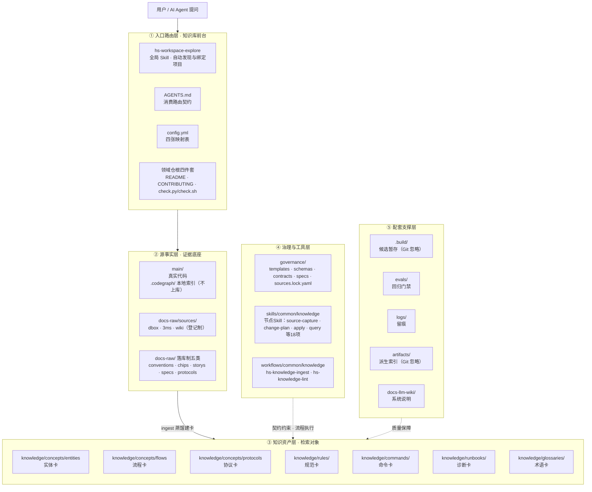
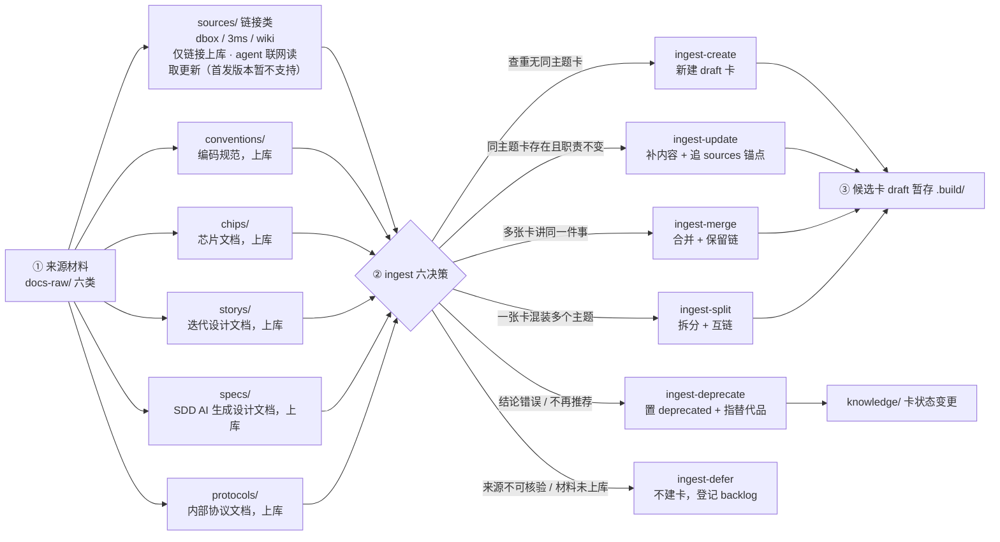
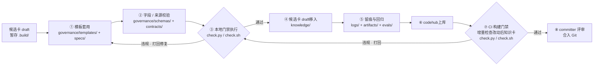
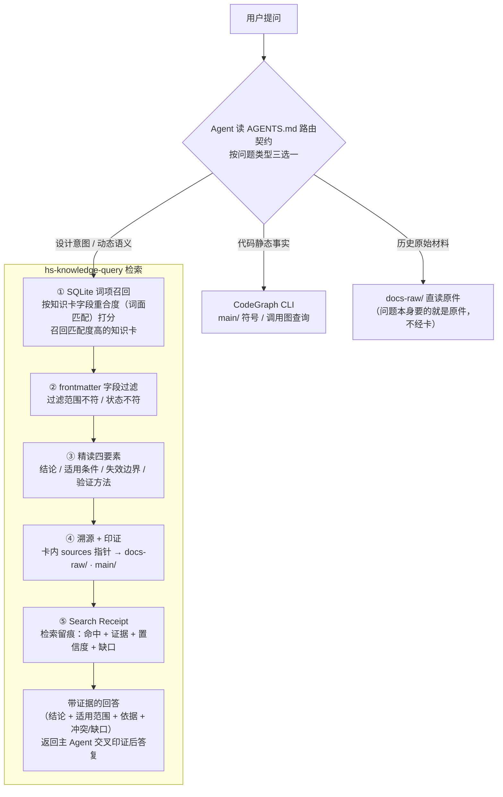

# AIoTBot 知识库详细设计

版本：v4.0；日期：2026-10-21。本文细化[主设计§5.3与第11章](AIoTBot知识库架构设计.md)，采用用户批准的18个节点级Skill与两个Workflow。WiFi唯一根为工作区直属的`aiotbot-knowledge-wifi/`，业务main仍为空；不新增其他领域或中间根。

本轮进入新的[knowledge-v2 SDD](sdd/knowledge-v2/README.md)开发流程，当前票据均从pending起算；是否完成以新记录中的测试、审查、提交/实际发布身份为准。旧knowledge-v1全部原字节保留，历史230项合成测试不表示当前包已交付。节点能力直接在本仓根skills/和workflows/开发，与main同级，使用当前FactumCore远端；不放嵌套.git，不发布个人安装路径。

## 1. 基础架构与实现边界

### 1.1 基础架构

沿用原五层图的节点和连线，仅工具能力标签随节点化更新。



### 1.2 首发范围与既定行为

| 项目 | 具体约定 |
|---|---|
| Workspace | FactumCore 保存代码槽位、配置与知识；Git在根执行；能力由本仓交付，领域目录无嵌套Git |
| 能力与编排 | 本仓能力目录的18个节点Skill 各有自己的 scripts/tests/依赖锁；两 Workflow 仅编排；通用规则只在领域 governance/contracts 实现一次 |
| 代码 | main 当前保持空；采用主设计 bfgx/common/dpa/platform/sensorhub、mp1x/mp12 的物理示意名称；真实代码由 config 关联 |
| Target | 现行 config 的 chip12/chip08/chip07c × host/device 六逻辑 ID 和三 pair 继续未绑定；不猜测其与 mp1x/mp12 的关系 |
| 文档 | 仅五类已落地 raw：conventions/chips/storys/specs/protocols；sources/dbox、3ms、wiki 只作后续保留 |
| 正文 | 七种 Profile：entity/flow/protocol/rule/command/runbook/glossary；九模板为七卡模板加 index/manual-review，不虚构额外正文类型 |
| 文档治理 | 真人确认确切最终视图后 stable；贡献者可自行确认；无回复、超时、Agent自报不是同意；免代码 lint |
| 代码治理 | 本地只读检查通过后 stable；上库按最新授权业务代码只读二次检查；检查不修卡、锁、链接或源码 |
| 消费 | SQLite 普通表词面候选→frontmatter/有效性过滤→过滤后 topK→同代精读→溯源→Search Receipt；无向量服务或 FTS5 |
| 排除项 | 首发不访问远端文档/仓外下载映射，不自动 OCR、不后台轮询，不代管用户 AGENTS，不承诺宿主必然隐式触发或目录提供 ACL |

### 1.3 名称、归属与唯一实现

W为FactumCore，K=W/aiotbot-knowledge-wifi；S=W/skills/common/knowledge，F=W/workflows/common/knowledge。全部固定源码都在本仓，Git操作在W根执行，禁止嵌套.git。现行路径遵循§5.3代码树；主文档通用描述不扩成本次其他域或隐藏.skills/.workflows。hs-knowledge-ingest、hs-knowledge-lint仅为Workflow ID，不再是聚合Skill。`hs-workspace-explore`和17个`hs-knowledge-*`节点Skill都经受信安装catalog解析，不从W相对路径或来源正文猜入口。

领域规则唯一实现仍在governance/contracts；Skill各有公开cli.py、薄support.py、测试和依赖锁。跨Skill只调catalog允许的公开CLI，不导入对方私有模块。事务引擎唯一归apply，recover调用其公开恢复action；检查引擎归local-check，merge-check调用公开merge action；索引引擎归index-build，query-regression复用query与index-build。维护原语归maintain，capture仅调用幂等来源变化阻断接口。不得恢复_shared聚合包或复制这些引擎。

产品协议版本2.0与设计版本v4.0分开。已有1.0规则/适配器是迁移输入，T201必须先冻结新schema/profile/lock/config兼容身份；旧记录只可显式历史读取，不重签成人确认或新代码证明。

## 2. 完整目录与固定文件

### 2.1 标记与当前身份

[F]本仓固定文件，[D]真实资料/技术卡实例，[R]真实运行产物，[P]首发延期，[L]宿主本机私有文件，[X]外部输入，[H]历史原字节。目标文件清单不是已完成声明。初期每个Skill固定为下列10文件，核心实现可按当前票据增添同目录模块，但必须同步文件清单与测试。所有业务运行输出只写显式授权K，安装区只读。

### 2.2 FactumCore完整目标树

```text
FactumCore/
├── .gitattributes [F]
├── .gitignore [F]
├── AGENTS.md [F]
├── aiotbot-knowledge-wifi/
│   ├── .build/
│   │   ├── .gitkeep [F]
│   │   └── operations/
│   │       └── <operation-id>/
│   │           ├── candidates/
│   │           │   └── <card-id>.md [R]
│   │           ├── captures/
│   │           │   └── <snapshot-id>/
│   │           │       ├── locators.json [R]
│   │           │       ├── manifest.json [R]
│   │           │       ├── normalized.md [R]
│   │           │       └── original.bin [R]
│   │           ├── changeset.json [R]
│   │           ├── final-view/
│   │           │   └── <relative-path> [R]
│   │           ├── handoff.json [R]
│   │           ├── operation.json [R]
│   │           ├── plan.json [R]
│   │           ├── reports/
│   │           │   └── local-check.json [R]
│   │           ├── review-package.json [R]
│   │           └── review-package.md [R]
│   ├── AGENTS.md [F]
│   ├── CONTRIBUTING.md [F]
│   ├── README.md [F]
│   ├── artifacts/
│   │   ├── .gitkeep [F]
│   │   ├── contexts/
│   │   │   └── <request-id>/
│   │   │       ├── binding.json [R]
│   │   │       └── project-context.json [R]
│   │   ├── indexes/
│   │   │   └── <channel>/
│   │   │       ├── <generation-id>/
│   │   │       │   ├── bodies/
│   │   │       │   │   └── <card-id>.md [R]
│   │   │       │   ├── index.sqlite3 [R]
│   │   │       │   └── manifest.json [R]
│   │   │       └── active.json [R]
│   │   ├── receipts/
│   │   │   └── <receipt-id>.json [R]
│   │   ├── reports/
│   │   │   └── <run-id>.json [R]
│   │   └── test-tmp/
│   │       └── <run-id>/
│   │           └── <temporary-file> [R]
│   ├── check.py [F]
│   ├── check.sh [F]
│   ├── docs-llm-wiki/
│   │   ├── AGENTS.md [F]
│   │   ├── AIoTBot知识库架构设计.md [F]
│   │   ├── README.md [F]
│   │   ├── sdd/
│   │   │   ├── knowledge-v1/
│   │   │   │   ├── README.md [H]
│   │   │   │   ├── baseline.json [H]
│   │   │   │   ├── batch-02.md [H]
│   │   │   │   ├── design.md [H]
│   │   │   │   ├── document-chain-usage.md [H]
│   │   │   │   ├── first-slice.md [H]
│   │   │   │   ├── module-map.md [H]
│   │   │   │   ├── modules/
│   │   │   │   │   └── <module-id>/
│   │   │   │   │       ├── design.md [H]
│   │   │   │   │       ├── spec.md [H]
│   │   │   │   │       └── tasks.md [H]
│   │   │   │   ├── records/
│   │   │   │   │   └── <record-file> [H]
│   │   │   │   ├── requirements.md [H]
│   │   │   │   ├── tasks.md [H]
│   │   │   │   ├── test-plan.md [H]
│   │   │   │   ├── tickets/
│   │   │   │   │   └── <ticket-id>.md [H]
│   │   │   │   └── traceability.json [H]
│   │   │   └── knowledge-v2/
│   │   │       ├── README.md [F]
│   │   │       ├── baseline.json [F]
│   │   │       ├── design.md [F]
│   │   │       ├── implementation-protocol.md [F]
│   │   │       ├── module-map.md [F]
│   │   │       ├── records/
│   │   │       │   └── README.md [F]
│   │   │       ├── requirements.md [F]
│   │   │       ├── test-plan.md [F]
│   │   │       ├── tickets/
│   │   │       │   ├── T201.md [F]
│   │   │       │   ├── T202.md [F]
│   │   │       │   ├── T203.md [F]
│   │   │       │   ├── T204.md [F]
│   │   │       │   ├── T205.md [F]
│   │   │       │   ├── T206.md [F]
│   │   │       │   ├── T207.md [F]
│   │   │       │   ├── T208.md [F]
│   │   │       │   ├── T209.md [F]
│   │   │       │   ├── T210.md [F]
│   │   │       │   └── T211.md [F]
│   │   │       └── traceability.json [F]
│   │   ├── task.md [F]
│   │   └── 知识库详细设计.md [F]
│   ├── docs-raw/
│   │   ├── AGENTS.md [F]
│   │   ├── chips/
│   │   │   ├── .gitkeep [F]
│   │   │   └── <document-id>/
│   │   │       └── <version-or-digest>/
│   │   │           ├── <attachment-file> [D]
│   │   │           └── <original-file> [D]
│   │   ├── conventions/
│   │   │   ├── .gitkeep [F]
│   │   │   └── <document-id>/
│   │   │       └── <version-or-digest>/
│   │   │           ├── <attachment-file> [D]
│   │   │           └── <original-file> [D]
│   │   ├── index.md [F]
│   │   ├── protocols/
│   │   │   ├── .gitkeep [F]
│   │   │   └── <document-id>/
│   │   │       └── <version-or-digest>/
│   │   │           ├── <attachment-file> [D]
│   │   │           └── <original-file> [D]
│   │   ├── sources/
│   │   │   ├── 3ms/
│   │   │   │   ├── .gitkeep [F]
│   │   │   │   └── <source-id>.md [P]
│   │   │   ├── dbox/
│   │   │   │   ├── .gitkeep [F]
│   │   │   │   └── <source-id>.md [P]
│   │   │   └── wiki/
│   │   │       ├── .gitkeep [F]
│   │   │       └── <source-id>.md [P]
│   │   ├── specs/
│   │   │   ├── .gitkeep [F]
│   │   │   └── <document-id>/
│   │   │       └── <version-or-digest>/
│   │   │           ├── <attachment-file> [D]
│   │   │           └── <original-file> [D]
│   │   └── storys/
│   │       ├── .gitkeep [F]
│   │       └── <document-id>/
│   │           └── <version-or-digest>/
│   │               ├── <attachment-file> [D]
│   │               └── <original-file> [D]
│   ├── evals/
│   │   ├── .gitkeep [F]
│   │   ├── README.md [F]
│   │   ├── cases/
│   │   │   └── retrieval.jsonl [F]
│   │   ├── pyproject.toml [F]
│   │   ├── requirements-dev.lock.txt [F]
│   │   ├── run_acceptance.py [F]
│   │   ├── tests/
│   │   │   ├── test_code_chain.py [F]
│   │   │   ├── test_contracts.py [F]
│   │   │   ├── test_document_chain.py [F]
│   │   │   ├── test_retrieval.py [F]
│   │   │   └── test_workflow_contracts.py [F]
│   │   └── validate_design.py [F]
│   ├── governance/
│   │   ├── AGENTS.md [F]
│   │   ├── contracts/
│   │   │   ├── __init__.py [F]
│   │   │   ├── knowledge.py [F]
│   │   │   ├── records.py [F]
│   │   │   ├── source_resources.py [F]
│   │   │   └── validation.py [F]
│   │   ├── framework.lock.yaml [F]
│   │   ├── index.md [F]
│   │   ├── schemas/
│   │   │   ├── frontmatter.schema.json [F]
│   │   │   ├── profiles.yaml [F]
│   │   │   ├── records.schema.json [F]
│   │   │   ├── registries.yaml [F]
│   │   │   ├── sources.schema.json [F]
│   │   │   └── workspace.schema.json [F]
│   │   ├── sources.lock.yaml [F]
│   │   ├── specs/
│   │   │   ├── cards.md [F]
│   │   │   ├── lifecycle.md [F]
│   │   │   ├── records.md [F]
│   │   │   └── sources.md [F]
│   │   └── templates/
│   │       ├── command.md [F]
│   │       ├── entity.md [F]
│   │       ├── flow.md [F]
│   │       ├── glossary.md [F]
│   │       ├── index.md [F]
│   │       ├── manual-review.json [F]
│   │       ├── protocol.md [F]
│   │       ├── rule.md [F]
│   │       └── runbook.md [F]
│   ├── knowledge/
│   │   ├── AGENTS.md [F]
│   │   ├── commands/
│   │   │   ├── <card-id>.md [D]
│   │   │   └── index.md [F]
│   │   ├── concepts/
│   │   │   ├── entities/
│   │   │   │   ├── <card-id>.md [D]
│   │   │   │   └── index.md [F]
│   │   │   ├── flows/
│   │   │   │   ├── <card-id>.md [D]
│   │   │   │   └── index.md [F]
│   │   │   ├── index.md [F]
│   │   │   └── protocols/
│   │   │       ├── <card-id>.md [D]
│   │   │       └── index.md [F]
│   │   ├── glossaries/
│   │   │   ├── <card-id>.md [D]
│   │   │   └── index.md [F]
│   │   ├── index.md [F]
│   │   ├── rules/
│   │   │   ├── <card-id>.md [D]
│   │   │   └── index.md [F]
│   │   └── runbooks/
│   │       ├── <card-id>.md [D]
│   │       └── index.md [F]
│   └── logs/
│       ├── .gitkeep [F]
│       ├── backlog/
│       │   └── <item-id>.json [R]
│       ├── document-reviews/
│       │   ├── <review-id>.json [R]
│       │   ├── decisions/
│       │   │   └── <decision-id>.json [R]
│       │   └── displays/
│       │       └── <display-id>.json [R]
│       ├── events/
│       │   ├── <event-id>.json [R]
│       │   └── state.json [R]
│       ├── evidence/
│       │   └── <bundle-id>/
│       │       ├── extractions/
│       │       │   └── <extraction-id>/
│       │       │       ├── locators.json [R]
│       │       │       └── text.txt [R]
│       │       ├── manifest.json [R]
│       │       └── objects/
│       │           └── <object-digest>.bin [R]
│       ├── local-checks/
│       │   └── <check-id>.json [R]
│       ├── merge-gates/
│       │   └── <gate-id>.json [R]
│       ├── operations/
│       │   ├── .writer.lock [R]
│       │   └── <operation-id>/
│       │       ├── backup-manifest.json [R]
│       │       ├── backups/
│       │       │   └── <file-key>.bin [R]
│       │       ├── journal.json [R]
│       │       └── result.json [R]
│       └── workflows/
│           ├── <workflow-run-id>/
│           │   └── nodes/
│           │       └── <node-id>/
│           │           └── <attempt-id>/
│           │               └── <artifact-id>.md [R]
│           └── <workflow-run-id>.json [R]
├── config.yml [F]
├── main/
│   ├── .gitkeep [F]
│   ├── device/
│   │   ├── bfgx/
│   │   │   └── <source-relative-path> [X]
│   │   ├── common/
│   │   │   └── <source-relative-path> [X]
│   │   ├── dpa/
│   │   │   └── <source-relative-path> [X]
│   │   ├── platform/
│   │   │   └── <source-relative-path> [X]
│   │   ├── sensorhub/
│   │   │   └── <source-relative-path> [X]
│   │   └── wifi/
│   │       ├── mp12/
│   │       │   ├── .codegraph/
│   │       │   │   └── <tool-artifact> [X]
│   │       │   └── <source-relative-path> [X]
│   │       └── mp1x/
│   │           ├── .codegraph/
│   │           │   └── <tool-artifact> [X]
│   │           └── <source-relative-path> [X]
│   └── drivers/
│       ├── bfgx/
│       │   └── <source-relative-path> [X]
│       ├── common/
│       │   └── <source-relative-path> [X]
│       ├── dpa/
│       │   └── <source-relative-path> [X]
│       ├── platform/
│       │   └── <source-relative-path> [X]
│       ├── sensorhub/
│       │   └── <source-relative-path> [X]
│       └── wifi/
│           ├── .codegraph/
│           │   └── <tool-artifact> [X]
│           └── <source-relative-path> [X]
├── skills/
│   └── common/
│       └── knowledge/
│           ├── hs-knowledge-apply/
│           │   ├── SKILL.md [F]
│           │   ├── artifacts/
│           │   │   ├── result.yaml [F]
│           │   │   ├── review-guide.md [F]
│           │   │   ├── templates/
│           │   │   │   └── result.md [F]
│           │   │   └── writing-guide.md [F]
│           │   ├── requirements-dev.lock.txt [F]
│           │   ├── requirements.lock.txt [F]
│           │   ├── scripts/
│           │   │   ├── cli.py [F]
│           │   │   └── support.py [F]
│           │   └── tests/
│           │       └── test_cli.py [F]
│           ├── hs-knowledge-candidate-inspect/
│           │   ├── SKILL.md [F]
│           │   ├── artifacts/
│           │   │   ├── result.yaml [F]
│           │   │   ├── review-guide.md [F]
│           │   │   ├── templates/
│           │   │   │   └── result.md [F]
│           │   │   └── writing-guide.md [F]
│           │   ├── requirements-dev.lock.txt [F]
│           │   ├── requirements.lock.txt [F]
│           │   ├── scripts/
│           │   │   ├── cli.py [F]
│           │   │   └── support.py [F]
│           │   └── tests/
│           │       └── test_cli.py [F]
│           ├── hs-knowledge-candidate-revise/
│           │   ├── SKILL.md [F]
│           │   ├── artifacts/
│           │   │   ├── result.yaml [F]
│           │   │   ├── review-guide.md [F]
│           │   │   ├── templates/
│           │   │   │   └── result.md [F]
│           │   │   └── writing-guide.md [F]
│           │   ├── requirements-dev.lock.txt [F]
│           │   ├── requirements.lock.txt [F]
│           │   ├── scripts/
│           │   │   ├── cli.py [F]
│           │   │   └── support.py [F]
│           │   └── tests/
│           │       └── test_cli.py [F]
│           ├── hs-knowledge-change-plan/
│           │   ├── SKILL.md [F]
│           │   ├── artifacts/
│           │   │   ├── result.yaml [F]
│           │   │   ├── review-guide.md [F]
│           │   │   ├── templates/
│           │   │   │   └── result.md [F]
│           │   │   └── writing-guide.md [F]
│           │   ├── requirements-dev.lock.txt [F]
│           │   ├── requirements.lock.txt [F]
│           │   ├── scripts/
│           │   │   ├── cli.py [F]
│           │   │   └── support.py [F]
│           │   └── tests/
│           │       └── test_cli.py [F]
│           ├── hs-knowledge-confirmation-prepare/
│           │   ├── SKILL.md [F]
│           │   ├── artifacts/
│           │   │   ├── result.yaml [F]
│           │   │   ├── review-guide.md [F]
│           │   │   ├── templates/
│           │   │   │   └── result.md [F]
│           │   │   └── writing-guide.md [F]
│           │   ├── requirements-dev.lock.txt [F]
│           │   ├── requirements.lock.txt [F]
│           │   ├── scripts/
│           │   │   ├── cli.py [F]
│           │   │   └── support.py [F]
│           │   └── tests/
│           │       └── test_cli.py [F]
│           ├── hs-knowledge-confirmation-record/
│           │   ├── SKILL.md [F]
│           │   ├── artifacts/
│           │   │   ├── result.yaml [F]
│           │   │   ├── review-guide.md [F]
│           │   │   ├── templates/
│           │   │   │   └── result.md [F]
│           │   │   └── writing-guide.md [F]
│           │   ├── requirements-dev.lock.txt [F]
│           │   ├── requirements.lock.txt [F]
│           │   ├── scripts/
│           │   │   ├── cli.py [F]
│           │   │   └── support.py [F]
│           │   └── tests/
│           │       └── test_cli.py [F]
│           ├── hs-knowledge-governance-handoff/
│           │   ├── SKILL.md [F]
│           │   ├── artifacts/
│           │   │   ├── result.yaml [F]
│           │   │   ├── review-guide.md [F]
│           │   │   ├── templates/
│           │   │   │   └── result.md [F]
│           │   │   └── writing-guide.md [F]
│           │   ├── requirements-dev.lock.txt [F]
│           │   ├── requirements.lock.txt [F]
│           │   ├── scripts/
│           │   │   ├── cli.py [F]
│           │   │   └── support.py [F]
│           │   └── tests/
│           │       └── test_cli.py [F]
│           ├── hs-knowledge-index-build/
│           │   ├── SKILL.md [F]
│           │   ├── artifacts/
│           │   │   ├── result.yaml [F]
│           │   │   ├── review-guide.md [F]
│           │   │   ├── templates/
│           │   │   │   └── result.md [F]
│           │   │   └── writing-guide.md [F]
│           │   ├── requirements-dev.lock.txt [F]
│           │   ├── requirements.lock.txt [F]
│           │   ├── scripts/
│           │   │   ├── cli.py [F]
│           │   │   └── support.py [F]
│           │   └── tests/
│           │       └── test_cli.py [F]
│           ├── hs-knowledge-local-check/
│           │   ├── SKILL.md [F]
│           │   ├── artifacts/
│           │   │   ├── result.yaml [F]
│           │   │   ├── review-guide.md [F]
│           │   │   ├── templates/
│           │   │   │   └── result.md [F]
│           │   │   └── writing-guide.md [F]
│           │   ├── requirements-dev.lock.txt [F]
│           │   ├── requirements.lock.txt [F]
│           │   ├── scripts/
│           │   │   ├── cli.py [F]
│           │   │   └── support.py [F]
│           │   └── tests/
│           │       └── test_cli.py [F]
│           ├── hs-knowledge-maintain/
│           │   ├── SKILL.md [F]
│           │   ├── artifacts/
│           │   │   ├── result.yaml [F]
│           │   │   ├── review-guide.md [F]
│           │   │   ├── templates/
│           │   │   │   └── result.md [F]
│           │   │   └── writing-guide.md [F]
│           │   ├── requirements-dev.lock.txt [F]
│           │   ├── requirements.lock.txt [F]
│           │   ├── scripts/
│           │   │   ├── cli.py [F]
│           │   │   └── support.py [F]
│           │   └── tests/
│           │       └── test_cli.py [F]
│           ├── hs-knowledge-merge-check/
│           │   ├── SKILL.md [F]
│           │   ├── artifacts/
│           │   │   ├── result.yaml [F]
│           │   │   ├── review-guide.md [F]
│           │   │   ├── templates/
│           │   │   │   └── result.md [F]
│           │   │   └── writing-guide.md [F]
│           │   ├── requirements-dev.lock.txt [F]
│           │   ├── requirements.lock.txt [F]
│           │   ├── scripts/
│           │   │   ├── cli.py [F]
│           │   │   └── support.py [F]
│           │   └── tests/
│           │       └── test_cli.py [F]
│           ├── hs-knowledge-publish-handoff/
│           │   ├── SKILL.md [F]
│           │   ├── artifacts/
│           │   │   ├── result.yaml [F]
│           │   │   ├── review-guide.md [F]
│           │   │   ├── templates/
│           │   │   │   └── result.md [F]
│           │   │   └── writing-guide.md [F]
│           │   ├── requirements-dev.lock.txt [F]
│           │   ├── requirements.lock.txt [F]
│           │   ├── scripts/
│           │   │   ├── cli.py [F]
│           │   │   └── support.py [F]
│           │   └── tests/
│           │       └── test_cli.py [F]
│           ├── hs-knowledge-query/
│           │   ├── SKILL.md [F]
│           │   ├── artifacts/
│           │   │   ├── result.yaml [F]
│           │   │   ├── review-guide.md [F]
│           │   │   ├── templates/
│           │   │   │   └── result.md [F]
│           │   │   └── writing-guide.md [F]
│           │   ├── requirements-dev.lock.txt [F]
│           │   ├── requirements.lock.txt [F]
│           │   ├── scripts/
│           │   │   ├── cli.py [F]
│           │   │   └── support.py [F]
│           │   └── tests/
│           │       └── test_cli.py [F]
│           ├── hs-knowledge-query-regression/
│           │   ├── SKILL.md [F]
│           │   ├── artifacts/
│           │   │   ├── result.yaml [F]
│           │   │   ├── review-guide.md [F]
│           │   │   ├── templates/
│           │   │   │   └── result.md [F]
│           │   │   └── writing-guide.md [F]
│           │   ├── requirements-dev.lock.txt [F]
│           │   ├── requirements.lock.txt [F]
│           │   ├── scripts/
│           │   │   ├── cli.py [F]
│           │   │   └── support.py [F]
│           │   └── tests/
│           │       └── test_cli.py [F]
│           ├── hs-knowledge-recover/
│           │   ├── SKILL.md [F]
│           │   ├── artifacts/
│           │   │   ├── result.yaml [F]
│           │   │   ├── review-guide.md [F]
│           │   │   ├── templates/
│           │   │   │   └── result.md [F]
│           │   │   └── writing-guide.md [F]
│           │   ├── requirements-dev.lock.txt [F]
│           │   ├── requirements.lock.txt [F]
│           │   ├── scripts/
│           │   │   ├── cli.py [F]
│           │   │   └── support.py [F]
│           │   └── tests/
│           │       └── test_cli.py [F]
│           ├── hs-knowledge-source-capture/
│           │   ├── SKILL.md [F]
│           │   ├── artifacts/
│           │   │   ├── result.yaml [F]
│           │   │   ├── review-guide.md [F]
│           │   │   ├── templates/
│           │   │   │   └── result.md [F]
│           │   │   └── writing-guide.md [F]
│           │   ├── requirements-dev.lock.txt [F]
│           │   ├── requirements.lock.txt [F]
│           │   ├── scripts/
│           │   │   ├── cli.py [F]
│           │   │   └── support.py [F]
│           │   └── tests/
│           │       └── test_cli.py [F]
│           ├── hs-knowledge-view-materialize/
│           │   ├── SKILL.md [F]
│           │   ├── artifacts/
│           │   │   ├── result.yaml [F]
│           │   │   ├── review-guide.md [F]
│           │   │   ├── templates/
│           │   │   │   └── result.md [F]
│           │   │   └── writing-guide.md [F]
│           │   ├── requirements-dev.lock.txt [F]
│           │   ├── requirements.lock.txt [F]
│           │   ├── scripts/
│           │   │   ├── cli.py [F]
│           │   │   └── support.py [F]
│           │   └── tests/
│           │       └── test_cli.py [F]
│           └── hs-workspace-explore/
│               ├── SKILL.md [F]
│               ├── artifacts/
│               │   ├── result.yaml [F]
│               │   ├── review-guide.md [F]
│               │   ├── templates/
│               │   │   └── result.md [F]
│               │   └── writing-guide.md [F]
│               ├── requirements-dev.lock.txt [F]
│               ├── requirements.lock.txt [F]
│               ├── scripts/
│               │   ├── cli.py [F]
│               │   └── support.py [F]
│               └── tests/
│                   └── test_cli.py [F]
└── workflows/
    └── common/
        └── knowledge/
            ├── hs-knowledge-ingest/
            │   ├── layouts.yaml [F]
            │   └── workflow.yaml [F]
            └── hs-knowledge-lint/
                ├── layouts.yaml [F]
                └── workflow.yaml [F]
```

### 2.3 本机和外部对象

| 文件与类型 | 职责 | 怎么开发／生成 | 要求 | 验收 |
|---|---|---|---|---|
| `<user-agent-home>/aiotbot-installations/<installation-id>.json` [L] | 受控安装清单 | 登记源commit、包hash、宿主版本/位置、拥有文件及校验结果 | 仅本机；更新/卸载仅操作本清单拥有且未被用户改动的包 | 同名用户包不覆盖，版本和宿主实测可核验 |
| `<openflow-data-root>/config/workflow-templates/<workflow-id>/workflow.yaml` [L] | OpenFlow安装后运行模板 | workflow-id仅为能力仓两个hs-knowledge模板；复制受控完整包并核hash | 宿主路径不是项目新真源；不声称自动扫描仓内workflows | 真实loader/catalog/角色可加载 |
| `<openflow-data-root>/config/workflow-templates/<workflow-id>/layouts.yaml` [L] | OpenFlow安装后画布布局 | 与对应workflow同包受控更新 | 仅画布；不能影响运行判断 | template_id和运行模板一致 |
| `<openflow-data-root>/config/skills/<skill-id>/<package-relative-path>` [L] | OpenFlow已安装Skill包 | skill-id仅为能力仓18个节点Skill，包相对文件逐个对应本设计Skill清单 | 包含各自scripts/tests/artifacts资源及实际需要的references，不夹带领域原件/卡/锁或本机凭据 | Skill资源与产物契约可见，实际选用/工具轨迹单独验证 |
| `<user-agent-home>/workspace-registry.json` [L] | 本机workspace定位登记 | 安装或显式登记时保存workspace_id/config位置与匹配索引；宿主私有区保存 | 只定位，不替代config事实或授权；不创建用户AGENTS，不扫描整盘 | 多checkout/失效登记有诊断；仓外仅给已登记路径可加载 |
| `<user-agent-home>/skills/hs-workspace-explore/SKILL.md` [L] | 宿主可见全局入口副本或受控链接 | 按已授权安装固定版本的explore Skill及其references/scripts | 安装不代表自动触发；依赖版本和源路径变更需受控更新 | 真实新会话只给代码路径有可见/选用/加载工具轨迹 |
| `<registered-code-root>/<source-relative-path>` [X] | config映射的实际业务代码 | 可为main挂载或真实独立checkout/无Git导出，登记真实身份 | 实际路径未知不臆造；dirty必须固定实际读取字节 | 固定Git/dirty/导出各能回放，否则incomplete |
| `<ci-output>/<run-id>/merge-gate.json` [X] | CI只读门禁报告 | 从受信CI固定H/B/T/V及规则生成独立报告 | 不回写PR卡/锁/链接/源码；不得自报已合入 | 报告输入与实际提案/最新业务观察点绑定 |
| `<ci-output>/<run-id>/index/<derived-file>` [X] | CI临时索引与回归输出 | 只在job独立目录完整重建和检验，随任务输出证据 | 不能写待审K/artifacts或激活shared；未运行单列 | 输入树前后字节不变，回归失败可定位 |

## 3. 各文件职责、开发要求和验收

### 3.1 本仓固定、实例与运行文件

| 文件与类型 | 职责 | 怎么开发／生成 | 要求 | 验收 |
|---|---|---|---|---|
| `AGENTS.md` [F] | 项目路由入口 | 短表指向 config、K、18节点Skill、两 Workflow | 不含业务结论，不替代真实加载，不代管用户个人 AGENTS | 仓内/仓外绑定后均能找到同一知识入口 |
| `config.yml` [F] | 四映射表及六 Target/三 pair | 保留 repos/architecture/wiki_entities/symbol_aliases，补充版本、工具与查询政策引用 | 未登记真实代码根、宏、构建、版本为 null/unknown；配置不是已验证知识 | 六 Target/三 pair 引用闭合；共享 Host 路径不被武断选成单芯片 |
| `.gitignore` [F] | 运行与本机产物排除 | 忽略 .build/artifacts/.codegraph、缓存、锁、临时备份 | 不整目录忽略 logs 而丢失唯一确认；不恢复根 runtime 目录 | git status 不含机器索引/凭据，必要审计记录仍可提交 |
| `.gitattributes` [F] | 文本与原件字节政策 | 系统文本 LF，raw 二进制/冻结原件按字节保留 | 原件不因迁移或换行被改 hash | 原件迁移前后摘要相同 |
| `main/.gitkeep` [F] | 业务代码槽位 | 维持现行空目录 | 不按主设计示意树虚造 device/host 源码 | main 仅占位；真实代码未知仍报告 unknown |
| `main/device/bfgx/<source-relative-path>` [X] | 主设计业务源码示意槽位 | 仅登记实际授权仓/版本或导出；当前不创建源树 | 不是本库生成文件；不由目录名推导芯片适用性 | 真实读取/编译/运行分层验收 |
| `main/device/common/<source-relative-path>` [X] | 主设计业务源码示意槽位 | 仅登记实际授权仓/版本或导出；当前不创建源树 | 不是本库生成文件；不由目录名推导芯片适用性 | 真实读取/编译/运行分层验收 |
| `main/device/dpa/<source-relative-path>` [X] | 主设计业务源码示意槽位 | 仅登记实际授权仓/版本或导出；当前不创建源树 | 不是本库生成文件；不由目录名推导芯片适用性 | 真实读取/编译/运行分层验收 |
| `main/device/platform/<source-relative-path>` [X] | 主设计业务源码示意槽位 | 仅登记实际授权仓/版本或导出；当前不创建源树 | 不是本库生成文件；不由目录名推导芯片适用性 | 真实读取/编译/运行分层验收 |
| `main/device/sensorhub/<source-relative-path>` [X] | 主设计业务源码示意槽位 | 仅登记实际授权仓/版本或导出；当前不创建源树 | 不是本库生成文件；不由目录名推导芯片适用性 | 真实读取/编译/运行分层验收 |
| `main/drivers/bfgx/<source-relative-path>` [X] | 主设计业务源码示意槽位 | 仅登记实际授权仓/版本或导出；当前不创建源树 | 不是本库生成文件；不由目录名推导芯片适用性 | 真实读取/编译/运行分层验收 |
| `main/drivers/common/<source-relative-path>` [X] | 主设计业务源码示意槽位 | 仅登记实际授权仓/版本或导出；当前不创建源树 | 不是本库生成文件；不由目录名推导芯片适用性 | 真实读取/编译/运行分层验收 |
| `main/drivers/dpa/<source-relative-path>` [X] | 主设计业务源码示意槽位 | 仅登记实际授权仓/版本或导出；当前不创建源树 | 不是本库生成文件；不由目录名推导芯片适用性 | 真实读取/编译/运行分层验收 |
| `main/drivers/platform/<source-relative-path>` [X] | 主设计业务源码示意槽位 | 仅登记实际授权仓/版本或导出；当前不创建源树 | 不是本库生成文件；不由目录名推导芯片适用性 | 真实读取/编译/运行分层验收 |
| `main/drivers/sensorhub/<source-relative-path>` [X] | 主设计业务源码示意槽位 | 仅登记实际授权仓/版本或导出；当前不创建源树 | 不是本库生成文件；不由目录名推导芯片适用性 | 真实读取/编译/运行分层验收 |
| `main/device/wifi/mp1x/<source-relative-path>` [X] | WiFi真实代码示意 | 实际路径和逻辑Target对应由config登记 | main当前空，不生成假代码；mp1x/mp12不自动对应chip12/08/07c | 对应授权工程的来源身份、构建和范围可核验 |
| `main/device/wifi/mp1x/.codegraph/<tool-artifact>` [X] | 本地代码图谱对象 | 由实际CodeGraph工具构建并固定源码/Target身份 | 不上库，陈旧图不能作当前语义证明；门禁不重建图 | 旧图/错Target报告缺口并回源码 |
| `main/device/wifi/mp12/<source-relative-path>` [X] | WiFi真实代码示意 | 实际路径和逻辑Target对应由config登记 | main当前空，不生成假代码；mp1x/mp12不自动对应chip12/08/07c | 对应授权工程的来源身份、构建和范围可核验 |
| `main/device/wifi/mp12/.codegraph/<tool-artifact>` [X] | 本地代码图谱对象 | 由实际CodeGraph工具构建并固定源码/Target身份 | 不上库，陈旧图不能作当前语义证明；门禁不重建图 | 旧图/错Target报告缺口并回源码 |
| `main/drivers/wifi/<source-relative-path>` [X] | WiFi真实代码示意 | 实际路径和逻辑Target对应由config登记 | main当前空，不生成假代码；mp1x/mp12不自动对应chip12/08/07c | 对应授权工程的来源身份、构建和范围可核验 |
| `main/drivers/wifi/.codegraph/<tool-artifact>` [X] | 本地代码图谱对象 | 由实际CodeGraph工具构建并固定源码/Target身份 | 不上库，陈旧图不能作当前语义证明；门禁不重建图 | 旧图/错Target报告缺口并回源码 |
| `aiotbot-knowledge-wifi/AGENTS.md` [F] | 领域入口 | 指知识/原件/治理/18节点Skill/两 Workflow | 不装业务结论；明确当前能力状态 | 与根入口没有互斥规则 |
| `aiotbot-knowledge-wifi/README.md` [F] | 人读定位/现状/安装入口 | 真实可用能力与未实现边界，指系统文档与验收 | 空骨架不得写成已运行 | 新人沿导航可找到准确操作入口 |
| `aiotbot-knowledge-wifi/CONTRIBUTING.md` [F] | 贡献与上库规则 | raw人工流程、代码双门禁、Scoped Git提交 | 自己可确认自己的文档，但必须真实动作；保留其他dirty | 贡献者可按说明分别完成两条合成演练 |
| `aiotbot-knowledge-wifi/check.py` [F] | 治理构建薄包装 | 从自身位置识别K/W；从受信安装清单按local/merge解析hs-knowledge-local-check或hs-knowledge-merge-check的已安装CLI，以argv转发明确K/context/view或merge参数 | 不假定W/skills或相邻能力仓路径；无代码/规则副本，无自动修复/安装；纯文档免代码门禁 | 与 Lint CLI 同结果，任意 cwd 可执行 |
| `aiotbot-knowledge-wifi/check.sh` [F] | Unix兼容入口 | 精确定位脚本目录后 exec python check.py "$@" | 不安装工具，不改 cwd 假定，不吞exitcode | 空格路径/失败退出码传递正确 |
| `aiotbot-knowledge-wifi/docs-raw/AGENTS.md` [F] | 原件只读边界 | 五允许类、sources延期、控制文件排除、真实格式缺口 | 不以raw文字获得执行/发布权限 | 提示注入只能作为正文呈现 |
| `aiotbot-knowledge-wifi/docs-raw/index.md` [F] | 原件导航 | 按类别列 document_id、版本、相对落点、source引用 | 不是第六原件，不复制结论 | 每项可回到真实字节/锁 |
| `aiotbot-knowledge-wifi/docs-raw/conventions/<document-id>/<version-or-digest>/<original-file>` [D] | 规范原件 | 用户放入真实不可变原件 | 只读，批准身份未知保持未知 | source锁恢复同字节 |
| `aiotbot-knowledge-wifi/docs-raw/conventions/<document-id>/<version-or-digest>/<attachment-file>` [D] | 规范附件 | 必要附件分别登记 | 缺附件不报完整 | 主文不变附件改仍提示影响 |
| `aiotbot-knowledge-wifi/docs-raw/chips/<document-id>/<version-or-digest>/<original-file>` [D] | 芯片原件 | 真实版本及芯片范围 | 不默认三芯片通用 | 不跨芯片current误用 |
| `aiotbot-knowledge-wifi/docs-raw/chips/<document-id>/<version-or-digest>/<attachment-file>` [D] | 芯片图表附件 | 固定hash/页图定位 | 单位和图表人工检查 | 附件字节可恢复 |
| `aiotbot-knowledge-wifi/docs-raw/storys/<document-id>/<version-or-digest>/<original-file>` [D] | 迭代设计原件 | 保留计划/实现/实测身份 | 计划不是验证结果 | 候选能区分身份 |
| `aiotbot-knowledge-wifi/docs-raw/storys/<document-id>/<version-or-digest>/<attachment-file>` [D] | 迭代附件 | 独立快照与主文关系 | 不纳凭据/无关日志 | 引用闭合 |
| `aiotbot-knowledge-wifi/docs-raw/specs/<document-id>/<version-or-digest>/<original-file>` [D] | SDD原件 | 固定规格/设计版本 | 系统自身SDD不是自动来源，必须明确落raw与授权 | AI设计不冒充已实现 |
| `aiotbot-knowledge-wifi/docs-raw/specs/<document-id>/<version-or-digest>/<attachment-file>` [D] | SDD必要附表 | 独立hash/locator | 不隐式复制docs-llm-wiki成领域事实 | 正式引用可追踪 |
| `aiotbot-knowledge-wifi/docs-raw/protocols/<document-id>/<version-or-digest>/<original-file>` [D] | 协议原件 | 标准版本/章节/原页 | 标准与产品支持分开 | 不混用不同版本 |
| `aiotbot-knowledge-wifi/docs-raw/protocols/<document-id>/<version-or-digest>/<attachment-file>` [D] | 协议勘误/附录 | 固定主版本关联 | 采用勘误须人工决定 | 旧条款与新勘误同时恢复 |
| `aiotbot-knowledge-wifi/docs-raw/sources/dbox/<source-id>.md` [P] | dbox登记页 | 未来链接/版本/hash/密级/授权登记 | 首发只保留.gitkeep，不访问、不更新卡 | 输入此路径返回SOURCE_DEFERRED且无网络 |
| `aiotbot-knowledge-wifi/docs-raw/sources/3ms/<source-id>.md` [P] | 3ms登记页 | 未来可行性与权限确认后设计 | 当前不支持访问 | 不伪造3ms读取结果 |
| `aiotbot-knowledge-wifi/docs-raw/sources/wiki/<source-id>.md` [P] | wiki登记页 | 未来网页授权/取回/固定快照后设计 | 首发不联网获取 | 相同输入明确延期 |
| `aiotbot-knowledge-wifi/docs-raw/chips/.gitkeep` [F] | 当前空目录占位 | 保持当前骨架，实施该目录固定文件时按同一模块提交移除占位 | 占位不是Skill、Workflow、索引或来源访问能力 | 新clone能看到对应目录，不产生虚假业务文件 |
| `aiotbot-knowledge-wifi/docs-raw/conventions/.gitkeep` [F] | 当前空目录占位 | 保持当前骨架，实施该目录固定文件时按同一模块提交移除占位 | 占位不是Skill、Workflow、索引或来源访问能力 | 新clone能看到对应目录，不产生虚假业务文件 |
| `aiotbot-knowledge-wifi/docs-raw/protocols/.gitkeep` [F] | 当前空目录占位 | 保持当前骨架，实施该目录固定文件时按同一模块提交移除占位 | 占位不是Skill、Workflow、索引或来源访问能力 | 新clone能看到对应目录，不产生虚假业务文件 |
| `aiotbot-knowledge-wifi/docs-raw/sources/3ms/.gitkeep` [F] | 当前空目录占位 | 保持当前骨架，实施该目录固定文件时按同一模块提交移除占位 | 占位不是Skill、Workflow、索引或来源访问能力 | 新clone能看到对应目录，不产生虚假业务文件 |
| `aiotbot-knowledge-wifi/docs-raw/sources/dbox/.gitkeep` [F] | 当前空目录占位 | 保持当前骨架，实施该目录固定文件时按同一模块提交移除占位 | 占位不是Skill、Workflow、索引或来源访问能力 | 新clone能看到对应目录，不产生虚假业务文件 |
| `aiotbot-knowledge-wifi/docs-raw/sources/wiki/.gitkeep` [F] | 当前空目录占位 | 保持当前骨架，实施该目录固定文件时按同一模块提交移除占位 | 占位不是Skill、Workflow、索引或来源访问能力 | 新clone能看到对应目录，不产生虚假业务文件 |
| `aiotbot-knowledge-wifi/docs-raw/specs/.gitkeep` [F] | 当前空目录占位 | 保持当前骨架，实施该目录固定文件时按同一模块提交移除占位 | 占位不是Skill、Workflow、索引或来源访问能力 | 新clone能看到对应目录，不产生虚假业务文件 |
| `aiotbot-knowledge-wifi/docs-raw/storys/.gitkeep` [F] | 当前空目录占位 | 保持当前骨架，实施该目录固定文件时按同一模块提交移除占位 | 占位不是Skill、Workflow、索引或来源访问能力 | 新clone能看到对应目录，不产生虚假业务文件 |
| `aiotbot-knowledge-wifi/governance/AGENTS.md` [F] | 规则改动入口 | 说明声明规则/契约/模板/锁/测试位置 | 主设计不变；规则改动有兼容和迁移说明 | 规则维护者能找到单一契约来源 |
| `aiotbot-knowledge-wifi/governance/index.md` [F] | 治理导航 | 链接下列固定文件 | 不复制另一份字段规范 | 无断链、无 _shared 现行入口 |
| `aiotbot-knowledge-wifi/governance/framework.lock.yaml` [F] | 锁定领域契约与外部工具兼容身份 | 本仓仅锁治理契约/规则的领域相对路径及hash；外部能力锁release/commit、包摘要及兼容要求，由受信安装清单解析实际入口 | 不声称存在已归档执行器；受信CI基线不由PR任意调低；未来2.0另锁定允许的能力release/包摘要；本轮1.0相对规则路径及字节不改 | 同版本hash可复核；不兼容拒绝 |
| `aiotbot-knowledge-wifi/governance/sources.lock.yaml` [F] | SourceResource/快照SSOT | 保留旧合法记录；实际导入时追加固定source/snapshot及恢复信息 | 空锁不表示已读取资料；原件不被capture覆盖 | 所用来源引用闭合、旧版本可恢复 |
| `aiotbot-knowledge-wifi/governance/schemas/frontmatter.schema.json` [F] | 卡/Claim字段 | 现有1.0为迁移输入，按2.0契约明确7 Profile、scope、sources、claims、relations | 字段兼容迁移显式；不能靠Schema声称内容正确 | 缺字段/错枚举定位准确 |
| `aiotbot-knowledge-wifi/governance/schemas/sources.schema.json` [F] | 来源/快照字段 | Git、导出、raw来源与定位、hash/bytes/恢复 | 来源链接只是登记，首发不拉远端 | 缺字节摘要、错误版本、不可恢复可识别 |
| `aiotbot-knowledge-wifi/governance/schemas/records.schema.json` [F] | 记录字段 | ProjectContext/SourceSnapshot/ChangeSet/人工/代码检查/事务/索引/收据统一判形 | 人工决定≠代码pass；记录不含自身递归摘要 | 记录与实际对象摘要绑定 |
| `aiotbot-knowledge-wifi/governance/schemas/workspace.schema.json` [F] | config字段/引用 | 四映射表、Target/pair、覆盖边界 | 不复制实际业务路径注册 | 对现行 config 及unknown正确校验 |
| `aiotbot-knowledge-wifi/governance/schemas/profiles.yaml` [F] | 七类章节义务 | 保持现有entity/flow/protocol/rule/command/runbook/glossary | 不按资料工具扩Profile；Profile不决定审核模式 | 七模板必需章节完整 |
| `aiotbot-knowledge-wifi/governance/schemas/registries.yaml` [F] | 受控公共枚举 | 登记受控枚举、五类raw允许根及来源类别；真实Target/代码位置仍只在config.yml；不放凭据或本机私有路径 | Target/实际repo映射仍只在config | 枚举闭合、无CANN业务遗留 |
| `aiotbot-knowledge-wifi/governance/contracts/__init__.py` [F] | 契约公开接口 | 仅导出版本及五模块需要的稳定纯函数 | 导入不扫描/联网/写入 | 独立加载无副作用 |
| `aiotbot-knowledge-wifi/governance/contracts/validation.py` [F] | 通用本地规则加载 | Schema/Profile/枚举加载、canonical摘要、诊断类型、safe路径读 | 禁远端$ref、eval、从raw读程序；缓存绑定规则hash | 畸形/未知版本/路径绕出拒绝，中文摘要确定 |
| `aiotbot-knowledge-wifi/governance/contracts/knowledge.py` [F] | 卡片完整解释 | Markdown frontmatter/claim text_ref/七Profile/ID/关系/适用范围纯函数 | 解析不修卡；scope unknown不当通配；导航/AGENTS不当卡 | 三Skill对同卡得到同一ParsedCard与排除原因 |
| `aiotbot-knowledge-wifi/governance/contracts/source_resources.py` [F] | 来源资源/快照契约 | 来源锁解析、引用/locator/恢复元数据、实际字节hash验证 | 只读已批准来源；不联网抓取；不混用旧source snapshot | 原文、附件、版本变化分别可诊断 |
| `aiotbot-knowledge-wifi/governance/contracts/records.py` [F] | 记录绑定验证 | **替换现有从 _shared.contracts/_shared.changes 导入的失效adapter**，改为本层validation与具体绑定纯函数 | 不包办真人交互/事务；信任不由confirmed_by字段产生 | 无 _shared 依赖；旧兼容记录可判形但不冒充新部署有效证明 |
| `aiotbot-knowledge-wifi/governance/templates/entity.md` [F] | 实体候选模板 | 职责/边界/接口/依赖/证据 | draft占位不能当实际结论 | Profile章节齐全 |
| `aiotbot-knowledge-wifi/governance/templates/flow.md` [F] | 流程候选模板 | 起终点/步骤/调用与消息/异常/条件/证据 | 跨侧缺口显式 | Profile章节齐全 |
| `aiotbot-knowledge-wifi/governance/templates/protocol.md` [F] | 协议候选模板 | 机制/字段与状态/约束/标准版本/产品支持边界/证据 | 标准不等于产品实现 | Profile章节齐全 |
| `aiotbot-knowledge-wifi/governance/templates/rule.md` [F] | 规范候选模板 | 规则对象/约束/例外/批准身份/检查办法/证据 | 无批准信息不补造 | Profile章节齐全 |
| `aiotbot-knowledge-wifi/governance/templates/command.md` [F] | 命令候选模板 | 语法/参数/前置条件/输出判读/误用/验证/证据 | 原task不等于可执行维测命令，须确有命令语义 | Profile章节齐全 |
| `aiotbot-knowledge-wifi/governance/templates/runbook.md` [F] | 诊断候选模板 | 现象/信号/分支/步骤/根因状态/解法/验证/证据 | 推测归因不得标已验证 | Profile章节齐全 |
| `aiotbot-knowledge-wifi/governance/templates/glossary.md` [F] | 术语候选模板 | 定义/别名/歧义/范围/证据 | 含歧义和来源上下文 | Profile章节齐全 |
| `aiotbot-knowledge-wifi/governance/templates/index.md` [F] | 导航模板 | 层级/卡ID/短用途/状态 | 非第8卡Profile | 不入词面索引 |
| `aiotbot-knowledge-wifi/governance/templates/manual-review.json` [F] | 人工记录形状样例 | 无真实姓名/时间/接受状态的占位样例 | **模板不是确认**，占位记录永不授权apply | 模板直接作确认必被拒绝 |
| `aiotbot-knowledge-wifi/governance/specs/cards.md` [F] | 卡编写规范 | 七Profile/四要素/Claim/证据/scope/关系规则 | 不复制Schema逐字段定义形成漂移 | 模板、解析、规范一致 |
| `aiotbot-knowledge-wifi/governance/specs/sources.md` [F] | 来源与人工更新规范 | 五raw、不可变版本、附件、恢复、设计与实现区分 | 远端三来源延期 | 新旧原件可同时恢复并精确定位 |
| `aiotbot-knowledge-wifi/governance/specs/lifecycle.md` [F] | 生命周期与共享资格 | draft→stable；deprecated/替代；local/shared与manual/code分支 | stable不是已合入；CI不改卡；回滚不覆盖历史 | 每个状态转换有责任人与确切证据 |
| `aiotbot-knowledge-wifi/governance/specs/records.md` [F] | 记录信任与绑定 | 终端真人确认、摘要、代码双检、事务/收据、schema迁移 | 去掉旧 _shared 命令描述；明确新CLI与历史身份 | 新命令能真实重放，历史记录不得伪装当前部署 |
| `aiotbot-knowledge-wifi/knowledge/AGENTS.md` [F] | 知识读取与写入规则 | 七 Profile、stable/范围/来源/复核边界 | 不虚构业务模块/Target实配 | 卡片任务有清晰Profile落点 |
| `aiotbot-knowledge-wifi/knowledge/index.md` [F] | 正式知识总导航 | 分类入口、卡ID和简短用途 | 人读导航不入技术检索 | 每张已落位卡可按ID寻址 |
| `aiotbot-knowledge-wifi/knowledge/concepts/index.md` [F] | 概念导航 | 指entities/flows/protocols | 不存独立技术事实 | 三子导航链接完整 |
| `aiotbot-knowledge-wifi/knowledge/concepts/entities/index.md` [F] | 实体卡导航 | 实体ID/职责入口 | 不把目录等于模块已存在 | 条目可达、无悬空卡 |
| `aiotbot-knowledge-wifi/knowledge/concepts/flows/index.md` [F] | 流程卡导航 | 场景/起终点入口 | 不重复卡正文 | merge/split后入口可达 |
| `aiotbot-knowledge-wifi/knowledge/concepts/protocols/index.md` [F] | 协议卡导航 | 协议版本/机制入口 | 标准与产品支持不混写 | 可定位相应版本卡 |
| `aiotbot-knowledge-wifi/knowledge/rules/index.md` [F] | 规范卡导航 | 规则对象/状态入口 | 不将规范声明当实现遵从 | 适用边界可见 |
| `aiotbot-knowledge-wifi/knowledge/commands/index.md` [F] | 命令卡导航 | 工具/命令入口 | 不自动执行命令 | 只跳转正式卡 |
| `aiotbot-knowledge-wifi/knowledge/runbooks/index.md` [F] | 诊断卡导航 | 症状/环境入口 | 不把未实测归因写为已证 | 卡内根因状态可查 |
| `aiotbot-knowledge-wifi/knowledge/glossaries/index.md` [F] | 术语卡导航 | 词/别名/歧义入口 | 别名不直接等同源码符号事实 | 词条可追溯来源 |
| `aiotbot-knowledge-wifi/knowledge/concepts/entities/<card-id>.md` [D] | entity卡 | entity模板与4要素/Claims | 模块/OPS/回调只写有证据职责 | Profile及语义人工/代码证据适配 |
| `aiotbot-knowledge-wifi/knowledge/concepts/flows/<card-id>.md` [D] | flow卡 | flow模板，边/条件/跨侧证据 | 缺一侧不得完链 | 起终点/异常/条件可验证 |
| `aiotbot-knowledge-wifi/knowledge/concepts/protocols/<card-id>.md` [D] | protocol卡 | 标准机制与产品支持独立Claim | 标准文档确认不证明芯片支持 | 版本/范围/定位闭合 |
| `aiotbot-knowledge-wifi/knowledge/rules/<card-id>.md` [D] | rule卡 | 可检查规则/例外/批准身份 | 未知批准不补造 | 约束与例外有证据 |
| `aiotbot-knowledge-wifi/knowledge/commands/<card-id>.md` [D] | command卡 | 真实命令/参数/输出/误用 | 不把SDD task标题生造命令 | 前置条件和验证明确 |
| `aiotbot-knowledge-wifi/knowledge/runbooks/<card-id>.md` [D] | runbook卡 | 现象/信号/分支/根因状态/解法/验证 | 推测不冒充根因已证 | 相同症状的边界可见 |
| `aiotbot-knowledge-wifi/knowledge/glossaries/<card-id>.md` [D] | glossary卡 | 定义/别名/歧义/范围 | 组内词不无条件映射代码符号 | 适用范围与证据可恢复 |
| `aiotbot-knowledge-wifi/.build/operations/<operation-id>/operation.json` [R] | 操作状态/绑定 | 固定workspace/K/操作种类/输入摘要 | ignored；不是最终授权 | 能判恢复/输入已变 |
| `aiotbot-knowledge-wifi/.build/operations/<operation-id>/captures/<snapshot-id>/original.bin` [R] | 读取期间固定原字节 | 临时一致读副本；raw本身仍只读 | ignored，不能成为唯一恢复源；final锁需真实raw版本/历史恢复 | 清.build后仍能恢复正式卡证据 |
| `aiotbot-knowledge-wifi/.build/operations/<operation-id>/captures/<snapshot-id>/normalized.md` [R] | 规范化文本 | 提取器输出带缺口 | ignored，不充当新原文版本 | 可从locator回真实字节 |
| `aiotbot-knowledge-wifi/.build/operations/<operation-id>/captures/<snapshot-id>/locators.json` [R] | 章节/页/段定位 | normalized span→原定位 | ignored，格式/工具版本入manifest | 抽样锚点可往返回源 |
| `aiotbot-knowledge-wifi/.build/operations/<operation-id>/captures/<snapshot-id>/manifest.json` [R] | 捕获清单 | snapshot/hash/bytes/附件/提取版本/恢复条件 | ignored；待应用source增量尚非正式锁 | 读中变化与缺附件可识别 |
| `aiotbot-knowledge-wifi/.build/operations/<operation-id>/plan.json` [R] | 六决策/影响面 | 基线/输出/理由/缺口/责任 | ignored；不是已执行记录 | plan不写正式卡 |
| `aiotbot-knowledge-wifi/.build/operations/<operation-id>/changeset.json` [R] | 确切写清单 | 每文件baseline/final hash/动作、来源及scope | ignored；范围不可隐式扩张 | 额外路径不在确认范围则拒绝 |
| `aiotbot-knowledge-wifi/.build/operations/<operation-id>/candidates/<card-id>.md` [R] | draft工作稿 | 人/Agent迭代工作稿 | ignored，永不检索 | draft字节不误进knowledge |
| `aiotbot-knowledge-wifi/.build/operations/<operation-id>/final-view/<relative-path>` [R] | 拟落位stable精确字节 | 卡/导航/锁最终文件视图 | ignored；确认的是这里的精确对象，apply不再补字段 | 确认后变1字节旧确认失效 |
| `aiotbot-knowledge-wifi/.build/operations/<operation-id>/review-package.json` [R] | 人工展示包 | final-view摘要/固定来源/附件/缺口/确认动作说明 | ignored，展示不是同意 | 展示内容可与确认记录摘要核对 |
| `aiotbot-knowledge-wifi/.build/operations/<operation-id>/review-package.md` [R] | 人读候选差异 | 结论/新增删改/范围/新旧证据与待确认项 | ignored，与JSON同包摘要 | 用户可明确接受/退回/无影响/部分接受 |
| `aiotbot-knowledge-wifi/logs/document-reviews/<review-id>.json` [R] | 真人决定审计 | 真实动作后产生，绑定操作/最终视图/来源/范围/决定 | 必要事实可提交；无回复/模板/Agent自述不生成accepted | 确认变化后过期；原记录只追加不覆盖 |
| `aiotbot-knowledge-wifi/logs/local-checks/<check-id>.json` [R] | 本地code_gate结果 | local只读报告通过后由ingest apply原字节持久归档，绑定确切卡/代码/规则；lint不回写正式目录 | 可提交证据摘要；manual_document无此记录 | 与当前final-view匹配才授权apply |
| `aiotbot-knowledge-wifi/logs/merge-gates/<gate-id>.json` [R] | merge结果归档 | CI外部产物验证后受控保存/引用 | CI只写独立output，不回写PR；外部证明不必卡内链接修订 | 绑定head/代码最新ref/规则，可验证CI身份 |
| `aiotbot-knowledge-wifi/logs/operations/<operation-id>/journal.json` [R] | 持久写事务意图/进度 | apply前durable journal，逐步追加/刷新 | 不是.build；写前flush，路径与hash固定 | 中断后定位唯一恢复步骤 |
| `aiotbot-knowledge-wifi/logs/operations/<operation-id>/backups/<file-key>.bin` [R] | 写前备份 | file-key为正式目标相对路径UTF-8的SHA-256；旧字节按键保存，由backup-manifest映射路径/摘要/absent状态 | 不默认提交、单独ignore；仅本域卡/导航/锁，不含raw/源码 | 回滚恢复旧hash，完成后按保留政策清理 |
| `aiotbot-knowledge-wifi/logs/operations/<operation-id>/result.json` [R] | 实际完成回执 | 成功后记录最终hash/文件/状态/证明引用 | 可提交事实；部分执行不可写success | 幂等重复返回同operation结果 |
| `aiotbot-knowledge-wifi/logs/operations/.writer.lock` [R] | 域写互斥 | OS文件锁持有token/进程信息，崩溃释放策略 | 本机不提交；过期文件不等于锁仍活跃 | 同域并行apply只有一方写，另一方明确busy |
| `aiotbot-knowledge-wifi/logs/events/<event-id>.json` [R] | 来源更新/失效/替代事件 | 只追加，关联源/卡/Claim/原因/生效范围 | 事件不直接修卡/宣称重验；更新被blocked的current输出 | 旧代仍可历史读，current即时排除阻断Claim |
| `aiotbot-knowledge-wifi/logs/backlog/<item-id>.json` [R] | defer事实 | 明确缺来源/缺适用条件等理由与待补项 | 不造技术卡，不写虚假已恢复 | 后续显式重入能关联旧defer |
| `aiotbot-knowledge-wifi/artifacts/indexes/<channel>/active.json` [R] | 当前索引指针 | 原子切换已完整校验generation_id | ignored；旧代可继续供已开始查询 | 构建失败不切指针 |
| `aiotbot-knowledge-wifi/artifacts/indexes/<channel>/<generation-id>/manifest.json` [R] | 代次内容身份 | 卡/规则/确认/代码证明/合入身份/词项器版本摘要 | ignored；local/shared资格分别声明 | 把本地未合入卡冒充shared会拒绝 |
| `aiotbot-knowledge-wifi/artifacts/indexes/<channel>/<generation-id>/index.sqlite3` [R] | 词面索引 | documents/claims/postings/relations/metadata；SQL按候选→字段过滤→topk | ignored，不含raw正文；不信任旧DB覆盖新规则 | 字段过滤先于limit，排序可解释 |
| `aiotbot-knowledge-wifi/artifacts/indexes/<channel>/<generation-id>/bodies/<card-id>.md` [R] | 同代精读字节 | 从固定知识快照复制/内容寻址 | ignored；不能精读实时另一版正文 | 切代并发仍命中同代hash |
| `aiotbot-knowledge-wifi/artifacts/receipts/<receipt-id>.json` [R] | Search Receipt | 查询/上下文/渠道/generation/命中排除/读卡/来源/缺口/置信 | ignored，含用户问题可能敏感；不自动提交 | 每个回答采用Claim可回源 |
| `aiotbot-knowledge-wifi/artifacts/reports/<run-id>.json` [R] | 检查/评测机器报告 | 命令输入版本/诊断/实际测试结果 | ignored；不凭空填pass | 可复核实际执行身份 |
| `aiotbot-knowledge-wifi/artifacts/test-tmp/<run-id>/<temporary-file>` [R] | 测试专属临时目录 | 单次命令唯一末级目录 | ignored；不得碰真实K/main | 并行测试互不覆盖 |
| `aiotbot-knowledge-wifi/logs/workflows/<workflow-run-id>/nodes/<node-id>/<attempt-id>/<artifact-id>.md` [R] | 工作流节点产物的不可变展示清单 | 由各Skill CLI --artifact-manifest写入，绑定权威runtime run/node/attempt、operation与真实JSON摘要 | 同节点循环用新attempt；Agent只上报location；不包含跨域资料、凭据或虚构通过 | 产物map revision总能回读原始字节；跨run、node、attempt或operation错配被adapter拒绝 |
| `aiotbot-knowledge-wifi/.build/operations/<operation-id>/reports/local-check.json` [R] | 本地只读代码检查输出 | lint local写入独立候选报告；apply验证后原字节归档到logs/local-checks | 报告不是修改许可之外的发布授权；manual_document无此代码证明要求 | 报告与确切final-view、代码和规则摘要绑定 |
| `aiotbot-knowledge-wifi/logs/operations/<operation-id>/backup-manifest.json` [R] | 持久恢复清单 | 写入前列出每个正式目标的旧/新摘要、长度、backup键与原先absent标记 | 不能把清单与唯一备份放.build；不含源码/raw备份 | 逐个恢复目标与原始字节核对 |
| `aiotbot-knowledge-wifi/logs/evidence/<bundle-id>/manifest.json` [R] | 持久来源恢复身份 | capture固定source/snapshot、对象hash/bytes、提取版本、locator与恢复策略 | 不是来源内容的第二份可编辑真源；声明是否本机可用/跨机可恢复 | 清理.build后仍能回放；不可用则明确缺口 |
| `aiotbot-knowledge-wifi/logs/evidence/<bundle-id>/objects/<object-digest>.bin` [R] | 同域不可变来源恢复对象 | 以内容摘要寻址保留必要原始字节，或声明可验证的固定Git/归档恢复方式 | 默认不上库、不进入公共框架发行；受原件同域权限保护 | 旧raw被替换或dirty代码改变仍取回原hash；否则incomplete |
| `aiotbot-knowledge-wifi/logs/evidence/<bundle-id>/extractions/<extraction-id>/text.txt` [R] | 固定转换文本 | 由固定提取器产生并绑定对象摘要 | 不是新原件，不反写raw；不自动联网/OCR | 正文可读部分及未提取缺口可追踪 |
| `aiotbot-knowledge-wifi/logs/evidence/<bundle-id>/extractions/<extraction-id>/locators.json` [R] | 转换与原件定位映射 | 保存段落/页/章节和原字节对象的映射 | 不伪造PDF分页或DOCX物理页号 | 采用的每个锚点可回到固定对象 |
| `aiotbot-knowledge-wifi/logs/workflows/<workflow-run-id>.json` [R] | 编排阶段与交接状态 | 保存parent_run_id、operation_id、阶段输入输出摘要及重入位置 | 阶段completed不替代人工/代码/合入证明 | 两个Workflow可恢复且不重复apply或提交 |
| `aiotbot-knowledge-wifi/logs/events/state.json` [R] | 当前阻断与双水位 | 由immutable事件重放，保存validity_epoch、impact_scan_watermark、knowledge_apply_watermark及条件化阻断引用 | 先持久化事件/影响再推进扫描水位；复核和激活齐备才推进应用水位 | 中断不丢阻断；旧代与回滚索引仍受当前阻断 |
| `aiotbot-knowledge-wifi/artifacts/contexts/<request-id>/binding.json` [R] | 已解析项目定位回执 | explore resolve在已定位并获授权的领域artifacts中输出规范路径、checkout/config身份及候选根 | 只表示resolved；尚不声称入口已读；未绑定时只向stdout输出诊断 | 仓外只给路径可定位；多命中不写假绑定 |
| `aiotbot-knowledge-wifi/artifacts/contexts/<request-id>/project-context.json` [R] | 已实际加载的上下文回执 | explore load-context从binding实际读取适用入口，固定读取摘要、范围与未知项 | 本机ignored；后续CLI核当前config/checkout/授权，不把旧回执当永不过期授权 | 未读/变动/撤权明确失效；context_loaded有真实读取轨迹 |
| `aiotbot-knowledge-wifi/.build/operations/<operation-id>/handoff.json` [R] | 生产到治理的不可变交接包 | materialize完成时固定context、原件、plan/changeset/final-view及基线/规则/工具摘要、review_mode、目标模板与缺口 | P5只核验并交接；不能跨模板target或重新复制正文冒充原视图 | 治理重读实际对象并拒绝陈旧/跨operation交接 |
| `aiotbot-knowledge-wifi/logs/document-reviews/displays/<display-id>.json` [R] | 实际展示回执 | confirm的受信展示adapter实际展示精确view后记录通道/run/op/node/attempt、view与来源摘要及可定位展示引用 | 未展示不生成已展示回执；不是接受；后续不能覆盖原字节 | 用户决策唯一绑定到实际展示的确切内容 |
| `aiotbot-knowledge-wifi/logs/document-reviews/decisions/<decision-id>.json` [R] | 原始人工通道决定的审计引用 | trusted_adapter从真实UI事件/认证通道或受支持人工终端取得动作、身份、时间、展示引用及原始证据来源 | 默认本机不提交敏感身份/交互原文；decidedBy=user字符串不证明真人；不能接收Agent自造accepted | 无可信原始交互则awaiting；旧事件或错view拒绝 |
| `aiotbot-knowledge-wifi/.build/.gitkeep` [F] | 当前空目录占位 | 保持当前骨架，实施该目录固定文件时按同一模块提交移除占位 | 占位不是Skill、Workflow、索引或来源访问能力 | 新clone能看到对应目录，不产生虚假业务文件 |
| `aiotbot-knowledge-wifi/artifacts/.gitkeep` [F] | 当前空目录占位 | 保持当前骨架，实施该目录固定文件时按同一模块提交移除占位 | 占位不是Skill、Workflow、索引或来源访问能力 | 新clone能看到对应目录，不产生虚假业务文件 |
| `aiotbot-knowledge-wifi/logs/.gitkeep` [F] | 当前空目录占位 | 保持当前骨架，实施该目录固定文件时按同一模块提交移除占位 | 占位不是Skill、Workflow、索引或来源访问能力 | 新clone能看到对应目录，不产生虚假业务文件 |
| `aiotbot-knowledge-wifi/evals/README.md` [F] | 跨能力验收导航 | 说明unit/synthetic/真实业务/宿主分层与命令 | 不设受限gold读取入口、不复制旧benchmark | 当前未运行项明确 |
| `aiotbot-knowledge-wifi/evals/requirements-dev.lock.txt` [F] | 领域集成验收依赖锁 | 只冻结领域契约和单仓跨节点验收runner实际依赖；另记录受信已安装Skill release的兼容要求，不代替其运行/开发锁 | 显式安装、不运行时联网；支持格式依赖矩阵与真实锁一致 | 先具备受信Skill安装和各自运行依赖，再在独立领域验收环境按此锁运行evals；不据此宣称Skill单测已执行 |
| `aiotbot-knowledge-wifi/evals/pyproject.toml` [F] | pytest/ruff范围配置 | 只配置域内evals检查范围、报告与专用tmp；Skill自有tests由能力仓各自执行 | 不配置W/skills路径或PYTHONPATH单仓跨节点导入；不把相邻checkout当受信发行 | 从任意cwd给-c绝对路径运行正确测试集 |
| `aiotbot-knowledge-wifi/evals/run_acceptance.py` [F] | 单一验收入口 | 解析声明的验收scope，以argv调用已登记受信Skill CLI与本域测试；记录知识SHA、实际工具release/包/解释器身份 | 只做单仓跨节点集成验收；不假定工具源码在FactumCore，不覆盖K真实资料，不伪造真实外部验证 | 各scope失败原exitcode上报；报告准确记录命令/版本/边界 |
| `aiotbot-knowledge-wifi/evals/cases/retrieval.jsonl` [F] | 检索回归输入 | 合成/公开toy问题、上下文、expected/include/exclude规则 | 不放真实秘密，不能由Agent读受限答案 | 六Target、未知、同词歧义、过滤后topk可回归 |
| `aiotbot-knowledge-wifi/evals/tests/test_contracts.py` [F] | 跨Skill共用契约回归 | 对本地Schema/卡/来源/records API的外部输入验证 | 契约不复制到Skill；不访问受限gold | 各Skill对同输入解释一致，模板契约兼容 |
| `aiotbot-knowledge-wifi/evals/tests/test_document_chain.py` [F] | raw到stable纵向验收 | 使用临时原件/卡、专属合成终端、事务、索引与检索 | 不为真实业务卡伪造人确认 | 接受/拒绝/陈旧/部分接受/失败恢复完整 |
| `aiotbot-knowledge-wifi/evals/tests/test_code_chain.py` [F] | codegate合成纵向验收 | toy代码、不同rev、local/merge分工、无改写 | main保持空，synthetic源码仅tmp | 旧代码证明不能批准新卡/新代码 |
| `aiotbot-knowledge-wifi/evals/tests/test_workflow_contracts.py` [F] | 两Workflow交接/路由验收 | 检查Skill名、命令、阶段输入输出、无复制执行逻辑 | 静态检查不冒充真实host触发 | 文件名/引用/分流/责任不漂移 |
| `aiotbot-knowledge-wifi/evals/tests/test_retrieval.py` [F] | 词面过滤/证据收据纵向 | 调Query真实CLI对cases建库检索 | 拒绝wrongScope，不卡死于错误范围高分候选 | 预期include/exclude与固定receipt吻合 |
| `aiotbot-knowledge-wifi/evals/validate_design.py` [F] | 当前设计与SDD静态一致性检查 | 以标准库校验设计hash、文件表/树、来源锚点、需求任务关系、DAG、目录约束和实际占位 | 仅证明文档和追踪一致；不验业务语义或宿主触发；不硬编码旧148条 | 正常规格通过；改hash、失效锚点或依赖环必须失败 |
| `aiotbot-knowledge-wifi/evals/.gitkeep` [F] | 当前空目录占位 | 保持当前骨架，实施该目录固定文件时按同一模块提交移除占位 | 占位不是Skill、Workflow、索引或来源访问能力 | 新clone能看到对应目录，不产生虚假业务文件 |
| `aiotbot-knowledge-wifi/docs-llm-wiki/AGENTS.md` [F] | 系统文档维护规则 | 主设计→详设→SDD阅读与修改方向 | 不存第二份业务事实；历史记录原样保留 | 修改者能确定当前依据 |
| `aiotbot-knowledge-wifi/docs-llm-wiki/README.md` [F] | 设计、模块任务与SDD导航 | 准确链接与部署身份 | 旧230测试注明历史归档 | 不把空技能宣称可用 |
| `aiotbot-knowledge-wifi/docs-llm-wiki/AIoTBot知识库架构设计.md` [F] | §5.3/11基线 | 仅扩展节点能力清单及对应归属/标签，不重构原图 | 名称路径SSOT；保留原图节点与边结构 | 图结构与改前一致，其他改动限能力清单与归属 |
| `aiotbot-knowledge-wifi/docs-llm-wiki/知识库详细设计.md` [F] | 具体文件/接口/链路/验收 | 采用此文件manifest并嵌原图 | 定义待实现与现状，所有固定文件都有5列 | §5.3所有目录覆盖；无_shared现行实现 |
| `aiotbot-knowledge-wifi/docs-llm-wiki/task.md` [F] | 当前模块任务粗排 | 按九模块列任务、依赖、完成条件与推进顺序，后续交接SDD细拆 | 不继承历史完成状态，不代替正式票据与验收 | 模块范围与本设计一致，依赖清楚，当前状态如实记录 |
| `aiotbot-knowledge-wifi/docs-llm-wiki/sdd/knowledge-v1/README.md` [H] | 历史SDD入口 | 保留原有导航；新实现基线由knowledge-v2承接 | 不改knowledge-v1；历史证据不能转名为新实现通过 | 文件与本轮开始时字节一致 |
| `aiotbot-knowledge-wifi/docs-llm-wiki/sdd/knowledge-v1/requirements.md` [H] | 既有需求 | 保留当前内容；后续SDD逐条与新详设对齐 | 不改knowledge-v1；新实现由knowledge-v2承接 | 文件与本轮开始时字节一致 |
| `aiotbot-knowledge-wifi/docs-llm-wiki/sdd/knowledge-v1/design.md` [H] | 既有模块设计 | 当前物理接口已滞后；后续按本详设更新 | 不改knowledge-v1；新实现由knowledge-v2承接 | 文件与本轮开始时字节一致 |
| `aiotbot-knowledge-wifi/docs-llm-wiki/sdd/knowledge-v1/module-map.md` [H] | 既有模块导航 | 后续重新核对文件拥有者，不在本轮重排 | 不改knowledge-v1；新实现由knowledge-v2承接 | 文件与本轮开始时字节一致 |
| `aiotbot-knowledge-wifi/docs-llm-wiki/sdd/knowledge-v1/tasks.md` [H] | 既有任务状态 | 保留原始状态；不得视为新目录接口已实现 | 不改knowledge-v1；新实现由knowledge-v2承接 | 文件与本轮开始时字节一致 |
| `aiotbot-knowledge-wifi/docs-llm-wiki/sdd/knowledge-v1/test-plan.md` [H] | 既有验收计划 | 后续按新CLI与Workflow阶段重新映射 | 不改knowledge-v1；新实现由knowledge-v2承接 | 文件与本轮开始时字节一致 |
| `aiotbot-knowledge-wifi/docs-llm-wiki/sdd/knowledge-v1/baseline.json` [H] | 既有基线身份 | 保留当前摘要；本轮不更新为已完成SDD同步 | 不改knowledge-v1；新实现由knowledge-v2承接 | 文件与本轮开始时字节一致 |
| `aiotbot-knowledge-wifi/docs-llm-wiki/sdd/knowledge-v1/traceability.json` [H] | 既有机器追踪 | 保留现有逻辑ID与历史成绩；设计定稿后单独重新基线 | 不改knowledge-v1；新实现由knowledge-v2承接 | 文件与本轮开始时字节一致 |
| `aiotbot-knowledge-wifi/docs-llm-wiki/sdd/knowledge-v1/first-slice.md` [H] | 历史首切片手册 | 原字节保留；当前程序已归档，不作为可运行命令 | 不改knowledge-v1；新实现由knowledge-v2承接 | 文件与本轮开始时字节一致 |
| `aiotbot-knowledge-wifi/docs-llm-wiki/sdd/knowledge-v1/batch-02.md` [H] | 历史批次手册 | 原字节保留；只说明当时实现和验收 | 不改knowledge-v1；新实现由knowledge-v2承接 | 文件与本轮开始时字节一致 |
| `aiotbot-knowledge-wifi/docs-llm-wiki/sdd/knowledge-v1/document-chain-usage.md` [H] | 历史raw操作手册 | 原字节保留；新接口以本详设及后续SDD为准 | 不改knowledge-v1；新实现由knowledge-v2承接 | 文件与本轮开始时字节一致 |
| `aiotbot-knowledge-wifi/docs-llm-wiki/sdd/knowledge-v1/modules/<module-id>/spec.md` [H] | 现有九模块规格/设计/任务 | module-id为旧M01–M09；原字节保留，新设计仅在knowledge-v2维护 | 本轮只保留现状，不用占位目录宣称实现 | 现存各模块文件完整保留 |
| `aiotbot-knowledge-wifi/docs-llm-wiki/sdd/knowledge-v1/modules/<module-id>/design.md` [H] | 现有九模块规格/设计/任务 | module-id为旧M01–M09；原字节保留，新设计仅在knowledge-v2维护 | 本轮只保留现状，不用占位目录宣称实现 | 现存各模块文件完整保留 |
| `aiotbot-knowledge-wifi/docs-llm-wiki/sdd/knowledge-v1/modules/<module-id>/tasks.md` [H] | 现有九模块规格/设计/任务 | module-id为旧M01–M09；原字节保留，新设计仅在knowledge-v2维护 | 本轮只保留现状，不用占位目录宣称实现 | 现存各模块文件完整保留 |
| `aiotbot-knowledge-wifi/docs-llm-wiki/sdd/knowledge-v1/tickets/<ticket-id>.md` [H] | 现有28张任务票 | ticket-id为现有T01–T28；后续SDD重核依赖、交付与验收 | 本轮不重置票状态，不继承历史完成为新接口完成 | 现存票据完整保留 |
| `aiotbot-knowledge-wifi/docs-llm-wiki/sdd/knowledge-v1/records/<record-file>` [H] | 已发生开发、测试、迁移与发布证据 | 保留已有文件原始身份；后续新证据独立命名 | 不覆盖、不补写虚构成绩 | 现存records全部原字节保留 |
| `aiotbot-knowledge-wifi/docs-llm-wiki/sdd/knowledge-v2/README.md` [F] | 节点化SDD当前工件 | 按本轮批准的18Skill/2Workflow需求、接口、依赖与验收维护 | 当前任务初始pending；knowledge-v1字节与状态保持历史身份 | 引用/依赖/基线实际hash一致，缺真实外部证据不结案 |
| `aiotbot-knowledge-wifi/docs-llm-wiki/sdd/knowledge-v2/requirements.md` [F] | 节点化SDD当前工件 | 按本轮批准的18Skill/2Workflow需求、接口、依赖与验收维护 | 当前任务初始pending；knowledge-v1字节与状态保持历史身份 | 引用/依赖/基线实际hash一致，缺真实外部证据不结案 |
| `aiotbot-knowledge-wifi/docs-llm-wiki/sdd/knowledge-v2/design.md` [F] | 节点化SDD当前工件 | 按本轮批准的18Skill/2Workflow需求、接口、依赖与验收维护 | 当前任务初始pending；knowledge-v1字节与状态保持历史身份 | 引用/依赖/基线实际hash一致，缺真实外部证据不结案 |
| `aiotbot-knowledge-wifi/docs-llm-wiki/sdd/knowledge-v2/test-plan.md` [F] | 节点化SDD当前工件 | 按本轮批准的18Skill/2Workflow需求、接口、依赖与验收维护 | 当前任务初始pending；knowledge-v1字节与状态保持历史身份 | 引用/依赖/基线实际hash一致，缺真实外部证据不结案 |
| `aiotbot-knowledge-wifi/docs-llm-wiki/sdd/knowledge-v2/baseline.json` [F] | 节点化SDD当前工件 | 按本轮批准的18Skill/2Workflow需求、接口、依赖与验收维护 | 当前任务初始pending；knowledge-v1字节与状态保持历史身份 | 引用/依赖/基线实际hash一致，缺真实外部证据不结案 |
| `aiotbot-knowledge-wifi/docs-llm-wiki/sdd/knowledge-v2/module-map.md` [F] | 节点化SDD当前工件 | 按本轮批准的18Skill/2Workflow需求、接口、依赖与验收维护 | 当前任务初始pending；knowledge-v1字节与状态保持历史身份 | 引用/依赖/基线实际hash一致，缺真实外部证据不结案 |
| `aiotbot-knowledge-wifi/docs-llm-wiki/sdd/knowledge-v2/traceability.json` [F] | 节点化SDD当前工件 | 按本轮批准的18Skill/2Workflow需求、接口、依赖与验收维护 | 当前任务初始pending；knowledge-v1字节与状态保持历史身份 | 引用/依赖/基线实际hash一致，缺真实外部证据不结案 |
| `aiotbot-knowledge-wifi/docs-llm-wiki/sdd/knowledge-v2/records/README.md` [F] | 节点化SDD当前工件 | 按本轮批准的18Skill/2Workflow需求、接口、依赖与验收维护 | 当前任务初始pending；knowledge-v1字节与状态保持历史身份 | 引用/依赖/基线实际hash一致，缺真实外部证据不结案 |
| `aiotbot-knowledge-wifi/docs-llm-wiki/sdd/knowledge-v2/tickets/T201.md` [F] | 节点化SDD当前工件 | 按本轮批准的18Skill/2Workflow需求、接口、依赖与验收维护 | 当前任务初始pending；knowledge-v1字节与状态保持历史身份 | 引用/依赖/基线实际hash一致，缺真实外部证据不结案 |
| `aiotbot-knowledge-wifi/docs-llm-wiki/sdd/knowledge-v2/tickets/T202.md` [F] | 节点化SDD当前工件 | 按本轮批准的18Skill/2Workflow需求、接口、依赖与验收维护 | 当前任务初始pending；knowledge-v1字节与状态保持历史身份 | 引用/依赖/基线实际hash一致，缺真实外部证据不结案 |
| `aiotbot-knowledge-wifi/docs-llm-wiki/sdd/knowledge-v2/tickets/T203.md` [F] | 节点化SDD当前工件 | 按本轮批准的18Skill/2Workflow需求、接口、依赖与验收维护 | 当前任务初始pending；knowledge-v1字节与状态保持历史身份 | 引用/依赖/基线实际hash一致，缺真实外部证据不结案 |
| `aiotbot-knowledge-wifi/docs-llm-wiki/sdd/knowledge-v2/tickets/T204.md` [F] | 节点化SDD当前工件 | 按本轮批准的18Skill/2Workflow需求、接口、依赖与验收维护 | 当前任务初始pending；knowledge-v1字节与状态保持历史身份 | 引用/依赖/基线实际hash一致，缺真实外部证据不结案 |
| `aiotbot-knowledge-wifi/docs-llm-wiki/sdd/knowledge-v2/tickets/T205.md` [F] | 节点化SDD当前工件 | 按本轮批准的18Skill/2Workflow需求、接口、依赖与验收维护 | 当前任务初始pending；knowledge-v1字节与状态保持历史身份 | 引用/依赖/基线实际hash一致，缺真实外部证据不结案 |
| `aiotbot-knowledge-wifi/docs-llm-wiki/sdd/knowledge-v2/tickets/T206.md` [F] | 节点化SDD当前工件 | 按本轮批准的18Skill/2Workflow需求、接口、依赖与验收维护 | 当前任务初始pending；knowledge-v1字节与状态保持历史身份 | 引用/依赖/基线实际hash一致，缺真实外部证据不结案 |
| `aiotbot-knowledge-wifi/docs-llm-wiki/sdd/knowledge-v2/tickets/T207.md` [F] | 节点化SDD当前工件 | 按本轮批准的18Skill/2Workflow需求、接口、依赖与验收维护 | 当前任务初始pending；knowledge-v1字节与状态保持历史身份 | 引用/依赖/基线实际hash一致，缺真实外部证据不结案 |
| `aiotbot-knowledge-wifi/docs-llm-wiki/sdd/knowledge-v2/tickets/T208.md` [F] | 节点化SDD当前工件 | 按本轮批准的18Skill/2Workflow需求、接口、依赖与验收维护 | 当前任务初始pending；knowledge-v1字节与状态保持历史身份 | 引用/依赖/基线实际hash一致，缺真实外部证据不结案 |
| `aiotbot-knowledge-wifi/docs-llm-wiki/sdd/knowledge-v2/tickets/T209.md` [F] | 节点化SDD当前工件 | 按本轮批准的18Skill/2Workflow需求、接口、依赖与验收维护 | 当前任务初始pending；knowledge-v1字节与状态保持历史身份 | 引用/依赖/基线实际hash一致，缺真实外部证据不结案 |
| `aiotbot-knowledge-wifi/docs-llm-wiki/sdd/knowledge-v2/tickets/T210.md` [F] | 节点化SDD当前工件 | 按本轮批准的18Skill/2Workflow需求、接口、依赖与验收维护 | 当前任务初始pending；knowledge-v1字节与状态保持历史身份 | 引用/依赖/基线实际hash一致，缺真实外部证据不结案 |
| `aiotbot-knowledge-wifi/docs-llm-wiki/sdd/knowledge-v2/tickets/T211.md` [F] | 节点化SDD当前工件 | 按本轮批准的18Skill/2Workflow需求、接口、依赖与验收维护 | 当前任务初始pending；knowledge-v1字节与状态保持历史身份 | 引用/依赖/基线实际hash一致，缺真实外部证据不结案 |

| `aiotbot-knowledge-wifi/docs-llm-wiki/sdd/knowledge-v2/implementation-protocol.md` [F] | 产品2.0公开实施协议 | 从本轮冻结协议完整保留；作为18节点公开JSON/API边界 | 修改须同步规则/包/SDD基线；不是额外聚合执行程序 | 源文件hash准确，协议与公开CLI一致 |

### 3.2 18个节点Skill的逐文件定义

每包result.yaml的文件名相同，artifact ID必须节点唯一（建议Skill ID加-result）；其applies_to/required_on只约束本节点的真实出口。三个资源均必须存在。新增具体实现模块前先在对应T20x票据记录接口/验收，不要求为每个函数制造新Skill。

#### hs-workspace-explore

职责：绑定项目；节点：`bind_project`；实施票：[T202](sdd/knowledge-v2/tickets/T202.md)。输入：code_path/config_ref/registry_ref；输出：Binding、context_loaded回执。边界：定位与真实加载；未绑定/歧义停止，不先要求Context。

| 文件与类型 | 职责 | 怎么开发／生成 | 要求 | 验收 |
|---|---|---|---|---|
| `skills/common/knowledge/hs-workspace-explore/SKILL.md` [F] | 能力入口与边界 | 明确本节点输入、动作、结果与缺口，指向公开CLI和产物合同 | 不包装成聚合Workflow；不自授人确认或发布 | 名称与目录及catalog完全一致，入口无秘密 |
| `skills/common/knowledge/hs-workspace-explore/scripts/cli.py` [F] | 公开进程入口 | 解析统一JSON进出、K/rules/catalog/action并调本包实现 | 不导入其他Skill私有代码；无运行时安装/联网/Git发布 | 外部进程可调用；0/2/3与phase语义符合协议 |
| `skills/common/knowledge/hs-workspace-explore/scripts/support.py` [F] | 本包薄适配与bootstrap | 校验包/锁身份、绑定受信领域规则与catalog，封装明确公开接口 | 不能复制Schema/卡/Scope/来源/证明规则，不成为聚合业务引擎 | 错误规则/包摘要/入口拒绝；加载前已验证代码字节 |
| `skills/common/knowledge/hs-workspace-explore/tests/test_cli.py` [F] | 本节点公开边界回归 | 用隔离合成K和公开CLI覆盖成功/阻断/无副作用/陈旧输入 | 合成动作只用于fixture根，不能证明真实人或宿主 | 正常与失败反例实际运行；stdout和持久记录可核 |
| `skills/common/knowledge/hs-workspace-explore/requirements.lock.txt` [F] | 运行依赖锁 | 冻结本包实际运行依赖版本/hash并纳tool_identity | 不以空文件宣称可复现；不从来源临时安装 | 显式锁定环境可运行本包；版本变化改变工具身份 |
| `skills/common/knowledge/hs-workspace-explore/requirements-dev.lock.txt` [F] | 开发测试依赖锁 | 固定本包测试/检查依赖及兼容运行锁 | 不恢复仓根依赖/旧共享包 | 空环境显式安装后本包测试可复现 |
| `skills/common/knowledge/hs-workspace-explore/artifacts/result.yaml` [F] | 节点产物合同 | id为Skill唯一结果ID，指定node/exit义务与三份资源 | location为合法markdown_file，机器JSON身份仍须真实核验 | 固定loader可读，引用资源存在且不跨run复用 |
| `skills/common/knowledge/hs-workspace-explore/artifacts/templates/result.md` [F] | 可见manifest模板 | 呈现run/node/attempt/op、phase、实际JSON引用/hash、范围与缺口 | 不预填accepted/pass/完成；模板不是证明 | 未执行占位不能被当作产物完成 |
| `skills/common/knowledge/hs-workspace-explore/artifacts/writing-guide.md` [F] | manifest生成约束 | 由程序从实际JSON生成不可变manifest，引用真实文件摘要 | 不手写假记录、不把工作流运行ID当操作ID | manifest与JSON及本次attempt绑定一致 |
| `skills/common/knowledge/hs-workspace-explore/artifacts/review-guide.md` [F] | 产物核验说明 | 检验摘要/路径/来源和证据边界，区分已处理与成功终态 | 模型零finding/文件存在不代替真实同意或事实核验 | 陈旧/错run/缺机器证据明确拒绝 |

#### hs-knowledge-source-capture

职责：固定来源；节点：`capture_raw`；实施票：[T203](sdd/knowledge-v2/tickets/T203.md)。输入：source_path/source_id/version/attachments/context_ref；输出：bundle_ref、固定snapshots和恢复依据。边界：仅五类raw；代码分支由T208补齐；resolve-source只读，不联网。

| 文件与类型 | 职责 | 怎么开发／生成 | 要求 | 验收 |
|---|---|---|---|---|
| `skills/common/knowledge/hs-knowledge-source-capture/SKILL.md` [F] | 能力入口与边界 | 明确本节点输入、动作、结果与缺口，指向公开CLI和产物合同 | 不包装成聚合Workflow；不自授人确认或发布 | 名称与目录及catalog完全一致，入口无秘密 |
| `skills/common/knowledge/hs-knowledge-source-capture/scripts/cli.py` [F] | 公开进程入口 | 解析统一JSON进出、K/rules/catalog/action并调本包实现 | 不导入其他Skill私有代码；无运行时安装/联网/Git发布 | 外部进程可调用；0/2/3与phase语义符合协议 |
| `skills/common/knowledge/hs-knowledge-source-capture/scripts/support.py` [F] | 本包薄适配与bootstrap | 校验包/锁身份、绑定受信领域规则与catalog，封装明确公开接口 | 不能复制Schema/卡/Scope/来源/证明规则，不成为聚合业务引擎 | 错误规则/包摘要/入口拒绝；加载前已验证代码字节 |
| `skills/common/knowledge/hs-knowledge-source-capture/tests/test_cli.py` [F] | 本节点公开边界回归 | 用隔离合成K和公开CLI覆盖成功/阻断/无副作用/陈旧输入 | 合成动作只用于fixture根，不能证明真实人或宿主 | 正常与失败反例实际运行；stdout和持久记录可核 |
| `skills/common/knowledge/hs-knowledge-source-capture/requirements.lock.txt` [F] | 运行依赖锁 | 冻结本包实际运行依赖版本/hash并纳tool_identity | 不以空文件宣称可复现；不从来源临时安装 | 显式锁定环境可运行本包；版本变化改变工具身份 |
| `skills/common/knowledge/hs-knowledge-source-capture/requirements-dev.lock.txt` [F] | 开发测试依赖锁 | 固定本包测试/检查依赖及兼容运行锁 | 不恢复仓根依赖/旧共享包 | 空环境显式安装后本包测试可复现 |
| `skills/common/knowledge/hs-knowledge-source-capture/artifacts/result.yaml` [F] | 节点产物合同 | id为Skill唯一结果ID，指定node/exit义务与三份资源 | location为合法markdown_file，机器JSON身份仍须真实核验 | 固定loader可读，引用资源存在且不跨run复用 |
| `skills/common/knowledge/hs-knowledge-source-capture/artifacts/templates/result.md` [F] | 可见manifest模板 | 呈现run/node/attempt/op、phase、实际JSON引用/hash、范围与缺口 | 不预填accepted/pass/完成；模板不是证明 | 未执行占位不能被当作产物完成 |
| `skills/common/knowledge/hs-knowledge-source-capture/artifacts/writing-guide.md` [F] | manifest生成约束 | 由程序从实际JSON生成不可变manifest，引用真实文件摘要 | 不手写假记录、不把工作流运行ID当操作ID | manifest与JSON及本次attempt绑定一致 |
| `skills/common/knowledge/hs-knowledge-source-capture/artifacts/review-guide.md` [F] | 产物核验说明 | 检验摘要/路径/来源和证据边界，区分已处理与成功终态 | 模型零finding/文件存在不代替真实同意或事实核验 | 陈旧/错run/缺机器证据明确拒绝 |

#### hs-knowledge-change-plan

职责：六决策计划；节点：`plan_change`；实施票：[T204](sdd/knowledge-v2/tickets/T204.md)。输入：bundle_ref、decisions数组；输出：plan_ref、逐候选处置与缺口。边界：每个candidate_id恰有一个终态；明确内容由Agent提供，不从原件首段自动生结论。

| 文件与类型 | 职责 | 怎么开发／生成 | 要求 | 验收 |
|---|---|---|---|---|
| `skills/common/knowledge/hs-knowledge-change-plan/SKILL.md` [F] | 能力入口与边界 | 明确本节点输入、动作、结果与缺口，指向公开CLI和产物合同 | 不包装成聚合Workflow；不自授人确认或发布 | 名称与目录及catalog完全一致，入口无秘密 |
| `skills/common/knowledge/hs-knowledge-change-plan/scripts/cli.py` [F] | 公开进程入口 | 解析统一JSON进出、K/rules/catalog/action并调本包实现 | 不导入其他Skill私有代码；无运行时安装/联网/Git发布 | 外部进程可调用；0/2/3与phase语义符合协议 |
| `skills/common/knowledge/hs-knowledge-change-plan/scripts/support.py` [F] | 本包薄适配与bootstrap | 校验包/锁身份、绑定受信领域规则与catalog，封装明确公开接口 | 不能复制Schema/卡/Scope/来源/证明规则，不成为聚合业务引擎 | 错误规则/包摘要/入口拒绝；加载前已验证代码字节 |
| `skills/common/knowledge/hs-knowledge-change-plan/tests/test_cli.py` [F] | 本节点公开边界回归 | 用隔离合成K和公开CLI覆盖成功/阻断/无副作用/陈旧输入 | 合成动作只用于fixture根，不能证明真实人或宿主 | 正常与失败反例实际运行；stdout和持久记录可核 |
| `skills/common/knowledge/hs-knowledge-change-plan/requirements.lock.txt` [F] | 运行依赖锁 | 冻结本包实际运行依赖版本/hash并纳tool_identity | 不以空文件宣称可复现；不从来源临时安装 | 显式锁定环境可运行本包；版本变化改变工具身份 |
| `skills/common/knowledge/hs-knowledge-change-plan/requirements-dev.lock.txt` [F] | 开发测试依赖锁 | 固定本包测试/检查依赖及兼容运行锁 | 不恢复仓根依赖/旧共享包 | 空环境显式安装后本包测试可复现 |
| `skills/common/knowledge/hs-knowledge-change-plan/artifacts/result.yaml` [F] | 节点产物合同 | id为Skill唯一结果ID，指定node/exit义务与三份资源 | location为合法markdown_file，机器JSON身份仍须真实核验 | 固定loader可读，引用资源存在且不跨run复用 |
| `skills/common/knowledge/hs-knowledge-change-plan/artifacts/templates/result.md` [F] | 可见manifest模板 | 呈现run/node/attempt/op、phase、实际JSON引用/hash、范围与缺口 | 不预填accepted/pass/完成；模板不是证明 | 未执行占位不能被当作产物完成 |
| `skills/common/knowledge/hs-knowledge-change-plan/artifacts/writing-guide.md` [F] | manifest生成约束 | 由程序从实际JSON生成不可变manifest，引用真实文件摘要 | 不手写假记录、不把工作流运行ID当操作ID | manifest与JSON及本次attempt绑定一致 |
| `skills/common/knowledge/hs-knowledge-change-plan/artifacts/review-guide.md` [F] | 产物核验说明 | 检验摘要/路径/来源和证据边界，区分已处理与成功终态 | 模型零finding/文件存在不代替真实同意或事实核验 | 陈旧/错run/缺机器证据明确拒绝 |

#### hs-knowledge-view-materialize

职责：物化最终视图；节点：`materialize_view`；实施票：[T204](sdd/knowledge-v2/tickets/T204.md)。输入：plan_ref、正式基线；输出：view_ref、精确writes/deletes。边界：只写候选区；拟stable字节提前固定，含导航和来源锁。

| 文件与类型 | 职责 | 怎么开发／生成 | 要求 | 验收 |
|---|---|---|---|---|
| `skills/common/knowledge/hs-knowledge-view-materialize/SKILL.md` [F] | 能力入口与边界 | 明确本节点输入、动作、结果与缺口，指向公开CLI和产物合同 | 不包装成聚合Workflow；不自授人确认或发布 | 名称与目录及catalog完全一致，入口无秘密 |
| `skills/common/knowledge/hs-knowledge-view-materialize/scripts/cli.py` [F] | 公开进程入口 | 解析统一JSON进出、K/rules/catalog/action并调本包实现 | 不导入其他Skill私有代码；无运行时安装/联网/Git发布 | 外部进程可调用；0/2/3与phase语义符合协议 |
| `skills/common/knowledge/hs-knowledge-view-materialize/scripts/support.py` [F] | 本包薄适配与bootstrap | 校验包/锁身份、绑定受信领域规则与catalog，封装明确公开接口 | 不能复制Schema/卡/Scope/来源/证明规则，不成为聚合业务引擎 | 错误规则/包摘要/入口拒绝；加载前已验证代码字节 |
| `skills/common/knowledge/hs-knowledge-view-materialize/tests/test_cli.py` [F] | 本节点公开边界回归 | 用隔离合成K和公开CLI覆盖成功/阻断/无副作用/陈旧输入 | 合成动作只用于fixture根，不能证明真实人或宿主 | 正常与失败反例实际运行；stdout和持久记录可核 |
| `skills/common/knowledge/hs-knowledge-view-materialize/requirements.lock.txt` [F] | 运行依赖锁 | 冻结本包实际运行依赖版本/hash并纳tool_identity | 不以空文件宣称可复现；不从来源临时安装 | 显式锁定环境可运行本包；版本变化改变工具身份 |
| `skills/common/knowledge/hs-knowledge-view-materialize/requirements-dev.lock.txt` [F] | 开发测试依赖锁 | 固定本包测试/检查依赖及兼容运行锁 | 不恢复仓根依赖/旧共享包 | 空环境显式安装后本包测试可复现 |
| `skills/common/knowledge/hs-knowledge-view-materialize/artifacts/result.yaml` [F] | 节点产物合同 | id为Skill唯一结果ID，指定node/exit义务与三份资源 | location为合法markdown_file，机器JSON身份仍须真实核验 | 固定loader可读，引用资源存在且不跨run复用 |
| `skills/common/knowledge/hs-knowledge-view-materialize/artifacts/templates/result.md` [F] | 可见manifest模板 | 呈现run/node/attempt/op、phase、实际JSON引用/hash、范围与缺口 | 不预填accepted/pass/完成；模板不是证明 | 未执行占位不能被当作产物完成 |
| `skills/common/knowledge/hs-knowledge-view-materialize/artifacts/writing-guide.md` [F] | manifest生成约束 | 由程序从实际JSON生成不可变manifest，引用真实文件摘要 | 不手写假记录、不把工作流运行ID当操作ID | manifest与JSON及本次attempt绑定一致 |
| `skills/common/knowledge/hs-knowledge-view-materialize/artifacts/review-guide.md` [F] | 产物核验说明 | 检验摘要/路径/来源和证据边界，区分已处理与成功终态 | 模型零finding/文件存在不代替真实同意或事实核验 | 陈旧/错run/缺机器证据明确拒绝 |

#### hs-knowledge-governance-handoff

职责：移交治理；节点：`governance_handoff`；实施票：[T204](sdd/knowledge-v2/tickets/T204.md)。输入：view_ref、context_ref、plan_ref；输出：不可变handoff_ref。边界：只交接，不直接启动另一模板、不写knowledge或伪造已审。

| 文件与类型 | 职责 | 怎么开发／生成 | 要求 | 验收 |
|---|---|---|---|---|
| `skills/common/knowledge/hs-knowledge-governance-handoff/SKILL.md` [F] | 能力入口与边界 | 明确本节点输入、动作、结果与缺口，指向公开CLI和产物合同 | 不包装成聚合Workflow；不自授人确认或发布 | 名称与目录及catalog完全一致，入口无秘密 |
| `skills/common/knowledge/hs-knowledge-governance-handoff/scripts/cli.py` [F] | 公开进程入口 | 解析统一JSON进出、K/rules/catalog/action并调本包实现 | 不导入其他Skill私有代码；无运行时安装/联网/Git发布 | 外部进程可调用；0/2/3与phase语义符合协议 |
| `skills/common/knowledge/hs-knowledge-governance-handoff/scripts/support.py` [F] | 本包薄适配与bootstrap | 校验包/锁身份、绑定受信领域规则与catalog，封装明确公开接口 | 不能复制Schema/卡/Scope/来源/证明规则，不成为聚合业务引擎 | 错误规则/包摘要/入口拒绝；加载前已验证代码字节 |
| `skills/common/knowledge/hs-knowledge-governance-handoff/tests/test_cli.py` [F] | 本节点公开边界回归 | 用隔离合成K和公开CLI覆盖成功/阻断/无副作用/陈旧输入 | 合成动作只用于fixture根，不能证明真实人或宿主 | 正常与失败反例实际运行；stdout和持久记录可核 |
| `skills/common/knowledge/hs-knowledge-governance-handoff/requirements.lock.txt` [F] | 运行依赖锁 | 冻结本包实际运行依赖版本/hash并纳tool_identity | 不以空文件宣称可复现；不从来源临时安装 | 显式锁定环境可运行本包；版本变化改变工具身份 |
| `skills/common/knowledge/hs-knowledge-governance-handoff/requirements-dev.lock.txt` [F] | 开发测试依赖锁 | 固定本包测试/检查依赖及兼容运行锁 | 不恢复仓根依赖/旧共享包 | 空环境显式安装后本包测试可复现 |
| `skills/common/knowledge/hs-knowledge-governance-handoff/artifacts/result.yaml` [F] | 节点产物合同 | id为Skill唯一结果ID，指定node/exit义务与三份资源 | location为合法markdown_file，机器JSON身份仍须真实核验 | 固定loader可读，引用资源存在且不跨run复用 |
| `skills/common/knowledge/hs-knowledge-governance-handoff/artifacts/templates/result.md` [F] | 可见manifest模板 | 呈现run/node/attempt/op、phase、实际JSON引用/hash、范围与缺口 | 不预填accepted/pass/完成；模板不是证明 | 未执行占位不能被当作产物完成 |
| `skills/common/knowledge/hs-knowledge-governance-handoff/artifacts/writing-guide.md` [F] | manifest生成约束 | 由程序从实际JSON生成不可变manifest，引用真实文件摘要 | 不手写假记录、不把工作流运行ID当操作ID | manifest与JSON及本次attempt绑定一致 |
| `skills/common/knowledge/hs-knowledge-governance-handoff/artifacts/review-guide.md` [F] | 产物核验说明 | 检验摘要/路径/来源和证据边界，区分已处理与成功终态 | 模型零finding/文件存在不代替真实同意或事实核验 | 陈旧/错run/缺机器证据明确拒绝 |

#### hs-knowledge-candidate-inspect

职责：检查候选身份；节点：`inspect_candidate`；实施票：[T205](sdd/knowledge-v2/tickets/T205.md)。输入：view_ref、handoff_ref；输出：manual_ready/code_ready/recovery_required。边界：非代码技术一致性检查；文档不调用local-check。

| 文件与类型 | 职责 | 怎么开发／生成 | 要求 | 验收 |
|---|---|---|---|---|
| `skills/common/knowledge/hs-knowledge-candidate-inspect/SKILL.md` [F] | 能力入口与边界 | 明确本节点输入、动作、结果与缺口，指向公开CLI和产物合同 | 不包装成聚合Workflow；不自授人确认或发布 | 名称与目录及catalog完全一致，入口无秘密 |
| `skills/common/knowledge/hs-knowledge-candidate-inspect/scripts/cli.py` [F] | 公开进程入口 | 解析统一JSON进出、K/rules/catalog/action并调本包实现 | 不导入其他Skill私有代码；无运行时安装/联网/Git发布 | 外部进程可调用；0/2/3与phase语义符合协议 |
| `skills/common/knowledge/hs-knowledge-candidate-inspect/scripts/support.py` [F] | 本包薄适配与bootstrap | 校验包/锁身份、绑定受信领域规则与catalog，封装明确公开接口 | 不能复制Schema/卡/Scope/来源/证明规则，不成为聚合业务引擎 | 错误规则/包摘要/入口拒绝；加载前已验证代码字节 |
| `skills/common/knowledge/hs-knowledge-candidate-inspect/tests/test_cli.py` [F] | 本节点公开边界回归 | 用隔离合成K和公开CLI覆盖成功/阻断/无副作用/陈旧输入 | 合成动作只用于fixture根，不能证明真实人或宿主 | 正常与失败反例实际运行；stdout和持久记录可核 |
| `skills/common/knowledge/hs-knowledge-candidate-inspect/requirements.lock.txt` [F] | 运行依赖锁 | 冻结本包实际运行依赖版本/hash并纳tool_identity | 不以空文件宣称可复现；不从来源临时安装 | 显式锁定环境可运行本包；版本变化改变工具身份 |
| `skills/common/knowledge/hs-knowledge-candidate-inspect/requirements-dev.lock.txt` [F] | 开发测试依赖锁 | 固定本包测试/检查依赖及兼容运行锁 | 不恢复仓根依赖/旧共享包 | 空环境显式安装后本包测试可复现 |
| `skills/common/knowledge/hs-knowledge-candidate-inspect/artifacts/result.yaml` [F] | 节点产物合同 | id为Skill唯一结果ID，指定node/exit义务与三份资源 | location为合法markdown_file，机器JSON身份仍须真实核验 | 固定loader可读，引用资源存在且不跨run复用 |
| `skills/common/knowledge/hs-knowledge-candidate-inspect/artifacts/templates/result.md` [F] | 可见manifest模板 | 呈现run/node/attempt/op、phase、实际JSON引用/hash、范围与缺口 | 不预填accepted/pass/完成；模板不是证明 | 未执行占位不能被当作产物完成 |
| `skills/common/knowledge/hs-knowledge-candidate-inspect/artifacts/writing-guide.md` [F] | manifest生成约束 | 由程序从实际JSON生成不可变manifest，引用真实文件摘要 | 不手写假记录、不把工作流运行ID当操作ID | manifest与JSON及本次attempt绑定一致 |
| `skills/common/knowledge/hs-knowledge-candidate-inspect/artifacts/review-guide.md` [F] | 产物核验说明 | 检验摘要/路径/来源和证据边界，区分已处理与成功终态 | 模型零finding/文件存在不代替真实同意或事实核验 | 陈旧/错run/缺机器证据明确拒绝 |

#### hs-knowledge-confirmation-prepare

职责：准备真人展示；节点：`prepare_confirmation`；实施票：[T205](sdd/knowledge-v2/tickets/T205.md)。输入：view_ref、固定来源；输出：display_ref、新challenge及完整展示包。边界：不生成accepted；完整字节/差异/来源/缺口都可见。

| 文件与类型 | 职责 | 怎么开发／生成 | 要求 | 验收 |
|---|---|---|---|---|
| `skills/common/knowledge/hs-knowledge-confirmation-prepare/SKILL.md` [F] | 能力入口与边界 | 明确本节点输入、动作、结果与缺口，指向公开CLI和产物合同 | 不包装成聚合Workflow；不自授人确认或发布 | 名称与目录及catalog完全一致，入口无秘密 |
| `skills/common/knowledge/hs-knowledge-confirmation-prepare/scripts/cli.py` [F] | 公开进程入口 | 解析统一JSON进出、K/rules/catalog/action并调本包实现 | 不导入其他Skill私有代码；无运行时安装/联网/Git发布 | 外部进程可调用；0/2/3与phase语义符合协议 |
| `skills/common/knowledge/hs-knowledge-confirmation-prepare/scripts/support.py` [F] | 本包薄适配与bootstrap | 校验包/锁身份、绑定受信领域规则与catalog，封装明确公开接口 | 不能复制Schema/卡/Scope/来源/证明规则，不成为聚合业务引擎 | 错误规则/包摘要/入口拒绝；加载前已验证代码字节 |
| `skills/common/knowledge/hs-knowledge-confirmation-prepare/tests/test_cli.py` [F] | 本节点公开边界回归 | 用隔离合成K和公开CLI覆盖成功/阻断/无副作用/陈旧输入 | 合成动作只用于fixture根，不能证明真实人或宿主 | 正常与失败反例实际运行；stdout和持久记录可核 |
| `skills/common/knowledge/hs-knowledge-confirmation-prepare/requirements.lock.txt` [F] | 运行依赖锁 | 冻结本包实际运行依赖版本/hash并纳tool_identity | 不以空文件宣称可复现；不从来源临时安装 | 显式锁定环境可运行本包；版本变化改变工具身份 |
| `skills/common/knowledge/hs-knowledge-confirmation-prepare/requirements-dev.lock.txt` [F] | 开发测试依赖锁 | 固定本包测试/检查依赖及兼容运行锁 | 不恢复仓根依赖/旧共享包 | 空环境显式安装后本包测试可复现 |
| `skills/common/knowledge/hs-knowledge-confirmation-prepare/artifacts/result.yaml` [F] | 节点产物合同 | id为Skill唯一结果ID，指定node/exit义务与三份资源 | location为合法markdown_file，机器JSON身份仍须真实核验 | 固定loader可读，引用资源存在且不跨run复用 |
| `skills/common/knowledge/hs-knowledge-confirmation-prepare/artifacts/templates/result.md` [F] | 可见manifest模板 | 呈现run/node/attempt/op、phase、实际JSON引用/hash、范围与缺口 | 不预填accepted/pass/完成；模板不是证明 | 未执行占位不能被当作产物完成 |
| `skills/common/knowledge/hs-knowledge-confirmation-prepare/artifacts/writing-guide.md` [F] | manifest生成约束 | 由程序从实际JSON生成不可变manifest，引用真实文件摘要 | 不手写假记录、不把工作流运行ID当操作ID | manifest与JSON及本次attempt绑定一致 |
| `skills/common/knowledge/hs-knowledge-confirmation-prepare/artifacts/review-guide.md` [F] | 产物核验说明 | 检验摘要/路径/来源和证据边界，区分已处理与成功终态 | 模型零finding/文件存在不代替真实同意或事实核验 | 陈旧/错run/缺机器证据明确拒绝 |

#### hs-knowledge-confirmation-record

职责：记录真实动作；节点：`record_confirmation`；实施票：[T205](sdd/knowledge-v2/tickets/T205.md)。输入：display_ref、host_event_ref；输出：manual_review或awaiting_confirmation。边界：可信catalog适配器/公钥认证真实人事件；Agent/未签名/无动作均不批准。

| 文件与类型 | 职责 | 怎么开发／生成 | 要求 | 验收 |
|---|---|---|---|---|
| `skills/common/knowledge/hs-knowledge-confirmation-record/SKILL.md` [F] | 能力入口与边界 | 明确本节点输入、动作、结果与缺口，指向公开CLI和产物合同 | 不包装成聚合Workflow；不自授人确认或发布 | 名称与目录及catalog完全一致，入口无秘密 |
| `skills/common/knowledge/hs-knowledge-confirmation-record/scripts/cli.py` [F] | 公开进程入口 | 解析统一JSON进出、K/rules/catalog/action并调本包实现 | 不导入其他Skill私有代码；无运行时安装/联网/Git发布 | 外部进程可调用；0/2/3与phase语义符合协议 |
| `skills/common/knowledge/hs-knowledge-confirmation-record/scripts/support.py` [F] | 本包薄适配与bootstrap | 校验包/锁身份、绑定受信领域规则与catalog，封装明确公开接口 | 不能复制Schema/卡/Scope/来源/证明规则，不成为聚合业务引擎 | 错误规则/包摘要/入口拒绝；加载前已验证代码字节 |
| `skills/common/knowledge/hs-knowledge-confirmation-record/tests/test_cli.py` [F] | 本节点公开边界回归 | 用隔离合成K和公开CLI覆盖成功/阻断/无副作用/陈旧输入 | 合成动作只用于fixture根，不能证明真实人或宿主 | 正常与失败反例实际运行；stdout和持久记录可核 |
| `skills/common/knowledge/hs-knowledge-confirmation-record/requirements.lock.txt` [F] | 运行依赖锁 | 冻结本包实际运行依赖版本/hash并纳tool_identity | 不以空文件宣称可复现；不从来源临时安装 | 显式锁定环境可运行本包；版本变化改变工具身份 |
| `skills/common/knowledge/hs-knowledge-confirmation-record/requirements-dev.lock.txt` [F] | 开发测试依赖锁 | 固定本包测试/检查依赖及兼容运行锁 | 不恢复仓根依赖/旧共享包 | 空环境显式安装后本包测试可复现 |
| `skills/common/knowledge/hs-knowledge-confirmation-record/artifacts/result.yaml` [F] | 节点产物合同 | id为Skill唯一结果ID，指定node/exit义务与三份资源 | location为合法markdown_file，机器JSON身份仍须真实核验 | 固定loader可读，引用资源存在且不跨run复用 |
| `skills/common/knowledge/hs-knowledge-confirmation-record/artifacts/templates/result.md` [F] | 可见manifest模板 | 呈现run/node/attempt/op、phase、实际JSON引用/hash、范围与缺口 | 不预填accepted/pass/完成；模板不是证明 | 未执行占位不能被当作产物完成 |
| `skills/common/knowledge/hs-knowledge-confirmation-record/artifacts/writing-guide.md` [F] | manifest生成约束 | 由程序从实际JSON生成不可变manifest，引用真实文件摘要 | 不手写假记录、不把工作流运行ID当操作ID | manifest与JSON及本次attempt绑定一致 |
| `skills/common/knowledge/hs-knowledge-confirmation-record/artifacts/review-guide.md` [F] | 产物核验说明 | 检验摘要/路径/来源和证据边界，区分已处理与成功终态 | 模型零finding/文件存在不代替真实同意或事实核验 | 陈旧/错run/缺机器证据明确拒绝 |

#### hs-knowledge-local-check

职责：代码本地核验；节点：`local_check`；实施票：[T208](sdd/knowledge-v2/tickets/T208.md)。输入：code_gate view_ref、真实代码/构建/Target证据；输出：local_check、pass/fail/incomplete。边界：只读、逐Claim正向证据；manual_document拒绝代码门禁。

| 文件与类型 | 职责 | 怎么开发／生成 | 要求 | 验收 |
|---|---|---|---|---|
| `skills/common/knowledge/hs-knowledge-local-check/SKILL.md` [F] | 能力入口与边界 | 明确本节点输入、动作、结果与缺口，指向公开CLI和产物合同 | 不包装成聚合Workflow；不自授人确认或发布 | 名称与目录及catalog完全一致，入口无秘密 |
| `skills/common/knowledge/hs-knowledge-local-check/scripts/cli.py` [F] | 公开进程入口 | 解析统一JSON进出、K/rules/catalog/action并调本包实现 | 不导入其他Skill私有代码；无运行时安装/联网/Git发布 | 外部进程可调用；0/2/3与phase语义符合协议 |
| `skills/common/knowledge/hs-knowledge-local-check/scripts/support.py` [F] | 本包薄适配与bootstrap | 校验包/锁身份、绑定受信领域规则与catalog，封装明确公开接口 | 不能复制Schema/卡/Scope/来源/证明规则，不成为聚合业务引擎 | 错误规则/包摘要/入口拒绝；加载前已验证代码字节 |
| `skills/common/knowledge/hs-knowledge-local-check/tests/test_cli.py` [F] | 本节点公开边界回归 | 用隔离合成K和公开CLI覆盖成功/阻断/无副作用/陈旧输入 | 合成动作只用于fixture根，不能证明真实人或宿主 | 正常与失败反例实际运行；stdout和持久记录可核 |
| `skills/common/knowledge/hs-knowledge-local-check/requirements.lock.txt` [F] | 运行依赖锁 | 冻结本包实际运行依赖版本/hash并纳tool_identity | 不以空文件宣称可复现；不从来源临时安装 | 显式锁定环境可运行本包；版本变化改变工具身份 |
| `skills/common/knowledge/hs-knowledge-local-check/requirements-dev.lock.txt` [F] | 开发测试依赖锁 | 固定本包测试/检查依赖及兼容运行锁 | 不恢复仓根依赖/旧共享包 | 空环境显式安装后本包测试可复现 |
| `skills/common/knowledge/hs-knowledge-local-check/artifacts/result.yaml` [F] | 节点产物合同 | id为Skill唯一结果ID，指定node/exit义务与三份资源 | location为合法markdown_file，机器JSON身份仍须真实核验 | 固定loader可读，引用资源存在且不跨run复用 |
| `skills/common/knowledge/hs-knowledge-local-check/artifacts/templates/result.md` [F] | 可见manifest模板 | 呈现run/node/attempt/op、phase、实际JSON引用/hash、范围与缺口 | 不预填accepted/pass/完成；模板不是证明 | 未执行占位不能被当作产物完成 |
| `skills/common/knowledge/hs-knowledge-local-check/artifacts/writing-guide.md` [F] | manifest生成约束 | 由程序从实际JSON生成不可变manifest，引用真实文件摘要 | 不手写假记录、不把工作流运行ID当操作ID | manifest与JSON及本次attempt绑定一致 |
| `skills/common/knowledge/hs-knowledge-local-check/artifacts/review-guide.md` [F] | 产物核验说明 | 检验摘要/路径/来源和证据边界，区分已处理与成功终态 | 模型零finding/文件存在不代替真实同意或事实核验 | 陈旧/错run/缺机器证据明确拒绝 |

#### hs-knowledge-candidate-revise

职责：修订或缩窄；节点：`revise_candidate`；实施票：[T204](sdd/knowledge-v2/tickets/T204.md)。输入：旧view、退回/部分接受范围、新操作身份；输出：新plan/view、重新确认要求。边界：经公开change-plan/materialize接口，不复制算法；不得复用旧接受。

| 文件与类型 | 职责 | 怎么开发／生成 | 要求 | 验收 |
|---|---|---|---|---|
| `skills/common/knowledge/hs-knowledge-candidate-revise/SKILL.md` [F] | 能力入口与边界 | 明确本节点输入、动作、结果与缺口，指向公开CLI和产物合同 | 不包装成聚合Workflow；不自授人确认或发布 | 名称与目录及catalog完全一致，入口无秘密 |
| `skills/common/knowledge/hs-knowledge-candidate-revise/scripts/cli.py` [F] | 公开进程入口 | 解析统一JSON进出、K/rules/catalog/action并调本包实现 | 不导入其他Skill私有代码；无运行时安装/联网/Git发布 | 外部进程可调用；0/2/3与phase语义符合协议 |
| `skills/common/knowledge/hs-knowledge-candidate-revise/scripts/support.py` [F] | 本包薄适配与bootstrap | 校验包/锁身份、绑定受信领域规则与catalog，封装明确公开接口 | 不能复制Schema/卡/Scope/来源/证明规则，不成为聚合业务引擎 | 错误规则/包摘要/入口拒绝；加载前已验证代码字节 |
| `skills/common/knowledge/hs-knowledge-candidate-revise/tests/test_cli.py` [F] | 本节点公开边界回归 | 用隔离合成K和公开CLI覆盖成功/阻断/无副作用/陈旧输入 | 合成动作只用于fixture根，不能证明真实人或宿主 | 正常与失败反例实际运行；stdout和持久记录可核 |
| `skills/common/knowledge/hs-knowledge-candidate-revise/requirements.lock.txt` [F] | 运行依赖锁 | 冻结本包实际运行依赖版本/hash并纳tool_identity | 不以空文件宣称可复现；不从来源临时安装 | 显式锁定环境可运行本包；版本变化改变工具身份 |
| `skills/common/knowledge/hs-knowledge-candidate-revise/requirements-dev.lock.txt` [F] | 开发测试依赖锁 | 固定本包测试/检查依赖及兼容运行锁 | 不恢复仓根依赖/旧共享包 | 空环境显式安装后本包测试可复现 |
| `skills/common/knowledge/hs-knowledge-candidate-revise/artifacts/result.yaml` [F] | 节点产物合同 | id为Skill唯一结果ID，指定node/exit义务与三份资源 | location为合法markdown_file，机器JSON身份仍须真实核验 | 固定loader可读，引用资源存在且不跨run复用 |
| `skills/common/knowledge/hs-knowledge-candidate-revise/artifacts/templates/result.md` [F] | 可见manifest模板 | 呈现run/node/attempt/op、phase、实际JSON引用/hash、范围与缺口 | 不预填accepted/pass/完成；模板不是证明 | 未执行占位不能被当作产物完成 |
| `skills/common/knowledge/hs-knowledge-candidate-revise/artifacts/writing-guide.md` [F] | manifest生成约束 | 由程序从实际JSON生成不可变manifest，引用真实文件摘要 | 不手写假记录、不把工作流运行ID当操作ID | manifest与JSON及本次attempt绑定一致 |
| `skills/common/knowledge/hs-knowledge-candidate-revise/artifacts/review-guide.md` [F] | 产物核验说明 | 检验摘要/路径/来源和证据边界，区分已处理与成功终态 | 模型零finding/文件存在不代替真实同意或事实核验 | 陈旧/错run/缺机器证据明确拒绝 |

#### hs-knowledge-apply

职责：精确事务落位；节点：`apply_view`；实施票：[T205](sdd/knowledge-v2/tickets/T205.md)。输入：view_ref、proof_ref；输出：ApplyResult、持久journal终态。边界：唯一事务引擎owner；CAS/域锁/备份/幂等；无静默补字段。

| 文件与类型 | 职责 | 怎么开发／生成 | 要求 | 验收 |
|---|---|---|---|---|
| `skills/common/knowledge/hs-knowledge-apply/SKILL.md` [F] | 能力入口与边界 | 明确本节点输入、动作、结果与缺口，指向公开CLI和产物合同 | 不包装成聚合Workflow；不自授人确认或发布 | 名称与目录及catalog完全一致，入口无秘密 |
| `skills/common/knowledge/hs-knowledge-apply/scripts/cli.py` [F] | 公开进程入口 | 解析统一JSON进出、K/rules/catalog/action并调本包实现 | 不导入其他Skill私有代码；无运行时安装/联网/Git发布 | 外部进程可调用；0/2/3与phase语义符合协议 |
| `skills/common/knowledge/hs-knowledge-apply/scripts/support.py` [F] | 本包薄适配与bootstrap | 校验包/锁身份、绑定受信领域规则与catalog，封装明确公开接口 | 不能复制Schema/卡/Scope/来源/证明规则，不成为聚合业务引擎 | 错误规则/包摘要/入口拒绝；加载前已验证代码字节 |
| `skills/common/knowledge/hs-knowledge-apply/tests/test_cli.py` [F] | 本节点公开边界回归 | 用隔离合成K和公开CLI覆盖成功/阻断/无副作用/陈旧输入 | 合成动作只用于fixture根，不能证明真实人或宿主 | 正常与失败反例实际运行；stdout和持久记录可核 |
| `skills/common/knowledge/hs-knowledge-apply/requirements.lock.txt` [F] | 运行依赖锁 | 冻结本包实际运行依赖版本/hash并纳tool_identity | 不以空文件宣称可复现；不从来源临时安装 | 显式锁定环境可运行本包；版本变化改变工具身份 |
| `skills/common/knowledge/hs-knowledge-apply/requirements-dev.lock.txt` [F] | 开发测试依赖锁 | 固定本包测试/检查依赖及兼容运行锁 | 不恢复仓根依赖/旧共享包 | 空环境显式安装后本包测试可复现 |
| `skills/common/knowledge/hs-knowledge-apply/artifacts/result.yaml` [F] | 节点产物合同 | id为Skill唯一结果ID，指定node/exit义务与三份资源 | location为合法markdown_file，机器JSON身份仍须真实核验 | 固定loader可读，引用资源存在且不跨run复用 |
| `skills/common/knowledge/hs-knowledge-apply/artifacts/templates/result.md` [F] | 可见manifest模板 | 呈现run/node/attempt/op、phase、实际JSON引用/hash、范围与缺口 | 不预填accepted/pass/完成；模板不是证明 | 未执行占位不能被当作产物完成 |
| `skills/common/knowledge/hs-knowledge-apply/artifacts/writing-guide.md` [F] | manifest生成约束 | 由程序从实际JSON生成不可变manifest，引用真实文件摘要 | 不手写假记录、不把工作流运行ID当操作ID | manifest与JSON及本次attempt绑定一致 |
| `skills/common/knowledge/hs-knowledge-apply/artifacts/review-guide.md` [F] | 产物核验说明 | 检验摘要/路径/来源和证据边界，区分已处理与成功终态 | 模型零finding/文件存在不代替真实同意或事实核验 | 陈旧/错run/缺机器证据明确拒绝 |

#### hs-knowledge-recover

职责：恢复事务；节点：`recover_transaction`；实施票：[T205](sdd/knowledge-v2/tickets/T205.md)。输入：operation_id、inspect/rollback/resume；输出：恢复状态或完整ApplyResult。边界：调用apply公开recovery action；不复制事务引擎、不覆盖后续外部编辑。

| 文件与类型 | 职责 | 怎么开发／生成 | 要求 | 验收 |
|---|---|---|---|---|
| `skills/common/knowledge/hs-knowledge-recover/SKILL.md` [F] | 能力入口与边界 | 明确本节点输入、动作、结果与缺口，指向公开CLI和产物合同 | 不包装成聚合Workflow；不自授人确认或发布 | 名称与目录及catalog完全一致，入口无秘密 |
| `skills/common/knowledge/hs-knowledge-recover/scripts/cli.py` [F] | 公开进程入口 | 解析统一JSON进出、K/rules/catalog/action并调本包实现 | 不导入其他Skill私有代码；无运行时安装/联网/Git发布 | 外部进程可调用；0/2/3与phase语义符合协议 |
| `skills/common/knowledge/hs-knowledge-recover/scripts/support.py` [F] | 本包薄适配与bootstrap | 校验包/锁身份、绑定受信领域规则与catalog，封装明确公开接口 | 不能复制Schema/卡/Scope/来源/证明规则，不成为聚合业务引擎 | 错误规则/包摘要/入口拒绝；加载前已验证代码字节 |
| `skills/common/knowledge/hs-knowledge-recover/tests/test_cli.py` [F] | 本节点公开边界回归 | 用隔离合成K和公开CLI覆盖成功/阻断/无副作用/陈旧输入 | 合成动作只用于fixture根，不能证明真实人或宿主 | 正常与失败反例实际运行；stdout和持久记录可核 |
| `skills/common/knowledge/hs-knowledge-recover/requirements.lock.txt` [F] | 运行依赖锁 | 冻结本包实际运行依赖版本/hash并纳tool_identity | 不以空文件宣称可复现；不从来源临时安装 | 显式锁定环境可运行本包；版本变化改变工具身份 |
| `skills/common/knowledge/hs-knowledge-recover/requirements-dev.lock.txt` [F] | 开发测试依赖锁 | 固定本包测试/检查依赖及兼容运行锁 | 不恢复仓根依赖/旧共享包 | 空环境显式安装后本包测试可复现 |
| `skills/common/knowledge/hs-knowledge-recover/artifacts/result.yaml` [F] | 节点产物合同 | id为Skill唯一结果ID，指定node/exit义务与三份资源 | location为合法markdown_file，机器JSON身份仍须真实核验 | 固定loader可读，引用资源存在且不跨run复用 |
| `skills/common/knowledge/hs-knowledge-recover/artifacts/templates/result.md` [F] | 可见manifest模板 | 呈现run/node/attempt/op、phase、实际JSON引用/hash、范围与缺口 | 不预填accepted/pass/完成；模板不是证明 | 未执行占位不能被当作产物完成 |
| `skills/common/knowledge/hs-knowledge-recover/artifacts/writing-guide.md` [F] | manifest生成约束 | 由程序从实际JSON生成不可变manifest，引用真实文件摘要 | 不手写假记录、不把工作流运行ID当操作ID | manifest与JSON及本次attempt绑定一致 |
| `skills/common/knowledge/hs-knowledge-recover/artifacts/review-guide.md` [F] | 产物核验说明 | 检验摘要/路径/来源和证据边界，区分已处理与成功终态 | 模型零finding/文件存在不代替真实同意或事实核验 | 陈旧/错run/缺机器证据明确拒绝 |

#### hs-knowledge-index-build

职责：构建验证和激活索引；节点：`rebuild_index`；实施票：[T206](sdd/knowledge-v2/tickets/T206.md)。输入：channel、固定知识/证明快照、action；输出：generation_ref、manifest/verify/activate结果。边界：唯一索引引擎owner；锁内快照/激活CAS，失败保留旧代。

| 文件与类型 | 职责 | 怎么开发／生成 | 要求 | 验收 |
|---|---|---|---|---|
| `skills/common/knowledge/hs-knowledge-index-build/SKILL.md` [F] | 能力入口与边界 | 明确本节点输入、动作、结果与缺口，指向公开CLI和产物合同 | 不包装成聚合Workflow；不自授人确认或发布 | 名称与目录及catalog完全一致，入口无秘密 |
| `skills/common/knowledge/hs-knowledge-index-build/scripts/cli.py` [F] | 公开进程入口 | 解析统一JSON进出、K/rules/catalog/action并调本包实现 | 不导入其他Skill私有代码；无运行时安装/联网/Git发布 | 外部进程可调用；0/2/3与phase语义符合协议 |
| `skills/common/knowledge/hs-knowledge-index-build/scripts/support.py` [F] | 本包薄适配与bootstrap | 校验包/锁身份、绑定受信领域规则与catalog，封装明确公开接口 | 不能复制Schema/卡/Scope/来源/证明规则，不成为聚合业务引擎 | 错误规则/包摘要/入口拒绝；加载前已验证代码字节 |
| `skills/common/knowledge/hs-knowledge-index-build/tests/test_cli.py` [F] | 本节点公开边界回归 | 用隔离合成K和公开CLI覆盖成功/阻断/无副作用/陈旧输入 | 合成动作只用于fixture根，不能证明真实人或宿主 | 正常与失败反例实际运行；stdout和持久记录可核 |
| `skills/common/knowledge/hs-knowledge-index-build/requirements.lock.txt` [F] | 运行依赖锁 | 冻结本包实际运行依赖版本/hash并纳tool_identity | 不以空文件宣称可复现；不从来源临时安装 | 显式锁定环境可运行本包；版本变化改变工具身份 |
| `skills/common/knowledge/hs-knowledge-index-build/requirements-dev.lock.txt` [F] | 开发测试依赖锁 | 固定本包测试/检查依赖及兼容运行锁 | 不恢复仓根依赖/旧共享包 | 空环境显式安装后本包测试可复现 |
| `skills/common/knowledge/hs-knowledge-index-build/artifacts/result.yaml` [F] | 节点产物合同 | id为Skill唯一结果ID，指定node/exit义务与三份资源 | location为合法markdown_file，机器JSON身份仍须真实核验 | 固定loader可读，引用资源存在且不跨run复用 |
| `skills/common/knowledge/hs-knowledge-index-build/artifacts/templates/result.md` [F] | 可见manifest模板 | 呈现run/node/attempt/op、phase、实际JSON引用/hash、范围与缺口 | 不预填accepted/pass/完成；模板不是证明 | 未执行占位不能被当作产物完成 |
| `skills/common/knowledge/hs-knowledge-index-build/artifacts/writing-guide.md` [F] | manifest生成约束 | 由程序从实际JSON生成不可变manifest，引用真实文件摘要 | 不手写假记录、不把工作流运行ID当操作ID | manifest与JSON及本次attempt绑定一致 |
| `skills/common/knowledge/hs-knowledge-index-build/artifacts/review-guide.md` [F] | 产物核验说明 | 检验摘要/路径/来源和证据边界，区分已处理与成功终态 | 模型零finding/文件存在不代替真实同意或事实核验 | 陈旧/错run/缺机器证据明确拒绝 |

#### hs-knowledge-query-regression

职责：回归候选代；节点：`query_regression`；实施票：[T206](sdd/knowledge-v2/tickets/T206.md)。输入：固定候选generation、声明式cases；输出：evaluation报告、成功后激活结果。边界：复用query与index-build公开接口；不把未激活评测当用户答案。

| 文件与类型 | 职责 | 怎么开发／生成 | 要求 | 验收 |
|---|---|---|---|---|
| `skills/common/knowledge/hs-knowledge-query-regression/SKILL.md` [F] | 能力入口与边界 | 明确本节点输入、动作、结果与缺口，指向公开CLI和产物合同 | 不包装成聚合Workflow；不自授人确认或发布 | 名称与目录及catalog完全一致，入口无秘密 |
| `skills/common/knowledge/hs-knowledge-query-regression/scripts/cli.py` [F] | 公开进程入口 | 解析统一JSON进出、K/rules/catalog/action并调本包实现 | 不导入其他Skill私有代码；无运行时安装/联网/Git发布 | 外部进程可调用；0/2/3与phase语义符合协议 |
| `skills/common/knowledge/hs-knowledge-query-regression/scripts/support.py` [F] | 本包薄适配与bootstrap | 校验包/锁身份、绑定受信领域规则与catalog，封装明确公开接口 | 不能复制Schema/卡/Scope/来源/证明规则，不成为聚合业务引擎 | 错误规则/包摘要/入口拒绝；加载前已验证代码字节 |
| `skills/common/knowledge/hs-knowledge-query-regression/tests/test_cli.py` [F] | 本节点公开边界回归 | 用隔离合成K和公开CLI覆盖成功/阻断/无副作用/陈旧输入 | 合成动作只用于fixture根，不能证明真实人或宿主 | 正常与失败反例实际运行；stdout和持久记录可核 |
| `skills/common/knowledge/hs-knowledge-query-regression/requirements.lock.txt` [F] | 运行依赖锁 | 冻结本包实际运行依赖版本/hash并纳tool_identity | 不以空文件宣称可复现；不从来源临时安装 | 显式锁定环境可运行本包；版本变化改变工具身份 |
| `skills/common/knowledge/hs-knowledge-query-regression/requirements-dev.lock.txt` [F] | 开发测试依赖锁 | 固定本包测试/检查依赖及兼容运行锁 | 不恢复仓根依赖/旧共享包 | 空环境显式安装后本包测试可复现 |
| `skills/common/knowledge/hs-knowledge-query-regression/artifacts/result.yaml` [F] | 节点产物合同 | id为Skill唯一结果ID，指定node/exit义务与三份资源 | location为合法markdown_file，机器JSON身份仍须真实核验 | 固定loader可读，引用资源存在且不跨run复用 |
| `skills/common/knowledge/hs-knowledge-query-regression/artifacts/templates/result.md` [F] | 可见manifest模板 | 呈现run/node/attempt/op、phase、实际JSON引用/hash、范围与缺口 | 不预填accepted/pass/完成；模板不是证明 | 未执行占位不能被当作产物完成 |
| `skills/common/knowledge/hs-knowledge-query-regression/artifacts/writing-guide.md` [F] | manifest生成约束 | 由程序从实际JSON生成不可变manifest，引用真实文件摘要 | 不手写假记录、不把工作流运行ID当操作ID | manifest与JSON及本次attempt绑定一致 |
| `skills/common/knowledge/hs-knowledge-query-regression/artifacts/review-guide.md` [F] | 产物核验说明 | 检验摘要/路径/来源和证据边界，区分已处理与成功终态 | 模型零finding/文件存在不代替真实同意或事实核验 | 陈旧/错run/缺机器证据明确拒绝 |

#### hs-knowledge-publish-handoff

职责：移交发布；节点：`publish_handoff`；实施票：[T209](sdd/knowledge-v2/tickets/T209.md)。输入：已验证本地结果、已有授权；输出：发布清单/缺口与外部责任。边界：不自行commit/push、制造merged或安装CI策略。

| 文件与类型 | 职责 | 怎么开发／生成 | 要求 | 验收 |
|---|---|---|---|---|
| `skills/common/knowledge/hs-knowledge-publish-handoff/SKILL.md` [F] | 能力入口与边界 | 明确本节点输入、动作、结果与缺口，指向公开CLI和产物合同 | 不包装成聚合Workflow；不自授人确认或发布 | 名称与目录及catalog完全一致，入口无秘密 |
| `skills/common/knowledge/hs-knowledge-publish-handoff/scripts/cli.py` [F] | 公开进程入口 | 解析统一JSON进出、K/rules/catalog/action并调本包实现 | 不导入其他Skill私有代码；无运行时安装/联网/Git发布 | 外部进程可调用；0/2/3与phase语义符合协议 |
| `skills/common/knowledge/hs-knowledge-publish-handoff/scripts/support.py` [F] | 本包薄适配与bootstrap | 校验包/锁身份、绑定受信领域规则与catalog，封装明确公开接口 | 不能复制Schema/卡/Scope/来源/证明规则，不成为聚合业务引擎 | 错误规则/包摘要/入口拒绝；加载前已验证代码字节 |
| `skills/common/knowledge/hs-knowledge-publish-handoff/tests/test_cli.py` [F] | 本节点公开边界回归 | 用隔离合成K和公开CLI覆盖成功/阻断/无副作用/陈旧输入 | 合成动作只用于fixture根，不能证明真实人或宿主 | 正常与失败反例实际运行；stdout和持久记录可核 |
| `skills/common/knowledge/hs-knowledge-publish-handoff/requirements.lock.txt` [F] | 运行依赖锁 | 冻结本包实际运行依赖版本/hash并纳tool_identity | 不以空文件宣称可复现；不从来源临时安装 | 显式锁定环境可运行本包；版本变化改变工具身份 |
| `skills/common/knowledge/hs-knowledge-publish-handoff/requirements-dev.lock.txt` [F] | 开发测试依赖锁 | 固定本包测试/检查依赖及兼容运行锁 | 不恢复仓根依赖/旧共享包 | 空环境显式安装后本包测试可复现 |
| `skills/common/knowledge/hs-knowledge-publish-handoff/artifacts/result.yaml` [F] | 节点产物合同 | id为Skill唯一结果ID，指定node/exit义务与三份资源 | location为合法markdown_file，机器JSON身份仍须真实核验 | 固定loader可读，引用资源存在且不跨run复用 |
| `skills/common/knowledge/hs-knowledge-publish-handoff/artifacts/templates/result.md` [F] | 可见manifest模板 | 呈现run/node/attempt/op、phase、实际JSON引用/hash、范围与缺口 | 不预填accepted/pass/完成；模板不是证明 | 未执行占位不能被当作产物完成 |
| `skills/common/knowledge/hs-knowledge-publish-handoff/artifacts/writing-guide.md` [F] | manifest生成约束 | 由程序从实际JSON生成不可变manifest，引用真实文件摘要 | 不手写假记录、不把工作流运行ID当操作ID | manifest与JSON及本次attempt绑定一致 |
| `skills/common/knowledge/hs-knowledge-publish-handoff/artifacts/review-guide.md` [F] | 产物核验说明 | 检验摘要/路径/来源和证据边界，区分已处理与成功终态 | 模型零finding/文件存在不代替真实同意或事实核验 | 陈旧/错run/缺机器证据明确拒绝 |

#### hs-knowledge-merge-check

职责：最新代码合入复验；节点：`verify_merge`；实施票：[T208](sdd/knowledge-v2/tickets/T208.md)。输入：提案/base/integration、最新授权代码政策；输出：merge_gate与只读报告。边界：首发两个模板之外的CI动作；复用local-check公开merge引擎。

| 文件与类型 | 职责 | 怎么开发／生成 | 要求 | 验收 |
|---|---|---|---|---|
| `skills/common/knowledge/hs-knowledge-merge-check/SKILL.md` [F] | 能力入口与边界 | 明确本节点输入、动作、结果与缺口，指向公开CLI和产物合同 | 不包装成聚合Workflow；不自授人确认或发布 | 名称与目录及catalog完全一致，入口无秘密 |
| `skills/common/knowledge/hs-knowledge-merge-check/scripts/cli.py` [F] | 公开进程入口 | 解析统一JSON进出、K/rules/catalog/action并调本包实现 | 不导入其他Skill私有代码；无运行时安装/联网/Git发布 | 外部进程可调用；0/2/3与phase语义符合协议 |
| `skills/common/knowledge/hs-knowledge-merge-check/scripts/support.py` [F] | 本包薄适配与bootstrap | 校验包/锁身份、绑定受信领域规则与catalog，封装明确公开接口 | 不能复制Schema/卡/Scope/来源/证明规则，不成为聚合业务引擎 | 错误规则/包摘要/入口拒绝；加载前已验证代码字节 |
| `skills/common/knowledge/hs-knowledge-merge-check/tests/test_cli.py` [F] | 本节点公开边界回归 | 用隔离合成K和公开CLI覆盖成功/阻断/无副作用/陈旧输入 | 合成动作只用于fixture根，不能证明真实人或宿主 | 正常与失败反例实际运行；stdout和持久记录可核 |
| `skills/common/knowledge/hs-knowledge-merge-check/requirements.lock.txt` [F] | 运行依赖锁 | 冻结本包实际运行依赖版本/hash并纳tool_identity | 不以空文件宣称可复现；不从来源临时安装 | 显式锁定环境可运行本包；版本变化改变工具身份 |
| `skills/common/knowledge/hs-knowledge-merge-check/requirements-dev.lock.txt` [F] | 开发测试依赖锁 | 固定本包测试/检查依赖及兼容运行锁 | 不恢复仓根依赖/旧共享包 | 空环境显式安装后本包测试可复现 |
| `skills/common/knowledge/hs-knowledge-merge-check/artifacts/result.yaml` [F] | 节点产物合同 | id为Skill唯一结果ID，指定node/exit义务与三份资源 | location为合法markdown_file，机器JSON身份仍须真实核验 | 固定loader可读，引用资源存在且不跨run复用 |
| `skills/common/knowledge/hs-knowledge-merge-check/artifacts/templates/result.md` [F] | 可见manifest模板 | 呈现run/node/attempt/op、phase、实际JSON引用/hash、范围与缺口 | 不预填accepted/pass/完成；模板不是证明 | 未执行占位不能被当作产物完成 |
| `skills/common/knowledge/hs-knowledge-merge-check/artifacts/writing-guide.md` [F] | manifest生成约束 | 由程序从实际JSON生成不可变manifest，引用真实文件摘要 | 不手写假记录、不把工作流运行ID当操作ID | manifest与JSON及本次attempt绑定一致 |
| `skills/common/knowledge/hs-knowledge-merge-check/artifacts/review-guide.md` [F] | 产物核验说明 | 检验摘要/路径/来源和证据边界，区分已处理与成功终态 | 模型零finding/文件存在不代替真实同意或事实核验 | 陈旧/错run/缺机器证据明确拒绝 |

#### hs-knowledge-maintain

职责：维护与阻断复核；节点：`maintain_knowledge`；实施票：[T207](sdd/knowledge-v2/tickets/T207.md)。输入：固定来源变化/失效事件、复核证据；输出：幂等event、阻断state、双水位。边界：capture仅调幂等阻断原语；解除须匹配新证明/确认/激活，不反向调用capture形成环。

| 文件与类型 | 职责 | 怎么开发／生成 | 要求 | 验收 |
|---|---|---|---|---|
| `skills/common/knowledge/hs-knowledge-maintain/SKILL.md` [F] | 能力入口与边界 | 明确本节点输入、动作、结果与缺口，指向公开CLI和产物合同 | 不包装成聚合Workflow；不自授人确认或发布 | 名称与目录及catalog完全一致，入口无秘密 |
| `skills/common/knowledge/hs-knowledge-maintain/scripts/cli.py` [F] | 公开进程入口 | 解析统一JSON进出、K/rules/catalog/action并调本包实现 | 不导入其他Skill私有代码；无运行时安装/联网/Git发布 | 外部进程可调用；0/2/3与phase语义符合协议 |
| `skills/common/knowledge/hs-knowledge-maintain/scripts/support.py` [F] | 本包薄适配与bootstrap | 校验包/锁身份、绑定受信领域规则与catalog，封装明确公开接口 | 不能复制Schema/卡/Scope/来源/证明规则，不成为聚合业务引擎 | 错误规则/包摘要/入口拒绝；加载前已验证代码字节 |
| `skills/common/knowledge/hs-knowledge-maintain/tests/test_cli.py` [F] | 本节点公开边界回归 | 用隔离合成K和公开CLI覆盖成功/阻断/无副作用/陈旧输入 | 合成动作只用于fixture根，不能证明真实人或宿主 | 正常与失败反例实际运行；stdout和持久记录可核 |
| `skills/common/knowledge/hs-knowledge-maintain/requirements.lock.txt` [F] | 运行依赖锁 | 冻结本包实际运行依赖版本/hash并纳tool_identity | 不以空文件宣称可复现；不从来源临时安装 | 显式锁定环境可运行本包；版本变化改变工具身份 |
| `skills/common/knowledge/hs-knowledge-maintain/requirements-dev.lock.txt` [F] | 开发测试依赖锁 | 固定本包测试/检查依赖及兼容运行锁 | 不恢复仓根依赖/旧共享包 | 空环境显式安装后本包测试可复现 |
| `skills/common/knowledge/hs-knowledge-maintain/artifacts/result.yaml` [F] | 节点产物合同 | id为Skill唯一结果ID，指定node/exit义务与三份资源 | location为合法markdown_file，机器JSON身份仍须真实核验 | 固定loader可读，引用资源存在且不跨run复用 |
| `skills/common/knowledge/hs-knowledge-maintain/artifacts/templates/result.md` [F] | 可见manifest模板 | 呈现run/node/attempt/op、phase、实际JSON引用/hash、范围与缺口 | 不预填accepted/pass/完成；模板不是证明 | 未执行占位不能被当作产物完成 |
| `skills/common/knowledge/hs-knowledge-maintain/artifacts/writing-guide.md` [F] | manifest生成约束 | 由程序从实际JSON生成不可变manifest，引用真实文件摘要 | 不手写假记录、不把工作流运行ID当操作ID | manifest与JSON及本次attempt绑定一致 |
| `skills/common/knowledge/hs-knowledge-maintain/artifacts/review-guide.md` [F] | 产物核验说明 | 检验摘要/路径/来源和证据边界，区分已处理与成功终态 | 模型零finding/文件存在不代替真实同意或事实核验 | 陈旧/错run/缺机器证据明确拒绝 |

#### hs-knowledge-query

职责：消费知识；节点：`query_knowledge`；实施票：[T206](sdd/knowledge-v2/tickets/T206.md)。输入：query/request、context、channel、generation；输出：search/read/receipt、合格Claim与缺口。边界：过滤后重算全局topK；标题/摘要/别名不绕过Claim资格，同代精读并复查撤销。

| 文件与类型 | 职责 | 怎么开发／生成 | 要求 | 验收 |
|---|---|---|---|---|
| `skills/common/knowledge/hs-knowledge-query/SKILL.md` [F] | 能力入口与边界 | 明确本节点输入、动作、结果与缺口，指向公开CLI和产物合同 | 不包装成聚合Workflow；不自授人确认或发布 | 名称与目录及catalog完全一致，入口无秘密 |
| `skills/common/knowledge/hs-knowledge-query/scripts/cli.py` [F] | 公开进程入口 | 解析统一JSON进出、K/rules/catalog/action并调本包实现 | 不导入其他Skill私有代码；无运行时安装/联网/Git发布 | 外部进程可调用；0/2/3与phase语义符合协议 |
| `skills/common/knowledge/hs-knowledge-query/scripts/support.py` [F] | 本包薄适配与bootstrap | 校验包/锁身份、绑定受信领域规则与catalog，封装明确公开接口 | 不能复制Schema/卡/Scope/来源/证明规则，不成为聚合业务引擎 | 错误规则/包摘要/入口拒绝；加载前已验证代码字节 |
| `skills/common/knowledge/hs-knowledge-query/tests/test_cli.py` [F] | 本节点公开边界回归 | 用隔离合成K和公开CLI覆盖成功/阻断/无副作用/陈旧输入 | 合成动作只用于fixture根，不能证明真实人或宿主 | 正常与失败反例实际运行；stdout和持久记录可核 |
| `skills/common/knowledge/hs-knowledge-query/requirements.lock.txt` [F] | 运行依赖锁 | 冻结本包实际运行依赖版本/hash并纳tool_identity | 不以空文件宣称可复现；不从来源临时安装 | 显式锁定环境可运行本包；版本变化改变工具身份 |
| `skills/common/knowledge/hs-knowledge-query/requirements-dev.lock.txt` [F] | 开发测试依赖锁 | 固定本包测试/检查依赖及兼容运行锁 | 不恢复仓根依赖/旧共享包 | 空环境显式安装后本包测试可复现 |
| `skills/common/knowledge/hs-knowledge-query/artifacts/result.yaml` [F] | 节点产物合同 | id为Skill唯一结果ID，指定node/exit义务与三份资源 | location为合法markdown_file，机器JSON身份仍须真实核验 | 固定loader可读，引用资源存在且不跨run复用 |
| `skills/common/knowledge/hs-knowledge-query/artifacts/templates/result.md` [F] | 可见manifest模板 | 呈现run/node/attempt/op、phase、实际JSON引用/hash、范围与缺口 | 不预填accepted/pass/完成；模板不是证明 | 未执行占位不能被当作产物完成 |
| `skills/common/knowledge/hs-knowledge-query/artifacts/writing-guide.md` [F] | manifest生成约束 | 由程序从实际JSON生成不可变manifest，引用真实文件摘要 | 不手写假记录、不把工作流运行ID当操作ID | manifest与JSON及本次attempt绑定一致 |
| `skills/common/knowledge/hs-knowledge-query/artifacts/review-guide.md` [F] | 产物核验说明 | 检验摘要/路径/来源和证据边界，区分已处理与成功终态 | 模型零finding/文件存在不代替真实同意或事实核验 | 陈旧/错run/缺机器证据明确拒绝 |

### 3.3 两个Workflow文件

| 文件与类型 | 职责 | 怎么开发／生成 | 要求 | 验收 |
|---|---|---|---|---|
| `workflows/common/knowledge/hs-knowledge-ingest/workflow.yaml` [F] | 运行编排真源 | 完整定义本模板node/owner/skill/exit；布局只声明真实ID与坐标 | user Gate不自动接受；不复制Skill算法、不把G6–G9塞入模板 | 固定版本loader/catalog校验通过；所有节点可达，缺动作等待 |
| `workflows/common/knowledge/hs-knowledge-ingest/layouts.yaml` [F] | 画布展示布局 | 完整定义本模板node/owner/skill/exit；布局只声明真实ID与坐标 | user Gate不自动接受；不复制Skill算法、不把G6–G9塞入模板 | 固定版本loader/catalog校验通过；所有节点可达，缺动作等待 |
| `workflows/common/knowledge/hs-knowledge-lint/workflow.yaml` [F] | 运行编排真源 | 完整定义本模板node/owner/skill/exit；布局只声明真实ID与坐标 | user Gate不自动接受；不复制Skill算法、不把G6–G9塞入模板 | 固定版本loader/catalog校验通过；所有节点可达，缺动作等待 |
| `workflows/common/knowledge/hs-knowledge-lint/layouts.yaml` [F] | 画布展示布局 | 完整定义本模板node/owner/skill/exit；布局只声明真实ID与坐标 | user Gate不自动接受；不复制Skill算法、不把G6–G9塞入模板 | 固定版本loader/catalog校验通过；所有节点可达，缺动作等待 |

### 3.4 原四Skill设计到节点Skill的迁移

原四Skill中的程序尚未交付，本表迁的是职责与目标文件，不伪造代码已经迁好。初期逻辑落入对应scripts/cli.py及support.py；业务变深后由票据增加本包模块，仍只有一个owner。

| 原设计能力/文件 | 新owner与复用方式 |
|---|---|
| explore/config.py、binding.py | hs-workspace-explore，resolve/load-context/status仍是同一绑定节点的内部动作 |
| ingest/capture.py、extractors.py | hs-knowledge-source-capture，raw/code及只读resolve-source；代码入口缺上下文时incomplete |
| ingest/changes.py计划/物化 | 分为change-plan和view-materialize；candidate-revise只组合这两者公开API |
| ingest/status与视图身份检查 | candidate-inspect；不因统一入口调用代码lint |
| ingest/confirm.py | confirmation-prepare负责展示，confirmation-record验证可信原始真人事件；user Gate保留为人动作 |
| ingest/apply.py | apply唯一事务引擎；recover通过其公开action复用，不复制锁/备份/journal |
| ingest/maintenance.py | maintain唯一事件/阻断/水位实现；capture只调限制性阻断原语 |
| lint/checks.py、codeproof.py | local-check唯一规则检查编排；merge-check固定最新代码元组再公开复用同引擎 |
| query/index.py | index-build统一build/verify/activate；query-regression复用，不另实现切代 |
| query/search.py与read/receipt | hs-knowledge-query单一消费节点；regression通过其evaluation请求复用排序/过滤 |
| 生产/治理末尾prompt交接 | governance-handoff/publish-handoff成为独立Skill，交接不构成批准/跨模板启动/Git合入 |

## 4. 三条链路与节点映射

原图简写继续保留：deprecate直指knowledge是终态效果，实际也先候选后治理；治理④的draft是来源身份，实际拟写/落位字节已为stable；CI增量语义与全局技术回归是不同检查集。

### 4.1 生产：来源到候选



| 阶段/node | 节点Skill | 行为与终态 |
|---|---|---|
| P1 bind_project | hs-workspace-explore | 真实加载入口后bound；未登记/歧义结束缺口 |
| P2 capture_raw | hs-knowledge-source-capture | 固定五raw原件/附件；外链、变动中输入或无可读内容不伪成功 |
| P3 plan_change | hs-knowledge-change-plan | 每个候选六决策之一，完整批次处置，无遗漏/重复 |
| P4 materialize_view | hs-knowledge-view-materialize | 固定基线和拟stable精确writes/deletes，仍只写.build/operations/O |
| P5 governance_handoff | hs-knowledge-governance-handoff | 固化handoff，显式结束；宿主/用户另启动治理，不跨模板target |

create/update/merge/split/deprecate都要明确旧基线、来源、范围和替代链；defer保留backlog理由不生成假技术卡。merge/split必须保留旧ID可导航关系，不能只删旧卡。Agent提供从已读材料得出的语义结论，程序只确定性检查与固定字节，不把模板填满当研究完成。

raw更新不覆盖旧snapshot；capture比较新旧源身份后经maintain限制性接口记录幂等事件/阻断，不改正式卡/锁、不解除阻断、不推进应用水位。新旧diff、引用Claim及缺口进入新视图，真人逐项确认accepted/confirmed_no_impact/退回/部分接受；部分接受创建新operation/view/display再确认。首发不轮询或联网，检索发现原件摘要变更先阻断报gap。

### 4.2 治理：真人确认或代码核验、stable与合入



| 阶段/node | 节点Skill/类型 | 行为与限制 |
|---|---|---|
| G1a bind_project | hs-workspace-explore | 复核handoff与当前项目身份 |
| G1b inspect_candidate | hs-knowledge-candidate-inspect | 状态/精确视图/来源/关系/路径的非代码技术检查，分manual/code/recovery |
| G2D1 prepare_confirmation | hs-knowledge-confirmation-prepare | 展示完整字节、来源/diff/范围/缺口，新challenge和display_ref；不能accepted |
| G2D2 final_view_user_gate | gate / user | 真人明确pass/fail；无回复/超时等待，不能拆成Agent批准Skill |
| G2D3 record_confirmation | hs-knowledge-confirmation-record | 从可信adapter认证host_event_ref，绑定display/view/source/rules/tool；无认证等待 |
| G2C local_check | hs-knowledge-local-check | 仅code_gate逐Claim正向支持；pass/fail/incomplete，manual_document拒绝 |
| revise_candidate | hs-knowledge-candidate-revise | 公开调用计划/物化生成新operation/view，旧确认不套新内容 |
| G3a apply_view | hs-knowledge-apply | exact view+人工/代码proof；匹配才写明确card/导航/lock集 |
| G3b recover_transaction | hs-knowledge-recover | inspect/rollback/resume；仅committed完整结果可继续索引 |
| G4a rebuild_index | hs-knowledge-index-build | 在合作writer锁内固定快照，build/verify未激活local代 |
| G4b query_regression | hs-knowledge-query-regression | 公开query evaluation，全部声明cases通过再公开activate；失败保留旧代 |
| G5 publish_handoff | hs-knowledge-publish-handoff | 记录已有授权与发布义务；不自动Git发布，不塞CI/committer假节点 |

纯manual_document通过非代码技术检查、真实人确认和apply，不经过local-check/merge-check，也不制造LocalCheckRecord/MergeGateRecord。若文档结论声称当前产品代码已支持，则按Claim转code_gate或拆卡，不能由来源文档身份逃过实现证据。贡献者可自行确认，无额外第二人要求。

真实确认必须由受信catalog内adapter/公钥认证原始人动作。confirmation-record不接受Agent actor、未签名JSON、默认同意或Agent自报；合成adapter仅限隔离fixture根且标synthetic。准备和记录都复核完整视图/来源/规则/工具/显示身份；没有可验证宿主动作停awaiting_confirmation。任何TTY或decidedBy字符串本身都不认证自然人。

apply使用logs/operations/.writer.lock、完整基线CAS、content-addressed备份和持久journal，单文件原子replace并核hash；普通文件系统无跨文件原子提交。持久journal/backup不进可清.build；失败只回滚仍为本次字节的对象，外部新编辑保留冲突。非终态先recover；committed重入核原result/目标，不重复写或覆盖后续合法更新。合作锁不能阻止任意编辑器，也不证明断电持久性。

G6–G9仍是模板外的授权发布、可信CI、committer实际合入与shared构建。代码CI通过hs-knowledge-merge-check固定proposal/base/integration与最新允许代码ref，结束复查tip；变更需重跑，卡/lock/链接/config/源码前后字节不变。检查覆盖改动及来源/关系/规则影响的代码Claim闭包，并做全视图结构/索引/检索回归。纯文档只核真实确认及技术一致性，不补代码门禁。真实合入身份从受信Git/CI证据取得，不认文件自报merged=true。

### 4.3 消费：词面候选、过滤、精读与证据



仓外用户只给代码路径时，由可见的hs-workspace-explore通过显式配置/有限祖先/私有registry解析并真实加载AGENTS/config/规则。resolved不是context_loaded；无/多映射报缺口，不扫描磁盘猜仓，不代管用户AGENTS。真实宿主隐式触发另行验证。

hs-knowledge-query生成词面候选全集，再按授权、local/shared、lifecycle、用途、Target/chip/side/pair/build/features/protocol/revision、来源证明与当前阻断过滤；只用合格Claim postings重新计分求全局topK。标题、摘要、别名/关键词也要绑定有效Claim，不能借聚合metadata召回被阻断结论。未知不当通配；分页/扫描上限触发时返回未穷尽gap，不能先收够原排名K张就停止。

search固定request/channel/generation；read再次核相同request、允许Claim和当前epoch，读取该代正文，不能用工作树新卡或指定旧代绕过过滤。receipt记录命中/排除/读取锚点/hash、推断/冲突/unknown和预算；输出前复查权限/阻断，source-capture的resolve-source只取确切snapshot，不用同名新原件替换。分数只是词面排序，不作事实概率。

local可用本地已apply的stable，shared只从真实merged身份与相符证明建立；shared不可用不得静默降级local。候选代evaluation标未激活，不当用户答案。build/activate与apply协调同一锁，CAS核active/知识基线/事件epoch后原子切指针；失败保留旧代，旧代仍受当前阻断。索引/body/cache也需同域ACL和隔离，目录/AGENTS/filter不是ACL。

## 5. 产品2.0接口与执行算法

### 5.1 公开进程协议

每Skill公开`scripts/cli.py --input REQUEST.json --output RESPONSE.json`。领域动作另带`--knowledge-root K --rules-digest SHA256`；`--catalog CATALOG.json`及`--action ACTION`是受信进程参数，不从材料正文取得。explore定位阶段可在尚无K/context时运行，定位并实际读取后才产Context。request中的所有资料/产物引用是K相对POSIX路径，operation_id和可选workflow的run_id/node_id/attempt_id分别校验。

ResultEnvelope包含schema_version=2.0、record_kind=result、status(ok/blocked/error)、phase、data、diagnostics、实际tool_identity和rules_digest。退出0表示已处理，awaiting/deferred/no_change都不意味着批准或完成；2为非法输入，3为前提阻断。调用者必须检查status/phase和实际输出义务，不凭0或模型零finding推进。tool_identity从实际包和运行锁计算，catalog固定精确包摘要/解释器/公开CLI，未知或不兼容即阻断，无自动安装/联网/commit/push。

对象摘要为有限数值、键排序紧凑UTF-8 JSON的SHA-256，仅排除对象自己的digest字段；数组顺序保留。文件按原始字节hash，不改换行/Unicode。领域程序与规则在导入前先核framework lock和列出的code/schema/profile摘要；远端Schema、重复YAML键、绝对/drive/ADS/UNC、Windows保留名/大小写别名及symlink/junction逃逸均拒绝。

### 5.2 请求、对象和运行路径

| 节点动作 | 请求关键字段 | 关键结果 |
|---|---|---|
| hs-workspace-explore | code_path/config_ref/registry_ref | Binding、context_loaded回执 |
| hs-knowledge-source-capture | source_path/source_id/version/attachments/context_ref | bundle_ref、固定snapshots和恢复依据 |
| hs-knowledge-change-plan | bundle_ref、decisions数组 | plan_ref、逐候选处置与缺口 |
| hs-knowledge-view-materialize | plan_ref、正式基线 | view_ref、精确writes/deletes |
| hs-knowledge-governance-handoff | view_ref、context_ref、plan_ref | 不可变handoff_ref |
| hs-knowledge-candidate-inspect | view_ref、handoff_ref | manual_ready/code_ready/recovery_required |
| hs-knowledge-confirmation-prepare | view_ref、固定来源 | display_ref、新challenge及完整展示包 |
| hs-knowledge-confirmation-record | display_ref、host_event_ref | manual_review或awaiting_confirmation |
| hs-knowledge-local-check | code_gate view_ref、真实代码/构建/Target证据 | local_check、pass/fail/incomplete |
| hs-knowledge-candidate-revise | 旧view、退回/部分接受范围、新操作身份 | 新plan/view、重新确认要求 |
| hs-knowledge-apply | view_ref、proof_ref | ApplyResult、持久journal终态 |
| hs-knowledge-recover | operation_id、inspect/rollback/resume | 恢复状态或完整ApplyResult |
| hs-knowledge-index-build | channel、固定知识/证明快照、action | generation_ref、manifest/verify/activate结果 |
| hs-knowledge-query-regression | 固定候选generation、声明式cases | evaluation报告、成功后激活结果 |
| hs-knowledge-publish-handoff | 已验证本地结果、已有授权 | 发布清单/缺口与外部责任 |
| hs-knowledge-merge-check | 提案/base/integration、最新授权代码政策 | merge_gate与只读报告 |
| hs-knowledge-maintain | 固定来源变化/失效事件、复核证据 | 幂等event、阻断state、双水位 |
| hs-knowledge-query | query/request、context、channel、generation | search/read/receipt、合格Claim与缺口 |

SourceBundle包含resources/snapshots/extractions与durable恢复引用，逻辑source_id与固定snapshot_id分离。Card.sources使用本卡唯一evidence_ref、逻辑source_id、snapshot_id、locator；Claim.source_refs只引用evidence_ref，不能以逻辑ID隐取最新版本。Claim的text_ref必须能定位确切正文，scope组内AND/组间OR，未知Target/构建不冒充全范围。

ChangePlan.decisions逐候选含candidate_id、六决策decision、reason、card_inputs、replaces。FinalView的writes是path/expected_old_digest/final_digest/bytes_b64，deletes是path/expected_old_digest，null old表示absent；同时绑定review_mode、plan/source/context/规则/工具身份。拟stable字节在展示前固定，apply不再补lifecycle/日期/链接。

所有操作暂存规范路径为`.build/operations/<operation_id>/`，不再使用旧`.build/<operation-id>/`。durable来源包、真人记录、事务在logs；索引/同代正文/收据在artifacts；Workflow manifest在logs/workflows/run/nodes/node/attempt中不可变。outputs只能落规定子树，不能用任意--output覆盖raw/knowledge。业务Git取证走受控只读命令、禁外部diff/textconv/hooks/fsmonitor并比较前后输入；未知Git身份不拿HEAD冒充实际dirty字节。

### 5.3 领域纯规则API

| 模块 | 固定职责/接口 |
|---|---|
| validation | load_rules(K,expected_digest)、validate_shape(kind,payload,rules)、digest_payload、sha256_bytes、safe_path、load_yaml、read_json、validate_id；ContractError(code,message,path) |
| knowledge | parse_card(bytes,path,rules)、validate_card(card,view,rules)、validate_relations(view)、match_scope(claim,context,purpose)；parsed含metadata/body/raw/path |
| source_resources | 来源锁解析、资源/快照/locator、实际字节摘要和可恢复身份纯校验；不capture/联网/写锁 |
| records | seal(record)、verify(record,expected=None)及记录kind/绑定校验；不生成真人动作或写事务 |
| __init__ | 导出版本和明确纯API；导入无扫描、联网、安装、写入副作用 |

同一契约供所有节点使用；support只bootstrap/catalog与I/O适配，不能复制机器规则。apply当次完整写集CAS与持续消费资格分开：消费核已应用卡和其引用snapshot/相关规则/真实证明/阻断，无关sources.lock追加不使所有历史确认失效。

### 5.4 SQLite与维护

普通表为documents、claims、postings、relations、metadata，不启用FTS5/向量/远端模型。固定tokenizer身份：Unicode NFKC/casefold、中文连续双字词项，C符号/宏保留精确项；去重query变体/posting，不以拆Claim抬分。title/aliases/search_terms/summary/body字段权重5/4/3/2/1，每查询词每字段最多一次，仅合格Claim参与最终score；排序score DESC/card_id ASC，SQL参数化。

所有合作正式写者及index快照/activate共享writer锁。capture经maintain登记来源变化事件后立即阻断受影响Claim；未稳定读取/提取失败不等于来源删除。state可重放immutable事件，分开scan/application水位；实际复核/应用/激活完成才提升后者。related_to只导航，不无限传播；索引回滚不清当前block。原件未主动更新时不承诺后台发现，查询核到摘要不符则先拒绝current。

### 5.5 Workflow包、产物与可信人动作

两个包都是workflow.yaml + layouts.yaml；Skill为SKILL.md和节点包。保留version:1、entry/entry_node、nodes、owner、skill、exits以及user gate语义；不发明shell run、自动重试或自动跨模板启动字段。仅layouts画布坐标变化不得改变运行逻辑。生产/治理节点完整映射见§4；publish/CI/committer是不同责任，user Gate保持真人。

节点Skill通过artifacts/result.yaml声明唯一artifact ID、applies_to.node_ids、required_on.exit_ids，并引用templates/result.md、writing-guide.md、review-guide.md。合法markdown manifest是外层可见合同，不认证内部JSON语义；manifest由程序从实际结果生成，绑定run/op/node/attempt/phase/真实JSON路径hash。跨run、旧attempt或相同文件名假证据拒绝；相同节点重入新attempt，不能覆盖旧manifest。

一个Workflow节点只有其被绑定Skill负责该节点manifest。recover→apply、revise→plan/materialize、regression→query/index、merge-check→local-check及capture→maintain等辅助公开调用不冒充第二个实际节点，也不原样转发workflow对象争写同一attempt的result.md；父节点核对真实子结果后生成自己的manifest。maintain/merge-check为首发模板之外的独立动作，不为它们制造不可达模板节点。

OpenFlow用户Gate的pass/fail/note或decidedBy字段本身不带完整final-view信任。prepare生成挑战/展示回执，user Gate实际等人；record只接host_event_ref，经受信catalog中的adapter/公钥认证原始UI动作/actor/时间/节点/展示摘要，再重读视图。拿不到认证事件即等待，不能由Agent自写JSON或以模型评估分数替代。终端适配同样需要真实人动作与可信adapter，测试签名身份只限隔离fixture，不是生产用户认证。

重入核run/node/attempt/op及所有输入摘要；已变视图重计划/新确认；apply committed只返回真实幂等结果，非终态先recover；回归/激活失败不重复apply。循环上限由adapter实际记录，不把prompt文本当引擎保证。Workflow静态loader通过、受控运行、真实宿主UI验证分层，不互相冒充。

## 6. knowledge-v2开发与验收

当前[task.md](task.md)映射11张[T201–T211票](sdd/knowledge-v2/README.md)。从契约/运行环境、发现、raw、候选、确认事务到索引先打通纵向闭环，再完善维护、代码门禁、Workflow和单仓跨节点；T211只由真实外部证据关闭。票据初始pending，不沿用knowledge-v1通过状态。程序实现由各模块自己的失败测试→实现→验证→独立审查→范围提交/实际发布记录推进。

18个节点包与两个Workflow在FactumCore同仓开发/发布，依赖和包摘要仍分别记录，不写本机安装路径入公共config。通用合同、toy raw/code、认证合成动作、事务故障、全局排序和跨节点交接可合成测试；真实人、宿主隐式触发、六Target/三pair、真实CI/committer合入和外部权限负测必须分别留证。Schema/单元/合成测试不表示知识语义或真实业务已正确。

详见[需求](sdd/knowledge-v2/requirements.md)、[设计与依赖](sdd/knowledge-v2/design.md)、[测试计划](sdd/knowledge-v2/test-plan.md)、[模块映射](sdd/knowledge-v2/module-map.md)、[机器追踪](sdd/knowledge-v2/traceability.json)。本轮文档静态校验不填写产品功能通过记录。
