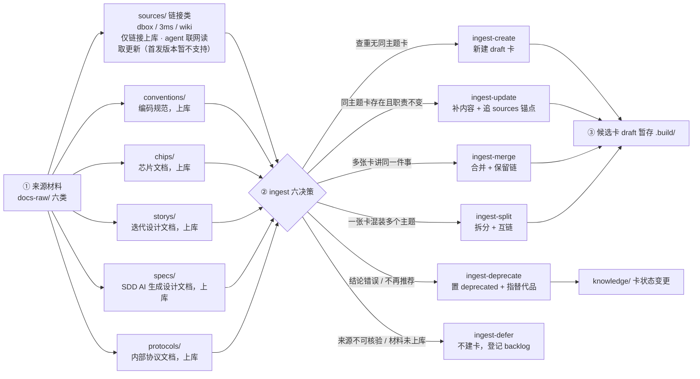
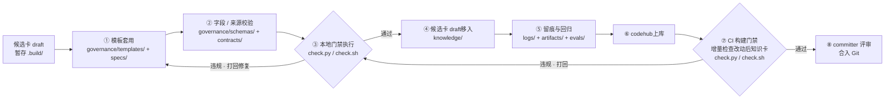
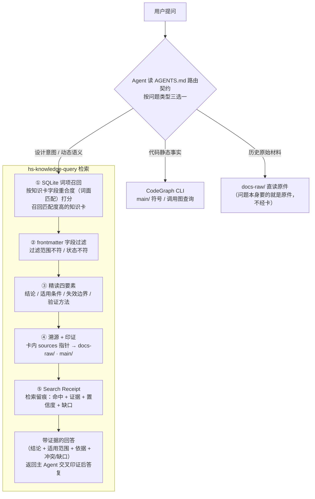

# AIoTBot 知识库详细设计

版本：v3.1；日期：2026-10-20。本文以[当前主设计](AIoTBot知识库架构设计.md) **§5.3 的目录树和第 11 章的五层架构、三条链路**为基础，完整展开具体文件、职责、接口、开发要求与验收。名称和物理归属遵循 §5.3；领域容器采用 `aiotbot-knowledge/`，当前仅 `wifi/` 有实际资产，其余八领域保留空位；能力实现归独立 Skill 仓。

本轮只完善设计文档；设计定稿后再重新对齐 SDD，不改任务状态、不开始实现。当前 `main/` 仍为空骨架；四个 Skill、两个 Workflow 是独立能力仓的目标交付，本仓不再保留它们的空目录；治理目录中的既有 1.0 声明资产是参考输入，不代表本文新接口已经实现。旧程序、测试及当时成绩保留为历史证据。本文件不再把旧公共执行包当作基础架构，也不要求恢复仓根 tools、开发配置或额外系统文档。

## 1. 范围与总体架构

### 1.1 基础架构

下图直接沿用主设计 §11.2 原图；不新增架构层或重构原连线。图中工具与目录表示职责，当前实现状态以 SDD 和实际文件为准。


### 1.2 首发范围与既定行为

| 项目 | 具体约定 |
|---|---|
| Workspace | FactumCore 保存代码槽位、配置与知识；Git在根执行；能力由独立Skill仓交付，领域目录无嵌套Git |
| 能力与编排 | 独立能力仓的四个 Skill 各有自己的 scripts/tests/依赖锁；两 Workflow 仅编排；通用规则只在领域 governance/contracts 实现一次 |
| 代码 | main 当前保持空；采用主设计 bfgx/common/dpa/platform/sensorhub、mp1x/mp12 的物理示意名称；真实代码由 config 关联 |
| Target | 现行 config 的 chip12/chip08/chip07c × host/device 六逻辑 ID 和三 pair 继续未绑定；不猜测其与 mp1x/mp12 的关系 |
| 文档 | 仅五类已落地 raw：conventions/chips/storys/specs/protocols；sources/dbox、3ms、wiki 只作后续保留 |
| 正文 | 七种 Profile：entity/flow/protocol/rule/command/runbook/glossary；九模板为七卡模板加 index/manual-review，不虚构额外正文类型 |
| 文档治理 | 真人确认确切最终视图后 stable；贡献者可自行确认；无回复、超时、Agent自报不是同意；免代码 lint |
| 代码治理 | 本地只读检查通过后 stable；上库按最新授权业务代码只读二次检查；检查不修卡、锁、链接或源码 |
| 消费 | SQLite 普通表词面候选→frontmatter/有效性过滤→过滤后 topK→同代精读→溯源→Search Receipt；无向量服务或 FTS5 |
| 排除项 | 首发不访问远端文档/仓外下载映射，不自动 OCR、不后台轮询，不代管用户 AGENTS，不承诺宿主必然隐式触发或目录提供 ACL |

### 1.3 规则、程序与证明的分工

`W` 为 FactumCore 根，`K=W/aiotbot-knowledge/wifi`；`P=<skill-repo>` 为独立能力仓根，`S=P/skills/common/knowledge`，`F=P/workflows/common/knowledge`。P 的仓库地址、实际本机路径与发行版本尚未指定，保持 unknown，不假设与 W 相邻。后文 W 内文件使用仓相对路径，能力仓文件显式带 `<skill-repo>/` 前缀；缩写只用于接口说明。全局入口通过宿主私有 `workspace-registry.json` 定位已登记项目并真实读取入口，不要求用户手动 bootstrap，不新增 W/config.local.yml。


命名以 §5.3 的代码目录树为准：容器为 `aiotbot-knowledge/`，域为 `wifi/` 等；主设计正文中的 `aiot-knowledge` 是概念简称/待统一文字，不据此另建目录。第11章表格中的 `.skills/.workflows` 同样不产生隐藏目录；实际源码按 §5.3 放独立能力仓的 `skills/common/knowledge` 与 `workflows/common/knowledge`。本轮保留用户主设计原字节，在本详设消除执行路径歧义。

能力仓源码与宿主已安装发行也要区分。运行从受信安装清单解析精确 Skill ID、release/commit、包摘要、解释器与CLI入口，不靠 W 下的相对路径，也不从 Skill 自身位置向上猜 K。Skill 安装区只读，可供多个项目复用；所有候选、原件恢复包、确认、事务、索引及工作流manifest写入显式授权的 K，并绑定域/run/op/attempt。未登记的领域或工具必须报告缺口，不因存在空文件夹而默认可用。

Skill 是能力与程序的拥有者：explore 绑定项目，ingest 捕获、制候选、确认及受证据约束的事务落位，lint 只读核验，query 维护派生索引和消费。生产 Workflow 只调用 ingest 的捕获/计划/物化阶段；治理 Workflow 才调用确认/apply。拥有 apply 能力不等于生产流程被授权绕过治理。

本文记录的接口和产品数据契约目标版本为 **2.0**；设计文件版本为 **v3.1**，两者独立。后续开发的首个契约切片必须同步 schemas、profiles、registries、framework lock、模板和 config 的相容版本，再实现新入口；现存 1.0 文件不可直接作为新接口兼容性证明。旧记录以原版本保留，迁移需显式受控适配，不静默丢字段或重签证明。

## 2. 完整目录与文件

### 2.1 标记、完整性和当前状态

`[F]` FactumCore固定交付文件；`[C]` 独立能力仓固定交付文件；`[D]` 原件或知识卡实例；`[R]` 实际运行产生的文件；`[P]` 首发延期；`[L]` 宿主私有本机文件；`[X]` 外部业务/CI输入；`[H]` 原字节保留的历史工件。尖括号只用于明确的实例规则；每种规则均在第 3 章定义生成者与验收。F/C 表示各拥有仓的目标清单，不表示本轮已创建运行程序或已获得能力仓。

`.gitkeep` 是当前空目录的跟踪占位，实施相应固定文件时可在该模块提交中移除；main 与 sources 的空位继续保留。本设计共定义 **263** 项文件或有界实例规则。实现文件逐个列名；原件、知识卡和运行产物使用明确命名规则。SDD 现有模块、票据和记录仅列保留规则，不在此复制一份任务库，具体文件仍由现有 SDD 管理。

### 2.2 FactumCore 与领域目标树

本树仅列本仓的目录归属。除 WiFi 外，八个领域现在只有 `.gitkeep`；main 下的 X 项是业务代码定位规则，当前仍只保留 main/.gitkeep，不制造代码。

```text
FactumCore/
├── .gitattributes [F]
├── .gitignore [F]
├── AGENTS.md [F]
├── aiotbot-knowledge/
│   ├── bgle/
│   │   └── .gitkeep [F]
│   ├── gnss/
│   │   └── .gitkeep [F]
│   ├── mcu/
│   │   └── .gitkeep [F]
│   ├── nfc/
│   │   └── .gitkeep [F]
│   ├── npu/
│   │   └── .gitkeep [F]
│   ├── platform/
│   │   └── .gitkeep [F]
│   ├── radar/
│   │   └── .gitkeep [F]
│   ├── slp/
│   │   └── .gitkeep [F]
│   └── wifi/
│       ├── .build/
│       │   ├── .gitkeep [F]
│       │   └── <operation-id>/
│       │       ├── candidates/
│       │       │   └── <card-id>.md [R]
│       │       ├── captures/
│       │       │   └── <snapshot-id>/
│       │       │       ├── locators.json [R]
│       │       │       ├── manifest.json [R]
│       │       │       ├── normalized.md [R]
│       │       │       └── original.bin [R]
│       │       ├── changeset.json [R]
│       │       ├── final-view/
│       │       │   └── <relative-path> [R]
│       │       ├── handoff.json [R]
│       │       ├── operation.json [R]
│       │       ├── plan.json [R]
│       │       ├── reports/
│       │       │   └── local-check.json [R]
│       │       ├── review-package.json [R]
│       │       └── review-package.md [R]
│       ├── AGENTS.md [F]
│       ├── CONTRIBUTING.md [F]
│       ├── README.md [F]
│       ├── artifacts/
│       │   ├── .gitkeep [F]
│       │   ├── contexts/
│       │   │   └── <request-id>/
│       │   │       ├── binding.json [R]
│       │   │       └── project-context.json [R]
│       │   ├── indexes/
│       │   │   └── <channel>/
│       │   │       ├── <generation-id>/
│       │   │       │   ├── bodies/
│       │   │       │   │   └── <card-id>.md [R]
│       │   │       │   ├── index.sqlite3 [R]
│       │   │       │   └── manifest.json [R]
│       │   │       └── active.json [R]
│       │   ├── receipts/
│       │   │   └── <receipt-id>.json [R]
│       │   ├── reports/
│       │   │   └── <run-id>.json [R]
│       │   └── test-tmp/
│       │       └── <run-id>/
│       │           └── <temporary-file> [R]
│       ├── check.py [F]
│       ├── check.sh [F]
│       ├── docs-llm-wiki/
│       │   ├── AGENTS.md [F]
│       │   ├── AIoTBot知识库架构设计.md [F]
│       │   ├── README.md [F]
│       │   ├── sdd/
│       │   │   └── knowledge-v1/
│       │   │       ├── README.md [H]
│       │   │       ├── baseline.json [H]
│       │   │       ├── batch-02.md [H]
│       │   │       ├── design.md [H]
│       │   │       ├── document-chain-usage.md [H]
│       │   │       ├── first-slice.md [H]
│       │   │       ├── module-map.md [H]
│       │   │       ├── modules/
│       │   │       │   └── <module-id>/
│       │   │       │       ├── design.md [H]
│       │   │       │       ├── spec.md [H]
│       │   │       │       └── tasks.md [H]
│       │   │       ├── records/
│       │   │       │   └── <record-file> [H]
│       │   │       ├── requirements.md [H]
│       │   │       ├── tasks.md [H]
│       │   │       ├── test-plan.md [H]
│       │   │       ├── tickets/
│       │   │       │   └── <ticket-id>.md [H]
│       │   │       └── traceability.json [H]
│       │   └── 知识库详细设计.md [F]
│       ├── docs-raw/
│       │   ├── AGENTS.md [F]
│       │   ├── chips/
│       │   │   ├── .gitkeep [F]
│       │   │   └── <document-id>/
│       │   │       └── <version-or-digest>/
│       │   │           ├── <attachment-file> [D]
│       │   │           └── <original-file> [D]
│       │   ├── conventions/
│       │   │   ├── .gitkeep [F]
│       │   │   └── <document-id>/
│       │   │       └── <version-or-digest>/
│       │   │           ├── <attachment-file> [D]
│       │   │           └── <original-file> [D]
│       │   ├── index.md [F]
│       │   ├── protocols/
│       │   │   ├── .gitkeep [F]
│       │   │   └── <document-id>/
│       │   │       └── <version-or-digest>/
│       │   │           ├── <attachment-file> [D]
│       │   │           └── <original-file> [D]
│       │   ├── sources/
│       │   │   ├── 3ms/
│       │   │   │   ├── .gitkeep [F]
│       │   │   │   └── <source-id>.md [P]
│       │   │   ├── dbox/
│       │   │   │   ├── .gitkeep [F]
│       │   │   │   └── <source-id>.md [P]
│       │   │   └── wiki/
│       │   │       ├── .gitkeep [F]
│       │   │       └── <source-id>.md [P]
│       │   ├── specs/
│       │   │   ├── .gitkeep [F]
│       │   │   └── <document-id>/
│       │   │       └── <version-or-digest>/
│       │   │           ├── <attachment-file> [D]
│       │   │           └── <original-file> [D]
│       │   └── storys/
│       │       ├── .gitkeep [F]
│       │       └── <document-id>/
│       │           └── <version-or-digest>/
│       │               ├── <attachment-file> [D]
│       │               └── <original-file> [D]
│       ├── evals/
│       │   ├── .gitkeep [F]
│       │   ├── README.md [F]
│       │   ├── cases/
│       │   │   └── retrieval.jsonl [F]
│       │   ├── pyproject.toml [F]
│       │   ├── requirements-dev.lock.txt [F]
│       │   ├── run_acceptance.py [F]
│       │   ├── tests/
│       │   │   ├── test_code_chain.py [F]
│       │   │   ├── test_contracts.py [F]
│       │   │   ├── test_document_chain.py [F]
│       │   │   ├── test_retrieval.py [F]
│       │   │   └── test_workflow_contracts.py [F]
│       │   └── validate_design.py [F]
│       ├── governance/
│       │   ├── AGENTS.md [F]
│       │   ├── contracts/
│       │   │   ├── __init__.py [F]
│       │   │   ├── knowledge.py [F]
│       │   │   ├── records.py [F]
│       │   │   ├── source_resources.py [F]
│       │   │   └── validation.py [F]
│       │   ├── framework.lock.yaml [F]
│       │   ├── index.md [F]
│       │   ├── schemas/
│       │   │   ├── frontmatter.schema.json [F]
│       │   │   ├── profiles.yaml [F]
│       │   │   ├── records.schema.json [F]
│       │   │   ├── registries.yaml [F]
│       │   │   ├── sources.schema.json [F]
│       │   │   └── workspace.schema.json [F]
│       │   ├── sources.lock.yaml [F]
│       │   ├── specs/
│       │   │   ├── cards.md [F]
│       │   │   ├── lifecycle.md [F]
│       │   │   ├── records.md [F]
│       │   │   └── sources.md [F]
│       │   └── templates/
│       │       ├── command.md [F]
│       │       ├── entity.md [F]
│       │       ├── flow.md [F]
│       │       ├── glossary.md [F]
│       │       ├── index.md [F]
│       │       ├── manual-review.json [F]
│       │       ├── protocol.md [F]
│       │       ├── rule.md [F]
│       │       └── runbook.md [F]
│       ├── knowledge/
│       │   ├── AGENTS.md [F]
│       │   ├── commands/
│       │   │   ├── <card-id>.md [D]
│       │   │   └── index.md [F]
│       │   ├── concepts/
│       │   │   ├── entities/
│       │   │   │   ├── <card-id>.md [D]
│       │   │   │   └── index.md [F]
│       │   │   ├── flows/
│       │   │   │   ├── <card-id>.md [D]
│       │   │   │   └── index.md [F]
│       │   │   ├── index.md [F]
│       │   │   └── protocols/
│       │   │       ├── <card-id>.md [D]
│       │   │       └── index.md [F]
│       │   ├── glossaries/
│       │   │   ├── <card-id>.md [D]
│       │   │   └── index.md [F]
│       │   ├── index.md [F]
│       │   ├── rules/
│       │   │   ├── <card-id>.md [D]
│       │   │   └── index.md [F]
│       │   └── runbooks/
│       │       ├── <card-id>.md [D]
│       │       └── index.md [F]
│       └── logs/
│           ├── .gitkeep [F]
│           ├── backlog/
│           │   └── <item-id>.json [R]
│           ├── document-reviews/
│           │   ├── <review-id>.json [R]
│           │   ├── decisions/
│           │   │   └── <decision-id>.json [R]
│           │   └── displays/
│           │       └── <display-id>.json [R]
│           ├── events/
│           │   ├── <event-id>.json [R]
│           │   └── state.json [R]
│           ├── evidence/
│           │   └── <bundle-id>/
│           │       ├── extractions/
│           │       │   └── <extraction-id>/
│           │       │       ├── locators.json [R]
│           │       │       └── text.txt [R]
│           │       ├── manifest.json [R]
│           │       └── objects/
│           │           └── <object-digest>.bin [R]
│           ├── local-checks/
│           │   └── <check-id>.json [R]
│           ├── merge-gates/
│           │   └── <gate-id>.json [R]
│           ├── operations/
│           │   ├── .writer.lock [R]
│           │   └── <operation-id>/
│           │       ├── backup-manifest.json [R]
│           │       ├── backups/
│           │       │   └── <file-key>.bin [R]
│           │       ├── journal.json [R]
│           │       └── result.json [R]
│           └── workflows/
│               ├── <workflow-run-id>/
│               │   └── nodes/
│               │       └── <node-id>/
│               │           └── <attempt-id>/
│               │               └── <artifact-id>.md [R]
│               └── <workflow-run-id>.json [R]
├── config.yml [F]
└── main/
    ├── .gitkeep [F]
    ├── device/
    │   ├── bfgx/
    │   │   └── <source-relative-path> [X]
    │   ├── common/
    │   │   └── <source-relative-path> [X]
    │   ├── dpa/
    │   │   └── <source-relative-path> [X]
    │   ├── platform/
    │   │   └── <source-relative-path> [X]
    │   ├── sensorhub/
    │   │   └── <source-relative-path> [X]
    │   └── wifi/
    │       ├── mp12/
    │       │   ├── .codegraph/
    │       │   │   └── <tool-artifact> [X]
    │       │   └── <source-relative-path> [X]
    │       └── mp1x/
    │           ├── .codegraph/
    │           │   └── <tool-artifact> [X]
    │           └── <source-relative-path> [X]
    └── drivers/
        ├── bfgx/
        │   └── <source-relative-path> [X]
        ├── common/
        │   └── <source-relative-path> [X]
        ├── dpa/
        │   └── <source-relative-path> [X]
        ├── platform/
        │   └── <source-relative-path> [X]
        ├── sensorhub/
        │   └── <source-relative-path> [X]
        └── wifi/
            ├── .codegraph/
            │   └── <tool-artifact> [X]
            └── <source-relative-path> [X]
```

### 2.3 独立能力仓目标树

本树是能力仓的交付规格，不是 FactumCore 的待建目录；当前未指定能力仓地址和本机checkout，不在本仓创建 Skill/Workflow 文件。安装到宿主后的路径另见 §3.15 与 §5.8。

```text
<skill-repo>/
├── skills/
│   └── common/
│       └── knowledge/
│           ├── hs-knowledge-ingest/
│           │   ├── SKILL.md [C]
│           │   ├── artifacts/
│           │   │   ├── apply-result.yaml [C]
│           │   │   ├── artifact-manifest-template.md [C]
│           │   │   ├── artifact-review-guide.md [C]
│           │   │   ├── artifact-writing-guide.md [C]
│           │   │   ├── change-plan.yaml [C]
│           │   │   ├── confirmation-view.yaml [C]
│           │   │   ├── final-view.yaml [C]
│           │   │   ├── manual-review.yaml [C]
│           │   │   └── raw-capture.yaml [C]
│           │   ├── references/
│           │   │   ├── code-evidence.md [C]
│           │   │   ├── decisions-and-apply.md [C]
│           │   │   └── raw-document.md [C]
│           │   ├── requirements-dev.lock.txt [C]
│           │   ├── requirements.lock.txt [C]
│           │   ├── scripts/
│           │   │   ├── apply.py [C]
│           │   │   ├── capture.py [C]
│           │   │   ├── changes.py [C]
│           │   │   ├── cli.py [C]
│           │   │   ├── confirm.py [C]
│           │   │   ├── extractors.py [C]
│           │   │   └── maintenance.py [C]
│           │   └── tests/
│           │       ├── test_apply.py [C]
│           │       ├── test_capture.py [C]
│           │       ├── test_changes.py [C]
│           │       ├── test_confirm.py [C]
│           │       └── test_maintenance.py [C]
│           ├── hs-knowledge-lint/
│           │   ├── SKILL.md [C]
│           │   ├── artifacts/
│           │   │   ├── artifact-manifest-template.md [C]
│           │   │   ├── artifact-review-guide.md [C]
│           │   │   ├── artifact-writing-guide.md [C]
│           │   │   ├── merge-gate.yaml [C]
│           │   │   └── validation-report.yaml [C]
│           │   ├── references/
│           │   │   ├── local-check.md [C]
│           │   │   └── merge-check.md [C]
│           │   ├── requirements-dev.lock.txt [C]
│           │   ├── requirements.lock.txt [C]
│           │   ├── scripts/
│           │   │   ├── checks.py [C]
│           │   │   ├── cli.py [C]
│           │   │   └── codeproof.py [C]
│           │   └── tests/
│           │       ├── test_checks.py [C]
│           │       ├── test_codeproof.py [C]
│           │       └── test_readonly.py [C]
│           ├── hs-knowledge-query/
│           │   ├── SKILL.md [C]
│           │   ├── artifacts/
│           │   │   ├── artifact-manifest-template.md [C]
│           │   │   ├── artifact-review-guide.md [C]
│           │   │   ├── artifact-writing-guide.md [C]
│           │   │   ├── index-generation.yaml [C]
│           │   │   └── search-receipt.yaml [C]
│           │   ├── references/
│           │   │   └── query-plan.md [C]
│           │   ├── requirements-dev.lock.txt [C]
│           │   ├── requirements.lock.txt [C]
│           │   ├── scripts/
│           │   │   ├── cli.py [C]
│           │   │   ├── index.py [C]
│           │   │   └── search.py [C]
│           │   └── tests/
│           │       ├── test_index.py [C]
│           │       ├── test_receipt.py [C]
│           │       └── test_search.py [C]
│           └── hs-workspace-explore/
│               ├── SKILL.md [C]
│               ├── artifacts/
│               │   ├── artifact-manifest-template.md [C]
│               │   ├── artifact-review-guide.md [C]
│               │   ├── artifact-writing-guide.md [C]
│               │   └── project-context.yaml [C]
│               ├── references/
│               │   ├── installation.md [C]
│               │   └── project-binding.md [C]
│               ├── requirements-dev.lock.txt [C]
│               ├── requirements.lock.txt [C]
│               ├── scripts/
│               │   ├── binding.py [C]
│               │   ├── cli.py [C]
│               │   └── config.py [C]
│               └── tests/
│                   ├── test_binding.py [C]
│                   └── test_config.py [C]
└── workflows/
    └── common/
        └── knowledge/
            ├── hs-knowledge-ingest/
            │   ├── layouts.yaml [C]
            │   └── workflow.yaml [C]
            └── hs-knowledge-lint/
                ├── layouts.yaml [C]
                └── workflow.yaml [C]
```

## 3. 逐文件职责、开发要求与验收

本章每行对应清单中唯一一项。固定文件、实例、运行文件、历史文件和外部输入分别验收；表内验收均为未来完成条件，不能解读为本轮已执行；不能仅凭目录或 JSON 形状将状态记为完成。程序文件统一在独立能力仓的各自 Skill 内部实现；模块 M01–M09 是逻辑职责，不把逻辑模块等同于本仓目录；能力实现遵循独立Skill仓边界。

### 3.1 Workspace 根入口

| 文件与类型 | 职责 | 怎么开发／生成 | 要求 | 验收 |
|---|---|---|---|---|
| `AGENTS.md` [F] | 项目路由入口 | 短表指向 config、K、四 Skill、两 Workflow | 不含业务结论，不替代真实加载，不代管用户个人 AGENTS | 仓内/仓外绑定后均能找到同一知识入口 |
| `config.yml` [F] | 四映射表及六 Target/三 pair | 保留 repos/architecture/wiki_entities/symbol_aliases，补充版本、工具与查询政策引用 | 未登记真实代码根、宏、构建、版本为 null/unknown；配置不是已验证知识 | 六 Target/三 pair 引用闭合；共享 Host 路径不被武断选成单芯片 |
| `.gitignore` [F] | 运行与本机产物排除 | 忽略 .build/artifacts/.codegraph、缓存、锁、临时备份 | 不整目录忽略 logs 而丢失唯一确认；不恢复根 runtime 目录 | git status 不含机器索引/凭据，必要审计记录仍可提交 |
| `.gitattributes` [F] | 文本与原件字节政策 | 系统文本 LF，raw 二进制/冻结原件按字节保留 | 原件不因迁移或换行被改 hash | 原件迁移前后摘要相同 |

### 3.2 全局入口 Skill（能力仓）

| 文件与类型 | 职责 | 怎么开发／生成 | 要求 | 验收 |
|---|---|---|---|---|
| `<skill-repo>/skills/common/knowledge/hs-workspace-explore/SKILL.md` [C] | 全局入口与触发 | description 含用户给代码仓/文件路径进行分析、设计、排障等场景；调用本 Skill CLI | 只从真实用户任务取目标，不从 raw 提示注入切仓；不自动建卡/发布 | 宿主已安装 Skill 的真实会话，任意 cwd 只给已登记代码路径可发现并加载 |
| `<skill-repo>/skills/common/knowledge/hs-workspace-explore/references/project-binding.md` [C] | 发现/绑定协议 | 解析顺序、消歧、配置/入口刷新、ProjectContextReceipt 字段 | resolved 与 context_loaded 分离；加载要求真实读取 trace | 只列路径或 Agent 自报已读不能升级 context_loaded |
| `<skill-repo>/skills/common/knowledge/hs-workspace-explore/references/installation.md` [C] | 统一安装/更新/运维说明 | 区分能力仓每Skill运行/开发依赖锁与K/evals集成锁；说明受信发行安装、registry登记、版本升级/卸载和真实宿主验收 | 不创建用户AGENTS、不自动安装、不伪造隐式触发保证 | 可按说明安装并运行真实host仓外触发验收 |
| `<skill-repo>/skills/common/knowledge/hs-workspace-explore/scripts/cli.py` [C] | 绑定命令入口 | resolve/load-context/status，固定JSON信封和0/2/3退出码；registry登记由显式安装步骤完成 | import 无副作用；不遍历整盘、不隐式安装 | 含空格中文路径正确；错误可机读 |
| `<skill-repo>/skills/common/knowledge/hs-workspace-explore/scripts/config.py` [C] | 配置加载 | 只读 config.yml，校验workspace.schema；本机registry仅定位config | 不另增config.local.yml，不允许临时覆盖降低门禁/改真实映射/扩来源 | 结构/引用错误拒绝；未知路径如实unknown |
| `<skill-repo>/skills/common/knowledge/hs-workspace-explore/scripts/binding.py` [C] | 定位与入口真实加载 | 显式 config → 目标路径祖先 config → 用户 registry 精确匹配；规范化路径、最具体边界、读取 AGENTS | 零命中报告缺口、多命中要求消歧；缓存绑定 checkout+config+入口摘要 | 同 repo 两 worktree 不串；更换路径/配置使旧回执失效 |
| `<skill-repo>/skills/common/knowledge/hs-workspace-explore/tests/test_config.py` [C] | 配置回归 | 合成最小 workspace、六 Target、未知路径与冲突 fixture | 不使用真实代码/本机路径 | 重复 ID、悬空引用、私有配置覆写企图可拒绝 |
| `<skill-repo>/skills/common/knowledge/hs-workspace-explore/tests/test_binding.py` [C] | 定位与加载回归 | 临时多 checkout、嵌套映射、坏 registry、中文路径 | 临时目录置 K/artifacts/test-tmp/ 本次末级 | stale registry、祖先边界、未读入口反例通过 |
| `<skill-repo>/skills/common/knowledge/hs-workspace-explore/artifacts/project-context.yaml` [C] | project-context的OpenFlow产物契约 | id/title/required、template/writing_guide/review_guide/default_location；applies_to.node_ids=bind_project；required_on.exit_ids=bound | location.kind=markdown_file；completion显式给本run/op/node/attempt路径；不发明json_file或operation路径插值；不把产物存在当语义proof | loader识别且三引用资源存在；只有适用节点产生此义务；跨run或旧尝试manifest拒绝 |
| `<skill-repo>/skills/common/knowledge/hs-workspace-explore/artifacts/artifact-manifest-template.md` [C] | 本Skill产物展示模板 | 统一展示run/op/node/attempt、phase、JSON证据路径与摘要、输入/输出摘要、限制和实际状态 | CLI写真实manifest，Agent不上报自造accepted/pass；JSON仍为正式机器契约 | 展示可回核原始JSON和当前operation；waiting/deferred不显示completed |
| `<skill-repo>/skills/common/knowledge/hs-workspace-explore/artifacts/artifact-writing-guide.md` [C] | 本Skill产物生成要求 | 列每artifact适用节点、允许输出与不可变attempt路径；从本Skill实际结果派生manifest | 不复制治理规则；不覆盖先前artifact revision；不把说明文档变第二事实库 | 循环重入新attempt不改旧manifest；各结果有真实机器证据 |
| `<skill-repo>/skills/common/knowledge/hs-workspace-explore/artifacts/artifact-review-guide.md` [C] | 本Skill产物验收要求 | 核身份、真实位置/摘要、阶段phase、原始证据、权限和缺口；各artifact差异列明 | OpenFlow markdown合法/非空不等于知识或真人证明通过；真实宿主验收单列 | 伪proof、跨run旧文件、错误node、过期view均被拒；限制诚实展示 |
| `<skill-repo>/skills/common/knowledge/hs-workspace-explore/requirements.lock.txt` [C] | 本Skill运行依赖锁 | 在能力仓冻结本Skill实际运行依赖的完整版本/hash；随受控release发布 | 不从K/evals开发环境推断运行依赖；无隐式联网安装 | 全新受控环境可按锁安装并启动对应真实CLI；包身份包含依赖锁摘要 |
| `<skill-repo>/skills/common/knowledge/hs-workspace-explore/requirements-dev.lock.txt` [C] | 本Skill开发与测试依赖锁 | 固定测试/审查工具，并显式包含本Skill运行依赖锁的身份 | 只在能力仓开发；不把测试环境作为用户运行环境，保持各Skill自有文件 | 对应能力仓SHA下单测和代码检查可重复，报告保留工具/依赖身份 |

### 3.3 生产与收尾 Skill（能力仓）

| 文件与类型 | 职责 | 怎么开发／生成 | 要求 | 验收 |
|---|---|---|---|---|
| `<skill-repo>/skills/common/knowledge/hs-knowledge-ingest/SKILL.md` [C] | 生产与独立写操作入口 | 引导 capture → 六决策 → plan/materialize → 治理交接；confirm/apply 显式命令 | 来源不授予写权限；不自动 self-confirm；能力可被治理 Workflow 调用 | 无确认/本地代码证明无法 apply；其他文件不变 |
| `<skill-repo>/skills/common/knowledge/hs-knowledge-ingest/references/raw-document.md` [C] | 五类 raw 文档生产/更新 | 固定版本、定位提取、与旧卡比较、展示最终视图、人工处理 | 排除 sources、网页、仓外映射与控制文件 | 首次/无影响/有影响更新均能走确切人工确认 |
| `<skill-repo>/skills/common/knowledge/hs-knowledge-ingest/references/code-evidence.md` [C] | 代码取证生产 | 源码锚点、注册/回调、条件编译、Host/Device 两侧与三芯片适用性 | 图是线索；缺构建/侧别/宏不产 current 成功 | 缺接收侧或宏配置形成明确缺口 |
| `<skill-repo>/skills/common/knowledge/hs-knowledge-ingest/references/decisions-and-apply.md` [C] | 六决策与写事务规则 | create/update/merge/split/deprecate/defer；基线、最终视图、确认、幂等/恢复 | deprecate 仍受治理确认；主图直达 knowledge 箭头是逻辑结果，不绕过治理 | 六分支均有正常结果与失败边界 |
| `<skill-repo>/skills/common/knowledge/hs-knowledge-ingest/scripts/cli.py` [C] | 生产命令入口 | capture/resolve-source/plan/materialize/confirm/narrow/apply/status/recover/maintain；参数与输入文件显式，统一JSON信封 | 业务参数显式；不包 git commit/push 或网络抓取 | 错误不写正式卡；退出码稳定 |
| `<skill-repo>/skills/common/knowledge/hs-knowledge-ingest/scripts/capture.py` [C] | 固定来源与原件包 | 实路径和允许根检查、读前后 stat/hash、source_id/snapshot_id、必要附件、锁增量 | 原件只读；来源锁更新是待应用变更；raw 必须可恢复，不以 URL 充当字节证据；已登记来源变化只调用maintenance幂等登记事件/阻断原语，不修改knowledge或来源锁，不解除阻断，不将解析失败当来源删除 | 越界/软链绕出/中途变化拒绝；附件变化可见 |
| `<skill-repo>/skills/common/knowledge/hs-knowledge-ingest/scripts/extractors.py` [C] | raw 规范化及 locator | 按显式格式提取 Markdown/TXT/PDF/DOCX，可回原页/段/章节 | 不做自动 OCR；不可提取内容和图表列明缺口，不能声称完整读取 | 中文页码/表格边界可回源；未知格式明确 unsupported |
| `<skill-repo>/skills/common/knowledge/hs-knowledge-ingest/scripts/changes.py` [C] | 比较计划与确切 final-view | 基线 hash、六决策目标/替代链、卡/导航/锁变更、plan 与 ChangeSet | materialize 只写 .build，不修改 knowledge；确认覆盖拟落位 stable 的确切字节 | 再跑相同输入同摘要；改任意输入需新 final-view |
| `<skill-repo>/skills/common/knowledge/hs-knowledge-ingest/scripts/confirm.py` [C] | 真人文档确认 | 展示最终字节/来源包/缺口，真实交互终端输入摘要挑战；原始动作 adapter 独立 | 无 --yes、无 Agent 自报、无超时同意；TTY 只证明交互形态，非认证自然人 | 非交互输入拒绝；拒绝/部分接受不 apply；缩窄后必须新确认 |
| `<skill-repo>/skills/common/knowledge/hs-knowledge-ingest/scripts/apply.py` [C] | stable 落位事务 | 校验确切确认或本地代码证明，基线 CAS、域锁、备份、journal、原子替换及恢复 | 只写明确卡/导航/来源锁清单；锁约束合作写者；journal与备份永久落logs，不放.build；不修改raw、代码或工具 | 每阶段中断可恢复或明确冲突；query继续旧完整代；不承诺多文件在任意编辑器中瞬间原子可见 |
| `<skill-repo>/skills/common/knowledge/hs-knowledge-ingest/scripts/maintenance.py` [C] | 统一收尾与后续维护 | 显式event记录、反向sources影响卡、defer backlog、复核计划、条件化block与恢复协调 | 写事件/计划，不自行修改已确认结论；复核变更仍经新final-view和治理 | 来源变化立刻阻断受影响current；复核后只恢复相符范围 |
| `<skill-repo>/skills/common/knowledge/hs-knowledge-ingest/tests/test_capture.py` [C] | raw 边界/更新测试 | 五类、附件、变更中输入、旧版恢复 fixture | 原件前后 hash 一致 | sources/外链/越界均拒绝 |
| `<skill-repo>/skills/common/knowledge/hs-knowledge-ingest/tests/test_changes.py` [C] | 六决策/基线测试 | create/update/merge/split/deprecate/defer，ID/导航/替代链 | 不让模板默认误造已批准语义 | 最终包确定、无隐式写卡 |
| `<skill-repo>/skills/common/knowledge/hs-knowledge-ingest/tests/test_confirm.py` [C] | 人工绑定反例 | 测试专属合成终端与记录 tamper fixture | 合成动作不能被当作真实业务人确认 | 陈旧来源/最终视图/部分接受/无回复均不能 apply |
| `<skill-repo>/skills/common/knowledge/hs-knowledge-ingest/tests/test_apply.py` [C] | 落位/恢复测试 | 注入每个事务写阶段崩溃、并发和幂等 | 测试只操作临时 K | 恢复到一致终态或保留冲突现场；旧代查询不读半套文件；不覆盖随后人工修改 |
| `<skill-repo>/skills/common/knowledge/hs-knowledge-ingest/tests/test_maintenance.py` [C] | 影响和恢复测试 | 同源多卡、条件化Claim、事件序列、确认后来源再变 | 影响不沿related_to无限传播 | 旧代current即时排除，历史可读，恢复需新证据 |
| `<skill-repo>/skills/common/knowledge/hs-knowledge-ingest/artifacts/raw-capture.yaml` [C] | raw-capture的OpenFlow产物契约 | id/title/required、template/writing_guide/review_guide/default_location；applies_to.node_ids=capture_raw；required_on.exit_ids=captured | location.kind=markdown_file；completion显式给本run/op/node/attempt路径；不发明json_file或operation路径插值；不把产物存在当语义proof | loader识别且三引用资源存在；只有适用节点产生此义务；跨run或旧尝试manifest拒绝 |
| `<skill-repo>/skills/common/knowledge/hs-knowledge-ingest/artifacts/change-plan.yaml` [C] | change-plan的OpenFlow产物契约 | id/title/required、template/writing_guide/review_guide/default_location；applies_to.node_ids=plan_change；required_on.exit_ids=planned/deferred | location.kind=markdown_file；completion显式给本run/op/node/attempt路径；不发明json_file或operation路径插值；不把产物存在当语义proof | loader识别且三引用资源存在；只有适用节点产生此义务；跨run或旧尝试manifest拒绝 |
| `<skill-repo>/skills/common/knowledge/hs-knowledge-ingest/artifacts/final-view.yaml` [C] | final-view的OpenFlow产物契约 | id/title/required、template/writing_guide/review_guide/default_location；applies_to.node_ids=materialize_view/revise_candidate；required_on.exit_ids=ready | location.kind=markdown_file；completion显式给本run/op/node/attempt路径；不发明json_file或operation路径插值；不把产物存在当语义proof | loader识别且三引用资源存在；只有适用节点产生此义务；跨run或旧尝试manifest拒绝 |
| `<skill-repo>/skills/common/knowledge/hs-knowledge-ingest/artifacts/confirmation-view.yaml` [C] | confirmation-view的OpenFlow产物契约 | id/title/required、template/writing_guide/review_guide/default_location；applies_to.node_ids=prepare_confirmation；required_on.exit_ids=await_user | location.kind=markdown_file；completion显式给本run/op/node/attempt路径；不发明json_file或operation路径插值；不把产物存在当语义proof | loader识别且三引用资源存在；只有适用节点产生此义务；跨run或旧尝试manifest拒绝 |
| `<skill-repo>/skills/common/knowledge/hs-knowledge-ingest/artifacts/manual-review.yaml` [C] | manual-review的OpenFlow产物契约 | id/title/required、template/writing_guide/review_guide/default_location；applies_to.node_ids=record_confirmation；required_on.exit_ids=accepted | location.kind=markdown_file；completion显式给本run/op/node/attempt路径；不发明json_file或operation路径插值；不把产物存在当语义proof | loader识别且三引用资源存在；只有适用节点产生此义务；跨run或旧尝试manifest拒绝 |
| `<skill-repo>/skills/common/knowledge/hs-knowledge-ingest/artifacts/apply-result.yaml` [C] | apply-result的OpenFlow产物契约 | id/title/required、template/writing_guide/review_guide/default_location；applies_to.node_ids=apply_view/recover_transaction；required_on.exit_ids=applied/recovered | location.kind=markdown_file；completion显式给本run/op/node/attempt路径；不发明json_file或operation路径插值；不把产物存在当语义proof | loader识别且三引用资源存在；只有适用节点产生此义务；跨run或旧尝试manifest拒绝 |
| `<skill-repo>/skills/common/knowledge/hs-knowledge-ingest/artifacts/artifact-manifest-template.md` [C] | 本Skill产物展示模板 | 统一展示run/op/node/attempt、phase、JSON证据路径与摘要、输入/输出摘要、限制和实际状态 | CLI写真实manifest，Agent不上报自造accepted/pass；JSON仍为正式机器契约 | 展示可回核原始JSON和当前operation；waiting/deferred不显示completed |
| `<skill-repo>/skills/common/knowledge/hs-knowledge-ingest/artifacts/artifact-writing-guide.md` [C] | 本Skill产物生成要求 | 列每artifact适用节点、允许输出与不可变attempt路径；从本Skill实际结果派生manifest | 不复制治理规则；不覆盖先前artifact revision；不把说明文档变第二事实库 | 循环重入新attempt不改旧manifest；各结果有真实机器证据 |
| `<skill-repo>/skills/common/knowledge/hs-knowledge-ingest/artifacts/artifact-review-guide.md` [C] | 本Skill产物验收要求 | 核身份、真实位置/摘要、阶段phase、原始证据、权限和缺口；各artifact差异列明 | OpenFlow markdown合法/非空不等于知识或真人证明通过；真实宿主验收单列 | 伪proof、跨run旧文件、错误node、过期view均被拒；限制诚实展示 |
| `<skill-repo>/skills/common/knowledge/hs-knowledge-ingest/requirements.lock.txt` [C] | 本Skill运行依赖锁 | 在能力仓冻结本Skill实际运行依赖的完整版本/hash；随受控release发布 | 不从K/evals开发环境推断运行依赖；无隐式联网安装 | 全新受控环境可按锁安装并启动对应真实CLI；包身份包含依赖锁摘要 |
| `<skill-repo>/skills/common/knowledge/hs-knowledge-ingest/requirements-dev.lock.txt` [C] | 本Skill开发与测试依赖锁 | 固定测试/审查工具，并显式包含本Skill运行依赖锁的身份 | 只在能力仓开发；不把测试环境作为用户运行环境，保持各Skill自有文件 | 对应能力仓SHA下单测和代码检查可重复，报告保留工具/依赖身份 |

### 3.4 只读核验 Skill（能力仓）

| 文件与类型 | 职责 | 怎么开发／生成 | 要求 | 验收 |
|---|---|---|---|---|
| `<skill-repo>/skills/common/knowledge/hs-knowledge-lint/SKILL.md` [C] | 代码卡只读门禁 | local 与 merge 显式两模式，解释 pass/fail/incomplete | 不调用确认/apply，不修改卡/锁/链接/源码；纯文档免代码 lint | 输入摘要前后相同，代码证据缺失不 pass |
| `<skill-repo>/skills/common/knowledge/hs-knowledge-lint/references/local-check.md` [C] | 候选代码本地门禁 | 校验拟 stable 最终视图、规则、来源、scope、关系和代码断言证据 | Schema 通过不是语义已证；结果固定工具/规则/业务快照/卡字节 | 任意范围/代码/卡变动使旧 LocalCheckRecord 失效 |
| `<skill-repo>/skills/common/knowledge/hs-knowledge-lint/references/merge-check.md` [C] | 最新代码二次检查 | 固定待合入知识 head、受信业务最新 ref、合成测试/索引回归输入与校验政策 | CI 不信任 PR 自选低标准；最新代码不可取为 incomplete；不修复来源/卡片 | 错 head/过期代码/不同规则证明被拒绝 |
| `<skill-repo>/skills/common/knowledge/hs-knowledge-lint/scripts/cli.py` [C] | 本地/CI检查命令 | local/merge/check-contracts，统一诊断 envelope | 无网络文档抓取、无安装、无写知识 | check 包装与直接 CLI 诊断相同 |
| `<skill-repo>/skills/common/knowledge/hs-knowledge-lint/scripts/checks.py` [C] | 只读检查编排 | 调契约，组合规则/来源/关系/范围与证据检查报告 | 不复制 Schema 字段规则；manual_document 不调用 codeproof | 各失败类别可定位，保留 unknown/incomplete |
| `<skill-repo>/skills/common/knowledge/hs-knowledge-lint/scripts/codeproof.py` [C] | 代码证据上下文核验 | 业务快照、Target/构建/宏/两侧 pair；比较与重验逐 Claim | 自动源码存在检查只证明可达；语义认可由审查与显式证据形成 | 一侧/一芯片/旧 revision 不冒充全覆盖 |
| `<skill-repo>/skills/common/knowledge/hs-knowledge-lint/tests/test_checks.py` [C] | 结构和纯文档分流测试 | 真实声明契约的可控卡包和错误枚举 | 不镜像实现写断言，验证外部输入/诊断 | 错模板/关系/来源等定位正确；文档不产代码记录 |
| `<skill-repo>/skills/common/knowledge/hs-knowledge-lint/tests/test_codeproof.py` [C] | 六 Target/最新代码反例 | 合成六 Target、不同 revision、宏和侧别 | synthetic 不表示业务接入 | stale/mismatch/incomplete 正确分类 |
| `<skill-repo>/skills/common/knowledge/hs-knowledge-lint/tests/test_readonly.py` [C] | 双门禁输入不变测试 | 对知识卡/锁/链接/代码树前后摘要并故障注入 | 报告输出路径与输入分离 | pass/fail/incomplete 三种结果均无输入改写 |
| `<skill-repo>/skills/common/knowledge/hs-knowledge-lint/artifacts/validation-report.yaml` [C] | validation-report的OpenFlow产物契约 | id/title/required、template/writing_guide/review_guide/default_location；applies_to.node_ids=local_check；required_on.exit_ids=code_passed/needs_revision | location.kind=markdown_file；completion显式给本run/op/node/attempt路径；不发明json_file或operation路径插值；不把产物存在当语义proof；manual_document不得进入lint/local/merge/proofs | loader识别且三引用资源存在；只有适用节点产生此义务；跨run或旧尝试manifest拒绝 |
| `<skill-repo>/skills/common/knowledge/hs-knowledge-lint/artifacts/merge-gate.yaml` [C] | merge-gate的OpenFlow产物契约 | id/title/required、template/writing_guide/review_guide/default_location；applies_to.node_ids=verify_merge；required_on.exit_ids=verified/rejected | location.kind=markdown_file；completion显式给本run/op/node/attempt路径；不发明json_file或operation路径插值；不把产物存在当语义proof；仅保留真实外部CI adapter合同，首发两个模板不含verify_merge节点，文档人工路径不启用 | loader识别且三引用资源存在；只有适用节点产生此义务；跨run或旧尝试manifest拒绝 |
| `<skill-repo>/skills/common/knowledge/hs-knowledge-lint/artifacts/artifact-manifest-template.md` [C] | 本Skill产物展示模板 | 统一展示run/op/node/attempt、phase、JSON证据路径与摘要、输入/输出摘要、限制和实际状态 | CLI写真实manifest，Agent不上报自造accepted/pass；JSON仍为正式机器契约 | 展示可回核原始JSON和当前operation；waiting/deferred不显示completed |
| `<skill-repo>/skills/common/knowledge/hs-knowledge-lint/artifacts/artifact-writing-guide.md` [C] | 本Skill产物生成要求 | 列每artifact适用节点、允许输出与不可变attempt路径；从本Skill实际结果派生manifest | 不复制治理规则；不覆盖先前artifact revision；不把说明文档变第二事实库 | 循环重入新attempt不改旧manifest；各结果有真实机器证据 |
| `<skill-repo>/skills/common/knowledge/hs-knowledge-lint/artifacts/artifact-review-guide.md` [C] | 本Skill产物验收要求 | 核身份、真实位置/摘要、阶段phase、原始证据、权限和缺口；各artifact差异列明 | OpenFlow markdown合法/非空不等于知识或真人证明通过；真实宿主验收单列 | 伪proof、跨run旧文件、错误node、过期view均被拒；限制诚实展示 |
| `<skill-repo>/skills/common/knowledge/hs-knowledge-lint/requirements.lock.txt` [C] | 本Skill运行依赖锁 | 在能力仓冻结本Skill实际运行依赖的完整版本/hash；随受控release发布 | 不从K/evals开发环境推断运行依赖；无隐式联网安装 | 全新受控环境可按锁安装并启动对应真实CLI；包身份包含依赖锁摘要 |
| `<skill-repo>/skills/common/knowledge/hs-knowledge-lint/requirements-dev.lock.txt` [C] | 本Skill开发与测试依赖锁 | 固定测试/审查工具，并显式包含本Skill运行依赖锁的身份 | 只在能力仓开发；不把测试环境作为用户运行环境，保持各Skill自有文件 | 对应能力仓SHA下单测和代码检查可重复，报告保留工具/依赖身份 |

### 3.5 消费与索引 Skill（能力仓）

| 文件与类型 | 职责 | 怎么开发／生成 | 要求 | 验收 |
|---|---|---|---|---|
| `<skill-repo>/skills/common/knowledge/hs-knowledge-query/SKILL.md` [C] | 消费五步法 | 召回/字段过滤/精读四要素/溯源/Search Receipt | 只查 knowledge 技术卡，不自动生产、修卡、发布 | 错 Target 不返回；答复含适用范围与证据缺口 |
| `<skill-repo>/skills/common/knowledge/hs-knowledge-query/references/query-plan.md` [C] | 检索和精读规范 | local/shared、current/guidance/historical、范围、预算、置信与冲突 | 词面候选后过滤、过滤后 top-k；body 与索引同代次 | 范围不符不能占满 top-k；收据足以重放 |
| `<skill-repo>/skills/common/knowledge/hs-knowledge-query/scripts/cli.py` [C] | 索引/查询命令入口 | build/verify/evaluate/activate/search/read/receipt；独立子命令固定定义，查询时不自动建库 | query 不自动重建；受控显式 build 才写 artifacts | 缺索引报明确缺口；查询运行不改正文 |
| `<skill-repo>/skills/common/knowledge/hs-knowledge-query/scripts/index.py` [C] | SQLite 不可变代次 | documents/claims/postings/relations/metadata 表、固定正文、manifest、校验与原子 active 指针 | 技术卡才入库；AGENTS/index/raw/治理排除；新代失败保留旧代 | 全量重建可复现；损坏代不能激活；切代读旧正文仍一致 |
| `<skill-repo>/skills/common/knowledge/hs-knowledge-query/scripts/search.py` [C] | 词面候选与字段过滤 | 相同 tokenizer 对标题/摘要/别名/关键词/正文可解释词项打分；SQL/流式先筛选全部词面候选再 limit | 首发不用向量/RAG服务；scope unknown 不作通用；回输出前复核 blocking/内容身份 | 大量错范围高分卡不淹没正确卡；兼容过滤可解释 |
| `<skill-repo>/skills/common/knowledge/hs-knowledge-query/tests/test_index.py` [C] | 代次构建与切换测试 | 固定卡包、失败中断、正文与 manifest 不符 | 不用真实内部知识 | 重建/激活/切代/损坏行为正确 |
| `<skill-repo>/skills/common/knowledge/hs-knowledge-query/tests/test_search.py` [C] | 检索资格与排序测试 | 六 Target/三 pair、生命周期、人工/代码分流、同义别名 | 词项命中不等于语义支持 | 错范围排除、过滤后 top-k、unknown/current 反例通过 |
| `<skill-repo>/skills/common/knowledge/hs-knowledge-query/tests/test_receipt.py` [C] | 精读/收据测试 | 固定 generation 的卡/Claim/证据和缺口 | 不能用 top-k 摘要直接冒充答案 | receipt 引用可回放；阻断事件出现即拒绝旧 current 输出 |
| `<skill-repo>/skills/common/knowledge/hs-knowledge-query/artifacts/index-generation.yaml` [C] | index-generation的OpenFlow产物契约 | id/title/required、template/writing_guide/review_guide/default_location；applies_to.node_ids=rebuild_index；required_on.exit_ids=built | location.kind=markdown_file；completion显式给本run/op/node/attempt路径；不发明json_file或operation路径插值；不把产物存在当语义proof | loader识别且三引用资源存在；只有适用节点产生此义务；跨run或旧尝试manifest拒绝 |
| `<skill-repo>/skills/common/knowledge/hs-knowledge-query/artifacts/search-receipt.yaml` [C] | search-receipt的OpenFlow产物契约 | id/title/required、template/writing_guide/review_guide/default_location；applies_to.node_ids=query_regression/query_knowledge；required_on.exit_ids=checked/answered | location.kind=markdown_file；completion显式给本run/op/node/attempt路径；不发明json_file或operation路径插值；不把产物存在当语义proof | loader识别且三引用资源存在；只有适用节点产生此义务；跨run或旧尝试manifest拒绝 |
| `<skill-repo>/skills/common/knowledge/hs-knowledge-query/artifacts/artifact-manifest-template.md` [C] | 本Skill产物展示模板 | 统一展示run/op/node/attempt、phase、JSON证据路径与摘要、输入/输出摘要、限制和实际状态 | CLI写真实manifest，Agent不上报自造accepted/pass；JSON仍为正式机器契约 | 展示可回核原始JSON和当前operation；waiting/deferred不显示completed |
| `<skill-repo>/skills/common/knowledge/hs-knowledge-query/artifacts/artifact-writing-guide.md` [C] | 本Skill产物生成要求 | 列每artifact适用节点、允许输出与不可变attempt路径；从本Skill实际结果派生manifest | 不复制治理规则；不覆盖先前artifact revision；不把说明文档变第二事实库 | 循环重入新attempt不改旧manifest；各结果有真实机器证据 |
| `<skill-repo>/skills/common/knowledge/hs-knowledge-query/artifacts/artifact-review-guide.md` [C] | 本Skill产物验收要求 | 核身份、真实位置/摘要、阶段phase、原始证据、权限和缺口；各artifact差异列明 | OpenFlow markdown合法/非空不等于知识或真人证明通过；真实宿主验收单列 | 伪proof、跨run旧文件、错误node、过期view均被拒；限制诚实展示 |
| `<skill-repo>/skills/common/knowledge/hs-knowledge-query/requirements.lock.txt` [C] | 本Skill运行依赖锁 | 在能力仓冻结本Skill实际运行依赖的完整版本/hash；随受控release发布 | 不从K/evals开发环境推断运行依赖；无隐式联网安装 | 全新受控环境可按锁安装并启动对应真实CLI；包身份包含依赖锁摘要 |
| `<skill-repo>/skills/common/knowledge/hs-knowledge-query/requirements-dev.lock.txt` [C] | 本Skill开发与测试依赖锁 | 固定测试/审查工具，并显式包含本Skill运行依赖锁的身份 | 只在能力仓开发；不把测试环境作为用户运行环境，保持各Skill自有文件 | 对应能力仓SHA下单测和代码检查可重复，报告保留工具/依赖身份 |

### 3.6 两份 Workflow（能力仓）

| 文件与类型 | 职责 | 怎么开发／生成 | 要求 | 验收 |
|---|---|---|---|---|
| `<skill-repo>/workflows/common/knowledge/hs-knowledge-ingest/workflow.yaml` [C] | OpenFlow V1生产编排真源 | version:1、entry_node、nodes；node owner/skill/exits/gate符合固定标准；完整展开提案阶段表 | 仅调用capture/plan/materialize；不写正式资产；结尾显式handoff不跨模板跳转 | 固定版本loader/validator与真实catalog/角色通过；重入、停等和实际证据交接可验 |
| `<skill-repo>/workflows/common/knowledge/hs-knowledge-ingest/layouts.yaml` [C] | Workflow Modeler画布坐标 | template_id与workflow.id一致，canvas.nodes含真实node及Start/End坐标 | 仅展示，无运行逻辑；不靠改坐标改变流程 | 图ID与模板一致；删改布局不影响运行结果 |
| `<skill-repo>/workflows/common/knowledge/hs-knowledge-lint/workflow.yaml` [C] | OpenFlow V1治理编排真源 | version:1、entry_node、nodes；node owner/skill/exits/gate符合固定标准；完整展开提案阶段表 | lint仅只读；写入调ingest；人工user gate不自动接受；CI不修卡源码 | 固定版本loader/validator与真实catalog/角色通过；重入、停等和实际证据交接可验 |
| `<skill-repo>/workflows/common/knowledge/hs-knowledge-lint/layouts.yaml` [C] | Workflow Modeler画布坐标 | template_id与workflow.id一致，canvas.nodes含真实node及Start/End坐标 | 仅展示，无运行逻辑；不靠改坐标改变流程 | 图ID与模板一致；删改布局不影响运行结果 |

### 3.7 main 业务工作区

| 文件与类型 | 职责 | 怎么开发／生成 | 要求 | 验收 |
|---|---|---|---|---|
| `main/.gitkeep` [F] | 业务代码槽位 | 维持现行空目录 | 不按主设计示意树虚造 device/host 源码 | main 仅占位；真实代码未知仍报告 unknown |
| `main/device/bfgx/<source-relative-path>` [X] | 主设计业务源码示意槽位 | 仅登记实际授权仓/版本或导出；当前不创建源树 | 不是本库生成文件；不由目录名推导芯片适用性 | 真实读取/编译/运行分层验收 |
| `main/device/common/<source-relative-path>` [X] | 主设计业务源码示意槽位 | 仅登记实际授权仓/版本或导出；当前不创建源树 | 不是本库生成文件；不由目录名推导芯片适用性 | 真实读取/编译/运行分层验收 |
| `main/device/dpa/<source-relative-path>` [X] | 主设计业务源码示意槽位 | 仅登记实际授权仓/版本或导出；当前不创建源树 | 不是本库生成文件；不由目录名推导芯片适用性 | 真实读取/编译/运行分层验收 |
| `main/device/platform/<source-relative-path>` [X] | 主设计业务源码示意槽位 | 仅登记实际授权仓/版本或导出；当前不创建源树 | 不是本库生成文件；不由目录名推导芯片适用性 | 真实读取/编译/运行分层验收 |
| `main/device/sensorhub/<source-relative-path>` [X] | 主设计业务源码示意槽位 | 仅登记实际授权仓/版本或导出；当前不创建源树 | 不是本库生成文件；不由目录名推导芯片适用性 | 真实读取/编译/运行分层验收 |
| `main/drivers/bfgx/<source-relative-path>` [X] | 主设计业务源码示意槽位 | 仅登记实际授权仓/版本或导出；当前不创建源树 | 不是本库生成文件；不由目录名推导芯片适用性 | 真实读取/编译/运行分层验收 |
| `main/drivers/common/<source-relative-path>` [X] | 主设计业务源码示意槽位 | 仅登记实际授权仓/版本或导出；当前不创建源树 | 不是本库生成文件；不由目录名推导芯片适用性 | 真实读取/编译/运行分层验收 |
| `main/drivers/dpa/<source-relative-path>` [X] | 主设计业务源码示意槽位 | 仅登记实际授权仓/版本或导出；当前不创建源树 | 不是本库生成文件；不由目录名推导芯片适用性 | 真实读取/编译/运行分层验收 |
| `main/drivers/platform/<source-relative-path>` [X] | 主设计业务源码示意槽位 | 仅登记实际授权仓/版本或导出；当前不创建源树 | 不是本库生成文件；不由目录名推导芯片适用性 | 真实读取/编译/运行分层验收 |
| `main/drivers/sensorhub/<source-relative-path>` [X] | 主设计业务源码示意槽位 | 仅登记实际授权仓/版本或导出；当前不创建源树 | 不是本库生成文件；不由目录名推导芯片适用性 | 真实读取/编译/运行分层验收 |
| `main/device/wifi/mp1x/<source-relative-path>` [X] | WiFi真实代码示意 | 实际路径和逻辑Target对应由config登记 | main当前空，不生成假代码；mp1x/mp12不自动对应chip12/08/07c | 对应授权工程的来源身份、构建和范围可核验 |
| `main/device/wifi/mp1x/.codegraph/<tool-artifact>` [X] | 本地代码图谱对象 | 由实际CodeGraph工具构建并固定源码/Target身份 | 不上库，陈旧图不能作当前语义证明；门禁不重建图 | 旧图/错Target报告缺口并回源码 |
| `main/device/wifi/mp12/<source-relative-path>` [X] | WiFi真实代码示意 | 实际路径和逻辑Target对应由config登记 | main当前空，不生成假代码；mp1x/mp12不自动对应chip12/08/07c | 对应授权工程的来源身份、构建和范围可核验 |
| `main/device/wifi/mp12/.codegraph/<tool-artifact>` [X] | 本地代码图谱对象 | 由实际CodeGraph工具构建并固定源码/Target身份 | 不上库，陈旧图不能作当前语义证明；门禁不重建图 | 旧图/错Target报告缺口并回源码 |
| `main/drivers/wifi/<source-relative-path>` [X] | WiFi真实代码示意 | 实际路径和逻辑Target对应由config登记 | main当前空，不生成假代码；mp1x/mp12不自动对应chip12/08/07c | 对应授权工程的来源身份、构建和范围可核验 |
| `main/drivers/wifi/.codegraph/<tool-artifact>` [X] | 本地代码图谱对象 | 由实际CodeGraph工具构建并固定源码/Target身份 | 不上库，陈旧图不能作当前语义证明；门禁不重建图 | 旧图/错Target报告缺口并回源码 |

### 3.8 领域根入口与保留位

| 文件与类型 | 职责 | 怎么开发／生成 | 要求 | 验收 |
|---|---|---|---|---|
| `aiotbot-knowledge/wifi/AGENTS.md` [F] | 领域入口 | 指知识/原件/治理/四 Skill/两 Workflow | 不装业务结论；明确当前能力状态 | 与根入口没有互斥规则 |
| `aiotbot-knowledge/wifi/README.md` [F] | 人读定位/现状/安装入口 | 真实可用能力与未实现边界，指系统文档与验收 | 空骨架不得写成已运行 | 新人沿导航可找到准确操作入口 |
| `aiotbot-knowledge/wifi/CONTRIBUTING.md` [F] | 贡献与上库规则 | raw人工流程、代码双门禁、Scoped Git提交 | 自己可确认自己的文档，但必须真实动作；保留其他dirty | 贡献者可按说明分别完成两条合成演练 |
| `aiotbot-knowledge/wifi/check.py` [F] | 治理构建薄包装 | 从自身位置识别K/W；从受信安装清单解析hs-knowledge-lint的已安装CLI，以argv转发明确K/context/view或merge参数 | 不假定W/skills或相邻能力仓路径；无代码/规则副本，无自动修复/安装；纯文档免代码门禁 | 与 Lint CLI 同结果，任意 cwd 可执行 |
| `aiotbot-knowledge/wifi/check.sh` [F] | Unix兼容入口 | 精确定位脚本目录后 exec python check.py "$@" | 不安装工具，不改 cwd 假定，不吞exitcode | 空格路径/失败退出码传递正确 |
| `aiotbot-knowledge/platform/.gitkeep` [F] | 主设计列明的领域保留位 | 仅跟踪空目录；实际接入前按独立领域授权和同构契约建设 | 不复制WiFi卡、原件、Target或配置；不写入当前knowledge_roots | 当前该目录仅此空文件，不能被自动选作可消费领域 |
| `aiotbot-knowledge/bgle/.gitkeep` [F] | 主设计列明的领域保留位 | 仅跟踪空目录；实际接入前按独立领域授权和同构契约建设 | 不复制WiFi卡、原件、Target或配置；不写入当前knowledge_roots | 当前该目录仅此空文件，不能被自动选作可消费领域 |
| `aiotbot-knowledge/gnss/.gitkeep` [F] | 主设计列明的领域保留位 | 仅跟踪空目录；实际接入前按独立领域授权和同构契约建设 | 不复制WiFi卡、原件、Target或配置；不写入当前knowledge_roots | 当前该目录仅此空文件，不能被自动选作可消费领域 |
| `aiotbot-knowledge/slp/.gitkeep` [F] | 主设计列明的领域保留位 | 仅跟踪空目录；实际接入前按独立领域授权和同构契约建设 | 不复制WiFi卡、原件、Target或配置；不写入当前knowledge_roots | 当前该目录仅此空文件，不能被自动选作可消费领域 |
| `aiotbot-knowledge/radar/.gitkeep` [F] | 主设计列明的领域保留位 | 仅跟踪空目录；实际接入前按独立领域授权和同构契约建设 | 不复制WiFi卡、原件、Target或配置；不写入当前knowledge_roots | 当前该目录仅此空文件，不能被自动选作可消费领域 |
| `aiotbot-knowledge/nfc/.gitkeep` [F] | 主设计列明的领域保留位 | 仅跟踪空目录；实际接入前按独立领域授权和同构契约建设 | 不复制WiFi卡、原件、Target或配置；不写入当前knowledge_roots | 当前该目录仅此空文件，不能被自动选作可消费领域 |
| `aiotbot-knowledge/npu/.gitkeep` [F] | 主设计列明的领域保留位 | 仅跟踪空目录；实际接入前按独立领域授权和同构契约建设 | 不复制WiFi卡、原件、Target或配置；不写入当前knowledge_roots | 当前该目录仅此空文件，不能被自动选作可消费领域 |
| `aiotbot-knowledge/mcu/.gitkeep` [F] | 主设计列明的领域保留位 | 仅跟踪空目录；实际接入前按独立领域授权和同构契约建设 | 不复制WiFi卡、原件、Target或配置；不写入当前knowledge_roots | 当前该目录仅此空文件，不能被自动选作可消费领域 |

### 3.9 raw 原件与来源保留位

| 文件与类型 | 职责 | 怎么开发／生成 | 要求 | 验收 |
|---|---|---|---|---|
| `aiotbot-knowledge/wifi/docs-raw/AGENTS.md` [F] | 原件只读边界 | 五允许类、sources延期、控制文件排除、真实格式缺口 | 不以raw文字获得执行/发布权限 | 提示注入只能作为正文呈现 |
| `aiotbot-knowledge/wifi/docs-raw/index.md` [F] | 原件导航 | 按类别列 document_id、版本、相对落点、source引用 | 不是第六原件，不复制结论 | 每项可回到真实字节/锁 |
| `aiotbot-knowledge/wifi/docs-raw/conventions/<document-id>/<version-or-digest>/<original-file>` [D] | 规范原件 | 用户放入真实不可变原件 | 只读，批准身份未知保持未知 | source锁恢复同字节 |
| `aiotbot-knowledge/wifi/docs-raw/conventions/<document-id>/<version-or-digest>/<attachment-file>` [D] | 规范附件 | 必要附件分别登记 | 缺附件不报完整 | 主文不变附件改仍提示影响 |
| `aiotbot-knowledge/wifi/docs-raw/chips/<document-id>/<version-or-digest>/<original-file>` [D] | 芯片原件 | 真实版本及芯片范围 | 不默认三芯片通用 | 不跨芯片current误用 |
| `aiotbot-knowledge/wifi/docs-raw/chips/<document-id>/<version-or-digest>/<attachment-file>` [D] | 芯片图表附件 | 固定hash/页图定位 | 单位和图表人工检查 | 附件字节可恢复 |
| `aiotbot-knowledge/wifi/docs-raw/storys/<document-id>/<version-or-digest>/<original-file>` [D] | 迭代设计原件 | 保留计划/实现/实测身份 | 计划不是验证结果 | 候选能区分身份 |
| `aiotbot-knowledge/wifi/docs-raw/storys/<document-id>/<version-or-digest>/<attachment-file>` [D] | 迭代附件 | 独立快照与主文关系 | 不纳凭据/无关日志 | 引用闭合 |
| `aiotbot-knowledge/wifi/docs-raw/specs/<document-id>/<version-or-digest>/<original-file>` [D] | SDD原件 | 固定规格/设计版本 | 系统自身SDD不是自动来源，必须明确落raw与授权 | AI设计不冒充已实现 |
| `aiotbot-knowledge/wifi/docs-raw/specs/<document-id>/<version-or-digest>/<attachment-file>` [D] | SDD必要附表 | 独立hash/locator | 不隐式复制docs-llm-wiki成领域事实 | 正式引用可追踪 |
| `aiotbot-knowledge/wifi/docs-raw/protocols/<document-id>/<version-or-digest>/<original-file>` [D] | 协议原件 | 标准版本/章节/原页 | 标准与产品支持分开 | 不混用不同版本 |
| `aiotbot-knowledge/wifi/docs-raw/protocols/<document-id>/<version-or-digest>/<attachment-file>` [D] | 协议勘误/附录 | 固定主版本关联 | 采用勘误须人工决定 | 旧条款与新勘误同时恢复 |
| `aiotbot-knowledge/wifi/docs-raw/sources/dbox/<source-id>.md` [P] | dbox登记页 | 未来链接/版本/hash/密级/授权登记 | 首发只保留.gitkeep，不访问、不更新卡 | 输入此路径返回SOURCE_DEFERRED且无网络 |
| `aiotbot-knowledge/wifi/docs-raw/sources/3ms/<source-id>.md` [P] | 3ms登记页 | 未来可行性与权限确认后设计 | 当前不支持访问 | 不伪造3ms读取结果 |
| `aiotbot-knowledge/wifi/docs-raw/sources/wiki/<source-id>.md` [P] | wiki登记页 | 未来网页授权/取回/固定快照后设计 | 首发不联网获取 | 相同输入明确延期 |
| `aiotbot-knowledge/wifi/docs-raw/chips/.gitkeep` [F] | 当前空目录占位 | 保持当前骨架，实施该目录固定文件时按同一模块提交移除占位 | 占位不是Skill、Workflow、索引或来源访问能力 | 新clone能看到对应目录，不产生虚假业务文件 |
| `aiotbot-knowledge/wifi/docs-raw/conventions/.gitkeep` [F] | 当前空目录占位 | 保持当前骨架，实施该目录固定文件时按同一模块提交移除占位 | 占位不是Skill、Workflow、索引或来源访问能力 | 新clone能看到对应目录，不产生虚假业务文件 |
| `aiotbot-knowledge/wifi/docs-raw/protocols/.gitkeep` [F] | 当前空目录占位 | 保持当前骨架，实施该目录固定文件时按同一模块提交移除占位 | 占位不是Skill、Workflow、索引或来源访问能力 | 新clone能看到对应目录，不产生虚假业务文件 |
| `aiotbot-knowledge/wifi/docs-raw/sources/3ms/.gitkeep` [F] | 当前空目录占位 | 保持当前骨架，实施该目录固定文件时按同一模块提交移除占位 | 占位不是Skill、Workflow、索引或来源访问能力 | 新clone能看到对应目录，不产生虚假业务文件 |
| `aiotbot-knowledge/wifi/docs-raw/sources/dbox/.gitkeep` [F] | 当前空目录占位 | 保持当前骨架，实施该目录固定文件时按同一模块提交移除占位 | 占位不是Skill、Workflow、索引或来源访问能力 | 新clone能看到对应目录，不产生虚假业务文件 |
| `aiotbot-knowledge/wifi/docs-raw/sources/wiki/.gitkeep` [F] | 当前空目录占位 | 保持当前骨架，实施该目录固定文件时按同一模块提交移除占位 | 占位不是Skill、Workflow、索引或来源访问能力 | 新clone能看到对应目录，不产生虚假业务文件 |
| `aiotbot-knowledge/wifi/docs-raw/specs/.gitkeep` [F] | 当前空目录占位 | 保持当前骨架，实施该目录固定文件时按同一模块提交移除占位 | 占位不是Skill、Workflow、索引或来源访问能力 | 新clone能看到对应目录，不产生虚假业务文件 |
| `aiotbot-knowledge/wifi/docs-raw/storys/.gitkeep` [F] | 当前空目录占位 | 保持当前骨架，实施该目录固定文件时按同一模块提交移除占位 | 占位不是Skill、Workflow、索引或来源访问能力 | 新clone能看到对应目录，不产生虚假业务文件 |

### 3.10 治理契约、模板与规范

| 文件与类型 | 职责 | 怎么开发／生成 | 要求 | 验收 |
|---|---|---|---|---|
| `aiotbot-knowledge/wifi/governance/AGENTS.md` [F] | 规则改动入口 | 说明声明规则/契约/模板/锁/测试位置 | 主设计不变；规则改动有兼容和迁移说明 | 规则维护者能找到单一契约来源 |
| `aiotbot-knowledge/wifi/governance/index.md` [F] | 治理导航 | 链接下列固定文件 | 不复制另一份字段规范 | 无断链、无 _shared 现行入口 |
| `aiotbot-knowledge/wifi/governance/framework.lock.yaml` [F] | 锁定领域契约与外部工具兼容身份 | 本仓仅锁治理契约/规则的领域相对路径及hash；外部能力锁release/commit、包摘要及兼容要求，由受信安装清单解析实际入口 | 不声称存在已归档执行器；受信CI基线不由PR任意调低；未来2.0另锁定允许的能力release/包摘要；本轮1.0相对规则路径及字节不改 | 同版本hash可复核；不兼容拒绝 |
| `aiotbot-knowledge/wifi/governance/sources.lock.yaml` [F] | SourceResource/快照SSOT | 保留旧合法记录；实际导入时追加固定source/snapshot及恢复信息 | 空锁不表示已读取资料；原件不被capture覆盖 | 所用来源引用闭合、旧版本可恢复 |
| `aiotbot-knowledge/wifi/governance/schemas/frontmatter.schema.json` [F] | 卡/Claim字段 | 现有1.0为迁移输入，按2.0契约明确7 Profile、scope、sources、claims、relations | 字段兼容迁移显式；不能靠Schema声称内容正确 | 缺字段/错枚举定位准确 |
| `aiotbot-knowledge/wifi/governance/schemas/sources.schema.json` [F] | 来源/快照字段 | Git、导出、raw来源与定位、hash/bytes/恢复 | 来源链接只是登记，首发不拉远端 | 缺字节摘要、错误版本、不可恢复可识别 |
| `aiotbot-knowledge/wifi/governance/schemas/records.schema.json` [F] | 记录字段 | ProjectContext/SourceSnapshot/ChangeSet/人工/代码检查/事务/索引/收据统一判形 | 人工决定≠代码pass；记录不含自身递归摘要 | 记录与实际对象摘要绑定 |
| `aiotbot-knowledge/wifi/governance/schemas/workspace.schema.json` [F] | config字段/引用 | 四映射表、Target/pair、覆盖边界 | 不复制实际业务路径注册 | 对现行 config 及unknown正确校验 |
| `aiotbot-knowledge/wifi/governance/schemas/profiles.yaml` [F] | 七类章节义务 | 保持现有entity/flow/protocol/rule/command/runbook/glossary | 不按资料工具扩Profile；Profile不决定审核模式 | 七模板必需章节完整 |
| `aiotbot-knowledge/wifi/governance/schemas/registries.yaml` [F] | 受控公共枚举 | 登记受控枚举、五类raw允许根及来源类别；真实Target/代码位置仍只在config.yml；不放凭据或本机私有路径 | Target/实际repo映射仍只在config | 枚举闭合、无CANN业务遗留 |
| `aiotbot-knowledge/wifi/governance/contracts/__init__.py` [F] | 契约公开接口 | 仅导出版本及五模块需要的稳定纯函数 | 导入不扫描/联网/写入 | 独立加载无副作用 |
| `aiotbot-knowledge/wifi/governance/contracts/validation.py` [F] | 通用本地规则加载 | Schema/Profile/枚举加载、canonical摘要、诊断类型、safe路径读 | 禁远端$ref、eval、从raw读程序；缓存绑定规则hash | 畸形/未知版本/路径绕出拒绝，中文摘要确定 |
| `aiotbot-knowledge/wifi/governance/contracts/knowledge.py` [F] | 卡片完整解释 | Markdown frontmatter/claim text_ref/七Profile/ID/关系/适用范围纯函数 | 解析不修卡；scope unknown不当通配；导航/AGENTS不当卡 | 三Skill对同卡得到同一ParsedCard与排除原因 |
| `aiotbot-knowledge/wifi/governance/contracts/source_resources.py` [F] | 来源资源/快照契约 | 来源锁解析、引用/locator/恢复元数据、实际字节hash验证 | 只读已批准来源；不联网抓取；不混用旧source snapshot | 原文、附件、版本变化分别可诊断 |
| `aiotbot-knowledge/wifi/governance/contracts/records.py` [F] | 记录绑定验证 | **替换现有从 _shared.contracts/_shared.changes 导入的失效adapter**，改为本层validation与具体绑定纯函数 | 不包办真人交互/事务；信任不由confirmed_by字段产生 | 无 _shared 依赖；旧兼容记录可判形但不冒充新部署有效证明 |
| `aiotbot-knowledge/wifi/governance/templates/entity.md` [F] | 实体候选模板 | 职责/边界/接口/依赖/证据 | draft占位不能当实际结论 | Profile章节齐全 |
| `aiotbot-knowledge/wifi/governance/templates/flow.md` [F] | 流程候选模板 | 起终点/步骤/调用与消息/异常/条件/证据 | 跨侧缺口显式 | Profile章节齐全 |
| `aiotbot-knowledge/wifi/governance/templates/protocol.md` [F] | 协议候选模板 | 机制/字段与状态/约束/标准版本/产品支持边界/证据 | 标准不等于产品实现 | Profile章节齐全 |
| `aiotbot-knowledge/wifi/governance/templates/rule.md` [F] | 规范候选模板 | 规则对象/约束/例外/批准身份/检查办法/证据 | 无批准信息不补造 | Profile章节齐全 |
| `aiotbot-knowledge/wifi/governance/templates/command.md` [F] | 命令候选模板 | 语法/参数/前置条件/输出判读/误用/验证/证据 | 原task不等于可执行维测命令，须确有命令语义 | Profile章节齐全 |
| `aiotbot-knowledge/wifi/governance/templates/runbook.md` [F] | 诊断候选模板 | 现象/信号/分支/步骤/根因状态/解法/验证/证据 | 推测归因不得标已验证 | Profile章节齐全 |
| `aiotbot-knowledge/wifi/governance/templates/glossary.md` [F] | 术语候选模板 | 定义/别名/歧义/范围/证据 | 含歧义和来源上下文 | Profile章节齐全 |
| `aiotbot-knowledge/wifi/governance/templates/index.md` [F] | 导航模板 | 层级/卡ID/短用途/状态 | 非第8卡Profile | 不入词面索引 |
| `aiotbot-knowledge/wifi/governance/templates/manual-review.json` [F] | 人工记录形状样例 | 无真实姓名/时间/接受状态的占位样例 | **模板不是确认**，占位记录永不授权apply | 模板直接作确认必被拒绝 |
| `aiotbot-knowledge/wifi/governance/specs/cards.md` [F] | 卡编写规范 | 七Profile/四要素/Claim/证据/scope/关系规则 | 不复制Schema逐字段定义形成漂移 | 模板、解析、规范一致 |
| `aiotbot-knowledge/wifi/governance/specs/sources.md` [F] | 来源与人工更新规范 | 五raw、不可变版本、附件、恢复、设计与实现区分 | 远端三来源延期 | 新旧原件可同时恢复并精确定位 |
| `aiotbot-knowledge/wifi/governance/specs/lifecycle.md` [F] | 生命周期与共享资格 | draft→stable；deprecated/替代；local/shared与manual/code分支 | stable不是已合入；CI不改卡；回滚不覆盖历史 | 每个状态转换有责任人与确切证据 |
| `aiotbot-knowledge/wifi/governance/specs/records.md` [F] | 记录信任与绑定 | 终端真人确认、摘要、代码双检、事务/收据、schema迁移 | 去掉旧 _shared 命令描述；明确新CLI与历史身份 | 新命令能真实重放，历史记录不得伪装当前部署 |

### 3.11 知识正文与导航

| 文件与类型 | 职责 | 怎么开发／生成 | 要求 | 验收 |
|---|---|---|---|---|
| `aiotbot-knowledge/wifi/knowledge/AGENTS.md` [F] | 知识读取与写入规则 | 七 Profile、stable/范围/来源/复核边界 | 不虚构业务模块/Target实配 | 卡片任务有清晰Profile落点 |
| `aiotbot-knowledge/wifi/knowledge/index.md` [F] | 正式知识总导航 | 分类入口、卡ID和简短用途 | 人读导航不入技术检索 | 每张已落位卡可按ID寻址 |
| `aiotbot-knowledge/wifi/knowledge/concepts/index.md` [F] | 概念导航 | 指entities/flows/protocols | 不存独立技术事实 | 三子导航链接完整 |
| `aiotbot-knowledge/wifi/knowledge/concepts/entities/index.md` [F] | 实体卡导航 | 实体ID/职责入口 | 不把目录等于模块已存在 | 条目可达、无悬空卡 |
| `aiotbot-knowledge/wifi/knowledge/concepts/flows/index.md` [F] | 流程卡导航 | 场景/起终点入口 | 不重复卡正文 | merge/split后入口可达 |
| `aiotbot-knowledge/wifi/knowledge/concepts/protocols/index.md` [F] | 协议卡导航 | 协议版本/机制入口 | 标准与产品支持不混写 | 可定位相应版本卡 |
| `aiotbot-knowledge/wifi/knowledge/rules/index.md` [F] | 规范卡导航 | 规则对象/状态入口 | 不将规范声明当实现遵从 | 适用边界可见 |
| `aiotbot-knowledge/wifi/knowledge/commands/index.md` [F] | 命令卡导航 | 工具/命令入口 | 不自动执行命令 | 只跳转正式卡 |
| `aiotbot-knowledge/wifi/knowledge/runbooks/index.md` [F] | 诊断卡导航 | 症状/环境入口 | 不把未实测归因写为已证 | 卡内根因状态可查 |
| `aiotbot-knowledge/wifi/knowledge/glossaries/index.md` [F] | 术语卡导航 | 词/别名/歧义入口 | 别名不直接等同源码符号事实 | 词条可追溯来源 |
| `aiotbot-knowledge/wifi/knowledge/concepts/entities/<card-id>.md` [D] | entity卡 | entity模板与4要素/Claims | 模块/OPS/回调只写有证据职责 | Profile及语义人工/代码证据适配 |
| `aiotbot-knowledge/wifi/knowledge/concepts/flows/<card-id>.md` [D] | flow卡 | flow模板，边/条件/跨侧证据 | 缺一侧不得完链 | 起终点/异常/条件可验证 |
| `aiotbot-knowledge/wifi/knowledge/concepts/protocols/<card-id>.md` [D] | protocol卡 | 标准机制与产品支持独立Claim | 标准文档确认不证明芯片支持 | 版本/范围/定位闭合 |
| `aiotbot-knowledge/wifi/knowledge/rules/<card-id>.md` [D] | rule卡 | 可检查规则/例外/批准身份 | 未知批准不补造 | 约束与例外有证据 |
| `aiotbot-knowledge/wifi/knowledge/commands/<card-id>.md` [D] | command卡 | 真实命令/参数/输出/误用 | 不把SDD task标题生造命令 | 前置条件和验证明确 |
| `aiotbot-knowledge/wifi/knowledge/runbooks/<card-id>.md` [D] | runbook卡 | 现象/信号/分支/根因状态/解法/验证 | 推测不冒充根因已证 | 相同症状的边界可见 |
| `aiotbot-knowledge/wifi/knowledge/glossaries/<card-id>.md` [D] | glossary卡 | 定义/别名/歧义/范围 | 组内词不无条件映射代码符号 | 适用范围与证据可恢复 |

### 3.12 暂存、留痕与机器产物

| 文件与类型 | 职责 | 怎么开发／生成 | 要求 | 验收 |
|---|---|---|---|---|
| `aiotbot-knowledge/wifi/.build/<operation-id>/operation.json` [R] | 操作状态/绑定 | 固定workspace/K/操作种类/输入摘要 | ignored；不是最终授权 | 能判恢复/输入已变 |
| `aiotbot-knowledge/wifi/.build/<operation-id>/captures/<snapshot-id>/original.bin` [R] | 读取期间固定原字节 | 临时一致读副本；raw本身仍只读 | ignored，不能成为唯一恢复源；final锁需真实raw版本/历史恢复 | 清.build后仍能恢复正式卡证据 |
| `aiotbot-knowledge/wifi/.build/<operation-id>/captures/<snapshot-id>/normalized.md` [R] | 规范化文本 | 提取器输出带缺口 | ignored，不充当新原文版本 | 可从locator回真实字节 |
| `aiotbot-knowledge/wifi/.build/<operation-id>/captures/<snapshot-id>/locators.json` [R] | 章节/页/段定位 | normalized span→原定位 | ignored，格式/工具版本入manifest | 抽样锚点可往返回源 |
| `aiotbot-knowledge/wifi/.build/<operation-id>/captures/<snapshot-id>/manifest.json` [R] | 捕获清单 | snapshot/hash/bytes/附件/提取版本/恢复条件 | ignored；待应用source增量尚非正式锁 | 读中变化与缺附件可识别 |
| `aiotbot-knowledge/wifi/.build/<operation-id>/plan.json` [R] | 六决策/影响面 | 基线/输出/理由/缺口/责任 | ignored；不是已执行记录 | plan不写正式卡 |
| `aiotbot-knowledge/wifi/.build/<operation-id>/changeset.json` [R] | 确切写清单 | 每文件baseline/final hash/动作、来源及scope | ignored；范围不可隐式扩张 | 额外路径不在确认范围则拒绝 |
| `aiotbot-knowledge/wifi/.build/<operation-id>/candidates/<card-id>.md` [R] | draft工作稿 | 人/Agent迭代工作稿 | ignored，永不检索 | draft字节不误进knowledge |
| `aiotbot-knowledge/wifi/.build/<operation-id>/final-view/<relative-path>` [R] | 拟落位stable精确字节 | 卡/导航/锁最终文件视图 | ignored；确认的是这里的精确对象，apply不再补字段 | 确认后变1字节旧确认失效 |
| `aiotbot-knowledge/wifi/.build/<operation-id>/review-package.json` [R] | 人工展示包 | final-view摘要/固定来源/附件/缺口/确认动作说明 | ignored，展示不是同意 | 展示内容可与确认记录摘要核对 |
| `aiotbot-knowledge/wifi/.build/<operation-id>/review-package.md` [R] | 人读候选差异 | 结论/新增删改/范围/新旧证据与待确认项 | ignored，与JSON同包摘要 | 用户可明确接受/退回/无影响/部分接受 |
| `aiotbot-knowledge/wifi/logs/document-reviews/<review-id>.json` [R] | 真人决定审计 | 真实动作后产生，绑定操作/最终视图/来源/范围/决定 | 必要事实可提交；无回复/模板/Agent自述不生成accepted | 确认变化后过期；原记录只追加不覆盖 |
| `aiotbot-knowledge/wifi/logs/local-checks/<check-id>.json` [R] | 本地code_gate结果 | local只读报告通过后由ingest apply原字节持久归档，绑定确切卡/代码/规则；lint不回写正式目录 | 可提交证据摘要；manual_document无此记录 | 与当前final-view匹配才授权apply |
| `aiotbot-knowledge/wifi/logs/merge-gates/<gate-id>.json` [R] | merge结果归档 | CI外部产物验证后受控保存/引用 | CI只写独立output，不回写PR；外部证明不必卡内链接修订 | 绑定head/代码最新ref/规则，可验证CI身份 |
| `aiotbot-knowledge/wifi/logs/operations/<operation-id>/journal.json` [R] | 持久写事务意图/进度 | apply前durable journal，逐步追加/刷新 | 不是.build；写前flush，路径与hash固定 | 中断后定位唯一恢复步骤 |
| `aiotbot-knowledge/wifi/logs/operations/<operation-id>/backups/<file-key>.bin` [R] | 写前备份 | file-key为正式目标相对路径UTF-8的SHA-256；旧字节按键保存，由backup-manifest映射路径/摘要/absent状态 | 不默认提交、单独ignore；仅本域卡/导航/锁，不含raw/源码 | 回滚恢复旧hash，完成后按保留政策清理 |
| `aiotbot-knowledge/wifi/logs/operations/<operation-id>/result.json` [R] | 实际完成回执 | 成功后记录最终hash/文件/状态/证明引用 | 可提交事实；部分执行不可写success | 幂等重复返回同operation结果 |
| `aiotbot-knowledge/wifi/logs/operations/.writer.lock` [R] | 域写互斥 | OS文件锁持有token/进程信息，崩溃释放策略 | 本机不提交；过期文件不等于锁仍活跃 | 同域并行apply只有一方写，另一方明确busy |
| `aiotbot-knowledge/wifi/logs/events/<event-id>.json` [R] | 来源更新/失效/替代事件 | 只追加，关联源/卡/Claim/原因/生效范围 | 事件不直接修卡/宣称重验；更新被blocked的current输出 | 旧代仍可历史读，current即时排除阻断Claim |
| `aiotbot-knowledge/wifi/logs/backlog/<item-id>.json` [R] | defer事实 | 明确缺来源/缺适用条件等理由与待补项 | 不造技术卡，不写虚假已恢复 | 后续显式重入能关联旧defer |
| `aiotbot-knowledge/wifi/artifacts/indexes/<channel>/active.json` [R] | 当前索引指针 | 原子切换已完整校验generation_id | ignored；旧代可继续供已开始查询 | 构建失败不切指针 |
| `aiotbot-knowledge/wifi/artifacts/indexes/<channel>/<generation-id>/manifest.json` [R] | 代次内容身份 | 卡/规则/确认/代码证明/合入身份/词项器版本摘要 | ignored；local/shared资格分别声明 | 把本地未合入卡冒充shared会拒绝 |
| `aiotbot-knowledge/wifi/artifacts/indexes/<channel>/<generation-id>/index.sqlite3` [R] | 词面索引 | documents/claims/postings/relations/metadata；SQL按候选→字段过滤→topk | ignored，不含raw正文；不信任旧DB覆盖新规则 | 字段过滤先于limit，排序可解释 |
| `aiotbot-knowledge/wifi/artifacts/indexes/<channel>/<generation-id>/bodies/<card-id>.md` [R] | 同代精读字节 | 从固定知识快照复制/内容寻址 | ignored；不能精读实时另一版正文 | 切代并发仍命中同代hash |
| `aiotbot-knowledge/wifi/artifacts/receipts/<receipt-id>.json` [R] | Search Receipt | 查询/上下文/渠道/generation/命中排除/读卡/来源/缺口/置信 | ignored，含用户问题可能敏感；不自动提交 | 每个回答采用Claim可回源 |
| `aiotbot-knowledge/wifi/artifacts/reports/<run-id>.json` [R] | 检查/评测机器报告 | 命令输入版本/诊断/实际测试结果 | ignored；不凭空填pass | 可复核实际执行身份 |
| `aiotbot-knowledge/wifi/artifacts/test-tmp/<run-id>/<temporary-file>` [R] | 测试专属临时目录 | 单次命令唯一末级目录 | ignored；不得碰真实K/main | 并行测试互不覆盖 |
| `aiotbot-knowledge/wifi/logs/workflows/<workflow-run-id>/nodes/<node-id>/<attempt-id>/<artifact-id>.md` [R] | 工作流节点产物的不可变展示清单 | 由各Skill CLI --artifact-manifest写入，绑定权威runtime run/node/attempt、operation与真实JSON摘要 | 同节点循环用新attempt；Agent只上报location；不包含跨域资料、凭据或虚构通过 | 产物map revision总能回读原始字节；跨run、node、attempt或operation错配被adapter拒绝 |
| `aiotbot-knowledge/wifi/.build/<operation-id>/reports/local-check.json` [R] | 本地只读代码检查输出 | lint local写入独立候选报告；apply验证后原字节归档到logs/local-checks | 报告不是修改许可之外的发布授权；manual_document无此代码证明要求 | 报告与确切final-view、代码和规则摘要绑定 |
| `aiotbot-knowledge/wifi/logs/operations/<operation-id>/backup-manifest.json` [R] | 持久恢复清单 | 写入前列出每个正式目标的旧/新摘要、长度、backup键与原先absent标记 | 不能把清单与唯一备份放.build；不含源码/raw备份 | 逐个恢复目标与原始字节核对 |
| `aiotbot-knowledge/wifi/logs/evidence/<bundle-id>/manifest.json` [R] | 持久来源恢复身份 | capture固定source/snapshot、对象hash/bytes、提取版本、locator与恢复策略 | 不是来源内容的第二份可编辑真源；声明是否本机可用/跨机可恢复 | 清理.build后仍能回放；不可用则明确缺口 |
| `aiotbot-knowledge/wifi/logs/evidence/<bundle-id>/objects/<object-digest>.bin` [R] | 同域不可变来源恢复对象 | 以内容摘要寻址保留必要原始字节，或声明可验证的固定Git/归档恢复方式 | 默认不上库、不进入公共框架发行；受原件同域权限保护 | 旧raw被替换或dirty代码改变仍取回原hash；否则incomplete |
| `aiotbot-knowledge/wifi/logs/evidence/<bundle-id>/extractions/<extraction-id>/text.txt` [R] | 固定转换文本 | 由固定提取器产生并绑定对象摘要 | 不是新原件，不反写raw；不自动联网/OCR | 正文可读部分及未提取缺口可追踪 |
| `aiotbot-knowledge/wifi/logs/evidence/<bundle-id>/extractions/<extraction-id>/locators.json` [R] | 转换与原件定位映射 | 保存段落/页/章节和原字节对象的映射 | 不伪造PDF分页或DOCX物理页号 | 采用的每个锚点可回到固定对象 |
| `aiotbot-knowledge/wifi/logs/workflows/<workflow-run-id>.json` [R] | 编排阶段与交接状态 | 保存parent_run_id、operation_id、阶段输入输出摘要及重入位置 | 阶段completed不替代人工/代码/合入证明 | 两个Workflow可恢复且不重复apply或提交 |
| `aiotbot-knowledge/wifi/logs/events/state.json` [R] | 当前阻断与双水位 | 由immutable事件重放，保存validity_epoch、impact_scan_watermark、knowledge_apply_watermark及条件化阻断引用 | 先持久化事件/影响再推进扫描水位；复核和激活齐备才推进应用水位 | 中断不丢阻断；旧代与回滚索引仍受当前阻断 |
| `aiotbot-knowledge/wifi/artifacts/contexts/<request-id>/binding.json` [R] | 已解析项目定位回执 | explore resolve在已定位并获授权的领域artifacts中输出规范路径、checkout/config身份及候选根 | 只表示resolved；尚不声称入口已读；未绑定时只向stdout输出诊断 | 仓外只给路径可定位；多命中不写假绑定 |
| `aiotbot-knowledge/wifi/artifacts/contexts/<request-id>/project-context.json` [R] | 已实际加载的上下文回执 | explore load-context从binding实际读取适用入口，固定读取摘要、范围与未知项 | 本机ignored；后续CLI核当前config/checkout/授权，不把旧回执当永不过期授权 | 未读/变动/撤权明确失效；context_loaded有真实读取轨迹 |
| `aiotbot-knowledge/wifi/.build/<operation-id>/handoff.json` [R] | 生产到治理的不可变交接包 | materialize完成时固定context、原件、plan/changeset/final-view及基线/规则/工具摘要、review_mode、目标模板与缺口 | P5只核验并交接；不能跨模板target或重新复制正文冒充原视图 | 治理重读实际对象并拒绝陈旧/跨operation交接 |
| `aiotbot-knowledge/wifi/logs/document-reviews/displays/<display-id>.json` [R] | 实际展示回执 | confirm的受信展示adapter实际展示精确view后记录通道/run/op/node/attempt、view与来源摘要及可定位展示引用 | 未展示不生成已展示回执；不是接受；后续不能覆盖原字节 | 用户决策唯一绑定到实际展示的确切内容 |
| `aiotbot-knowledge/wifi/logs/document-reviews/decisions/<decision-id>.json` [R] | 原始人工通道决定的审计引用 | trusted_adapter从真实UI事件/认证通道或受支持人工终端取得动作、身份、时间、展示引用及原始证据来源 | 默认本机不提交敏感身份/交互原文；decidedBy=user字符串不证明真人；不能接收Agent自造accepted | 无可信原始交互则awaiting；旧事件或错view拒绝 |
| `aiotbot-knowledge/wifi/.build/.gitkeep` [F] | 当前空目录占位 | 保持当前骨架，实施该目录固定文件时按同一模块提交移除占位 | 占位不是Skill、Workflow、索引或来源访问能力 | 新clone能看到对应目录，不产生虚假业务文件 |
| `aiotbot-knowledge/wifi/artifacts/.gitkeep` [F] | 当前空目录占位 | 保持当前骨架，实施该目录固定文件时按同一模块提交移除占位 | 占位不是Skill、Workflow、索引或来源访问能力 | 新clone能看到对应目录，不产生虚假业务文件 |
| `aiotbot-knowledge/wifi/logs/.gitkeep` [F] | 当前空目录占位 | 保持当前骨架，实施该目录固定文件时按同一模块提交移除占位 | 占位不是Skill、Workflow、索引或来源访问能力 | 新clone能看到对应目录，不产生虚假业务文件 |

### 3.13 领域验收与开发工具

| 文件与类型 | 职责 | 怎么开发／生成 | 要求 | 验收 |
|---|---|---|---|---|
| `aiotbot-knowledge/wifi/evals/README.md` [F] | 跨能力验收导航 | 说明unit/synthetic/真实业务/宿主分层与命令 | 不设受限gold读取入口、不复制旧benchmark | 当前未运行项明确 |
| `aiotbot-knowledge/wifi/evals/requirements-dev.lock.txt` [F] | 领域集成验收依赖锁 | 只冻结领域契约和跨仓验收runner实际依赖；另记录受信已安装Skill release的兼容要求，不代替其运行/开发锁 | 显式安装、不运行时联网；支持格式依赖矩阵与真实锁一致 | 先具备受信Skill安装和各自运行依赖，再在独立领域验收环境按此锁运行evals；不据此宣称Skill单测已执行 |
| `aiotbot-knowledge/wifi/evals/pyproject.toml` [F] | pytest/ruff范围配置 | 只配置域内evals检查范围、报告与专用tmp；Skill自有tests由能力仓各自执行 | 不配置W/skills路径或PYTHONPATH跨仓导入；不把相邻checkout当受信发行 | 从任意cwd给-c绝对路径运行正确测试集 |
| `aiotbot-knowledge/wifi/evals/run_acceptance.py` [F] | 单一验收入口 | 解析声明的验收scope，以argv调用已登记受信Skill CLI与本域测试；记录知识SHA、实际工具release/包/解释器身份 | 只做跨仓集成验收；不假定工具源码在FactumCore，不覆盖K真实资料，不伪造真实外部验证 | 各scope失败原exitcode上报；报告准确记录命令/版本/边界 |
| `aiotbot-knowledge/wifi/evals/cases/retrieval.jsonl` [F] | 检索回归输入 | 合成/公开toy问题、上下文、expected/include/exclude规则 | 不放真实秘密，不能由Agent读受限答案 | 六Target、未知、同词歧义、过滤后topk可回归 |
| `aiotbot-knowledge/wifi/evals/tests/test_contracts.py` [F] | 跨Skill共用契约回归 | 对本地Schema/卡/来源/records API的外部输入验证 | 契约不复制到Skill；不访问受限gold | 各Skill对同输入解释一致，模板契约兼容 |
| `aiotbot-knowledge/wifi/evals/tests/test_document_chain.py` [F] | raw到stable纵向验收 | 使用临时原件/卡、专属合成终端、事务、索引与检索 | 不为真实业务卡伪造人确认 | 接受/拒绝/陈旧/部分接受/失败恢复完整 |
| `aiotbot-knowledge/wifi/evals/tests/test_code_chain.py` [F] | codegate合成纵向验收 | toy代码、不同rev、local/merge分工、无改写 | main保持空，synthetic源码仅tmp | 旧代码证明不能批准新卡/新代码 |
| `aiotbot-knowledge/wifi/evals/tests/test_workflow_contracts.py` [F] | 两Workflow交接/路由验收 | 检查Skill名、命令、阶段输入输出、无复制执行逻辑 | 静态检查不冒充真实host触发 | 文件名/引用/分流/责任不漂移 |
| `aiotbot-knowledge/wifi/evals/tests/test_retrieval.py` [F] | 词面过滤/证据收据纵向 | 调Query真实CLI对cases建库检索 | 拒绝wrongScope，不卡死于错误范围高分候选 | 预期include/exclude与固定receipt吻合 |
| `aiotbot-knowledge/wifi/evals/validate_design.py` [F] | 当前设计与SDD静态一致性检查 | 以标准库校验设计hash、文件表/树、来源锚点、需求任务关系、DAG、目录约束和实际占位 | 仅证明文档和追踪一致；不验业务语义或宿主触发；不硬编码旧148条 | 正常规格通过；改hash、失效锚点或依赖环必须失败 |
| `aiotbot-knowledge/wifi/evals/.gitkeep` [F] | 当前空目录占位 | 保持当前骨架，实施该目录固定文件时按同一模块提交移除占位 | 占位不是Skill、Workflow、索引或来源访问能力 | 新clone能看到对应目录，不产生虚假业务文件 |

### 3.14 系统文档、SDD与历史工件

| 文件与类型 | 职责 | 怎么开发／生成 | 要求 | 验收 |
|---|---|---|---|---|
| `aiotbot-knowledge/wifi/docs-llm-wiki/AGENTS.md` [F] | 系统文档维护规则 | 主设计→详设→SDD阅读与修改方向 | 不存第二份业务事实；历史记录原样保留 | 修改者能确定当前依据 |
| `aiotbot-knowledge/wifi/docs-llm-wiki/README.md` [F] | 四文档与SDD导航 | 准确链接与部署身份 | 旧230测试注明历史归档 | 不把空技能宣称可用 |
| `aiotbot-knowledge/wifi/docs-llm-wiki/AIoTBot知识库架构设计.md` [F] | §5.3/11基线 | 本轮只引用，不重构原图 | 名称路径SSOT | bytes不改 |
| `aiotbot-knowledge/wifi/docs-llm-wiki/知识库详细设计.md` [F] | 具体文件/接口/链路/验收 | 采用此文件manifest并嵌原图 | 定义待实现与现状，所有固定文件都有5列 | §5.3所有目录覆盖；无_shared现行实现 |
| `aiotbot-knowledge/wifi/docs-llm-wiki/sdd/knowledge-v1/README.md` [H] | SDD入口 | 保留现有导航；设计定稿后再建立新实现基线 | 本轮不改SDD；历史证据不能转名为新实现通过 | 文件与本轮开始时字节一致 |
| `aiotbot-knowledge/wifi/docs-llm-wiki/sdd/knowledge-v1/requirements.md` [H] | 既有需求 | 保留当前内容；后续SDD逐条与新详设对齐 | 本轮不改SDD；历史证据不能转名为新实现通过 | 文件与本轮开始时字节一致 |
| `aiotbot-knowledge/wifi/docs-llm-wiki/sdd/knowledge-v1/design.md` [H] | 既有模块设计 | 当前物理接口已滞后；后续按本详设更新 | 本轮不改SDD；历史证据不能转名为新实现通过 | 文件与本轮开始时字节一致 |
| `aiotbot-knowledge/wifi/docs-llm-wiki/sdd/knowledge-v1/module-map.md` [H] | 既有模块导航 | 后续重新核对文件拥有者，不在本轮重排 | 本轮不改SDD；历史证据不能转名为新实现通过 | 文件与本轮开始时字节一致 |
| `aiotbot-knowledge/wifi/docs-llm-wiki/sdd/knowledge-v1/tasks.md` [H] | 既有任务状态 | 保留原始状态；不得视为新目录接口已实现 | 本轮不改SDD；历史证据不能转名为新实现通过 | 文件与本轮开始时字节一致 |
| `aiotbot-knowledge/wifi/docs-llm-wiki/sdd/knowledge-v1/test-plan.md` [H] | 既有验收计划 | 后续按新CLI与Workflow阶段重新映射 | 本轮不改SDD；历史证据不能转名为新实现通过 | 文件与本轮开始时字节一致 |
| `aiotbot-knowledge/wifi/docs-llm-wiki/sdd/knowledge-v1/baseline.json` [H] | 既有基线身份 | 保留当前摘要；本轮不更新为已完成SDD同步 | 本轮不改SDD；历史证据不能转名为新实现通过 | 文件与本轮开始时字节一致 |
| `aiotbot-knowledge/wifi/docs-llm-wiki/sdd/knowledge-v1/traceability.json` [H] | 既有机器追踪 | 保留现有逻辑ID与历史成绩；设计定稿后单独重新基线 | 本轮不改SDD；历史证据不能转名为新实现通过 | 文件与本轮开始时字节一致 |
| `aiotbot-knowledge/wifi/docs-llm-wiki/sdd/knowledge-v1/first-slice.md` [H] | 历史首切片手册 | 原字节保留；当前程序已归档，不作为可运行命令 | 本轮不改SDD；历史证据不能转名为新实现通过 | 文件与本轮开始时字节一致 |
| `aiotbot-knowledge/wifi/docs-llm-wiki/sdd/knowledge-v1/batch-02.md` [H] | 历史批次手册 | 原字节保留；只说明当时实现和验收 | 本轮不改SDD；历史证据不能转名为新实现通过 | 文件与本轮开始时字节一致 |
| `aiotbot-knowledge/wifi/docs-llm-wiki/sdd/knowledge-v1/document-chain-usage.md` [H] | 历史raw操作手册 | 原字节保留；新接口以本详设及后续SDD为准 | 本轮不改SDD；历史证据不能转名为新实现通过 | 文件与本轮开始时字节一致 |
| `aiotbot-knowledge/wifi/docs-llm-wiki/sdd/knowledge-v1/modules/<module-id>/spec.md` [H] | 现有九模块规格/设计/任务 | module-id为现有M01–M09；后续SDD阶段逐模块同步 | 本轮只保留现状，不用占位目录宣称实现 | 现存各模块文件完整保留 |
| `aiotbot-knowledge/wifi/docs-llm-wiki/sdd/knowledge-v1/modules/<module-id>/design.md` [H] | 现有九模块规格/设计/任务 | module-id为现有M01–M09；后续SDD阶段逐模块同步 | 本轮只保留现状，不用占位目录宣称实现 | 现存各模块文件完整保留 |
| `aiotbot-knowledge/wifi/docs-llm-wiki/sdd/knowledge-v1/modules/<module-id>/tasks.md` [H] | 现有九模块规格/设计/任务 | module-id为现有M01–M09；后续SDD阶段逐模块同步 | 本轮只保留现状，不用占位目录宣称实现 | 现存各模块文件完整保留 |
| `aiotbot-knowledge/wifi/docs-llm-wiki/sdd/knowledge-v1/tickets/<ticket-id>.md` [H] | 现有28张任务票 | ticket-id为现有T01–T28；后续SDD重核依赖、交付与验收 | 本轮不重置票状态，不继承历史完成为新接口完成 | 现存票据完整保留 |
| `aiotbot-knowledge/wifi/docs-llm-wiki/sdd/knowledge-v1/records/<record-file>` [H] | 已发生开发、测试、迁移与发布证据 | 保留已有文件原始身份；后续新证据独立命名 | 不覆盖、不补写虚构成绩 | 现存records全部原字节保留 |

### 3.15 本机安装与外部输入

| 文件与类型 | 职责 | 怎么开发／生成 | 要求 | 验收 |
|---|---|---|---|---|
| `<user-agent-home>/aiotbot-installations/<installation-id>.json` [L] | 受控安装清单 | 登记源commit、包hash、宿主版本/位置、拥有文件及校验结果 | 仅本机；更新/卸载仅操作本清单拥有且未被用户改动的包 | 同名用户包不覆盖，版本和宿主实测可核验 |
| `<openflow-data-root>/config/workflow-templates/<workflow-id>/workflow.yaml` [L] | OpenFlow安装后运行模板 | workflow-id仅为能力仓两个hs-knowledge模板；复制受控完整包并核hash | 宿主路径不是项目新真源；不声称自动扫描仓内workflows | 真实loader/catalog/角色可加载 |
| `<openflow-data-root>/config/workflow-templates/<workflow-id>/layouts.yaml` [L] | OpenFlow安装后画布布局 | 与对应workflow同包受控更新 | 仅画布；不能影响运行判断 | template_id和运行模板一致 |
| `<openflow-data-root>/config/skills/<skill-id>/<package-relative-path>` [L] | OpenFlow已安装Skill包 | skill-id仅为能力仓四个hs-* Skill，包相对文件逐个对应本设计Skill清单 | 包含各自scripts/references/tests/artifacts资源，不夹带领域原件/卡/锁或本机凭据 | Skill资源与产物契约可见，实际选用/工具轨迹单独验证 |
| `<user-agent-home>/workspace-registry.json` [L] | 本机workspace定位登记 | 安装或显式登记时保存workspace_id/config位置与匹配索引；宿主私有区保存 | 只定位，不替代config事实或授权；不创建用户AGENTS，不扫描整盘 | 多checkout/失效登记有诊断；仓外仅给已登记路径可加载 |
| `<user-agent-home>/skills/hs-workspace-explore/SKILL.md` [L] | 宿主可见全局入口副本或受控链接 | 按已授权安装固定版本的explore Skill及其references/scripts | 安装不代表自动触发；依赖版本和源路径变更需受控更新 | 真实新会话只给代码路径有可见/选用/加载工具轨迹 |
| `<registered-code-root>/<source-relative-path>` [X] | config映射的实际业务代码 | 可为main挂载或真实独立checkout/无Git导出，登记真实身份 | 实际路径未知不臆造；dirty必须固定实际读取字节 | 固定Git/dirty/导出各能回放，否则incomplete |
| `<ci-output>/<run-id>/merge-gate.json` [X] | CI只读门禁报告 | 从受信CI固定H/B/T/V及规则生成独立报告 | 不回写PR卡/锁/链接/源码；不得自报已合入 | 报告输入与实际提案/最新业务观察点绑定 |
| `<ci-output>/<run-id>/index/<derived-file>` [X] | CI临时索引与回归输出 | 只在job独立目录完整重建和检验，随任务输出证据 | 不能写待审K/artifacts或激活shared；未运行单列 | 输入树前后字节不变，回归失败可定位 |

### 3.16 文件布局的实施约束

1. 主设计、根/领域 AGENTS、Skill 与 Workflow 名称不另起别名。跨 Skill 只用明确类型、规范路径和版本化 JSON；固定脚本用参数数组调用，不拼接来源中的 shell 文本，不从待审配置加载任意 Python 插件。
2. Skill 同目录脚本可相互调用；跨 Skill 不导入私有模块。领域契约由受信且摘要匹配的包提供；CI 以保护基线的工具/规则执行，待审规则变化不能给自身放行。
3. `.gitignore` 的目标规则保留 metadata 审计事实，忽略索引、临时目录、writer 锁、备份对象和含原始字节的 evidence objects；logs 不能整目录忽略。跨机恢复必须有可访问的固定 Git/归档/原件或授权恢复包，单机有 hash 不等于跨机可回放。
4. 原件只在 docs-raw 维护，知识只在 knowledge 维护。logs/evidence 是不可变恢复副本，不是第二份可编辑原文真源；默认不随知识提交或公共框架发行。
5. 系统说明只扩展四个平铺文件及 SDD，不重新创建 design_principles/installation_and_usage/maintenance 等平级文档；安装操作细节在 explore reference，维护协议在 ingest reference 与 governance/specs。

## 4. 三条链路的完整执行设计

原图中的以下简写按本节执行约束理解：deprecate 直指 knowledge 是最终效果，实际也先候选后治理；治理④写 draft 是候选来源身份，正式落位字节必须已为 stable；CI 的增量语义核验与全库结构/索引回归是两个检查集合；消费先生成词面候选全集，再字段过滤并截断 topK。

### 4.1 生产：来源到候选



#### 4.1.1 阶段与产物

| 图节点 / 阶段 | 实际动作 | 输入 → 输出 | 成功边界 / 失败 |
|---|---|---|---|
| ① 来源材料 | 用户将合法原件落到 raw 五类；程序只读捕获 | raw 文件 → SourceBundle | 原始字节/hash/分类可复核；sources 链接登记不接入 |
| ② ingest 六决策 | 对既有卡做主题检索/范围核对，Agent 逐条给决定与证据 | bundle + 全部必要旧卡 → ChangePlan | 决策有理由；相似词不能自动判同职责 |
| ③ draft 暂存 | 根据模板生成可检查候选和准确拟写视图 | plan → .build operation | 暂存不影响知识、index、source lock 或查询 |
| 移交治理 | 生产 Workflow 交出固定 manifest 和摘要 | final-view → lint Workflow | 入参改变须重建视图；不得跨阶段修改同份被审核文件 |

raw 分类只给默认 Profile 路由；一份 storys 可同时支持 flow/runbook，具体是否建卡取决于材料中真实内容。七类正文卡不能因为图的默认路径而硬造。`specs/task` 也不能仅凭有 task 清单就伪造可执行命令卡。

#### 4.1.2 六决策的完整事务定义

| 决策 | 候选中定义的变化 | 必须保留 | 验收 |
|---|---|---|---|
| create | 新 Card ID、Claim ID、正式路径 | 材料快照和范围 | 同主题/同职责已有卡时必须说明为何仍新建；重复 ID 拒绝 |
| update | 原 Card ID 保持、明确改动 Claim 和锚点 | 未改内容及历史 source snapshot 身份 | 原卡基线变化拒绝覆盖；不擅自扩大 scope |
| merge | 选一个 canonical 卡，旧卡拟 deprecated/replacement，受影响引用一起列清单 | 旧 Card ID 的可追溯历史和所有有效证据 | 悬空引用、requires/replacement 环、丢失 Claim 归宿拒绝 |
| split | 新卡各自单一职责，旧卡和入站关系的迁移显式化 | 旧主题→新主题对应、证据归属 | 不复制相同 Claim ID 造成全域冲突；不漏更新必需互链 |
| deprecate | 原卡 lifecycle 拟 deprecated，给理由/替代品或无替代的显式缺口 | 历史卡和旧证据 | 必须走治理；依赖卡形成影响集，不能继续被当 current 召回 |
| defer | 不生成正式卡、不修改既有卡 | 材料身份、缺口、责任人/下一步 | backlog 可复查；来源不支持时不能“临时引用网络正文” |

create/update 可作为最先落地的纵向切片；merge/split/deprecate 不能仅改决策 enum 就宣布完成，必须有跨卡写集、影响闭包、回滚及关系测试。defer 没有知识正文写集。

#### 4.1.3 raw 更新与影响处理

用户替换同一路径文件时，旧 snapshot_id/bytes/hash 不覆盖；新原件生成新 SourceBundle。capture比较旧来源锁和新 bundle，计算引用该来源的 Claim，通过maintenance内部登记原语在同域writer锁下持久化事件、更新阻断状态并抬高 validity_epoch。相同source/old/new身份重复捕获只返回原事件，不重复抬水位；读取不稳定或提取失败不推断来源删除。该原语不改卡/来源锁、不解除阻断、不推进knowledge_apply_watermark，不执行完整maintain。受影响 current Claim 在旧索引下也应被阻断，等待新卡/确切无影响声明的真人确认。

文档确认结果可为：accepted、confirmed_no_impact、partially_accepted、returned、deferred、deprecated。confirmed_no_impact 必须展示新旧原件差异与依然成立的逐主张范围；不能仅复用上次接受。Agent 标记“已读”不等于真人确认。首发不自动轮询远端，也不承诺主动发现用户未运行更新流程的文件变更；检索前后的来源摘要核对发现不一致时先阻断并报 gap。

### 4.2 治理：确认、stable与合入



#### 4.2.1 本地①–⑤

| 图阶段 | 纯 raw 文档 `manual_document` | 代码相关 `code_gate` |
|---|---|---|
| ① 模板套用 | 校验 Profile 章节与逐主张范围，不生成新的未审结论 | 同左，并明确代码事实 vs 设计/规范主张 |
| ② 字段/来源 | 做非代码写入前技术检查：Schema、ID、目录、关系图、来源快照/锚点及路径安全；不引入代码语义门禁 | 加验证需求与实际代码/构建/macros/Target 身份；仍不把字段存在当代码事实 |
| ③ 本地门禁 | 展示最终 stable 视图、来源与 diff，真实人接受；无 LocalCheckRecord/MergeGateRecord 的代码门禁要求 | 按 actual checkout/Target 验证每个 current Claim；pass 且输入绑定一致才放行；必要上下文 unknown → incomplete |
| ④ 落位 | 只落真人看过的 stable 最终字节；纯文档不跑代码 lint | 落本地通过记录绑定的 stable 字节 |
| ⑤ 留痕回归 | 持久 journal、人工记录、来源锁/导航一致性；构建 local 代际并跑结构与检索回归 | 同左，保留本地门禁证据和代码快照身份 |

纯文档的技术检查是防损坏/覆盖与可追溯身份检查，不是另加机器“语义通过”或要求代码上下文。人工确认不能因为缺少业务代码而被卡住。文档中若新增“当前实现已支持”的主张，则按主张性质转为 code_gate 或拆卡，不能利用 raw 来源身份给实现声明免核验。

本地最终视图从一开始就是 stable 的拟写字节，避免人看的是 draft、apply 又额外改 lifecycle 造成未确认变化。校验程序不修正文；Agent 修改正文/来源/scope/写入清单后，应产生新视图并重新校验或确认。

#### 4.2.2 真人确认协议

1. `confirm` 从 final-view 的文件摘要清单读取实际字节，展示所有卡、导航/锁变化与原件证据；给可见的 view_id 和摘要，不只展示摘要字符串。
2. 人在受支持真实交互通道明确动作。终端模式是人工可见终端挑战；宿主模式使用能绑定这次输入与动作的可信审批回执。贡献人本人可确认，不新增第二人审批要求。
3. 无输入/超时/关闭窗口停在 awaiting_confirmation；Agent 文本“用户同意了”无效；不向 Agent 暴露 `--yes` 或让 Agent 自写 accepted JSON 当真人证据。
4. 部分接受不直接套用原 final-view。生成更小写集和新 final-view，重新展示，真人再确认；合并/拆分影响集也同步收缩校验。
5. apply 再读 review、source bundle、final-view、相关基线、scope/config/契约/工具身份；任一摘要或授权水位变化拒绝并要求重确认。
6. 文件记录无法抵抗拥有相同文件写权限的恶意进程伪造；本协议保障受支持工具流程和审计，不据此宣称 OS 权限隔离或可抗同用户篡改。

#### 4.2.3 原子落位、恢复与并发

普通文件系统没有多文件原子提交，必须区分“单文件原子替换”和“整代消费者可见”。

- 领域统一 OS 排他 writer 锁放 `logs/operations/.writer.lock`，使用规范化真实领域根。第二写者返回 BUSY；进程退出释放锁，禁止通过删除锁文件抢占。
- apply 固定明确写集，含 card、相关 index、sources.lock 与跨卡操作需变更的正式文件，绝不从一个宽目录递归覆盖。拒绝绝对路径、`..`、大小写别名、Windows 设备名/ADS、symlink/junction 逃逸。
- 在 `logs/operations/<operation-id>/` 先形成原始字节备份、absent 标记、manifest 和 prepared journal，并逐个核摘要。永久恢复证据不放可清理 `.build/`。
- 写入通过目标同目录临时文件、flush/fsync、单文件原子 replace。每次替换前比较 expected old digest，替换后核新摘要并更新 journal。raw、源码、无关 dirty 文件不在写集。
- journal 非终态时新的正式写操作一律 RECOVERY_REQUIRED。消费者继续使用上一个完整已验证代际，不能扫描到半写卡就激活。
- 普通失败执行受控回滚：只恢复仍等于本次新字节的文件；已被外部修改的目标保留现场，标记 recovery_required。先前 absent 目标也仅在仍为本次字节时移除。不得用 `--force` 覆盖后来人的编辑。
- 硬中断靠下一进程检查 journal 发现，不假定 finally 一定执行。recover inspect 先输出现场/备份/目标摘要和可执行恢复方案；rollback/resume 在锁内重验全部证据。只有恢复到committed并核对完整ApplyResult才能进入新视图索引；rolled_back回修订或停止。resume 只能写原已确认字节，不能现场重新生成结论。
- committed 幂等重试要求 operation/review 身份、result 摘要、明确最终目标摘要一致，返回原结果不重复追加。当前目标已经被后续合法操作更新时返回 APPLIED_STATE_CHANGED，不把旧结果覆盖回去。
- OS 锁只约束合作写者；为减少任意编辑器竞态，apply 检查全部基线并逐文件 CAS，索引 build 固定快照并写后复核。不能宣称锁已证明断电持久一致性或能阻止任意写者。

建议 transaction 状态：`planned → prepared → replacing → committed`；失败分支 `rolling_back → rolled_back` 或 `recovery_required`。业务状态独立：`draft → stable → deprecated`；Workflow 状态独立：`running / awaiting_confirmation / needs_revision / completed`。Git `proposed / merged` 又是另一维，不能靠 lifecycle stable 推断已合入。

#### 4.2.4 上库⑥–⑧及最新代码只读二次检查

本地 stable 后的 commit/PR/push 由有用户发布授权的开发流程完成；生产或 apply CLI 本身不自动 Git 发布。codehub 是图中托管角色名，不在实现中硬编码平台；当前实际 Git 远端身份由发布流程记录。

CI 的工作树是待合入知识 integration tree；业务代码则按 config/门禁策略解析“检查开始时最新允许分支 tip”的真实 revision，解析后固定完整 snapshot 身份以保证一次检查可复现。门禁结束前再次确认该 tip 与输入知识树未变；变更时 incomplete/需重跑，不能一边核验一边改知识树或切源码。

| CI 层 | 检查集 | 为何如此 |
|---|---|---|
| 增量语义/来源相关性 | 改动代码卡及由 source/scope/relations/config/契约变化影响的依赖闭包，对比最新代码证据；纯 raw 文档校验真人接受绑定与来源完整性，不跑代码语义 lint | 避免把全库人工结论当作每 PR 都需重批；又不能只按 Git touched 文件漏掉依赖 |
| 全局结构与回归 | 全 knowledge 的 ID/路径/Profile/引用图/来源完整性/导航一致性；全量临时索引及 manifest 校验、检索回归、单测 | 修改一张卡也可破坏全库引用或排序；图中“增量”不豁免全局一致性 |

上述 CI 检查集合用于代码相关卡的合入门禁。纯 manual_document 提交走普通文档评审合入，不强制调用 lint Skill/local/merge，不制造代码证明；可运行全库结构和索引一致性检查，但不能据此要求真人重新确认无关文档。混合提交只对 code_gate 主张执行代码门禁。

影响集不确定时返回 incomplete 或保守扩大核验，不静默忽略。config、规范契约、分词/别名或门禁工具变化触发与其相关的全量重建/重验。报告逐项列明实际执行与未执行，字段 shape/路径存在不算语义通过。

CI 只将报告写 job 临时空间，artifact 可上传；卡、source lock、链接、config、源码的前后字节摘要必须一致。CI 不自动执行修复、apply、commit、push。失败打回本地：若最新代码导致卡需改，走新候选与本地检查/确认，重新上库。

MergeGateRecord 绑定 proposed_head、knowledge base、integration tree、真实 code snapshots、输入卡/来源/范围/契约/工具摘要、validity_epoch 和检查证据。合入前提案、基分支或代码 tip 变更须重跑。committer 真正评审并合入后，shared 索引才能标记 merged；文件内写一个 `merged=true` 不构成合入证据。

### 4.3 消费：路由、检索与举证



#### 4.3.1 路由与入口触发

用户从仓外启动，仅告知代码路径时，全局 explore Skill 必须先在宿主可见并被真实宿主触发；先规范化路径、按用户目录的 `workspace-registry.json` 与仓内 `config.yml` 唯一绑定，再实际读取适用 AGENTS、config 与领域契约。本机登记不写入 Git，不新增 workspace/config.local.yml，也不安装、维护用户级 AGENTS。`resolved` 只说明定位成功；`context_loaded` 才说明入口文件实际读取。不能把“Skill 已安装”“提示词包含路径”“AGENTS 文件存在”当触发证据。未绑定或歧义时明确缺口，不能遍历 D/E 盘猜仓。

首个实现切片必须给出最小安装方式、所需宿主能力、可见 Skill 版本/摘要和卸载方式；安装验证与真实宿主自动触发验收分开记录。宿主未支持自动识别时明确限制，不能把手动调用 CLI 计为自动触发成功。

原生代码问题 → CodeGraph CLI；历史原件问题 → 五类 raw 定点读取；设计意图/动态语义 → query。混合问题拆成多个证据通道后合并，不能强迫 CodeGraph 回答设计意图，也不能用旧卡覆盖当前代码事实。`.codegraph/` 必须绑定真实 checkout revision/Target，缺失或陈旧时给诊断，可按授权读实际代码，不自动捏造图索引。

#### 4.3.2 SQLite 普通表与顺序

| 表 | 内容 |
|---|---|
| `documents` | card_id、profile、title、summary、scope/lifecycle/review_mode、card_digest、body snapshot 引用；不收 raw/设计/候选正文 |
| `postings` | token、card_id/claim_id、field、frequency/weight；以普通索引辅助 token 查询 |
| `claims`（如拆表） | Claim 的 text_ref、usage、evidence_kind、scope/context 映射和验证要求 |
| `relations`（如拆表） | card/claim 引用和关系类型，按同代卡集验证 |
| `metadata` | generation、schema/tokenizer/config/alias 摘要和 manifest 引用 |

词项规范化定义大小写、Unicode、C 符号/下划线、缩写与中文分词策略；首版规则必须确定、版本化和可复现。title/summary/aliases/search_terms/body 分别权重，按字段词面重合度计算可解释 score，不引入 embedding、远端模型或 FTS。SQL 全部参数化，限制输入词项数，稳定排序 `score DESC, card_id ASC`。

① 对查询 token 集生成匹配候选流，分页由词面稳定排序推进；不可先 `LIMIT top_k`。② 对每个候选应用 scope/状态/证据与权限硬过滤，再选 topK。实现可将硬条件下推到 SQL，必须与“①候选→②过滤”的语义等价。若设置候选扫描保护上限，报告 `candidate_scan_truncated` 和未穷尽缺口，不把少于 K 结果称为无更多知识。

硬条件包括：领域/授权；local/shared 与真实 integration 身份；stable/deprecated/historical 请求模式；Target chip/host/device、build/features/protocol/revision；来源与验证有效性水位；Claim 的 current/historical/guidance。未知不自动当 universal；universal 需有明确证据声明。某卡部分 Claim 不适用时，只准返回适用 Claim，不能整卡全结论沿用。

`top_k`、精读卡数和输出 token 预算都在硬过滤后计算；拒绝项仅计扫描/诊断预算，不抢占最终命中额度。显式历史请求可返回 deprecated/historical，并始终带历史标签及替代链接，不为当前代码答案提供 current 证据。

#### 4.3.3 精读、印证、回答

③ 精读同一 generation 的卡快照，逐 Claim 读取结论、适用条件、失效边界、验证方法；摘要或命中词不能替代正文。④ sources 固定 snapshot 指向原件与锚点，读取时验证 bytes/hash；代码证据绑定真实 revision 与有效构建/Target。路径存在、函数同名、符号可查或注释一致均不充分证明动态链路正确；回调、宏、host/device 配对按实际证据核验。

⑤ Search Receipt 留存 query、项目绑定、代际、过滤、正文读取、来源读取、结论支持/冲突、unknown 和证据。词面 score 是排序值；“已获源文支持”“仅设计推断”“当前代码未验证”等是证据等级，不输出伪精确概率。

最终回答在输出前重查授权 epoch 与 validity_epoch；若来源撤销、维护阻断或范围变更，则剔除受影响 Claim 并重查/报告 gap，不能因开始时命中过就继续泄露或断言。冲突时并列呈现规范/设计/实现/测量各自身份，当前代码事实不被旧设计覆盖。无可用证据返回缺口，而非自动跨域或转网络补全。

#### 4.3.4 local/shared 与代际一致性

- local 可含本地已验证/真实人确认、完成 apply 的 stable 卡，integration=local；未合入不伪装 shared。
- shared 仅从真实 merged 知识身份、匹配的代码门禁/文档确认和当前有效性记录构建。不得直接索引 proposed PR 或用户任意改写的工作树。
- 构建固定卡/lock/contracts/config/词项规则快照，输出 `artifacts/indexes/<channel>/<generation-id>/` 的 SQLite、正文快照和 manifest；完整验证并 fsync 后才原子替换同 channel 下 `active.json` 指针。
- search 开始固定 generation，之后 read/receipt 全程使用同 generation；不能 SQLite 查旧版而从工作树读取新卡。保留读者使用的旧代，显式租约/引用计数或安全保留期后回收。
- query 构建与正式 apply 通过领域锁或快照协议协调；生成过程中基线变化则废弃未激活代际。旧 active 不受失败构建影响。
- 当前维护阻断/权限水位是代际外的更强约束，在召回与输出前各查一次；旧代不豁免撤销。shared 不可用时明确失败，不自动降级 local。
- artifacts/SQLite/body snapshots 都可能含敏感符号和知识，不上库不等于无权限风险；部署时使用同域身份/ACL/存储隔离，不把目录名、过滤或 AGENTS 当保密控制。

### 4.4 阶段身份和文件交接

P1 绑定、P2 固定来源、P3 六决策、P4 物化、P5 交接；G1 收包、G2D 真人确认/G2C 本地代码检查、G3 ingest apply、G4 query build/activate local、G5 用户授权提交、G6 固定合入输入、G7 CI只读检查、G8 实际评审合入、G9 shared构建；C1定位、C2实际加载、C3固定渠道与代次、C4词面候选和字段过滤、C5同代精读、C6回源、C7回执与输出前复查。

operation_id、workflow_run_id 和 request_id 分别标识写操作、编排运行与查询，不能混用。handoff 至少携带 workspace/config/domain、operation、source bundle、plan/changeset、final-view、相关基线、scope/规则/工具摘要与缺口；接收者重读实际对象，不从聊天摘要推断已确认。返回修订创建新 final-view；相同 operation 只能重放原输入，索引失败不重复 apply，发布失败不虚构 merged。

## 5. 接口、数据和运行算法

### 5.1 能力写入边界

| 执行体 | 写入范围与条件 |
|---|---|
| explore | 私有registry的显式登记；已定位授权领域的artifacts/contexts绑定与实际读取回执；不改知识、raw、源码或治理规则 |
| ingest生产阶段 | .build、不可变来源恢复包及显式backlog；capture检测已登记来源变化时可幂等登记事件与阻断状态；不改正式卡或来源锁，不解除阻断 |
| ingest治理阶段 | confirm记录；有匹配证明后apply的精确正式写集；持久事务、维护事件与恢复记录 |
| lint / check包装 | 只读输入；local写候选报告或指定out；CI只写独立job输出，不回写K |
| query | artifacts内索引、正文快照、收据；build/activate遵循领域协调锁，不改正式正文；普通search/read不写正式状态 |
| Workflow | 自己的阶段日志、固定接口交接；不复制实现算法、不自授予确认/发布权限 |

### 5.2 统一结果与输入输出对象

#### 5.2.1 稳定规则

explore 是上下文创建入口：`resolve` 只收 `--code-path` 与可选 `--config`/受控 registry，返回 Binding；`load-context --binding B` 实际读取入口后返回 ProjectContext，不预先要求 knowledge-root 或 context。后续 ingest/lint/query 统一要求 `--knowledge-root K` 与已加载的 `--context ProjectContext.json`；生产/治理写操作另须 `--operation O`。下表省略后续公共参数，但实现必须校验。每 Skill 统一 `scripts/cli.py`，对外输出统一 UTF-8 JSON `ResultEnvelope`；形状和诊断定义归 `governance/schemas/records.schema.json` 与 `governance/contracts/validation.py`。错误必须有机器码、相关路径和缺口，不能返回空成功。CLI 通过 Python 参数列表调用，禁止拼接 shell 执行来自文档的命令。

统一退出码：0 表示请求已处理，包含 awaiting_confirmation/deferred/no_change，调用者必须继续读 phase，不能凭 0 推断 stable/pass/completed；2 表示输入无效或治理条件不满足，phase 细分 incomplete/conflict/rejected；3 表示依赖、IO 或运行错误。Workflow 只在 ResultEnvelope 明确满足当前阶段的输出条件时前进，代码证据缺失即使工具未崩溃也不能视为 pass。

本文命令是待实现的接口，当前不能运行；程序实现位置归对应 Skill 的 `scripts/`。每 Skill 采用单一 `cli.py` 与第 3 章已列出的内部分层模块，下面函数语义是约束，非要求一函数一文件。

#### 5.2.2 输入输出类型

| 类型 | 最低语义内容 |
|---|---|
| `ProjectContext` | 输入/规范化代码路径、workspace/config/领域真实根、六 Target 中已确认维度、unknown 列表、checkout 身份、config 摘要、逐个入口实际读取回执；`resolved` 不等于 `context_loaded` |
| `SourceBundle` | source_id/snapshot_id、raw 相对路径、原始字节 sha256/bytes、声明版本与分类、捕获时身份、转换器身份/转换文本摘要、段落/页锚点映射、权限声明和缺口 |
| `ChangePlan` | 六决策之一、理由、命中与排除旧卡、主张与来源对应、期望路径/操作、影响集、基线摘要；Agent 提供从已读材料得出的明确结论，程序不自动把原文首段变结论 |
| `FinalView` | 所有拟写目标的确切最终字节及摘要、将变更的 index 与 sources.lock、拟删除/替代关系、基线/来源/契约/工具/config 摘要、逐主张的范围和验证要求；不能只展示卡正文 |
| `ValidationReport` | 单项检查 id、输入身份、执行/未执行/不适用、实测结果或语义复核依据、逐主张结果、证据引用与缺口；聚合 pass/fail/incomplete |
| `ManualReview` | 真人对确切 FinalView 与 source_snapshot 的动作、身份、时间、可信交互引用、逐主张接受/退回/暂缓、范围与限制、绑定全部相关摘要 |
| `ApplyResult` | operation 与证据引用、精确写入/删除清单、最终摘要、journal 终态、`index_activated=false`；不声称已 Git 合入或索引可消费 |
| `IndexManifest` | generation_id、local/shared、知识身份、全部卡/锁/契约/config/工具/词典/别名摘要、验证引用、水位、每个派生文件摘要 |
| `SearchReceipt` | 请求/绑定/代际、解析范围与 unknown、全部过滤理由计数、命中卡和 Claim、原件读取锚点与摘要、逐主张证据/冲突/缺口、预算、验证水位；相似度不命名为事实置信概率 |

字段按产品2.0规范表更新Schema，旧1.0仅通过显式历史解析或迁移入口读取，不默认放行新写入。`Schema pass` 只意味着字段结构有效，不意味着所引用真人存在、材料已读、主张正确、Target 可用或宿主触发成功。旧 records.schema 可以保留历史 v1 解析；本设计扩展字段必须明确产品契约版本/迁移，不允许因 `additionalProperties=false` 而私自丢弃绑定项。

#### 5.2.3 CLI / 函数责任

| 所属 Skill / 公共子命令 | 核心函数 | 输入 | 输出 / 失败 |
|---|---|---|---|
| explore `resolve --code-path P` | `resolve_project(code_path, registry, config)` | 用户代码路径、已安装绑定 registry | Binding（尚未加载）；零命中 NOT_BOUND，多命中 AMBIGUOUS_BINDING，不猜第一项 |
| explore `load-context --binding R` | `load_project_context(binding)` | resolved 回执 | 实际读取适用 AGENTS/config/领域规则的 `context_loaded` 回执；文件不可读/摘要变更报缺口 |
| ingest `capture --kind raw --source raw-relative-path` | `capture_raw(context, source_path, declared_version)` | 已加载 context、五类落地 raw 内普通文件 | SourceBundle 与可读转换副本；路径逃逸/链接/不支持格式/无可读内容 fail/defer，不碰原件 |
| ingest `capture --kind code --repo repo-id --selection files.json` | `capture_code(context, repo_id, selection)` | 已登记Git/dirty/导出代码选择与真实构建上下文 | 固定实际读取字节和可恢复身份；无代码登记返回incomplete，不虚构源码 |
| ingest `resolve-source --source-id I --snapshot-id V [--anchor A]` | `resolve_source(context, source_id, snapshot_id, anchor=None)` | 固定来源引用及授权 | 只读返回确切来源对象/locator与实际读取回执；不可恢复返回gap，不替换同名新原件 |
| ingest `plan --decision D --proposal proposal.json --bundle B` | `build_plan(context, bundle, proposal, existing_cards)` | 已读来源的明确卡主张、六决策和既有卡摘要 | ChangePlan；缺理由/缺证据/范围伪装通用拒绝 |
| ingest `materialize --plan P` | `materialize_final_view(plan, baseline)` | 固定基线与计划 | final-view + 明确写入/删除 manifest；只写 .build，不落正式 |
| lint `local --view V` | `validate_final_view(view, context)` | final-view、契约、真实代码上下文 | ValidationReport / LocalCheckRecord；unknown 必要代码身份为 incomplete |
| ingest `confirm --view V --package review-package.json` | `collect_human_review(view, trusted_adapter)` | exact final-view、来源、人工可读 diff | ManualReview 或 awaiting/returned/deferred；不得提供默认接受或供 Agent 的 --yes |
| ingest `narrow --review R --claims accepted.json` | `narrow_final_view(view, review)` | 部分接受范围 | 新 operation/新 final-view；使旧接受记录失效，重新展示再确认 |
| ingest `apply --operation O --proof R` | `apply_verified_view(context, view, proof)` | 人工证明或代码门禁记录与全部绑定 | ApplyResult；STALE_VIEW、BASELINE_CHANGED、RECOVERY_REQUIRED、BUSY |
| ingest `recover --operation O --action inspect/rollback/resume` | `recover_operation(context, operation, action)` | 非终态 journal 和验证后备份 | 恢复计划/受控回滚/继续原字节；外部改动冲突不强制覆盖 |
| ingest `maintain --event E` | `register_maintenance_event(context, event)` | raw 新版本或来源失效事件 | 阻断水位与受影响 Claim 集、待更新任务；不原地伪造知识 |
| lint `merge --proposed-head H --base B --code-policy P --out R` | `validate_merge(proposed_tree, base, latest_code_policy)` | 待合入知识树、实际代码快照、门禁策略 | MergeGateRecord + 报告；输入前后摘要一致，失败只打回 |
| lint `proofs --operation O --record R` | `verify_proof_bindings(context, view, records)` | 既有检查/确认/合入证明、exact view | 只读绑定核验，不制造人动作、不apply |
| query `build --channel local/shared --out R` | `build_generation(knowledge_snapshot, proofs, context)` | 完整稳定知识快照与校验证据 | 完整新 generation，尚未激活；构建失败旧代继续 |
| query `verify --generation G` | `verify_generation(manifest, context)` | 未激活代次与文件摘要清单 | 完整性与渠道资格结果；不修改active |
| query `evaluate --generation G --cases C --out R` | `evaluate_generation(context, generation, cases)` | 已验证未激活代次、固定声明式检索案例 | 只在候选代执行受控检索/精读与断言，报告标记evaluation；不切active，不把结果作为普通用户答案 |
| query `activate --generation G` | `activate_generation(manifest, expected_active)` | 验证完整 manifest | 原子切 active 指针；代际/权限/水位不合拒绝 |
| query `search --query Q --channel local/shared --top-k N` | `search_candidates(request, pinned_generation)` | 固定 ProjectContext、问题/范围/预算 | 过滤后命中及 rejected/gaps；不隐式跨域、跨通道 fallback |
| query `read --request R --generation G --card-id I` | `read_card_snapshot(request, generation, card_id)` | 原请求绑定的context/channel/purpose、固定G和允许Claim | 重新校验授权、渠道资格和当前阻断后返回同代合格Claim视图与定位；不得以指定旧代或直接card-id绕过过滤 |
| query `receipt --request R --evidence E` | `finalize_receipt(request, reads, claim_results)` | 同代证据读取与输出前水位复核 | SearchReceipt；revoked/blocked/changed 时重查或明确拒绝当前结论 |

confirm 的 terminal 适配采用真实交互；OpenFlow 适配显式使用 `--adapter openflow --mode prepare` 产生展示回执，或 `--mode record --decision-ref I` 读取受信原始决定。两个模式均重核 `--view/--package` 及全部公共绑定；prepare不生成接受，record不接受Agent提交的动作JSON。

explore与ingest的 `status --request R` / `status --operation O` 只读返回既有绑定或操作状态，缺记录不制造完成结果。lint的 `check-contracts --input payload.json --kind card/sources/record/workspace` 是显式规则开发诊断，不作为manual_document的必需内容门禁。

领域包装入口拟为：`python aiotbot-knowledge/wifi/check.py local --operation O --context C`、`python aiotbot-knowledge/wifi/check.py merge --proposed-head H --base B --code-policy P --context C --out R`。包装器仅从自身真实路径确定 K/W，从受信安装登记解析已安装 hs-knowledge-lint 入口及解释器；不得推导 W/skills 或相邻能力仓。local 用 O 读取受控 .build/O/changeset.json 与 final-view，再向 lint 显式传 K/context/view；merge 显式传提案和代码政策。`check.sh` 仅转发参数和退出码；没有独立规则。无 Python/依赖/安装登记时返回 MISSING_RUNTIME，版本或包摘要不兼容返回 INCOMPATIBLE_RUNTIME，不能自动联网安装或以空报告通过。

### 5.3 领域契约的具体API与数据形状

产品契约2.0由四份JSON Schema、profiles、registries和五个contracts模块组成。JSON Schema禁止远端引用；YAML安全解析并拒绝重复键；路径采用相对POSIX标识，解析时校验真实根、大小写别名、Windows保留名/ADS和联接逃逸。原件字节不经换行改写。

| 规则文件 | 固定接口与核心约束 |
|---|---|
| validation.py | load_rules(K, trusted_identity)、validate_shape(kind,payload,rules)、digest_payload(payload)、diagnostic(code,path,field)；纯读，验证锁/版本和统一诊断；不安装、不扫描、不写卡 |
| knowledge.py | parse_card(bytes,path,rules)、validate_card(card,view,rules)、validate_relations(view)、match_scope(claim,context,purpose)；七Profile必需章节、独占显式锚点/line span、ID唯一、关系闭合、组内AND/组间OR、unknown不当universal |
| source_resources.py | read_source_lock(K)、validate_source_ref(ref,lock,roots)、validate_snapshot(bundle,expected)；分离source逻辑身份与snapshot固定字节，raw/代码允许根和可恢复依据一致 |
| records.py | validate_record_shape(record,rules)、validate_record_binding(record,expected)；ResultEnvelope、Context、Capture、ChangeSet、Review、Local/Merge、Generation、Receipt、Event各有kind，不把一个record_kind套成另一类证明 |
| __init__.py | 导出受支持contract family/version与上述稳定入口；导入无副作用，不再导入归档程序 |

Card固定包含schema_version/id/profile/title/summary/lifecycle/review_mode/owner、scope、sources、claims、relations；可选aliases/search_terms/replacement。Claim含id/text_ref/source_refs/evidence_kind/usage/完整条件组；Card.sources 每项带本卡唯一 evidence_ref、逻辑 source_id、固定 snapshot_id 和 locator；Claim.source_refs 只引用 evidence_ref。即使同一 source_id 被引用多个版本，每个 Claim 仍能唯一解析到确切 snapshot/locator；禁止仅凭逻辑 source_id 推断最新版本。条件组保留target/chip/side/build/features/protocol/revision_policy；跨侧断言还绑定pair。SourceResource与SourceSnapshot分别登记资源类型/逻辑身份和版本/定位/hash/bytes/恢复方法，不用URL代替已读取字节。

FinalView不是几张卡的摘要：其writes/deletes清单逐文件保存expected_old_digest或absent、final_digest/bytes、作用类型和来源/范围，包含相关导航与来源锁。候选draft可以继续编辑；供确认和代码门禁的final-view必须预先包含拟落位stable的确切字节，apply不能再悄悄补lifecycle、日期或链接。

摘要规则统一为 SHA-256：文件按原始字节计算，不改换行或Unicode；对象摘要采用 UTF-8 JSON、键排序、紧凑分隔符、禁止NaN/Infinity并排除对象自身digest字段，数组顺序保留。对象中摘要引用的文件另按其原始字节核对，不能把对摘要文本的确认当作看过正文。

apply的并发前置条件与已应用卡的持续消费资格分开。apply核对当次完整写集及sources.lock等全文件基线，防止覆盖他人增量；消费阶段核已应用卡字节、其引用的不可变snapshot/locator、相关scope/规则、真实确认或代码证明及当前阻断。不要求历史确认中的全量sources.lock摘要永远等于最新整库锁；无关来源追加不撤销旧卡，相关证据/范围或规则变化则进入维护复核。

### 5.4 配置与全局发现

config.yml的四映射表保留repos/architecture/wiki_entities/symbol_aliases；另显式声明schema/workspace身份、knowledge_roots、六Target/三pair、query渠道/预算、只读代码最新ref政策和固定工具/契约版本与兼容要求；工具发行来自独立能力仓，真实安装路径仅在宿主私有清单中解析。decision_engine.mode=shadow只产计划/诊断，assist仍须满足确认/门禁与用户授权；配置不扩大权限。

目标逻辑ID严格采用现有config：chip12-host/chip12-device、chip08-host/chip08-device、chip07c-host/chip07c-device；pair为chip12-host-device、chip08-host-device、chip07c-host-device。主设计main物理示意只给路径槽位，不能据mp12名称推导chip12匹配。实际代码根、宏、构建、协议或ref未提供时保留null/unknown。

explore按显式config、用户目标路径的有限祖先config、私有registry顺序定位；最具体且获授权的架构绑定优先，无/多映射明确诊断。config不是登记缓存的从属副本；旧registry摘要不能覆盖当前config。读取根AGENTS、config、领域AGENTS与适用局部规则之后才生成context_loaded，回执保留真实读取内容摘要和trace。安装文档必须覆盖独立能力仓release、各Skill运行/开发依赖锁、受信发行挂载、解释器、登记、更新、卸载与新会话实测；无bootstrap不等于零安装前提。


运行记录必须同时绑定知识身份与工具身份：ProjectContext加载受信安装记录，FinalView、ManualReview、本地/合入检查、IndexManifest及SearchReceipt保留实际能力release/commit、包/资源/依赖摘要和领域契约身份。工具或规则升级按相关字段的相容策略使旧证明失效或显式迁移，不能仅记录FactumCore HEAD而默认外部工具从未变化。运行时只选择允许清单内的精确CLI入口，按参数数组传K/context；不从候选材料、待审config或任意路径加载Python插件。K内既有1.0 contracts适配依赖归档程序，仍只是历史参考，本轮不趁迁移恢复执行或修改锁定规则。

### 5.5 raw提取与持久证据

extractors显式支持UTF-8 Markdown/TXT、PDF文本层、DOCX段落/表格；提取器与依赖版本写入manifest。扫描PDF/嵌入图片、复杂表格、修订和无法定位的内容列为unsupported/partial缺口，不自动OCR或空文本成功。非文本附件仅保留原字节与关联，不声称理解其全部内容。格式边界由test_capture与真实受授权样例分别验证。

capture可在.build写临时副本，但正式来源恢复依据必须是可访问的固定Git对象/不可变raw版本/同域logs/evidence对象包之一。dirty与无Git导出固定实际读取字节，不拿HEAD冒充；若唯一证据只在临时目录且无恢复方式，current代码卡不得通过。旧对象与新版本分别寻址，raw更新不覆盖旧snapshot。存储介质或外部凭据缺失导致不可恢复时返回明确gap，不承诺跨机可回放。

### 5.6 SQLite表、词项与确定排序

SQLite使用普通documents、claims、postings、relations、metadata表，索引token/card_id/claim_id及受控范围字段；不启用FTS5、向量或远端模型。documents只收正式技术卡；AGENTS/index、raw、治理、系统设计和候选永不进入正文候选。postings保存字段、定位span与词项，claims保存usage/scope/证明索引，metadata绑定schema/tokenizer/config/alias版本。

tokenizer规则2.0：自然词采用Unicode NFKC与casefold，中文采用确定的连续双字词项；C标识符/宏/消息ID额外保留原样精确项，不能只靠小写化匹配。相同查询词的规范化/精确变体作为一组备选，不重复加分；相同card/claim/span的重复posting去重，分裂Claim不抬分。title/aliases/search_terms/summary/body字段权重分别5/4/3/2/1，每查询词每字段最多计一次匹配；稳定排序score降序、card_id升序。此score只表示词面排序。

先按查询词生成匹配候选及posting全集，再按授权/渠道/用途/范围/来源证明与当前阻断过滤，最后只用合格Claim的posting计分并截断topK；不得先LIMIT一批高分卡再过滤。分页/扫描上限只能作为资源保护，遇上限必须返回candidate_scan_truncated和未穷尽缺口。SQL参数化，字段和排序列只接受固定枚举。

### 5.7 事务与索引协调的具体落点

所有合作正式写者与index build/activate遵循logs/operations/.writer.lock同一OS文件锁协议。index在锁内读取完整正式卡/锁/证明快照，释放后重建新代；激活前重新取得锁，核对知识基线、事件epoch和expected_active，再原子替换artifacts/indexes/<channel>/active.json。普通search固定代次后不读取工作树新卡。

恢复清单backup-manifest将正式相对路径映射到SHA-256路径键、旧字节或absent状态；backups以file-key.bin保存，不将任意路径直接作为备份文件名。prepared/replacing/committed及rollback/recovery_required状态保留在持久journal，result只在终态生成。锁仅协调合作程序，不能阻止任意编辑器；实现必须重核实际摘要，冲突保留现场，不宣称普通文件系统具备跨文件原子提交或断电验证。

维护事件放logs/events/<event-id>.json，采用锁内递增序号和不可变事件；state.json为可重放的当前阻断、validity_epoch和两水位。先持久化事件/影响再推进impact_scan_watermark，匹配内容/确认或代码证明以及渠道激活齐备后才推进knowledge_apply_watermark；related_to仅导航，不无条件传播失效。查询在召回、回源和输出前重查epoch，索引回滚不撤销当前阻断。

### 5.8 Workflow：OpenFlow V1 文件与执行约定

本节定义目标设计；本轮不修改 SDD、代码、骨架或主设计。固定调研身份：`Robin-hhc/OpenFlow@1901a463efca222542a4634d7ce50c7b244b2bab`。来源为已授权 `gh api` 读取的第一方文件；未执行 OpenFlow，也不代表宿主集成已通过。

#### 5.8.1 已核验标准与本仓取舍

| 已核验事实 | 本仓设计 |
|---|---|
| 模板包为 `workflow.yaml` + `layouts.yaml`；后者只含画布位置，不影响运行。[模板说明][OF-S1] | 两个 Workflow 各定义这两个文件；Workflow 按 YAML 模板交付；Skill 使用 SKILL.md。 |
| 模型为 `version: 1 / entry_node / nodes[]`，不是 stages/runner DAG。节点 prompt/skill/gate，非 user owner 必须是实际 AI 角色。[模板说明][OF-S1] [节点校验源码][OF-S2] [模板入口与可达性校验][OF-S11] | 使用已有 `coder/reviewer` 角色；安装时验证角色与 skill catalog，缺失即拒启动，不假装可执行。 |
| 节点 owner 决定接棒；skill 节点只绑定 Skill ID，运行时向 Agent 注入当前任务。[模板说明][OF-S1] [节点owner与运行编译][OF-S3] | Workflow 编排，Agent 调各 Skill 的 CLI；不在 YAML 发明 shell `run`、`runner`、`inputs/outputs` 或自动重试字段。 |
| Prompt/Skill 用 exits[].id/target；Gate 用 on_pass/on_fail。target 只能本模板节点或 `__end__`。[节点校验源码][OF-S2] | 生产与治理是独立模板，P5 只能产出 handoff 包并结束；宿主显式启动治理，不能跨模板连边。 |
| Skill artifact contract 来自 Skill 的 artifacts/*.yaml；applies_to.node_ids 选节点，artifact map 注入后续节点。[Skill产物加载器][OF-S4] | 产物归属执行 Skill，不放 Workflow 私有事实。query 的 index/receipt 用不同 applies_to 节点集。 |
| Gate owner:user 进入 await_user；agent gate 是 Agent 的 pass/fail 判断。[模板说明][OF-S1] [节点owner与运行编译][OF-S3] | 真人确认必须 user Gate；knowledge-research 的自动评估分数不代替人工接受。 |
| Handoff 使用当前 Guide 合法 exitId、goal、done[]、currentFocus，按需附 workflowCompletion/workflowGateDecision。[交棒协议源码][OF-S5] | Agent 上报 CLI 实际产物位置；不改 currentNode，不伪造 raw callback，不把 exit=ready 当 proof。 |
| loader 默认扫描宿主根 config/workflow-templates；Skill 默认 config/skills。[模板发现加载器][OF-S6] [Skill目录发现][OF-S13] | 按 §5.3 保留能力仓源码路径；用受信发行安装适配映射到宿主，不声称宿主会自动扫描本仓目录。 |

#### 5.8.2 文件清单、安装与移植

```text
workflows/common/knowledge/hs-knowledge-ingest/
  workflow.yaml                      # id=hs-knowledge-ingest
  layouts.yaml                       # template_id 与 workflow.id 一致
workflows/common/knowledge/hs-knowledge-lint/
  workflow.yaml                      # id=hs-knowledge-lint
  layouts.yaml
skills/common/knowledge/<四个 Skill>/artifacts/
  <artifact-id>.yaml                 # 下表列举精确 ID/节点
  artifact-manifest-template.md      # 同 Skill 各契约可共用此展示模板
  artifact-writing-guide.md
  artifact-review-guide.md
```

`workflow.yaml` 是运行真源，`layouts.yaml` 只存 `template_id: ... / canvas: {nodes: {<id>: {x, y}}}`。画布 Start/End 不写成真实 nodes。[模板说明][OF-S1] [布局加载器][OF-S7] 独立能力仓的两个顶级目录及四个 Skill 名称完全遵守 §5.3；以上是详细扩展，不恢复 `_shared`。

OpenFlow 安装适配是待开发项：验证目标宿主版本、catalog 和角色，从独立能力仓的固定SHA/release取得四Skill及两个Workflow包，核对各自代码、资源和依赖锁摘要，再将四 Skill 的完整包映射到宿主用户数据根的 `config/skills/<skill-id>/`，将两 Workflow 映射到 `config/workflow-templates/<workflow-id>/`；记录来源 Git SHA、包摘要、安装位置和宿主验证结果。发布包不包含 K 内的原件、卡、领域锁、日志、索引或本机凭据；宿主路径不写回项目 config.yml，不提交用户凭据，不维护用户级 AGENTS。更新与卸载只处理本安装清单，不覆盖用户手工同名包。用户侧 `workspace-registry.json` 仍只负责项目发现。

OpenFlow V1 是文件与运行协议参考，不是知识程序唯一运行前提。其他宿主可显式按同一阶段顺序调用 CLI、传精确 JSON 和真人确认记录；未实现相应安装/运行/审批 adapter 时，只声明手动顺序编排，不声明自动发现、自动加载或 OpenFlow runtime 兼容。当前FactumCore骨架没有本地能力源码，独立能力仓及宿主安装也未验证，不宣称已有可安装发行。

#### 5.8.3 产物桥接与路径身份

OpenFlow 支持 location.kind 为 `feature_doc_section/markdown_file/markdown_file_set/yaml_file/workspace_changes/csv_file`，没有 `json_file`；[markdown_file位置校验](https://github.com/Robin-hhc/OpenFlow/blob/1901a463efca222542a4634d7ce50c7b244b2bab/src/orchestration/workflow-artifact-location.js#L163-L177)只要求合法范围、存在且非空，不认证业务 JSON 语义。[产物类型枚举][OF-S8] [Markdown产物内容检查][OF-S12] 因此使用“展示 manifest + 真正机器证据”双层，不能把产物 location 合法当作知识通过。

各 Skill CLI 增加显式参数 `--workflow-run-id R --node-id N --attempt-id A --artifact-manifest PATH`。运行中原生 JSON 仍留在既定 `.build/`、`logs/operations/`、`logs/document-reviews/`、`artifacts/indexes/<channel>/<generation-id>/` 等位置；CLI 自己生成 Markdown manifest，含 run/op/node/attempt、输入/输出 SHA、phase、真实 JSON 路径/摘要、source/final-view/proof 身份、限制和实际结果。Agent 只提交真实 location，不手写 accepted/pass 证据。

manifest 位于 `logs/workflows/<workflow-run-id>/nodes/<node-id>/<attempt-id>/<artifact-id>.md`，保持不可变；同 node 重入使用新 attempt，不能覆盖旧 revision 指向的字节。外层 workflow-run-id 不替代 operation-id；治理从 handoff 获取并重验原 operation，不能因新 Workflow run 就重新制造一份自动接受。

OpenFlow 的 path_pattern 只原生替换 feature/change 变量，不支持 `{operation_id}` 或 `{workflow_run_id}`。[路径定位源码][OF-S9] 契约不写这些虚构插值：default_location 只声明 markdown_file，completion 显式提交本次真实 path；本仓 adapter 再核验 path 在本次 run/node/attempt 根内、manifest 与机器 JSON/operation 匹配，拒绝另一运行的旧文件。artifact map 是可见性机制，不是 ACL。[模板说明][OF-S1]

| 所属 Skill | artifact ID / applies_to.node_ids | required_on.exit_ids |
|---|---|---|
| explore | project-context / [bind_project] | [bound] |
| ingest | raw-capture / [capture_raw] | [captured] |
| ingest | change-plan / [plan_change] | [planned, deferred] |
| ingest | final-view / [materialize_view, revise_candidate] | [ready] |
| ingest | confirmation-view / [prepare_confirmation] | [await_user] |
| ingest | manual-review / [record_confirmation] | [accepted] |
| ingest | apply-result / [apply_view, recover_transaction] | [applied, recovered] |
| lint | validation-report / [local_check] | [code_passed, needs_revision] |
| lint | merge-gate / [verify_merge] | [verified, rejected] |
| query | index-generation / [rebuild_index] | [built] |
| query | search-receipt / [query_regression, query_knowledge] | [checked, answered] |

`query_knowledge` 是宿主显式消费节点的保留 ID，不是新增第三个 Workflow。`verify_merge` 不在首发两个 Workflow 模板中，只给未来真实外部 CI adapter 预留合同，不声称该节点已启用；它不能用于纯文档人工确认链路，也不能自行写 merged。node.id 是契约应用键，重命名节点时一起改契约并复核 catalog。[Skill产物加载器][OF-S4]

能力仓每份产物契约统一写明 id/title/required、template/writing_guide/review_guide/default_location、applies_to/required_on；loader强制要求id、有效location.kind和三份引用资源存在，其余字段按本仓设计显式约束；三个被引用 Markdown 必须实际存在，否则 loader 拒绝。[Skill产物加载器][OF-S4] 示例（完整可识别字段，无虚构插件）：

```yaml
id: final-view
title: 确切拟落位视图
required: true
template: artifact-manifest-template.md
writing_guide: artifact-writing-guide.md
review_guide: artifact-review-guide.md
default_location: { kind: markdown_file }
applies_to: { node_ids: [materialize_view, revise_candidate] }
required_on: { exit_ids: [ready] }
```

apply-result的recovered出口只对应成功续写并committed的完整ApplyResult；回滚/inspect不产出“已应用”义务。

模板只控制 UI/运行产物义务，真实 FinalView/ManualReview/ApplyResult 的字段、身份、语义及前后摘要仍由K内 records/schema 与已安装的受信Skill程序验证。不要滥用 draft_allowed_on 绕开确切 final-view 接受。

#### 5.8.4 生产模板：P1–P5

所有生产阶段只读正式资产；ingest 在生产模板只准 capture/plan/materialize，禁止 confirm/apply/recover及独立maintain；capture内部登记来源变化事件并阻断是唯一维护副作用，不解除阻断或更新正式卡/来源锁。Skill 公共能力仍完整，阶段权限由 CLI 参数/记录与 adapter 校验，不只写在 prompt。

| 阶段 / node.id | 类型 / owner / skill | 输入 → 输出 | 出口与重入 |
|---|---|---|---|
| P1 bind_project | skill / coder / explore | 用户路径、registry → context_loaded 回执 | bound→P2；未绑定/歧义→__end__，带明确缺口 |
| P2 capture_raw | skill / coder / ingest | context、五类已落地 raw → bundle | captured→P3；不可读/外链→__end__ defer；同 operation 重读须核字节 |
| P3 plan_change | skill / coder / ingest | bundle、已有卡、明确主张 → 六决策计划 | planned→P4；deferred→__end__；缺范围/证据不能猜 |
| P4 materialize_view | skill / coder / ingest | plan、基线 → draft暂存与确切 stable 拟写视图、handoff manifest | ready→P5；基线变化→P3，不改正式卡 |
| P5 governance_handoff | prompt / coder | P4 不可变清单/摘要 → 明确治理入口和未完成事项 | handed_off→__end__；不能直接 target 另一模板 |

P5 交接包写 operation、knowledge root、context/plan/final-view/原件身份、审查模式、目标治理模板和缺口。宿主或用户显式启动第二模板，并传交接引用；不重新以旧文本复制候选。不具备跨模板启动 adapter 时，停在“候选完成，治理待启动”。

```yaml
version: 1
id: hs-knowledge-ingest
name: 知识生产
kind: custom
source: user_created
entry: { skill: hs-workspace-explore }
entry_node: bind_project
nodes:
  - id: bind_project
    title: 绑定项目
    type: skill
    owner: coder
    skill: hs-workspace-explore
    prompt: 实际加载项目入口；仅 context_loaded 可选 bound，缺口走 blocked。
    exits:
      - { id: bound, target: capture_raw }
      - { id: blocked, target: __end__ }
# 其余节点按 P2–P5 表展开；此摘录不冒充完整可导入模板。
```

#### 5.8.5 治理模板：G1–G5，外部责任不塞进首发模板

| 阶段 / node.id | 类型 / owner / skill | 输入 → 输出 | 出口、重入与限制 |
|---|---|---|---|
| G1a bind_project | skill / coder / explore | handoff + 用户路径 → context_loaded | bound→G1b；绑定不一致结束带缺口 |
| G1b inspect_candidate | skill / coder / ingest | status与固定final-view技术检查 →审查模式、当前operation、完整绑定 | manual_ready→G2D1；code_ready→G2C；recovery_required→G3b；不调用lint |
| G2D1 prepare_confirmation | skill / coder / ingest | manual文档view+来源 →可信展示回执 | await_user→G2D2；视图变更→G1b；不得生成接受 |
| G2D2 final_view_user_gate | gate / user | 展示视图与声明 →UI pass/fail | on_pass→G2D3；on_fail→候选修订；无动作永远等待 |
| G2D3 record_confirmation | skill / coder / ingest | 原始UI决策+展示回执 →ManualReview | accepted→G3a；缺桥接停等；stale→G2D1；partial→候选修订 |
| G2C local_check | skill / reviewer / lint | 仅code_gate的exact view +实际代码context →LocalCheckRecord | code_passed→G3a；needs_revision→候选修订；manual_document入参直接拒绝 |
| 候选修订 revise_candidate | skill / coder / ingest | 退回理由/部分接受 →新operation/新view | ready→G1b；deferred→__end__；文档必须重新展示确认 |
| G3a apply_view | skill / coder / ingest | exact view+人工/代码proof →ApplyResult | applied→G4a；recovery_required→G3b；stale→G1b |
| G3b recover_transaction | skill / coder / ingest | 非终态journal+备份 →受控恢复结果 | 仅journal=committed且有完整ApplyResult才recovered→G4a；rolled_back→候选修订或结束；仅inspect/conflict停等，不索引未应用视图 |
| G4a rebuild_index | skill / coder / query | 事务已committed的stable快照 →build+verify得到未激活local新代 | built→G4b；失败保留旧active，不重做apply |
| G4b query_regression | skill / reviewer / query | evaluate固定候选新代+声明式cases →回归报告；通过后activate | 仅回归通过且activate成功才checked→G5；回归/激活失败保留旧active并结束带缺口，不重做apply |
| G5 publish_handoff | prompt / coder | 本地结果+已有授权 →明确发布交接 | ready_to_publish→__end__；首发不追加verify_merge模板分支 |

纯 manual_document 通过 ingest 的 status/FinalView技术检查、真人确认、apply，不进入 lint Skill 的 local/merge/proofs；技术身份与防覆盖检查不是代码门禁。不能为了“统一G2”而隐藏调用 lint。候选技术检查失败返回修订，不能改成代码语义审查。

详设原链路 §4.4 的 G6–G9 继续是外部发布、CI、committer和shared激活责任，首发模板到G5结束，不添加额外合入验证节点。CI对代码相关卡执行增量语义与全局结构/索引/回归两层，只读且固定最新允许业务代码快照；纯raw文档仍只依赖真实人工确认及技术一致性，不补代码lint。真实committer合入后才允许shared代际。不能生成不可达模板节点“占位”，不能把CLI成功当真正Git合入。

```yaml
# 治理包 workflow.yaml 中的关键节点摘录；完整包还含上表其余节点。
- id: final_view_user_gate
  title: 确认本次最终知识视图
  type: gate
  owner: user
  prompt: 仅确认当前展示回执绑定的 exact final-view；改变内容必须重新展示。
  pass_label: 接受本次视图
  fail_label: 退回修改
  note_label: 展示回执 ID 与视图摘要
  note_required: true
  on_pass: record_confirmation
  on_fail: revise_candidate
```

#### 5.8.6 真人批准桥接、重入与验收

OpenFlow 当前 user Gate 校验节点与 waiting 状态，接收 pass/fail、note/reason/actions，记录 nodeId/decidedBy/decidedAt；没有原生 final-view hash/source-set/config/contract/tool digest 绑定。[人工门禁事件源码][OF-S10] `note_required` 可提示用户填展示回执 ID，仍不自动证明看过正确字节。源码里的 decidedBy 还取自调用参数 updatedBy（默认 user）；适配器必须追到受信宿主UI/认证通道，不能只相信这个字段或gate pass。

由 ingest `scripts/confirm.py` 的 trusted_adapter 适配。G2D1 调 `confirm --adapter openflow --mode prepare`，从 exact bytes 生成不可变展示回执，含 run/op/node/attempt、view与全写集/来源摘要、展示引用；G2D2 保持真实UI等待。G2D3 调 `confirm --adapter openflow --mode record --decision-ref <原始可信UI事件引用>`，从可信宿主通道读取原始决策事件/身份/时间/节点版本，核对决策引用同一展示回执，重读所有绑定摘要，再生成 `logs/document-reviews/` 下 ManualReview。Agent 只能传决策引用，不能自己构造 `accepted` JSON。拿不到原始事件、身份或摘要绑定就停 awaiting_confirmation，改用真实终端确认也需实际人动作。

pass 只接受当前全部视图；部分接受必须 narrow/replan 新视图→G1b→G2D1→G2D2。fail/退回/暂缓不写正式卡。无回复、超时、Agent“认为用户同意”和自动评估 pass 均不放行。raw 文档免代码门禁；代码卡必须 actual local pass 才能走 G3a。

重入先核 workflow run + node attempt + operation 状态与全部输入摘要；未变可复用不可变 capture/check 结果，变更开新 attempt 并失效旧proof。apply committed重入只返回真实幂等结果，不因runtime重复交棒再写一次；非终态先recover。CLI退出0只表示已处理，awaiting/deferred/no_change仍按phase停等，不能直接选ready。循环次数上限写在prompt只是指导，不是引擎保证；adapter需记录尝试并在超限时明确停等，不自动接受。

验收分三层：①静态完整YAML通过固定版本loader/validator，Skill/catalog/角色真实可见、节点可达且有退出；②受控运行验证handoff、manifest跨run拒绝、循环旧proof失效、故障重入与不重复apply；③真实宿主UI验证仓外绑定、展示exact view、人工pass/fail、无响应不推进、原始决策桥接和shared真实合入身份。完成①不宣称②③已完成；本轮只写设计。

#### 5.8.7 固定来源

[OF-S1]: https://github.com/Robin-hhc/OpenFlow/blob/1901a463efca222542a4634d7ce50c7b244b2bab/config/workflow-templates/README.md#L20-L86
[OF-S2]: https://github.com/Robin-hhc/OpenFlow/blob/1901a463efca222542a4634d7ce50c7b244b2bab/src/config/workflow-template-validator.js#L385-L628
[OF-S3]: https://github.com/Robin-hhc/OpenFlow/blob/1901a463efca222542a4634d7ce50c7b244b2bab/src/orchestration/workflow-template-compiler.js#L66-L136
[OF-S4]: https://github.com/Robin-hhc/OpenFlow/blob/1901a463efca222542a4634d7ce50c7b244b2bab/src/config/skill-artifact-loader.js#L97-L175
[OF-S5]: https://github.com/Robin-hhc/OpenFlow/blob/1901a463efca222542a4634d7ce50c7b244b2bab/src/orchestration/workflow-handoff-contract.js#L1-L146
[OF-S6]: https://github.com/Robin-hhc/OpenFlow/blob/1901a463efca222542a4634d7ce50c7b244b2bab/src/config/workflow-template-loader.js#L19-L54
[OF-S7]: https://github.com/Robin-hhc/OpenFlow/blob/1901a463efca222542a4634d7ce50c7b244b2bab/src/config/workflow-template-layout-loader.js#L5-L44
[OF-S8]: https://github.com/Robin-hhc/OpenFlow/blob/1901a463efca222542a4634d7ce50c7b244b2bab/src/config/skill-artifact-loader.js#L7-L15
[OF-S9]: https://github.com/Robin-hhc/OpenFlow/blob/1901a463efca222542a4634d7ce50c7b244b2bab/src/orchestration/workflow-artifact-location.js#L39-L59
[OF-S10]: https://github.com/Robin-hhc/OpenFlow/blob/1901a463efca222542a4634d7ce50c7b244b2bab/src/orchestration/workflow-runtime-service.js#L2167-L2225
[OF-S11]: https://github.com/Robin-hhc/OpenFlow/blob/1901a463efca222542a4634d7ce50c7b244b2bab/src/config/workflow-template-validator.js#L1014-L1083
[OF-S12]: https://github.com/Robin-hhc/OpenFlow/blob/1901a463efca222542a4634d7ce50c7b244b2bab/src/orchestration/workflow-artifact-location.js#L165-L180
[OF-S13]: https://github.com/Robin-hhc/OpenFlow/blob/1901a463efca222542a4634d7ce50c7b244b2bab/src/config/skill-registry.js#L32-L54

另见模板实际示例：[knowledge-research 的 user gate 与 agent 自动评估](https://github.com/Robin-hhc/OpenFlow/blob/1901a463efca222542a4634d7ce50c7b244b2bab/config/workflow-templates/knowledge-research/workflow.yaml#L29-L103)、[default-dev 的 user gate 和 owner 路由](https://github.com/Robin-hhc/OpenFlow/blob/1901a463efca222542a4634d7ce50c7b244b2bab/config/workflow-templates/default-dev/workflow.yaml#L9-L78)、[sdd-dev 的真实Skill/review/revision闭环](https://github.com/Robin-hhc/OpenFlow/blob/1901a463efca222542a4634d7ce50c7b244b2bab/config/workflow-templates/sdd-dev/workflow.yaml#L40-L112)。README 的模板列表提到部分实际树中已不存在的旧模板，实施应以固定源码和validator为准。

## 6. 开发顺序、验收与交付

### 6.1 纵向开发建议与历史边界

本轮不变更现有 SDD。下一阶段先对本设计重新建立需求、模块、依赖、任务和验收映射，再开发程序；不能沿用旧路径的 verified 作为新接口完成证明。下表沿用 E01–E34 作为验收场景索引，供后续 SDD 对齐，不代表当前任务状态或已运行成绩。

建议纵向顺序为：契约/配置与可复现开发环境→项目定位→raw捕获→候选和精确最终视图→真人确认→可恢复stable落位→local索引→代码双门禁/维护→Workflow与真实宿主→真实业务/外部边界。前置未完成时，后续接口保持未实现；每个切片的明确任务与状态由后续SDD确定。

### 6.2 设计验收场景矩阵

领域集成测试使用本次专用K/artifacts/test-tmp/<run-id>/末级及其中的合成域，不能碰真实main/raw/knowledge。per-Skill单测由能力仓各自执行并固定其运行/开发锁；领域验收只通过显式已安装CLI或已列公共契约API验证行为，不以PYTHONPATH导入相邻仓源码；evals纵向用toy与明确synthetic动作，真实人、真实host、真实六Target、实际CI与外部访问控制各留独立证据。

| 验收ID | 新入口／阶段 | 场景 | 通过条件 |
|---|---|---|---|
| E01 | governance/contracts/validation.py；evals/tests/test_contracts.py | 有效/缺字段/错版本的配置、卡、来源及记录；七 Profile | 正确解析与定位诊断；错误版本不以旧字段静默兼容 |
| E02 | governance/contracts/knowledge.py::match_scope；I0 | 六 Target、三 pair；缺侧、跨芯片配对、未知 build | 每槽独立解析；缺侧或不兼容不推断端到端，不伪造宏/路径 |
| E03 | ingest/scripts/changes.py；knowledge.py；P3/P4 | 同 ID 不同路径、循环替代链、merge/split/deprecate | 拒绝冲突；保留历史 ID、去向和原因，六决策形成完整最终视图 |
| E04 | ingest/scripts/capture.py；P2 | Git 固定对象、dirty 工作区、无 Git 导出及来源恶意指令 | 锁定实际读取字节，导出记清单不补造 HEAD；不执行材料指令 |
| E05 | explore/tests/test_binding.py；C1/C2 | 文件/模块路径、中文空格路径、同名 clone、worktree、无 Git 导出 | 真实路径与 checkout 身份准确，两阶段绑定可核验，避免前缀错配 |
| E06 | explore/references/installation.md；真实宿主C1/C2 | 多次独立仓外新会话，只给代码目录不提知识/Skill | 记录 Skill 可见、实际选用、正确绑定/加载及分析前加载率，保留分母与工具轨迹 |
| E07 | explore/scripts/binding.py；C1/C2 | 无登记、多映射、仅读清单、入口读取失败、日志内无关路径 | 各类诊断清晰；未读保持 resolved，不错误切仓或伪造 loaded |
| E08 | explore/scripts/config.py,binding.py；C1–C3 | 同会话切仓、配置变动、权限撤销、Target/渠道缺失 | 刷新或终止绑定；不复用旧仓/旧渠道，不默认全芯片通用 |
| E09 | ingest/scripts/capture.py；P2 | 允许 raw 路径、sources 链接、URL、仓外路径、链接绕出 | 仅实际 raw 原件获捕获记录，其他返回延期且零网络请求 |
| E10 | ingest/scripts/capture.py,extractors.py；P2/P3 | 读取中原件变化、缺附件、提取失败、版本 unknown | 不采用不稳定或不完整内容；版本不伪造，解析失败不当删除 |
| E11 | ingest/scripts/changes.py；P3–P5 | 原件不变、章节/附件变化、多卡影响、范围冲突 | 无变化幂等；变化有逐 claim 差异和 final-view，交接后仍未修改 knowledge |
| E12 | ingest/scripts/confirm.py；治理G2D | 接受、自确认、部分接受、无影响、废弃、暂缓、无回复 | 确认绑定确切最终字节与真实人；部分接受重新展示；等待不 apply |
| E13 | ingest/scripts/confirm.py,apply.py；G2D/G3 | 确认后改正文/来源/scope 或并发改同卡 | REVIEW_STALE/BASE_CHANGED；不套旧确认，不覆盖双方修改 |
| E14 | 两Workflow、ingest/apply.py、query/index.py；P1–G9 | 完整 raw 文档任务至 local，再普通合入 shared | 有人工确认与实际内容身份；轨迹无 lint Skill/local/merge 和必需代码 CI |
| E15 | ingest/scripts/capture.py；logs/evidence；P2/G9 | 旧原件只在临时目录、原件后来替换、共享机器缺原件 | 唯一证据不可恢复时明确失败/缺口；不宣称跨机可回放或远端最新 |
| E16 | lint/scripts/checks.py,codeproof.py；G2C | final-view 含完整证据、缺义务、断言与源码冲突 | 分别 pass/incomplete/fail；最终受检字节是 stable，不是事后改 draft |
| E17 | ingest/scripts/apply.py；G3 | 本地检查/人工确认后改最终字节，另一操作在不同路径新增同 ID | 两路径都拒绝陈旧证明或 ID 冲突，不能只比较 touched_paths；文档不因此调用 lint |
| E18 | ingest/scripts/apply.py；recover；G3 | 第 N 个文件替换时中断，恢复前另一人修改已写文件 | journal可恢复或明确冲突；不覆盖后来编辑；query继续上一完整代，不宣称任意工作区多文件瞬间原子可见 |
| E19 | 两Workflow workflow.yaml、各Skill artifacts契约；P5/G1/G4 | 同名 Skill/Workflow、返回修订、等待时变化、索引失败重启 | 完整身份正确路由；不递归、不重复 apply/提交，只恢复所需阶段 |
| E20 | query/scripts/index.py；G4/C3 | local 未合入卡、shared 已合入卡、摘要不符、证明丢失 | 渠道独立；本地 stable 正常消费；不匹配内容/确认不激活新代次 |
| E21 | query/scripts/search.py；C4 | 错 Target 高分卡、部分阻断卡、拆分 claim、多符号/双字中文 | 完整词面候选经字段/当前有效性过滤后，只按合格Claim计分并topK；错范围高分卡不挤占结果，阻断词项不进入摘要 |
| E22 | query/scripts/index.py,search.py；C5 | search 后改卡/切 active、中文空格路径、索引占用或构建中断 | read 保持原代正文摘要；失败保留旧完整代次，不假报新卡已可检索 |
| E23 | query/scripts/search.py；receipt；C6/C7 | 仅 Host、缺 Device/运行记录、文档声称实现、冲突来源 | 答案限于已证实范围；人工确认不变成代码通过或实测结论 |
| E24 | query/scripts/search.py；C3–C7 | 无召回、范围未知、预算用完、直接分析代码未查知识 | 分别诊断缺口；无召回不宣称无实现，未检索不生成虚构命中 |
| E25 | ingest/scripts/maintenance.py；query/search.py；C7 | 源码未改但宏/构建/pair 改；回滚索引；检索后撤销 | 依赖条件参与影响；旧代仍叠加阻断，最终交付重查当前授权/事件 |
| E26 | lint/scripts/codeproof.py；merge；G6/G7 | 最新源码不同、本轮语义冲突、缺完整依赖、扩大 scope 才成立 | 新元组重验/有据继承或 incomplete；冲突 fail，不扩大声明范围 |
| E27 | lint/tests/test_readonly.py；G6–G8 | gate 前后摘要比较；H/B/ref/规则变化；借用其他 head 真 gate | 零输入修改；旧 gate 过期；不 apply、修卡、补锁、commit、push 或激活 |
| E28 | 治理Workflow＋query/index.py；G8/G9 | squash 后内容不同、人工文档和代码混合提交、发布失败 | 按内容绑定确认/证明；文档免门禁；不等价先重验，不激活假 shared |
| E29 | ingest/scripts/maintenance.py；维护与recover | 事件登记后修订失败、进度写入中断、重复事件 | 扫描与应用水位分开；阻断不丢，幂等恢复不重复建卡 |
| E30 | query/scripts/index.py,search.py；framework lock | 词典/契约/分词版本变化，仍持旧代 | 诊断版本不兼容，重建或显式迁移后使用，不能混代 |
| E31 | config＋真实六Target/三pair；外部业务 | 获授权实际 Host/Device 源码和构建，逐芯片问题 | 分开记录读取/编译/运行层级；共享源码同 hash 不推定三芯片均成立 |
| E32 | explore/installation.md；Windows/宿主真实环境 | 真解释器、Skill 挂载、中文/空格路径、文件占用、重启恢复 | 真实工具轨迹与结果；Python CLI 可启动不等于三链路或自动触发通过 |
| E33 | 真实同域存储/会话/端点负测；外部权限 | 另一组源码/索引/缓存/工具端点的实际负测，随后撤销 | 由外部执行环境拒绝访问并保留结果；目录/AGENTS/config 不计作 ACL 证明 |
| E34 | evals/run_acceptance.py；交付状态 | 合成通过、真实工程尚缺、未来远端接口未做的混合状态 | 分开列通过/失败/未执行及原因，不把 fixture 成绩写成 WiFi 覆盖或已部署 |

### 6.3 具体开发与交付要求

每票先需求/模块/ticket，再写公共CLI或契约入口的失败用例，随后实现、相关测试、独立规范与规格审查，最后记录实际提交和远端身份。新路径首次实现必须新测；不得从历史JUnit、目录或Schema存在推定通过。

开发与验证分两侧：能力仓分别按各Skill的requirements.lock.txt/requirements-dev.lock.txt执行本Skill tests并记录发行身份；FactumCore显式安装K/evals/requirements-dev.lock.txt，再用python -m pytest -c K/evals/pyproject.toml与K/evals/run_acceptance.py调用已安装受信Skill release做领域契约/跨仓集成验收。仅安装K/evals依赖不代表四Skill或Workflow可用。运行时不自动安装。依赖版本/hash由后续契约切片在实际可验证环境固定；在锁文件、程序未交付前，这些是设计接口，不是当前可执行指令。evals/validate_design.py 同样是待实现的静态检查器，当前 checkout 无产品执行入口；本轮仅对文档与路径做静态复核。

记录至少包含知识仓commit/tree、实际能力仓release/commit与包/资源/依赖锁摘要、解释器及合同身份、命令、实际输出、断言、失败/未执行与限制；真实宿主按独立新会话统计可见/选用/绑定/分析前加载的分母，六Target分别报告读取/编译/运行层级。ACL、秘密和跨域边界必须由实际外部环境验证，不能由路径、过滤或AGENTS替代。

本轮交付目录骨架迁移、这份详设与必要文档导航，保持用户本版主设计原图/字节、已有SDD文件内容和治理资产字节不变，仅迁移目录并调整骨架及活跃入口。SDD 的旧操作手册和原 records 保留历史身份；后续开发须先按本详设重新基线，不能由旧票据反向覆盖本版物理目录、接口或验收边界。
