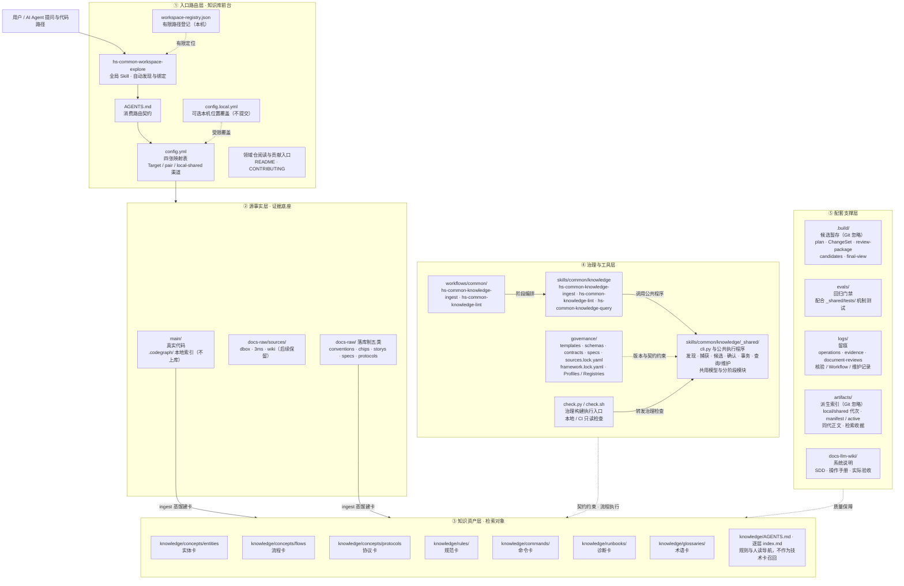
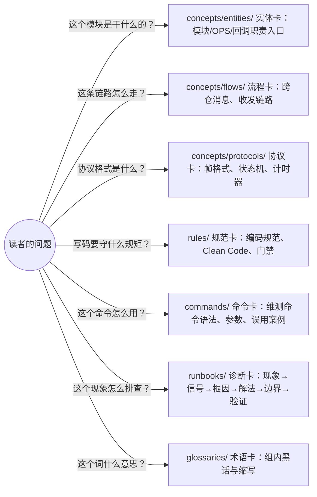
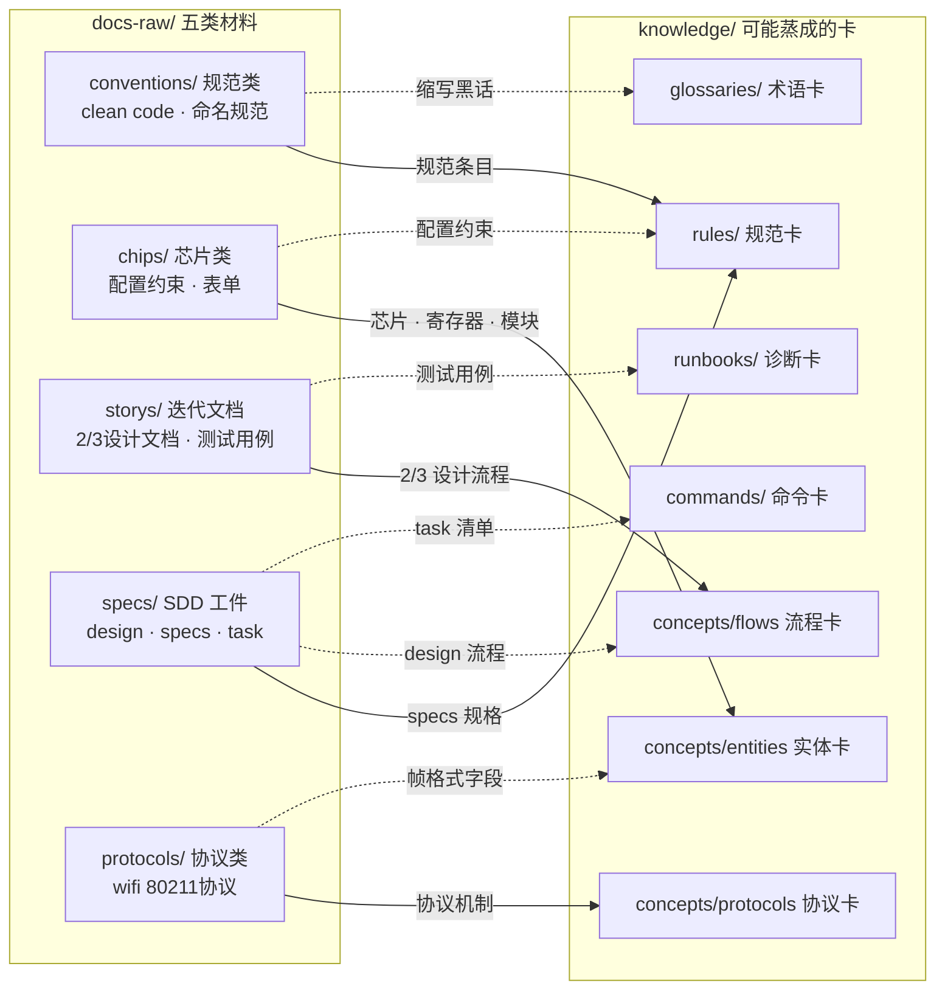
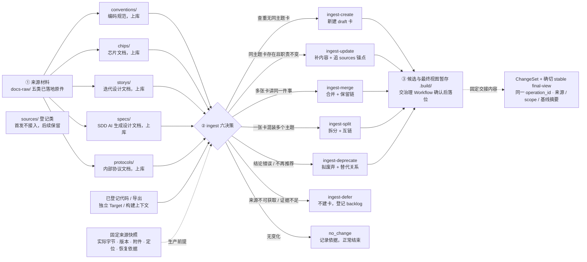
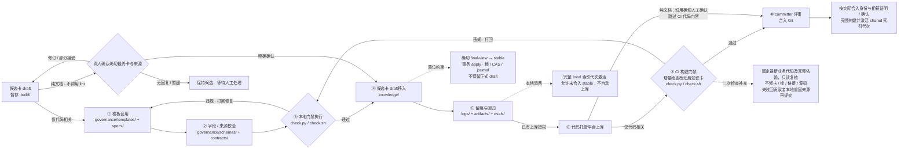
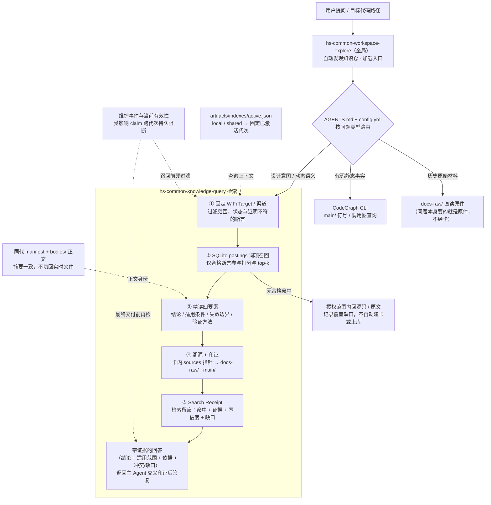

# 5 AIoTBot架构

当前部署决议（用户指定）：在 FactumCore 单仓根维护 `skills/`、`workflows/`、`config.yml` 与 `aiot-wifi-knowledge/`，原 `docs/` 对应 `docs-llm-wiki/`；下文分仓为未来分发与领域职责边界，当前不建立嵌套 Git，单仓目录不等于 ACL，公共框架发行须排除组内事实。

AIoTBot架构是基于对保密区 AIoT 业务开发环境、业界优秀实践（cannbot-skills / openharmony-skills / hibot-skills / cannbot-knowledge）、各个领域业务管理差异以及为了进行能力共建共用的目的综合分析得出。架构横向为Skills层和knowledge层、纵向为Tool 工具层。

## 5.1 AIoTBot架构图

（图：AIoTBot 整体架构图，原图略）

AIoTBot架构横向包含两个大层，分别是Skills层和knowledge层；纵向为Tool工具层，用于管理Skills资源以及harness工程控制。AIoTBot 核心组件如下：

| 层 | 核心组件 | 定位 |
|----|----------|------|
| Skills层 | Atomic Skill | 解决一个明确能力点的最小能力单元 | 
| Skills层 | hs-common-workspace-explore | 全局入口 Skill：按代码路径发现知识仓并加载项目路由 |
| Skills层 | Workflow Skill | 串联多个 atomic skill，定义阶段、输入输出、失败回退、验收证据 |
| Skills层 | SubAgent | 专注特定领域或复杂任务的专业执行者 | 
| Skills层 | Team | 协调多个 Skill 与 SubAgent 的协同作战单元 | 
| Skills层 | Hook | harness 工程钩子：事件监听、权限守卫 | 
| Knowledge层 | 领域知识库 | 各领域独立建设管理的知识仓 |
| Knowledge层 | 知识卡 | 知识正文的最小单元（结论 + 溯源） | 
| Knowledge层 | 知识技能与工作流 | ingest / lint / query 能力，生产与治理 Workflow 编排 |
| Tool层 | aiotbot-tools | Skills 资源管理、版本管理、harness 工程管理 |

### 5.1.1 Skills 层

Skills层当前阶段采用 Atomic Skills + Workflow Skills + SubAgent + Team 四层架构方式，配合 Hook 实现 harness 工程控制，组件由 aiotbot-skills 仓承载。

- **Atomic skill** 解决一个明确能力点的最小能力单元。一段能被多个 agent 工具复用的能力放在一个目录里，核心是 `SKILL.md`，再配上可选的使用指导和辅助文件。
- **hs-common-workspace-explore** 是用户级安装的全局入口 Atomic Skill。用户只需给出目标代码仓、目录或文件路径，Agent 即可自动发现已登记的知识入口、加载适用规则，再进入业务分析，无需用户手动初始化。
- **Workflow skill** 串联多个 atomic skill，定义阶段、输入输出、失败回退、验收证据，将分散的能力点编排为完整流程。公共工作流（hs-common-sdd、hs-common-test-design、hs-common-knowledge-ingest、hs-common-knowledge-lint）和领域工作流分别在 `workflows/common/` 和 `workflows/domain/` 下管理。
- **SubAgent** 专注特定领域或复杂任务的专业执行者。它封装了垂直场景下的深度能力，如代码生成、数据分析或特定硬件调试，通过接收高层指令并返回高质量结果，实现能力的专业化分工与复用。SubAgent 和 Team 统一存放在 `agent/` 目录下。
- **Team** 协调多个Skill与SubAgent的协同作战单元。它模拟人类团队协作模式，负责任务拆解、角色分配、状态同步及冲突解决，将复杂问题转化为多智能体并行或串行工作流，确保最终交付物的完整性与一致性。
- **Hook**：承载 harness 工程钩子，包括公共领域钩子和领域钩子，当前阶段未展开分析，未来可以进行扩展。可参考 cannbot-skills 的 hooks 设计，在工具执行前拦截写操作、按角色限制可写路径，实现权限防护。

Skills根据功能特点可以分为IPD研发流程生命周期的技能、公司业务通用技能、领域技能三种类型。相关技能需要遵守本文中的规范。

- 生命周期的技能：需求、设计、开发、测试、CI/CD、问题排查等完整研发生命周期的技能。在领域间共享，由技能owner管理。
- 公司业务通用技能：根据公司的业务特点，形成的特有技能，比如代码小型化优化、代码高性能优化、ROM化、安全编程等技能。在领域间共享，由技能owner管理。
- 领域技能：WiFi、BGLE、定位、雷达、SLP、NFC、NPU、MCU、平台、IR、显示、音频、媒体、视频等核心领域专用技能。在领域内部单独管理。

### 5.1.2 Knowledge 层

Knowledge层采用知识卡片的方式管理 AIoT业务 相关知识库，给出知识库的目录架构、卡片契约、来源治理和消费/增量维护规范。

**领域知识库**：知识库在领域内部单独管理。领域知识库可以独立建仓，或者直接放在代码仓中，建议独立建仓管理。一个领域一个仓，由各领域独立建设，管理内容和权限。知识仓内部框架目录基本相同，技能跨仓复用零适配。知识库可以参考 aiot-wifi-knowledge 案例，知识仓库举例：

- aiot-wifi-knowledge: wifi领域知识库。
- aiot-bgle-knowledge: bgle领域知识库。
- aiot-gnss-knowledge: gnss领域知识库。

**知识卡**：知识正文的最小单元，是知识库中唯一参与检索的对象。按"读者带着什么问题来"切分为实体卡、流程卡、协议卡、规范卡、命令卡、诊断卡、术语卡七类；卡片只写"结论 + sources 指针"，不复制原文段落，被指向的原始材料统一落在 `docs-raw/`。

**流程技能**：知识库的"操作说明书"，不装任何领域事实，可跨领域知识仓复用。

### 5.1.3 Tool 工具层

Tool 工具层由 aiotbot-tools 承载，包含以下功能，未来可以进行功能扩展：

- **Skills 资源管理**：负责 skill 的中心库与货架分离、挂载与分发、开关与分组机制，实现"资产即 skill"的准入、分发和迭代闭环；负责全局入口 Skill 的用户级安装与工作区登记。
- **版本管理**：负责 skills 仓、tools 仓的导入、升级和版本一致性管理，保证多 agent、多宿主下技能版本可追溯、可回退。
- **harness 工程管理**：负责 harness 工程（hooks、agent、workflow 等）的资源组织与工程控制，为 Skills 资源提供运行期支撑。

## 5.2 AIoTBot skills目录架构

aiotbot-skills技能仓目录结构如下所示。

- skills：存放Atomic Skills，包括三方技能、公共领域技能、领域技能。
- workflows：存放Workflow Skills，包括公共领域技能、领域技能。
- hook：存放harness工程钩子，包括公共领域钩子、领域钩子。当前未展开分析，未来可以进行扩展。
- agent：存放subagent 和 team。

本项目自有 Skill 与 Workflow Skill 的可调用名称、末级目录统一以 `hs-common-` 开头；全局入口命名为 `hs-common-workspace-explore`。`common/knowledge`、阶段/领域等分类目录不加此前缀，第三方原始名称与源码引用保留原样。

```
skills/
  third-party/
  common/           # 公共 Skills，面向跨领域、跨子系统、跨团队复用的通用能力
    requirements/   #   需求阶段
    design/         #   设计阶段
    fulldesign/     #   全量设计阶段
    development/    #   开发阶段
    testing/        #   测试阶段
    cicd/           #   CI/CD 阶段
    troubleshooting/ #   问题排查阶段
    codesize/        # 代码体积优化分类，具体 Skill 使用 hs-common- 前缀
    rom/             # ROM 化分类，具体 Skill 使用 hs-common- 前缀
    knowledge/      #  知识技能
  domain/           # 领域 Skills，面向具体框架、子系统或技术域的专用能力，内部可再细分
    platform/       #   platform子系统
    wifi/           #   WiFi 子系统
    bgle/           #   bgle 子系统
    gnss/           #   定位 子系统
    slp/            #   slp 子系统
    radar/          #   radar 子系统
    nfc/            #   nfc子系统
    npu/            #   npu子系统
    mcu/            #   mcu子系统
    kernel/         #   内核 子系统
workflows/          # 工作流定义
  common/           # 公共 工作流，面向跨领域、跨子系统、跨团队复用的通用能力
    hs-common-sdd/  # SDD规格驱动开发
    hs-common-test-design/ # 测试设计工作流
    hs-common-knowledge-ingest/ # 知识生产：来源获取、六决策、候选与交接
    hs-common-knowledge-lint/   # 知识治理：检查或人工确认、落位与上库阶段
  domain/           # 领域 工作流，面向具体框架、子系统或技术域的专用能力，内部可再细分
    platform/       #   platform子系统
    wifi/           #   WiFi 子系统
    bgle/           #   bgle 子系统
    gnss/           #   定位 子系统
    slp/            #   slp 子系统
    radar/          #   radar 子系统
    nfc/            #   nfc子系统
    npu/            #   npu子系统
    mcu/            #   mcu子系统
    kernel/         #   内核 子系统
hook/               # 钩子定义
  common/         # 公共 钩子，面向跨领域、跨子系统、跨团队复用的通用能力
  domain/           # 领域 钩子，面向具体框架、子系统或技术域的专用能力，内部可再细分
    platform/       #   platform子系统
    wifi/           #   WiFi 子系统
    bgle/           #   bgle 子系统
    gnss/           #   定位 子系统
    slp/            #   slp 子系统
    radar/          #   radar 子系统
    nfc/            #   nfc子系统
    npu/            #   npu子系统
    mcu/            #   mcu子系统
    kernel/         #   内核 子系统
agent/               # agent定义
common/         # 公共 agent，面向跨领域、跨子系统、跨团队复用的通用能力
domain/           # 领域 agent，面向具体框架、子系统或技术域的专用能力，内部可再细分
  platform/       #   platform子系统
  wifi/           #   WiFi 子系统
  bgle/           #   bgle 子系统
  gnss/           #   定位 子系统
  slp/            #   slp 子系统
  radar/          #   radar 子系统
  nfc/            #   nfc子系统
  npu/            #   npu子系统
  mcu/            #   mcu子系统
  kernel/         #   内核 子系统  
docs/             # 公共文档定义
scripts/          # 公共管理脚本定义、安装、检查、升级、插件等
LICENSE             # 版权说明
README.md           # 项目介绍
aiot-skills-namespace-and-placement-spec.md # aiot Skills 命名空间与目录放置规范，入库前必须遵守
```

## 5.3 AIoTBot knowledge目录架构

Workspace 与领域知识仓目录结构如下所示，各领域仓按 `aiot-<domain>-knowledge/` 命名并直接位于 workspace 下。

首版只接入 WiFi：chip12、chip08、chip07c，各覆盖 Host/Device；下图是逻辑布局，真实仓、路径和构建配置以登记为准，共享代码可映射多个芯片。其他领域保留为后续扩展。

框架参考 CANNBot Knowledge 固定版本，按复用条件选择性改造治理与 postings 检索；WiFi Target、两份 Workflow、代码双门禁和文档人工路径按本设计补齐，详见[详设附录 A](知识库详细设计.md#附录-a-cannbot-改造依据)。

- skills/common/knowledge/：存放全局入口与 ingest / lint / query 能力 Skill
- workflows/common/hs-common-knowledge-ingest/、workflows/common/hs-common-knowledge-lint/：分别编排生产与治理，复用上述 Skill
- AGENTS.md：项目绑定后的消费路由契约
- config.yml：四张映射表，把代码仓、架构元素、领域知识实体、符号别名集中登记为一份配置事实
- main/：真实代码工作区
- `aiot-wifi-knowledge/`：WiFi 独立知识仓，直接位于 workspace 下；其他领域按 `aiot-<domain>-knowledge/` 平级建仓，内部目录同构
  - knowledge/：知识卡，唯一检索对象，处理后知识的仓库
  - docs-raw/：源文档，原始证据层（LLM 只读）
  - governance/：治理文件夹，存放契约，模板，规范等
  - .build/ · logs/ · evals/ · artifacts/ · docs-llm-wiki/：配套支撑层

```
skills/
└── common/
    └── knowledge/
        ├── hs-common-workspace-explore/    # 全局入口：按代码路径发现、绑定知识入口
        ├── hs-common-knowledge-ingest/        # 来源处理、建卡与变更集落位能力
        ├── hs-common-knowledge-lint/          # 只读结构、来源检查与语义复核能力
        └── hs-common-knowledge-query/         # 初版 SQLite 词面检索与索引工具
workflows/
└── common/
    ├── hs-common-knowledge-ingest/            # 生产编排：来源 → 六决策 → final-view
    └── hs-common-knowledge-lint/              # 治理编排：检查 / 人工确认 → stable → 上库阶段
AGENTS.md                            # 入口：领域/流程路由、卡契约指针、config.yml 说明
config.yml                           # 代码仓 ↔ 架构元素 ↔ 领域知识实体 ↔ 符号映射
main/                                # 真实代码工作区
├── device/
│   ├── combo/ common/ datapath/ platform/ sensorhub/
│   └── wifi/
│       ├── chip12/                  # 逻辑槽位，实际目录由 config 映射
│       │   ├── .codegraph/          # [新增]代码图谱db文件，本地生成不上库
│       │   └── …
│       ├── chip08/
│       │   ├── .codegraph/          # [新增]代码图谱db文件，本地生成不上库
│       │   └── …
│       └── chip07c/
├── drivers/
│   ├── combo/ common/ datapath/ platform/ sensorhub/
│   └── wifi/
│       ├── .codegraph/              # [新增]代码图谱db文件，本地生成不上库
│       └── …
└── …
aiot-platform-knowledge/              # Platform 领域知识仓（后续，同构，不展开）
aiot-bgle-knowledge/                  # BGLE 领域知识仓（后续，同构，不展开）
aiot-gnss-knowledge/                  # GNSS 领域知识仓（后续，同构，不展开）
aiot-slp-knowledge/                   # SLP 领域知识仓（后续，同构，不展开）
aiot-radar-knowledge/                 # Radar 领域知识仓（后续，同构，不展开）
aiot-nfc-knowledge/                   # NFC 领域知识仓（后续，同构，不展开）
aiot-npu-knowledge/                   # NPU 领域知识仓（后续，同构，不展开）
aiot-mcu-knowledge/                   # MCU 领域知识仓（后续，同构，不展开）
aiot-wifi-knowledge/                  # 首发 WiFi 独立知识仓；直接展开内部结构
├── AGENTS.md                    # 知识边界、规则指针与技能入口
├── README.md                    # 定位、实际能力、资料导航
├── CONTRIBUTING.md              # 生产、核验和贡献流程
├── check.py / check.sh          # 结构、来源完整性及历史导入快照检查
├── docs-raw/                    # 知识所在的原始文档
│   ├── sources/                 # 后续来源登记保留位；首发不更新链接
│   │   ├── dbox                 # dbox设计文档，链接到dbox，与薪火平台共管理
│   │   ├── 3ms                  # 3ms文档，链接到3ms，与薪火平台共管理
│   │   └── wiki                 # wiki文档，链接到wiki，与薪火平台共管理
│   ├── conventions              # clean code、编码规范等，内部公开，上库git仓
│   ├── chips                    # 芯片相关文档，内部公开，上库git仓
│   ├── storys                   # 迭代设计文档，内部公开，上库git仓
│   ├── specs                    # sdd流程AI生成设计文档，内部公开，上库git仓
│   └── protocols                # 内部公开协议文档，内部公开，上库git仓
├── governance/
│   ├── AGENTS.md / index.md     # 共享治理维护规则与任务导航
│   ├── templates/               # 七类卡及目录导航、人工复核、维护记录模板
│   ├── sources.lock.yaml        # source → 声明版本/落点/hash/bytes/恢复说明；当前空锁
│   ├── schemas/
│   │   ├── frontmatter.schema.json
│   │   ├── sources.schema.json  # 来源锁字段形状
│   │   ├── profiles.yaml
│   │   └── registries.yaml      # 受控枚举；Target/源码映射以 config.yml 为准
│   ├── contracts/               # knowledge、source_resources 与共享 validation
│   └── specs/                   # 共享契约及编写、复核、生命周期规范
├── knowledge/                   # 唯一知识正文根；
│   ├── AGENTS.md                # WiFi 领域规则，不虚构实际模块与 Target
│   ├── index.md                 # 当前仅入口，无技术卡；以下 Profile 随真实建卡创建
│   ├── concepts/                # 原理、机制及概念卡
│   │   ├── entities/            # 实体卡：模块/OPS/回调职责入口（dbox、storys、specs、chips 设计文档蒸馏）
│   │   ├── flows/               # 流程卡：跨仓消息、收发链路（dbox、storys、specs 设计文档蒸馏）
│   │   └── protocols/           # 协议卡：802.11 帧格式、状态机、计时器（协议蒸馏）
│   ├── rules/                   # 规范卡：编码规范、Clean Code、门禁约束（conventions 蒸馏）
│   ├── commands/                # 命令卡：维测命令语法、参数、典型输出、误用案例（wiki 蒸馏）
│   ├── runbooks/                # 诊断卡：现象→信号→根因→解法→边界→验证（wiki 经验蒸馏）
│   └── glossaries/              # 术语卡：组内黑话与缩写
├── .build/                      # ignored 转换、规范化、候选暂存，按需产生
├── logs/                        # 按日期记录已发生的导入与维护
├── docs-llm-wiki/               # LLM WIKI系统说明（design_principles / installation_and_usage）；禁止成为第二份领域事实库
├── evals/                       # 检索案例、回归执行与接受/拒绝测试
└── artifacts/                   # 本地派生索引、验证报告，Git 忽略

```

# 11 AIoTBot知识库架构

前文"AIoTBot knowledge目录架构"回答的是"有哪些目录"，本章回答三个问题：**每个目录是干什么的？为什么要有这个目录？目录之间怎么协作？** 阅读顺序：11.1 建立动机认知（为什么需要知识库）→ 11.2 仓库架构（分层模型 + 目录职责）→ 11.3 知识生命周期（三条链路看目录协作）。

## 11.1 知识库收益

AIoT 业务横跨 WiFi、BGLE、定位、雷达、SLP、NFC、NPU、MCU 等十几个领域，代码规模大、协议密集、芯片迭代快，领域知识散落在 dbox/3ms/wiki 设计文档、迭代 story、内部协议和代码注释中。没有知识库时，Agent 每次任务都从零开始读代码、读文档：上下文爆炸、检索无门、结论无法溯源；多人多 agent 各自沉淀的经验无法复用，同样的坑反复踩。

知识库带来的收益：

| 收益 | 说明 |
|------|------|
| 检索增强 | 词面召回 + frontmatter 范围过滤，Agent 先路由再消费，把上下文预算花在刀刃上 |
| 结论可溯源 | 每张卡带 sources 锚点，回答可回溯到原始证据，抑制幻觉 |
| 经验可沉淀 | 一次调试经验固化为 runbook 卡，跨项目、跨 agent 复用 |
| 质量可治理 | lint 门禁 + 检索回归评测，知识有生命周期而非一次性文档 |
| 权限可控 | 领域独立建仓，保密要求不同的知识各自管理、互不越界 |

## 11.2 知识库架构

知识库的目录划分不是文件夹的随意归置，而是治理规则的物理落地。四条原则各对应一对目录：

| 原则 | 回答的问题 | 对应目录 |
|------|-----------|---------|
| 事实与证据分离 | 卡片结论从哪里来？ | `knowledge/`（结论）↔ `docs-raw/`（证据） |
| 事实与规则分离 | 什么才算一张合格的卡？ | `knowledge/`（领域事实）↔ `governance/`（元规则） |
| 人读与机读分离 | 谁来浏览、谁来召回？ | `index.md`（人读导航）↔ `artifacts/`（机器索引） |
| 沉淀与暂存分离 | 什么入库、什么忽略？ | 上库目录 ↔ `.build/`（暂存，Git 忽略） |

知识库仓的目录架构按"层"组织：每层回答一个问题、承载一组目录，层与层之间靠三条链路协作。总体架构如下：



图中保留原五层及七类知识卡，只补入口配置、共享程序、版本锁、人读导航和运行文件形态。它描述目标架构；全局 Skill 挂载与 Skill/Workflow 自动编排、代码门禁、索引及维护仍按 SDD 后续任务验收，不能由文件名推断已部署。`_shared/confirmations.py`、`transactions.py` 是既有公共入口内部的实现拆分，具体补项见[详设 §1.1](知识库详细设计.md#11-要实现的闭环)。

各层与目录的对应关系：

| 层 | 一句话职责 | 承载目录/文件 |
|---|---|---|
| ① 入口路由层 | 自动绑定项目，先路由再消费 | `hs-common-workspace-explore` · 仓内 `AGENTS.md` · `config.yml` · `workspace-registry.json` · `README.md` · `CONTRIBUTING.md` |
| ② 源事实层 | 证据底座：代码事实 + 原始材料，喂知识层 | `main/` · `docs-raw/` |
| ③ 知识资产层 | 唯一检索对象：治理后的知识卡 | `knowledge/` |
| ④ 治理与工具层 | 契约、能力执行与生产/治理编排 | `governance/` · `skills/common/knowledge/` · `check.py/check.sh` · `workflows/common/hs-common-knowledge-ingest/` · `workflows/common/hs-common-knowledge-lint/` |
| ⑤ 配套支撑层 | 候选暂存 · 回归门禁 · 留痕 · 派生索引 | `.build/` · `evals/` · `logs/` · `artifacts/` · `docs-llm-wiki/` |

递进一句话：证据层喂知识层，契约层束知识层，技能层跑知识层，配套层验知识层，入口层路由知识层。

### 11.2.1 根目录架构

#### AGENTS.md —— 消费路由契约

Agent 会话入口。作用是"先路由，再消费"：代码静态事实走 CodeGraph CLI，设计意图/动态语义走知识卡，历史原始材料走 raw，禁止全库扫描。没有这个入口，Agent 每次都要猜路径；有了它，一次会话的上下文预算花在刀刃上。

仓外启动时先由全局 `hs-common-workspace-explore` 按目标代码路径定位 `config.yml` 与知识仓，再读取适用 `AGENTS.md`；不假定提示词中出现路径就已自动加载项目规则。

参与链路：消费链路（前置路由）。生产、治理链路不经过它——ingest / lint 是显式触发，不走会话路由。

#### config.yml —— 四张映射表

repos / architecture / wiki_entities / symbol_aliases 四张表，把"代码仓在哪、架构怎么划、卡片页叫什么、符号别名是什么"集中登记。这些内容是**配置事实而非领域知识**，集中一处，人和 Agent 共用同一份真相；决策引擎段（shadow/assist）也在此声明。

参与链路：消费链路——路由的判断依据就是这四张表。

#### main/ —— 真实代码工作区

device 侧 + host 侧真实代码。`.codegraph/` 是代码图谱索引，**本地生成不上库**：它是按仓可重建的派生物，且可能包含内部符号信息，保持 Git 干净。知识卡结论必须能锚定到代码（`[函数](路径:行号)`），检索-印证-回写闭环因此要求代码与知识同工作区可达。

参与链路：生产链路（代码事实作为来源材料之一）+ 消费链路（codegraph 交叉印证）。

#### `skills/common/knowledge/` 与 `workflows/common/hs-common-knowledge-xxx/` —— 能力与编排

知识库的"操作说明书"，不装任何领域事实：

| 技能 | 职责 | 一句话 |
|------|------|--------|
| `skills/common/knowledge/hs-common-workspace-explore/` | 全局发现与绑定项目、加载知识入口 | 先接入 |
| `skills/common/knowledge/hs-common-knowledge-ingest/` | 来源处理、六决策、建卡、变更集与落位能力 | 怎么进 |
| `skills/common/knowledge/hs-common-knowledge-lint/` | 只读结构、来源检查与语义复核能力 | 怎么验 |
| `skills/common/knowledge/hs-common-knowledge-query/` | 初版 SQLite 词面检索与索引工具 | 怎么找 |
| `workflows/common/hs-common-knowledge-ingest/` | 编排来源获取、六决策、候选生成与治理交接 | 生产顺序 |
| `workflows/common/hs-common-knowledge-lint/` | 编排本地检查或人工确认、stable 落位及上库阶段 | 治理顺序 |

技能与知识分仓的理由：技能是"流程"，知识是"事实"，升级节奏不同；同一套技能可跨领域知识仓复用。

各 Skill 拥有自己的 `SKILL.md`、references 和必要的专属 scripts；`_shared/` 是统一知识执行包，共用来源/卡片模型、确切视图与确认绑定等规则，也按职责分模块供不同入口调用，不要求每个 Skill 使用全部模块。Skill 专属适配可以自带，共同规则不在各目录重复实现；分工见详设 §3.3。

参与链路：`hs-common-workspace-explore` 做前置发现与绑定；生产、治理分别由同名 Workflow 编排并调用所需 Skill，消费仍由 hs-common-knowledge-query 执行。Workflow 定义阶段与交接，Skill 和共享工具提供能力，不各写一套契约；文档人工分支不调用 lint，CI 只执行治理的只读 merge 阶段。详见[详设 §3.4](知识库详细设计.md#34-生产与治理-workflow)。

#### `aiot-<domain>-knowledge/` —— 领域知识仓

一个领域一个仓，直接位于 workspace 下，例如 `aiot-wifi-knowledge/`、`aiot-bgle-knowledge/`，**内部目录同构**，技能跨仓复用。按域分仓的理由见"AIoTBot目标"章：领域知识差异大、保密要求不同；代码与知识放一个仓会有权限冲突和一致性难题，独立建设各自管内容和权限。

参与链路：**三条链路全程**——每个领域仓内部跑完整的"生产 → 治理上库 → 消费"。

### 11.2.2 各领域仓目录架构（以 wifi 为例）

#### 领域仓根文件：阅读入口与治理构建入口

| 文件 | 职责 | 消费者 |
|------|------|--------|
| `AGENTS.md` | 知识边界、规则指针与技能入口 | Agent 会话第一步 |
| `README.md` | 定位、实际能力、资料导航 | 人 |
| `CONTRIBUTING.md` | 生产、核验和贡献流程 | 贡献者 |
| `check.py / check.sh` | 治理构建执行入口：结构、来源完整性及历史导入快照检查 | ④治理与工具层；本地门禁 + CI 门禁共用入口 |

`AGENTS.md`、`README.md`、`CONTRIBUTING.md` 承担规则、阅读与贡献入口；`check.py / check.sh` 属于④治理与工具层，在治理构建的本地/CI 阶段调用公共检查程序。脚本物理上仍位于领域根，不另造一套检查规则。

参与链路：`README.md` / `CONTRIBUTING.md` 生产链路贡献者入口；`check.py / check.sh` 治理链路本地门禁 + CI 门禁共用入口；`AGENTS.md` 消费路由。

#### knowledge/ —— 知识正文根（唯一检索对象）

整个知识库中**唯一参与检索的目录**。子目录按"读者带着什么问题来"切分，而非按代码目录切分：



目录来源标注了材料出处；首发文档必须先由人放入 raw 的五类材料目录，不能直接沿 dbox/wiki 链接读取。材料性质辅助归档，卡片类型按知识问题选择。`AGENTS.md` + `index.md` 是领域规则与逐层导航。

**上库管理标准**：知识卡正文随仓提交、进评审流程，仓库里沉淀的是卡片、导航、规则、模板与评测全量事实；不上库的只有可重建的派生物（`artifacts/` 索引、验证报告）与暂存区（`.build/`），Git 历史只承载"人确认过的知识"。

参与链路：治理链路（卡片落位上库）+ 消费链路（定位 / 精读）。

#### docs-raw/ —— 原始证据层（LLM 只读）

知识卡正文只写"结论 + sources 指针"，不复制原文段落；被指向的原始材料统一落在 `docs-raw/`。这一层的组织逻辑是**按材料性质分类，而不是按项目、时间或团队分类**——因为下游建卡时，第一个判断就是"这份材料是什么性质、该蒸成什么卡"。

两套存放形态：

- **登记制（`sources/`，后续保留）**：按文档工具登记"链接 + 版本 + hash + 密级"；首发不处理链接更新、dbox 仓外路径映射、wiki 网页获取及 3ms 接入。用户可先将导出原件放入下面五类目录，再走人工确认路径。
- **落库制（conventions / chips / storys / specs / protocols）**：内部公开、上库 Git 仓的文件，按 WiFi 组可能用到的材料类型分五类。

##### 分类对知识卡生成的影响

材料分类提供建卡的推荐路由；具体 Profile 按知识问题选择，适用条件与确认方式由证据和用途确定，不能仅凭原件目录自动决定：



实线 = 推荐主路由，虚线 = 常见兼路由。一类材料可形成多种卡；最终按问题边界、Profile 必需内容和实际证据选择，不把材料目录等同卡片语义。

| 影响点 | 链路环节 | 分类错位后果 |
|--------|----------|--------------|
| 辅助卡类型路由 | 生产：材料性质提供候选，知识问题确定 Profile | 仅按目录自动选型会混淆问题边界和必需内容 |
| 决定溯源锚点 | 治理：卡片 `sources` 必须指向固定可核验位置 | 分类漂移 → 溯源路径漂移 → lint 机器化检查失效 |
| 决定召回过滤 | 消费：query 按 platform/technology/lifecycle 过滤 | 范围声明混乱 → "未知范围伪装通用"或漏召回 |

同时划清边界：**分类不保证卡的内容正确**——内容正确性靠蒸馏与人工复核；分类保证的是"每张卡能被路由到正确类型、溯源到固定位置、过滤出正确范围"三件可机器化审计的事。

参与链路：生产链路（材料分类与登记）+ 消费链路（溯源）。

#### governance/ —— 治理规则层（契约 SSOT）

`templates/`（七类卡及导航、人工复核和维护记录模板）、`schemas/`（卡、来源、记录、workspace 的形状及 profiles、registries）、`contracts/`（卡、来源、范围、记录及关系规则）、`specs/`（编写、复核、生命周期规范）、`sources.lock.yaml`（来源锁：声明版本/落点/hash/bytes/恢复说明）。生产、治理、消费**共用同一契约**，Skill 不维护私有例外；逐文件设计见详设第 3 章。

参与链路：生产链路（建卡时套它的模板）+ 治理链路（契约为治理全程供给规则）+ 消费链路（过滤时按它的规范）。

#### 配套设施

| 目录 | 一句话职责 | 为什么单独设 |
|------|-----------|--------------|
| `.build/` | 转换、规范化、候选暂存（ignored） | 生产过程的半成品不该出现在检索结果里 |
| `evals/` | 检索案例、回归执行与接受/拒绝测试 | 质量门禁：改索引/改契约必须先过回归 |
| `logs/` | 按日期记录已发生的导入与维护 | 审计留痕；只追加，不代替原始 trace |
| `artifacts/` | 本地派生索引、验证报告（Git 忽略） | 由固定卡片、契约及保留的确认/证明重建；不能反造丢失的原始证明 |
| `docs-llm-wiki/` | LLM WIKI 系统说明 | 讲"系统怎么用"；禁止成为第二份领域事实库 |

参与链路：`.build/` 生产链路暂存；`evals/` 治理链路回归 · CI 门禁复跑；`logs/` 治理链路留痕；`artifacts/` 消费链路机器召回；`docs-llm-wiki/` 不参与链路，讲链路本身。

## 11.3 知识库使用链路

知识库里所有目录，都是为三条链路服务的。先看链路、再看目录，每个目录"参与哪条链路、卡在哪一环"顺着图就能对上号。

### 链路一：生产 —— ingest 六决策

输入是来源材料，输出是 `.build/` 里的候选卡与 final-view。`workflows/common/hs-common-knowledge-ingest/` 编排来源获取、六决策及候选生成，调用对应 ingest Skill 后交给治理 Workflow：



新增的快照节点是六决策的来源前提；候选交接仍由原③阶段完成，正式文件在治理确认/检查并 apply 前不变。代码与 raw 各自固定上下文；首发文档只读五类 raw 已落地原件，`sources/` 不接入。

### 链路二：治理上库 —— lint 门禁

以下两道门禁适用于代码相关卡。纯文档知识卡走“人将原件放入 raw → Agent 更新候选 → 人工确认 → stable 落入 `knowledge/` → 普通评审合入”，不要求本地或 CI 门禁；具体更新与确认流程见[详设 §4.2.2](知识库详细设计.md#422-首发文档更新的具体动作)。

输入是 `.build/` 里的最终视图，输出是本地 stable 及后续合入记录。`workflows/common/hs-common-knowledge-lint/` 编排治理；代码分支调用 lint Skill、`check.py / check.sh`，文档分支仅人工确认，两者均调用 ingest apply 落位。提交与合入沿用用户授权；CI 仅运行代码分支的只读二次检查，不修卡或调用 apply。代码两道门禁共用 `governance/` 契约：



新增支路不改变原①–⑧阶段：B/C/D/H 只用于代码，纯文档由真人确认后进入落位，并从上库节点直达普通评审；文档在 F 仅留痕和构建索引，不调用 lint 或要求代码门禁记录。④的正式落位必须是 stable（与下文既定规则相同）；原节点中的 draft 表示候选来源，原文案修正待讨论。F 的 local 构建与授权上库均从已落位 stable 出发，上库不以 local 激活成功为前提；H 的打回连线表示贡献者回本地修订，不是 CI 修改输入。

**①② 是"查"不是"改"**：契约校验只判定卡是否合规，不改写内容——违规卡的修复由 Agent 按 lint 违规清单改，改完重新走门禁。

**⑥⑦⑧ 两道门禁的分工**：①-⑤ 是本地门禁——查 `.build/` 候选卡，通过后卡片平移到 `knowledge/`（置 stable、`index.md` 回填一行），这只是**本地变更，还不是上库**；⑥⑦⑧ 是 CI 门禁——提 PR 触发 CI，服务器拉取待合入代码，按**改动的 knowledge 卡**重跑同一套契约校验（全库 lint + 索引核验 + 检索回归 + 单测），违规打回，committer 评审后合入 Git。

### 链路三：消费 —— query 五步法

输入是提问与目标代码路径，输出是带证据的回答。全局 `hs-common-workspace-explore` 自动绑定已登记的项目与知识仓，加载 `AGENTS.md` 和配置后按**问题类型**选择入口，支持组合核验：



新增节点只补查询身份与失败出口：local 可以引用本地未合入 stable；shared 必须绑定确切合入身份和相符证明/确认。正文固定在同一代次，当前维护阻断在召回和交付前都要核对；无命中不自动转生产。

入口 Skill 不装领域事实；由 Skill 自身说明首次接入、换仓及绑定失效时的重载要求，触发与加载以回执和评测确认，不能把安装成功视为必然触发。用户个人 AGENTS 由用户自行配置，不纳入本方案开发、托管或验收。具体设计见 [知识库详细设计 §3.2](知识库详细设计.md#32-能力-skill)。

#### 目录 × 链路参与矩阵

| 目录/文件 | 生产（材料 → 候选卡） | 治理上库（候选卡 → 合入） | 消费（卡 → 答案） |
|---|---|---|---|
| `hs-common-workspace-explore` | 显式流程可复用项目绑定 | 同一绑定上下文 | 前置：自动发现与加载 |
| `AGENTS.md` | 不参与 | 不参与 | 前置：路由 |
| `config.yml` | — | — | 前置：路由依据 |
| `main/` | 来源之一（代码事实） | — | ④ 交叉印证 |
| `skills/common/knowledge/` | ② 六决策能力 | ③ 只读检查与落位能力 · ⑦ CI 检查 | ①-⑤ 消费能力 |
| `workflows/common/hs-common-knowledge-ingest/` | 来源、六决策、候选与治理交接编排 | 返回修订时恢复生产阶段 | — |
| `workflows/common/hs-common-knowledge-lint/` | 接收确切 final-view | 检查 / 人工确认、落位及上库阶段编排；CI 只读 | — |
| `knowledge/` | — | ④ 平移落位 | ① 定位 / ③ 精读 |
| `docs-raw/` | ① 来源材料 | — | ④ 溯源 |
| `governance/` | — | ①② 契约供给 | — |
| `.build/` | ③ 候选暂存 | — | — |
| `evals/` | — | ⑤ 回归 · ⑦ CI 门禁 | — |
| `logs/` | — | ⑤ 留痕 | — |
| `artifacts/` | — | ⑤ 索引重建 · ⑦ 全量核验 | ① 机器召回 |
| `docs-llm-wiki/` | — | — | 人读说明 |

