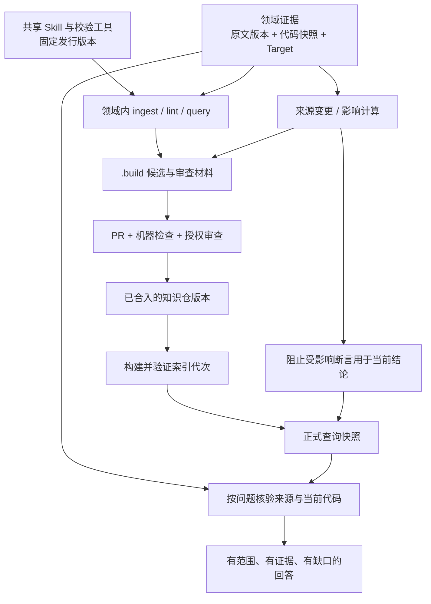

# AIoTBot 知识库：基于最终设计的可行性评估与详细设计建议

日期：2026-10-18。身份：**待评审的知识子系统补充设计**，不是另一份总体架构，也不是已经实现的能力说明。

后续澄清：本地门禁通过后即置 `stable` 并放入 `knowledge/`，允许本地消费；上库后依据最新业务代码进行只读合入门禁，不修改提交、来源锁、引用链接或被引用代码。本文中将本地通过仅视为候选、将 stable 等同人工批准的旧建议由 [知识库详细设计](../设计文档/知识库详细设计.md) 替代；本稿保留当时评估过程，实施以新详细设计为准。

## 0. 阅读范围与结论

本次唯一业务设计依据是 [aibot.md](../设计文档/aibot.md)，下文简称 D。用户指定的 `aiotbot.md` 在本机不存在；实际读取的是同目录、当日更新的 `aibot.md`，共 572 行，SHA-256：`D23CE88A84CA024358D88CD53A1F7FF11FCC59B89A8D1C8598EAC11CC68E795D`。父仓当前 HEAD 为 `c685aa0f5c159c3546f3458e34ec0b8497bdb283`；这些标识仅固定本次审阅输入。

没有读取其他业务设计、历史研究正文、独立知识仓实现或评测 gold；没有复验内网代码、文档平台、权限部署、检索性能或知识覆盖。下文严格区分：D 中的设计要求、官方技术文档确认的工具机制、本文提出的工程方案。

**结论：总体方案可行，适合先以一个授权范围内的 WiFi 小场景落地。** 保留“共享流程 Skill + 领域独立知识仓 + Markdown 卡片 + 原始证据 + SQLite 派生索引”的主干。当前不足不是缺少另一个数据库，而是尚未把来源快照、适用范围、人工审查、发布快照、失效传播和证据消费连接成可执行契约。

“可行”指没有发现必须推翻主干的结构性障碍；不等于已经证明收益、召回率、跨域复用成本或权限隔离。是否值得规模化，应由第 15 节的小范围试点回答。

## 1. 我理解你们要做什么

AIoTBot 是研发 Agent 的能力与知识体系，而知识库负责让研发中确认过的事实可以被其他任务复用：

1. 公共 Skill 描述怎么工作，领域仓保存这个领域知道什么；二者可以分别升级。
2. 各领域分别组织原文、结论、审核和权限，共用知识契约与操作接口。
3. Agent 不必每次把全部代码、协议和设计文档重新读一遍，先定位相关卡片，再按当前问题核验原文或代码。
4. 卡片保存经过提炼的结论、适用条件、失效边界和验证方法；原始材料承担举证职责。
5. 研发任务中新产生的可靠经验，经候选、核验、评审后再次进入知识库。

依据：D §5.1（L9–59）、§11.1（L241–253）、§11.2（L257–264）、§11.3（L489–550）。

以“某芯片上这个消息为什么没有到 Device”为例，理想消费过程是：先锁定芯片、Host/Device 代码快照和配置；找相关流程卡理解设计；检查发送点、消息标识、注册/分发点与接收入口；需要时读命令卡和诊断卡定位观测方法；答案分别说明设计预期、当前静态实现和实际运行证据。问题解决后，再判断是否有值得复用的新知识。

这要求知识库能描述**知道什么、对什么成立、依据哪一版、还有什么没有证实**。单纯“搜到一篇写得像答案的文档”不能完成这个目标。

## 2. 总体取舍

| 设计部分 | 判断 | 落地条件 |
|---|---|---|
| 领域独立建仓 | 保留 | 逻辑领域还需对应实际授权范围；同一领域内部也可能需要分仓或分部署 |
| 原文与卡片分离 | 保留 | 原文指针必须落到可核验的固定版本，不能只有会变化的 URL |
| 七类知识卡 | 保留 | 用问题和断言决定 Profile；材料目录只提供默认建议 |
| 统一治理契约 | 保留 | 明确版本兼容与扩展点，Skill 不复制私有字段规则 |
| SQLite 词面检索 | 适合首期 | 显式处理中文短词、符号、别名和范围条件；业务质量仍需试验 |
| CodeGraph 与知识卡协作 | 保留 | 图谱与代码快照绑定；图边不自动等于目标构建或运行事实 |
| 人工评审后沉淀 | 必须保留 | 正式查询消费已批准发布快照，不能直接读取开发工作区 |
| 增量维护 | 必须补齐 | 从 source/Target/配置变化传播到卡片、引用关系和索引 |

首期建议选择 SQLite，理由是与现有文件资产和单领域部署方式衔接直接、派生物可重建。这里是工程取舍，不是已经测得 SQLite 比向量检索更好。只有在控制范围、中文词项和别名后仍出现大量语义漏召回，再对同一批授权卡片比较语义召回；新增召回通道仍须遵守相同的发布、范围和证据约束。

## 3. 原稿中需要先澄清的落地问题

下表是对 D 的精化建议，未修改最终设计原文。

| 位置 | 问题与后果 | 建议规则 |
|---|---|---|
| L514、L522–532 | 本地门禁后就置 stable，人工评审更晚；若查询读取同一工作区，会提前消费未批准知识 | 本地通过只产生可审查候选；人工批准并合入后才发布正式快照 |
| L49、L413、L495、L507 | 原文可仅登记在远端，却又把“材料未上库”作为 defer 条件 | 准入看“固定版本是否可授权取回并核验”；远端原件不强制复制进 Git |
| L346、L413 | 路径:行号、链接+hash 尚不足以说明如何重放证据 | 锁定 source_id、snapshot、字节对象、定位器、取回方法及代码上下文 |
| L447、L450、L455 | 测试用例默认生成诊断卡、task 默认生成命令卡，会把计划误作经验；“唯一决定”过强 | 材料性质给默认候选 Profile，按实际断言和证据选择最终 Profile |
| L536–553 | 问题被三选一，无法处理“原设计与当前实现有何差异” | 三类入口可组合成证据计划；卡片仍是知识索引唯一对象 |
| L546–547 | 先取 top-k 再过滤可能让错误芯片卡占满候选 | 授权先限制可访问集合；范围、发布状态与查询排序在最终 LIMIT 前共同约束 |
| L249、L358、L546 | “SQLite 词面”没有定义中文和代码符号如何形成词项 | 固定词项规范、领域别名表和符号精确检索，并记录版本 |
| L489–550 | 有首次生产与查询，没有来源变化到卡片失效的链路 | 增加变更检测、影响清单、阻止过期断言使用、复核与重发 |
| L209、L469 对比 L49 | 七类正文与“9 类 draft 模板”的关系不明确 | 七类正文 Profile 固定；导航/复核/维护等辅助模板另列，不参与正文检索 |
| L147–165、L300、L325、L563 | Skill 路径有多种写法；全库与增量 CI 的措辞也不一致 | 统一逻辑入口与版本解析；结构/关系全检，语义复核按影响范围执行 |

另外两点应写清：AGENTS 中的边界规则适用于生产、治理和消费所有会话，“不走消费路由”不等于不受约束（D L334–336）；“一领域一仓”与 Hook 都不能单独证明权限隔离（D L31、L253、L366）。

## 4. 部署与职责：沿用五层，不另建知识真源

下图是建议的运行关系，不表示这些服务已部署。



建议分工：领域 owner 决定范围与发布政策；材料管理员提供授权原件/远端版本；Agent 生成和修订候选；校验器做可确定性检查；具备权限的 reviewer 核验结论；发布执行器只构建已批准版本；查询 Agent 不能自行批准、发布或清除失效状态。

保留 D 的目录。只在现有目录内增补用途明确的文件：

| 资产 | 位置建议 | 谁维护 | 是否进正式知识索引 |
|---|---|---|---|
| 业务结论 | `knowledge/` 七类卡 | Agent 提案，reviewer 批准 | 是，且受发布和有效性条件约束 |
| 原件/远端登记 | `docs-raw/` | 受控获取工具/材料管理员 | 否；可按授权计划读取 |
| 来源版本清单 | `governance/sources.lock.yaml` | 获取工具出具快照，评审确认引用 | 否 |
| Profile、范围、来源定位规则 | `governance/schemas/`、`contracts/`、`specs/` | 框架 owner + 领域注册项维护者 | 否 |
| 候选、计划和检查结果 | `.build/<operation-id>/` | Agent 与校验工具 | 否 |
| 可审查操作摘要、来源变更事件 | `logs/` | 确定性工具追加，随变更评审 | 否 |
| 索引代次与验证报告 | `artifacts/` | 构建工具 | 否；它是索引载体，不是新的正文源 |
| 测试输入与公开合成断言 | `evals/` | 领域测试维护者 | 否 |

跨域复用的含义应是：相同操作协议、相同核心 Schema、相同 CLI；领域差异通过 Target、术语、来源 resolver 和审核策略注册。不能承诺每个内网文档平台“零配置”，也不应为每个领域复制一份校验器。

## 5. 先固定四个核心对象

建议把文档中的约定落实为以下对象。字段是本次建议，尚未修改任何现有机器契约。

| 对象 | 不变标识 | 主要职责 |
|---|---|---|
| SourceResource | `source_id` | 某份原文、代码库或受控运行记录的身份、授权域和取回方式 |
| SourceSnapshot | `source_id + snapshot_id` | 锁定一次可验证的内容版本，不覆盖历史快照 |
| KnowledgeCard | `card_id` | 对明确问题给出带适用条件的结论，文件移动不改变身份 |
| Publication | `knowledge_commit + generation_id` | 固定本次允许消费的卡、契约、词项规则和来源引用集合 |

Target 是卡片与代码/运行快照共同引用的领域注册对象，至少能区分芯片或产品、Host/Device、构建配置及必要的特性条件。不能用单个 `wifi` 标签代替。

SourceResource 与 Snapshot 是证据元数据，不是另一套 Wiki；Publication 是发布描述，不承载领域结论。

## 6. 来源治理详细设计

### 6.1 登记制与落库制使用同一个版本模型

`docs-raw/sources/` 的 Markdown 登记负责人的可读说明；来源锁负责机器使用的结构化事实。版本、哈希等字段只维护一处，由工具生成另一种展示，避免两份手填事实冲突。

一条来源快照至少记录：

| 字段 | 规则 |
|---|---|
| 身份 | `source_id`、`snapshot_id`、来源性质、所属授权范围 |
| 固定版本 | 源系统版本号/对象版本/代码 commit；无 Git 则是明确的快照清单 |
| 内容指纹 | 对具体获取字节计算 SHA-256 和 bytes，标注 MIME、编码和哈希对象 |
| 定位与恢复 | repo/path 或远端资源 ID、版本化读取方法、正文锚点规则 |
| 获取记录 | 获取时间、获取工具版本、已核验状态；不保存凭据 |
| 派生转换 | 原字节指纹、转换器版本、转换参数、抽取文本指纹及页码/章节映射 |

远端平台动态导出的 PDF、HTML、纯文本不是同一个字节对象。若导出含时间戳、导致每次 hash 不同，应分别记录原字节 hash 和声明了规则的正文规范化 hash；不可偷偷把二者混用。hash 用于核对内容是否一致，不证明材料本身正确或出处可信。

远端来源按能力分级：

1. 可按固定版本取回：登记版本、取回并验证，可作为正式引用。
2. 远端版本不可重放，但允许保存受控导出：归档在该授权范围内，登记归档地址与指纹；归档不必位于 Git。
3. 只能读取最新页面、也不能保留证据：登记局限，作为调查线索或待核验项；不能据此承诺可重放的正式结论。

这保留 D 的远端登记制，同时把 defer 条件改成“证据不足或不可核验”，而不是“原件没有进 Git”。

### 6.2 代码快照不能只有行号

Git 工程记录仓库身份、commit，以及是否存在未提交变更；正式代码结论原则上引用干净、可恢复版本。需要研究 dirty 工作区时额外保存补丁/内容清单并标记为非正式快照。

无 Git 的导出工程记录导出批次、纳入文件的路径/大小/hash、相关构建配置和清单摘要。没有的 commit、编译数据库或运行记录写 unknown，不编造。原始字节保留；编码转换在 `.build/` 生成分析副本并建立映射。

证据定位建议同时保存 `source_snapshot + file + symbol/section + line/page + snippet_hash`。行号方便人跳转；snapshot 和片段校验负责判断跳转后是不是当初那份证据。

CodeGraph 索引元数据还应记录源码清单摘要、索引器版本、语言/解析配置及 Target 相关输入。无法确认宏条件或函数指针绑定的关系，保留为候选；不得自动写成已证实链路。

### 6.3 LLM 只读原件的具体含义

Agent 可以请求经授权的获取工具读取来源；不能覆盖原始字节、修改旧快照或把原文内的指令当成执行授权。远端获取与登记写入由受控工具完成，Agent 的蒸馏输出进入 `.build/`。本地来源需要更新时新增版本，不原地伪造旧证据。

凭据由来源系统/运行环境管理；登记、日志、卡片与公共框架中不保存令牌或带秘密的 URL。

## 7. 知识卡契约详细设计

### 7.1 正文以“可复用问题”切分

保留七类正文。建议每张卡有一个主要问题，正文包含 D 要求的四要素，并把主要断言与来源逐项关联。一个资料可产生多张卡；一张卡也可引用多种资料。资料所在文件夹不决定事实类型和验证强度。

| Profile | 最小正文结构 | 特别门禁 |
|---|---|---|
| entity | 职责、边界、接口、依赖 | 设计职责与代码已实现职责分别注明 |
| flow | 起点、阶段、消息/调用、终点、异常边界 | 跨 Host/Device 必须分别举证发送、注册/分发、接收和兼容条件 |
| protocol | 机制、字段/状态、约束、适用版本 | 协议要求不能替代产品实现证明 |
| rule | 规则、适用对象、例外、检查办法 | AI 生成的 SDD 条款标明批准状态及依据 |
| command | 语法、参数、前置条件、输出判读、风险 | task 列表不构成命令语法；未验证用法需明确标识 |
| runbook | 现象、观测、排查步骤、分支、验证、边界 | 区分排查建议与已观测根因，不能从测试计划推出根因 |
| glossary | 定义、别名、歧义、适用范围 | 同名异义按域/上下文区分，不全局合并 |

模板数量可以多于七，但辅助导航、审查表、维护日志不取得正文 `profile`，不进入正文检索。

### 7.2 元数据与示意卡

最小公共字段建议为：`schema_version`、`id`、`profile`、`title`、`summary`、`lifecycle`、`scope`、`aliases`、`sources`、`relations`、`owner`。日期不是新鲜度证明；真实有效性由来源和复核记录决定。

以下完全是字段示意，不是产品事实；符号、Target 与版本占位值在真实建卡时必须替换并核验。

```yaml
schema_version: "1.0"
id: wifi.flow.example-control-message
profile: flow
title: 示例控制消息的处理路径
summary: 描述指定上下文中的设计路径及尚未证实的实现环节
lifecycle: draft
owner: wifi-maintainers
scope:
  domain: wifi
  applicability: constrained
  contexts:
    - id: example-context-a
      target_set: example-host-device-pair
      features_all: [EXAMPLE_FEATURE]
      features_none: [EXAMPLE_ALTERNATE_PATH]
      verified_snapshots:
        host: example-host@example-snapshot-1
        device: example-device@example-snapshot-1
        build_config_digest: example-config-digest
aliases: [示例消息]
sources:
  - id: e-design
    ref: example-design@example-version-1
    locator: {kind: section, value: "3.2"}
  - id: e-host
    ref: example-host@example-snapshot-1
    locator: {kind: symbol, file: example.c, symbol: example_send}
relations: []
```

示例中的 `verified_snapshots` 只演示上下文字段；draft 中 C2 尚未证实 Device，不能因填了这一字段就获得 verified。发布前仍按逐项断言与证据核验。正文中的断言表建议如下；不需要在正文再复制原文。

| 断言 ID | 结论 | 依据性质 | 来源 | 未完成验证 |
|---|---|---|---|---|
| C1 | 设计规定消息应经过某分发阶段 | design | e-design 的指定章节 | 运行路径尚未验证 |
| C2 | 指定 Host 快照存在某发送入口 | implementation | e-host 的指定符号 | Device 端接收与版本兼容未证实 |

每张卡不强求同时具备 design、implementation、measurement 三类证据；要求结论强度不超过已有证据。测量断言必须关联运行环境、方法、原始记录和结果，不能只引用静态代码。

### 7.3 范围逻辑必须显式

`contexts` 内每一项是一组需要同时满足的条件；不同项之间表示经分别核验的备选上下文。芯片、版本、Host/Device 组合与宏条件不能拆成无关联标签后做笛卡尔积匹配。

产品 Target 与“已经核验的精确快照元组”是两个对象。实现断言默认只覆盖明确的 Host/Device 快照、配置摘要及必要协议版本组合；缺失一侧不得声明端到端 verified。请求当前实现时，运行环境解析实际源码/构建上下文与此元组比较；同芯片同宏但升级了代码，不能直接沿用旧 verified。扩大到兼容集合需有范围明确的差异核验与审查记录；规范/协议卡则绑定规范版本，不能机械地要求它必须引用产品代码。

建议三种范围声明：

- `constrained`：只对列出的上下文成立。
- `universal`：经复核确认在声明的领域/标准版本边界内通用；仍需说明边界和依据。
- `unknown`：尚未确定，不默认当作通用卡。

问题缺少 Target 时，可以展示按 Target 分组的导航候选，或请求补充决定性条件；不能把特定芯片的结论合并成通用答案。`unknown` 不进入面向确定 Target 的默认正式结论集合。

### 7.4 生命周期与有效性分开

建议保留正文生命周期 `draft → stable → deprecated`，另外维护与具体卡内容摘要、来源快照和上下文绑定的复核状态：`pending / verified / needs_review / blocked`。

`stable` 表示该知识曾经经过批准；`verified` 表示当前指定上下文仍有足够核验依据。source 更新不应抹去历史 stable 版本，但应立即使受影响的当前使用状态变成 needs_review 或 blocked。

复核记录至少包含 card 内容摘要、引用快照集合摘要、适用上下文摘要、审查人、审查结论和可验证的托管平台审查标识。审查记录不嵌入其自身摘要，避免循环。Agent 手填 `reviewed_by` 不能成为审核通过的依据。

发布器从受信平台/API 或由其生成的受控证明中核验：仓库、PR/head、受审内容集合、审查人及其授权角色、批准结论、必需检查和审核策略版本。批准绑定卡片内容、来源引用与 scope 摘要；任一变化需使旧批准失效。若采用 squash/merge，合入树中的相关内容必须与被批准内容一致，并核验对应检查；不能拿另一个 PR 的真实 review ID 或旧 head 的批准充数。原始证明按域受控保留，可读摘要记录在本次变更的 `logs/` 中。

## 8. ingest：六决策如何执行

保持 D 的 create/update/merge/split/deprecate/defer，但所有操作先生成审查计划。

输入：授权来源快照集合、任务目标、知识基线 commit、适用上下文和契约版本。输出：`.build/<operation-id>/` 内的操作清单、候选卡/补丁、来源映射、检查报告和未解决项。

建议顺序：

1. 核对来源授权与快照是否可读取；解析原件时只处理本任务需要的部分。
2. 提取带出处的断言，分别标注设计、实现、测量或建议。
3. 按问题、scope、符号和来源关系查重。别名相似仅表示候选重复，不能直接合并不同 Target 的知识。
4. 形成六决策操作计划，写明理由、旧 card_id、新 card_id、引用者影响和来源差异。
5. 生成候选卡和 diff；记录基线内容摘要，避免更新期间覆盖其他人的修改。
6. 跑结构与引用检查，供人审查。

特殊操作规则：

| 操作 | 规则 |
|---|---|
| update | 保持稳定 card_id；改变适用范围或关键断言时必须重新核验，不能沿用旧批准 |
| merge | 选定保留 ID；旧卡保留 deprecated/redirect 和替代关系，修正入链 |
| split | 为新主题分配 ID；旧入口记录多个替代项，不能制造指向不明的单一跳转 |
| deprecate | 通过同一评审流程提交状态与替代项，不让 Agent 绕过门禁直接改正式库 |
| defer | 只登记缺口、责任人和下一步，不创建伪造来源的卡 |

幂等键建议由操作类型、来源快照集合、卡基线摘要和契约版本形成。重跑相同操作应复用候选或明确报告无变化。基线已变时返回 `BASE_CHANGED`，重新计算 diff。

有紧急错误时，由授权维护者发出消费阻断事件，先阻止错误结论继续使用，再审查修订或废弃；这与 Agent 任意修改正式卡是两条权限路径。

## 9. lint、评审与发布：通过检查不等于正式知识

### 9.1 三类门禁

| 门禁 | 能确认什么 | 不能确认什么 |
|---|---|---|
| 结构检查 | 字段、类型、七类章节、唯一 ID、合法关系、无悬空替代链 | 结论真假 |
| 证据检查 | 授权可达、固定快照、指纹、锚点、scope 与引用完整性 | 引用是否足以推出断言 |
| 语义审查 | 断言与证据关系、设计/实现/测量界限、边界和冲突 | 未执行过的构建或运行行为 |

语义审查由具备领域权限的人负责；Agent 可生成核对表和反例。模板、Schema 和 lint 都不能替 reviewer 证明业务事实。

### 9.2 建议发布顺序

```text
.build 候选
  → 本地检查
  → 建立可审查分支/PR（允许携带“拟置 stable”的目标 diff）
  → CI 结构/关系/索引/回归检查
  → 授权 reviewer 审查并批准确切内容
  → 合入受保护发布分支
  → 从合入后的固定 commit 构建索引
  → 完整性核验与试查询
  → 激活发布代次
```

正式 query 读取单独的已发布快照。开发者当前工作区与 PR 分支即使写了 stable，也不能成为正式 query 的输入；调试查询须显式选择 preview，并在输出标记未批准。

若托管平台支持要求 review 与 status checks，应实际配置并核验，而非只写入 AGENTS。GitHub 官方文档说明了受保护分支的审批/检查规则及默认可能存在的绕过主体；本文不假设实际内网平台或仓库已启用这些控制。[GitHub 受保护分支](https://docs.github.com/en/repositories/configuring-branches-and-merges-in-your-repository/managing-protected-branches/about-protected-branches)

### 9.3 CI 的全量与增量边界

- 所有候选卡跑完整本地检查。
- CI 对全库做结构、唯一 ID、引用/替代链和来源登记一致性检查；小规模试点直接全量重建派生索引。
- 语义复核围绕变更断言及其依赖卡进行；Schema、词项规则、scope 逻辑或索引器变更时跑全量兼容与检索回归。
- 来源暂时不可达与“内容指纹不匹配”分开报告；不能把网络失败伪装为已验证通过，也不宜因不相关平台短时不可达阻塞所有领域。

### 9.4 索引代次与回滚

建议首期使用**不可变索引代次**：`artifacts/indexes/<generation-id>/` 保存 SQLite 文件及 manifest。manifest 包含 knowledge commit、源引用清单摘要、契约/工具/分词版本、卡数量及规范化输入摘要。

构建器在未激活目录写入索引，关闭连接、做完整性核验和回归后，再由发布协调器切换 active-generation。新请求绑定新代次；进行中的请求保持旧代次直到结束。旧代次释放后再清理。Windows 上不依赖覆盖一个仍被打开的数据库文件来完成发布；切换机制必须做失败注入测试，失败时保持旧代次可用。SQLite 官方也明确警告不要重命名或删除仍在使用的数据库。[SQLite 数据库文件使用约束 §2.5](https://www.sqlite.org/howtocorrupt.html)

`query search` 与 `query read` 必须使用同一个 generation。建议代次内保存正文及其 hash，或只读取该 commit 的只读正文快照并核对 hash；不能用旧索引定位后再读取开发工作区的新文件。回源代码也按 source ref 解析固定快照；若同时检查当前代码，应明确作为另一份上下文比较。

首期查询连接用只读方式打开。`immutable=1` 不是只读的同义词，只有文件确实不会再变化时才可使用；官方说明它会跳过锁和变更检测，错误使用可能产生错误结果。[SQLite URI 参数](https://www.sqlite.org/uri.html)

如果后续改成可变 SQLite 服务，普通表与 FTS 更新必须在同一事务内完成，并正确处理锁/忙重试。WAL 需要读写进程在同一主机，不能因此设计成多个工作站共写网络共享盘上的索引；长期读事务还会影响 checkpoint。首期不可变代次降低了这部分运行复杂度。[SQLite WAL](https://sqlite.org/wal.html)

若采用 WAL，还须检查实际链接的 SQLite 含 WAL-reset 修复（3.51.3 及以后，或官方提供的相应回移植），不能只检查 Python 版本；这是依赖准入条件，不是本机发现了该故障。[SQLite WAL-reset 说明](https://sqlite.org/wal.html#walresetbug)

回滚切回上一个已验证代次；但不能回滚掉已经发现的来源失效/权限撤销事件。卡片历史可回看，不意味着过期结论重新获得当前有效性。

## 10. query：可组合路由、范围约束和证据收据

### 10.1 三种路由变成可组合计划

把 D 的“三选一”解释为三个入口，而不是互斥通道：

| 问题 | 主入口 | 后续核验 |
|---|---|---|
| 某符号在哪、静态调用关系是什么 | CodeGraph/源码定位 | 绑定源码快照，读取必要代码；解释设计时补卡 |
| 某机制为何如此设计、如何排查 | 知识卡 | 按断言读取原文、代码或运行记录 |
| 某版本原文究竟写了什么 | 原文 resolver | 按授权读取固定版本；无需先制造一张卡 |
| 当前实现是否符合设计 | 流程/实体卡 + 代码 | 比较各自快照和适用条件，明确差异 |

知识 query 索引只收 `knowledge/` 正文卡。原文和源码通过各自受控工具读取/定位；卡片未覆盖时可按预算回源调查。没有卡不能被表述成没有实现；无召回也不能证明某项事实不存在。调查结果进入正式库仍需 ingest 和评审。

### 10.2 请求上下文

请求至少包含 `query`、授权的领域入口、已知 Target/配置、问题所需证据强度、最大候选数/读取预算和发布代次。身份与可访问范围来自受信运行环境，不能由用户传入 `domain=wifi` 就自行获得。

查询先在实际授权集合内工作，再形成语义上满足下式的候选：

```text
可用候选 = 已发布正文卡
        ∩ scope 与请求上下文兼容
        ∩ 当前有效性满足用途
        ∩ 词项/符号/别名命中
结果 = 在该集合内排序后取 top-k
```

关系表要表达条件组，避免把多个 Target 的 chip/version/feature 拆开匹配。SQL 执行器可自行优化物理顺序，但不能在语义上先 LIMIT 再排除不适用卡；SQLite 官方也区分结果语义与实际执行顺序。[SQLite SELECT](https://www.sqlite.org/lang_select.html) 精确词项、别名、FTS 等每个通道在截断前应用同一范围条件，再合并去重和排序。权限必须由部署和工具执行边界保证，WHERE 过滤只是检索正确性条件。

### 10.3 SQLite 的最小实现

建议派生表包括 `cards`、`scope_contexts`、`card_sources`、`card_relations`、`exact_terms`、`cards_fts`、`index_meta`。七类卡都进入同一正文索引，用 profile 和范围筛选；导航、AGENTS、模板、日志和 evals 不进索引。

首期避免 external-content FTS 的双写复杂度：构建一个代次时从同一规范化卡对象生成普通表、词项表和 FTS 表，一次验证后激活。FTS 是派生副本，正文仍以 Git 中的 Markdown 为准。如果以后使用 external-content，必须补上同步与一致性校验；官方文档明确外部内容表和索引的一致性由应用负责。[SQLite FTS5 外部内容表](https://sqlite.org/fts5.html#external_content_and_contentless_tables)

词项策略建议：

1. 标题、summary、aliases、正文分别建字段；明确标题/术语与正文的排序优先级，参数由回归调整。
2. 构建前做可版本化的中文切词与领域词典展开，查询端使用同一规则；原文不被改写。
3. 代码符号、消息 ID、宏和命令语法保留原貌，并进入精确词项表；不要只依赖下划线分词后的片段。
4. 别名扩展绑定 domain/Target/语境，控制扩展预算；保留精确匹配原因，避免同名不同义互相污染。
5. 可选 trigram 补长子串匹配，但两字中文术语需走切词/精确词项通道。

技术依据：FTS5 的 unicode61 按连续 token 字符切分，不提供中文语义分词；trigram 的全文查询不匹配少于三个 Unicode 字符的子串；BM25 用于相关性排序，值越小越靠前。三者都不提供事实真伪判断。[SQLite FTS5 tokenizer 与排序](https://sqlite.org/fts5.html#tokenizers)

因此“漫游”“重传”和代码符号必须成为试点的专门用例。是否安装了 SQLite 不足以说明这些问题已经能正确召回。部署时锁定实际 SQLite、FTS5 可用性及词项工具版本，不把官方网页当前能力当作本机已验证能力。

### 10.4 精读、溯源与回答

先返回少量候选及命中原因，再按预算读取正文四要素。对准备进入答案的主要断言核对来源：

- 固定版本是否能恢复，指纹/锚点是否一致？
- 当前问题与卡片的 Target、宏、版本和运行条件是否兼容？
- 引用说明的是规范要求、设计意图、实现存在，还是实际观测？
- 是否有冲突、失效事件或缺失的另一侧代码？

设计文档优先回答“当初为何这样设计”；源码回答“该快照怎么写”；运行记录回答“该环境实际发生了什么”。三者不设一个不分用途的全局优先级。冲突时并列报告并触发复核，不把其中一类静默覆盖成唯一事实。

runbook 中的写操作、重启或清配置仍需按调用环境的授权执行；找到命令卡不代表执行命令已获授权。

### 10.5 Search Receipt

收据建议记录：request_id、发布代次、有效性事件进度、请求上下文、所用词项规则、命中卡/摘要、范围判定、读取的 source snapshot 与 locator、逐项验证结果、冲突/缺口、是否触发回源、预算消耗。

把 `retrieval_score` 与 `evidence_status` 分开。证据状态建议用 `verified / partial / conflict / unavailable` 及理由，不将 BM25 或模型自报概率写成“答案 95% 正确”。原文暂时不可达只能声明历史核验状态；回答当前实现或高风险操作时，证据不足就缩小结论或暂停相关步骤。

收据由同一授权范围保管，默认不复制整段原文、秘密 URL 或凭据。普通查询不得自动更新 stable 卡或清除 needs_review。

## 11. 来源变化与增量维护

这是在 D 三条链路之上补齐的持续维护闭环，不另设第四份知识库。

### 11.1 检测什么变化

- 原文的新版本、删除、访问撤销、字节变化、章节锚点移动。
- 代码快照、文件、构建配置、宏、注册表、消息协议或 Target 配对变化。
- 知识卡的关键断言、适用条件、替代关系发生变化。
- 契约、别名/切词、来源 resolver 或索引器升级。

代码正文没变但构建配置变化，也可能影响结论；符号仍存在不代表旧流程仍适用。

检测入口可以是来源版本事件、受控同步时的差异清单或按需核验；没有版本事件能力的系统须明确检查间隔和可接受的新鲜度。系统只能保证“已检测到的变化已处理”，不能声称知道上游尚未观察到的修改。回答当前行为前按风险核验相关来源的新鲜度；超过领域设定窗口则回源核验或降级，不悄悄沿用旧结论。

### 11.2 影响计算与消费阻断

维护可重建的反向依赖：`source snapshot → 断言/卡 → 依赖卡`，关系注明是“使用该结论”还是普通相关链接，避免无关卡无限传播。

收到变更事件后先持久化影响清单和范围，再将受影响断言标记 needs_review/blocked。对无语义变更证明的行号漂移，可重新定位后走较轻复核；对行为、宏条件或版本兼容变化，必须重新审查断言。

正式查询把“已发布快照”与“当前有效性/撤销事件状态”一起读取。不能等所有卡重写完才阻止过期答案；同时历史查询仍可明确选择旧上下文复现当时结论。有效性事件本身需要授权写入和审计，不能由查询 Agent 伪造。

普通版本切换允许在途请求完成旧代次；权限撤销具有更高优先级。建议受信授权环境提供可失效的访问租约/epoch，所有代次和历史查询均服从当前授权；在 search、read、证据获取和答复交付前检查，撤销时中止相关读取和未交付输出，不能等待旧请求自然结束或重新构建索引。该规则只能约束受控系统的后续访问与输出，不能追溯收回已经交付的信息。

建议由授权维护执行器持有持久事件账本，域内审计摘要归入 `logs/`，反向依赖和消费状态是可重建缓存。待审阻断无需等待普通内容 PR 合入；恢复 verified 必须绑定新的审查与发布记录。每次查询固定所读事件进度，返回答案前检查是否出现影响本次证据的新阻断/撤销事件，有则重新核验或终止相关结论。服务无法确认事件状态是否足够新时，不给出受影响范围的当前确定结论。

### 11.3 两个进度标记与幂等恢复

分别记录：

- `impact_scan_watermark`：来源变化已经完整计算影响并登记阻断到哪里。
- `knowledge_apply_watermark`：影响卡完成复核、修订和发布到哪里。

影响清单和扫描进度一起提交，不能先推进扫描进度再写影响清单；未完成事件不推进完整完成标记。应用进度只有在对应发布代次验证成功后推进，不能以“候选生成完成”代替。

每条事件含来源旧/新快照、事件 ID、影响集合摘要、操作状态。失败重试依靠幂等键，不重复建卡、不丢待审项。并行修改同一张卡使用基线摘要检测冲突，而不是最后写入覆盖。

处理次序建议按错误严重性、使用频率和下游依赖数安排；只是排序辅助，不能让模型决定清除阻断或批准发布。查询不等待整个待审队列清空，可以使用未受影响的卡并披露缺口。

### 11.4 网络故障、内容变化和权限撤销分别处理

| 事件 | 建议动作 |
|---|---|
| 远端短时不可达 | 保留历史来源核验记录，报告当前不可达；按问题用途决定是否可作带限制的历史引用 |
| hash/固定版本不一致 | 阻止相关当前结论，登记新快照，调查是否真有内容变化或导出差异 |
| 来源或卡片权限撤销 | 同步撤销访问，处理索引、缓存、日志和已有发布副本；不能等待普通重建周期 |
| 全新内容尚未摄入 | 报告覆盖缺口，允许授权回源；不能将无卡理解为不存在 |

## 12. 三个 Skill 与工具接口

以下是建议的逻辑接口，不代表已有这些命令。具体命令落在现有 Skill 的执行脚本与共享校验模块；领域 `check.py/check.sh` 只作薄入口，避免每个领域维护不同实现。

| 接口 | 输入 | 输出 | 副作用 |
|---|---|---|---|
| `ingest plan` | source refs、上下文、知识基线 | 六决策计划、缺口 | 写 `.build/` |
| `ingest materialize` | 经确认的操作计划 | 候选卡、diff、引用映射 | 写 `.build/`，不发布 |
| `lint check` | 候选/卡路径、契约版本、来源策略 | 结构化违规清单与检查摘要 | 不改业务正文；可写报告 |
| `query search` | query、上下文、发布代次、预算 | 候选、原因、范围结果 | 可留收据 |
| `query read` | card_id、固定发布代次 | 正文、来源引用 | 只读 |
| `source resolve/verify` | source@snapshot、locator | 原文片段与核验状态 | 受控获取/缓存，不覆盖原件 |
| `index build/activate` | 已批准 knowledge commit | 可验证代次/激活结果 | 仅发布角色可激活 |
| `maintenance impact` | 来源/规则变更事件 | 影响卡、阻断状态、待审计划 | 授权维护状态，不批准结论 |

公共返回信封建议：`schema_version / operation_id / status / data / diagnostics / provenance`。主要错误码：`SCOPE_REQUIRED`、`SOURCE_UNAVAILABLE`、`SOURCE_MISMATCH`、`ANCHOR_MISSING`、`NEEDS_REVIEW`、`BASE_CHANGED`、`INDEX_STALE`、`CONTRACT_UNSUPPORTED`。权限失败按服务策略统一返回，不能通过错误文本泄露其他组资源是否存在。

退出码、诊断码和 JSON 字段要稳定，供 Workflow/SubAgent 调用；自然语言报告作为附加展示，不作为唯一协议。

契约兼容在入口检查：工具版本声明支持哪些 Schema/Profile 版本；未知版本拒绝写入，提供迁移建议；迁移在候选分支执行并重新检查，不静默修改已发布卡。正文扩展字段应显式命名和注册，不能让每个 Skill 自行解释。

## 13. 权限、跨域复用和评测边界

领域仓是内容管理单位；实际授权边界由企业身份、仓库/文档平台权限、OS/容器/VM、工具访问范围和运行身份共同执行。同域不同密级可能需要多个部署。AGENTS、目录结构、Git ignore、frontmatter 和查询 WHERE 都不独立执行安全边界。

源码、原文、衍生卡、source lock、内部路由、代码图、SQLite、向量缓存（如果以后增加）、日志、收据、备份和会话沿用来源授权范围。卡片是原文的衍生物，提炼后不会自动降低密级。

`config.yml` 只含当前身份可见的路由与架构映射，不集中暴露所有领域的内网资源。公共 Skill 和工具发行包只包含经审阅的通用规则、空模板、合成样例及校验实现，不携带真实领域事实或日志。

跨域问题只组合当前身份有权访问的证据。需要跨域产出时另走审阅与发布流程，不由 query 任务自动转发其他组内容。

试点测试分成两部分：可开放的工具单测/合成验收用例留在 `evals/`；真实评测的历史答案、gold 和评分事实由独立评测身份与外部 harness 管理。受测 Agent 不可从目录、工具、搜索索引或日志接触它们。本文未读取任何 gold。

## 14. 最小验证集与可观测性

以下是建议的验收条件，不是当前成绩，也不是只靠文档就能保证的能力。

| 场景 | 应观察到的结果 |
|---|---|
| 开发分支 stable 卡尚未批准 | 正式 query 不可见；preview 明确标记 |
| 错误 Target 的高词面命中占多数 | 正确 Target 卡仍能进入最终 top-k，不先被截断 |
| 两字中文、缩写、带下划线符号 | 从预期通道召回；记录是精确、别名还是词项匹配 |
| 远端固定版本可取回但不在 Git | 可按策略核验；只提供最新链接的来源不能伪装成固定证据 |
| 来源变更而卡片未修改 | 相关当前断言被标记待审，收据展示原因 |
| 图谱旧于源码或缺少构建信息 | 显式报告局限，不给出已验证 Target 调用链 |
| Host 有发送证据但 Device 缺失 | 回答停在已证实边界，不编造端到端接收 |
| AI SDD 计划与代码不一致 | 区分设计与实现，报告差异，不自动裁决运行行为 |
| merge/split/deprecate | 旧 ID 可追溯、无悬空替代链，正常查询按策略跳转 |
| 两人并发更新同卡 | 产生基线冲突，保留双方候选 |
| 构建/切换/重试中途崩溃 | 正式查询保持完整旧代次或完整新代次，不读半成品 |
| 回滚索引而存在撤销事件 | 撤销仍有效，旧错误知识不重新成为当前结论 |
| 检索后修改开发正文或激活新代次 | 旧请求精读仍来自其固定代次的正文对象，摘要一致 |
| 同芯片/配置但更换 Host 或 Device 快照 | 旧实现卡不自动取得对新组合的 verified；需差异核验或作为历史候选 |
| 拿旧 head/其他 PR 的真实 review ID 发布 | 发布器拒绝，批准必须绑定当前受审内容、来源和 scope |
| 检索后、精读前撤销授权 | 旧代次、历史入口和缓存均不得继续提供被撤销内容；在途未交付输出终止 |
| 检索无结果 | 返回无覆盖/范围不明/待审等原因及授权回源选项 |
| 来源中的恶意指令 | 被视作材料内容，不触发工具执行或发布 |
| 其他组文件/索引/缓存/工具端点 | 在外部运行边界被拒绝；需实际访问负测证明 |

至少记录：覆盖的真实问题、Target/来源分布、人工核验错误、错范围/过期断言次数、top-k 命中、证据完整性、允许的拒答/缺口、查询耗时和上下文预算、每次来源变化的维护工作量。

质量比较采用同批冻结来源、相同身份和模型/预算：A 为既有授权源码/原文查阅，B 为相同资源加知识卡。评估的是答案正确性、证据、适用范围和维护成本，不能只比较回答长度或模型自报信心。真实评分数据由隔离评测方掌握。

试点建议设置硬性阻断条件：未审卡进入正式结果、跨授权泄露、伪造来源、错 Target 被作为确定结论、来源已判定失效仍作当前依据，出现任一情况先修复再扩大使用。这是针对具体试点的建议，不是对线上零错误的承诺。

## 15. 落地顺序：先跑通一条完整链路

不建议先把全部历史资料批量蒸成卡。首批选择一个小范围、真实高频问题族，同时具备设计、代码和至少部分可观测证据，并明确授权来源。

建议以约 20–30 张卡、30–50 个独立试点问题起步，覆盖七类中的实际需要类型和两种不同 Target/配置。数量只是便于控制审查工作量的起点，不是统计显著性或容量保证；评分方另行判断样本是否足够。

| 切片 | 要交付什么 | 完成条件 |
|---|---|---|
| 1. 固定契约 | 七类 Profile、SourceSnapshot、scope、审查/发布规则和合成样例 | 能明确判断一张卡为什么可用或不可用；没有重复字段真源 |
| 2. 最短纵向链路 | 一份授权来源 → 一张候选 → 本地检查 → 人审 → 合入 → 索引 → 有证据回答 | 正式与 preview 分离，证据可恢复 |
| 3. 检索与七类场景 | 中文/符号/别名、范围条件、可组合路由、收据 | 错范围与短词用例通过，缺口可解释 |
| 4. 增量与恢复 | 来源变更、影响阻断、复核重发、并发冲突、失败恢复 | 过期断言不会在待审期继续作当前结论 |
| 5. 第二领域复用 | 相同工具发行包，换领域注册项与授权来源 | 不复制引擎、不把领域事实装入公共 Skill；真实验证权限边界 |
| 6. 收益评估 | 与原文/源码基线比较，记录质量、耗时与维护成本 | 质量未下降且收益足以抵偿维护成本，再决定扩大、优化召回或停止 |

这些切片是建议实施顺序，不是已批准任务、工期估计或测量结果。当前最先值得实现的纵向路径是“固定来源 → 可核验卡 → 审批发布 → 有范围检索 → 来源变更后阻断并复核”。

## 16. 对最终设计建议补入的关键条款

若接受本文方向，可将以下条款收口到 D；本次没有自动改原文：

1. **知识索引范围**：仅索引 `knowledge/` 中符合发布及当前有效性条件的正文卡；原文和源码通过授权的独立入口定位与核验，支持混合证据计划。
2. **来源准入**：本地与远端来源统一绑定可核验快照；是否进入 Git 不决定来源是否合格。
3. **材料与卡型**：材料分类提供默认建卡建议，最终类型由问题、断言和证据决定，不将任务计划直接变为命令或诊断事实。
4. **审查与发布**：本地门禁通过只产生候选；人工批准、合入和索引激活后才进入正式消费快照。
5. **范围与排序**：请求授权、适用上下文和有效性与检索共同约束最终结果，不先取 top-k 再丢弃不适用项。
6. **持续有效性**：来源与构建条件变化先登记影响并阻断相关当前结论，再复核更新；回滚不撤销已知失效事件。
7. **可复用接口**：核心契约、执行引擎与逻辑入口统一版本；领域通过注册项扩展，不复制私有校验规则。

## 17. 依据与证据边界

- **业务设计**：[D：aibot.md](../设计文档/aibot.md)。关键行号在第 1、3 节注明；本文审阅期间原文保持不变。
- **FTS 能力与局限**：[SQLite FTS5](https://sqlite.org/fts5.html)，重点 tokenizer、external content、BM25。查阅日期 2026-10-18；未验证目标部署的 SQLite 版本和编译选项。
- **索引运行约束**：[SQLite WAL](https://sqlite.org/wal.html)。查阅日期 2026-10-18；不可变代次与 Windows 切换协议是本文工程建议，不是引用文档已经替本项目实现的机制。
- **文件与查询语义**：[SQLite 数据库文件使用约束](https://www.sqlite.org/howtocorrupt.html)、[URI 参数](https://www.sqlite.org/uri.html)、[SELECT](https://www.sqlite.org/lang_select.html)。查阅日期 2026-10-18；仅核对机制，未执行本项目运行实验。
- **托管审批能力示例**：[GitHub 受保护分支](https://docs.github.com/en/repositories/configuring-branches-and-merges-in-your-repository/managing-protected-branches/about-protected-branches)。查阅日期 2026-10-18；实际平台能力、绕过主体与配置必须另行核验。

除上述工具机制与 D 原文要求外，本文的数据模型、接口、状态机、部署取舍和验收方法均为待评审工程建议；未把任何旧设计、历史成绩或已有实现状态当成本次依据。

## 18. 后续复核：docs-raw 远端链接更新（待收口建议）

**后续决策覆盖说明**：本节保留提出建议时的研究过程。其后用户已明确采用“文档卡人工更新确认、免本地/合入门禁；dbox 手动下载至配置本机路径，wiki 授权网页获取，3ms 暂不支持”的方案，执行依据为[详设 §7.5](../设计文档/知识库详细设计.md#75-文档卡人工更新dbox-本机导入wiki-网页获取)。下文关于自动文档监测、有效版本向量及二次门禁检查文档的建议不作为当前实施要求；代码卡保留两道门禁。

本节于 2026-10-18 针对“raw 内登记的链接如何更新并保证正确”追加审阅。依据为当前工作区的 `aibot.md` 和 `知识库详细设计.md`，包含尚未提交的全局 Skill 入口设计；不修改前文首次研究时的历史判断。本文早期关于本地发布状态的建议已由详设取代：本地门禁通过即为 stable 并进入 `knowledge/`；提交后二次门禁只读检查，失败后由提交者回本地修改。

审阅输入 SHA-256：

- `aibot.md`：`71E915DE4D7469526583CA479D0C87A8A7443CC91A29513A4555563C413198C5`。
- `知识库详细设计.md`：`CB5A126732A7758F4D1BDA623ACE32726DD605D2A5F0BFE79CE58FBDEF8E37E4`。

### 18.1 现有方案已覆盖什么

详设第 7 节已经区分链接、稳定对象身份、不可变 SourceSnapshot、固定版本取回、字节摘要和提取锚点，并要求快照追加而不覆盖。第 15 节已有来源事件、依赖传播、当前断言阻断、影响扫描与知识应用双水位、不可达与权限撤销处理。因此不需要推翻“远端保留原文、仓内登记链接”的方向。

尚不能据此宣称远端更新链路已经闭合：主设计 raw 图中的“agent 联网读取更新”没有明确谁负责发现、抓取一致性、有效版本选择和复核；详设第 10 节明确冻结最新代码向量，但当前有效文档向量尚未形成同等明确的门禁输入。这里审阅的是设计合同，不是已运行的同步器；未访问或验证 dbox、3ms、wiki 的真实 API、权限及保留策略。

### 18.2 建议补齐的六个执行合同

| 合同 | 具体约束 |
|---|---|
| 对象身份与采用版本分开 | 注册 `source_id + authority_domain + resource_id`，URL 只用于定位；记录 `observed_head`，卡片继续引用各自已核验的 `snapshot_id`。观察到新版不自动替换卡片依据。URL 迁移先核验同一对象，不能仅因地址相同而认定内容身份相同。 |
| 编辑版本与有效版本分开 | 适配器读取 revision、发布/审批状态和生效时间等平台实际支持的字段；领域策略选择当前适用版本。较新的草稿不覆盖有效发布版；平台无审批信息时标注未知，不能伪造“已批准”。 |
| 一次抓取形成一致证据 | 优先按固定 revision 获取正文，并校验返回的对象身份、版本、字节摘要及导出方式，生成取回收据；识别登录页、错误页和部分响应。只有 latest 接口时可做前后版本检查及有界重试，但平台若不能保证读取一致性，仍须报告不完整，不能冒称原子快照。 |
| 必要附件组成证据闭包 | 将实际支撑断言的附件、嵌入页、表格和必要引用登记为依赖清单，分别锁定对象、revision 和摘要。正文未变而必要附件变化，也应触发影响分析；不无边界递归抓取全部外链。 |
| 发现更新可恢复且可计时 | 每个适配器声明事件/游标/轮询能力、检查周期、失败重试和漏事件补扫策略。发现游标与影响/应用水位分开；分页失败和鉴权失败不前移成功检查点，不更新 `last_successful_check_at`。区别删除、无权限、迁移和临时故障。 |
| 二次门禁检查当前有效文档 | 除代码向量外固定 `resolved_document_snapshots[]`，按可信策略选择相关文档的当前适用版本，记录历史依据与当前版的差异及断言核验结果。有关变化无法证明不影响断言时，阻断并返回本地修订；门禁不修改提交的卡、锁、链接或原文。合入前再检查版本向量与事件水位，变化则使结果过期。 |

HTTP 条件请求可作为适配器的低成本变化提示，但 ETag 是所选表示的 opaque validator，既不天然等于业务 revision，也不证明文档内容真实或已批准；HTTP 规范也明确其验证器并非用于保证表示有效性。参见 [RFC 9110 §8.8](https://www.rfc-editor.org/rfc/rfc9110.html#section-8.8)、[§17.14](https://www.rfc-editor.org/rfc/rfc9110.html#section-17.14)，查阅日期 2026-10-18。

### 18.3 更新闭环与失败处理

建议链路为：稳定对象登记 → 观察编辑版/有效版 → 固定版本取回及必要附件核验 → 追加 SourceSnapshot 与收据 → 差异分析并登记影响事件 → 阻断受影响的当前断言 → 本地修订与门禁 → stable 放入 `knowledge/` → 提交 → 二次只读门禁检查最新代码和当前有效文档 → 合入。

例如卡片 C 依据文档 V1 声明超时为 100 ms。发现有效文档 V2 改为 200 ms 时，保留 C→V1 历史依据，同时令相关当前断言待复核；不能只改 sources 中的 URL/hash 就让 C 看起来已经跟随 V2 更新。若新版仅改错别字，可按完整依赖与差异证明继承核验；不能仅凭整页摘要变化就断言全部结论错误，或仅凭摘要相同就断言业务结论仍适用。

远端能按历史 revision 可靠恢复时，不要求原文进 Git。远端不能恢复历史版本时，需在获准范围内保留不可变副本；不允许归档且没有版本恢复能力时，该来源无法满足严格证据回放，必须标记缺口。保存 hash 不能代替保存可恢复内容。全局 Skill 负责发现工程和知识入口，不承担远端监控与版本正确性的保证。

最低验收应覆盖：同 URL 内容替换；新版草稿与有效旧版并存；正文不变但附件更新；抓取途中版本变化；HTTP 200 返回登录页；事件丢失后的补扫及失败游标不前移；删除/撤权/迁移区分；远端无历史版本且不允许归档；本地通过后、合入前有效文档再次变化；仅无关编辑时允许带证据继承核验。

### 18.4 保证边界与主稿收口建议

可检验的目标是对象和版本一致、证据可恢复、更新可追溯、已发现但未核验的相关变化不继续作为确定的当前结论。语义正确性仍依赖适用范围、来源权威性、逐断言证据和必要复核；不能由 URL、hash 或 Agent 自评替代。轮询和事件提供截至某次观察的状态，不能保证远端刚发生而尚未观测的变化已被系统处理；需显式给出检查时间、允许新鲜度及超期降级策略。

如采纳本节建议，主设计仅需将 raw 图中的“agent 联网读取更新”收敛为“受控取回固定版本，变更触发复核”，并将来源准入按“可核验证据”表达，避免误读为只有进入 Git 的原文才能使用。执行合同、平台能力矩阵、收据字段、文档版本向量及上述验收用例应收口到详设；本次尚未把这些建议改为最终设计决策。
