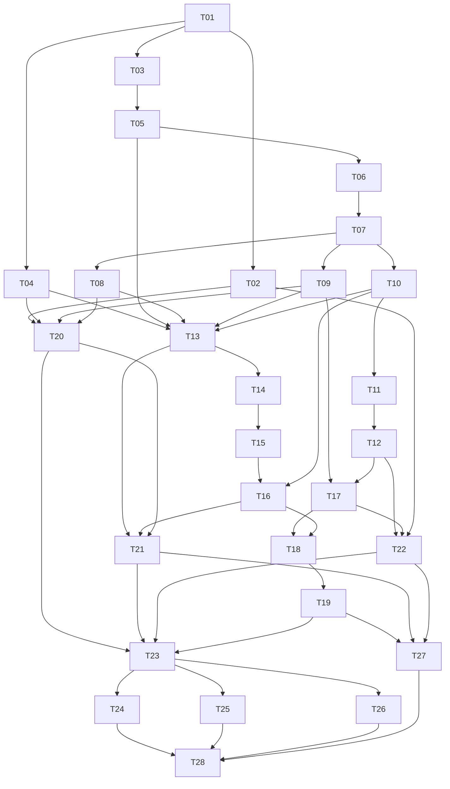

# 首发纵向任务与依赖

28 张任务以单张 ticket 为具体执行真源；不能按文件横切后跳过链路验收。状态以 traceability.json 为准。

| ID | 行为交付 | 模块 | Blocked by | 状态 |
|---|---|---|---|---|
| [T01](tickets/T01.md) | 四类声明契约、六 Target/pair 条件与 CLI 首切片 | M01 | 无 | verified |
| [T02](tickets/T02.md) | 仓外路径 resolve_project 与显式入口读取首切片 | M01, M02 | T01 | verified |
| [T03](tickets/T03.md) | raw 原件捕获、附件与可恢复提取 | M03 | T01 | verified |
| [T04](tickets/T04.md) | Git、dirty 与无 Git 代码快照纵向捕获 | M03 | T01 | ready |
| [T05](tickets/T05.md) | 从原件到七 Profile 候选及明确六决策计划 | M04 | T03 | verified |
| [T06](tickets/T06.md) | 人工文档确认与部分接受重确认 | M05 | T05 | verified |
| [T07](tickets/T07.md) | 文档 stable 事务落位与全域唯一性 | M05 | T06 | verified |
| [T08](tickets/T08.md) | apply 中断、后续编辑与阶段恢复 | M05 | T07 | ready |
| [T09](tickets/T09.md) | 文档更新与跨卡 merge/split/deprecate 完整闭环 | M04, M05 | T07 | ready |
| [T10](tickets/T10.md) | local 不可变索引、正文包与条件激活 | M07 | T07 | ready |
| [T11](tickets/T11.md) | 逐断言硬过滤、词项与确定性召回排序 | M07 | T10 | planned |
| [T12](tickets/T12.md) | 同代精读、回源与诚实 SearchReceipt | M01, M03, M07 | T11 | planned |
| [T13](tickets/T13.md) | 代码本地证据义务到 stable/local 的闭环 | M05, M06 | T04, T05, T08, T09, T10 | planned |
| [T14](tickets/T14.md) | 最新源码向量上的只读 merge gate | M06 | T13 | planned |
| [T15](tickets/T15.md) | 证明复用、依赖继承、重验与过期重核 | M03, M06 | T14 | planned |
| [T16](tickets/T16.md) | 实际合入身份、混合提交与 shared 发布 | M05, M06, M07 | T10, T15 | planned |
| [T17](tickets/T17.md) | 变更事件、条件化影响与即时阻断 | M08 | T09, T12 | planned |
| [T18](tickets/T18.md) | 复核恢复与双水位协调 | M05, M06, M07, M08 | T16, T17 | planned |
| [T19](tickets/T19.md) | 契约/分词升级、新代重建与安全回滚 | M01, M07, M08 | T18 | planned |
| [T20](tickets/T20.md) | 生产 Skill/Workflow 与代码/raw 两条入口编排 | M09 | T02, T04, T08, T09 | planned |
| [T21](tickets/T21.md) | 治理 Workflow、本地与可信 CI 接线 | M06, M09 | T13, T16, T20 | planned |
| [T22](tickets/T22.md) | 消费 Skill 与上下文、回源、输出前复查 | M07, M08, M09 | T02, T12, T17 | planned |
| [T23](tickets/T23.md) | 框架及全局 Skill 挂载与 Windows 运维 | M02, M09 | T19, T20, T21, T22 | planned |
| [T24](tickets/T24.md) | 目标宿主仓外隐式触发实测（外部条件验证） | M09 | T23 | external_validation_required |
| [T25](tickets/T25.md) | 六 Target/三 pair 的真实工程逐槽接入（外部条件验证） | M02, M03, M06, M09 | T23 | external_validation_required |
| [T26](tickets/T26.md) | 组隔离与撤销的真实负测（外部条件验证） | M08, M09 | T23 | external_validation_required |
| [T27](tickets/T27.md) | 汇总可重复合成验收与失败定位 | M09 | T19, T21, T22 | planned |
| [T28](tickets/T28.md) | 首发交付证据、三链路回归与状态结案 | M09 | T24, T25, T26, T27 | planned |

## 执行规则

依赖验证通过后进入下一任务。每张 ticket 先补明确行为的失败测试，再实现、针对测试、回归、独立审查与记录；状态不得先于证据。T01/T02 已完成首批，当前主要闭环是 T03→T05→T06→T07，即 raw 原件到人工确认后 stable；不会绕过确认直接写业务卡。模块完成后分别记录 FactumCore 的测试、审查、合入和推送身份，发布失败不伪造完成状态。

T24/T25/T26 需要目标宿主、真实六 Target 工程及外部授权环境；本轮不能用 fixture 关闭。配置映射未知不阻止通用机制开发，须保留未知项与未执行状态。
