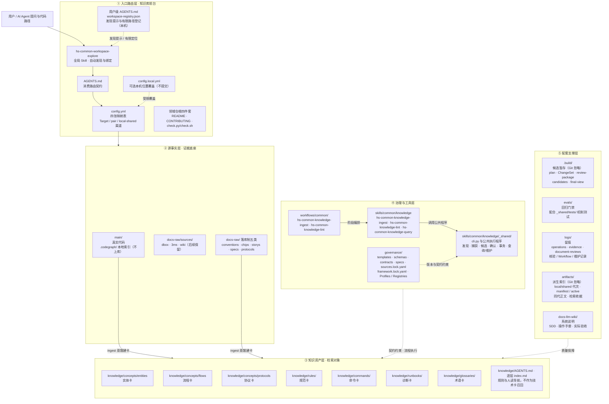
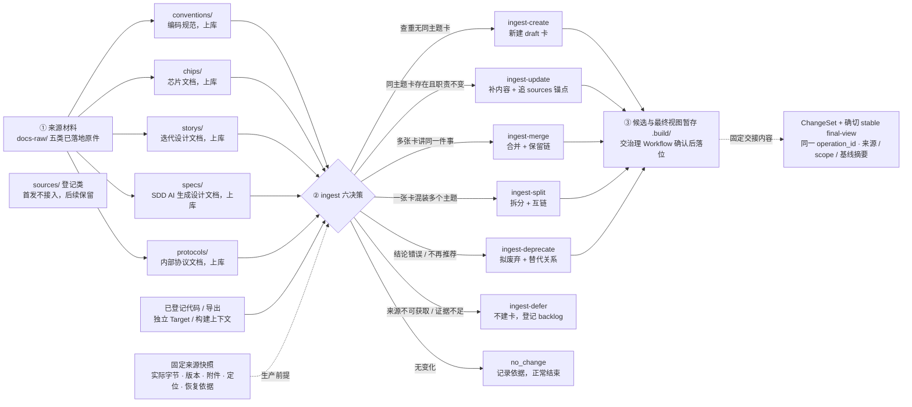
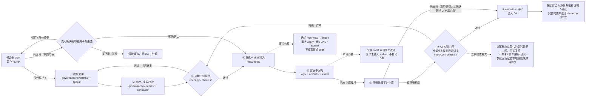
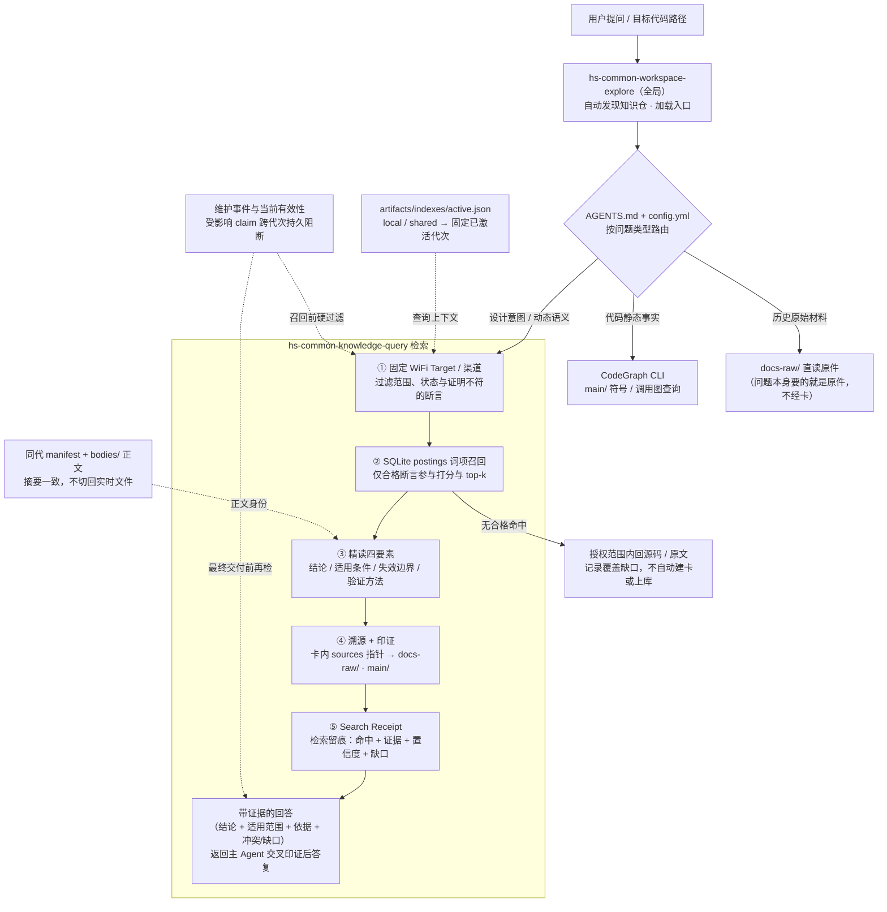

# AIoTBot 知识库详细设计

版本：v2.0；日期：2026-10-19。本文细化[主设计](aibot.md)的 **5.3 AIoTBot knowledge 目录架构**与 **11 AIoTBot 知识库架构**：先列完整目标文件，再按文件说明开发要求，最后用生产、治理、消费三条链路串联。

当前部署决议（用户指定）：在 FactumCore 单仓根维护 `skills/`、`workflows/`、`config.yml` 与 `aiot-wifi-knowledge/`，原 `docs/` 对应 `docs-llm-wiki/`；下文分仓描述保留为未来分发与领域职责边界，当前不建立嵌套 Git，单仓目录不等于 ACL，公共框架发行须排除组内原件、卡、锁、日志和索引。

这是目标设计，不表示这些目录、文件、业务知识或门禁已在本机实现。本文不修改业务源码或独立知识仓；执行时的唯一机器契约归属于其治理包与受信共享程序。第 2 章列清单，第 3 章按清单开发，第 4 章看协作顺序，第 5 章看交付和验收；CANNBot 依据及后续能力放在附录。

## 1. 设计范围与总体流程

### 1.1 要实现的闭环

直接沿用[主设计 §11.2](aibot.md#112-知识库架构)的原五层架构图，保留层级、原节点和主体连线，只补原图未体现的文件与运行资产；生产、治理、消费分别沿用主设计 §11.3 的原图，在本文 §4.2 / §4.3 / §4.4 增补说明，不再拼成一张新总流程图。



原图补充的文件如下。这里区分图中缺项与程序未完成，补进架构图不代表已实现，也不要求为凑齐目录生成空业务资料。

| 原层 / 位置 | 本次补充的文件或形态 | 当前状态与边界 |
|---|---|---|
| ① 入口 | 用户级 `AGENTS.md`、`workspace-registry.json`；可选 `config.local.yml`；`config.yml` 的 Target / pair / 渠道 | 解析器与公共配置已有；用户级托管安装、全局隐式触发和本机覆盖合并仍按后续任务验收。不提交用户私有登记，不由路径授予权限 |
| ③ 资产 | `knowledge/AGENTS.md` 与各级 `index.md` | 已有规则与人读导航；技术检索对象仍是知识卡，未导入真实业务卡 |
| ④ 工具 | `_shared/cli.py`、`workspace.py`、`contracts.py`、`sources.py`、`cards.py`、`scope.py`、`changes.py`、`confirmations.py`、`transactions.py`、`receipts.py` 及测试 | 已有公共程序；`confirmations.py` / `transactions.py` 按既有 M05 决策拆分，不另增公共能力。`checks.py` / `index.py` / `search.py` / `maintenance.py` 仍计划，四个 Skill 与两份 Workflow 按 T20–T22 接线 |
| ④ 契约 | `governance/framework.lock.yaml`；`schemas/profiles.yaml`、`registries.yaml` | 已有声明和锁；`sources.lock.yaml` 随实际来源/操作维护，锁和 Schema 不证明语义或业务接入 |
| ⑤ 候选与持久记录 | `.build/<operation_id>/` 下的 plan、ChangeSet、候选、确切 final-view、review-package；`logs/evidence/`、`document-reviews/`、`operations/` | 捕获、候选、人工确认及事务已有合成验证。当前 journal / 备份 / result 唯一落在 `logs/operations/<operation_id>/`，按[既有 M05 路径映射](../sdd/knowledge-v1/modules/M05/design.md)执行，不放回可清理候选区；代码证明、Workflow 和维护事件按后续任务生成 |
| ⑤ 消费与验证 | `artifacts/indexes/active.json`、代次 `manifest.json` / `index.sqlite3` / `bodies/`、`receipts/`；`_shared/tests/`、SDD 记录和操作手册 | tests、SDD 与手册已有；索引、查询和检索收据完整链路仍待实现。运行文件按实际操作生成，不把合成测试或本地 stable 解释成检索已可用 |

本图中的证据层到知识层表示架构关系：来源须经生产候选、代码检查或纯文档真人确认、事务落位，才成为正式 stable；不会从 raw 直接自动写正式知识。local 在完整代次激活后可消费未合入 stable，shared 只消费确切合入身份及相符证明/确认。目录和分层不等于权限隔离。

### 1.2 首发边界

| 项目 | 首发约定 |
|---|---|
| 业务范围 | 只做 WiFi，覆盖 chip12、chip08、chip07c 的 Host/Device 六个逻辑 Target，以及同芯片的三组候选配对 |
| 源码入口 | 从已登记的业务代码仓或无 Git 导出读取；真实路径、revision、宏、构建和接口版本按实际工程登记，未知值不补造 |
| 文档入口 | 只处理 docs-raw 内已落地的原件，使用 conventions/chips/storys/specs/protocols；不把 AGENTS/index 等控制文件当原件 |
| 延后能力 | docs-raw/sources 链接登记区的更新、dbox 仓外目录映射、wiki 网页获取、3ms 接入均不纳入首发 |
| 代码卡 | 本地门禁通过后 stable 并进入 knowledge；上库后按最新业务代码二次检查，CI 只读卡、锁、链接和业务代码 |
| 文档卡 | manual_document 路径由人确认最终卡与原件，确认后 stable；不要求 LocalCheckRecord 或 MergeGateRecord |
| 查询与共享 | local 可用本地未合入 stable；shared 只用确切已合入内容和相符证明/确认，收据说明身份 |
| 框架复用 | 参考固定 CANNBot 实现，按复用条件选择性改造通用组件；不迁移其业务事实、平台枚举或评测答案 |

三芯片与两侧是逻辑范围，不等于六个独立 Git 仓或六份物理代码。共享 Host/模块可映射多个 Target，但适用条件与证明分别保留。文档若原先在 dbox/wiki，可由人先放入 raw，再按本地文件处理；系统不会沿 URL 获取或扫描仓外下载目录。

### 1.3 读法与基本术语

| 术语 | 本文含义 |
|---|---|
| 知识卡 / claim | 卡是可复用结论单元；claim 是卡内可单独举证、判断范围和复核的一条断言 |
| SourceSnapshot | 原文或代码实际读取内容的固定版本，包含身份、摘要、定位和恢复条件 |
| Target / pair | Target 绑定芯片、侧别与构建条件；pair 绑定所需 Host/Device 两侧及兼容上下文 |
| final-view / ChangeSet | 生产阶段准备的确切目标字节和有基线的变更清单，尚未替换正式知识 |
| generation | 从固定知识内容、规则和证明构建的只读索引与正文代次 |

研发者提出任务并确认文档卡；Agent 按 Skill/Workflow 读材料、出候选、解释结果；程序执行检查、事务和检索；committer 审阅共享合入。同一研发者可以确认自己维护的文档卡。只给代码路径时先绑定项目，建卡、更新和上库仍按用户明确任务执行。

## 2. AIoTBot knowledge 完整目录与文件

### 2.1 目录归属和标记

下图是主设计 5.3 的目标展开，不是本机文件盘点。workspace 是组织容器；skills/workflows 来自同一受信共享框架仓的挂载或受控发行副本，不能在 WiFi 仓复制第二套引擎。main 指向业务工程；aiot-wifi-knowledge 是独立知识 Git 仓，各自在所属仓运行 Git。用户级登记位于 Agent 宿主的私有配置区，以 `<user-agent-home>` 表示，不是 workspace 子仓。

- `[F]`：首发固定框架文件，必须逐项设计与实现；第 3 章提供对应行。
- `[L]`：本机/用户级文件，不提交凭据或个人绝对路径。
- `[D]`：业务实例路径规则；目录内数量不定，但文件形状、生成方式和约束固定。
- `[R]`：运行产物；在第 3 章说明生成者、是否保留、能否重建，不能只因是产物就随意清理。
- `[P]`：后续扩展，占位保留，首发不实现或验收其访问/更新。
- `[X]`：外部业务源码，只列登记入口，不虚构尚未提供的产品文件树。

### 2.2 完整目标树

固定文件全部列出；尖括号是有定义的实例标识或原文件名，不是省略固定文件。每个实例的路径都必须通过实际根、scope 与写入清单检查。

```text
<workspace>/
├── AGENTS.md [F]
├── config.yml [F]
├── config.local.yml [L]
├── skills/
│   └── common/
│       └── knowledge/
│           ├── hs-common-workspace-explore/
│           │   ├── SKILL.md [F]
│           │   └── references/
│           │       └── project-binding.md [F]
│           ├── hs-common-knowledge-ingest/
│           │   ├── SKILL.md [F]
│           │   └── references/
│           │       ├── code-producer.md [F]
│           │       └── raw-document-producer.md [F]
│           ├── hs-common-knowledge-lint/
│           │   ├── SKILL.md [F]
│           │   └── references/
│           │       ├── local-check.md [F]
│           │       └── merge-check.md [F]
│           ├── hs-common-knowledge-query/
│           │   ├── SKILL.md [F]
│           │   └── references/
│           │       └── query-plan.md [F]
│           └── _shared/
│               ├── __init__.py [F]
│               ├── cli.py [F]
│               ├── workspace.py [F]
│               ├── contracts.py [F]
│               ├── sources.py [F]
│               ├── cards.py [F]
│               ├── scope.py [F]
│               ├── changes.py [F]
│               ├── checks.py [F]
│               ├── index.py [F]
│               ├── search.py [F]
│               ├── maintenance.py [F]
│               ├── receipts.py [F]
│               └── tests/
│                   ├── test_workspace.py [F]
│                   ├── test_sources_scope.py [F]
│                   ├── test_changes_checks.py [F]
│                   ├── test_index_search.py [F]
│                   └── test_maintenance.py [F]
├── workflows/
│   └── common/
│       ├── hs-common-knowledge-ingest/
│       │   └── SKILL.md [F]
│       └── hs-common-knowledge-lint/
│           ├── SKILL.md [F]
│           └── references/
│               └── merge-stage.md [F]
├── main/
│   └── <registered-code-root>/
│       ├── <source-relative-path> [X]
│       └── .codegraph/
│           └── <tool-artifact> [X]
└── aiot-wifi-knowledge/
    ├── AGENTS.md [F]
    ├── README.md [F]
    ├── CONTRIBUTING.md [F]
    ├── check.py [F]
    ├── check.sh [F]
    ├── .gitignore [F]
    ├── docs-raw/
    │   ├── AGENTS.md [F]
    │   ├── index.md [F]
    │   ├── conventions/
    │   │   └── <document-id>/
    │   │       └── <version-or-digest>/
    │   │           ├── <original-file> [D]
    │   │           └── <attachment-file> [D]
    │   ├── chips/
    │   │   └── <document-id>/
    │   │       └── <version-or-digest>/
    │   │           ├── <original-file> [D]
    │   │           └── <attachment-file> [D]
    │   ├── storys/
    │   │   └── <document-id>/
    │   │       └── <version-or-digest>/
    │   │           ├── <original-file> [D]
    │   │           └── <attachment-file> [D]
    │   ├── specs/
    │   │   └── <document-id>/
    │   │       └── <version-or-digest>/
    │   │           ├── <original-file> [D]
    │   │           └── <attachment-file> [D]
    │   ├── protocols/
    │   │   └── <document-id>/
    │   │       └── <version-or-digest>/
    │   │           ├── <original-file> [D]
    │   │           └── <attachment-file> [D]
    │   └── sources/
    │       ├── dbox.md [P]
    │       ├── wiki.md [P]
    │       └── 3ms.md [P]
    ├── governance/
    │   ├── AGENTS.md [F]
    │   ├── index.md [F]
    │   ├── framework.lock.yaml [F]
    │   ├── sources.lock.yaml [F]
    │   ├── schemas/
    │   │   ├── frontmatter.schema.json [F]
    │   │   ├── sources.schema.json [F]
    │   │   ├── records.schema.json [F]
    │   │   ├── workspace.schema.json [F]
    │   │   ├── profiles.yaml [F]
    │   │   └── registries.yaml [F]
    │   ├── contracts/
    │   │   ├── __init__.py [F]
    │   │   ├── schema.py [F]
    │   │   ├── knowledge.py [F]
    │   │   ├── sources.py [F]
    │   │   ├── scope.py [F]
    │   │   ├── records.py [F]
    │   │   └── relations.py [F]
    │   ├── templates/
    │   │   ├── entity.md [F]
    │   │   ├── flow.md [F]
    │   │   ├── protocol.md [F]
    │   │   ├── rule.md [F]
    │   │   ├── command.md [F]
    │   │   ├── runbook.md [F]
    │   │   ├── glossary.md [F]
    │   │   ├── index.md [F]
    │   │   ├── manual-review.json [F]
    │   │   └── maintenance-event.json [F]
    │   └── specs/
    │       ├── cards.md [F]
    │       ├── sources.md [F]
    │       ├── scope.md [F]
    │       ├── lifecycle.md [F]
    │       └── records.md [F]
    ├── knowledge/
    │   ├── AGENTS.md [F]
    │   ├── index.md [F]
    │   ├── concepts/
    │   │   ├── index.md [F]
    │   │   ├── entities/
    │   │   │   ├── index.md [F]
    │   │   │   └── <card-id>.md [D]
    │   │   ├── flows/
    │   │   │   ├── index.md [F]
    │   │   │   └── <card-id>.md [D]
    │   │   └── protocols/
    │   │       ├── index.md [F]
    │   │       └── <card-id>.md [D]
    │   ├── rules/
    │   │   ├── index.md [F]
    │   │   └── <card-id>.md [D]
    │   ├── commands/
    │   │   ├── index.md [F]
    │   │   └── <card-id>.md [D]
    │   ├── runbooks/
    │   │   ├── index.md [F]
    │   │   └── <card-id>.md [D]
    │   └── glossaries/
    │       ├── index.md [F]
    │       └── <card-id>.md [D]
    ├── .build/
    │   └── <operation_id>/
    │       ├── plan.json [R]
    │       ├── changeset.json [R]
    │       ├── review-package.md [R]
    │       ├── reports/
    │       │   └── local-check.json [R]
    │       ├── transaction/
    │       │   ├── journal.json [R]
    │       │   ├── backup-manifest.json [R]
    │       │   └── backups/
    │       │       └── <file-key>.bin [R]
    │       ├── candidates/
    │       │   └── <card-id>.md [R]
    │       └── final-view/
    │           └── <target-relative-path> [R]
    ├── logs/
    │   ├── operations/
    │   │   └── <operation_id>.json [R]
    │   ├── workflows/
    │   │   └── <workflow_run_id>.json [R]
    │   ├── document-reviews/
    │   │   └── <review_id>.json [R]
    │   ├── verifications/
    │   │   ├── local/
    │   │   │   └── <check_id>.json [R]
    │   │   └── merge/
    │   │       └── <gate_id>.json [R]
    │   ├── maintenance/
    │   │   ├── events.jsonl [R]
    │   │   └── watermarks.json [R]
    │   └── evidence/
    │       └── <bundle_id>/
    │           ├── manifest.json [R]
    │           ├── objects/
    │           │   └── <object_digest>.bin [R]
    │           └── extractions/
    │               └── <extraction_id>/
    │                   ├── text.txt [R]
    │                   └── locators.json [R]
    ├── artifacts/
    │   ├── indexes/
    │   │   ├── active.json [R]
    │   │   └── <generation_id>/
    │   │       ├── index.sqlite3 [R]
    │   │       ├── manifest.json [R]
    │   │       └── bodies/
    │   │           └── <card-id>.md [R]
    │   └── receipts/
    │       └── <request_id>.json [R]
    ├── evals/
    │   ├── AGENTS.md [F]
    │   ├── README.md [F]
    │   ├── run_acceptance.py [F]
    │   ├── cases/
    │   │   ├── production.json [F]
    │   │   ├── governance.json [F]
    │   │   ├── consumption.json [F]
    │   │   ├── scope.json [F]
    │   │   └── recovery.json [F]
    │   └── fixtures/
    │       ├── workspace/
    │       │   └── config.yml [F]
    │       ├── raw/
    │       │   └── sample.md [F]
    │       ├── cards/
    │       │   └── sample-flow.md [F]
    │       └── code/
    │           ├── host.c [F]
    │           └── device.c [F]
    └── docs-llm-wiki/
        ├── design_principles.md [F]
        ├── installation_and_usage.md [F]
        └── maintenance.md [F]

<user-agent-home>/
├── AGENTS.md [L]
└── workspace-registry.json [L]
```

### 2.3 完整性的判定

每个固定文件、运行文件形状和业务实例形状都必须在第 3 章或附录 B 有一条对应设计。每个实现任务应能指向这里的路径及其验收条件。未知业务源码不为凑树而补造；七类知识卡、原件、日志和索引实例只按约定命名生成。首发代码及 raw 路径发现不能扩大到全盘或 sources 链接区。

## 3. 各目录与文件的职责、开发要求和验收

本章按第 2 章目标目录树顺序展开。表中的“怎么开发”是实施要求；“验收”是开发完成的判定条件，均不表示这些文件或能力已经部署。固定文件逐项列明，实例文件采用命名规则；程序接口统一从 `_shared/cli.py` 调用，Skill 和 Workflow 不各自实现一份规则。

### 3.1 Workspace 入口与配置

Workspace 负责将用户提供的业务代码路径关联到正确知识仓。它只登记项目身份、物理位置和执行政策；领域知识正文与领域契约仍留在 `aiot-wifi-knowledge/`。Workspace、WiFi 知识仓和业务代码仓分别识别 Git 根并执行操作，不在父仓提交整个知识仓或源码树。

| 文件 | 职责 | 怎么开发 | 要求 | 验收 |
|---|---|---|---|---|
| `AGENTS.md` | Workspace 的入口规则，供发现后的项目加载及三条链路共同使用 | 写清目录归属、知识入口、代码/raw 来源边界、Skill/Workflow 完整标识、发布授权与局部 AGENTS 阅读顺序 | 保持薄入口；不内嵌卡片、平台凭据或第二套字段规范；提醒用户只给路径时先绑定项目，不自动生产或上库 | 仓内会话能找到唯一配置与领域入口；仓外发现后读取同一入口；不存在重复或相互冲突的路由规则 |
| `config.yml` | 项目关联、六个 Target、三个配对及执行政策的配置真源 | 在既有 `repos / architecture / wiki_entities / symbol_aliases` 结构上扩展 workspace 身份、领域根、模块边界、Target 与 pair 引用、渠道默认值、工具/契约政策引用 | 业务路径映射只维护一份；Target 未配置字段保留 unknown；配对登记不等于兼容已验证；通过受信配置选择最新代码 ref，不能由提交者任意改政策降低检查 | 配置 Schema 通过；六 Target/三 pair 均能解析且不虚构代码目录；共享 Host 路径返回多芯片候选；冲突和悬空引用返回明确诊断 |
| `config.local.yml` | 当前身份的本机位置覆盖，供已授权路径解析使用 | 只允许覆盖 Schema 明确列出的物理根、运行时位置等本机字段；加载后生成合并配置摘要 | 不提交个人路径和凭据；不允许覆盖授权域、卡片治理路径、受信 CI 政策或扩大来源范围；首发不接受仓外文档下载目录映射 | 合法路径覆盖有效且不改公共配置；越权字段拒绝；CI 不依赖开发者本机文件；无文件时公共配置仍可解释 |
| `<user-agent-home>/AGENTS.md` | 仓外会话可加载的用户级薄规则，提示代码任务先发现项目 | 部署适配宿主实际用户级配置位置，在明确托管块中写调用 hs-common-workspace-explore 的最小规则并记录版本 | 不覆盖用户其他规则；不复制项目私有映射；实际加载顺序、override 和大小限制按宿主验证；薄规则提高选择稳定性，不冒充必运行拦截器 | 新会话从仓外能证明薄规则被加载；更新只改托管块；用户自有内容保留；宿主不支持时如实报告 |
| `<user-agent-home>/workspace-registry.json` | 仓外启动时定位可访问的 workspace 配置，属于用户级本机登记 | 安装/挂载或配置更新时登记 workspace_id、config 定位及摘要、登记版本和由配置生成的路径匹配索引 | 仅定位，不授予权限或复制领域事实；旧缓存不得覆盖现配置；有限范围查询，不扫描整盘；不随领域仓提交 | 任意 cwd 给出已登记代码文件可定位；迁移/失效配置被识别；同远端不同 checkout 不误用缓存；未登记时报告缺口 |

#### 3.1.1 配置内容与覆盖顺序

配置按“受版本管理的 `config.yml` → 允许字段的本机覆盖 → 受信运行身份/授权信息”解析。身份和访问控制由运行环境提供，不接受模型或任意配置提升权限。最终配置摘要同时绑定公共配置、本机有效覆盖和工具所用规范化版本；共享收据不输出本机私有绝对路径。

配置至少登记下列对象；字段形状由 `governance/schemas/workspace.schema.json` 定义，代码统一由 `workspace.py` 加载。

| 对象 | 最小开发内容 |
|---|---|
| Workspace | workspace_id、配置版本、领域根、工具入口、允许渠道与显式默认渠道 |
| 代码源 | source_id/repo_id、Git 或导出类型、根与模块边界、预期身份、允许 ref/导出政策 |
| 模块关联 | 代码源与模块路径 → WiFi 领域根/入口；允许显式一对多，嵌套覆盖规则须声明 |
| Target | target_id、chip、side、source_bindings、module_roots、build_profile、required_features、protocol_versions |
| 同芯片 pair | pairing_id、host_target、device_target、compatibility_policy；运行时证明另绑定两侧快照与配置 |
| 工具政策 | 工具/契约兼容版本、最新代码解析政策、查询预算、来源检查和有效性策略引用 |

`governance/schemas/registries.yaml` 保存受控名称与合法关系，引用这里的代码源/Target ID；不再次手抄物理源码位置。相同代码仓服务多个芯片时可以复用快照身份，仍逐 Target 保留构建选择、宏和侧别条件。

### 3.2 能力 Skill

四个能力 Skill 包含一个项目入口和三个知识操作入口，发布名统一使用 `hs-common-`。源码在 Workspace 并不意味着宿主已全局发现；部署时需将所需入口安装或挂载到宿主实际支持的位置，固定同一工具与契约版本，再从仓外新会话验证名称、描述和薄规则确实可见。运行业务任务时不自动安装或升级工具。

| 文件 | 职责 | 怎么开发 | 要求 | 验收 |
|---|---|---|---|---|
| `skills/common/knowledge/hs-common-workspace-explore/SKILL.md` | 用户指定代码仓/文件时执行项目发现，再进入生产、治理或消费 | 元数据围绕分析/排障/设计/审查/修改代码及路径触发；正文调用 `project resolve`，读取实际入口并形成两阶段绑定 | 名称为 hs-common-workspace-explore；只认用户明确目标，来源正文/日志路径不触发换仓；仅绑定不启动摄入、索引或发布 | 仓外只给路径能隐式选择；换仓重绑；无知识关联不虚构成功，仍允许原任务的授权源码分析 |
| `skills/common/knowledge/hs-common-workspace-explore/references/project-binding.md` | 详细定义路径匹配、入口读取、回执和刷新行为 | 列出确定性解析顺序、ProjectContextReceipt 字段、缓存键和所有失败分支；与 workspace.py 输出逐项对应 | `resolved` 与 `context_loaded` 分开；后者必须有真实工具读取的路径/摘要/trace；同 clone 不同 worktree 分别绑定 | 仅列文件或自报已读不能升级；配置/权限/入口变化使旧绑定失效；压缩恢复后可核验引用，否则重绑 |
| `skills/common/knowledge/hs-common-knowledge-ingest/SKILL.md` | 生产能力：取证、六决策、候选与受控 apply | 按任务选择代码或 raw 文档 reference，调用 source/document/ingest 命令；解释 plan 与变更包后交治理 Workflow | 不自己判断已获人工确认或门禁通过；`apply` 只接受匹配证明；不把调查答案自动写 stable | 两种来源能生成确定 final-view；失败不触碰正式卡；重复 apply 幂等且不重复生产 |
| `skills/common/knowledge/hs-common-knowledge-ingest/references/code-producer.md` | WiFi 源码阅读与实现类知识生产规范 | 定义模块边界、调用/注册/回调、宏与构建闭包，跨 Host/Device 证据清单和 code_gate 选择 | 固定实际代码字节；图只定位线索；每个 current 断言绑定具体 Target/快照；一侧或一芯片证据不扩成全覆盖 | 缺接收侧/宏/配置时只产片段或缺口；共享文件不自动证明三个芯片；图版本冲突回源码核验 |
| `skills/common/knowledge/hs-common-knowledge-ingest/references/raw-document-producer.md` | 首发本地 raw 文档摄入与更新规范 | 指导选择明确原件、固定版本、提取定位、比较旧卡和制作人工确认包，调用 document capture/update-plan | 仅接受允许 raw 根内原件，排除 sources/、仓外路径和网页；保留原字节与旧版恢复依据；不覆盖原件 | 本地原件可形成带页/章节证据的候选；外链/路径绕出被拒绝；变化中的文件重取；无确认不生效 |
| `skills/common/knowledge/hs-common-knowledge-lint/SKILL.md` | code_gate 的本地与合入只读检查入口 | 按 local/merge 模式加载对应 reference，调用同一 checks 实现，解释 fail/incomplete/expired 的返回路径 | 不改卡、不 apply、不改引用代码；manual_document 不调用本 Skill，也不伪造自动 pass | 本地和 CI 对同一规则产生一致诊断；输入检查前后摘要相同；纯文档任务不触发代码门禁 |
| `skills/common/knowledge/hs-common-knowledge-lint/references/local-check.md` | 针对 .build 最终视图的代码本地检查规范 | 说明 Schema/Profile、来源、scope、断言证据、关系闭合、导航和基线检查，输出 LocalCheckRecord | 检查拟落位 stable 的确切字节；draft 通过后不能擅补未检字段；输入变化须重检 | 有效 final-view 取得匹配记录；改一处字节/来源/scope 后旧记录失效；lint 自身不移动文件 |
| `skills/common/knowledge/hs-common-knowledge-lint/references/merge-check.md` | 最新代码上的只读二次检查规范 | 固定 H/B/T/V，说明受信政策、逐断言复用/继承/重验、证明过期与外部证据归档 | 不重跑生产、不联网抓文档、不安装依赖；submitted 卡、lock、链接及业务代码保持原样 | 新代码与断言冲突时失败退回本地；必需代码不可访问为 incomplete；无输入改写；错误 head 的报告拒绝 |
| `skills/common/knowledge/hs-common-knowledge-query/SKILL.md` | 消费入口：检索、精读、组合证据与解释限制 | 加载 query-plan，调用 index/query/source 能力；按问题路由到卡片、原文或代码 | 查询不自动生产/上库；local/shared 明示；manual_document 展示人工确认身份，不表述为产品代码验证 | 回答有渠道、范围、卡与来源版本；无覆盖/过期明确缺口；查询不会修改知识正文 |
| `skills/common/knowledge/hs-common-knowledge-query/references/query-plan.md` | 查询上下文、排序、精读、证据收据的操作细则 | 定义 current/guidance/historical、预算、候选后精读、逐断言证据和输出前事件复查 | 硬过滤先于 top-k；read 固定 generation；不将同卡失效断言带入摘要；不把搜索失败解读为事实不存在 | 错 Target/侧别不能挤占正确候选；切代后精读仍一致；阻断事件立即影响旧代查询 |

#### 3.2.1 全局项目发现的确定性步骤

1. 从用户本次明确路径或有效绑定取目标；相对路径必须有明确基准。保留请求路径并解析真实路径、符号链接和联接点。
2. 识别文件所属 checkout/导出根、repo 身份及模块边界。只读相关 Git 元数据；无 Git 使用已登记清单，不伪造 HEAD/dirty。
3. 查询当前身份的有限登记项和明确指针，核对配置当前摘要。按目录边界匹配；嵌套优先必须有覆盖规则，同优先级冲突不能选第一项。
4. 校验知识根、适用入口与工具可访问，输出 `resolved` 回执；不能因目录同名或远端 URL 相同推定关联。
5. 按层级实际读取 Workspace、领域仓和任务目录入口，记录工具 trace/摘要后输出 `context_loaded`；再路由至业务操作。

ProjectContextReceipt 至少记录 receipt_id/binding_id、requested_path/canonical_path、checkout_identity、workspace/config 身份与摘要、knowledge_bindings、required_entry_files/entry_reads、resolved_context/unknown_fields、授权 epoch、工具/Skill/规则摘要和诊断。它只证明发现和入口读取，不证明已查卡、代码已验证或知识覆盖。

绑定回执由命令返回；需要持久化时嵌入本次 `logs/operations/<operation_id>.json` 或 SearchReceipt，未登记的新缓存文件不作为必需资产。会话内缓存只作加速，恢复后仍按原配置与入口摘要核对。

同一会话可以复用仍有效绑定；首次、换仓、配置/入口/身份/授权变化或上下文恢复后无法核验时重解析。缓存键含真实 checkout、配置与入口摘要、解析器/契约版本和身份 epoch；不靠一句“已加载”延续绑定。知识入口失败不借用上一项目；允许的独立源码分析可以继续。

#### 3.2.2 触发与命名要求

全局薄规则应要求代码任务先绑定项目，再开始业务分析；Skill 描述应覆盖“用户只给代码路径”的自然说法，不依赖“知识库”关键词。隐式选择仍受宿主发现、上下文与模型选择影响，不能声称纯 Skill 必然执行。逐层验收可见、选择、解析、实际读取和分析前完成；显式调用只用于诊断。

Skill 与 Workflow 可能末级同名，日志和调用必须使用完整类型/路径，例如 `skill:common/knowledge/hs-common-knowledge-ingest` 与 `workflow:common/hs-common-knowledge-ingest`。宿主要求唯一调用名时，Workflow 的注册名使用 `hs-common-knowledge-ingest-workflow`、`hs-common-knowledge-lint-workflow`；目录仍按第 2 章保留，不让同名入口互相遮蔽或递归触发。

### 3.3 共享执行程序

`_shared/` 是入口、能力 Skill、Workflow 和领域 wrapper 共用的唯一程序实现。首版使用一个受版本固定的 Python 包，不拆独立服务。领域 Contract 定义机器政策，共享程序执行；改造 CANNBot 时公共执行包和 WiFi Contract 同版发行，`framework.lock.yaml` 固定兼容信息，不能只复制 Skill 后指向任意治理目录。

| 文件 | 职责 | 怎么开发 | 要求 | 验收 |
|---|---|---|---|---|
| `skills/common/knowledge/_shared/__init__.py` | 定义公共包身份与兼容入口 | 导出工具版本、支持的 contract family/schema/index 版本和稳定 API；不导入运行时业务事实 | import 无副作用；不联网、不自动安装、不扫描知识仓；版本不兼容显式拒绝 | 单独导入不产生文件或连接；匹配版本可加载，不匹配报告兼容诊断 |
| `skills/common/knowledge/_shared/cli.py` | 全部逻辑命令与诊断信封的入口 | 参数解析后调用各模块；统一 schema_version、operation/request ID、status、artifacts、diagnostics 和退出码 | 参数不执行为 shell/SQL；模式限制写入范围；错误不以空结果或 pass 表示；禁止自动下载依赖 | 所有命令支持机器 JSON 与可读摘要；无效参数无写入；失败退出码与信封一致 |
| `skills/common/knowledge/_shared/workspace.py` | 项目发现、配置与两阶段绑定底层 | 实现真实路径/仓身份/有限登记匹配、配置合并摘要、入口清单与读取回执核验、绑定刷新 | 不改登记真源或业务资产；入口加载证明依赖实际工具轨迹；允许合法多绑定，冲突不猜选 | 仓外/嵌套/多 clone/worktree/导出均按身份区分；路径跳转不扩权；未知项目无假成功 |
| `skills/common/knowledge/_shared/contracts.py` | 加载受信 Schema/Profile/Registry/Contract | 从 framework lock 与治理入口解析同版契约，校验摘要/兼容表，调用领域 contracts 的固定接口 | 默认禁止远端 Schema 引用和提交内任意动态插件；CI 政策来自受信基线，候选契约修改不能给自身放行 | 同版加载一致；损坏/不兼容/未授权引用拒绝；本地与 CI 采用声明的可信契约 |
| `skills/common/knowledge/_shared/sources.py` | 代码证据与 raw 文档快照的捕获、恢复、解析 | 实现 SourceResource/SourceSnapshot、source resolve/register、document capture；核实际读取字节、附件、编码/提取映射和定位 | 原件只读；文档限制 raw 真实路径且排除 sources/；首发不网页抓取或外部文档映射；快照追加不覆盖；hash 不冒充语义正确 | dirty/导出/固定 Git 各得真实身份；原件变化可检测；旧版本可恢复；摘要/版本/锚点错误分开诊断 |
| `skills/common/knowledge/_shared/cards.py` | Markdown/元数据解析与稳定断言模型 | 解析七 Profile、card/claim IDs、text_ref、scope、sources、relations；保存正文 span 和原始字节摘要 | 不推断事实真假；不同结论不复用已删除 claim ID；正文与 frontmatter 不各维护第二份长结论 | 相同内容可重复解析一致；重复 ID、断锚、畸形元数据有定位诊断；span 可用于去重检索 |
| `skills/common/knowledge/_shared/scope.py` | Target、配对与精确验证上下文匹配 | 展开配置登记；条件组内 AND、组间 OR；结合 purpose、review_mode、验证记录和有效性事件计算逐断言资格 | unknown 不等于通用；不同条件组不得笛卡尔重组；代码精确元组与人工文档确认分开解释 | 错芯片/侧别/宏/快照不满足 current；缺一侧不证实端到端；一个芯片证明不传播至另两芯片 |
| `skills/common/knowledge/_shared/changes.py` | 六决策、文档更新候选、ChangeSet 与事务 apply | 实现 plan/materialize、document update-plan/confirm、最终视图摘要、写锁/CAS、journal/备份恢复和幂等 apply | human record 只记录真实人工动作；无确认不自动批准；code_gate 核本地记录；manual_document 不跑 lint；所有操作先形成 final-view | 修改候选后旧证明失效；部分接受须重做最终确认；中断恢复不丢原卡、不重复应用；非本任务脏文件保留 |
| `skills/common/knowledge/_shared/checks.py` | code_gate 的本地和合入检查 | 共用字段、来源、scope、断言、关系和目标树检查；local 读 final-view，merge 冻结 H/B/T/V 并产出逐断言记录 | lint 全程只读；不以 hash/符号存在代替语义核验；缺证据 incomplete；manual_document 不调用本模块作内容门禁 | 同一错误两模式诊断一致；merge 前后输入摘要不变；最新代码冲突失败；受检字节与报告严格绑定 |
| `skills/common/knowledge/_shared/index.py` | local/shared 不可变代次构建、自检、激活 | 沿 CANNBot SQLite documents/postings 机制改造为卡/断言/范围/证据单元；构建正文包、manifest，完成完整性检查再条件激活 | 不原位覆盖服务库；文档卡用人工记录而非代码 pass；激活与构建分权；旧代不能绕过当前阻断/授权 | 构建中断继续服务旧完整代；新旧代切换可恢复；丢失证明不伪造通过；shared 只读实际合入树 |
| `skills/common/knowledge/_shared/search.py` | 候选召回、排序、generation 精读与证据路由 | 共用 v3 词项/精确项规则；逐断言硬过滤后 top-k；同卡去重；query read 从固定代次正文包取值 | 失效断言不贡献分数/摘要；别名不跨 scope；SQL 参数绑定；search/read 同代并核 body digest；不自动扩大 Target | 中文/符号/短查询诊断可复现；错范围不挤占 top-k；拆分 claim 不抬分；切代/改工作区不混读 |
| `skills/common/knowledge/_shared/maintenance.py` | 来源变化、依赖影响、即时阻断和复核进度 | 实现 event 幂等、反向 requires/derived_from 遍历、事务写入影响与水位、复核记录匹配和 reconcile | 阻断先于修卡完成；related_to 不默认全量传播；事件不改历史卡 lifecycle；两个水位分离，失败不跳进度 | 重放不重复；中断不漏影响；旧索引仍执行新阻断；只有匹配新证明后恢复适用性 |
| `skills/common/knowledge/_shared/receipts.py` | 回执/日志的规范化、摘要、保留引用与脱敏 | 统一生成 ProjectContextReceipt、操作/人工/本地/合入/搜索记录的信封；检查自身摘要循环和外部证据引用 | 不伪造人工身份/工具 trace；关键证明不可只留 .build；原始私有路径/令牌不进入共享记录；记录不能自含自身摘要 | 相同规范化输入摘要稳定；篡改载荷可发现；不匹配内容/上下文拒绝；持久证据丢失可诊断 |
| `skills/common/knowledge/_shared/tests/test_workspace.py` | 项目发现和绑定的程序回归 | 合成目录覆盖仓外、相对路径、联接点、worktree、多映射、入口变化/不可达、授权 epoch 和两阶段回执 | 只用合成项目；程序单测不冒充宿主隐式触发率测试 | 确定性绑定、失败关闭和缓存失效用例全部通过；无整盘扫描或业务读写 |
| `skills/common/knowledge/_shared/tests/test_sources_scope.py` | 来源真实性与 WiFi 范围回归 | 构造 raw、附件、代码 dirty/导出、读取中变更和六 Target/三 pair 的合成矩阵 | 覆盖 sources/、仓外跳转、无旧版恢复、unknown 和错配；不访问真实平台或代码 | 真实字节一致性、范围隔离及端到端缺证判断通过；无网页/仓外文档取回 |
| `skills/common/knowledge/_shared/tests/test_changes_checks.py` | 六决策、两确认路径、只读门禁和事务回归 | 六决策逐一构造 final-view；篡改摘要、过期基线、人工拒绝/部分接受、H/B/T/V 变化和写入故障注入 | 每种操作都走相同确认/落位规则；纯文档不产生伪代码 pass；失败保持旧资产 | 同字节通过、改字节失效；两门禁不写输入；人工无回复不应用；各故障点可回滚/续做 |
| `skills/common/knowledge/_shared/tests/test_index_search.py` | postings、资格过滤和代次一致性回归 | 合成多 Target 卡、部分失效 claim、中文双字/宏/消息 ID、重复 span、切代及索引损坏 | 同题同输入排序确定；检索质量回归与业务准确率测量分开 | 过滤先于 top-k、claim 拆分不加分、精读同代、旧代不恢复阻断全部通过 |
| `skills/common/knowledge/_shared/tests/test_maintenance.py` | 事件传播、水位与恢复回归 | 构造直接/传递依赖、无关关系、重复事件、权限撤回、故障中断和复核恢复 | 验证持久事件先提交再前推进度；不靠可删索引存唯一阻断依据 | 无漏扫/漏阻断/过早恢复；重放幂等；影响扫描与知识修订进度保持独立 |

#### 3.3.1 统一命令与写入边界

下表是目标逻辑 CLI；最终包装方式由部署适配，不要求用户手工运行。能力 Skill 调同一入口，领域 `check.py/check.sh` 也只转发。

| 命令 | 输入 → 输出 | 允许写入 |
|---|---|---|
| `project resolve` | 明确路径、基准、当前登记/身份 → resolved 绑定与入口清单 | 返回最小收据/会话缓存；持久回执嵌入既有操作或搜索记录，不改配置/登记真源 |
| `source resolve / register` | 固定 source ref/locator 或授权快照清单 → 证据对象或登记增量 | 留存字节按 §3.10.2 evidence 包，登记增量进入 final-view；不覆盖原件 |
| `document capture` | raw 相对路径或明确清单 → 固定文档快照与定位信息 | 明确的版本化副本/捕获收据，不联网、不改 stable |
| `document update-plan` | 文档快照、旧卡基线、scope → 六决策、差异、候选与 final-view | `.build/<operation_id>/` |
| `document confirm` | operation、最终视图摘要、真实人工决定 → ManualReviewRecord | 人工确认记录；不代替人决定、不 apply |
| `ingest plan / materialize` | 固定来源、scope、相关基线 → 计划、候选、ChangeSet/final-view | `.build/<operation_id>/` |
| `lint local` | operation/final-view、验证上下文 → LocalCheckRecord | 报告，不改输入 |
| `ingest apply` | operation、review_mode、匹配记录 → stable 落位和操作结果 | 明确 ChangeSet、导航、来源锁及操作日志 |
| `lint merge` | H/B/T/V、受信政策、独立 output → MergeGateRecord | 隔离 output，不写知识树或业务代码 |
| `index build / activate` | 渠道、固定内容/证明 → 新代次或条件激活结果 | 未激活代次；激活仅由渠道授权执行器完成 |
| `query search / read` | 渠道、purpose、context、预算/代次 → 合格候选或同代正文 | 域内查询收据，不写知识正文 |
| `maintenance impact / reconcile` | 事件、依赖/匹配证明 → 阻断、影响与恢复进度 | 授权维护账本，不重写卡片事实 |

所有写命令都要求显式领域根与操作身份，不能依赖 Agent 启动 cwd。诊断至少区分配置/绑定冲突、来源不可恢复/摘要不符/定位失败、范围未知/不匹配、确认缺失/过期、基线变化、门禁 incomplete、代次损坏和预算耗尽；不能统一返回“无结果”。

#### 3.3.2 取证、人工确认与事务的共同约束

来源捕获以实际读取字节为准。Git 固定对象绑定真实 commit；dirty 工作区保存补丁/文件清单形成独立快照；无 Git 导出绑定实际批次、文件清单和配置摘要。文档保留原始字节与编码，转换/OCR 只产生分析副本及页码映射；图表抽取不足需在确认包列为缺口。

六决策为 create、update、merge、split、deprecate、defer；no_change 是无需写入的结果。计划固定 related baseline、目标路径、旧/新摘要、来源/scope/契约/工具摘要、导航与替代关系。final-view 在 `.build/` 就包含拟落位的 stable 字段及完整最终字节，不能“先确认 draft 再偷偷补 stable”。

code_gate 使用匹配 final-view 与上下文的 LocalCheckRecord；manual_document 使用绑定同一最终视图、来源集和 scope 的真实 ManualReviewRecord。人工可由贡献者本人完成，无回复、超时或 Agent 自报均不是确认。部分接受先形成更小的最终视图，再由人确认；改字节、范围或来源均使相关旧确认失效。

review_mode 按结论用途选择，不按文件后缀或来源目录偷换。纯文档中记载的设计、规范、命令和排查经验可人工确认；若额外声称已核验当前产品代码或真实运行行为，相关结论改走 code_gate，混合任务拆成可追踪的两类变更集。文档卡的必要机器解析、摘要绑定和索引完整性诊断，不新增人工路径的自动内容门禁。

apply 先取领域写锁，再比较相关旧摘要（CAS）并对两种 review_mode 重核全库 ID/替代引用技术视图或执行等价唯一性预留，准备备份/journal，执行已批准的明确路径变更，核新摘要并提交操作结果。唯一性和防覆盖不构成文档语义门禁。失败回滚或按 journal 续做；不能用整仓 reset/restore 覆盖其他未提交内容。已应用操作重复调用返回既有结果；索引失败只恢复索引，不重做落位。日志和提交身份避免循环摘要：记录绑定载荷，实际 commit 由外部提交记录关联。

#### 3.3.3 代码门禁与可信证明

本地检查对象是 final-view；检查通过后，由独立 apply 写入 stable。CI merge 检查固定 H（上库 head）、B（知识基线）、T（待合入内容树）和 V（按受信政策解析的最新业务代码快照向量）。各业务仓的“最新”固定到具体 ref/导出观察点，不声称多个仓存在全局原子时刻。

每个 current 代码断言必须有覆盖精确 Target/配置/代码元组的证明。原上下文完全相同可复用；依赖闭包完整且差异证明不影响行为时可记录继承；否则实际重验，保存方法、证据和父证明引用。仅符号存在、hash 相同或图边存在不能证明语义。scope 超出、依赖不全或必需源码不可访问，不得自动 pass。

CI 不改提交卡片、来源锁、链接、业务代码或 lifecycle，只在独立输出保存可信报告与证据。H/B/T/V、政策或相关有效性事件变化使证明过期；合入前核对受检内容等价。不能跨业务仓冻结外部 ref 时，承诺止于固定向量和最后观察时间，之后变化交维护链路。纯文档卡及其 PR 不运行代码两门禁；混合 PR 拆分记录实际受检代码范围。

#### 3.3.4 索引、检索与持续有效性算法

首版改造 CANNBot 的普通 SQLite documents/postings 与 Python v3 词项机制，增加 claim、完整 scope 条件组、来源/证明引用、精确项及不可变代次；物理 schema 使用本项目版本，不直接打开旧上游索引当成本版数据。FTS5、向量和新分词引擎均不作为首发必需依赖。

索引的首版逻辑数据模型如下，均属于 `index.py` 管理的同代派生数据，不新增正文资产：

| 逻辑表 | 主键/主要内容 | 实现要求 |
|---|---|---|
| cards | card_id 唯一、Profile/path/title/summary/lifecycle/review_mode、正文及摘要 | 正文副本与本代解析对象一致，不能只存跳回可变工作区的路径 |
| claims | card + claim_id 唯一、text_ref、正文 span、evidence_kind/usage | 保存稳定断言身份与正文位置，不合并成一条卡级真假标记 |
| scope_contexts | card + context_id、完整条件组、scope_digest | 条件组保持整体，不把 chip/side/macro 拆成可任意重组的标签 |
| claim_contexts | claim + context 关联 | 每个 claim 只引用已声明的适用组 |
| source_snapshots | source_ref 唯一、快照描述与实际字节摘要 | 与来源锁对应；未知版本明确 unknown，不能由索引补造 |
| claim_sources | claim + source_ref + locator/snippet_digest | 支持正向举证和来源变化反向定位 |
| relations | 起止 card/claim、关系类型、context | replacement 与语义依赖分开，related_to 不代替 requires |
| verification_refs | claim/context → record_id/kind/digest/result/evidence | 明确本地、合入或人工确认身份；证明原件保留在索引之外 |
| search_units | unit_id、card、正文/公共字段单元与词项 | 单元仅用于检索计算，知识返回对象仍是卡 |
| search_unit_claims | unit → 全部依赖 claim | 单元依赖全部合格才可用于本次 current 候选和分数 |
| postings | term + unit、字段词频 | 合格投影后按卡去重，不因同文多 claim 重复计分 |
| exact_terms | 原样符号/消息 ID/宏/命令、大小写政策、unit | 完整 exact 命中单独排序；不因自然语言小写化丢失符号身份 |
| term_metadata | term、完整串/双字 gram/别名类型、tokenizer 版本 | 可解释命中路径；建库查询版本一致 |
| index_meta | key/value、数量、schema/规则与 manifest 信息 | 自检数量和引用闭合，版本变化显式新代构建 |

外键/唯一性检查与 SQLite 完整性检查均在激活前完成。manifest 的 file_digests 只覆盖数据库、正文包等载荷，不把承载摘要的 manifest 自身放入载荷摘要集合；manifest 摘要由独立激活记录绑定。关键证明丢失时重建报告不完整，不能从旧索引字段反推“曾经通过”。

建库和查询使用同一 tokenizer 摘要：精确符号保留大小写/标点；自然语言副本按固定规则小写；连续两字以上汉字保留完整串，三字以上补相邻双字 gram。受控别名按域/Target/语境展开一次并计预算；首版不默认启用领域词典、单汉字泛召回或 subword/IDF。词项机制不是中文语义理解，需用合成和后续真实问题分别评测。

查询先按授权、渠道、purpose、scope、确认/验证记录和当前事件算出合格断言，再进入每个召回通道并截断。共用标题/summary/aliases 默认依赖全卡断言；未全部合格时不能用于当前结论摘要。正文按稳定 span 合并重叠，不因 claim 拆分重复计词；非连续区间不拼成短语。卡级结果去重，摘要来自本次合格 claim 并显示其 ID。

初始 text 分数沿用 v3：每词 `4*title_tf + 2.5*summary_tf + 2*tags_tf + 2*aliases_tf + 0.5*min(body_tf,4)`，字段仅计一次，缺失的可选 tags 计零；完整查询串落在真实连续合格 span 时每卡最多加 4。literal 单独取最高匹配分：完整标题 12、标题片段 8、摘要 4、正文 1、其他字段 0.5，不与 text 裸分相加。排序为完整 exact 命中优先、所选模式分数降序、card_id 升序；这些是待回归的初值。

默认返回 10 张候选、先精读 3 张、一次别名展开最多 16 项，全部作为可配置的试点起始值。无 Target 时返回按范围分组的导航候选，不混成当前实现结论；无有效词项、空查询、预算耗尽和无合格命中分开返回。短查询不自动放宽范围，单字符代码标识可走精确项，单汉字自然语言提示补上下文。

构建固定内容、证明与事件水位后，在新 generation 目录一次生成 SQLite、正文包和 manifest；自检、核摘要并关闭写连接后，持独占激活锁条件切换 active。构建失败保留旧完整代；不覆盖 Windows 下已打开的数据库。search 固定 generation，read 只读该代正文副本；代次回滚不回滚权限撤回或当前阻断。

维护以 source_snapshot → claim 和 requires/derived_from 反向依赖传播，related_to 不默认使全域失效。先持久写事件、影响集合与阻断，再推进 impact_scan_watermark；卡片经匹配的本地门禁/人工确认及适当合入后，分别推进 knowledge_apply_watermark。卡片 lifecycle 保留历史，查询/精读/输出前叠加当前阻断；事件记录不能只存在可删除索引中。

### 3.4 生产与治理 Workflow

Workflow 只编排阶段、责任、暂停和恢复；能力 Skill 提供操作入口，共享程序执行确定逻辑。本版消费链路由项目入口和 query Skill 串联，不再虚设第三份同义 Workflow。两份 Workflow 随共享程序与兼容 Contract 一起发行。

| 文件 | 职责 | 怎么开发 | 要求 | 验收 |
|---|---|---|---|---|
| `workflows/common/hs-common-knowledge-ingest/SKILL.md` | 生产编排：绑定/固定来源 → 六决策 → 候选及治理交接 | 按 §4.2 定义 P1 绑定、P2 固定来源、P3 比较计划、P4 候选及 P5 摘要交接；按代码/raw 路径调用 ingest Skill | 不提前 apply/stable；defer/no_change 正常结束；不从来源内容接受发布命令；不递归调用治理全流程 | 两来源均产可复核最终包；交接摘要可核验；缺口保留；相同输入恢复不重复生成或改变候选 |
| `workflows/common/hs-common-knowledge-lint/SKILL.md` | 治理编排：代码检查或人工确认 → stable → 本地索引 → 授权上库/共享发布 | 按 §4.3 定义 G1 接收、G2C/G2D 分流、G3 apply、G4 索引、G5 授权提交，及独立 G6–G9 检查/合入/发布交接 | 治理是确认/落位唯一负责人；manual_document 不调用 lint Skill；无上库授权停在本地；索引构建诊断不变成文档代码门禁 | 人工未答不应用；检查失败回生产修订；本地 stable 可查；上库失败不撤销本地生命周期；不擅自提交 |
| `workflows/common/hs-common-knowledge-lint/references/merge-stage.md` | CI 的显式非交互阶段与合入/发布交接 | 固定受信 H/B/T/V/政策/工具，调用 lint merge，保存外部证明；列出 committer 合入与授权 shared 构建的独立职责 | CI 不从 P1 重跑、不等待人工、不 apply/修复/提交/推送/激活 shared；不依赖隐式 Skill 选择；文档沿用确切人工确认 | CI 输入输出隔离；过期或不同 head 拒绝；纯文档不注册必需代码 lint 状态；合入内容与确认证明一致 |

Workflow 交接引用同一 operation_id、ChangeSet、相关基线、final-view/target/source/scope/contract/tool 摘要，不复制另一份可变候选。生产与治理各有 workflow_run_id，以 parent_run_id 关联；进度写 `logs/workflows/<workflow_run_id>.json`，状态至少 running、awaiting_confirmation、needs_revision、completed。

恢复先核阶段输入摘要和 operation/journal：已落位不再次应用；索引失败只续建索引；提交/合入状态以实际仓和平台为准。来源或最终字节变化时重新交接，旧检查/人工确认不得复用。退回修订携带精确诊断，由生产显式生成新 final-view 后交接，不让两 Workflow 相互递归。

### 3.5 main 业务代码映射

`main/` 表示授权业务代码工作区，可能由多个 Git 仓、子模块、worktree 或无 Git 导出组成。它不是知识仓正文，也不是强制每芯片一套源码目录；示意路径由配置登记替换，不能为使目录树看起来完整而虚构业务文件。

| 文件 | 职责 | 怎么开发 | 要求 | 验收 |
|---|---|---|---|---|
| `main/<registered-code-root>/<source-relative-path>` | WiFi 代码卡的实际生产证据、代码两门禁的核验输入及消费时回源位置 | 不在知识项目中新造源码；登记真实根/仓身份/模块边界/ref 或导出政策，再由 sources 按固定快照读取 | Git 操作在实际所属仓执行；业务任务之外不修改源码；Host/Device、芯片、构建/宏和配对依赖明确；只读门禁禁止更新被链接代码 | 每个已配置 Target 能取回真实快照并定位片段；缺配置如实报 unknown；六 Target 与三配对证据分别验收，不以目录存在代替运行证明 |
| `main/<registered-code-root>/.codegraph/<tool-artifact>` | 代码工具的派生图谱对象，供生产和消费定位静态线索 | 按实际工具格式生成或接入其产物，随查询结果报告源码快照、构建/Profile、Target、覆盖范围与工具版本 | pattern 不强制具体数据库/文件格式；不充当源码或知识语义真源；门禁不重建或修改图；元数据不匹配时回源码，不能混用另一版本的图边 | 旧图/错 Target/宏缺失可识别；每条采用的线索能回到对应源码；有调用边仍须核验注册/宏/跨侧行为，不冒充完整语义证明 |

首发逻辑映射如下，均是待绑定到实际授权工程的登记 ID：

| 芯片 | Host Target | Device Target | 同芯片 pair |
|---|---|---|---|
| chip12 | `wifi.chip12.host` | `wifi.chip12.device` | `wifi.chip12.pair` |
| chip08 | `wifi.chip08.host` | `wifi.chip08.device` | `wifi.chip08.pair` |
| chip07c | `wifi.chip07c.host` | `wifi.chip07c.device` | `wifi.chip07c.pair` |

同一 Host 路径可对应三个 Target，入口返回候选并结合用户任务与实际构建配置确定，不能默认 chip12。单侧知识可以先落地；端到端流断言需逐项绑定产生/发送、消息或接口 ID、接收/分发/处理和必要返回路径，两侧 revision、构建与协议配对都要可核验。缺侧或配对未知只报告已证实片段；首发不自动构造跨芯片配对。

### 3.6 领域知识仓根：入口、贡献与检查包装

本节以下路径均为目标逻辑布局。`aiot-wifi-knowledge/` 是 WiFi 领域独立知识仓根，负责本组业务事实；公共框架中不打包 WiFi 原件、卡片、来源锁、运行日志或索引。目录存在不表示已实现权限隔离，实际授权覆盖原件、证据、派生物和会话。

| 完整逻辑路径 | 职责 | 怎么开发 | 要求 | 验收 |
|---|---|---|---|---|
| `aiot-wifi-knowledge/AGENTS.md` | Agent 的领域入口 | 写清资产地图、阅读顺序、三条链路入口与修改边界 | 指向本仓 governance/knowledge/raw；明确 sources 链接首发不启用、评测不读 gold | 从领域根开始任务可找到正确入口且不批量读取全仓 |
| `aiot-wifi-knowledge/README.md` | 人的安装、现状和导航入口 | 汇总部署步骤、六 Target 登记状态及可运行命令；链接详细运维文档 | 分开标记目标设计、已配置、已运行；未知路径不写成已接入 | 首次使用者可完成最小安装；所有入口链接可解析 |
| `aiot-wifi-knowledge/CONTRIBUTING.md` | 贡献和共享约定 | 分别写代码卡两道检查、raw 文档人工确认、框架变更审查流程 | 本地 stable 可消费；文档不执行 lint；仅提交本次范围，不夹带无关 dirty 文件 | 代码/文档各按说明完成一次合成贡献，证据和最终字节对应 |
| `aiot-wifi-knowledge/check.py` | 领域检查的跨平台薄入口 | 仅解析参数、加载框架版本并调用共享 CLI/Contract | 不另实现第二套字段规则；只读输入，退出码与统一诊断一致；不能替人工确认 | 与共享 CLI 同输入得到同结果；输入文件摘要前后相同 |
| `aiot-wifi-knowledge/check.sh` | Unix 环境兼容包装 | 定位本脚本目录后调用 check.py，并保留参数和退出码 | 不依赖调用 cwd、不自动安装、不提交、不调用文档内容门禁 | 含空格路径和失败退出码均正确转发 |
| `aiot-wifi-knowledge/.gitignore` | 排除临时构建与派生物 | 排除 .build、artifacts、临时锁和敏感本机配置；保留应评审的卡、治理与必要记录 | 日志按记录类别选择归档，不用整目录忽略丢弃唯一确认/证明；ignore 不作 ACL | 临时索引不被误提交，ManualReviewRecord 等必要记录仍可按范围纳入评审 |

### 3.7 docs-raw：已落地原件和附件

首发文档输入只接受下面五类材料目录中的**实际文件**。入口文件、索引、Schema、锁、模板及 `docs-raw/sources/` 不是摄入原件；不访问网页、不读取仓外下载映射、不跟随原文 URL。原件由人下载/导出后放入版本化目录；Agent 只读取和生成分析结果，不覆盖原件。材料类型仅帮助归档，不决定卡片 Profile 或确认方式。

| 完整逻辑路径 | 职责 | 怎么开发 | 要求 | 验收 |
|---|---|---|---|---|
| `aiot-wifi-knowledge/docs-raw/AGENTS.md` | 原件边界和读取规则 | 列允许材料目录、禁止修改原件和人工更新入口 | 排除控制文件、sources 和越界软链接；不赋予外部指令执行权 | 指定 sources/网页/越界文件返回 DOCUMENT_SOURCE_DEFERRED，工具轨迹无网络请求 |
| `aiot-wifi-knowledge/docs-raw/index.md` | 原件导航 | 按材料类列 document_id、已知版本、原件相对路径和来源锁身份 | 只作导航，不复制资料事实、不成为新来源；由受控操作更新 | 每个条目到实际原件及来源身份可解析，缺失明确诊断 |
| `aiot-wifi-knowledge/docs-raw/conventions/<document-id>/<version-or-digest>/<original-file>` | 编码约定、组织规范等原件 | 人放入不可变版本目录；生产固定实际字节并提取章节 | 保留批准/草稿身份；文档规则不自动证明产品代码遵从 | 变更能定位到章节；人工确认卡不声称已验证代码遵从 |
| `aiot-wifi-knowledge/docs-raw/conventions/<document-id>/<version-or-digest>/<attachment-file>` | 约定原件必要附件 | 单独登记附件快照并绑定主文档 | 不能只核主文件；附件缺失报告原件包不完整 | 主文不变、附件变化仍能产生影响差异 |
| `aiot-wifi-knowledge/docs-raw/chips/<document-id>/<version-or-digest>/<original-file>` | 芯片资料原件 | 人放入原件并标注已知 chip/版本，不凭目录补造适用性 | chip12/chip08/chip07c 的范围由人工确认；不能默认三芯片通用 | 仅 chip08 资料形成的卡不自动用于其他芯片当前结论 |
| `aiot-wifi-knowledge/docs-raw/chips/<document-id>/<version-or-digest>/<attachment-file>` | 芯片资料附表/图等 | 为必要附件独立固定摘要和定位 | 图表、脚注和单位转换需保留映射并交人核对 | 附表缺失或读取失败不生成完整成功记录 |
| `aiot-wifi-knowledge/docs-raw/storys/<document-id>/<version-or-digest>/<original-file>` | 问题故事、经验与复盘原件 | 保留原文及当时环境，提炼时区分经验与已实测归因 | 不改写导入原件；测试计划不写成测试结果 | 候选 runbook 显示环境限制、根因状态和未知项 |
| `aiot-wifi-knowledge/docs-raw/storys/<document-id>/<version-or-digest>/<attachment-file>` | 复盘必要截图/记录等 | 逐件绑定快照，保留正文引用关系 | 授权范围沿用主原件；不上传凭据、个人环境或无关 trace | 可从卡片逐项恢复所用附件，缺失形成明确缺口 |
| `aiot-wifi-knowledge/docs-raw/specs/<document-id>/<version-or-digest>/<original-file>` | 需求和设计说明原件 | 固定版本，提炼设计断言并标明草案/已批准状态 | AI 设计稿不直接成为已实现事实；未知批准状态如实记录 | 设计意图与代码实现结论可区分，人工确认不冒充代码验证 |
| `aiot-wifi-knowledge/docs-raw/specs/<document-id>/<version-or-digest>/<attachment-file>` | 设计必要图纸/接口附表 | 独立登记版本和摘要，建立主文依赖 | 页面/图号与提取文本对应，不因正文不变跳过附件 | 附件修改能定位受影响断言并等待人工再确认 |
| `aiot-wifi-knowledge/docs-raw/protocols/<document-id>/<version-or-digest>/<original-file>` | 协议、标准原件 | 固定标准版本和适用章节，保留原版分页 | 标准机制与产品支持情况分开；不暗中采用新版替换旧引用 | 同一条款跨版本可分别恢复，卡片声明明确标准版本 |
| `aiot-wifi-knowledge/docs-raw/protocols/<document-id>/<version-or-digest>/<attachment-file>` | 协议勘误和必要附录 | 单独固定快照，记录其对应主版本 | 勘误是否取代旧条款由人工确认，不自动覆盖旧快照 | 能同时显示旧条款、勘误和采用决定 |

`<document-id>` 对同一逻辑资料稳定；`<version-or-digest>` 优先使用可靠版本，未知则采用内容摘要且 declared_version=unknown；`<original-file>` 保留原始名称/格式。附件不另造知识卡，只有形成独立知识问题才走摄入。原件重名不意味着同一版本。

捕获时解析真实路径和允许根，比较读取前原件、分析副本、读取后原件摘要；读取中改变则重取。新版本另建目录，旧快照可从保留的 raw 路径或确切知识仓 commit+路径恢复，不能只依赖 .build 临时文件。Word/PDF/OCR 提取结果是派生分析，记录转换器、参数、文本摘要及页码/章节映射；提取失败不视为章节删除。

一次人工更新以明确原件清单为输入，比较同一 source_id 的旧/新快照及必要附件，输出章节差异、受影响 claim、候选和最终差异包。无变化返回 no_change；相关变化先记 needs_review，确认前保留旧卡历史证据。正文只引用链接、原件缺失或原件包未读全时，说明缺口并 defer，不伪造“已读取完整资料”。

### 3.8 governance：契约、来源锁和辅助模板

#### 3.8.1 入口、Schema 与注册

| 完整逻辑路径 | 职责 | 怎么开发 | 要求 | 验收 |
|---|---|---|---|---|
| `aiot-wifi-knowledge/governance/AGENTS.md` | 治理资产修改入口 | 说明声明规则、执行器、模板和记录归属 | 明确规则升级归框架 owner；来源材料不授予修改规则权限 | 规则任务可找到版本、迁移和回归要求 |
| `aiot-wifi-knowledge/governance/index.md` | 治理文件导航 | 逐项链接 Schema、Contract、模板及 specs | 不成为第二份规则真源 | 路径完整，与实际受信规则版本一致 |
| `aiot-wifi-knowledge/governance/framework.lock.yaml` | 固定公共执行器及兼容版本 | 记录框架来源、固定 revision、工具/契约版本和摘要 | 不能从待审 PR 指定任意可执行引擎；不可导入 CANN 业务卡、锁或枚举 | 版本不兼容失败关闭；可复现加载确切框架版本 |
| `aiot-wifi-knowledge/governance/sources.lock.yaml` | SourceResource/SourceSnapshot 唯一登记 | 以结构化对象追加快照，卡片按 source_id@snapshot_id 引用 | 核实际字节；保留旧版本/恢复方法；首发不解析 sources 登记页 | 从任一卡证据可恢复对应原件；新增快照不改写旧身份 |
| `aiot-wifi-knowledge/governance/schemas/frontmatter.schema.json` | Card/Claim 字段形状 | 定义公共字段、七 Profile 枚举、条件与版本规则 | 禁止未声明远端 Schema；语义支持不是 JSON Schema 能力 | 缺必填/非法状态/失配 text_ref 给确定诊断；合法合成卡可解析 |
| `aiot-wifi-knowledge/governance/schemas/sources.schema.json` | 来源及快照形状 | 定义资源身份、字节摘要、恢复和提取结构 | unknown 显式；Git/无 Git 互斥规则；凭据禁止入锁 | 无 Git 快照不要求虚构 commit；缺摘要或不可恢复条件被正确报告 |
| `aiot-wifi-knowledge/governance/schemas/records.schema.json` | 操作、核验、人工确认、索引、检索与事件记录 | 以 record_kind 和 schema_version 区分记录并复用公共摘要字段 | 记录自身不纳入自身摘要；pass/fail/incomplete 与人工决定分开 | 所有记录可判版本、来源及目标摘要，循环摘要样例被拒绝 |
| `aiot-wifi-knowledge/governance/schemas/workspace.schema.json` | workspace、路由和 Target 配置形状 | 校验 config 与本机覆盖的结构及字段边界 | 六 Target/三 pair 用同一注册项；绝对本机路径不写公共配置 | 缺 side/重复 Target/非法覆盖可诊断，unknown 配置不冒充接入成功 |
| `aiot-wifi-knowledge/governance/schemas/profiles.yaml` | 七 Profile 必需章节和义务 | 对 entity/flow/protocol/rule/command/runbook/glossary 写声明规则 | Profile 不自动选择 code_gate/manual_document；文档人工路径不触发 lint | 各模板覆盖其 Profile；缺章节的代码卡有准确诊断 |
| `aiot-wifi-knowledge/governance/schemas/registries.yaml` | 公共枚举与语义名 | 注册 lifecycle、evidence_kind、relation、diagnostic、record_kind 等 | 不复制 Target/物理源码映射；不搬入 CANN 业务枚举 | 枚举引用闭合，新增枚举须兼容声明与回归 |

**frontmatter.schema.json 所管 Card/Claim。** Card 必需字段为 `schema_version,id,profile,title,summary,lifecycle,review_mode,owner,scope,aliases,sources,claims,relations`；废弃/合并/拆分另有 replacement 或无替代原因。id 稳定且域内唯一，迁移路径不改 ID。Claim 为 `id,text_ref,evidence_kind,source_ids,context_ids,usage,verification_requirements`，可选 search_terms；正文是结论真源，text_ref 指向稳定锚点，禁止手填第二份长结论。evidence_kind 区分 normative/design/implementation/measurement/recommendation；usage 区分 current/historical/guidance。

**sources.schema.json 与 sources.lock.yaml 所管快照。** Resource 为 `source_id,kind,authority_domain,resolver,resource_id`；Snapshot 为 `snapshot_id,declared_version,object_digest,bytes,mime,encoding,digest_kind,retrieval,recovery,acquired_at,acquisition_tool,locator_policy,extraction`。digest_kind 分原字节/导出对象/规范化正文，不能混称。引用为快照+locator+可选 snippet_digest；代码保存 path/symbol/line_range，文档保存 section/page/稳定标识。行号/页码仅导航，实际字节和版本决定身份。

Git 来源固定真实仓身份/commit，读取 commit 对象或隔离 checkout；dirty 来源保存可恢复补丁或实际文件字节及清单，不用 HEAD 代替实际工作区。无 Git 导出固定可信批次、实际文件字节、完整清单与配置摘要，不伪造 HEAD/dirty；可靠且受保留政策保障的恢复位置可引用而不重复存载荷。代码图另记源码摘要、解析工具与配置，不匹配时重新生成隔离图或退回源码定位。原件 hash 不能证明内容语义、批准状态或 Target 适用性。

**workspace.schema.json 所管适用性。** config 注册 chip12/chip08/chip07c 的 Host、Device 六槽及各芯片一组三 pair，参照 §3.1 的统一 Target 定义。scope.applicability 为 constrained/universal/unknown；条件组内 AND、组间 OR，不拼接不同组标签。每组保留 Target、chip、side、build_profile、features_all/features_none、protocol_versions 和 revision_policy。pinned 只覆盖固定快照；revalidate 允许在同一声明边界增加新元组证明；not_applicable 用于无产品实现承诺的文档结论。配对登记不等于兼容已验证，共享源码不使三芯片证明互通。

#### 3.8.2 Contract 执行文件

| 完整逻辑路径 | 职责 | 怎么开发 | 要求 | 验收 |
|---|---|---|---|---|
| `aiot-wifi-knowledge/governance/contracts/__init__.py` | 导出稳定契约接口与版本 | 仅导出受信模块和兼容信息 | 导入不扫描业务原件、不联网、不写入 | import 无副作用、契约版本可查询 |
| `aiot-wifi-knowledge/governance/contracts/schema.py` | 本地声明规则加载 | 编译 Schema/Profile/Registry，缓存绑定规则摘要 | 禁任意远端 $ref；加载失败不给默认放行 | 同版本可复现；损坏/未知版本明确失败 |
| `aiot-wifi-knowledge/governance/contracts/knowledge.py` | Card/Claim/章节/ID 规则 | 对 final-view 及相关全库视图校验，输出结构诊断 | 正文锚点与 Claim 闭合；稳定 ID 不复用；不改卡片 | 重复 ID、失配锚点和缺章节可定位；输入摘要不变 |
| `aiot-wifi-knowledge/governance/contracts/sources.py` | 快照与证据引用规则 | 复用共享 sources 获取结果核锁、摘要、恢复和 locator | 不以存在 URL/符号代替语义支持；无 Git 规则同样适用 | 原文字节、版本或 locator 不符能区分报错 |
| `aiot-wifi-knowledge/governance/contracts/scope.py` | 完整条件组及证明上下文 | 复用统一 scope 模块验证 Target、宏、构建和 pair | 缺失保持 unknown；不能跨 chip/side 继承未证明结论 | 六槽范围和三 pair 反例均正确排除 |
| `aiot-wifi-knowledge/governance/contracts/records.py` | 记录的身份与摘要绑定 | 验 record_kind、输入/输出绑定、保留引用和信任来源 | URL 真实不代表匹配 head；Agent 不伪造人工确认人 | 错 head、陈旧人工确认、缺证据包均不能作为有效证明 |
| `aiot-wifi-knowledge/governance/contracts/relations.py` | 依赖和替代链闭合 | 校验 requires/derived_from/related_to/replacement 的目标、条件与环 | 相关关系不无限传播；替代旧 ID 可导航，继承证明无环 | merge/split 后入口可达；断链、循环及越域引用可诊断 |

Contract 是执行规则，Schema/Profile 是声明规则；两者共用版本和诊断，不各写一套真源。代码本地检查按身份/基线→结构→来源→scope→逐 Claim 证据→临时索引→末次摘要执行。source-anchor、entailment、current-code、target-conditions、cross-side、runtime 分别保留方法和证据；锚点、hash、图边不能单独证明行为。人工文档卡不运行这套内容门禁，解析失败仅报告工具/索引故障。

#### 3.8.3 模板与规范文件

| 完整逻辑路径 | 职责 | 怎么开发 | 要求 | 验收 |
|---|---|---|---|---|
| `aiot-wifi-knowledge/governance/templates/entity.md` | 实体卡骨架 | 含职责、边界、接口、依赖、证据及公共 frontmatter | 设计职责与实现职责分开 | 填合成内容后匹配 entity Profile |
| `aiot-wifi-knowledge/governance/templates/flow.md` | 流程卡骨架 | 含起终点、步骤、调用/消息、异常、条件和分侧证据 | 跨侧显示发送、标识、分发、接收与兼容缺口 | 缺 Device 证据的样例仅得出 Host 片段结论 |
| `aiot-wifi-knowledge/governance/templates/protocol.md` | 协议卡骨架 | 含机制、字段/状态、约束、标准版本及产品支持边界 | 标准要求和实际支持不混写 | 同条款与产品实现可分别定位来源 |
| `aiot-wifi-knowledge/governance/templates/rule.md` | 规则卡骨架 | 含规则对象、约束、例外、批准身份和检查办法 | 设计建议不冒充已批准组织规则 | 原件批准未知时候选明确保留 unknown |
| `aiot-wifi-knowledge/governance/templates/command.md` | 命令卡骨架 | 含语法、参数、前置条件、输出判读、误用、验证 | 文档记载命令与实机验证区分 | 无运行证据的文档样例不标实测成功 |
| `aiot-wifi-knowledge/governance/templates/runbook.md` | 排查卡骨架 | 含现象、信号、分支、步骤、根因状态、解法和验证 | 建议排查不等于实测根因 | 每个分支有条件，未知根因不会写为确定归因 |
| `aiot-wifi-knowledge/governance/templates/glossary.md` | 术语卡骨架 | 含定义、别名、歧义、范围和来源 | 同名不同义按语境保留，不自动合并 | 歧义词能给分组解释而非错误别名扩展 |
| `aiot-wifi-knowledge/governance/templates/index.md` | 导航页骨架 | 列 ID、标题、范围摘要和链接 | 无正文 Profile，不填伪造 sources/claims | 导航未进入正文候选/评分，条目链接闭合 |
| `aiot-wifi-knowledge/governance/templates/manual-review.json` | 人工确认记录骨架 | 复用 records Schema，留真实决定、确认主体与证据位 | 不默认 accepted，不预填虚构 confirmed_by | 无明确人工决定保持待确认，不能 apply |
| `aiot-wifi-knowledge/governance/templates/maintenance-event.json` | 变更事件骨架 | 复用事件字段并填写旧/新身份与影响理由 | event_id 幂等、sequence 有序，scope 明确 | 重放同一事件不重复影响、不重复建卡 |
| `aiot-wifi-knowledge/governance/specs/cards.md` | 卡片/断言编写规范 | 解释字段含义、七类章节和合成正反例 | 与 Schema/Profile 一致，明确设计/实现/实测/建议 | 作者可按规范选择 Profile 并写出可追踪 Claim |
| `aiot-wifi-knowledge/governance/specs/sources.md` | 来源和原文规范 | 解释实际字节、恢复、定位、附件及首发 raw 限制 | 无 Git 不造 commit；来源锁不能只留 latest URL | 可依据规范登记一份 raw 原件和一个无 Git 代码快照 |
| `aiot-wifi-knowledge/governance/specs/scope.md` | WiFi 范围及证明规范 | 用六槽三 pair 合成例解释 AND/OR、宏、侧别和版本元组 | 不复制物理路由；范围声明与已验证元组分开 | 共享代码、缺侧和错芯片反例都有明确处理 |
| `aiot-wifi-knowledge/governance/specs/lifecycle.md` | 生命周期/集成/有效性规范 | 分开三维状态和两种 review_mode；说明迁移及恢复 | stable+local 合法；needs_review 不强改卡生命周期 | 本地消费、文档人工确认、CI 只读三种情形无冲突 |
| `aiot-wifi-knowledge/governance/specs/records.md` | 记录和持久保留规范 | 解释各 record_kind、摘要、信任、过期和证据保留 | 构建 URL/索引不是唯一证明；提交身份用外部记录绑定 | 清理临时产物后仍能审计已保留卡的确认/证明 |

### 3.9 knowledge：七类正文和导航

| 完整逻辑路径 | 职责 | 怎么开发 | 要求 | 验收 |
|---|---|---|---|---|
| `aiot-wifi-knowledge/knowledge/AGENTS.md` | 正文消费和写入规则 | 写明先检索再精读/回源、按范围回答及两种治理路径 | 禁从目录名/命中分数推导正确性；手改后旧证明不覆盖新字节 | Agent 能说明引用、Target、确认方式和缺口 |
| `aiot-wifi-knowledge/knowledge/index.md` | 全域正文入口 | 导航七类入口和主题分区，条目引用稳定 ID | 不存第二份结论，不进入正文检索评分 | 全部正文可从入口到达，孤儿/失链可诊断 |
| `aiot-wifi-knowledge/knowledge/concepts/index.md` | 概念分区入口 | 链到 entities、flows、protocols | 不重复复制卡片摘要事实 | 三子入口闭合 |
| `aiot-wifi-knowledge/knowledge/concepts/entities/index.md` | 实体导航 | 按实体主题/范围列 ID 和链接 | 同一实体多范围允许并存 | 导航与实际实体卡集合对应 |
| `aiot-wifi-knowledge/knowledge/concepts/entities/<card-id>.md` | entity 正文 | 以 entity 模板与来源提炼问题、职责及边界 | Claim、scope、source 和确认记录绑定最终字节 | 可回答职责/接口；设计与实现不混淆 |
| `aiot-wifi-knowledge/knowledge/concepts/flows/index.md` | 流程导航 | 按场景、侧别和完整/片段范围导航 | 不把单侧卡标成端到端完整链路 | 缺侧卡导航明确可见边界 |
| `aiot-wifi-knowledge/knowledge/concepts/flows/<card-id>.md` | flow 正文 | 逐步骤绑定 Claim 与证据，标条件及消息/调用边 | 回调、宏和跨二进制边分别举证；无证据停在片段 | 六 Target 请求仅返回已支持范围，pair 缺口不会被补造 |
| `aiot-wifi-knowledge/knowledge/concepts/protocols/index.md` | 协议导航 | 按机制/标准版本列入口 | 同机制不同标准版本不无条件合并 | 读者可选择确切标准版本 |
| `aiot-wifi-knowledge/knowledge/concepts/protocols/<card-id>.md` | protocol 正文 | 描述机制与条款，产品支持另列实现断言 | 文档人工确认与代码验证分别显示 | 可回溯原条款，未验证实现保持缺口 |
| `aiot-wifi-knowledge/knowledge/rules/index.md` | 规则导航 | 按对象、适用域和批准身份导航 | 草稿规则标识清楚 | 未批准建议不会显示为全域强制规则 |
| `aiot-wifi-knowledge/knowledge/rules/<card-id>.md` | rule 正文 | 写条件、例外、检查方法和来源 | 更改要求保留版本与替代关系 | 旧规则可恢复，新规则适用范围明确 |
| `aiot-wifi-knowledge/knowledge/commands/index.md` | 命令导航 | 按工具/用途/环境导航 | 文档记载与已验证标识分开 | 用户可识别命令是否已在当前环境验证 |
| `aiot-wifi-knowledge/knowledge/commands/<card-id>.md` | command 正文 | 给前置条件、参数、输出判读、误用和验证方法 | 不自动执行原文命令；运行证据必须实际存在 | 缺环境/结果时不输出“已验证可用” |
| `aiot-wifi-knowledge/knowledge/runbooks/index.md` | 排查导航 | 按现象、信号和场景组织 | 不以命中次数认定根因 | 导航条件能区分不同排查分支 |
| `aiot-wifi-knowledge/knowledge/runbooks/<card-id>.md` | runbook 正文 | 用条件分支写排查与恢复，并记录根因状态 | 经验、建议、实测结果分别标识 | 依据不足时保留备选原因和下一步，而非编造闭环 |
| `aiot-wifi-knowledge/knowledge/glossaries/index.md` | 术语导航 | 按词/别名/语境导航 | 歧义不自动展开到全部 Target | 同名多义可分组定位 |
| `aiot-wifi-knowledge/knowledge/glossaries/<card-id>.md` | glossary 正文 | 给定义、语境、别名及来源 | 受控 alias 有 domain/Target/语境，不递归扩展 | 查询歧义词给候选，明确符号保留大小写 |

正文文件名可由 card_id 映射，身份始终取 frontmatter.id。create/update/merge/split/deprecate/defer 六决策均通过候选和 ChangeSet 执行；同名/同 source 只是查重候选，不是自动合并依据。废弃保留历史、原因和 replacement，旧 Claim ID 不复用给不同结论。

生命周期为 draft/stable/deprecated；集成身份由工作区/提交/实际合入推导 local/proposed/merged；有效性由核验/人工确认和维护记录给出 verified/partial/needs_review/blocked/unavailable。代码卡本地通过或文档卡人工确认即可 stable 并落入 knowledge，本地正常消费；代码卡提交后才接受最新代码只读二次检查。纯文档卡不要求 LocalCheckRecord/MergeGateRecord；混合实现/实测承诺优先拆卡，否则走 code_gate，不能用原件在 raw 内为由免除代码义务。

### 3.10 配套设施：事务、记录、索引、验收和运维

#### 3.10.1 临时构建与可恢复落位

| 完整逻辑路径 | 职责 | 怎么开发 | 要求 | 验收 |
|---|---|---|---|---|
| `aiot-wifi-knowledge/.build/<operation_id>/plan.json` | 六决策和基线计划 | ingest plan 固定来源、scope、操作及理由 | 同输入幂等；不把整仓 dirty 内容并入 | 重跑返回同计划/no_change；缺证据 defer |
| `aiot-wifi-knowledge/.build/<operation_id>/changeset.json` | 精确写入集合 | 记录旧/新摘要、Claim/来源/关系变化和 review_mode | 仅显式 touched_paths；基线比写集更广以发现重复 ID/依赖冲突 | 并发新增重复 ID 不被漏过，其他任务文件不被覆盖 |
| `aiot-wifi-knowledge/.build/<operation_id>/review-package.md` | 人工可审的最终差异 | 展示原件/附件差异、逐 Claim 新旧结论、定位、范围、缺口及目标摘要 | 确认最终 stable 字节；不以早先草稿代替 | 部分接受后重新生成 final-view 并取得真实确认 |
| `aiot-wifi-knowledge/.build/<operation_id>/reports/local-check.json` | 完整本地代码检查报告 | 按 §4.3.1 的 G2C 顺序只读检查 final-view，写详诊断和 Claim 结果 | manual_document 不产生伪 lint 报告；关键证明另持久归档 | fail/incomplete 不可 apply；通过匹配全部最终字节 |
| `aiot-wifi-knowledge/.build/<operation_id>/transaction/journal.json` | 多文件写入与恢复状态 | 顺序记录 prepared/replacing/committed/恢复状态及每文件摘要 | 在修改前持久化；发现未完事务先恢复，不启动新写入 | 任一步中断均可完成或受控恢复，未提交部分不被新索引消费 |
| `aiot-wifi-knowledge/.build/<operation_id>/transaction/backup-manifest.json` | 旧字节备份映射 | 记录目标路径、原摘要、备份路径与新摘要 | 不包含自身摘要；缺原件/已新建文件分别记状态 | 回滚只恢复仍匹配本次已写摘要的目标 |
| `aiot-wifi-knowledge/.build/<operation_id>/candidates/<card-id>.md` | 可编辑 draft 候选 | 六决策生成候选，关联操作和来源 | 非正式正文、不被常规索引；编辑使既有确认失效 | 未确认候选不会进入 current 回答 |
| `aiot-wifi-knowledge/.build/<operation_id>/final-view/<target-relative-path>` | 确切拟落位字节 | 组合 stable 卡、废弃/替代、来源锁和导航增量 | 检查/人工确认/apply 复用同一视图，不临时再次改字节 | 通过后改任一目标可被摘要检查发现 |
| `aiot-wifi-knowledge/.build/<operation_id>/transaction/backups/<file-key>.bin` | 恢复所需原字节 | 修改前保存并核对摘要 | 不归一化原字节，不作为长期原件唯一副本 | 恢复后字节与原摘要一致；他人后续修改保留 |

ChangeSet 必需字段为 `operation_id,operation_kind,review_mode,baseline_tree_digest,touched_paths,expected_old_digests,target_digests,card_ids,claim_changes,source_ref_changes,scope_digest,relation_changes,idempotency_key,created_by,created_at`。基线包括相关知识/治理/来源/路由，排除临时输出和增长日志。code_gate 的受检基线覆盖全库 ID/关系视图；manual_document 的人工确认基线覆盖本次相关范围，无关代码变化不要求重确认。两路径均在 apply 协作写锁内重核领域全库 ID 唯一性及替代/引用技术视图，防止另一任务在不同路径新增同 ID；这项落位一致性检查不运行文档语义 lint，也不能用 CAS 仅比较 touched_paths 代替。

apply 在领域协作写锁内重算基线和目标摘要，核 LocalCheckRecord 或 ManualReviewRecord，并对两路径统一重核全库唯一 ID 与替代/引用技术一致性，再准备同文件系统临时字节、备份、journal，逐项替换后核完整结果并标 committed，最后构建 local 索引。发现不同路径的同 ID/引用冲突时保留双方内容并停止落位；文档仍由人决定内容，不转为语义门禁。普通文件系统无多文件原子提交，依靠 journal 和消费者只读完整已激活代次保持一致。BASE_CHANGED/CHECK_BASE_CHANGED/REVIEW_STALE 保留双方内容；回滚只覆盖仍等于本次已写摘要的目标，否则停止并报告冲突。卡已落位但索引失败时保留 stable，继续服务旧完整代次并标明落后，只恢复构建阶段。

#### 3.10.2 持久记录和变更账本

| 完整逻辑路径 | 职责 | 怎么开发 | 要求 | 验收 |
|---|---|---|---|---|
| `aiot-wifi-knowledge/logs/operations/<operation_id>.json` | 持久操作摘要及证据引用 | 记录 ChangeSet、基线、执行状态、确认/核验和提交关联 | 摘要不嵌入自身；确切 commit 在提交后外部绑定 | 清理 .build 后仍可定位本次确认和变更范围 |
| `aiot-wifi-knowledge/logs/workflows/<workflow_run_id>.json` | 生产/治理 Workflow 阶段恢复 | 记录类型/版本、operation、parent_run、阶段输入输出摘要及暂停原因 | 不复制可变候选；恢复重核基线；消费行为另记 SearchReceipt，进度不是正确性证明 | 中断后从实际完成阶段恢复，不重复 apply/提交 |
| `aiot-wifi-knowledge/logs/document-reviews/<review_id>.json` | 原始人工确认依据 | document confirm 记录真实人的决定、最终目标、来源和限制 | 不存凭据/私有路径；超时无回复不等于同意；可由贡献者本人确认 | 没有真实动作无法伪造 accepted；改字节后 REVIEW_STALE |
| `aiot-wifi-knowledge/logs/verifications/local/<check_id>.json` | 本地代码证明的持久摘要 | 归档 LocalCheckRecord 及可恢复完整证明引用 | 绑定最终视图/上下文，不等同托管批准 | 精确内容可重建 local 索引，旧记录不覆盖新字节 |
| `aiot-wifi-knowledge/logs/verifications/merge/<gate_id>.json` | 可信 CI 证明的持久引用/归档 | 从平台受信状态关联 gate、实际知识提交与证据包 | CI 只向隔离证据存储输出，不反写待审树；需保留完整证明 | 错 head/过期 ref/不可恢复证据不能充作 shared 证明 |
| `aiot-wifi-knowledge/logs/evidence/<bundle_id>/manifest.json` | 可恢复证据包清单 | sources.py 捕获/恢复，checks.py 调用生成；登记逻辑源路径、对象摘要、必要版本/格式元数据及提取映射 | 不包含自身摘要；已有可恢复 commit/raw 路径可引用而不复制；gate 绑定 bundle_ref/digest | 清理 .build 后可恢复所需实际字节；清单与载荷摘要对应 |
| `aiot-wifi-knowledge/logs/evidence/<bundle_id>/objects/<object_digest>.bin` | 必须持久留存的来源字节 | 保存 dirty 文件、无 Git 导出实际文件或可恢复补丁等原字节，按摘要寻址 | 仅清单不足以恢复；原 raw 仍从允许 raw 捕获；已有可靠恢复位置可避免重复存储 | 脱离原临时工作区仍能重放准确来源，不拿 HEAD 代替 dirty 字节 |
| `aiot-wifi-knowledge/logs/evidence/<bundle_id>/extractions/<extraction_id>/text.txt` | 原件派生文本 | 固定转换器、参数和提取文本摘要，与原字节对象关联 | 属派生非原件，不替代原文；不成为新的文档摄入入口 | 可追到原始对象及提取版本，重提取差异可解释 |
| `aiot-wifi-knowledge/logs/evidence/<bundle_id>/extractions/<extraction_id>/locators.json` | 提取文本到原件定位映射 | 保存章节/页码/表图与派生文本区间、相关摘要 | 与 text.txt/原对象版本绑定；提取失败不伪造完整映射 | 每个引用可定位回原件，失配映射明确诊断 |
| `aiot-wifi-knowledge/logs/maintenance/events.jsonl` | 当前有效性持久账本 | 受信执行器追加有序事件、影响 Claim 和阻断/恢复记录 | 同域授权；不能仅存可删索引；权限撤销即时使租约失效 | 删除派生索引后仍能重建阻断；事件幂等且不丢待审项 |
| `aiot-wifi-knowledge/logs/maintenance/watermarks.json` | 影响与应用双进度 | 受控写锁下与事件完成状态协调保存 | impact_scan 与 knowledge_apply 分开，不能扫描完就标已复核 | 中途失败不越过未完成事件，新代激活后才推进应用进度 |

证据包服务来源恢复与审计，不是新的文档原件摄入目录。首发文档仍仅从 docs-raw 五类原件目录捕获。CI 先在独立 output 中生成上述逻辑 evidence 形状，再写入同域受信持久证据存储；MergeGateRecord 通过 bundle_ref/digest 引用，不能为归档而写 PR 输入树。manifest 的摘要由外层记录保存，避免自摘要循环。

records.schema.json 定义以下持久形状，日志只引用同一契约：

- **LocalCheckRecord**：`check_id,operation_id,input_view_digest,target_file_digests,source_set_digest,scope_digest,contract_digest,tool_digest,validation_context,checks,claim_results,result,finished_at`；result=pass/fail/incomplete，必要义务未执行为 incomplete。validation_context 固定 code_snapshots、build_config_digest、protocol_versions、source_snapshots、Target/条件组、checked_at 和 policy_digest。
- **ManualReviewRecord**：`review_id,operation_id,review_mode,baseline_digest,target_file_digests,card_ids,claim_decisions,source_snapshot_refs,source_set_digest,scope_digest,decision,confirmed_by,confirmed_at,confirmation_ref,limitations`。接受、确认无影响、部分接受、退回/暂缓、废弃分别记录；无影响也需绑定差异证据，不能只刷新日期。记录自身不在 target_file_digests 中。纯文档不跑本地/CI 门禁；hash、并发和索引自检只保障工具一致性。
- **MergeGateRecord**：`gate_id,proposed_head,knowledge_base,integration_tree_digest,input_file_digests,latest_code_policy_digest,resolved_code_snapshots,validation_context,evidence_snapshots,card_digest_set,source_set_digest,scope_digest,contract_digest,tool_digest,checks,claim_results,input_unchanged,validity_watermark,started_at,finished_at,result,evidence_bundle_ref,evidence_bundle_digest`。H=上库知识提交、B=目标知识基线、T=待合入视图、V=最新业务代码向量分别固定。evidence_bundle_ref 定位同域受信存储中的确切证据包，digest 校验其清单；不能仅凭摘要猜存储地址。evidence_snapshots 使用完整 SourceSnapshot，Claim 引用 gate_id/evidence_id；原卡/锁/链接/代码始终不变。
- **ClaimResult**：断言 ID、正文摘要、精确上下文、实际方法、证据引用、结果及理由。CI 记录 reused/inherited/revalidated；reused 需同元组无失效，inherited 需受信完整依赖、父证明、新旧元组和无相关变化证据且无环，否则重验/incomplete。构建/运行未执行不得写已验证。H/B/政策/必要代码 ref/相关事件变化使证明过期，合入前重核；普通文档不增加 CI 最新文档检查。
- **MaintenanceEvent**：`event_id,sequence,authority_domain,source_id,old_snapshot,new_snapshot,event_kind,affected_claims,scope_digest,reason,detected_at,producer_identity,status`。source→Claim、requires/derived_from 逐范围传播；related_to 仅导航。宏/构建/pair 改变也算影响。持久化影响与阻断后才推进 impact_scan_watermark；证明、内容和激活齐备才推进 knowledge_apply_watermark。

人工确认后再变更 Claim 正文、来源集合、scope 或最终文件摘要，原确认即不覆盖新内容，必须重新展示最终差异并由人确认。部分接受需重建仅含接受项的 final-view 再确认；不复用整包旧决定。sources.py 负责 raw 捕获/提取，changes.py 负责文档候选、确认绑定与 apply；不额外引入另一套 document_updates 引擎。

CI 最新代码证据置于受信 gate 证据命名空间，由 `gate_id/evidence_id` 和完整 SourceSnapshot 解析；source_id 必须来自受信注册，resolver 不使用待审 PR 任意指定的执行器。有效期还受政策规定的新鲜度窗口和观察时间限制；合入前最后一次重核后仍存在外部来源随后改变的时间边界，报告实际观察时间，不宣称永久最新。合入失败/证明过期只报告并退回本地，不写卡、锁、链接、业务代码或待审分支。

首发文档仅由人更新 raw 后发起任务，不常驻监控、不轮询 sources。发现新旧原件相关差异即记录 needs_review；人工确认匹配最终字节后恢复对应渠道。代码/配置变化按完整依赖判断，不能仅因引用文件未变就继承。search、read、证据取回与交付前均叠加当前事件；普通代次切换可完成旧请求，撤销或新阻断必须中止/重验未交付结果。

#### 3.10.3 代次索引和检索收据

| 完整逻辑路径 | 职责 | 怎么开发 | 要求 | 验收 |
|---|---|---|---|---|
| `aiot-wifi-knowledge/artifacts/indexes/active.json` | 渠道当前代次及恢复激活记录 | 协调器锁内写 local/shared 指针、manifest 摘要和激活状态 | 新代完整后才切换，旧代引用未释放不回收；不覆盖使用中 SQLite | 任一步切换失败只见旧完整代或新完整代 |
| `aiot-wifi-knowledge/artifacts/indexes/<generation_id>/index.sqlite3` | 冻结输入的 SQLite 派生索引 | 按 §3.3.4 的逻辑表、postings/v3、Claim 硬过滤和计分规则生成 | 构建后只读；不复用上游旧数据库 schema；FTS5 非首发依赖 | 错范围/阻断 Claim 不评分；完整性检查通过且可重建 |
| `aiot-wifi-knowledge/artifacts/indexes/<generation_id>/manifest.json` | IndexManifest | 固定输入、证明、工具/词项版本和载荷摘要 | 不包含自身摘要；记录未启用词典为 none；来源/证明不只存索引 | 相同输入可解释重建；失配输入或丢证明不伪造成功 |
| `aiot-wifi-knowledge/artifacts/indexes/<generation_id>/bodies/<card-id>.md` | 代次正文副本 | 与索引从同一解析对象生成，保存原正文与 body_digest | read 固定 generation，不回读已变化工作区；展示逐 Claim 状态 | 搜索后修改源卡或切新代，旧请求精读仍是原字节 |
| `aiot-wifi-knowledge/artifacts/receipts/<request_id>.json` | SearchReceipt | 记录真实命中、精读、证据读取、范围及缺口 | 不用分数代替证据状态；不伪造未执行检索或来源读取 | 答案每个结论可回到所用代次、Claim、来源和实际证明 |

索引逻辑模型、tokenizer、Claim 硬过滤、合格投影去重、短语计分和排序统一按 §3.3.4 实现；本节仅规定持久文件身份、代次激活与记录保留约束，索引不成为另一份知识真源。

**IndexManifest** 为 `generation_id,index_schema_version,channel,knowledge_identity,input_tree_digest,card_digest_set,source_set_digest,contract_digest,tool_digest,tokenizer_digest,dictionary_digest,alias_digest,config_digest,sqlite_runtime,verification_record_refs,validity_watermark,file_digests,card_count,claim_count,built_at`。file_digests 仅载荷，不含 manifest/签名信封；外层激活记录保存 manifest 摘要。local 身份=workspace+实际树摘要，HEAD 仅附加；shared 身份=实际知识 commit+匹配 MergeGateRecord/ManualReviewRecord+合入记录。

构建固定输入/证明/事件进度，在新代目录生成数据库和正文包，核数量/引用、SQLite 完整性与受影响回归，关闭写连接后核摘要；激活前重核输入与事件。Windows 不重命名/覆盖仍打开的数据库，读连接固定代次；保留旧代以支持在途请求和恢复。索引丢失可重建，原确认/证明丢失只能报告不完整，不能从旧字段反造曾经 pass。

**SearchReceipt** 为 `request_id,channel,integration,generation_id,knowledge_identity,query,resolved_context,authorization_epoch,validity_watermark,tokenizer_digest,dictionary_digest,channels,hits,source_reads,claim_results,gaps,budget_used,finished_at`；有项目绑定时另记 binding_id/context_receipt_ref/code_checkout_identity/workspace_config_digest。hit 含 card_id、claim_ids、body_digest、review_mode、匹配理由、排名及 scope 判定；source_read 记 snapshot/locator/实际取回与核验状态。文档显示 raw 路径、已知版本、实际读取与人工确认时间；local/shared 身份分别展示，默认不混用。答案状态 verified/partial/conflict/unavailable 与检索分数分开。

#### 3.10.4 验收资产与运维说明

| 完整逻辑路径 | 职责 | 怎么开发 | 要求 | 验收 |
|---|---|---|---|---|
| `aiot-wifi-knowledge/evals/AGENTS.md` | 验收输入与评测边界 | 声明只读公开/合成输入及实际运行记录 | 普通任务不读受限 gold；验收协议不冒充成绩 | 执行轨迹没有 gold/其他组材料 |
| `aiot-wifi-knowledge/evals/README.md` | 验收说明和执行入口 | 链接用例、夹具、命令、预期及结果记录方式 | 分开工具契约通过与真实 WiFi 知识质量 | 可按说明重跑合成验收并识别未测范围 |
| `aiot-wifi-knowledge/evals/run_acceptance.py` | 可重复运行验收集合 | 调共享 CLI，在隔离临时领域根执行用例并输出实际结果 | 不写生产正文、不联网获取 sources、不读取 gold | 同输入有确定断言，失败有可定位证据 |
| `aiot-wifi-knowledge/evals/cases/production.json` | 生产六决策验收 | 定义原件、代码、查重、候选及交接正反例 | 无证据 defer，同名不同 scope 不合并 | 六决策及 raw 控制文件排除均有结果 |
| `aiot-wifi-knowledge/evals/cases/governance.json` | 两种治理路径验收 | 定义代码 local/merge 与人工文档确认场景 | 纯文档工具轨迹无 lint；CI 前后输入字节不变 | stable 本地可用、错 head/陈旧确认不可复用 |
| `aiot-wifi-knowledge/evals/cases/consumption.json` | 检索、精读、收据验收 | 定义中文双字/符号、硬过滤、去重/短语及代次样例 | 不能用全库 top-k 后过滤；不因拆 Claim 抬分 | 受阻断 Claim 无分数/摘要泄漏，旧代精读一致 |
| `aiot-wifi-knowledge/evals/cases/scope.json` | 六 Target/三 pair 边界验收 | 用合成宏、配置和协议版本构造错芯片/错侧/缺侧例 | 逻辑槽不是实际产品接入成绩 | 每一槽及 pair 都有正反例，unknown 不扩大适用 |
| `aiot-wifi-knowledge/evals/cases/recovery.json` | 并发、事务及代次恢复验收 | 在各写入/激活阶段注入中断并模拟外部编辑 | 不删除生产资产，不覆盖另一任务修改 | 旧完整代或新完整代可用，journal 可恢复且不丢修改 |
| `aiot-wifi-knowledge/evals/fixtures/workspace/config.yml` | 最小合成 workspace | 配置六逻辑槽/三候选 pair 和临时源路由 | 值明确为 synthetic，不冒充真实工程 | 解析成功，换错 chip/side 时拒绝错误关联 |
| `aiot-wifi-knowledge/evals/fixtures/raw/sample.md` | 合成文档原件 | 给章节、版本、附件引用和可修改段落 | 不用内部原件/历史答案；只测流程 | 更新后生成可解释章节差异并等待人工确认 |
| `aiot-wifi-knowledge/evals/fixtures/cards/sample-flow.md` | 合成流程卡 | 给 Claim、条件组、来源和单侧/跨侧边界 | 不导入生产库，不作为 WiFi 事实 | 能覆盖缺侧、替代和逐 Claim 失效用例 |
| `aiot-wifi-knowledge/evals/fixtures/code/host.c` | 合成 Host 来源 | 含发送入口、条件宏和消息 ID | 只用于工具验证，不证明真实 Host 行为 | 宏裁剪/消息 ID 改变触发对应 Claim 影响 |
| `aiot-wifi-knowledge/evals/fixtures/code/device.c` | 合成 Device 来源 | 含分发/回调/接收及不兼容版本例 | 不能凭同名符号造跨侧链路 | 缺注册/版本冲突例返回 partial/incomplete |
| `aiot-wifi-knowledge/docs-llm-wiki/design_principles.md` | 实施后的规则解释 | 由详设提炼核心不变量与修改入口 | 不另造字段/算法真源；链接 governance 规范 | 原文/正文/索引、两种确认及只读 CI 可区分 |
| `aiot-wifi-knowledge/docs-llm-wiki/installation_and_usage.md` | 部署与日常操作手册 | 写框架版本、配置、全局入口、三链路命令和故障例 | 按实际支持命令更新；首发只 raw 原件 | 新环境可完成合成端到端且不需手动 bootstrap |
| `aiot-wifi-knowledge/docs-llm-wiki/maintenance.md` | 维护和恢复手册 | 写事件、双进度、备份、journal、重建、回滚、授权撤销与升级 | 清理不删唯一原件/确认/证明；升级新代，不改 CI 输入 | 运维按文档恢复中断操作并重建同身份可用代次 |

## 4. 生产、治理、消费三条链路

### 4.1 链路边界和交接规则

本章把第 3 章文件串成可以逐阶段实现的流程，不再另建一套状态或命令。路径缩写统一为：`W` 是配置所属 workspace，`K` 是 `W/aiot-wifi-knowledge/`；`S` 是 `W/skills/common/knowledge/`；`F` 是 `W/workflows/common/`。源码路径由 `W/config.yml` 中的 Target 映射解析，不能把 `main/` 当成已存在于任何机器的固定部署。

调用身份始终带类型：`Workflow hs-common-knowledge-ingest` 对应 `F/hs-common-knowledge-ingest/SKILL.md`；`Workflow hs-common-knowledge-lint` 对应 `F/hs-common-knowledge-lint/SKILL.md`。四个能力 Skill 对应 `S/<完整 hs-common 名称>/SKILL.md`。宿主要求全局唯一名称时使用 §3.2.2 的 Workflow 调用别名，不靠相同末级目录猜测入口。

| 链路 | 负责人 | 起点与终点 | 不能越过的边界 |
|---|---|---|---|
| 生产 | Workflow hs-common-knowledge-ingest | 已授权任务与固定来源 → ChangeSet、候选及 final-view | 不自行人工确认，不替换正式知识，不提前 apply |
| 治理 | Workflow hs-common-knowledge-lint | 生产交接 → 检查或人工确认 → stable 落位；按授权提交和合入 | 唯一编排确认与落位；代码检查 Skill 只读；CI 不修复或提交 |
| 消费 | Skill hs-common-workspace-explore、Skill hs-common-knowledge-query | 用户任务与代码路径 → 绑定、检索、精读、举证回答 | 自动发现不自动启动生产；文档确认不冒充代码或运行验证 |

生产向治理传递 `operation_id、review_mode、baseline_tree_digest、ChangeSet 摘要、target_file_digests、source_set_digest、scope_digest、contract_digest、tool_digest`。候选及最终字节仍在原 `.build/<operation_id>/`，交接只传引用和摘要，不复制可变候选作为第二真源。

两份 Workflow 分别写 `K/logs/workflows/<workflow_run_id>.json`，通过 `parent_run_id` 与 `operation_id` 关联。阶段状态至少有 `running、awaiting_confirmation、needs_revision、completed`；进度日志引用实际产物，不能替代 LocalCheckRecord、ManualReviewRecord 或 MergeGateRecord。

### 4.2 生产链路：来源到最终候选

沿用主设计 §11.3 的原图，仅增补来源/身份、确认与记录等必要元素；下方既有阶段表继续定义详细调用与文件流。



新增的快照节点是六决策的来源前提；候选交接仍由原③阶段完成，正式文件在治理确认/检查并 apply 前不变。代码与 raw 各自固定上下文；首发文档只读五类 raw 已落地原件，`sources/` 不接入。

#### 4.2.1 阶段调用与文件流

| 阶段 | 调用者 | 读取文件 | 写入产物 | 成功出口与失败返回 |
|---|---|---|---|---|
| P1 绑定任务 | Workflow hs-common-knowledge-ingest → Skill hs-common-workspace-explore | `W/config.yml`、授权本机覆盖、领域 `AGENTS.md`、`governance/framework.lock.yaml` | `K/logs/operations/<operation_id>.json` 与生产 Workflow 进度 | 固定知识根、任务写入范围及已有上下文；歧义或不兼容时停止，不猜根 |
| P2 固定来源 | Workflow hs-common-knowledge-ingest → Skill hs-common-knowledge-ingest | `K/governance/sources.lock.yaml`；登记业务源码，或 `K/docs-raw/` 允许的原件与附件 | 操作日志中的 SourceSnapshot 与获取结果；后续来源锁增量仍属候选 | 得到可恢复来源、实际字节摘要和 locator；缺失、变化或延期入口返回诊断 |
| P3 比较与计划 | Workflow hs-common-knowledge-ingest → Skill hs-common-knowledge-ingest | 来源新旧快照、相关 `K/knowledge/` 卡与导航、`governance/specs/`、`schemas/`、`templates/` | `K/.build/<operation_id>/plan.json`、`changeset.json`；必要维护事件 | 完成六决策及影响断言清单；no_change/defer 正常结束并保留理由 |
| P4 生成候选 | Workflow hs-common-knowledge-ingest → Skill hs-common-knowledge-ingest | plan、ChangeSet、固定证据、对应 Profile 模板 | `candidates/<card-id>.md`、`final-view/<target-relative-path>`、`review-package.md`，均相对本次 `.build/` | 最终视图含拟落位 stable 字节及来源/导航/替代关系；冲突或证据不足返回计划阶段 |
| P5 交接治理 | Workflow hs-common-knowledge-ingest | 本次 plan、ChangeSet、final-view、相关基线与版本摘要 | 生产与治理 Workflow 的关联进度；操作日志中的交接摘要 | 治理接受同一摘要集合；候选后续变化须重新交接，不能沿用旧检查或确认 |

`Skill hs-common-knowledge-ingest` 通过 `_shared/cli.py` 调用 `_shared/sources.py` 固定源码或执行 `document capture`，通过 `_shared/changes.py` 执行 `ingest plan/materialize` 或 `document update-plan`。它们只负责获取与候选生成；确认和 apply 的调用时机由治理 Workflow 负责。

生产选择六种操作：create 新问题建卡；update 保留问题和 card_id 更新断言；merge 保留主 ID 并废弃旧入口；split 新建独立问题并保留替代链；deprecate 保留历史与原因；defer 记录缺口而不造卡。无变化返回 no_change，不虚构新的确认。不能仅凭同名、同 source 或同符号合并不同芯片或条件的结论。

ChangeSet 显式列出本任务 touched_paths、旧/新摘要、card/claim 变化、来源与关系增量以及幂等键。代码路径基线覆盖必要治理/来源上下文；人工文档路径覆盖相关文档、卡片、关系和确认范围。两路径都在 apply 写锁内重核全库 ID/替代引用技术视图或执行等价唯一性预留，防止其他路径并发新增同 ID；这不调用文档 lint 或增加语义门禁。无关 dirty 文件和不断追加的日志不并入操作。

#### 4.2.2 首发文档更新的具体动作

1. 人先把原件与必要附件放进 `K/docs-raw/conventions|chips|storys|specs|protocols/<document-id>/<version-or-digest>/`，再指定文件清单或已有卡。Agent 不替人访问远端，也不覆盖原件。
2. `document capture` 按 K 解析 raw 相对路径，核验真实路径仍在允许目录内；排除 `sources/`、符号链接绕出、仓外目录和网页 URL。仅有链接时返回 `DOCUMENT_SOURCE_DEFERRED`，不发网络请求。
3. `_shared/sources.py` 读取前后比较原件与实际分析字节，固定 source_id、snapshot_id、摘要、长度、格式、读取时间和定位映射；版本未知记 unknown，不以文件 mtime 伪造平台 revision。附件独立记录摘要。
4. 从上次采用快照与当前字节比较章节、表格和附件变化，定位受影响 claim。提取失败不能解释成章节删除；表格、图片或 OCR 无法可靠读取时，在确认包注明人工阅读要求。
5. `_shared/changes.py` 形成逐断言旧/新结论、证据位置、scope、未决问题和确切拟写文件清单，写 `review-package.md`。已发现相关变化先通过维护入口登记 needs_review，再等待人工确认。
6. 原件旧版必须可由确切 Git commit 与路径恢复，或已保存在 raw 的版本化目录；`.build/` 和索引副本不能成为旧卡唯一依据。来源锁增量随最终卡片交治理确认。

后续由人替换或新增 raw 文档后显式发起同一流程；首发不部署常驻监视或定时更新。`docs-raw/sources/dbox.md、wiki.md、3ms.md` 均属于后续能力，正文中的链接只作材料内容。以上限制只针对文档；代码仍读取已登记业务仓及构建上下文。

### 4.3 治理链路：确认、落位和共享

沿用主设计 §11.3 的原图，仅增补来源/身份、确认与记录等必要元素；下方既有阶段表继续定义详细调用与文件流。



新增支路不改变原①–⑧阶段：B/C/D/H 只用于代码，纯文档由真人确认后进入落位，并从上库节点直达普通评审；文档在 F 仅留痕和构建索引，不调用 lint 或要求代码门禁记录。④的正式落位必须是 stable（与下文既定规则相同）；原节点中的 draft 表示候选来源，原文案修正待讨论。F 的 local 构建与授权上库均从已落位 stable 出发，上库不以 local 激活成功为前提；H 的打回连线表示贡献者回本地修订，不是 CI 修改输入。

#### 4.3.1 本地治理的分支与共同落位

| 阶段 | 调用者 | 读取文件 | 写入产物 | 成功出口与失败返回 |
|---|---|---|---|---|
| G1 接收最终视图 | Workflow hs-common-knowledge-lint | P5 交接、ChangeSet、final-view、当前相关基线与治理版本 | 治理 Workflow 的接收/诊断进度 | 摘要一致进入对应 review_mode；不一致返回生产修订 |
| G2C 代码本地门禁 | Workflow hs-common-knowledge-lint → Skill hs-common-knowledge-lint | final-view 叠加当前基线、治理契约、固定源码及构建/Target 上下文 | `.build/<operation_id>/reports/local-check.json`；持久 `logs/verifications/local/<check_id>.json` | LocalCheckRecord=pass 才进入 G3；fail/incomplete 返回生产，不修输入 |
| G2D 文档人工确认 | Workflow hs-common-knowledge-lint → 人 → Skill hs-common-knowledge-ingest | `review-package.md`、最终视图、raw 原件及摘要、逐断言差异 | `logs/document-reviews/<review_id>.json` 中的真实人工决定 | 确认最终字节才进入 G3；无回复/暂缓等待，拒绝或修改返回生产 |
| G3 事务落位 | Workflow hs-common-knowledge-lint → Skill hs-common-knowledge-ingest | 对应检查/确认记录、ChangeSet、final-view、相关基线 | `.build/<operation_id>/transaction/` 的 journal、backup-manifest、backups；确切知识/导航/来源锁文件及操作日志 | `ingest apply` 成功得到本地 stable；基线变化退出并保留双方内容，替换中断先恢复 |
| G4 本地索引 | Workflow hs-common-knowledge-lint → Skill hs-common-knowledge-ingest | 已落位内容、相符检查/确认、当前维护账本与规则 | `artifacts/indexes/<generation_id>/` 的 index、manifest、bodies；`active.json` 的 local 指针 | 完整构建并激活后正常 local 消费；失败保留旧完整代次，单独恢复构建 |
| G5 授权提交 | Workflow hs-common-knowledge-lint → 获授权贡献者/提交执行器 | 本任务实际 diff、检查或确认、授权提交范围 | 明确文件的知识提交/PR；操作日志记录实际身份 | 已获上库授权才提交；未授权时以本地 stable 完成，不自动推送 |

表内省略 K 前缀的 `logs/、.build/、artifacts/` 均相对领域根。G2D 调用 `document confirm`，G3 调用 `ingest apply`，二者由 `_shared/changes.py` 实现；G4 通过 `_shared/index.py` 构建和激活。文档分支的治理 Workflow 名称虽含 lint，**整个 manual_document 分支不调用 lint Skill、lint local 或 lint merge，也不要求对应 CI 状态**。

G2C 的本地门禁依次完成：输入/授权/版本与基线 → 覆盖视图 Schema、Profile、唯一 ID 和关系闭合 → 来源实际字节与 locator → scope、Target、构建与配对 → 逐 claim 证据及语义复核 → 未激活索引和受影响检索回归 → 输入摘要复查。未执行的运行义务记 incomplete，不能以锚点或 hash 存在替代行为成立。

G2D 的人可以是贡献者本人，无额外双人审批要求。接受更新或新建时确认最终 stable 字节；确认无影响时保留比较依据并绑定采用来源；部分接受须先形成仅含接受部分的最终视图再确认；废弃同样确认历史与替代关系。Agent 记录真实确认动作，不自行署名、不以超时当同意。

人工确认后的正文、来源集合或 scope 变化使原确认失效；代码本地通过后的相关覆盖视图变化使检查过期。摘要、路径和并发检查用于标识与防覆盖，不构成文档语义的自动门禁。人工编辑正式文件也必须对最终字节重新确认或检查，旧记录不能套用。

G3 持有领域协作写锁，复查基线，先备份并持久化 journal，再替换 ChangeSet 中的卡、导航与必要登记，最后复查完整结果并提交事务。普通文件系统不存在全库多文件原子提交；一致性依靠写锁、journal 和消费者只读已激活代次。恢复仅覆盖仍与本操作已写摘要匹配的文件，遇到别人新改动停止自动回滚。

#### 4.3.2 代码上库后的只读二次门禁

| 阶段 | 调用者 | 读取文件 | 写入产物 | 成功出口与失败返回 |
|---|---|---|---|---|
| G6 固定待合入上下文 | Workflow hs-common-knowledge-lint 的 CI merge 阶段 → Skill hs-common-knowledge-lint | 受信事件与工具/政策；提交 H、目标知识基线 B、待合入覆盖树 T；`config.yml` 映射的最新业务代码向量 V | 隔离检查输出中的输入身份/摘要 | 固定真实 commit 或可信导出清单、Target、构建与配对；缺失或冲突返回本地 |
| G7 逐断言复核 | Workflow hs-common-knowledge-lint 的 CI merge 阶段 → Skill hs-common-knowledge-lint | 只读 T、历史证据、V、完整依赖及维护事件；治理契约 | 隔离 `logs/verifications/merge/<gate_id>.json` 逻辑产物与可恢复证据包 | current 代码断言全部有新元组证明覆盖并通过；冲突 fail，缺义务 incomplete |
| G8 合入前复查 | 获授权 committer/平台合入执行器 | gate 身份、H/B/T 摘要、必需业务 ref、规则和相关事件进度 | 平台实际合入记录及持久 gate 引用 | 内容等价且证明有效才合入；相关变化使 gate 过期并重跑，CI 本身不合入 |
| G9 共享激活 | 独立获授权发布执行器 | 实际知识 commit、与合入内容一致的 MergeGateRecord 或 ManualReviewRecord、维护账本 | shared 的新索引代次及 `active.json` 指针；实际发布身份 | 新完整代次可消费；证明/内容不符不激活，构建失败保留旧代次并报告落后 |

G6–G7 的输出根是 CI 独立 output，表内日志路径相对此根，不写 T、H checkout 或业务仓。CI 只运行显式 `mode=merge`，不重启生产链，不等待人确认，不取远端文档，不 apply、format、改卡、补锁、改链接、改源码、commit、push 或激活 shared。前后摘要验证上述输入未改；失败由贡献者本地修订后重新提交。

V 固定本次需要的六 Target 子集和完整依赖。跨侧结论需要同一芯片 pair 的 Host/Device 快照与兼容条件；共享代码、宏或构建改变须计算各 Target 影响，不能由一侧或一个芯片推断另一侧或其他芯片。多个源码仓的最新状态只承诺固定向量和最后观察时间，不宣称跨仓全局原子最新。

原卡 sources 与来源锁保持建卡时固定证据，新的代码证明写入 gate 的 evidence_snapshots 与 claim_results。每个 current claim 明确为精确元组 reused、完整依赖支持的 inherited，或本轮 revalidated；继承必须形成绑定新元组且可恢复的新记录。依赖不完整时重验或 incomplete，不以“不在 diff”视作通过。

纯 manual_document 提交按普通人工评审合入，跳过 G6–G7，不要求 MergeGateRecord；G8–G9 仍绑定确切确认内容和实际合入身份。混合任务按 review_mode 拆成可追踪 ChangeSet，代码部分及必要依赖照常二次检查，人工文档内容不伪装成自动 pass。

#### 4.3.3 维护与恢复如何回到主链

`_shared/maintenance.py` 接收代码/构建/配对变化、显式 raw 更新、人工修订、规则升级或撤销事件，写 `K/logs/maintenance/events.jsonl` 和 `watermarks.json`。影响与阻断先持久化，再推进 impact_scan_watermark；对应渠道的复核、内容和可用代次全部到位后才推进 knowledge_apply_watermark。

source_snapshot→claim 及 requires/derived_from 依赖负责条件化传播，related_to 只导航。受影响 claim 的当前用途在所有索引代次叠加阻断；生命周期和历史字节无需自动改。代码修订回 P1→G2C；文档修订回 P1→G2D。恢复 verified 必须绑定匹配渠道/内容的实际检查或人工确认，不只清错误或改日期。

暂停后先核对操作、Workflow、journal 与实际产物。相同输入复用候选和完成阶段；变化后重新交接，不能复用过期检查/确认。apply 已完成而构建失败只恢复索引；提交/合入以实际仓与平台记录为准，不因重试重复提交。生产和治理通过阶段返回修订，不递归启动整个对方。

### 4.4 消费链路：项目发现到举证回答

沿用主设计 §11.3 的原图，仅增补来源/身份、确认与记录等必要元素；下方既有阶段表继续定义详细调用与文件流。



新增节点只补查询身份与失败出口：local 可以引用本地未合入 stable；shared 必须绑定确切合入身份和相符证明/确认。正文固定在同一代次，当前维护阻断在召回和交付前都要核对；无命中不自动转生产。

| 阶段 | 调用者 | 读取文件 | 写入产物 | 成功出口与失败返回 |
|---|---|---|---|---|
| C1 解析项目 | Skill hs-common-workspace-explore | 用户明确任务路径、`<user-agent-home>/workspace-registry.json`、`W/config.yml`、授权本机覆盖、入口路径身份 | 域内最小操作日志中的 ProjectContextReceipt，状态 resolved | 得到精确 checkout/导出身份、K 和入口清单；无映射/歧义分别诊断，不整盘搜 |
| C2 实际加载 | Skill hs-common-workspace-explore | 绑定范围内实际 `AGENTS.md`、适用配置/入口、`governance/framework.lock.yaml` | 可核验工具读取与配置摘要，绑定状态 context_loaded | 成功加载才开始业务分析；只列清单或读取失败保持未加载，不能自报成功 |
| C3 固定查询上下文 | Skill hs-common-knowledge-query | 已加载绑定、目的、六 Target/三 pair 映射、明确 local/shared、`active.json` 和代次 manifest、维护状态 | 本次 request_id 的固定 generation/授权进度/查询上下文 | 明确所需渠道和范围；缺 Target/pair/渠道保留缺口，不默认通用或混渠道 |
| C4 过滤与召回 | Skill hs-common-knowledge-query | 同代 `index.sqlite3`、合格 claim、Profile、词项/别名/精确符号索引 | 查询中间结果、命中原因和预算，最终并入收据 | 先硬过滤后各通道候选/top-k；无结果、范围不匹配、预算用尽分别诊断 |
| C5 精读正文 | Skill hs-common-knowledge-query | 固定 generation 的 `bodies/<card-id>.md` 与 body_digest，当前逐断言有效性叠加 | 拟引用 claim 集、条件/失效边界和冲突缺口 | 只读同代正文，不切回实时文件；摘要与正文不一致则停止使用该命中 |
| C6 核对证据 | Skill hs-common-knowledge-query | 来源锁、固定原件/源码、LocalCheckRecord/ManualReviewRecord/MergeGateRecord 及必要当前证据 | 实际 source_reads、核验方法和 claim_results | 返回有依据部分；缺原文、另一侧、构建或运行记录明确限缩，不由卡片代替证据 |
| C7 最终交付 | Skill hs-common-knowledge-query | 本次绑定、固定代次、实际命中/精读/回源结果、最新相关撤销和阻断 | `K/artifacts/receipts/<request_id>.json` 与答案 | 最终复查通过后交付带范围/身份/依据的结论；撤销或新阻断停止相关未交付内容 |

入口先由 `_shared/workspace.py` 确定性解析，再实际读取形成第二阶段绑定。切仓、配置/权限变化和路径迁移时刷新，不复用上一仓知识上下文。任意 cwd 只给路径的自动触发，依赖用户级可见 Skill 和薄规则安装；必须以新会话工具轨迹验收，目录存在不等于稳定触发。

代码问题需要 Target 时使用 `chip12-host/device、chip08-host/device、chip07c-host/device` 所对应的已登记逻辑槽位；具体 ID 以 config 枚举为准。跨侧查询必须选择对应芯片 pair，未知映射不补造代码路径、宏或兼容关系。纯文档陈述可使用明确 not_applicable 范围，但不因此宣称当前产品实现。

`_shared/search.py` 先将渠道、适用条件、授权、当前用途与有效证明落实到合格 claim 集，再执行精确项与 postings/v3 召回排序。已阻断 claim 不参与当前候选、词频或摘要；不能只降权。错误 Target 的高分卡不能挤掉正确 Target 的候选；缺省不将 local/shared 静默混用。

`_shared/receipts.py` 记录 binding_id、generation、knowledge_identity、上下文、命中 claim/body_digest、实际来源读取、证明或人工确认、规则版本、预算及缺口。local 回答保留“本地 stable，尚未合入”等实际身份；shared 绑定真实知识 commit 与发布代次。人工文档回答展示 raw 快照、读取和确认时间，不承诺已同步远端。

需要当前实现结论时读取匹配代码与最新证明；文档卡只支持其记载内容。只有 Host 证据不输出完整 Host→Device 链路；只有 SDD 或测试计划不输出已实测。没有卡不等于没有实现，可以按授权回源码并记录覆盖缺口；仅代码分析未查知识时，不伪造检索收据或命中。

### 4.5 阶段接口、诊断和重入

下表为 `_shared/cli.py` 统一暴露的逻辑接口，具体参数和字段由第 3 章对应文件定义；是开发约定，不表示已有可运行命令。宿主入口自动调用，用户无需手动 bootstrap。

| 接口 | 阶段与实现模块 | 返回/修改边界 |
|---|---|---|
| `project resolve` | C1；workspace.py | 路径解析与 resolved 收据；实际读取后才补 loaded 状态 |
| `source resolve` | P2/C6；sources.py | 固定来源及 locator 的实际内容与核验状态；不覆盖原件 |
| `document capture` | P2；sources.py | 允许 raw 原件的固定快照与诊断；无网络访问 |
| `ingest plan/materialize`、`document update-plan` | P3/P4；changes.py、cards.py | 计划、候选、最终视图与确认包；不落位 |
| `document confirm` | G2D；changes.py | 真实人工动作绑定最终摘要；无动作保持等待 |
| `lint local`、`lint merge` | G2C/G7；checks.py | 只读检查与记录；manual_document 不调用 |
| `ingest apply` | G3；changes.py | 匹配本地检查或人工确认后事务落位，禁止隐式提交 |
| `index build/activate` | G4/G9；index.py | 构建未激活代次，复查后条件切换对应渠道指针 |
| `query search/read` | C4/C5；search.py | 固定代次的合格候选与原版正文，附逐断言状态 |
| `maintenance impact/reconcile` | 维护；maintenance.py | 持久化影响/阻断，按渠道核验后推进应用进度 |

所有接口统一返回 `status、operation_id/request_id、input_digests、output_refs、diagnostics、retryability`。至少区分成功、无变化、延期、不完整、冲突和等待，不把 fail/incomplete/no_change 合并为“已更新”。诊断定位到相对路径、card/claim 或来源对象，说明返回生产、等待人工、补来源还是只恢复构建。

重入首先读取已持久化阶段与摘要，不以模型对话记忆推断是否执行过写入。`BASE_CHANGED/CHECK_BASE_CHANGED/REVIEW_STALE` 保留已有结果并重新生成适用视图；`DOCUMENT_SOURCE_DEFERRED/LOCAL_SOURCE_MISSING` 不改卡；规则不匹配或同代正文不一致停止该次使用。人工文档解析失败单列为提取或索引故障，不伪装成需要代码门禁。

## 5. 开发顺序与验收

### 5.1 按纵向闭环推进

每阶段先用无业务事实的合成 fixture 验证机制，再在获授权且实际可用的 WiFi 工程验证。以下是开发与验收要求，本文没有宣称这些程序已经实现、安装或运行通过。上游复用条件、固定版本及许可处理见附录，未满足前不复制实现。

| 顺序 | 具体开发文件/范围 | 可运行的阶段成果 | 依赖与阶段出口 |
|---|---|---|---|
| I0 框架身份与契约 | `W/config.yml`、用户级登记接口；`K/governance/framework.lock.yaml`、`schemas/`、`contracts/`、`templates/`、`specs/`；`_shared/contracts.py、scope.py` | 配置、七类卡、SourceSnapshot 及各类记录能解析；六 Target/三 pair 可登记但不伪造实际路径 | 先确定版本和契约；E01–E04 |
| I1 入口与安装 | workspace-explore Skill 两文件、`_shared/workspace.py、receipts.py`、`_shared/tests/test_workspace.py`、安装说明 | 任意 cwd 给路径完成 resolved→context_loaded，缺项有明确诊断 | 依赖 I0；先合成解析，再单独验收宿主安装与触发；E05–E08 |
| I2 文档纵向流程 | ingest Skill 与 raw-document-producer、两份 Workflow、`_shared/sources.py、cards.py、changes.py`、raw 入口与人工记录模板 | raw 原件→差异/候选→人工确认→事务落位 stable，工具轨迹不调用 lint | 依赖 I0，可先显式入口开发；E09–E15 |
| I3 代码本地流程 | code-producer、lint/local-check、`_shared/checks.py`、领域 `check.py/check.sh`、代码 Scope/来源适配 | 六决策→代码本地门禁→stable，失败不改正式内容 | 依赖 I0、I2 的 ChangeSet 与事务；E16–E19 |
| I4 消费与维护 | query Skill、`_shared/index.py、search.py、maintenance.py`、相关 tests、事件账本与代次产物 | local 稳定检索→同代精读→证据回答；变更先阻断、复核后恢复 | 依赖 I2/I3 记录；E20–E25、E29–E30 |
| I5 二次门禁与共享 | lint/merge-check、Workflow merge-stage、可信 CI 调用接口、merge 记录与 shared 索引绑定 | 最新业务代码只读复核→受权合入→按实际 commit 激活 shared；文档跳过代码门禁 | 依赖 I3/I4 与独立可信执行环境；E26–E28 |
| I6 首发部署验证 | `evals/run_acceptance.py`、cases/fixtures、使用维护说明；六 Target/三 pair 真实登记 | 合成机制、宿主触发、真实业务证据和外部访问负测分别形成结果 | 依赖前述阶段；E31–E34；本版不引入第二领域和远端文档接入 |

### 5.2 可执行验收矩阵

以下相对代码路径以 `S/_shared/` 为基准；cases/fixtures 以 `K/evals/` 为基准。`run_acceptance.py` 读取已有五份 cases JSON，按场景触发模块与 Workflow，结果保存在该次操作/Workflow 允许的运行记录中。每项记录输入摘要、执行版本、预期/实际结果及证据引用，未执行单列，不把设计期望写成测试成绩。

| ID | 文件/阶段 | 具体输入或故障注入 | 必须观察到的结果 |
|---|---|---|---|
| E01 | `contracts.py`、治理 schemas/contracts；I0 | 有效/缺字段/错版本的配置、卡、来源及记录；七 Profile | 正确解析与定位诊断；错误版本不以旧字段静默兼容 |
| E02 | `scope.py`、`tests/test_sources_scope.py`；I0 | 六 Target、三 pair；缺侧、跨芯片配对、未知 build | 每槽独立解析；缺侧或不兼容不推断端到端，不伪造宏/路径 |
| E03 | `cards.py`、领域 contracts；P3/P4 | 同 ID 不同路径、循环替代链、merge/split/deprecate | 拒绝冲突；保留历史 ID、去向和原因，六决策形成完整最终视图 |
| E04 | `sources.py`、`tests/test_sources_scope.py`；P2 | Git 固定对象、dirty 工作区、无 Git 导出及来源恶意指令 | 锁定实际读取字节，导出记清单不补造 HEAD；不执行材料指令 |
| E05 | `tests/test_workspace.py`、fixtures/workspace/config.yml；C1/C2 | 文件/模块路径、中文空格路径、同名 clone、worktree、无 Git 导出 | 真实路径与 checkout 身份准确，两阶段绑定可核验，避免前缀错配 |
| E06 | workspace-explore Skill、宿主安装；C1/C2 | 多次独立仓外新会话，只给代码目录不提知识/Skill | 记录 Skill 可见、实际选用、正确绑定/加载及分析前加载率，保留分母与工具轨迹 |
| E07 | `workspace.py`、`receipts.py`；C1/C2 | 无登记、多映射、仅读清单、入口读取失败、日志内无关路径 | 各类诊断清晰；未读保持 resolved，不错误切仓或伪造 loaded |
| E08 | 同上；C1–C3 | 同会话切仓、配置变动、权限撤销、Target/渠道缺失 | 刷新或终止绑定；不复用旧仓/旧渠道，不默认全芯片通用 |
| E09 | `sources.py`、fixtures/raw/sample.md；P2 | 允许 raw 路径、sources 链接、URL、仓外路径、链接绕出 | 仅实际 raw 原件获捕获记录，其他返回延期且零网络请求 |
| E10 | `sources.py`、`changes.py`；P2/P3 | 读取中原件变化、缺附件、提取失败、版本 unknown | 不采用不稳定或不完整内容；版本不伪造，解析失败不当删除 |
| E11 | `changes.py`、production.json；P3–P5 | 原件不变、章节/附件变化、多卡影响、范围冲突 | 无变化幂等；变化有逐 claim 差异和 final-view，交接后仍未修改 knowledge |
| E12 | 治理 Workflow、manual-review 模板；G2D | 接受、自确认、部分接受、无影响、废弃、暂缓、无回复 | 确认绑定确切最终字节与真实人；部分接受重新展示；等待不 apply |
| E13 | `changes.py`、governance.json；G2D/G3 | 确认后改正文/来源/scope 或并发改同卡 | REVIEW_STALE/BASE_CHANGED；不套旧确认，不覆盖双方修改 |
| E14 | 两份 Workflow、人工文档记录；P1–G9 | 完整 raw 文档任务至 local，再普通合入 shared | 有人工确认与实际内容身份；轨迹无 lint Skill/local/merge 和必需代码 CI |
| E15 | `sources.py`、来源锁；P2/G9 | 旧原件只在临时目录、原件后来替换、共享机器缺原件 | 唯一证据不可恢复时明确失败/缺口；不宣称跨机可回放或远端最新 |
| E16 | `checks.py`、`tests/test_changes_checks.py`；G2C | final-view 含完整证据、缺义务、断言与源码冲突 | 分别 pass/incomplete/fail；最终受检字节是 stable，不是事后改 draft |
| E17 | `changes.py`、`tests/test_changes_checks.py`；G3 | 本地检查/人工确认后改最终字节，另一操作在不同路径新增同 ID | 两路径都拒绝陈旧证明或 ID 冲突，不能只比较 touched_paths；文档不因此调用 lint |
| E18 | `changes.py`、recovery.json；G3 | 第 N 个文件替换时中断，恢复前另一人修改已写文件 | journal 可恢复相同操作；不覆盖后来修改，消费者不读半套文件 |
| E19 | 两份 Workflow、Workflow 日志；P5/G1/G4 | 同名 Skill/Workflow、返回修订、等待时变化、索引失败重启 | 完整身份正确路由；不递归、不重复 apply/提交，只恢复所需阶段 |
| E20 | `index.py`、`tests/test_index_search.py`；G4/C3 | local 未合入卡、shared 已合入卡、摘要不符、证明丢失 | 渠道独立；本地 stable 正常消费；不匹配内容/确认不激活新代次 |
| E21 | `search.py`、consumption/scope cases；C4 | 错 Target 高分卡、部分阻断卡、拆分 claim、多符号/双字中文 | 合格 claim 先过滤；阻断词项不贡献排序/摘要；精确项命中可追踪 |
| E22 | `index.py`、query-read；C5 | search 后改卡/切 active、中文空格路径、索引占用或构建中断 | read 保持原代正文摘要；失败保留旧完整代次，不假报新卡已可检索 |
| E23 | `receipts.py`、consumption.json；C6/C7 | 仅 Host、缺 Device/运行记录、文档声称实现、冲突来源 | 答案限于已证实范围；人工确认不变成代码通过或实测结论 |
| E24 | `search.py`、`receipts.py`；C3–C7 | 无召回、范围未知、预算用完、直接分析代码未查知识 | 分别诊断缺口；无召回不宣称无实现，未检索不生成虚构命中 |
| E25 | `maintenance.py`、`tests/test_maintenance.py`；维护/C7 | 源码未改但宏/构建/pair 改；回滚索引；检索后撤销 | 依赖条件参与影响；旧代仍叠加阻断，最终交付重查当前授权/事件 |
| E26 | merge-check、merge-stage、governance.json；G6/G7 | 最新源码不同、本轮语义冲突、缺完整依赖、扩大 scope 才成立 | 新元组重验/有据继承或 incomplete；冲突 fail，不扩大声明范围 |
| E27 | 同上；G6–G8 | gate 前后摘要比较；H/B/ref/规则变化；借用其他 head 真 gate | 零输入修改；旧 gate 过期；不 apply、修卡、补锁、commit、push 或激活 |
| E28 | 发布执行器、index manifest；G8/G9 | squash 后内容不同、人工文档和代码混合提交、发布失败 | 按内容绑定确认/证明；文档免门禁；不等价先重验，不激活假 shared |
| E29 | `maintenance.py`、recovery.json；维护 | 事件登记后修订失败、进度写入中断、重复事件 | 扫描与应用水位分开；阻断不丢，幂等恢复不重复建卡 |
| E30 | index/search、规则锁；升级/C3 | 词典/契约/分词版本变化，仍持旧代 | 诊断版本不兼容，重建或显式迁移后使用，不能混代 |
| E31 | 六 Target/三 pair 真实映射；I6 | 获授权实际 Host/Device 源码和构建，逐芯片问题 | 分开记录读取/编译/运行层级；共享源码同 hash 不推定三芯片均成立 |
| E32 | 宿主安装、Windows 运行；I6 | 真解释器、Skill 挂载、中文/空格路径、文件占用、重启恢复 | 真实工具轨迹与结果；Python CLI 可启动不等于三链路或自动触发通过 |
| E33 | 外部授权边界；I6 | 另一组源码/索引/缓存/工具端点的实际负测，随后撤销 | 由外部执行环境拒绝访问并保留结果；目录/AGENTS/config 不计作 ACL 证明 |
| E34 | `run_acceptance.py`、说明文档；交付 | 合成通过、真实工程尚缺、未来远端接口未做的混合状态 | 分开列通过/失败/未执行及原因，不把 fixture 成绩写成 WiFi 覆盖或已部署 |

### 5.3 交付判定

首发完成至少交付三类相互独立的证据：框架机制验收结果；目标宿主安装与新会话触发结果；六 Target/三 pair 的实际登记、业务证据覆盖及部署验证结果。某个机制可先验收，但只有授权和真实输入到位的槽位才可宣称业务可用。触发率、召回和开销的目标阈值在试点前明确，不填写未经测量的百分比。

最终交付清单对应第 2 章目录树和第 3 章逐文件要求：实现/配置固定版本、实际安装说明、合成与真实验收记录、未支持项和恢复步骤。首发的 sources 链接、dbox 本机外部映射、wiki 网页和 3ms 接入仍列延期；不因通用来源模型存在而声称这些能力已经可用。

## 附录 A. CANNBot 改造依据

### A.1 固定参考与采用边界

本设计参考[官方 cannbot-knowledge](https://gitcode.com/cann/cannbot-knowledge)的固定 commit `7ea0efbeb79f2559f121fa8514a9fe5c82245807`。此前已对该官方 Git clone 做静态源码核对，逐项源文件与行号见[实现复核记录](../research/aiotbot-knowledge-feasibility-and-detailed-design-2026-10-18.md#19-2026-10-19cannbot-实现复核与-wifi-首版改造依据)。这次是设计重排，未安装或运行其生产、评测或 WiFi 业务流程。

| 上游事实 | 本设计取舍 |
|---|---|
| knowledge 是唯一正文根，治理与 Skill 在其外 | 保留资产边界，换为 WiFi 七类卡与本项目契约；不带入 CANN 卡、平台/算子来源或历史评分内容 |
| 通用 create 接受 body-file、校验后排他写入，默认 draft；完整提取多由 Skill 算法指导 | 借鉴解析/诊断和闭包举证；新增六决策 ChangeSet、final-view、事务 apply 及代码/文档分路 |
| Query 使用普通 SQLite documents/postings 与 Python v3 词项，已有过滤后 top-k | 优先改造候选内核，新增 claim、Target 和当前证明约束；FTS5/subword/领域词典不作为首发默认依赖 |
| Git inventory 路径与本地源恢复路径检查不同；滚动文档归档有不核 hash 的路径 | 统一核实际读取字节和恢复条件；首发文档仅 raw，代码保留 Git/无 Git 快照 |
| 流程主要写在 Skill references/recipes；CI 并非本项目最新 WiFi 代码二次检查 | 生产/治理 Workflow、H/B/T/V 与只读 CI 是本项目改造；文档仍由人确认而非机器门禁 |
| 上游有 quick/full 索引验证、只读查询和不可覆盖收据，但主要是单索引路径 | 保留指纹及失败关闭；新增不可变代次、local/shared、正文 pin 和当前失效事件 |
| 安装链要求 Python≥3.10、Bash/Git/mktemp/符号链接 | 共享运行时按发行清单固定，PowerShell/路径/链接/文件占用须定向验证，不能宣称原安装器直接兼容 |

### A.2 直接复用条件与升级

仓库采用 [CANN Open Software License v2.0](https://gitcode.com/cann/cannbot-knowledge/blob/7ea0efbeb79f2559f121fa8514a9fe5c82245807/LICENSE#L15)，含用途范围及保留声明要求；本设计没有替 WiFi 项目确认其直接复用适用性。满足适用授权时才选择性导入框架文件，保留许可证和原声明，并在 framework.lock.yaml 记录上游/修改摘要；条件未满足时按本设计的职责和接口独立实现。此处不把研究访问、文件清单或目录同构当作已获得复制/再发行授权。

升级在隔离 checkout 对比固定旧/新 commit，审查契约与运行依赖，再跑本设计的合成和相应业务验收。项目运行时不自动追踪 master，不让新规则自行批准自身。真实业务卡、凭据、来源锁、缓存和运行记录不回流公共框架。

## 附录 B. 后续扩展与保留位置

首发不执行本附录。用户先将原件放入 raw 的普通材料目录，即可使用当前文档人工路径；仅提供下面登记文件不构成可读取原件，也不触发联网。

| 文件 | 职责 | 后续怎么开发 | 要求 | 验收 |
|---|---|---|---|---|
| `aiot-wifi-knowledge/docs-raw/sources/dbox.md` | dbox 的人读来源登记页 | 后续接入时登记逻辑对象与本机导出映射；适配器取得固定副本后复用文档确认流程 | 首发不扫描、访问、写更新或要求仓外路径配置；未来本机绝对路径/凭据仍留私有配置 | 首发请求此类来源返回延期且无网络/卡片写入；未来再验收对象身份、下载/导出和历史恢复 |
| `aiot-wifi-knowledge/docs-raw/sources/wiki.md` | wiki 页面登记位置 | 后续由授权网页适配器获取正文/必要附件，形成快照与差异 | 首发不抓网页；未来须区分登录页、错误页、部分正文与真实页面，仍需人工确认 | 首发不发网络请求；未来用固定授权样例验证完整抓取、失效与人工更新 |
| `aiot-wifi-knowledge/docs-raw/sources/3ms.md` | 未接入来源的占位登记 | 保持未支持，取得真实接口与权限条件后另行设计 | 不伪造已同步时间、来源版本或知识覆盖 | 首发返回明确未支持/延期，不建伪造快照 |

向量/FTS5、多领域、自动监控与批量历史迁移也不是首发完成条件。扩展时仍以当前契约和实际证据为准；字段、目录或安装成功都不证明访问隔离、语义正确性或产品覆盖。
