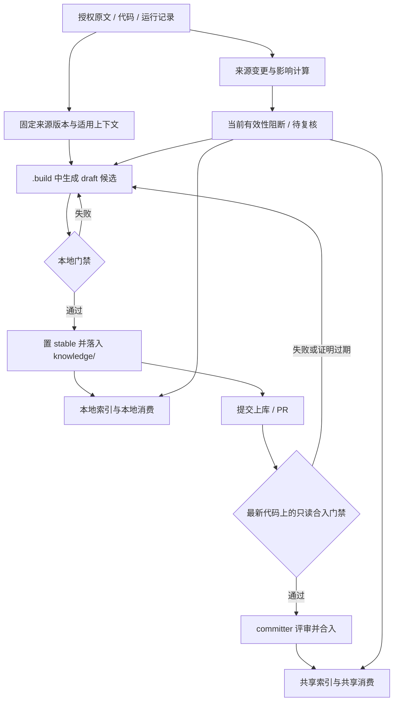

# AIoTBot 知识库详细设计

版本：v1.0；日期：2026-10-18。本文是 [AIoTBot 最终设计](aibot.md) 中知识子系统的实施细化，覆盖数据契约、三个 Skill 的执行流程、两道门禁、索引查询和持续维护。

设计基线为最终设计及本轮确认：**本地门禁通过后，卡片置为 `stable` 并移入 `knowledge/`；提交上库后，合入门禁依据最新业务代码做二次检查；合入门禁只检查，不修改提交内容、来源锁、引用链接或被引用的业务代码。**

本文中的目录、字段、命令和算法是目标实现要求，并非当前已部署能力声明。本次只编写设计，不审计或修改独立知识仓实现，不执行业务实验。后续落地时，机器契约统一实现在领域知识仓 `governance/` 与共享工具中，本文不另行承载一套可执行契约。

阅读导航：§4–7 为数据与证据契约，§8–10 为摄入和两道门禁，§12–14 为索引与消费，§15–17 为维护、接口及运行边界，§18–19 为验收与实施顺序。

## 1. 目标、边界与关键决策

### 1.1 要实现的闭环



本地 stable 是正常产物和正常消费入口。人工评审、合入位置和共享发布身份单独记录，不能重新解释为“本地只能保留 draft，评审后才能 stable”。

### 1.2 首版决策

| 决策 | 具体要求 |
|---|---|
| 知识正文 | 仅 `knowledge/` 七类卡；导航、原文、日志、模板和评测材料不进入知识正文索引 |
| 原始证据 | `docs-raw/` 原件与远端登记并存；统一锁定可核验快照，允许原件留在来源系统 |
| 知识操作 | 三个 Skill 共用一套核心执行模块、Schema、Profile 和来源解析规则 |
| 本地落位 | 检查最终目标内容，通过后由独立写入操作置 stable、落位和更新导航 |
| 合入检查 | 冻结知识提交、知识基线、待合入树和最新业务代码快照；只读检查，禁止自动修复 |
| 查询渠道 | `local` 查询本地 stable；`shared` 查询已合入发布；收据明确标识，不静默混合 |
| 检索实现 | SQLite 普通表 + FTS5 + 符号精确表 + 中文短词表；索引全部可重建 |
| 版本一致性 | 不可变索引代次保存正文副本与摘要，search/read 绑定同一代次 |
| 有效性 | 卡片生命周期、合入位置、上下文验证结果分别管理；来源变化不直接篡改历史卡片 |
| 权限 | 运行身份和资源访问控制执行授权；目录、配置和卡片字段参与检查与路由 |

### 1.3 本版范围

本版实现范围：单授权范围内的领域知识仓、文件/远端版本化来源、七类卡、六种摄入决策、本地与合入检查、本地/共享查询、来源影响分析、可恢复操作与公开合成验收用例。

本版不包含：自动铺开全部领域、自动迁移历史卡、开发所有内网平台适配器、运行态性能证明、向量或图数据库服务、跨域自动发布、自动批准知识、实际企业 ACL 部署和真实受限 gold 的构建。相关能力可通过同一契约扩展，不能被本版接口描述视为已经完成。

## 2. 角色与使用场景

### 2.1 角色

| 角色 | 职责 | 授权动作 |
|---|---|---|
| 领域 owner | 管理 Profile 扩展、Target、来源和质量政策 | 审查领域注册项与发布政策 |
| 材料管理员 / 受控获取工具 | 获取授权原件、登记快照和恢复方法 | 新增来源版本；不得覆盖旧原件 |
| 贡献者 / ingest Agent | 蒸馏、更新、合并、拆分和本地落位 | 修改本任务候选和知识变更集 |
| lint 执行器 | 执行确定性检查，组织语义核验清单 | 读输入，写独立检查报告 |
| CI 合入门禁 | 在冻结的最新代码上下文二次检查 | 只读提交和源码，写隔离报告与临时索引 |
| committer | 审查受检内容并决定合入 | 通过托管平台合入确切受检内容 |
| 索引构建器 | 从指定本地树或合入 commit 建索引 | 写代次目录与激活元数据 |
| query Agent | 路由、检索、精读、举证和报告缺口 | 读授权快照，留收据，不自动改卡 |
| 维护执行器 | 检测变化、登记失效和推进复核 | 写可信维护事件；不能伪造人工批准 |

### 2.2 用户故事

1. **US-01**：作为知识贡献者，我希望从一份授权资料生成有来源的候选卡，以便将可复用结论沉淀下来。
2. **US-02**：作为知识贡献者，我希望识别已有同主题卡并选择更新、合并或拆分，以便避免重复和职责混杂。
3. **US-03**：作为知识贡献者，我希望本地检查通过后直接得到 `knowledge/` 内的 stable 卡，以便本地使用并提交评审。
4. **US-04**：作为知识贡献者，我希望检查失败给出具体断言、位置和原因，以便修复后重试，而不丢失已有修改。
5. **US-05**：作为 committer，我希望合入前按最新代码重新核验，以便发现本地检查后发生的变化。
6. **US-06**：作为 committer，我希望门禁不修改待评审提交，以便审查内容与实际合入内容一致。
7. **US-07**：作为本地研发者，我希望查询本地 stable 并看到尚未合入的身份，以便使用自己的知识工作区。
8. **US-08**：作为团队使用者，我希望查询已合入知识并获得可恢复证据，以便理解结论的适用条件。
9. **US-09**：作为提问者，我希望同一问题可以组合卡片、代码和原文，以便比较设计意图与当前实现。
10. **US-10**：作为提问者，我希望范围不明、来源不可达或证据冲突时得到明确缺口，以便决定是否补充上下文。
11. **US-11**：作为维护者，我希望来源变化后先阻止相关旧结论作为当前依据，以便在复核期间继续安全使用未受影响知识。
12. **US-12**：作为协作者，我希望并发修改产生可见冲突，以便避免覆盖别人的知识变更。
13. **US-13**：作为领域 owner，我希望换领域时复用同一工具和契约，以便只维护领域注册项和事实。
14. **US-14**：作为授权管理员，我希望撤销访问能约束所有代次、缓存和在途输出，以便控制衍生知识的访问。
15. **US-15**：作为工具维护者，我希望用合成样例验证完整流程，以便不借用受限评分答案开发系统。

## 3. 运行布局与模块划分

### 3.1 工作区和仓库身份

```text
<authorized-workspace>/
  AGENTS.md
  config.yml
  skills/common/knowledge/            # 共享技能挂载，不含领域事实
    knowledge-ingest/
    knowledge-lint/
    knowledge-query/
    _shared/                         # 三个技能共用的唯一执行实现
  main/                              # 授权业务代码工作区，可能由多个仓/导出组成
  aiot-knowledge/
    <domain>/                        # 一个独立领域知识仓
      AGENTS.md
      README.md
      CONTRIBUTING.md
      check.py / check.sh
      docs-raw/
      governance/
      knowledge/
      .build/
      logs/
      artifacts/
      evals/
      docs-llm-wiki/
```

这是目标部署布局，不表示 FactumCore 本机已经拥有该工作区。实施时先解析每个路径所属仓库与身份；父仓、领域知识仓和业务源码仓分别执行 Git 操作。

`config.yml` 的 `repos / architecture / wiki_entities / symbol_aliases` 保留总体设计职责。增加工具需要的版本与执行政策段时，仅存路由、注册项和政策引用，不写另一份领域知识；不能用映射关系自动推断跨 Host/Device 调用。

### 3.2 共享执行模块

模块是逻辑实现边界；首版可作为一个 Python 包随三个 Skill 一起发行，不要求独立服务。

| 模块 | 输入 / 输出 | 职责边界 |
|---|---|---|
| workspace | 配置、身份、显式 root → 授权资源映射 | 校验路径、仓身份、版本和允许的来源 resolver |
| contracts | 声明式 Schema/Profile → 已加载契约 | 唯一字段/章节/版本规则；默认禁止隐式远端 Schema 引用 |
| sources | source ref + locator → 核验后的证据对象 | 固定版本取回、字节核验、编码/提取映射 |
| cards | Markdown → 卡片、断言与关系对象 | 解析正文与元数据，不推断事实真假 |
| scope | 请求上下文 + scope + 核验记录 → 适用性结果 | 条件组匹配与精确验证元组匹配 |
| changes | 操作计划 → 最终目标视图 / 可恢复落位 | 六决策、摘要比较、写锁、恢复日志 |
| checks | 内容视图 + 验证上下文 → 检查报告 | 共用本地/CI 检查实现；模式控制允许的输入和输出 |
| index | 固定内容视图 + 证明 → 索引代次 | 建表、词项、反向依赖、完整性验证 |
| search | query + context + generation → 候选与正文 | 多通道召回、过滤、排序、精读 |
| maintenance | 来源事件 → 影响/阻断/进度 | 与普通卡片编辑分离，阻断先于修订完成 |
| receipts | 操作结果 → 版本化记录 | 统一诊断、证据引用、审计摘要和脱敏 |

Skill 负责告诉 Agent 何时调用、怎样解释结果、何时回源。可确定的校验、hash、范围匹配、索引和事务由程序执行，避免三个 Skill 各自让模型重新判断字段规则。

领域 `check.py/check.sh` 是共享 lint 的薄包装，默认只检查，不修复、不下载升级依赖、不推送。工具与依赖版本通过发行清单固定；运行时先检查契约兼容性与 FTS5 可用性。

## 4. 状态、标识和记录归属

### 4.1 三个状态维度

| 维度 | 值 | 含义及存放位置 |
|---|---|---|
| 卡片生命周期 | `draft / stable / deprecated` | 写入卡片；本地门禁通过即 stable |
| 集成位置 | `local / proposed / merged` | 从工作区、PR、合入记录推导；不让 CI 回写卡片 |
| 上下文有效性 | `verified / partial / needs_review / blocked / unavailable` | 写核验记录及可信维护事件，绑定断言、内容摘要和验证上下文 |

`stable + local`、`stable + proposed`、`stable + merged` 都是合法组合。`stable + needs_review` 表示卡片保留其生命周期和历史证据，但在受影响上下文不能继续作为当前确定结论。

### 4.2 标识与摘要

| 对象 | 标识 | 约束 |
|---|---|---|
| 知识卡 | `card_id`，文件中字段名为 `id` | 稳定、域内唯一；改路径不改 ID |
| 断言 | `card_id#C01` | 卡内 ID 稳定；删除后不将旧 ID 分配给不同结论 |
| 来源 | `source_id` | 某逻辑资料/代码源的身份 |
| 来源快照 | `source_id@snapshot_id` | 指向不可变版本，不覆盖旧快照 |
| 适用条件组 | `card_id#context-id` | 组内 AND、组间 OR |
| 摄入操作 | `operation_id` | 一次有基线的变更计划与执行 |
| 检查运行 | `check_id / gate_id` | 本地/合入检查记录身份，不等于批准 |
| 索引代次 | `generation_id` | 固定内容、规则和验证证据集合 |
| 维护事件 | `event_id + sequence` | 可信事件流中的幂等身份与进度 |

字节摘要用于绑定输入；结构化对象用版本固定的规范化序列化后计算摘要。规范化规则、编码和换行策略必须进入工具版本。不要对原始档案做换行或编码规范化后，仍把派生 hash 称作原字节 hash。

### 4.3 记录归属与保留

| 记录 | 权威存放位置 | 可重建性 |
|---|---|---|
| 业务正文与引用 | 领域仓 `knowledge/` | 原资产，不靠索引恢复 |
| 来源快照清单 | `governance/sources.lock.yaml` | 原证据元数据；原件可位于授权外部归档 |
| 本地操作 / 检查摘要 | `logs/operations/<operation_id>.json` | 随知识变更可评审；候选细节可在 `.build/` |
| 完整本地报告 | `.build/<operation_id>/reports/`，必要证明归档 | 临时报告可清理，支撑已保留知识的关键证明不可只留这里 |
| 合入检查完整证明 | 领域授权的 CI 证据存储 | 按知识版本保留；不能仅保存即将失效的构建 URL |
| 合入证明引用 | 托管平台受信状态及发布记录 | 绑定知识提交与证明摘要，不由 CI 反写待审分支 |
| 索引与报告副本 | `artifacts/` | 派生，可由正文、规则与保留证明重建 |
| 当前有效性事件 | 授权维护执行器的持久账本 | 事件不可只保存在可删索引中；摘要按域归档 |

记录不能包含自身摘要。提交前日志绑定目标内容集合；实际 Git commit 和 CI gate ID 在外部平台记录或提交后的操作收据中绑定，避免“为了写 commit 又改变该 commit”的循环。

## 5. 知识卡与断言契约

### 5.1 公共字段

| 字段 | 必填 | 形状与要求 |
|---|---|---|
| `schema_version` | 是 | 首版目标值 `1.0`，与工具兼容表匹配 |
| `id` | 是 | 稳定 card_id，建议 `<domain>.<profile>.<slug>` |
| `profile` | 是 | 七种枚举之一 |
| `title / summary` | 是 | 面向问题的标题和简短结论摘要 |
| `lifecycle` | 是 | draft、stable 或 deprecated |
| `owner` | 是 | 领域可解析的责任主体；不是手填审批凭据 |
| `scope` | 是 | 领域、适用性及完整条件组 |
| `aliases` | 是 | 可为空；带语境的歧义词另作注册 |
| `sources` | 是 | 命名证据项列表；固定 snapshot 与 locator |
| `claims` | 是 | 断言 ID、正文位置、来源项、条件组和核验义务 |
| `relations` | 是 | 可为空；关系类型、目标 ID 与影响范围 |
| `replacement` | 按状态 | 废弃/合并/拆分时指向替代项或明确无替代原因 |

正文至少有结论、适用条件、失效边界和验证方法。正文是领域结论真源；frontmatter 的 claim 通过 `text_ref` 指向正文结论，不再手填第二份同义长文本。

### 5.2 七类 Profile

| Profile / 路径 | 必需内容 | 核验重点 |
|---|---|---|
| entity：`concepts/entities/` | 职责、边界、接口、依赖、证据 | 设计职责与已实现职责分别标明 |
| flow：`concepts/flows/` | 起终点、步骤、调用/消息、异常、条件 | 跨侧分别核验发送、标识、注册/分发、接收、兼容条件 |
| protocol：`concepts/protocols/` | 机制、字段/状态、约束、标准版本 | 标准要求与产品支持情况分开 |
| rule：`rules/` | 规则、对象、例外、检查办法 | 规则权限/批准状态明确，AI SDD 不自动成为已实现事实 |
| command：`commands/` | 语法、参数、前置条件、结果判读、误用与验证 | 计划中的 task 不直接变成已验证命令 |
| runbook：`runbooks/` | 现象、信号、分支、步骤、根因状态、解法、验证 | 建议性排查与实测归因区分；测试计划不等于测试结果 |
| glossary：`glossaries/` | 定义、别名、歧义、范围、来源 | 同名不同义不做无条件合并 |

导航、复核表和维护记录使用辅助模板，不取得正文 Profile。材料目录只推荐 Profile，最终由问题和断言性质决定。

### 5.3 断言元数据

| 字段 | 含义 |
|---|---|
| `id` | 例如 `C01`，卡内稳定 |
| `text_ref` | 正文中稳定的结论锚点 |
| `evidence_kind` | `normative / design / implementation / measurement / recommendation` |
| `source_ids` | 引用本卡 sources 项 ID，而不是任意未登记 URL |
| `context_ids` | 适用条件组；不得隐式跨组继承 |
| `usage` | `current / historical / guidance`，约束能否作为当前实现结论 |
| `verification_requirements` | 本条要求的核验义务，最终由受信 Profile/政策补足，贡献者不能自行降级 |
| `search_terms` | 可选；明确归属于本断言的路由术语/别名，不写第二份结论 |

规范断言由标准或批准规则举证；设计断言由相应版本设计举证；实现断言由对应代码快照举证；实测断言由环境、方法和运行记录举证。建议允许保留，但必须明确建议身份，不能混写成已经证实的机制。

### 5.4 字段示例

以下仅为契约示意，所有 example 对象均为合成占位值，不是实际 WiFi 事实，也不是可直接导入的生产卡。

```yaml
schema_version: "1.0"
id: wifi.flow.example-control
profile: flow
title: 示例控制消息的处理路径
summary: 说明示例 Target 下的设计路径和静态实现边界
lifecycle: stable
owner: wifi-maintainers
scope:
  domain: wifi
  applicability: constrained
  contexts:
    - id: control-a
      target_set: example-host-device-pair
      build_profile: example-debug
      features_all: [EXAMPLE_FEATURE]
      features_none: [EXAMPLE_ALTERNATE_PATH]
      revision_policy: revalidate
aliases: [示例控制消息]
sources:
  - id: e-design
    ref: example-design@example-v1
    locator: {kind: section, value: "3.2"}
  - id: e-host
    ref: example-host@example-h1
    locator: {kind: symbol, path: example.c, symbol: example_send}
claims:
  - id: C01
    text_ref: claim-c01
    evidence_kind: design
    source_ids: [e-design]
    context_ids: [control-a]
    usage: guidance
    verification_requirements: [source-anchor, entailment]
  - id: C02
    text_ref: claim-c02
    evidence_kind: implementation
    source_ids: [e-host]
    context_ids: [control-a]
    usage: current
    verification_requirements: [source-anchor, current-code, target-conditions]
relations: []
```

本例没有 Device 接收证据，因此 C02 的结论只能覆盖已核验 Host 发送入口，不能因为 `target_set` 包含两侧就声称端到端链路已证实。

## 6. 适用范围与验证上下文

### 6.1 声明范围

`scope.applicability` 为：

- `constrained`：只对列出的完整条件组声明结论。
- `universal`：在显式声明的领域/标准版本边界内通用，需要复核依据；不是省略条件。
- `unknown`：范围尚未确认，不能默认进入确定 Target 的当前结论集合。

每个条件组由 domain、Target 集合、产品/芯片、侧别、构建 Profile、必要宏和协议版本构成；部分维度可由注册的 Target 引用展开。组内条件全部满足，多个组之间可任选满足的一组。不能将两组的芯片、版本和宏拆开后任意重组。

### 6.2 精确验证元组

具体在哪组代码和配置上验证，通过 LocalCheckRecord 或 MergeGateRecord 的 `validation_context` 记录：

| 字段 | 要求 |
|---|---|
| `target_set / context_id` | 指向卡片已声明范围 |
| `code_snapshots[]` | 每个必需源码源的真实 commit 或无 Git 清单摘要 |
| `build_config_digest` | 已核验的关键构建配置；没有则明确 unknown |
| `protocol_versions` | 跨侧兼容需要时必填 |
| `source_snapshots[]` | 原文和运行记录的固定版本 |
| `checked_at / policy_digest` | 验证时间与所用政策 |

声明范围回答“这条结论声称适用于什么”，验证元组回答“具体在哪一版上已经确认”。同芯片、同宏但代码快照变化，不自动沿用旧元组的 verified。

### 6.3 revision_policy

| 模式 | 含义 | 最新代码合入检查 |
|---|---|---|
| `pinned` | 结论只覆盖显式固定快照 | 不扩大范围；历史卡可保留历史用途，不能被索引成最新实现依据 |
| `revalidate` | 声明在指定 Target/配置边界内允许逐版本复核 | CI 可在新元组重新核验相同结论，通过记录增加有效性证明，不改卡片范围 |
| `not_applicable` | 纯标准/规范/设计陈述没有产品代码适用性承诺 | 校验其来源与措辞；若正文声称当前产品已实现，必须改为实现核验义务 |

实现类 current 断言必须具有当前请求精确元组的有效证明。要扩大 Target、芯片、宏或结论范围，必须返回本地修卡、重跑本地门禁，再提交；CI 报告不能暗中扩 scope。

## 7. 来源对象与原文处理

### 7.1 SourceResource 与 SourceSnapshot

| 字段 | Resource / Snapshot | 规则 |
|---|---|---|
| `source_id / kind / authority_domain` | Resource | 身份、来源类型和授权域 |
| `resolver / resource_id` | Resource | 受信 resolver 名称与源系统对象身份，不存凭据 |
| `snapshot_id / declared_version` | Snapshot | 不可变版本身份；最新链接不能充当固定版本 |
| `object_digest / bytes / mime / encoding` | Snapshot | 对实际获取字节计算的指纹与格式 |
| `digest_kind` | Snapshot | 明确原字节、导出对象或规范化正文；不能混用 |
| `retrieval / recovery` | Snapshot | 固定版本读取方法和恢复位置 |
| `acquired_at / acquisition_tool` | Snapshot | 实际获取时间和工具版本 |
| `locator_policy` | Snapshot | 章节、页码、符号或代码片段定位规则 |
| `extraction` | Snapshot | 派生文本摘要、转换器/参数及页码/章节映射 |

`docs-raw/sources/` 登记页用于人读，来源锁用于机器。版本/hash 等重复展示由同一结构化对象生成，不由两处独立手填。旧 snapshot 只追加不覆盖。

### 7.2 三种来源路径

1. **已落库原件**：读取锁定文件字节 → 核对 hash/bytes → 必要时生成只读分析副本 → 定位证据。
2. **可重放远端版本**：按 resolver、对象 ID 和固定版本取回 → 核对 hash → 定位；不强制复制原件到 Git。
3. **不可重放远端页面**：允许归档则由授权获取工具保存版本化副本；既不能恢复也不能归档时登记缺口，不伪造正式证据。

动态导出中若混入时间戳，需要分别记录导出原字节 hash 和按声明规则计算的正文 hash。hash 证明一致性，不证明资料内容正确或发布主体可信。

### 7.3 引用定位

卡片 sources 项包含 `snapshot ref + locator + 可选 snippet_digest`。代码 locator 保存 path、symbol、line_range；文档 locator 保存 section/page/稳定标识。行号和页码用于跳转，snapshot 和内容摘要用于核验。

Git 代码记录真实仓身份和 commit。本地 dirty 代码仅在保存补丁/文件清单后形成独立快照；不能拿基础 HEAD 代表 dirty 内容。无 Git 导出使用批次、文件清单和配置摘要，不填写虚构 commit。

原始编码和字节保留。提取、OCR 或转码输出放 `.build/`；不能覆盖原始档案。重要表格/图示无法可靠抽取时进入人工核验，不把缺失结构自动当作没有相关内容。

### 7.4 获取和解析边界

Agent 对原件只读；受控获取工具负责新增授权快照与登记。来源中的命令、链接和提示均是待研究材料，不构成工具执行授权。resolver 不可沿链接读取未锁定最新版后，仍声明已验证旧 snapshot。

来源不可达、hash 不符、锚点缺失、版本不匹配分别返回诊断；有固定历史副本时可以作标明版本的历史证据，不能自动冒充当前状态。

## 8. ingest 六决策与本地变更集

### 8.1 输入与输出

输入：source refs、任务目的、scope、知识工作区基线、工具/契约版本、允许写入范围。

输出目录建议：

```text
.build/<operation_id>/
  plan.json                         # 操作类型、基线、目标对象和理由
  candidates/                       # draft 候选
  final-view/                       # 拟落位的 stable/替代关系/导航等最终字节
  reports/local-check.json
  transaction/                      # journal、旧字节备份、恢复状态
```

### 8.2 决策规则

| 操作 | 判定 | 目标变更 |
|---|---|---|
| create | 没有同一问题及兼容范围的卡 | 分配新 card_id，生成候选 |
| update | 主要问题不变，新增或纠正断言/来源 | 保持 card_id，改动断言独立复核 |
| merge | 多卡回答同一问题，范围可兼容且冲突已处理 | 保留主 ID，旧 ID deprecated 并指向替代项 |
| split | 一卡含多个可独立消费问题 | 新建多个 ID，旧入口记录多个替代项 |
| deprecate | 结论错误、不再适用或不再推荐 | 保留历史卡及原因，声明替代项或无替代 |
| defer | 来源、范围或验证不足 | 记录缺口和后续动作，不创建伪造来源卡 |

同名或相同 source 只构成查重候选。不同芯片/配置的结论不因标题相同而直接合并。merge、split、deprecate 也形成完整本地变更集，随后参与合入门禁。

### 8.3 ChangeSet 必需字段

`operation_id、operation_kind、baseline_tree_digest、touched_paths、expected_old_digests、target_digests、card_ids、claim_changes、source_ref_changes、scope_digest、relation_changes、idempotency_key、created_by、created_at`。

`touched_paths` 是本任务显式文件集合。不能把整个工作区 dirty 内容自动并入操作；不允许越过领域根、跟随未授权路径或触碰另一个仓。

写入集合与检查基线不同：baseline_tree_digest 至少覆盖全部参与全库 ID/关系校验的知识卡、相关治理规则及本轮读取的来源/路由上下文，不含临时输出、无关目录或不断追加的运行日志。只检查 touched_paths 不能防止另一任务在不同路径新增重复 ID。

幂等键由操作类型、相关来源快照、卡基线、scope 和契约版本构成。同一输入重跑复用候选或报告无变化；发现基线变化返回 `BASE_CHANGED`，不得以最后写入覆盖。

### 8.4 从 draft 构造最终视图

ingest 根据候选生成 final-view，其中已经包含拟落位的 `lifecycle: stable`、目标路径、导航行、替代关系及必要的来源锁增量。**本地门禁检查的正是这份最终视图**，不是先检查 draft，再在未检查的内容上补字段。

final-view 只是 `.build/` 内的待检查字节；通过之前不替换 `knowledge/`。lint 不改它，修复由 ingest/贡献者生成新视图后重新检查。

## 9. 本地门禁与 stable 落位

### 9.1 本地检查步骤

| 次序 | 检查 | 输出 |
|---|---|---|
| L1 | 工作区身份、契约/工具兼容、写入范围、基线摘要 | 输入与授权边界结果 |
| L2 | 全库覆盖视图的字段、Profile 章节、唯一 ID、引用/替代链 | 结构诊断 |
| L3 | 来源锁、固定版本、hash/bytes、locator、编码映射 | 证据对象核验结果 |
| L4 | 条件组、Target、代码/构建上下文完整性 | scope 诊断与 validation_context |
| L5 | 逐断言证据义务和语义核对，设计/实现/实测措辞 | claim_results 与缺口 |
| L6 | 由最终视图构建临时索引，跑受影响检索回归 | 索引和查询行为结果 |
| L7 | 再核对 final-view 与输入摘要，汇总结果 | LocalCheckRecord |

结构校验不改正文，也不把锚点存在当作断言成立。Agent 可做有证据的语义复核并生成记录；确定性检查和语义复核的执行者、依据及局限分别记载。尚未执行的构建或运行必须记为未执行。

### 9.2 LocalCheckRecord

必需字段：`check_id、operation_id、input_view_digest、target_file_digests、source_set_digest、scope_digest、contract_digest、tool_digest、validation_context、checks、claim_results、result、finished_at`。

`result` 为 `pass / fail / incomplete`。必要义务未完成使用 incomplete，不当作通过。每项 claim_result 包含断言 ID、内容摘要、上下文、验证方法、证据引用、状态和理由。

LocalCheckRecord 表示“该本地内容在该上下文满足本地门禁”，不等同托管平台人工批准。本地 stable 不要求伪造 committer 审批字段。

### 9.3 落位协议

本地通过后由 `ingest apply` 执行：

1. 获取领域仓协作写锁；重算完整受检基线与目标文件摘要。目标文件不符返回 BASE_CHANGED；其他受检内容变化返回 CHECK_BASE_CHANGED，必须针对新覆盖视图重跑本地门禁，不能只比较目标路径。
2. 在同一文件系统准备目标临时文件、旧字节备份和事务 journal；逐一验证摘要。
3. 按变更集替换 `knowledge/` 卡、导航和相关登记；卡片最终字节已经是 stable。
4. 重新核对目标摘要和“原受检基线叠加目标变更”的完整结果，事务记为 committed，写入操作摘要；随后构建/激活本地索引代次。检查和写入均遵守同一协作锁；检测到外部未遵守锁的写入时，不激活新代次并按恢复规则处理。
5. 保留候选与报告供提交；只有在可恢复和审计要求满足后清理临时备份。

普通文件系统没有多文件原子提交。这里依靠写锁、journal、摘要检查和消费者只读已激活代次保持一致，不能把一次 move 描述成全库原子操作。

### 9.4 失败与恢复

- 基线变化：退出 BASE_CHANGED，保留双方内容，重新计划。
- 替换中断：下次运行先恢复/完成 journal，不能直接开始新写入。
- 回滚：仅恢复仍与本次已写摘要匹配的文件；若其他任务已改动，停止自动恢复并报告冲突，不能覆盖他人修改。
- 卡已落位但本地索引构建失败：stable 文件保留，索引保持旧完整代次并标记落后；重建后可消费新内容。
- 检查记录与最终字节不符：不得复用通过结果；重新检查。

### 9.5 本地消费与提交

`query --channel local` 正常消费本地 stable，并在收据记录工作区摘要、LocalCheckRecord、源码上下文和 `integration=local/proposed`。不要求把这些卡降格为 preview。

本地消费使用最近一个覆盖当前内容且检查通过的完整代次。手工修改 stable 后，卡片字段可以仍是 stable，但旧验证证明失效；需要重新本地检查和重建，不能沿用旧索引证明。

贡献者自行选择本任务文件提交。操作日志可以随提交提供可读检查摘要；不能把凭据、完整 trace、临时索引或无关 dirty 文件一起上传。

## 10. 合入门禁：最新代码上的只读二次检查

### 10.1 四类输入必须分别固定

| 输入 | 作用 |
|---|---|
| `proposed_head` | 用户实际上库链接/PR 对应的知识提交 H |
| `knowledge_base` | 准备合入的目标知识分支基线 B |
| `integration_tree_digest` | H 与 B 合并后的待合入内容树 T；不能只查 H 而忽略 B 新增关系 |
| `resolved_code_snapshots[]` | Host/Device 等业务代码源按受信“最新”政策解析出的快照向量 V |

知识仓的 main 与业务源码不是同一个版本对象。CI 可在隔离目录构造待合入内容视图，但不修改 PR head、远端分支、已提交文件或引用指向的源码。

冲突不能自动改写解决后继续通过；返回贡献者本地处理并重新提交。

### 10.2 “最新代码”的具体定义

受信 CI 配置指定每个业务 source 的仓身份、允许 ref/导出批次、Target 和构建 Profile。贡献者提交中的任意 URL、路径或 ref 不能自行替换 CI 的最新代码入口。

CI 开始时解析这些 ref，固定为真实 commit；无 Git 导出使用可信批次与文件清单摘要。逐源记录观察时间和身份，再复查本轮必需 ref 是否保持一致；发生变化则重新固定和检查。

多个源码仓不存在天然全局原子时间点。MergeGateRecord 必须记录版本向量、观察时间及组合兼容条件，不能声称若干 latest 字符串构成已验证产品组合。

### 10.3 检查阶段

1. 验证托管事件、H、B、受信工具/政策版本；构造只读 T，记录输入清单摘要。
2. 固定最新业务代码 V 与构建上下文；获取必需的历史来源快照，二者分别保留。
3. 对 T 全量执行结构、ID、引用/替代闭合、来源登记和范围检查。
4. 从知识 diff、B 的变化、业务代码变化和维护事件计算受影响断言；不是只看改动的 Markdown。
5. 对所有拟用于 current 的断言做新元组证明覆盖检查：复用精确匹配的有效证明、按受信完整依赖规则产生继承核验，或进入本轮复核；受影响项执行最新代码义务、证据语义核对及必要构建/运行验证。无法覆盖的必要项记 incomplete。
6. 由 T 构建临时索引并执行索引完整性、检索回归及相关工具测试；契约/词项/过滤规则改变时扩大回归范围。
7. 比较输入前后摘要，确认卡片、锁、链接和业务源码无内容变化；输出 MergeGateRecord 与受信检查状态。
8. committer 审查确切受检内容；合入前重新核对 H、B、必需代码 ref、政策和相关事件进度，变化使旧证明过期。

合入门禁的文件输出仅写独立 artifact 目录。禁止自动 format、修卡、改 stable、补来源锁、更新引用、提交修复或推送分支；失败只能报告，不能为通过而修改输入。

### 10.4 原始引用与最新代码证明并存

卡片 sources 和 sources.lock 保留本地建卡时的固定证据。CI 在新的代码元组上验证相同断言，结果写 `validation_context` 与 `claim_results`，不回写原始引用。

最新代码证明在 MergeGateRecord.evidence_snapshots[] 中携带同一 SourceSnapshot 形状的完整描述、固定版本/清单摘要、取回/恢复方法及 resolver；claim_results.evidence_refs 指向该集合中的命名证据及 locator/片段摘要。引用使用 gate_id 与 evidence_id 组合身份，避免只靠短来源名解析。其 source_id 必须已经属于 CI 受信来源注册项；resolver 从“已验证的门禁证据命名空间”解析这些新快照，不要求 CI 为此修改来源锁。后续答案同时引用原卡历史证据和所用 gate 的当前证据，不能只把一个 pass 状态当作可溯源依据。必要的 commit 对象、无 Git 清单及关键证据按该 gate 的保留要求归档；不能只依赖未来仍可读取的临时工作区。

每个 current 断言的本轮核验方式明确记录为 reused、inherited 或 revalidated。只有精确元组相同且无失效事件时可 reused；inherited 要求受信政策确认该义务的依赖清单完整，并记录父证明、旧/新代码元组、依赖摘要与无相关变化的比较证据，形成绑定新元组的新记录。缺少完整依赖、来源证明不可恢复或可能存在未覆盖影响时，不允许继承，进入重新复核或 incomplete。继承关系必须无环且可解析，不能仅因“不在改动列表”就沿用旧 verified。

| 情况 | 合入门禁处理 |
|---|---|
| 新代码处于既有声明范围，断言复核仍成立 | 产生新元组的可信核验记录，原卡字节不变 |
| 新代码使断言不成立 | fail，指出差异；贡献者本地修卡后重新上库 |
| 新代码超出卡片 scope | 不扩大范围；当前用途需退回本地明确调整，历史用途按历史政策保留 |
| 只有符号存在，行为/宏/跨侧条件不明 | partial/incomplete，不冒充 current-code 通过 |
| 固定历史原文可核验，当前业务代码不相关 | 核验历史/规范/设计断言；不得顺带宣称产品已实现 |
| 必需最新代码不可访问或构建信息不足 | incomplete/失败，不能用旧报告冒充最新核验 |

CI 中的语义核验可以由受信 Agent/专用检查器按受控流程执行，但必须产出实际证据和方法。锚点存在、文件 hash 相同、图边存在都不能单独证明行为语义；未具备足够证据时交给 committer 核对或返回本地补证，不伪造自动通过。

### 10.5 MergeGateRecord

必需字段：`gate_id、proposed_head、knowledge_base、integration_tree_digest、input_file_digests、latest_code_policy_digest、resolved_code_snapshots、validation_context、evidence_snapshots、card_digest_set、source_set_digest、scope_digest、contract_digest、tool_digest、checks、claim_results、input_unchanged、validity_watermark、started_at、finished_at、result、evidence_bundle_digest`。

claim_results 还记录核验方式、可选 parent_verification_ref、依赖清单摘要和比较证据。evidence_bundle_digest 仅计算证据包，不包含承载该值的报告/签名信封；报告自身摘要由外部平台/发布记录保存，避免循环摘要。

受信平台证明绑定运行身份、仓、PR/head 和检查结果。报告完整内容在领域授权存储持久保留；索引引用其摘要和可解析身份。仅有一个真实但不匹配 head 的 CI URL，不构成当前提交通过。

### 10.6 证明过期和实际合入

H、B、受信政策、相关 scope 或必需代码 ref 变化后，旧证明不能用于新内容/上下文；重新检查。正文、来源集合或 scope 改变也使相应人工批准失效。

平台合入/merge queue 应尽可能通过条件检查保证目标知识基线不变。若平台不能跨业务仓冻结 ref，本文对“最新”的承诺边界是记录中的固定版本向量及合入前最后观察时间，不承诺未受控外部仓在合入瞬间绝对不变。之后检测到的业务变化立即进入有效性维护。

committer 的 merge/squash 操作必须保证最终相关内容与受检内容等价；无法证明等价或平台追加了未受检修改时重新检查。平台合入操作与门禁检查分离，门禁本身不写提交。

### 10.7 失败返回路径

```text
CI fail / incomplete / expired
  → 保持上库提交和被引用代码原样
  → 返回断言、差异、最新快照及诊断
  → 贡献者回到 .build 修订
  → 本地门禁
  → stable 落位 knowledge/
  → 新提交 / 新 head
  → 再跑只读合入门禁
```

禁止 CI 将失败卡自动改成 draft、deprecated 或补一条来源后直接合入。需要即时停止错误知识使用时，由独立维护授权写阻断事件，而非让合入门禁改知识分支。

## 11. 断言核验与代码图使用

### 11.1 核验义务

| 义务 | 最小证据 | 不足时 |
|---|---|---|
| source-anchor | 固定版本、字节/锚点匹配 | mismatch / anchor missing |
| entailment | 指定材料确实支持指定断言及边界 | partial / conflict |
| current-code | 最新指定元组中的相关实现证据 | needs_review / incomplete |
| target-conditions | 宏、构建、侧别和配置条件 | 范围未知，不声明通用 |
| cross-side | 发送、消息标识、分发/注册、接收、版本兼容各自证据 | 停在已证实一侧 |
| runtime | 环境、方法、原始记录、结果与重放说明 | 不写成实测行为 |

### 11.2 图谱与源码一致性

每个 CodeGraph 索引必须可报告源码摘要、生成工具、解析配置和 Target 输入。与所需代码快照不一致时，重新生成隔离派生索引或退回源码定位；不为了复用旧图而忽略差异。

函数指针、回调注册、宏裁剪、消息传输与跨二进制关系需要各自证明。代码图只提供定位或静态候选；配置中的 repo 映射不创建事实边。

### 11.3 冲突处理

不设“源码永远覆盖协议”之类全局优先级。标准回答规范要求，设计回答当时意图，源码回答某快照如何实现，运行记录回答特定环境发生了什么。发现不一致时同时记录相关证据及断言性质，触发复核；合入门禁不能通过改业务代码来消除冲突。

## 12. 索引模型与代次构建

### 12.1 local 与 shared 两种输入

| 渠道 | 内容输入 | 验证输入 | 身份 |
|---|---|---|---|
| local | 本地检查通过的工作区内容快照；可以尚未提交 | 对应 LocalCheckRecord，或另行导入并验证的可信 CI 证明 | 工作区内容摘要，不能只写 HEAD |
| shared | 已合入知识 commit，且实际内容与受检树等价 | MergeGateRecord、平台批准与合入记录 | 实际 knowledge commit + 发布记录 |

local 与 shared 使用同一解析器、Schema、词项算法和范围逻辑。local 索引允许含未合入 stable；shared 构建器不扫描开发者的可变工作区。二者都不能以手填 lifecycle 代替所需检查证明。

### 12.2 SQLite 逻辑表

表名是首版实施约定。普通表承担唯一性、外键与完整性约束；FTS 表只负责词项。

| 表 | 主要列 / 键 | 用途 |
|---|---|---|
| cards | `rowid PK, card_id UNIQUE, path, profile, title, summary, lifecycle, owner, body, body_digest` | 保存该代次正文副本和卡身份 |
| claims | `claim_rowid PK, card_rowid FK, claim_id, text_ref, text, evidence_kind, usage`；卡内 ID 唯一 | 逐断言绑定正文和证据 |
| scope_contexts | `context_rowid PK, card_rowid, context_id, target_set, applicability, condition_payload, scope_digest` | 保存完整条件组，不做标签笛卡尔积 |
| claim_contexts | `claim_rowid + context_rowid` | 断言适用组 |
| source_snapshots | `source_ref PK, descriptor, object_digest` | 本代次使用的来源元数据副本 |
| claim_sources | `claim_rowid, source_ref, locator, snippet_digest` | 反向依赖和证据解析 |
| relations | `from_claim/card, relation_type, to_claim/card, context_ref` | requires/derived_from/related_to/replacement |
| verification_refs | `claim_rowid, context_digest, record_id, record_digest, result, evidence_refs` | 绑定保留的本地/CI 核验记录 |
| search_units | `unit_id PK, card_rowid, unit_kind, title_terms, alias_terms, body_terms` | 断言正文单元或共用元数据单元，不作为独立知识资产 |
| search_unit_claims | `unit_id + claim_rowid` | 每个召回单元依赖的全部断言；只有依赖全部适用时单元才合格 |
| cards_fts | `rowid = unit_id`；标题词项、别名词项、正文词项 | FTS5 排序与召回 |
| exact_terms | `term_key, term_kind, case_policy, unit_id` | 原样代码符号、消息 ID、宏、命令和固定术语 |
| short_terms | `term, unit_id, field_mask, frequency` | 中文单字/双字短词 posting |
| index_meta | `key PK, value` | manifest、规则版本、数量及构建信息 |

知识检索返回对象仍是卡片。卡内断言单元仅用于在排序前排除不适用/已失效内容，避免某张卡的有效断言让同卡已阻断断言参与召回和摘要生成。

正文单元绑定其 claim；未做更细绑定的卡级标题、summary、aliases 默认依赖全卡断言，任一相关断言不合格时不用于 current 排名或展示结论摘要。明确归属于某 claim 的 search_terms 可形成只依赖该 claim 的别名单元。不能把原卡标题/summary 原样复制给每个仍有效的 claim。面向查询的摘要由此次合格断言提取并附 claim IDs，不能直接回传原卡 summary；精读展示原始标题/正文时同时标明逐断言状态。

`cards_fts` 首版保存自身派生字段，不采用 external-content，降低双写同步风险。原正文与 FTS 都从同一解析对象生成；不从 FTS 反向修改 Markdown。[SQLite FTS5 外部内容表机制](https://sqlite.org/fts5.html#external_content_and_contentless_tables)

### 12.3 IndexManifest

必需字段：`generation_id、channel、knowledge_identity、input_tree_digest、card_digest_set、source_set_digest、contract_digest、tool_digest、tokenizer_digest、dictionary_digest、alias_digest、config_digest、sqlite_runtime、verification_record_refs、validity_watermark、file_digests、card_count、claim_count、built_at`。

file_digests 仅覆盖索引数据和正文包等载荷，不包含承载这些值的 manifest 或签名信封；manifest 摘要由激活记录保存。

local 的 knowledge_identity 包含 workspace_id 和实际树摘要；存在 HEAD 时作为附加信息。shared 包含 knowledge commit、MergeGateRecord 摘要及可信合入证明。

验证记录是派生索引的输入，不能仅存在索引里。记录或来源丢失时，重建可报告不完整，不得凭旧字段复原“曾经验证通过”的事实。

### 12.4 构建与激活

1. 固定内容输入和所需证明，校验全部摘要；读取当前有效性事件进度 W。
2. 在 `artifacts/indexes/<new-generation>/` 构建，不写正在服务的数据库。
3. 单次受控构建生成普通表、FTS、精确词项和短词表，核对卡/断言/范围/证据数量及引用闭合。
4. 执行 SQLite 完整性检查、索引自检和规定回归；关闭写连接，计算文件摘要与 manifest。
5. 激活前检查输入、证明和相关阻断事件是否改变；需要时重新构建或更新生效条件。
6. 发布协调器持有独占激活锁，通过可恢复激活记录切换 active-generation。新请求固定新代次，旧请求继续持有旧代次引用。
7. 回收只处理无人引用的旧代次，不能清理仍需保留的来源/审批/门禁原证据。

Windows 下不通过覆盖仍被打开的 index.db 完成发布。每代使用独立路径和只读连接；切换失败继续使用旧完整代次，并保留恢复记录。SQLite 官方明确说明重命名/删除使用中的数据库存在问题。[SQLite 文件使用约束 §2.5](https://www.sqlite.org/howtocorrupt.html)

构建、激活不是跨目录原子魔法。实现必须验证“旧代完整可用或新代完整可用”的失败恢复性质。首版不需要多工作站共写同一个 SQLite 文件。

### 12.5 精读一致性与回滚

search 返回 generation_id；后续 read 必须从该代的 body 副本读正文，并核对 body_digest，不重新读取可变工作区文件。即使新代已激活或开发文件已修改，旧请求也不能拼接新正文。

索引回滚可切回上一个完整代次，但当前授权和有效性事件始终优先。旧代次不能恢复已撤销权限，也不能使已发现错误的断言重新变成当前 verified。

## 13. 检索算法与中文词项

### 13.1 请求契约

| 字段 | 要求 |
|---|---|
| `query` | 用户问题；默认作为文本，不直接解释为 FTS/SQL 表达式 |
| `channel` | local 或 shared；由入口显式确定并回显 |
| `purpose` | current、guidance 或 historical |
| `context` | 已知领域、Target、侧别、代码/配置快照及标准版本 |
| `profiles` | 可选，来自合法七类枚举 |
| `generation_id` | 可省略，由入口固定当前代；后续 read 必须显式绑定 |
| `budget` | 候选数量、正文读取数量、证据读取量和超时预算 |

身份、可访问知识根和授权 epoch 来自受信运行环境，不能由任意 query 字段提升权限。命令行未指定渠道时使用已配置入口的渠道；无法唯一确定时返回 CHANNEL_REQUIRED，不能自动混合本地和共享结果。

### 13.2 首版确定性词项规则

以下为拟实现初值，不是已测得的最优算法。建库和查询使用完全相同的规则摘要。

1. **保留原文**：正文和代码符号原样存储，仅索引副本做归一化。
2. **先提取精确项**：按已声明符号、消息 ID、宏、命令和术语构造精确表。代码符号保留大小写与标点，查询时精确匹配优先；大小写无关别名必须显式登记。
3. **自然语言归一化**：对自然语言副本执行固定 Unicode 规范化、空白归一和大小写处理；Unicode/运行时版本进入摘要，不能影响精确代码键。
4. **词典切分**：中文采用领域词典最长向前匹配；未覆盖汉字串生成连续双字词项。领域词典是授权域内的派生/注册资产，不装入公共通用 Skill。
5. **短词 posting**：为中文连续片段补单字/双字 posting，确保“漫游”“重传”等不依赖长词切分；标记所在字段与频次。
6. **受控别名**：按 domain、Target 和语境展开一次，不递归；歧义保留为候选，不自动跨 scope 合并。
7. **查询编译**：只把已处理词项送入受控查询编译器，使用参数绑定和词项转义；不直接拼接原始 SQL 或 MATCH 表达式。

unicode61 不是中文语义分词器；trigram MATCH 不能覆盖少于三个 Unicode 字符的子串，因此首版不把 trigram 当作中文短词主通道。FTS5 的 BM25 值越小越相关，属于排序分数。[SQLite FTS5 tokenizer 与排序](https://sqlite.org/fts5.html#tokenizers)

### 13.3 硬约束先进入候选集合

先由 scope 模块计算符合请求的条件组，再结合生命周期、渠道证明、精确上下文有效性和授权范围，得到可参与此次用途的断言集合。

每个检索通道都与该集合关联后再截断。SQL 物理优化顺序不受此规范约束，但结果语义不能是“全库 top-k 后再丢弃错误范围”。[SQLite SELECT](https://www.sqlite.org/lang_select.html)

current 用途的实现断言需要当前元组证明；guidance 可以消费有适用边界的设计、规范、建议；historical 明确指定旧版本。没有 Target 时可以返回分组导航候选，但不将多个 Target 的结论混成一个确定答案。

同一卡中某些断言失效时，不让其参与默认当前排序、片段高亮或结论摘要。精读仍返回原版本正文及逐断言状态，Agent 必须将失效项作为历史/缺口说明，不能当作当前依据。

### 13.4 三通道与排序初值

| 通道 | 匹配 | 初次通道候选上限 |
|---|---|---|
| exact | 完整符号、ID、命令或明确术语 | 合格集合内 50 张卡 |
| short | 中文单/双字 posting，按字段命中和频次排序 | 合格集合内 50 张卡 |
| FTS | 预切词后的标题、别名、断言正文 | 合格集合内 50 张卡 |

FTS 列权重初值为标题 8、别名 4、正文 1，按 BM25 升序；每通道先合并同卡命中单元，再形成卡排名。最终用加权 RRF 合并：`sum(weight / (60 + rank))`，exact/short/FTS 权重初值为 3/2/1；同分用 card_id 排序，保证重跑可解释。

默认返回 10 张候选、先精读 3 张；单次别名展开最多 16 项。数值均为试点起始配置，需要通过回归调整，不作为性能或质量承诺。词项规则、词典、别名、排序参数变化均构建新代次并运行回归。

单字查询导致大量匹配时返回范围提示和可分页候选，不自动放宽 Target。空查询、无有效词项或预算耗尽使用独立诊断，不能把失败解释为领域事实不存在。

### 13.5 组合证据路由

| 问题类型 | 主入口 | 可组合后续 |
|---|---|---|
| 符号、位置、静态关系 | CodeGraph / 源码定位 | 卡片解释设计与边界 |
| 机制、设计意图、规范、排查 | 知识卡 | 原文、代码与运行记录核验 |
| 指定原件或版本原话 | source resolver | 必要时用卡片定位，不强制先建卡 |
| 当前实现与设计差异 | 卡 + 最新代码 | 分别给设计来源、实现快照、冲突与缺口 |

知识覆盖不足时允许在授权和预算内回源调查；生成答案不自动把调查结果写入 stable。后续沉淀仍走 ingest、本地门禁和合入门禁。

## 14. 精读、证据收据与回答

### 14.1 查询五步

1. 固定渠道、generation、上下文和授权/有效性进度，路由到所需证据入口。
2. 在硬约束下检索候选，返回命中通道、scope 判定和可读摘要。
3. 精读结论、适用条件、失效边界、验证方法，确定拟引用的 claim IDs。
4. 按 sources 与有效的 LocalCheckRecord/MergeGateRecord 核验原始和当前证据；需要时读取最新代码或运行记录。
5. 形成 SearchReceipt，返回结论、范围、依据、冲突/缺口；输出前重查相关撤销/阻断事件。

### 14.2 SearchReceipt

必需字段：`request_id、channel、integration、generation_id、knowledge_identity、query、resolved_context、authorization_epoch、validity_watermark、tokenizer_digest、dictionary_digest、channels、hits、source_reads、claim_results、gaps、budget_used、finished_at`。

每个 hit 至少包含 card_id、claim_ids、body_digest、匹配原因、排名及 scope 判定；每次 source_read 包含 snapshot、locator、取回/核验状态；每个 claim_result 包含核验记录 ID、精确上下文及结果理由。

检索分数和证据状态分开。用户可见证据状态用 `verified / partial / conflict / unavailable`，不得把 BM25/RRF 或模型自报概率写成答案正确率。

### 14.3 本地/共享身份展示

local 的回答附带“本地 stable，尚未合入/已提交待合入”等实际身份；shared 附带知识 commit、发布代次和所用代码快照。该身份提示不改变卡片 stable 状态。

允许调用方显式组合 local/shared，但每条依据独立标识。默认入口不通过静默混用来填补另一渠道缺口。

### 14.4 失败和缺口

- 没有卡：报告覆盖缺口，可回源；不等于没有实现。
- 无范围兼容卡：报告范围不匹配，不取相似芯片卡代替。
- 原文暂时不可达：说明最后核验版本与当前不可达，按用途缩小结论。
- 缺另一侧或运行证据：只回答已证实部分。
- 命中冲突/已阻断断言：并列证据，停止将其作当前确定结论，生成复核线索。

命令卡中的重启、写寄存器、清配置等动作仍受任务授权控制；检索得到用法不自动构成执行授权。

## 15. 来源变更、失效传播与复核

### 15.1 触发入口

来源版本事件、受控同步 diff、代码提交/导出清单、构建配置变化、权限撤销、卡片关键断言变化、契约/词项/别名/索引规则升级都进入维护入口。

没有上游事件能力时，领域政策声明检查间隔与新鲜度窗口；回答 current 问题前，对必要来源执行按需核验。超过窗口则回源或降级。不能把“尚未观察到变化”写成“已证明没有变化”。

### 15.2 反向依赖

```text
source_snapshot ──supports──> claim
claim ──requires / derived_from──> dependent_claim
card ──replacement──> replacement_card
```

每条依赖记录条件组和关系性质。requires/derived_from 可传播失效；related_to 只用于导航，不无限传播。索引保存依赖副本，原依赖从卡片及保留证明重建。

源代码正文未改而宏、构建、注册或版本配对改变，也可能影响断言。只有在政策认定足以覆盖该核验义务的依赖清单完整时，才可记录“无相关变化”的复核；不能仅凭一个被引用文件未改就证明行为不变。

### 15.3 先阻断，再修订

收到变更后，维护执行器持久化事件、影响断言和当前阻断状态，再推进扫描进度。卡片字节与 lifecycle 无需自动改变；query 在所有代次上叠加当前有效性状态。

修订走本地候选 → 本地门禁 → stable 落位 → 提交 → 只读合入门禁 → committer 合入。恢复 verified 必须关联实际新核验记录，不能仅更新日期或清空错误。

对本地渠道，本地重新核验可恢复对应 local 元组；对共享渠道，需有其认可的合入/维护证明，不能用另一人的未经验证本地报告解除共享阻断。

### 15.4 维护事件字段与进度

MaintenanceEvent 至少包含：`event_id、sequence、authority_domain、source_id、old_snapshot、new_snapshot、event_kind、affected_claims、scope_digest、reason、detected_at、producer_identity、status`。

首版本地持久账本可使用授权目录内追加记录及受控写锁；共享执行器使用同域持久证据存储。索引中的事件状态是缓存。事件无需等待 Git 内容 PR 合入才开始阻断；审计摘要后续按域归档，完整事件不能只留在 `.build/` 或可删 artifacts 中。

分开保存两个进度：

- `impact_scan_watermark`：已经完整登记影响与阻断的事件进度。
- `knowledge_apply_watermark`：已完成对应渠道复核并激活可用代次的事件进度。

影响写入与扫描进度同一事务提交；处理未完成事件不越过完整完成标记。应用进度只在证明、内容及激活结果均到位后推进。批处理失败依靠 event_id/operation_id 幂等重试，不丢待审项、不重复建卡。

### 15.5 网络故障与权限事件

| 事件 | 行为 |
|---|---|
| 临时不可达 | 保留历史核验信息，限制 current 用途；不直接判内容错误 |
| hash/版本冲突 | 阻断相关当前断言，调查版本/导出差异，登记新证据 |
| 来源删除 | 检查历史副本是否可恢复；无法证明则不继续确定性引用 |
| 权限撤销 | 高优先级使租约/epoch 失效，所有渠道、历史入口和缓存服从当前授权 |
| 构建/代码变化 | 计算影响；未获新元组证明的 current 实现断言不沿用旧 verified |

普通代次切换允许在途请求完成旧版本；撤销和新阻断不同。search、read、证据获取及交付答案前检查事件进度；影响本次证据时重新核验或中止未交付输出。不能追溯收回已经交付的信息。

## 16. 命令接口与诊断协议

### 16.1 首版逻辑 CLI

以下命令由共享工具实现，领域 wrapper 调用同一逻辑；是接口设计，不是已验证可运行命令。

| 命令 | 关键参数 | 返回 | 写入范围 |
|---|---|---|---|
| `ingest plan` | root、sources、scope、baseline、operation | 六决策计划 | `.build/` |
| `ingest materialize` | root、plan | draft 与 final-view | `.build/` |
| `lint local` | root、operation、view | LocalCheckRecord | 报告目录，不改输入 |
| `ingest apply` | root、operation、check-record | stable 落位结果 | 明确变更集、导航、必要登记及日志 |
| `lint merge` | submitted-tree、base-tree、trusted-policy、code-context、output | MergeGateRecord | 隔离 output，不写知识树或源码 |
| `source resolve` | root、source-ref、locator、purpose | 证据内容与状态 | 受控缓存，不覆盖原件 |
| `source register` | root、授权快照清单、acquisition-record | 来源登记变更 | 受控来源元数据；贡献者流程评审 |
| `index build` | root、channel、identity、verification-refs、output | 新代次与报告 | 未激活代次目录 |
| `index activate` | root、channel、generation、expected-active | 激活记录 | 仅渠道授权执行器 |
| `query search` | channel、query、purpose、context、generation、budget | 候选与收据 | 可写域内查询收据 |
| `query read` | channel、generation、card-id | 原版正文与逐断言状态 | 只读 |
| `maintenance impact` | event、policy、expected-watermark | 影响/阻断/进度 | 可信事件账本 |
| `maintenance reconcile` | events、verification-refs、generation | 复核恢复与应用进度 | 授权维护状态 |

`check.py` 本地默认映射 lint local/check；CI 显式选择 merge 模式及受信输入。任何 check 模式都不调用 apply、提交或推送。

### 16.2 返回信封

每个命令返回：`schema_version、operation_id/request_id、status、data、diagnostics、provenance`。diagnostic 至少有 `code、severity、subject、path/locator、message、evidence_refs、suggested_action`。

退出码约定：0 成功；2 数据/契约检查失败；3 必需输入不可用或验证不完整；4 基线/代次/证明冲突或过期；5 内部错误。结构化 code 表达具体原因，调用方不依赖中文错误文本判断流程。

### 16.3 主要诊断码

| code | 含义 | 后续动作 |
|---|---|---|
| CONTRACT_UNSUPPORTED | 工具不支持声明契约 | 使用兼容工具或在候选中迁移 |
| PROFILE_INVALID / CLAIM_UNBOUND | 类型/章节或断言绑定不合格 | 本地修正后重查 |
| SOURCE_UNAVAILABLE / SOURCE_MISMATCH | 来源不可达或内容不符 | 补来源/核对版本，不能假通过 |
| ANCHOR_MISSING | 固定版本中定位失效 | 重新核对锚点和结论 |
| SCOPE_REQUIRED / SCOPE_MISMATCH | 范围缺失或不兼容 | 补上下文或缩小结论 |
| CURRENT_CONTEXT_UNVERIFIED | 当前代码元组无有效证明 | 复核，或明确转为历史/指导用途 |
| BASE_CHANGED | 被写文件与计划基线不同 | 保留候选并重新计划 |
| CHECK_BASE_CHANGED | 其他受检卡/规则/上下文已变化 | 重建覆盖视图并重跑全库本地门禁 |
| INPUT_MUTATED | 只读检查期间输入内容变化 | gate 失败，调查执行器和输入挂载 |
| GATE_EXPIRED / HEAD_CHANGED | 检查所绑定版本已变化 | 冻结新输入重新检查 |
| INDEX_STALE / RULE_VERSION_MISMATCH | 正文或词项版本不匹配 | 重建，不混用新旧规则 |
| NEEDS_REVIEW / EVIDENCE_CONFLICT | 断言待复核或证据冲突 | 限制当前使用并进入维护 |
| CHANNEL_REQUIRED / BUDGET_EXCEEDED | 渠道不明确或预算不足 | 明确渠道/分页/收窄问题 |

权限失败使用服务统一策略，错误文本不泄露其他授权组资源是否存在。失败返回不自动扩大来源、Target 或访问身份。

## 17. 权限、规则升级和运维

### 17.1 授权单位

领域是内容组织单位，授权域是运行边界。同一领域有不同项目/密级时，可需要不同仓、不同部署或不同源挂载。源码、原件、卡、来源锁、配置、图谱、SQLite、缓存、日志、收据、备份和会话均继承相应授权要求。

原文蒸馏不会自动降低密级。单卡不能通过合并多个不同来源授权范围而扩大读者；来源组合的可访问身份应满足全部必要证据的授权，跨域发布另走审阅。

配置、AGENTS、Git ignore、frontmatter、CODEOWNERS 或 SQL WHERE 都不能单独证明访问隔离。Hook 只有在全部相关工具/文件路径确实被运行环境覆盖时才参与防护，不能只凭存在 Hook 文件就宣称已部署 ACL。

### 17.2 CI 与规则可信性

CI 执行引擎、权限和准入政策由受信发行版本提供，不直接执行 PR 新增任意脚本。拟修改 Schema/Profile 的 PR 可以在受控引擎中测试声明式变更，但不能自行降低本次审批要求或替换政策来源；治理规则变更需框架 owner 审查。

构建输入只读挂载，临时索引/报告输出独立；检查前后摘要是附加检测，不替代运行环境对写权限的限制。凭据由环境注入，报告不保存令牌、私有签名 URL 或无关完整原文。

### 17.3 升级与迁移

工具发行清单固定核心模块、依赖、支持的契约版本和词项规则。启动时拒绝未知写入版本；只读兼容也需要明确声明。

Schema/Profile 迁移作为本地变更集执行：生成候选 → 检查 → stable 落位 → 提交 → 二次门禁。CI 不在原提交上自动迁移。词典/别名/排序改变构建新代次并跑回归，保留旧代次供比较与恢复。

### 17.4 运维项目

至少监测：未完成事务、来源核验失败、门禁过期、待复核断言数、索引落后、证据存储失效、当前事件进度、渠道查询耗时/预算、错范围或失效引用事件。

临时转换可清理；被 stable/合入版本依赖的原始来源、审批、门禁证明和维护事件按领域保留政策保存。派生索引丢失可以重建，唯一证据丢失不能用“重建索引”掩盖。

## 18. 验收设计

验收优先通过真实公共接口：ingest → lint local → apply → local query → 提交内容快照 → lint merge → 受信合入记录 → shared index/query。纯结构、范围和词项函数可单测，但不能用内部 mock 通过替代整条链路。

| 编号 | 场景 | 必须结果 |
|---|---|---|
| A01 | 本地候选通过 | 最终字节 stable，位于 knowledge，导航更新 |
| A02 | 本地正常消费尚未合入 stable | 返回 local 身份与本地证明，不能强制改称 draft/preview |
| A03 | 检查 draft 后擅自改最终字节 | 摘要不匹配，apply 拒绝 |
| A04 | 本地检查失败/不完整 | 不替换 knowledge，候选与诊断保留 |
| A05 | 更新/合并/拆分/废弃 | ID 和替代链可追溯，无悬空或循环 |
| A06 | 并发修改同卡 | BASE_CHANGED，不覆盖另一人的修改 |
| A07 | 多文件落位中断 | journal 可恢复；消费者只读完整已激活代次 |
| A08 | 来源远端可恢复但不在 Git | 固定版本可核验并可建卡 |
| A09 | 仅最新 URL、无可恢复证据 | defer/不完整，不伪造 snapshot |
| A10 | CI 中最新代码已不同于本地 | 固定新元组二次核验，保留原引用字节 |
| A11 | CI 发现当前实现冲突 | fail 并报告差异，PR、锁、链接及业务代码前后摘要不变 |
| A12 | CI 需要扩大 scope 才能成立 | 返回本地修订，不在报告中偷扩范围 |
| A13 | PR head 或知识基线变化 | 旧 gate 过期，重新检查待合入内容 |
| A14 | 必需业务 ref 在检查/合入前变化 | 旧证明过期或按明确时间边界重新固定 |
| A15 | 借用旧 head/其他 PR 的真实通过 ID | 拒绝作为当前内容通过依据 |
| A16 | 门禁成功但最终合入内容不同 | 不激活共享代次，重新核验 |
| A17 | 本地 stable 尚未合入 | local 可见，shared 不将该工作区内容混入 |
| A18 | 错 Target 高分卡占满全局候选 | 正确范围卡仍可进入其通道最终 top-k |
| A19 | 两字中文、缩写、带下划线符号 | 从规定通道可定位，收据说明命中原因 |
| A20 | 同卡部分断言被阻断 | 阻断断言不参与当前排序/摘要，精读标明状态 |
| A21 | search 后修改工作区或切代 | read 仍返回原 generation 的相同正文摘要 |
| A22 | Host 有证据、Device 未核验 | 不输出已证实端到端链路 |
| A23 | 只有 SDD/test plan，没有运行记录 | 不输出已实测或已定位根因 |
| A24 | 源码/宏/配置变化但卡未改 | 相关当前用途受阻断或无新元组证明，不沿用旧 verified |
| A25 | 影响登记后修订失败 | 扫描与应用进度分离，阻断不丢失 |
| A26 | 回滚索引且已有撤销/失效事件 | 当前撤销/失效仍生效 |
| A27 | 检索后、精读前权限撤销 | 拒绝后续读取与未交付输出 |
| A28 | 来源内含恶意指令/未锁定跳转 | 作为材料处理，不触发命令或冒充旧版本 |
| A29 | 其他组来源、图谱、索引、缓存、工具端点 | 在外部授权边界拒绝；须实际访问负测 |
| A30 | 词典/规则升级但仍用旧代次 | RULE_VERSION_MISMATCH，重建后使用 |
| A31 | CI 证明或原证据丢失 | 显式不完整，不靠索引字段伪造证明 |
| A32 | 无召回、范围不明、预算耗尽 | 分别诊断，可解释回源/补条件，不声称事实不存在 |
| A33 | 两个操作在不同路径新增相同 ID | 后 apply 者发现完整受检基线变化，重新 lint 时拒绝重复 ID |
| A34 | 新代码元组上只有旧断言证明 | 产生可恢复的新元组继承/重验记录，否则 incomplete；不静默沿用 |
| A35 | 标题/摘要主要描述已阻断断言，卡内另有有效断言 | 阻断词项不借有效断言参与 current 排名；摘要仅取合格 claim 并附 ID |

质量度量包括：范围错误、断言支撑度、过期引用、允许缺口/拒答、top-k 命中、查询开销及每次来源变化的维护成本。试点问题与知识内容分别冻结，比较同一授权来源和预算下的源码/原文基线与增加知识卡后的结果。

公开合成验收用例可存 `evals/`。真实 gold、历史答案和评分事实由独立评测身份与外部 harness 隔离，受测 Agent 不能通过文件、工具或索引访问。本文没有读取 gold，也没有把计划用例写成实际成绩。

## 19. 实施拆分与交付物

| 顺序 | 实施单元 | 交付物 | 对应验收 |
|---|---|---|---|
| I1 | 契约与身份 | Card/Claim/Source/Scope/记录 Schema、七类 Profile、版本兼容及合成样例 | A08、A09、A22、A23、A28 |
| I2 | 本地纵向流程 | 六决策计划、最终视图、本地检查、journal 落位、local stable | A01–A07、A33 |
| I3 | local 索引和查询 | 普通表/FTS/精确/短词、渠道、正文快照、收据 | A02、A18–A21、A30、A32、A35 |
| I4 | 最新代码只读门禁 | H/B/T/V 固定、逐断言复核、零输入修改、过期重跑、持久证明 | A10–A16、A34 |
| I5 | 共享发布 | 审批/合入绑定、shared 构建激活、证据恢复、代次回滚 | A15–A17、A21、A31 |
| I6 | 持续维护 | 来源事件、依赖传播、阻断、双进度、复核恢复 | A20、A24–A27 |
| I7 | 授权与第二领域验证 | 受信运行边界、撤销、通用工具发行、第二领域注册项 | A27–A29 |
| I8 | 试点收益与容量 | 冻结真实问题、基线比较、维护成本和资源测量 | 全链路质量结果，另存实际运行报告 |

I1→I2→I3 先完成本地可用闭环；I4→I5 完成团队合入闭环；I6→I7 在扩大使用前完成。第二领域仅替换注册项与事实，不能复制一套私有校验引擎。

首批可选约 20–30 张卡和 30–50 个独立问题控制复核工作量，至少覆盖两种不同 Target/配置及来源变化情形。数字是试点起点，不是统计有效性或性能承诺；真实测量与结论另存 `docs/experiments/`。

## 20. 依据与文档关系

- 总体目标、目录和三条链路依据 [aibot.md](aibot.md)，本地 stable 与只读最新代码二次门禁按本轮明确约束落实。
- [前期可行性评估](../research/aiotbot-knowledge-feasibility-and-detailed-design-2026-10-18.md) 保留研究过程；其中“本地通过仅为候选”“stable 等同人工批准”的旧建议由本文替代。
- SQLite 能力边界查阅 [FTS5](https://sqlite.org/fts5.html)、[SELECT](https://www.sqlite.org/lang_select.html)、[文件使用约束](https://www.sqlite.org/howtocorrupt.html)。工具文档不证明本项目已通过性能、语义或授权验证。
- 本文设计接口落地时统一进入独立领域知识仓的治理契约与共享工具。本文不修改最终设计原稿，也不声称已经同步任何其他架构副本或完成部署。
