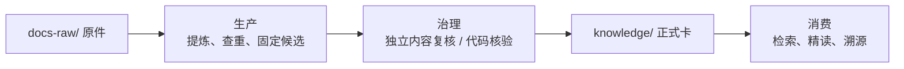

# WiFi 知识库

WiFi 知识库将原始材料提炼为可追溯知识卡，通过独立内容复核、核验和检索回归后供 Agent 使用。文档用 `repo/` 表示项目根目录，知识库位于其下的 `himate-knowledge-wifi-mp/`，Git 操作统一在项目根执行；布局见[总体设计 §5.3](docs-llm-wiki/HiMate知识库架构设计.md#53-himate-knowledge目录架构)。

| 目录 | 存放内容 |
|---|---|
| `docs-raw/` | conventions、chips、storys、specs、protocols 五类原件；`sources/` 留作后续接入 |
| `knowledge/` | 七类正式知识卡及逐层导航，唯一知识正文根 |
| `governance/` | Schema、契约、受控枚举、卡模板、规范及来源锁 |
| `tools/deploy/` | 既有部署兼容工具、执行说明与回归；首次使用从 workspace Skill 的 setup 开始 |
| `../skills/common/knowledge/` | 节点 Skill 的开发分发源码；实际由 harness 调用 Agent 已安装能力 |
| `../workflows/common/knowledge/` | ingest 工作流的开发分发源码；实际部署到 Agent 的 Workflow 目录 |
| `.build/` | 本地候选与转换暂存，生成内容不上库 |
| `logs/` | 操作、复核、来源快照及恢复记录 |
| `evals/` | 检索案例、契约与流程回归 |
| `artifacts/` | 可重建索引与报告，生成内容不上库 |
| `docs-llm-wiki/` | 架构、概要与详细设计、使用说明；项目自身 SDD 工件仅在本地维护 |

从[架构设计](docs-llm-wiki/HiMate知识库架构设计.md)了解目录与三条链路，从[概要与详细设计](docs-llm-wiki/知识库详细设计.md)了解节点判断和文件分工，操作见[使用说明](docs-llm-wiki/使用说明.md)。贡献规则见 [CONTRIBUTING.md](CONTRIBUTING.md)。项目自身的 `docs-llm-wiki/sdd/` 和 `docs-llm-wiki/task.md` 为 Git 忽略的本地开发工件，不是使用或部署知识库的必需文件。

默认将知识库与代码放在同一业务工作区，项目配置全部在根 `config.yml`。Skill／Workflow 已装在 Agent 目录；首次运行 `hs-knowledge-explore` 内 setup，复用全局 Python 并补齐确实缺少的依赖。跨机器时，SSH 提示放该 Skill 的 `config.env`，连接与执行检查交给 harness。正常使用不创建私有环境、登记文件或额外产物目录。仓外知识库仍需另行适配，路径见[工作区路径与部署边界](docs-llm-wiki/知识库关键点.md#1-工作区路径与部署边界)。

外层 `config.yml` 以模块路径和归属整理逻辑 Target／pair；实际宏、构建与版本由明确材料支持，未知项保持 unknown。纯文档经独立 Agent 内容复核和完整固定检查后 stable；代码卡在 ingest 内完成本地只读核验，上库 CI 复用确定性检查。目录结构和设计本身不代表真实业务、宿主或权限隔离已接入。
