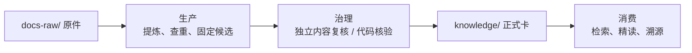

# WiFi 知识库

WiFi 知识库将原始材料提炼为可追溯知识卡，通过独立内容复核、核验和检索回归后供 Agent 使用。文档用 `repo/` 表示项目根目录，知识库位于其下的 `himate-knowledge-wifi-mp/`，Git 操作统一在项目根执行；布局见[总体设计 §5.3](docs-llm-wiki/HiMate知识库架构设计.md#53-himate-knowledge目录架构)。

| 目录 | 存放内容 |
|---|---|
| `docs-raw/` | 六类仓内原件；`sources/` 保存 dbox 目录映射模板，本机资料地址单独配置 |
| `knowledge/` | 七类正式知识卡及逐层导航，唯一知识正文根 |
| `governance/` | Schema、契约、受控枚举、卡模板、规范及来源锁 |
| `knowledge.py`、`knowledge.cmd`、`knowledge.sh` | 仓内统一命令入口；注册命令后可直接使用 `knowledge` |
| `runtime/` | 八阶段执行实现、公共协议、独立运行清单及执行端依赖锁 |
| `../skills/common/knowledge/` | Skill 指引及契约文本的开发源码；分发包不携带执行脚本 |
| `../workflows/common/knowledge/` | ingest 与 lint 巡检编排；实际部署到 Agent 的 Workflow 目录 |
| `.build/` | 本地候选与转换暂存，生成内容不上库 |
| `logs/` | 操作、复核、来源快照及恢复记录 |
| `evals/` | 检索案例、契约与流程回归 |
| `artifacts/` | 可重建索引与报告，生成内容不上库 |
| `docs-llm-wiki/` | 架构、概要与详细设计、使用说明；项目自身 SDD 工件仅在本地维护 |

从[架构设计](docs-llm-wiki/HiMate知识库架构设计.md)了解目录与三条链路，从[概要与详细设计](docs-llm-wiki/知识库详细设计.md)了解节点判断和文件分工，操作见[使用说明](docs-llm-wiki/使用说明.md)。贡献规则见 [CONTRIBUTING.md](CONTRIBUTING.md)。项目自身的 `docs-llm-wiki/sdd/` 和 `docs-llm-wiki/task.md` 为 Git 忽略的本地开发工件，不是使用或部署知识库的必需文件。

默认将知识库与代码放在同一业务工作区，项目配置全部在根 `config.yml`。保留业务仓已有的 `AGENTS.md`，按分发的 `AGENTS.md.example` 合并四项位置说明和 explore 入口指针，不覆盖业务内容；本开发仓的根 `AGENTS.md` 仅本地维护。Agent 使用已安装的文本 Skill 与 Workflow，确定性执行统一调用当前知识根的 CLI；全库能力介绍与路由见 `hs-knowledge-explore`。每个实际执行端首次准备配套 Python 和 `runtime/requirements.lock.txt` 依赖，日常通过 `knowledge doctor` 只读核对，再选择查询、来源或巡检任务。CLI 不调用模型，内容提炼和独立审阅由 Agent 完成。

Windows 本地使用 `.\knowledge.cmd`，POSIX 使用 `sh ./knowledge.sh`，一次命令注册后可用裸 `knowledge`。知识仓在 Samba 服务器时，通过宿主已有 SSH 工具在服务器原生知识根运行同一入口，服务器无需另装或逐次接收 Skill 脚本；从 Windows 经映射盘执行仍会产生网络 I/O。配置及命令见[使用说明](docs-llm-wiki/使用说明.md#2-首次环境安装)，路径约定见[工作区路径与部署边界](docs-llm-wiki/知识库关键点.md#1-工作区路径与部署边界)。

外层 `config.yml` 以模块路径和归属整理逻辑 Target／pair；实际宏、构建与版本由明确材料支持，未知项保持 unknown。纯文档经独立 Agent 内容复核和完整固定检查后 stable；代码卡在 ingest 内完成本地只读核验，上库 CI 复用确定性检查。目录结构和设计本身不代表真实业务、宿主或权限隔离已接入。
