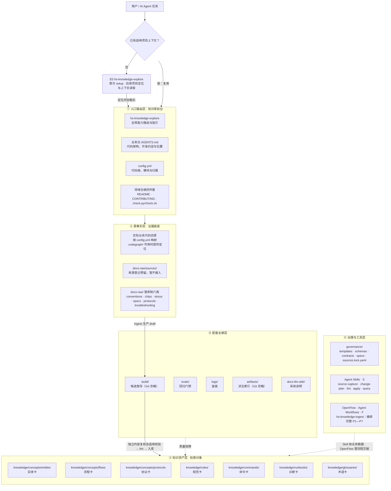
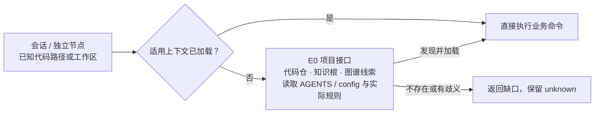
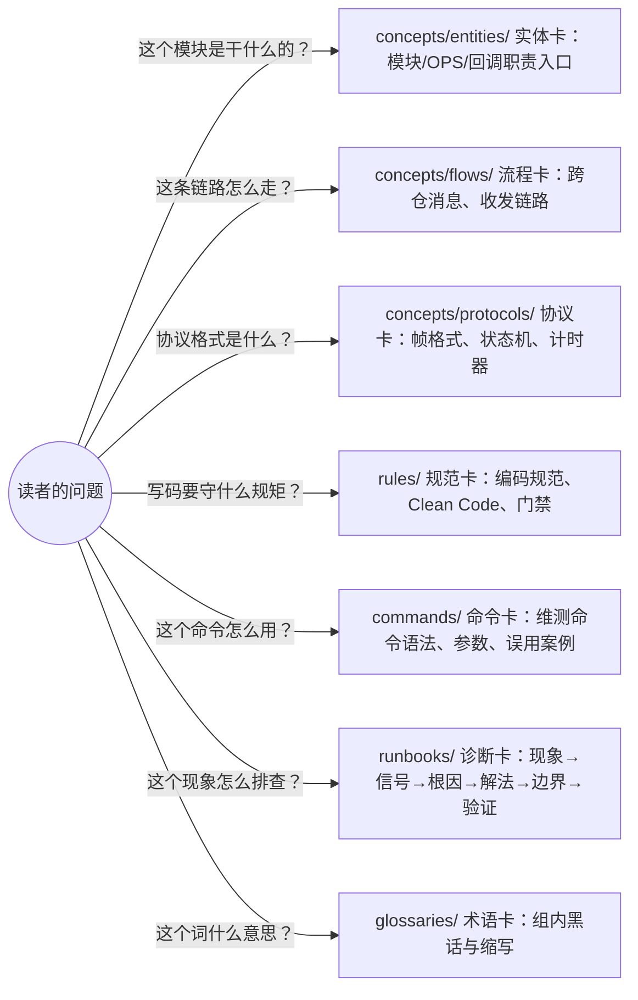
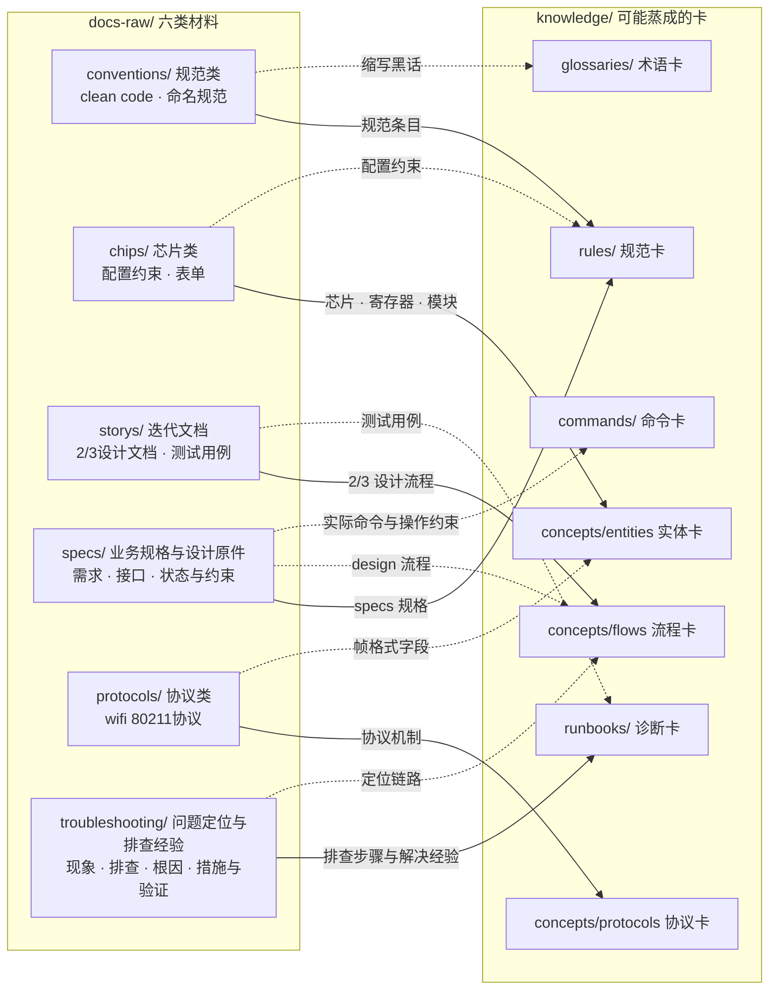
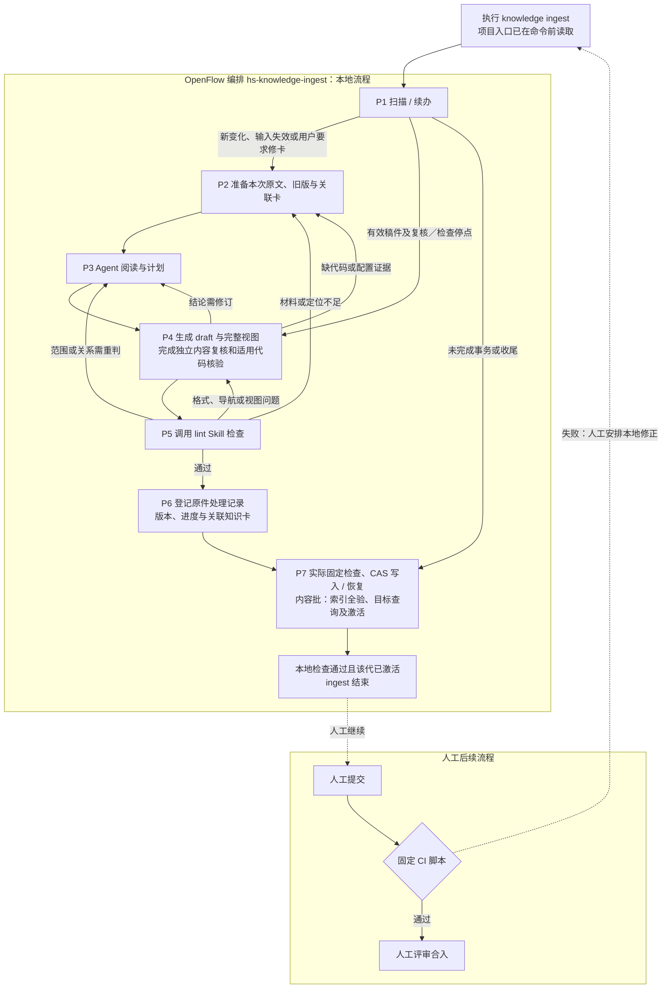
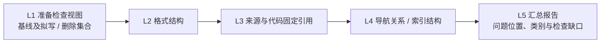
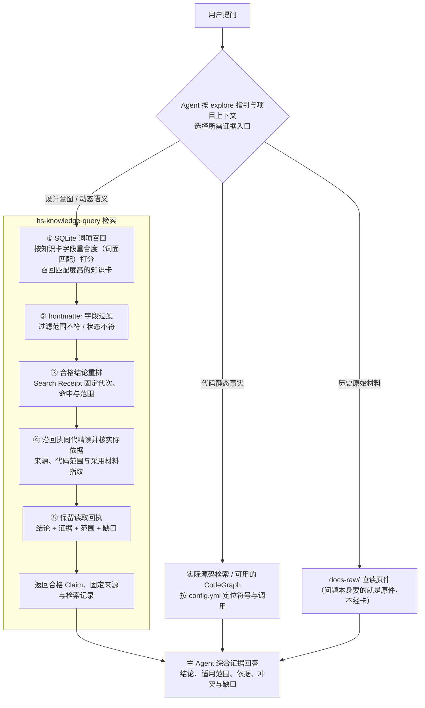

# HiMate知识库架构设计

Skill 可人工逐个调用，只校验本职业务数据和固定检查；OpenFlow 负责流程顺序、角色隔离及交棒合法性。节点不要求 Workflow 身份、catalog 登记或上游通过凭证。

## 5.3 HiMate knowledge目录架构

himate-knowledge知识库仓目录结构如下所示。

本节以 `repo/` 表示项目根目录，实际目录名称和存放位置不限。下树以平铺布局示意；实际知识根 K 由项目 `config.yml` 的 `knowledge_roots.wifi` 相对配置目录解析，允许安全的前置子目录，与业务代码共同管理。开发仓保存 Skill／Workflow 分发源码；实际部署在 Agent 自己的能力目录，运行不依赖项目根保留源码副本。业务工作区可包含 Host、Device、特性和算法等多个代码模块；知识库按配置中的相对路径读取实际文件，以内容指纹核对引用。

当前入口按同一业务工作区读取根 `config.yml`，项目配置全部由用户在这份文件维护。已安装 `hs-knowledge-explore` 是全库能力入口，提供 ingest、query、lint 等任务的选择与指引；首次用 setup 复用全局 Python、补齐实际缺依赖并读取入口，后续缺上下文时才运行只读发现。跨机器 SSH 信息放该 Skill 的 `config.env`，连接与实际执行检查交给 harness。正常流程不增加私有环境或登记步骤。仓外知识库仍需另行适配，见[知识库关键点](知识库关键点.md#1-工作区路径与部署边界)。

- AGENTS.md：具体业务仓的代码架构、开发约定与位置说明；由该工作区维护
- AGENTS.md.example：本项目分发的接入示例，供合并 main、config.yml、知识根及设计文档四项说明
- config.yml：项目架构映射，登记代码根、模块相对路径及芯片／端／特性／用途
- main/：真实代码工作区
- skills/common/knowledge/：开发分发用的节点能力源码，部署位置由 Agent 决定
- workflows/common/knowledge/：开发分发用的 ingest 工作流源码
- himate-knowledge-wifi-mp/：WiFi 领域根，集中维护原件、知识与治理
  - knowledge/：知识卡，唯一检索对象，处理后知识的仓库
  - docs-raw/：源文档，原始证据层（LLM 只读）
  - governance/：治理文件夹，存放契约，模板，规范等
  - .build/ · logs/ · evals/ · artifacts/ · docs-llm-wiki/：配套支撑层

```text
repo/
├── AGENTS.md                      # 业务仓说明，本开发仓仅本地维护
├── AGENTS.md.example              # 分发接入示例，合并到业务仓已有说明
├── config.yml                     # 代码根、模块相对路径与归属
├── main/                          # 业务代码工作区，可包含多个模块
├── skills/common/knowledge/   # 开发分发源码，部署时放入 Agent Skills
│   ├── hs-knowledge-explore/             # 全库能力入口；按需 setup 与只读发现
│   ├── hs-codegraph-setup/               # 按真实模块首次准备 CodeGraph；日常使用官方 MCP
│   ├── hs-knowledge-source-scan/         # 增量扫描、材料与处理记录
│   ├── hs-knowledge-source-capture/      # 保存本次原文副本与定位
│   ├── hs-knowledge-change-plan/         # 六决策计划
│   ├── hs-knowledge-view-materialize/    # 物化最终视图
│   ├── hs-knowledge-governance-handoff/  # 只读描述确切视图与上下文
│   ├── hs-knowledge-lint/                # 只读确定性检查 Skill
│   ├── hs-knowledge-candidate-inspect/   # 检查候选视图、来源与基线
│   ├── hs-knowledge-local-check/         # 代码本地核验
│   ├── hs-knowledge-candidate-revise/    # 修订或缩窄
│   ├── hs-knowledge-apply/               # 精确事务落位
│   ├── hs-knowledge-recover/             # 恢复事务
│   ├── hs-knowledge-index-build/         # 构建、验证与激活索引
│   ├── hs-knowledge-query-regression/    # 回归候选代
│   ├── hs-knowledge-publish-handoff/     # 外部发布材料辅助
│   ├── hs-knowledge-merge-check/         # 固定代码视图复核辅助
│   ├── hs-knowledge-maintain/            # 变更影响与阻断复核
│   └── hs-knowledge-query/               # 消费知识
├── workflows/common/knowledge/ # 开发分发源码，部署时放入 Agent Workflows
│   └── hs-knowledge-ingest/   # P1—P7：原件到 stable 的完整流程
└── himate-knowledge-wifi-mp/       # WiFi 领域根，无嵌套 .git
    ├── AGENTS.md / README.md / CONTRIBUTING.md
    ├── check.py / check.sh         # 固定 CI 入口，复用共用检查函数
    ├── docs-raw/                 # 原始证据，Agent 只读
    │   ├── conventions/          # 编码规范
    │   ├── chips/                # 芯片材料
    │   ├── storys/               # 迭代设计和测试材料
    │   ├── specs/                # 项目需求与设计原件
    │   ├── protocols/            # 内部协议
    │   ├── troubleshooting/      # 问题定位与排查经验
    │   └── sources/              # dbox、3ms、wiki 登记，暂不接入
    ├── governance/
    │   ├── AGENTS.md / index.md
    │   ├── templates/            # 七类卡、导航与处理记录模板
    │   ├── schemas/              # 字段形状、Profile 和受控枚举
    │   ├── contracts/            # 共享机器规则
    │   ├── specs/                # 编写、复核和生命周期规范
    │   └── sources.lock.yaml     # 逻辑来源、固定版本和恢复信息
    ├── knowledge/                # 唯一知识正文根
    │   ├── AGENTS.md / index.md
    │   ├── concepts/
    │   │   ├── entities/         # 模块、OPS、回调职责
    │   │   ├── flows/            # 跨仓消息和收发链路
    │   │   └── protocols/        # 帧格式、状态机和计时器
    │   ├── rules/                # 规范
    │   ├── commands/             # 命令
    │   ├── runbooks/             # 排障
    │   └── glossaries/           # 术语
    ├── .build/                   # 候选暂存，Git 忽略
    ├── logs/                     # 来源、复核、操作和恢复留痕
    ├── evals/                    # 检索案例和回归门禁
    ├── artifacts/                # 可重建索引和报告，Git 忽略
    └── docs-llm-wiki/             # 系统设计与使用说明；自身 SDD 仅本地维护
```

节点 Skill 和 Workflow 随 WiFi 知识库维护：

上树展示开发分发源码。实际能力已经安装在 Agent 自己的 `S`、`F` 目录，由 harness 使用；不要求业务仓根保留能力源码。首次运行 `S/hs-knowledge-explore/scripts/setup.py` 检查当前全局 Python 和依赖、读取项目入口；需要跨机时从同 Skill 的 `config.env` 提示 harness 通过 SSH 执行，不另复制部署工具或建立机器绑定。业务产物仍在 K 已有 `.build/`、`logs/`、`artifacts/`。ingest 完成 P1—P7，lint 保持确定性检查；文档和代码均独立内容复核，代码及混合稿另做适用代码核验。

服务器项目由 Agent/harness 按 `hs-knowledge-explore/config.env` 的 SSH 提示在服务器原生路径执行，使用当地现有全局 Python。harness 须确认实际执行端能调用对应 Skill 脚本；调用端的安装路径不能当作远端脚本路径。setup 只返回连接提示，不上传能力；执行端能力缺失时报告缺口，特殊处理先与用户讨论，不另建目录或工具副本。连接、权限与命令结果由 harness 判断，不另外建立 runner 硬校验层。“本地入库”和“本机索引”指实际执行端；生成物留在 K 原有目录。行为与恢复见[详细设计 §6.3](知识库详细设计.md#63-命令分派与工作流续办)，首次操作见[使用说明](使用说明.md#首次准备运行依赖)。


# 11 HiMate知识库架构

知识库随代码仓一并拉取；首次运行依赖由 `hs-knowledge-explore` 准备，不需要额外业务初始化命令或常驻服务。`ingest` 默认处理六类允许 raw，从提炼 draft 连续完成检查、修订、独立内容复核和适用代码核验，最后将 stable 卡落位到 `knowledge/`；`lint` 是可单独调用的只读确定性检查入口，供手动修改和 CI 复用，不自动修稿或入库；`query` 消费知识。本地入库、索引全验、目标查询及活动代激活完成后，由人提交、触发固定 CI 并评审合入。`ingest --source` 可选限定来源；命令格式见[详细设计 §1.1](知识库详细设计.md#11-从命令进入流程)，OpenFlow 负责 Workflow 的调度和交棒校验；人工测试可逐个调用 Skill 并按实际结果继续。

ingest 是原件到本地正式知识的完整流程；lint 是可被 ingest、独立命令和 CI 复用的只读检查 Skill，query 负责消费。三者不是必须由用户顺序启动的三个 Workflow。

前文"HiMate knowledge目录架构"回答的是"有哪些目录"，本章回答三个问题：**每个目录是干什么的？为什么要有这个目录？目录之间怎么协作？** 阅读顺序：11.1 建立动机认知（为什么需要知识库）→ 11.2 仓库架构（分层模型 + 目录职责）→ 11.3 知识生命周期（三条链路看目录协作）。

## 11.1 知识库收益

AIoT 业务横跨 WiFi、BGLE、定位、雷达、SLP、NFC、NPU、MCU 等十几个领域，代码规模大、协议密集、芯片迭代快，领域知识散落在 dbox/3ms/wiki 设计文档、迭代 story、内部协议和代码注释中。没有知识库时，Agent 每次任务都从零开始读代码、读文档：上下文爆炸、检索无门、结论无法溯源；多人多 agent 各自沉淀的经验无法复用，同样的坑反复踩。

知识库带来的收益：

| 收益 | 说明 |
|------|------|
| 检索增强 | 词面召回 + frontmatter 范围过滤，Agent 先路由再消费，把上下文预算花在刀刃上 |
| 结论可溯源 | 每张卡带 sources 锚点，回答可回溯到原始证据，抑制幻觉 |
| 经验可沉淀 | 一次调试经验固化为 runbook 卡，跨项目、跨 agent 复用 |
| 质量可治理 | lint 门禁 + 检索回归评测，知识有生命周期而非一次性文档 |
| 权限可控 | 按授权范围部署原件、知识卡和派生索引，由仓库与运行环境实施访问控制 |

## 11.2 知识库架构

知识库的目录划分不是文件夹的随意归置，而是治理规则的物理落地。四条原则各对应一对目录：

| 原则 | 回答的问题 | 对应目录 |
|------|-----------|---------|
| 事实与证据分离 | 卡片结论从哪里来？ | `knowledge/`（结论）↔ `docs-raw/`（证据） |
| 事实与规则分离 | 什么才算一张合格的卡？ | `knowledge/`（领域事实）↔ `governance/`（元规则） |
| 人读与机读分离 | 谁来浏览、谁来召回？ | `index.md`（人读导航）↔ `artifacts/`（机器索引） |
| 沉淀与暂存分离 | 什么入库、什么忽略？ | 上库目录 ↔ `.build/`（暂存，Git 忽略） |

项目与知识库按层协作：下图的 `AGENTS.md`、`config.yml` 相对项目根，`docs-raw/`、`knowledge/`、`governance/`、`tools/` 及运行支撑目录相对知识根 K；`S`、`F` 是 Agent 实际能力目录。`main/` 是本仓代码工作区，真实业务目录按 `config.yml` 映射。总体架构如下：



各层与目录的对应关系：

| 层 | 一句话职责 | 承载目录/文件 |
|---|---|---|
| ① 入口路由层 | explore 提供能力路由；已知上下文直接复用，缺失时才发现 | `hs-knowledge-explore` 指引；业务仓 `AGENTS.md` · `config.yml` · 领域仓根四件套；脚本发现为可选前置 E0 |
| ② 源事实层 | 证据底座：代码事实 + 原始材料，喂知识层 | `main/` · `docs-raw/` |
| ③ 知识资产层 | 唯一检索对象：治理后的知识卡 | `knowledge/` |
| ④ 治理与工具层 | Skill 执行业务检查，OpenFlow 编排顺序、角色与交棒；harness 执行命令 | `governance/` · Agent 的 `S`／`F` · 既有兼容工具 |
| ⑤ 配套支撑层 | 候选暂存 · 回归门禁 · 留痕 · 派生索引 | `.build/` · `evals/` · `logs/` · `artifacts/` · `docs-llm-wiki/` |

递进一句话：证据层喂知识层，契约层束知识层，技能层跑知识层，配套层验知识层，入口层路由知识层。

### 11.2.1 根目录架构

#### hs-knowledge-explore —— 全库能力入口与按需前置发现 E0

该 Skill 集中介绍知识库能力并按任务引导 ingest、query、lint 及维护入口。Agent 阅读其指引后，已有有效上下文即可直接使用相应能力；阅读指引不要求执行脚本。首次准备时运行 `hs-knowledge-explore/scripts/setup.py`，检查现有全局依赖并读取根 `config.yml`；有 SSH 提示时由 harness 连接服务器实际执行。后续仅在上下文缺失时通过只读 E0 定位代码仓、知识根并读取业务仓 `AGENTS.md` 与配置，无需重复 setup 或登记。



只读发现依据显式配置、有限祖先路径或 harness 提供的既有上下文，不整盘猜测、不创建图谱或伪造配置。首次 setup 只准备全局依赖和入口，E0 继续处理会话信息缺口；它们位于业务命令之前，不属于 ingest，也不是每条命令的必调步骤。图谱线索和服务真实可用性分别核实，缺项保留 unknown。

#### AGENTS.md / AGENTS.md.example —— 业务仓说明与接入示例

根 `AGENTS.md` 介绍所在业务仓的真实代码架构和开发约定；未知业务结构只列大纲与 `...`，不编造模块。知识库接入只补 `main/`、`config.yml`、知识根和 `docs-llm-wiki/` 四项位置与职责，能力介绍和任务路由由已安装 `hs-knowledge-explore` 承担。

本知识库开发仓的根 `AGENTS.md` 仅本地维护，不作为统一文件分发；共享仓保留 `AGENTS.md.example`。部署时保留业务仓已有的 `AGENTS.md`，只按真实路径合并示例的四项说明和 explore 入口指针，不覆盖原有业务规则；没有文件时才将示例改名并按真实仓补全。默认复用已加载的业务约定、配置和知识库位置；只有上下文缺失才调用前置 E0。仓外知识库部署仍需另行实现[知识库关键点 §1.3](知识库关键点.md#13-例外知识库位于业务仓外)的宿主适配。

参与链路：生产、治理和消费均遵守业务仓约定，并按 explore 指引选择知识库能力。

#### config.yml —— 项目代码架构映射

`code_root` 指定相对项目根的代码工作区，`modules` 登记相对代码根的模块路径，以及可选的 `chips`、`sides`、`features`、`description`。同一模块可覆盖多个子仓，共享模块可关联多个芯片和端；这些是配置事实，人和 Agent 共用一份架构说明。

无需手填仓库绝对路径、六 Target／三 pair 或重复代码根授权。取证按已登记范围读取实际代码文件，固定内容指纹和定位。版本只采用明确提供的材料，未知版本不阻断当前文件静态核验；模块标签帮助定位，不证明宏开启、构建或协议适用。参与链路：生产准备源码、本地核验、查询路由及变化维护共用同一套映射，具体规则见[知识库关键点](知识库关键点.md#1-工作区路径与部署边界)。

#### main/ —— 真实代码工作区

`main/` 是默认业务代码工作区；`config.yml` 以模块相对路径记录芯片、Host／Device、特性及用途，未知接入保持 unknown。业务代码保留实际目录结构，知识根和能力目录不另建嵌套 Git 仓。可用的 `.codegraph/` 提供代码定位，**本地生成不上库**：它是按目录可重建的派生物，且可能包含内部符号信息。知识卡的代码结论通过头部 `Claim.source_refs` 关联确切来源：固定快照中的逻辑仓／模块、相对文件及行段等定位；关键流程步骤可分别绑定对应原文与源码。后续 Agent 根据查询恢复的来源和实际模块映射定位源码，再使用可用的 CodeGraph 分析调用与实现。结构化引用即可承载这条链，正文可点击链接不是前提；只有规范依据时保留设计范围，不补造实现函数。首选部署使代码与知识在同一repo工作区可达；仓外存放需另行实现[部署适配](知识库关键点.md#13-例外知识库位于业务仓外)，默认入口尚不提供该接入。

参与链路：生产取证、本地代码语义核验、CI 固定身份比对及消费的代码交叉印证。

#### `skills/common/knowledge/` —— 项目入口与节点级能力

该路径是开发分发源码；实际能力位于 Agent 的 `S` 目录，由 harness 使用，不依赖项目根同名目录。Skill 保存操作指引与所需脚本；`hs-knowledge-explore` 承担全库能力路由，并提供按需首次 setup 和只读项目发现，领域事实仍只放知识库：

| 技能 | 职责 | 一句话 |
|------|------|--------|
| `hs-knowledge-explore/` | 全库能力入口与任务指引；按需首次 setup、定位代码仓与知识根 | 读指引选择能力；已有上下文直接复用，缺项才运行脚本 |
| `hs-codegraph-setup/` | S0：按模块首次准备 CodeGraph 索引与 MCP 接入 | 纯说明 Skill；日常 Q6 直接用官方 MCP |
| `hs-knowledge-source-scan/` | P1 扫描、P2 材料、P6 处理记录及进度查询 | scan / prepare / record / status |
| `hs-knowledge-source-capture/` | 保存本次原文副本，恢复旧版阅读材料 | 默认捕获；resolve-source / resolve 恢复固定来源或捕获包 |
| `hs-knowledge-change-plan/` | 六决策计划 | plan / review 保存作者计划与独立内容复核 |
| `hs-knowledge-view-materialize/` | 物化最终视图 | 保存完整拟写／删除字节和基线 |
| `hs-knowledge-governance-handoff/` | 只读描述确切视图及来源／基线，不判交棒合法性 | 当前 ingest 不设此固定节点 |
| `hs-knowledge-lint/` | L1—L5 只读确定性检查 | lint |
| `hs-knowledge-candidate-inspect/` | 检查候选业务数据 | 核对确切视图、来源、拟写字节和当前基线 |
| `hs-knowledge-local-check/` | 检查逐 Claim 依据与实际代码／配置材料 | local / merge 核验；verify-proof 复查结果中的业务绑定 |
| `hs-knowledge-candidate-revise/` | 修订或缩窄 | 生成新的受检视图 |
| `hs-knowledge-apply/` | 实际固定检查与精确事务落位 | run；verify-result 核对事务内容，不颁发流程通过资格 |
| `hs-knowledge-recover/` | 恢复事务 | inspect / resume / rollback |
| `hs-knowledge-index-build/` | 按实际卡／来源和可选代码材料构建、验证及激活 | build / verify / activate；不追查上游通过票据 |
| `hs-knowledge-query-regression/` | 回归候选代 | 执行本次明确的查询断言；verify 重跑报告中的实际案例 |
| `hs-knowledge-publish-handoff/` | 外部发布材料辅助 | run / verify-submission；不执行 Git 提交 |
| `hs-knowledge-merge-check/` | 固定代码视图复核辅助 | 复用 local-check 的 merge 核验 |
| `hs-knowledge-maintain/` | 维护与阻断复核 | inspect-context 只读比较；事件登记与 advance 另行写入 |
| `hs-knowledge-query/` | 消费知识 | search / read；延续 search 时绑定原 receipt |

参与流程：OpenFlow 的 ingest Workflow 编排 P1—P7，内部调用 lint Skill；人工测试由人按需要逐个调用，Skill 不校验前驱步骤、角色身份或上游 passed 票据。query 使用实际知识、来源和索引。上表是能力清单，不表示上库必须逐个执行；固定 CI 复用 lint 的确定性检查函数。`hs-knowledge-explore` 提供首次 setup 和后续按需项目接口。S0 仅在首次 setup 时按 `config.yml` 的真实模块准备代码图谱，消费 Q6 使用官方 MCP 定位源码，见[详细设计 §5.11](知识库详细设计.md#511-s0--q6codegraph-首次-setup-与源码定位)。

#### `workflows/common/knowledge/` —— 增量更新与治理工作流

该路径是开发分发源码；实际 Workflow 放在 Agent 的 `F` 目录，由 OpenFlow 按 Skill ID 编排并校验流程顺序、角色隔离和交棒合法性。Skill 自身只处理本次业务输入与输出，不要求 Workflow run／node／attempt 身份或生成流程 manifest。运行脚本从已安装能力定位，不以项目根目录拼接；Workflow 不装领域事实：

| 技能 | 职责 | 一句话 |
|------|------|--------|
| `hs-knowledge-ingest/` | P1 扫描或续办→P2 材料→P3 阅读计划→P4 稿件及适用复核→P5 lint→P6 处理记录→P7 入库、索引与目标查询 | 一次入口完成本地闭环 |

ingest 不另分独立的生产和治理流程；它在 P5 调用已安装的 `hs-knowledge-lint`，由返回的问题决定补材料、重判或修稿，再继续检查。lint 不建立 Workflow。

#### himate-knowledge-wifi-mp/ —— WiFi 领域知识库

WiFi 原件、知识和治理集中在 `himate-knowledge-wifi-mp/`，项目配置由根 `config.yml` 提供；Skill／Workflow 安装在 Agent 自己的目录，由 harness 调用。首次准备复用现有全局 Python，不要求额外私有部署目录或用户填写能力登记。产物使用既有 K 目录。仓外知识库仍需另行实现[知识库关键点 §1.3](知识库关键点.md#13-例外知识库位于业务仓外)的宿主适配；目录不构成 ACL。

参与流程：ingest 负责原件到本地知识，lint 检查固定资产，query 消费合格结论。

### 11.2.2 各领域仓目录架构（以 wifi 为例）

本仓当前实现面向 WiFi-MP。其他领域可以借鉴目录、流程和治理机制，并按目标领域适配配置、原件分类、卡片规则及配套能力；具体改动判断和验证范围见[知识库关键点：目录与领域规则如何适配](知识库关键点.md#2-目录与领域规则如何适配)。

#### 领域仓根四件套

| 文件 | 职责 | 消费者 |
|------|------|--------|
| 领域 `AGENTS.md` | 知识边界与治理规则指针 | Agent 读取领域材料时 |
| `README.md` | 定位、实际能力、资料导航 | 人 |
| `CONTRIBUTING.md` | 生产、核验和贡献流程 | 贡献者 |
| `check.py / check.sh` | 固定 CI 检查入口，复用格式、导航、引用和索引构建规则 | 提交后的 CI 作业 |

四个文件提供领域阅读、贡献和固定检查入口，不承载知识内容；全库任务路由归 explore，领域知识与治理材料分别位于 `knowledge/`、`governance/`。

参与链路：`README.md` / `CONTRIBUTING.md` 是贡献者入口；`check.py / check.sh` 用于提交后的固定 CI 检查；领域 `AGENTS.md` 提供知识边界，生产、治理和消费均加载这些约定。

#### knowledge/ —— 知识正文根（唯一检索对象）

整个知识库中**唯一参与检索的目录**。子目录按"读者带着什么问题来"切分，而非按代码目录切分：



目录按知识类型和读者问题组织，来源出处在卡内 `sources` 与来源锁登记；不能把 raw 分类或材料平台名当成卡类型。`AGENTS.md` + `index.md` 是领域规则与逐层导航。

**上库管理标准**：正式卡、导航、来源锁和 `logs/ingest/` 处理记录按本批清单提交；规则、模板和测试按项目版本管理。`.build/`、派生索引、私有恢复备份及原始复核／证据日志不整体提交。文档和代码结论须有独立 Agent 内容复核，代码另按 Claim 核对源码及条件；固定 CI 仅检查确定性项，详见[保存与提交边界](知识库详细设计.md#64-哪些内容上库哪些用于本机执行)。

参与链路：治理链路（卡片落位上库）+ 消费链路（定位 / 精读）。

#### docs-raw/ —— 原始证据层（LLM 只读）

知识卡正文只写"结论 + sources 指针"，不复制原文段落；被指向的原始材料统一落在 `docs-raw/`。这一层的组织逻辑是**按材料性质分类，而不是按项目、时间或团队分类**——因为下游建卡时，第一个判断就是"这份材料是什么性质、该蒸成什么卡"。

两套存放形态：

- **登记制（`sources/`）**：不好落到本地的文件（dbox、3ms、wiki），按公司三个文档管理工具分类登记"链接 + 版本 + hash + 密级"，原件仍由源系统持有，与薪火平台共管理；`governance/sources.lock.yaml` 锁声明版本与恢复说明。（首发版本暂不支持）
- **落库制（conventions / chips / storys / specs / protocols / troubleshooting）**：内部公开、上库 Git 仓的文件，按 WiFi 组可能用到的材料类型分六类。

##### 分类对知识卡生成的影响

**分类不是仅"方便人管理"，它是知识生产-消费链的第一环**——材料分类决定建卡路由，建卡路由决定卡片元数据，卡片元数据决定检索召回：



实线是默认提炼方向，虚线是兼路由。图中的 specs 是已放入原件目录的业务规格与设计，不包含本项目本地 `docs-llm-wiki/sdd/`、`task.md`。一类材料可产生多类卡，最终按具体结论的性质选择 Profile；目录分类不能替代对正文、来源和适用范围的判断。

| 影响点 | 链路环节 | 分类错位后果 |
|--------|----------|--------------|
| 决定卡类型路由 | 生产：材料性质 → 卡 Profile（映射见上图） | 材料进错类 → 卡 type 判断错 → 卡结构（必填章节）错 |
| 决定溯源锚点 | 治理：卡片 `sources` 必须指向固定可核验位置 | 分类漂移 → 溯源路径漂移 → lint 机器化检查失效 |
| 决定召回过滤 | 消费：query 按 Claim 用途、Target／条件、状态、来源和依赖资格过滤 | 范围声明混乱 → "未知范围伪装通用"或漏召回 |

同时划清边界：**分类不保证卡的内容正确**——内容正确性依靠提炼与独立 Agent 内容复核；分类保证的是"每张卡能被路由到正确类型、溯源到固定位置、过滤出正确范围"三件可机器化审计的事。

参与链路：生产链路（材料分类与登记）+ 消费链路（溯源）。

#### governance/ —— 治理规则层（契约 SSOT）

`templates/`（七类卡、导航与处理记录模板）、`schemas/`（frontmatter / sources schema、profiles、registries）、`contracts/`（knowledge、source_resources 与共享 validation）、`specs/`（编写、复核、生命周期规范）、`sources.lock.yaml`（来源锁：声明版本/落点/hash/bytes/恢复说明）。生产、治理、消费**共用同一契约**，Skill 不维护私有例外。

参与链路：生产链路（建卡时套它的模板）+ 治理链路（契约为治理全程供给规则）+ 消费链路（过滤时按它的规范）。

#### 配套设施

| 目录 | 一句话职责 | 为什么单独设 |
|------|-----------|--------------|
| `.build/` | 转换、规范化、候选暂存（ignored） | 生产过程的半成品不该出现在检索结果里 |
| `evals/` | 检索案例、回归执行与接受/拒绝测试 | 质量门禁：改索引/改契约必须先过回归 |
| `logs/` | 按操作保存来源、内容复核、事务和维护记录；`logs/ingest/` 保存可共享处理事实 | 支持内容追溯与安全恢复；不把日志存在或上游状态当作交棒资格 |
| `artifacts/` | 执行端派生索引、同代正文和验证报告（Git 忽略） | 按实际卡、来源和业务材料重建；完整核对集合、内容与指纹，不依赖上游通过证明链 |
| `docs-llm-wiki/` | LLM WIKI 系统说明 | 讲"系统怎么用"；禁止成为第二份领域事实库 |

参与链路：`.build/` 生产链路暂存；`evals/` 治理链路回归 · CI 门禁复跑；`logs/` 治理链路留痕；`artifacts/` 消费链路机器召回；`docs-llm-wiki/` 不参与链路，讲链路本身。

## 11.3 知识库使用链路

目录共同支撑完整 ingest、只读 lint 和 query。下述先后关系由 OpenFlow 的 Workflow 编排和校验，人工测试时由人掌握；独立 Skill 仍核对本次所需业务文件和内容一致性。先看各自的输入、动作与输出，再对应资产位置；提交后的固定 CI 是独立作业。

### 流程一：ingest —— 从原件到本地正式知识

Agent 已具备业务仓约定、代码仓与知识库位置，并按 explore 指引选择 ingest；缺上下文时由前置 E0 辅助发现，不作为 ingest 的节点。ingest 从 P1 扫描原件开始，是完整的 P1—P7 Workflow。P4 的 draft 和修改预览是中间产物，完成适用的独立内容复核和代码核验后继续 P5，不要求用户另启动入库流程。



P1 对照原件处理记录发现新增、修改、缺失与未完成事项，并接收用户明确的修卡请求；即使原件未变，该请求仍进入 P2 阅读原件和旧卡，不按无变化跳过。扫描只提供观察事实；P3 读取新旧原文和关联卡，再选择 create、update、merge、split、deprecate 或 defer。原件处理记录分别保留本次看到的版本、正式卡采用的版本及实际停点；

P6 校验覆盖和真实引用，不要求先有 lint 通过票据或独立抽样身份证明。apply 自身运行完整固定业务检查，保存实际写入结果，不自动生成 supported 或独立复核验收摘要。保存副本、某卡引用原件均不表示整份原件已全部提炼。仅记录批在 P6 对账并由 P7 保存记录后结束，不写卡或重建索引。记录和阅读材料见[详细设计](知识库详细设计.md)。

续办先核对原件、规则、代码和相关基线，稿件及依据未变时复用原操作与视图。退回改稿或输入变化后建立新操作与新视图，重新完成独立内容复核、适用代码核验和 P5；纯文档通过后继续入库，不等待真人回复。P6 准备并校验待入库记录，P7 随本批事务正式落位；apply 核对实际视图、来源恢复、当前代码／配置材料和旧基线，不检查前驱 Skill 是否通过。恢复依赖原视图、事务、CAS 和备份，可选复核文件后来删除不阻断安全恢复。未完成写入优先恢复原事务，已入库只补未完成的索引／查询／激活，不重复写入。用户要求修改已入库卡时，另建更新操作。

只有同范围完整扫描成功，才能把原有路径未出现列为缺失；不可读、扫描中断或 `--source` 范围外不推断删除。缺失项读各关联卡实际引用的旧原文，不自动删知识。

### 流程二：lint Skill —— 只读检查并汇总问题

`hs-knowledge-lint` 是 Agent 已安装的 Skill 包，内部调用固定脚本。ingest 的 P5、独立 lint 命令及 C1 共用确定性规则；lint 只做确定性检查，不修稿、不做内容语义复核、不 apply。C1 直接使用知识库的 `check.py`／`check.sh` 与受锁领域规则，不依赖 Agent 的能力目录。



L3 核对快照、文件指纹、路径、行页段及范围绑定，能定位不表示支持结论。文档和代码内容复核由 P4 完成，混合卡不能整体免核验。L4 检查受管导航和派生结构，必要时临时构建验证，不切换活动索引。

C1 位于提交之后，复用这些确定性检查及必要的 SQLite 构建验证；代码变化只核已固定文件的 hash、路径和范围。不匹配则失败返回本地修正，不自动修稿或重新组织 Agent 语义复审。
### 流程三：query —— 知识消费

输入是问题与已有项目上下文，可补 Target 或指定历史版本，输出是带证据的回答。Agent 按 `hs-knowledge-explore` 的任务指引，结合业务仓约定与项目配置，按**所需证据**选择入口：



图中展示证据入口，主 Agent 根据问题综合材料；代码事实以所问版本的实际源码确认。下表沿用项目根／知识根 K 的路径基准；能力位置以 Agent 的实际目录 `S`、`F` 为准。

查询用途与 stable 状态分开判断：current／implementation 直接核对实际来源、当前模块／Target 范围和工作树源码字节；涉及构建／运行断言时，还复查索引中 `code_contexts` 固定的实际材料和逐 Claim 引用指纹，不要求 apply／merge-check 已通过的票据。静态源码结论和纯文档不增加构建材料要求，guidance／historical 不把未知条件提升为产品当前事实。

OpenFlow 在 P3 预先声明目标查询及用途，P7 沿用计划；独立回归 Skill 直接执行本次明确输入的查询断言。query 的 search 回执固定频道、索引代、用途、上下文及命中 Claim，read 仍核实际依据，不能把回执当成永久授权。

shared 索引可在构建时按 `knowledge_commit` 核对实际 Git 快照，query 复验所用代次的快照，结果只声明 `repository_snapshot`；显式提交签名发布回执时另核受信发布身份，不由此证明上游流程或 CI 已通过。OpenFlow 按同一 K 单个 ingest 编排；query 可并发，写入仍由事务锁和 CAS 保护，活动代切换或内容变化时可明确拒绝，机制见[详细设计 §5.9](知识库详细设计.md#59-q1q6路由查询同代精读与回答)。

#### 目录 × 链路参与矩阵

| 目录/文件 | ingest（原件 → 本地正式知识） | lint / 固定 CI（只读检查） | query（卡 → 答案） |
|---|---|---|---|
| `AGENTS.md` / `config.yml` | 项目约定、代码根与模块归属 | 适用规则、实际代码上下文和条件缺口 | 路由与范围依据 |
| 实际业务代码目录 | 代码取证与 P4 内容复核 | 固定引用与文件身份检查 | 源码交叉印证 |
| Agent Skills（`S`） | 可独立调用的 P1—P7 材料、计划、内容复核、lint、核验及入库能力 | 独立 lint Skill；固定 CI 直接复用 K 内规则 | 查询、精读、来源恢复 |
| Agent Workflows（`F`） | OpenFlow 编排 P1—P7，校验顺序、角色与交棒 | — | — |
| `knowledge/` | 查重、关联卡和 P7 精确入库 | 正式卡格式与引用检查 | 唯一正文检索对象 |
| `docs-raw/` | 只读原件 | 来源一致性复核 | 原件与证据溯源 |
| `governance/` | 模板、来源和卡契约 | 共同规则、来源锁与记录约束 | 范围、来源、依赖与业务材料一致性 |
| `.build/` | draft、计划和完整视图 | 只读检查视图 | 检索操作暂存 |
| `evals/` | — | 索引和检索回归 | 回归用例 |
| `logs/` | 原文、内容复核、核验、事务与续办记录 | 只读核对记录结构和实际引用 | 来源恢复与实际变更事实，不作为上游放行票据 |
| `artifacts/` | 查重时使用已有索引 | CI 内部构建、验证的派生索引 | 机器召回与同代正文 |
| `docs-llm-wiki/` | 系统设计与操作说明 | 系统设计与操作说明 | 系统使用说明 |
