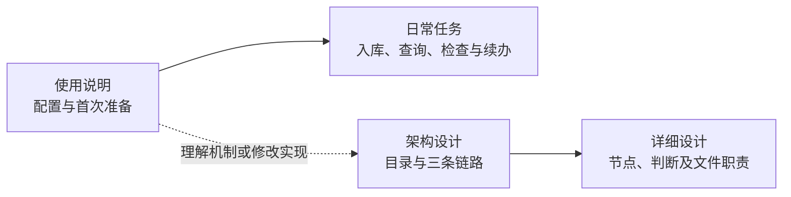

# HiMate 设计与使用入口

第一次使用从[使用说明](使用说明.md)开始：保留业务仓已有的根 `AGENTS.md`，按 `AGENTS.md.example` 合并位置说明和 `hs-knowledge-explore` 入口指针，核对项目 `config.yml`、知识根和 Agent 已安装的配套能力。已有环境与项目上下文时直接选择业务任务，首次准备和只读发现按需执行。

| 文件 | 阅读目的 |
|---|---|
| [使用说明.md](使用说明.md) | 两份配置、首次环境准备、日常任务和独立动作的使用方法 |
| [HiMate知识库架构设计.md](HiMate知识库架构设计.md) | 目录架构、分层职责及生产、治理、消费三条链路 |
| [知识库详细设计.md](知识库详细设计.md) | §2.1 七阶段 ingest；§3.1 只读 lint 巡检与 L1—L5 检查；§3.2 固定 CI；§4 查询；§5 节点文件；§6 共用规则与保存边界 |
| [知识库关键点.md](知识库关键点.md) | 路径与部署边界，以及更换领域、raw 类别和卡片 Profile 时的配套改动 |
| [AGENTS.md](AGENTS.md) | Agent 阅读入口与文档维护约定 |

本目录下的 `task.md`、`sdd/` 用于本机开发任务、需求、测试计划和验收记录，由 Git 忽略，部署无需准备。本目录的共享正文说明系统设计与使用方式；正式领域知识进入 `../knowledge/`。

## 能力与任务入口

当前有9个公开 Skill，名称均以 `hs-knowledge-` 开头：explore、source-scan、source-prepare、change-plan、view-materialize、lint、apply、query、maintain。开发分发源码在项目根的 `skills/common/knowledge/`；实际运行使用 Agent 已安装的能力。两个 Workflow 的源码在 `workflows/common/knowledge/`，由 OpenFlow 加载和编排。

| 任务 | 使用哪个入口 | 做到哪里结束 |
|---|---|---|
| 新原件入库、增量更新或明确修订已有卡 | `hs-knowledge-ingest` **Workflow** | P1扫描、P2备料、P3内容决策、P4完整稿、P5审阅和检查、P6记录、P7安全落位与检索收尾；真正无变化则在P1结束 |
| 单独检查正式库或候选稿 | `hs-knowledge-lint` **Skill** | 默认只读检查正式完整库；按请求也可检查候选，保存检查报告后结束 |
| 巡检正式库及来源／代码引用 | `hs-knowledge-lint` **Workflow** | `check_formal` 调用 lint 默认正式全库检查，`audit_references` 调用 maintain 的只读引用巡检；保存 JSON／Markdown 报告后结束 |
| 检索知识并分析问题 | `hs-knowledge-query` **Skill** | 按用途、范围和实际依据检索，使用回执精读同一代索引中的正文，再给出结论与缺口 |
| 独立备料、进度观察、恢复或索引维护 | 对应 **Skill 的公开动作** | source-prepare准备材料，source-scan观察进度，apply提供事务恢复／索引／回归／提交核对，maintain负责维护状态；见[独立动作](使用说明.md#独立备料恢复索引与提交核对) |

同名 lint Skill 与 Workflow 分属能力目录和工作流目录；ingest 的 P5 调用的是 lint **Skill** 的 `review` 动作，不嵌套 lint Workflow。独立 lint 默认仍为正式全库固定检查，周期巡检由外部系统触发；发现问题后，由人明确将修订要求交给 ingest，巡检不自动修稿。

内容批正常在P5完成独立审阅和一次完整质量检查，再由P6转写已定处置，P7调用 `apply --action batch`。P7核对实际输入、旧文件基线、写锁、字节和记录，再构建并完整验证真实索引、执行冻结查询、按原活动指针基线启用；不重复P5质量判断。仅记录批只保存处理结果并保留欠账，不新建或启用索引。旧 `apply --action run` 保留原完整固定检查和结果语义，不能当作新主线的安全收尾入口替换使用。

P1只发现变化和续办事项，P2独立准备新旧材料，可按固定扫描清单或明确目标开始。P5缺材料回P2、内容判断有误回P3、稿件问题回P4；返工保存新操作及前序稿引用，不覆盖旧工件，输入有效时复用原扫描单元。采用的原件版本已变时，由P2要求刷新受影响的扫描范围。运行故障按原停点续办；已落位内容只补索引、查询或启用，不重复写入。完整分支见[详细设计 §2.1](知识库详细设计.md#21-完整流程与节点判断)。

Workflow负责顺序、角色与交棒：P5由独立reviewer执行，其余节点由coder执行。Skill只核对本职业务数据，不认证角色、Workflow身份或上游通过票据；内部通过知识根的受锁公共函数复用规则，不调用兄弟Skill CLI。人工验证可逐个调用同一组Skill，真实宿主的角色隔离、出口选择和等待恢复仍需按部署环境核实。

## 项目与执行位置

文档用 `repo/` 示意项目根。业务仓 `AGENTS.md`、用户维护的 `config.yml`、实际代码工作区和知识根位于该项目中；知识根按 `knowledge_roots.wifi` 相对配置目录解析，允许安全嵌套。代码按 `code_root` 和 `modules[].path` 映射真实文件，不要求另建六Target／三pair配置，也不按目录标签推断宏、构建或版本事实。填法见[两个配置文件](使用说明.md#1-两个配置文件)，路径规则见[知识库关键点](知识库关键点.md#1-工作区路径与部署边界)。

`hs-knowledge-explore` 负责全库路由、按需准备与项目发现。首次 `setup.py` 检查现有全局Python依赖并读取项目配置；已有有效环境与上下文后直接使用业务能力，不新增catalog、registry或机器绑定。首次CodeGraph准备由Agent按真实配置逐仓执行，空模块列表不建图，MCP由harness提供；见[首次环境安装](使用说明.md#2-首次环境安装)及[详细设计 §5.11](知识库详细设计.md#511-explorecodegraph-首次初始化)。

SSH提示保存在已安装explore的本机 `config.env`，harness连接后须核对执行端实际能力和原生路径；提示不代表远端已就绪，调用端路径不能直接用作远端路径。请求、稿件、记录和索引沿用实际知识根的 `.build/`、`logs/`、`artifacts/`。共享正式资产与本机执行材料的区别见[保存与提交边界](知识库详细设计.md#64-哪些内容上库哪些用于本机执行)。

本地入库、索引启用、Git提交、固定CI和合入分别记录实际事实。ingest完成后，按本批清单由人提交并触发固定CI，复用确定性检查函数，再评审合入；见[上库流程](知识库详细设计.md#32-上库固定-ci-检查后合入)。设计图、目录、角色标签及机制测试各有说明范围，不能代替真实业务内容、宿主接入或权限验收。
