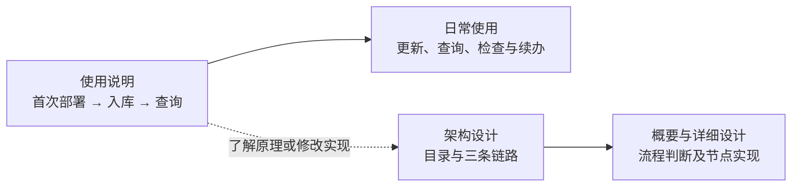

# HiMate 设计与使用入口

第一次使用直接从[使用说明](使用说明.md)开始：默认项目中已放好知识根、根 `AGENTS.md` 与 `config.yml`，Agent 已安装配套能力，但当前项目还没有准备运行环境。架构与详细设计用于需要理解机制或修改实现时查阅。

| 文件 / 目录 | 阅读目的 |
|---|---|
| [HiMate知识库架构设计.md](HiMate知识库架构设计.md) | 目录架构、分层职责与生产、治理、消费三条链路 |
| [知识库详细设计.md](知识库详细设计.md) | 第 1 节说明前置发现和命令；第 2.1 节画完整 ingest P1—P7，第 3.1 节展开 lint 检查，第 3.2 节说明固定 CI，第 4 节说明查询与 Q6 源码定位；第 5 节按节点解释文件设计，§5.11 说明 S0 CodeGraph 首次 setup；第 6 节集中说明共用规则与运行约束 |
| [知识库关键点.md](知识库关键点.md) | 工作区路径基准、默认与仓外部署边界，以及项目视图和文件核验约定 |
| [使用说明.md](使用说明.md) | 填写 `config.env` 与 `config.yml` → 发送首次安装 Prompt → 日常 `query`、`ingest`、`lint` 的用法与 Prompt |
| [AGENTS.md](AGENTS.md) | Agent 阅读入口和文档修改边界 |

项目自身的 `task.md` 与 `sdd/` 仅在本地保存开发任务、需求、测试计划和验收记录，已由 Git 忽略；共享仓库和能力包不包含这些工件，使用与部署无需准备它们。

文档用 `repo/` 表示项目根目录的示意名称。业务代码工作区、`AGENTS.md`、`config.yml` 与知识库 `himate-knowledge-wifi-mp/` 位于该根目录。开发仓的 `skills/common/knowledge/` 和 `workflows/common/knowledge/` 是分发源码；实际能力装在 Agent 自己的目录，由 harness 调用；项目根不要求保留能力源码。业务代码可包含多个实际代码仓或模块目录，不另建嵌套 `.git`。本目录只存系统说明与开发工件，正式领域知识只进入 `../knowledge/`。

项目配置全部由用户在根 `config.yml` 提供，包括知识根、代码根与模块映射。首次 setup 只检查实际全局依赖、读取这份配置并给出项目入口，不生成另一套 catalog、registry 或机器绑定。仓外知识库需要另行适配，增加连接字段不会扩展布局。路径见[工作区路径与部署边界](知识库关键点.md#1-工作区路径与部署边界)。

同一工作区内的知识根可按 `knowledge_roots.wifi` 嵌套，项目根以实际 `config.yml` 为准。跨机器 SSH 信息放已安装 `hs-knowledge-explore` 的 `config.env`；harness 负责连接，并确认实际执行端的能力入口可调用。`ssh_entry` 不上传脚本或证明远端就绪，调用端路径不能直接当作远端路径；缺执行能力先报告并讨论方案。本机直接调用，请求、稿件、记录和索引沿用 K 的 `.build/`、`logs/`、`artifacts/`。操作见[使用说明](使用说明.md#首次准备运行依赖)。

`hs-knowledge-explore` 是知识库项目接口：首次通过 `setup.py` 检查现有全局依赖、读取项目配置；后续用只读发现定位代码仓、知识根并加载上下文，已有信息直接复用。它不属于 ingest 的 P1，不要求每次业务调用都重复 setup。业务 CLI 默认读取当前规则锁并核验文件，不要求 catalog、Workflow 身份或登记。首次操作见[使用说明](使用说明.md#首次准备运行依赖)。

`config.yml` 维护代码根和模块相对路径，以及芯片、Host／Device、特性和用途；共享模块可关联多芯片、多端。无需逐项填写六 Target、三 pair 或重复代码根授权，取证按路径读取实际文件并固定内容指纹。配置填法见[使用说明](使用说明.md#配置项目代码架构)，共享映射与核验逻辑见[知识库关键点](知识库关键点.md#1-工作区路径与部署边界)。

能力共 19 个 Skill：18 个公开 CLI 节点及 1 个纯说明 `hs-codegraph-setup`，另有 1 条 ingest Workflow。`hs-knowledge-explore` 负责首次准备与后续项目定位；`hs-codegraph-setup` 按真实模块准备图谱及官方 MCP，空模块列表不建图，日常 Q6 直接使用 MCP 或实际文件检索。卡头来源及查询结果提供模块、文件与定位，Agent 按实际 `config.yml` 匹配模块根后追查源码，不以正文可点击链接为前提；见[查询和追代码](使用说明.md#3-怎么查询和追代码)与[详细设计 §5.9](知识库详细设计.md#59-q1q6路由查询同代精读与回答)。

设计文档描述职责、流程与边界，能力安装、实际宿主、六 Target、CI 合入和权限验证以各自环境的实际记录为准。本项目历史验证工件在本地 SDD 保存原始版本身份，不据此推断当前部署状态。

详设中的 `knowledge ...` 是统一入口名称。首次准备后，按[使用说明](使用说明.md)中的 Prompt 向 Agent 发起 `query`、`ingest`、`lint`；当前由 Agent 调用已安装 Skill，底层接口参数见相应能力的 `SKILL.md` 与 `references/`。

`knowledge ingest` 是逻辑入口名称，默认扫描五类允许 raw 并选择新增、变化及待处理来源；限定范围时，在 source-scan 的请求中填写可选 `source`。首次导入和日常增量使用同一套能力，不要求安装同名终端命令。

当前测试由人工点名逐个调用 Skill，按实际业务文件传递输入输出；后续由 OpenFlow 的 ingest Workflow 编排扫描、写稿、独立内容复核、适用代码核验、lint、记录及本地入库，并检查流程顺序和交棒。Skill 自身只检查本职数据，不要求前驱通过凭证。`query` 消费正式知识，`hs-knowledge-lint` 独立只读检查，发现问题交回相应生产步骤修订。

独立内容复核由人工测试者或 OpenFlow 安排；Skill 核对逐 Claim 理由、实际材料和确切内容绑定，不以作者名字或上下文标签校验角色隔离。apply 自身执行固定业务检查并保护写入，不检查上游通过票据，也不因成功落位自动生成 supported 验收摘要。lint 与固定 CI 继续复用确定性检查。

索引与查询直接核对卡片、来源、当前代码范围及采用材料；构建／运行结论使用随索引固定的 `code_contexts` 业务数据，不依赖 apply／merge-check 证明链。共享索引构建时指定 `knowledge_commit` 只确认实际仓库快照；显式签名发布回执另核发布身份真实性，不能据快照或入库成功推断 CI、合入或语义复核通过。

用户可在执行中要求退回，也可在入库后要求修改已有卡；原件未变的明确修订仍走新操作，重新完成复核、检查与入库。

本地入库、完整索引验证、本批目标查询通过，且该代次成功激活后 ingest 结束；之后由人提交并触发固定 CI，复用 lint 的格式、导航、引用和索引检查脚本，通过后人工合入；见[上库流程](知识库详细设计.md#32-上库固定-ci-检查后合入)。
