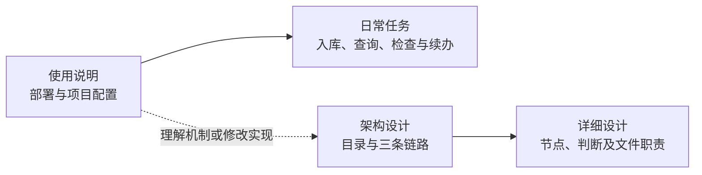

# HiMate 设计与使用入口

第一次使用从[使用说明](使用说明.md)开始：保留业务仓已有的根 `AGENTS.md`，按 `AGENTS.md.example` 合并位置说明和 `hs-knowledge-explore` 入口指针，核对项目 `config.yml`、知识根和 Agent 已安装的配套能力。首次部署或本机依赖缺项使用[部署脚本](使用说明.md#2-首次环境安装)；已有部署与项目上下文时直接选择业务任务，缺少入口时才做只读发现。

| 文件 | 阅读目的 |
|---|---|
| [使用说明.md](使用说明.md) | 项目配置与执行位置、首次环境准备、日常任务和独立动作的使用方法 |
| [HiMate知识库架构设计.md](HiMate知识库架构设计.md) | 目录架构、分层职责及生产、治理、消费三条链路 |
| [知识库详细设计.md](知识库详细设计.md) | §2.1 七阶段 ingest；§3.1 治理巡检、Git 适配与 L1—L5 检查；§3.2 固定 CI；§4 查询；§5 节点文件；§6 共用规则与保存边界 |
| [知识库关键点.md](知识库关键点.md) | 路径与部署边界，以及更换领域、raw 类别和卡片 Profile 时的配套改动 |
| [AGENTS.md](AGENTS.md) | Agent 阅读入口与文档维护约定 |

本目录下的 `task.md`、`sdd/` 用于本机开发任务、需求、测试计划和验收记录，由 Git 忽略，部署无需准备。本目录的共享正文说明系统设计与使用方式；正式领域知识进入 `../knowledge/`。

入库的准备、发布与清理是一条连续流程：前六步保存本批暂存材料，最后一步发布正式内容和必要依据，完成索引、查询验证与启用，再清理本批可删文件。完整分支见[详细设计 §2.1](知识库详细设计.md#21-完整流程与节点判断)，发布与清理见[§5.7](知识库详细设计.md#57-p7安全事务真实索引与检索收尾)，共享资产与本机材料的保存边界见[§6.4](知识库详细设计.md#64-哪些内容上库哪些用于本机执行)。

## 能力与任务入口

当前有8个公开 Skill，名称均以 `hs-knowledge-` 开头：explore、source、change-plan、view-materialize、lint、apply、query、maintain。开发分发源码在项目根的 `skills/common/knowledge/`；实际运行使用 Agent 已安装的能力。两个 Workflow 的源码在 `workflows/common/knowledge/`，由 OpenFlow 加载和编排。

| 任务 | 使用哪个入口 | 做到哪里结束 |
|---|---|---|
| 新原件入库、增量更新或明确修订已有卡 | `hs-knowledge-ingest` **Workflow** | 前六步完成扫描、备料、成稿、审阅和待发布记录；P7发布、验证检索并清理本批暂存；真正无变化则在P1结束 |
| 单独检查正式库或候选稿 | `hs-knowledge-lint` **Skill** | 默认只读检查正式完整库；按请求也可检查候选，保存检查报告后结束 |
| 巡检raw及来源／代码变更并处理 | `hs-knowledge-lint` **Workflow** | 同步后脚本筛选，按待办复用 ingest 能力修订；只在实际发布、索引及清理完成后推进成功基线 |
| 检索知识并分析问题 | `hs-knowledge-query` **Skill** | 按用途、范围和实际依据检索，使用回执精读同一代索引中的正文，再给出结论与缺口 |
| 独立扫描、备料、进度观察、恢复或索引维护 | 对应 **Skill 的公开动作** | source提供扫描、备料、捕获、来源恢复、记录与进度，apply提供事务恢复／索引／回归／提交核对，maintain负责维护状态；见[独立动作](使用说明.md#独立备料恢复索引与提交核对) |

同名 lint Skill 与 Workflow 分属能力目录和工作流目录；ingest 的 P5 调用的是 lint **Skill** 的 `review` 动作。独立 lint 默认仍为正式全库固定检查；周期治理由外部系统触发 lint Workflow，根据实际差异生成精确材料请求，复用 source.prepare 与 P3—P7 处理，核验真实完成后才推进成功基线，不嵌套另一个 Workflow。

内容批在P5完成独立审阅和一次完整质量检查，P6只保存待发布的处理记录。P7调用 `apply --action batch`，核对输入、原版本、写锁和实际落盘字节；已审内容与必要依据发布并核验后，才保存正式成功记录。随后构建并完整验证索引，执行本批预定查询和同代精读，按原活动指针基线启用，最后清理本批可删暂存。内容已发布与整批已完成是两件事：检索或清理未完成时，保留已发布事实并报告停点。仅记录批保存处理结果及欠账，不新建或启用索引。旧 `apply --action run` 沿用原完整检查和事务语义。

ingest保留P1—P7七个业务步骤，由六个OpenFlow节点调度。首个coder节点`prepare_sources`使用source默认`run`，先由脚本生成真实扫描清单，再按待办准备材料；完整且没有待办、维护限制、缺口或明确修订目标才返回`unchanged`结束，否则交实际`scan_ref/material_ref`给P3。新流程不搜索旧私有操作，Agent不重写扫描事实。P3／P4／P5缺材料返回首节点，但明确调用`prepare`定向补齐，不先重跑默认`run`；判断有误回P3，稿件问题回P4。输入漂移按变化对象刷新有效材料，运行故障保留原停点。只有明确继续某次执行时，才按其确切引用核对停点；指定操作的`status`只观察历史事实，不证明当前索引健康。用法见[使用说明](使用说明.md#进度续办和完成判断)。

Workflow负责顺序、角色与交棒：P5由独立reviewer执行，其余节点由coder执行。Skill只核对本职业务数据，不认证角色、Workflow身份或上游通过票据；内部通过知识根的受锁公共函数复用规则，不调用兄弟Skill CLI。人工验证可逐个调用同一组Skill，真实宿主的角色隔离、出口选择和等待恢复仍需按部署环境核实。

## 项目与执行位置

文档用 `repo/` 示意项目根。业务仓 `AGENTS.md`、用户维护的 `config.yml`、实际代码工作区和知识根位于该项目中；知识根按 `knowledge_roots.wifi` 相对配置目录解析，允许安全嵌套。代码按 `code_root` 和 `modules[].path` 映射真实文件，不要求另建六Target／三pair配置，也不按目录标签推断宏、构建或版本事实。填法见[项目配置与执行位置](使用说明.md#1-项目配置与执行位置)，路径规则见[知识库关键点](知识库关键点.md#1-工作区路径与部署边界)。

`hs-knowledge-explore` 负责全库路由与只读项目发现；首次部署统一使用分发仓根的 `deploy.ps1`，旧 `setup.py` 只保留显式诊断或兼容用途。已有部署及有效上下文后直接使用业务能力，不自动安装依赖，不新增catalog、registry或机器绑定。首次CodeGraph准备由Agent按真实配置逐仓执行，空模块列表不建图，MCP由harness提供；见[首次环境安装](使用说明.md#2-首次环境安装)及[详细设计 §5.11](知识库详细设计.md#511-explorecodegraph-首次初始化)。

目标代码仓在远端时，用户或部署维护者先在 OpenFlow 配置、启用 SSH MCP，并验证实际可调用，连接凭据由宿主管理；操作见[远端执行准备](使用说明.md#12-远端执行先配置-openflow-ssh-mcp)。远端须已有全局 Python 和配套已安装 Skill，Agent 再通过 SSH MCP 执行脚本与仓库操作，核对执行端能力和原生路径；调用端路径不能直接用作远端路径。同机执行不要求 SSH。请求、稿件、记录和索引沿用实际知识根的 `.build/`、`logs/`、`artifacts/`。共享正式资产与本机执行材料的区别见[保存与提交边界](知识库详细设计.md#64-哪些内容上库哪些用于本机执行)。

本地入库、索引启用、Git提交、固定CI和合入分别记录实际事实。ingest完成后，按本批清单由人提交并触发固定CI，复用确定性检查函数，再评审合入；见[上库流程](知识库详细设计.md#32-上库固定-ci-检查后合入)。设计图、目录、角色标签及机制测试各有说明范围，不能代替真实业务内容、宿主接入或权限验收。
