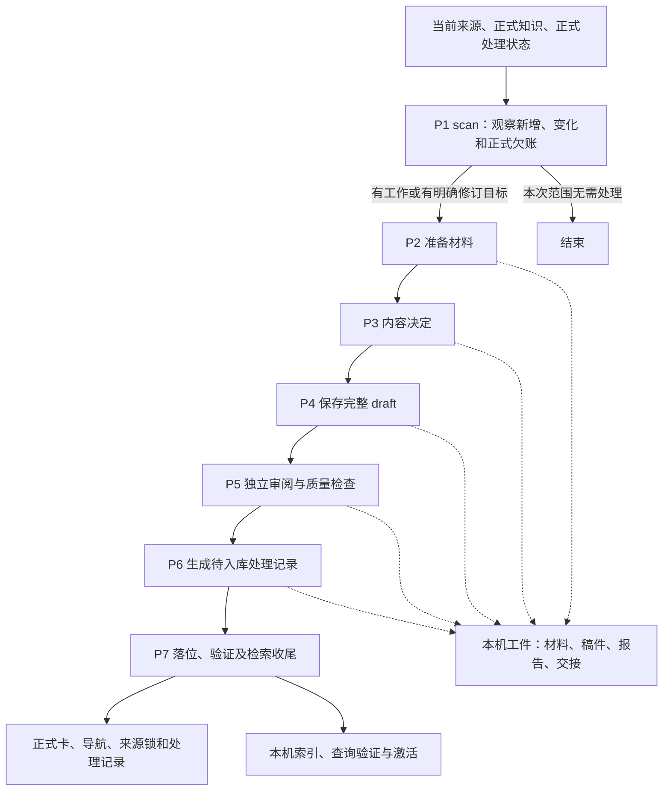

# Skill 边界与状态记录重构方案

状态：待评审，尚未实施。日期：2026-10-29。

本文汇总本轮讨论，供设计对齐后实施。当前代码仍以实际 Skill、Workflow 和公共契约为准；下文的目标流程不代表现有实现已经完成修改。路径以 `repo/` 为项目根，K 为配置声明的实际知识根。

## 1. 问题与目标

现有知识库包含 ingest、lint、query 三类工作。ingest 生产知识，lint 发现需要维护的问题，query 消费正式知识。本轮只调整这些能力的数据读取边界、处理状态和执行记录职责，不改变知识卡的内容定位，也不新增语义准确度门禁。

目前普通 scan 同时读取正式处理记录和本机旧 operation。指定目标的 status 也会间接枚举所有索引、回归和激活报告。这会导致同一份正式库在不同机器上，或在清理旧本机文件前后，出现不同的来源处理判断；无关坏历史也可能干扰新任务。

目标是：

- 正式资产与长期处理状态足以支持新的增量任务。
- 本次 Workflow 的稿件和交接材料保留在本机，通过明确引用传递。
- 同 session 继续由 Agent 使用本次上下文和材料推进；新 Workflow 默认重新开始，不自动接续旧 Workflow。
- 过程产物可以按生命周期清理，不因为其中包含正式状态的唯一副本而被迫永久保留。
- 先完成基础职责重构，暂不为极少见的 P7 落位中断建设自动修复体系。

## 2. 本轮已收敛的决策

| 编号 | 决策 |
|---|---|
| D1 | 普通 scan 以当前真实来源、正式知识与随仓处理状态为输入，不枚举旧 Workflow 的执行目录。 |
| D2 | 新 Workflow 创建自己的 operation，不因旧 operation 未结束而自动恢复、采用旧稿或跳到旧 P7。 |
| D3 | 原 session 继续时，Agent 沿本次实际工件和进度推进；scan 不承担查找恢复位置的职责。 |
| D4 | 进入 P7 前，材料、稿件、检查结果和待入库记录均为本机工件，不能提前作为正式完成状态。 |
| D5 | 正式记录保留来源版本、完成处置、实际覆盖和欠账；普通执行日志本地留存并在满足条件后清理。 |
| D6 | 保留现有写锁、文件完整替换、基线校验及未完事务保护，不以简化 scan 为由删除这些保护。 |
| D7 | P7 多文件发布途中被中断、新 session 又不接续原任务的自动修复，首轮不覆盖；不保证任意中断后仅靠重跑 scan 都能自愈。 |
| D8 | 九个 Skill、七个 ingest 节点和现有卡片／code_ref 结构保持；P1 自动恢复出口移除。 |

这里“忽略旧未完成记录”指忽略旧 Workflow 的执行进度，不是丢弃正式记录中的失败、暂缓、部分覆盖等业务欠账。

## 3. 用户场景

1. 作为知识库使用者，我希望拉取正式资产后就能判断哪些来源需要处理，以便不依赖其他人的本机历史。
2. 作为 ingest 使用者，我希望原 session 中断后可以让 Agent 接着做，以便保留本次已有工作。
3. 作为 ingest 使用者，我希望新开 Workflow 时从正式库重新处理，以便不继承上次有问题的草稿和执行状态。
4. 作为知识维护者，我希望已完成、无需更新和未完成有不同记录，以便源文件未变化时也不会丢失欠账或反复处理已审阅项。
5. 作为执行进度查看者，我希望指定一个 operation 时只看到它的事实，以便无关历史文件损坏不干扰诊断。
6. 作为维护者，我希望能显式查看本机全部执行历史，以便排查问题，同时不影响正常 ingest 的输入。
7. 作为维护者，我希望过程产物能够预览后清理，以便控制空间占用并保留仍被使用的材料。

## 4. 数据分类及保存边界

| 数据类别 | 内容 | 保存和读取规则 |
|---|---|---|
| 正式内容与依据 | 原件、卡片、导航、来源锁、明确采用的代码／构建／运行材料 | 按项目和来源策略长期保存；确切采用版本须可恢复。 |
| 正式处理状态 | `logs/ingest/` 中的来源处理事实，`logs/events/` 中的有效限制和待办 | 随仓维护；供新 Workflow 和消费端使用，不按普通日志清理。 |
| 本机执行工件 | `.build/` 中的请求、材料、稿件、报告、交接与停点，`logs/operations/` 中的事务和备份 | 本次调用或明确续办使用；正常新任务不默认读取历史；清理须先判断终态和引用。 |
| 本机派生运行状态 | 当前活动索引、同代正文、查询回执、CodeGraph 等 | 按实际用途读取和重建；不作为其他机器识别来源处理进度的前置。 |

`logs/evidence/` 不能整体归为垃圾目录：其中既有可重建缓存，也可能有正式采用或尚未保全的唯一依据。Git 忽略某个路径不等于该路径可以直接删除。

来源捕获仍可能在 P7 前登记正式维护事件和限制；它们表达当前已发现的影响，不表示来源已完成入库。暂存交接记录与这类正式待办状态不能混为一类。

### 4.1 正式处理状态需要保存什么

长期有价值的是：

- 来源身份、登记路径、观察版本与内容指纹。
- 实际采用的版本，以及关联卡／Claim 和必要版本绑定。
- 完成范围、处置结果和理由。
- 尚未完成的项、暂缓原因，以及明确的后继覆盖关系。

“最后一次成功更新卡”不是唯一完成结果。审阅后确认无需更新，也应记录该版本已经处理；失败、暂缓和部分处理则保留欠账，不能因记录了新指纹就视为完成。

版本判断使用内容指纹，不只看修改时间。窄范围后继只覆盖它实际处理的来源；并行记录冲突不能按时间戳任意选最新。

### 4.2 复用现有正式记录

当前 `logs/ingest/` 已内嵌 inventory、逐项处置、来源指纹、卡／Claim 关联和前序摘要，基本具备独立消费条件。首轮继续使用现有 2.0 格式，不另建一份持久的“最后成功表”，不批量重写历史记录。

正式记录中的旧 `scan_ref/view_ref/material_ref/lint_ref` 可以作为追踪线索，不要求原私有文件永久存在。未完成操作实际采用的同类引用则属于执行依赖，保留到不再需要为止。不能见到 ref 就永久保留，也不能把所有 ref 都当作无用信息。

首轮不压缩正式处理历史。现有前序链仍有业务作用，只保留“最后一条记录”可能丢失其他来源的完成基线和欠账。

## 5. ingest 的目标流程

### 5.1 正式记录的成功语义

本方案建议明确区分两个事实：

| 事实 | 含义 |
|---|---|
| 来源／内容已处理 | 本批卡、导航、来源锁等内容完整落位，并通过相应内容写入验证；正式处理记录可以描述该版本的实际处置。 |
| P7 批次完成 | 适用的内容落位、索引、查询验证和激活均已完成；仅记录批不要求索引。 |

正式处理记录描述可跨机器消费的内容处理事实，不把某台机器是否已有索引当作共享完成基线。消费端仍需要重建自己的索引。

当前实现是先预制 `applied` 状态，把处理记录作为内容事务的最后一个写入项，随后才做整批终验和检索收尾。目标应保证正式内容的完成验证先于成功记录发布；实施时需要核对并调整这一发布点，不能仅凭 P6 记录或单卡写入成功就推进基线。

这里不要求新增跨文件原子发布协议，也不承诺消除“正式卡已经变化、成功记录尚未发布”的极窄中断窗口。是否需要将成功记录进一步推迟到整个 P7 检索收尾之后，是本次评审需要明确的发布语义；本方案推荐保持“内容完成”和“本机检索就绪”分开。

### 5.2 同 session 继续与新 Workflow

- 同 session 继续：Agent 根据当前上下文、明确工件和实际文件继续本次工作；恢复能力不由 scan 自动发现和调度。
- 新 Workflow：创建新 operation，从当前正式资产重新判断任务，不自动采用上一个 Workflow 的 draft、报告或计划。
- 同一 Workflow 内的 P5 返工仍允许新 operation 通过明确 `previous_view_ref` 等引用采用前序材料；这与新 Workflow 默认接续历史不同，不改变既有返工协议。
- 在正式文件仍可解释的正常新增／变化场景中，新版本尚未发布正式完成记录就会再次被 scan 发现，然后重新准备和处理；如存在未结束写入事务，后续写入仍受既有安全保护约束。
- 原件未变的明确修卡仍按用户给出的目标处理，不能因 scan 返回 unchanged 而忽略用户请求。

## 6. scan、status 与 Workflow 的职责

### 6.1 普通 scan

保留：支持范围内的当前来源观察、正式记录解释、来源锁、正式欠账，以及必要的当前来源／代码维护判断。

移除：

- 自动枚举 `.build/operations` 查找旧未完成 inventory 或 draft。
- 自动读取旧 batch／journal 来判断要不要恢复上一个 Workflow。
- 自动枚举历史 generation、regression、activation 来寻找收尾位置。

scan 的 unchanged 仅表示所选来源范围无需新的内容处置，不表示本机索引健康或不存在其他历史操作。

兼容期可保留 `finalization_pending`、`historical_finalization_unknown` 两个空数组，同时明确“未检查执行历史”。Workflow 不得根据这两个空数组推断本机没有待处理事务。

规则摘要变化导致的既有复查策略先保留，并给出明确原因；本轮不把历史完成事实解释为旧规则永远有效，也不新增规则影响范围计算。

### 6.2 显式 status

- 指定 operation：仅检查该操作的协议固定路径和明确引用链，内部辅助函数也不得隐式构造全局 catalog。
- 不指定 operation：作为显式本机历史总览，允许枚举历史，并报告坏记录。
- 关联不明的旧独立索引／回归保持 unknown，不根据文件名、相同 baseline 或唯一候选猜测属于哪个批次。
- status 仅诊断，不成为正常 ingest 的必经节点，不替新 Workflow 调度旧流程恢复。

### 6.3 Workflow

ingest 仍为七节点，P5 仍由 reviewer 使用 lint，其余节点由 coder 执行。

删除 P1 的 `recover/resume_index/resume_queries` 自动恢复出口，正常仅保留准备材料或无变化结束。原 session 的继续发生在本次实际节点；显式事务恢复和索引维护继续作为 apply 的独立能力。

只读 lint Workflow 保持两节点巡检，不新增清理或自动修复步骤。

## 7. 九个 Skill 的统一边界

共同允许的输入是：正式资产及配置声明的真实外部来源、本次明确采用的工件与依赖、必要的当前本机运行状态。历史总览、恢复检查和清理必须是显式动作。

| Skill | 正常读取范围 | 本轮调整 |
|---|---|---|
| explore | 当前项目入口、配置、规则、依赖；明确上下文和必要代码图状态 | 补统一边界说明；不自动浏览历史执行记录，旧上下文可重新发现。 |
| source-scan | 当前来源、正式处理状态和当前维护事实；record 使用明确输入 | 改普通 scan、定向 status；record 保持自包含。 |
| source-prepare | 明确目标／清单、正式候选卡、确切来源及明确补料引用 | 保持主链，补边界和清理后消费验证。 |
| change-plan | 本次明确材料、旧卡和修订引用 | 保持主链，不自动寻找历史最新计划。 |
| view-materialize | 本次明确计划、材料、作者 draft、正式旧卡与输入快照 | 保持主链，不因重开 Workflow 自动采用旧 draft。 |
| lint | 正式库或明确候选与采用材料；必要事务安全状态 | 保留检查与安全例外，不把旧报告当作当前通过。 |
| apply | 本次明确视图、待入库记录、实际基线和写锁／事务状态 | 保留安全写入；按 §5.1 评审结论核对成功记录发布点，不新增自动恢复体系。 |
| query | 当前活动代、确切来源、有效限制；明确回执时读取同代内容 | 主算法不改，无关历史操作不参与查询。 |
| maintain | 正式来源、卡、有效事件；明确巡检报告 | 保持业务维护主链；清理能力作为下一阶段独立扩展。 |

来源恢复使用确切来源身份、原版和指纹，必要时读取登记的 Git 历史或确切缓存。这属于正式依据恢复，不等同于依赖旧 Workflow 的执行历史。

writer 安全检查是明确例外：现有 apply／索引写入仍默认核对现存事务 journal；无法解释的坏 journal 可能阻断写入。它们用于保护正式库一致性，不参与来源是否已经处理的判断，本轮不移除该保护。

统一规则放在领域契约与共享说明中，各 Skill 只补自身输入边界和指针，避免复制九套完整规则。

## 8. 首轮接受的限制

首轮不新增：

- P7 中断后的自动半成品识别和自动修复。
- knowledge 全目录的一次性原子切换或新存储协议。
- scan 对所有卡版本是否偏离最后成功状态的全面检测。
- 对原件未变且未明确指定的新修订意图的自动恢复。
- 在线自动 GC、所有入口读租约、正式处理记录压缩或新状态数据库。

这些限制不代表允许删除未完成事务保护。罕见中断若已经留下不一致文件或未结束事务，现有检查可能报错或阻断；届时诊断处理，不声称新 Workflow 一定可以无条件覆盖修复。

尤其是：原件未变的卡片措辞修订、多卡拆分部分落位等情况，不能仅靠来源指纹保证自动重开。本轮接受该覆盖范围，优先完成清晰的常规流程。

## 9. 后续清理能力

清理需求保留，作为基础边界重构后的第二阶段；本文提交和第一阶段均不删除现有产物。

建议由 maintain 提供预览和执行能力，不新增 Skill 或 ingest 节点：

1. 只处理已识别、明确受管的操作工件，不整体删除 `.build`、`logs` 或 `artifacts`；未知目录和开发环境不在范围内。
2. 先判断实际终态、明确放弃状态和保留引用。TTL 或失败响应不能单独证明可以清理。
3. 已结束、无保留依赖的 draft、报告和终态备份可以按时间／容量策略选择清理。
4. 未结束事务、结果不明、仍被采用的前序材料和本机唯一依据保留。
5. 正式记录的追踪型旧 ref 不要求整套私有 operation 永久保留；业务所需的确切旧卡和来源仍必须可恢复。
6. 预览列出对象、大小、可清／受保护／无法确认及原因；执行前重验，发生变化则停止。
7. 首版在宿主排空相关任务的维护窗口执行。writer 锁不能证明没有正在读取回执或写 draft 的任务。

首版暂不自动回收 evidence 缓存、索引代、保留回执、activation 链或 CodeGraph；这些对象后续分别设计恢复核验与并发保护。

## 10. 修改范围与影响面

| 区域，相对 `repo/` | 拟修改内容 |
|---|---|
| `skills/common/knowledge/hs-knowledge-source-scan/scripts/scan.py` | 移除旧 pending operation 和收尾发现，保留正式增量判断。 |
| 同目录 `status.py/progress.py` | 分离定向引用读取与全局历史总览，移除定向路径中的隐式扫描／关联猜测。 |
| `workflows/common/knowledge/hs-knowledge-ingest/` | 修改 P1 prompt、出口及说明；七节点及 P5 返工关系保持。 |
| 九个 `skills/common/knowledge/<Skill>/SKILL.md` 及必要 request／产物说明 | 统一读取边界、正式状态与本机执行记录的解释。 |
| `hs-knowledge-apply/scripts/transaction*.py` 及必要公共 P7 契约 | 待 §5.1 评审选定发布语义后，核对并实施必要的发布顺序调整；保留现有安全协议。 |
| `himate-knowledge-wifi-mp/governance/specs/records.md`、共享设计和使用说明 | 明确长期状态、执行留痕、成功含义和恢复入口。 |
| `governance/framework.lock.yaml` 与能力分发校验 | 公共契约变更后同步固定摘要，验证已安装能力所需配套关系。 |
| source-scan 测试、领域 evals 和 Workflow 静态校验 | 更新旧自动恢复预期，验证正式状态独立消费。 |

卡片 Schema、`sources[].code_ref`、来源锁结构和正式处理记录 2.0 不计划迁移；不重写历史字节，不把本地 SDD、执行产物或缓存加入 Git。

基础边界修改为小到中等改动，主要在 source-scan 和 Workflow；若评审决定调整 P7 发布点，须独立验证。安全清理是中等新增能力，主要成本在终态判断和引用保护。两个阶段分别验收，避免同时扩大范围。

## 11. 验收标准

以公开 CLI 和隔离消费工作区为主要测试入口：

| 场景 | 预期 |
|---|---|
| 没有生产端 `.build`、事务日志和缓存的新消费副本 | 正式状态可解释；按既有首次准备流程重建索引后可查询。 |
| 无关旧 draft、坏 inventory、坏 regression 存在或被移除 | 普通 scan 的业务判断不变。 |
| 正式版本未完成、新来源、来源升级 | 新 Workflow 仍发现需要处理，不依赖旧执行目录。 |
| 正式 substantive skip、暂缓、失败、部分覆盖、窄范围后继和分支冲突 | 原有处置语义与欠账保留。 |
| 用户明确要求修订未变原件对应的卡 | 仍能进入明确目标的 ingest，不被 unchanged 自动跳过。 |
| 指定 operation 的 status 遇到无关坏历史 | 目标事实不受影响；显式全局总览仍报告该坏历史。 |
| P1 与七节点 Workflow | 不自动跳旧 P7，正常新建／更新与既有 P5 返工仍成立。 |
| 正式成功记录 | P6 草稿不形成完成基线；P7 达到约定的内容发布边界后才发布正式成功事实。 |
| 规则升级 | 保留既有复查策略，区分规则复查与来源内容变化。 |
| 写入安全 | 写锁、CAS、文件完整替换和现有事务保护继续有效。 |

后续清理另验：预览不改数据、白名单范围、引用保护、计划漂移阻断、唯一历史证据保留，以及清理后正式资产摘要和正常消费行为不变。

静态校验、隔离测试不代表真实宿主调度、真实 CI、权限或硬件验收。

## 12. 实施顺序与本次评审重点

1. 先评审本文，明确“正式内容已处理”和“P7 全部完成”的发布语义及首轮边界。
2. 实施基础读取边界、scan/status、P1 出口与九包说明；成功记录发布点按 §5.1 的评审结论实施。
3. 完成相应回归、干净消费副本和分发验证，再单独评审清理能力。
4. P7 极端中断自动修复、在线回收及正式历史压缩按实际问题另行迭代。

本次上库仅发布设计方案及导航。业务代码、Workflow、机器契约和已安装能力均不因此改变；设计对齐后再开始实现。
