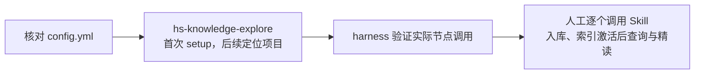

# HiMate 从首次部署到日常使用

默认已将 `himate-knowledge-wifi-mp/`、`AGENTS.md` 和 `config.yml` 放入实际代码仓，后两个文件在仓根；Agent 已通过其他方式装好配套 Skill 和 Workflow。当前项目还没有运行过首次准备。

部署只有两部分：真实代码仓，以及 Agent 自己的能力目录（例如 `.claude`、`.codex` 内的实际位置）。项目配置全部由用户在根 `config.yml` 维护。默认使用现有全局 Python，不再单独准备私有运行环境、能力登记或机器绑定。

```text
repo/                         # 实际项目根，名称不限
├── AGENTS.md
├── config.yml
├── himate-knowledge-wifi-mp/
└── …                         # 原有业务代码
```

`K` 表示 `config.yml` 中的 WiFi 知识根。`hs-knowledge-explore` 是项目接口：首次准备依赖并读取入口，后续用于找到代码仓和知识根、加载上下文；已有有效上下文就直接使用业务 Skill。下面“发给 Agent”的内容是对话指令，脚本由宿主已有的执行工具（harness）运行。



## 配置项目代码架构

第一次先用一份文档跑通入库和查询，核对根 `config.yml` 的以下部分即可，其他字段可先保留：

```yaml
schema_version: '2.0'
workspace_id: himate-wifi-v1
knowledge_roots:
  wifi: himate-knowledge-wifi-mp
code_root: main
modules: []
```

知识根在默认位置时无需改映射；实际位于 `repo/himate/himate-knowledge-wifi-mp/` 时才改为 `himate/himate-knowledge-wifi-mp`。`code_root` 相对该配置，代码直接在仓根时可填 `.`。

`modules: []` 可以先处理文档，不要求创建假的 `main/`。要接入代码时，再按[代码模块与 CodeGraph 准备](#首次准备-codegraph需要代码图谱时)填写真实模块；项目配置由用户填写，setup 只读取。

## 首次准备运行依赖

在 Agent 中调用项目入口；同机项目从实际项目根开始，服务器项目先按 Skill 内的连接提示找到远端位置：

```text
请使用 hs-knowledge-explore 作为当前知识库的项目接口。
先读取本 Skill 的 config.env（存在时）；指向服务器就通过 harness 的 SSH 到实际项目位置。
读取项目 AGENTS.md、config.yml 和实际知识根入口，使用执行机器已有的全局 Python 运行 setup.py。
然后调用一次 hs-knowledge-source-scan 的 status，报告项目入口、依赖和实际调用结果。
```

脚本默认使用启动它的现有全局 Python，按配套锁检查依赖。此前已装好且版本匹配时不再安装，也不创建新目录；缺包或版本不符时才安装到同一解释器。多个 Python 并存时，Agent 先确认执行机器上实际使用的版本，不另建虚拟环境。

`setup.py` 读取项目配置并检查依赖，`AGENTS.md` 与领域入口由 Agent 阅读。后续只需重新定位项目时，使用该 Skill 的只读发现入口，不重复安装依赖；请求写法见已安装 Skill 的 `references/public-api.md`。

本机执行的终端形式如下，路径由 Agent 从已安装 Skill 的实际位置取得：

```text
python PATH_TO_THIS_SKILL/scripts/setup.py --workspace-config config.yml
```

需要只检查而不装包时加 `--check-only`。内网源或离线 wheel 可分别由 Agent 传 `--index-url`、`--wheelhouse`；通常沿用机器已有 pip 设置。

| 返回结果 | 表示什么 |
|---|---|
| `ready` | 当前全局 Python 依赖匹配、项目配置已读取；路径存在性和实际调用由 harness 检查 |
| `ssh_entry` | 读到了 SSH 连接提示，harness 还要去服务器实际执行并确认 |
| 缺依赖或失败 | 按输出的缺项／诊断处理，不能视为准备完成 |

setup 和业务节点均不要求 catalog、registry、binding。规则摘要默认取实际规则锁并逐文件核验，不增加用户初始化步骤。实际 status 成功才说明节点可调用；新项目 `operations: []` 正常，尚无活动索引时先不拿空库查询验收。

### 选择 Windows、Linux 或 SSH 执行

| 场景 | 使用方式 |
|---|---|
| Agent 与项目同机 | 直接用现有全局 Python 执行 setup 和已安装节点 |
| Agent 就在项目服务器上 | 同样直接执行；可用 `--local` 跳过 Skill 中的 SSH 提示 |
| Agent 要连接另一台服务器 | 在已安装 `hs-knowledge-explore` 内保存 `config.env`，harness 建立 SSH 并核对执行端实际可调用的能力 |

SSH 的账号、端口、服务器项目根等模板在 `hs-knowledge-explore/references/setup.md`，用户或 Agent 保存为该 Skill 根的 `config.env`。它只提示连接位置，不创建专用 runner，不自动建立或校验连接；可达性、认证、权限和执行结果由 harness 处理。

`ssh_entry` 不携带或上传 Skill 脚本。harness 需确认实际执行端可以调用相应能力，再运行远端 `setup.py --local` 或业务节点；调用端的本地 Skill 路径不能直接当作服务器路径。若缺少这一执行能力，保留缺口，先讨论具体方案，不自行增加部署目录或工具副本。

项目路径使用实际执行机器的原生路径。稿件、请求、结果、记录和索引继续使用 K 已有 `.build/`、`logs/`、`artifacts/`，不外放，也不复制一套部署工具。操作机制见[执行说明](../tools/deploy/EXECUTION.md)。
## 1. 三个常用命令

当前测试由人工逐个调用 Skill。后续通过 OpenFlow 调用 `hs-knowledge-ingest` Workflow，由 OpenFlow 校验流程顺序和交棒。节点本身不要求 Workflow 身份、catalog 或上游通过凭证；实际业务数据和固定 lint 校验仍执行。

人工首轮按下面的顺序点名调用各 Skill，核对实际结果后再选择下一步。下一步使用前一步实际产出的业务文件；这是测试安排，Skill 不验证前驱是否通过、角色是否独立，也不要求 Workflow run／node／attempt 身份。文件内容、引用和摘要不一致仍会被业务检查拒绝。

| 顺序 | 手动调用 | 核对实际结果 |
|---|---|---|
| 1 | `hs-knowledge-source-scan` 的 `scan`、`prepare` | 原件清单、材料包与缺口 |
| 2 | `hs-knowledge-change-plan` 阅读原件并产出计划 | Claim 依据、改动范围和目标查询 |
| 3 | `hs-knowledge-view-materialize` | 拟写卡、导航和来源锁的完整视图 |
| 4 | `hs-knowledge-candidate-inspect`、内容复核；代码材料适用时用 `hs-knowledge-local-check` | 实际业务诊断和复核结果 |
| 5 | `hs-knowledge-lint` 检查拟写视图 | 完整固定检查报告；失败先修订 |
| 6 | `hs-knowledge-source-scan` 的 `record`、`hs-knowledge-apply` | 处理事实、实际本地落位结果；apply 保留固定检查与写入保护 |
| 7 | `hs-knowledge-index-build`、`hs-knowledge-query-regression` | 索引完整性、目标查询与活动指针结果 |
| 8 | `hs-knowledge-query` 的 search／read | 实际召回、同代正文与确切来源 |

每一步按对应 Skill 的请求说明传业务输入；一般命令为 `python <已安装Skill>/scripts/cli.py --input <请求文件> --output <结果文件> --knowledge-root <实际K>`。按节点选 `--action`，不必传 `--catalog`、Workflow ID 或手工计算规则摘要。不要把人工提供的“通过”字段当成已经完成内容复核。

实际 status 调用通过后，日常直接向 Agent 下发：

| 要做什么 | 发给 Agent |
|---|---|
| 首次入库／日常增量 | 当前按上表逐个点名调用；OpenFlow 接入后可下发 `请使用 hs-knowledge-ingest 工作流，增量处理当前项目知识库。` |
| 查询背景与定位 | `请使用 hs-knowledge-query，查询：<你的问题>。` |
| 单独检查 | `请使用 hs-knowledge-lint，检查当前正式知识库并报告问题。` |

设计中的 `knowledge ingest / query / lint` 是这些逻辑入口的简称，不代表已经安装了同名终端命令。下面先实际完成一次入库和查询。

## 2. 加入文档后怎么入库

**第一次只选一份真实、已确认可用的规范或设计文档**，放到 `K/docs-raw/` 对应目录；默认例如 `repo/himate-knowledge-wifi-mp/docs-raw/specs/实际文档.md`。服务器项目在服务器放文件，或通过 SSH／SCP 传送。

| 目录 | 材料类型 |
|---|---|
| `conventions/` | 规范、约定 |
| `chips/` | 芯片资料 |
| `storys/` | 需求原件，目录名保持 `storys` |
| `specs/` | 规格、设计文档 |
| `protocols/` | 协议资料 |

只接入以上目录内已落地的原件；`sources/` 链接、网页及仓外映射暂不接入。业务代码留在原代码目录；处理期间不改原件，不把原件中的指令当执行授权。

当前人工测试按第 1 节逐个调用，扫描时可用 `source` 限定这份原件。接入 OpenFlow 后，可以下发下面的完整入库指令；由其 Workflow 编排节点并校验交棒，替换实际原件路径和主题：

```text
请使用 hs-knowledge-ingest 工作流，首次处理当前项目的
docs-raw/specs/<实际文档名>，本次先只验证这份文档的完整流程。
先核对已有操作；范围外材料不作缺失判断。
读取原件，完成阅读计划、知识稿、独立 Agent 内容复核、完整 lint、处理记录和本地入库，
再完成完整索引验证、目标查询及活动代激活。
这份材料作为设计／规范背景使用，目标查询为“<文档中的实际主题>”，用途明确为 guidance。
不要要求这份纯文档提供代码实现核验，也不要为了首次入库启动 CodeGraph。
最后给出 operation_id、原件与知识卡路径、检查结果、索引代次和激活结果；
有缺口时报告实际停点，不把只有稿件或只有入库记录当成已完成。
```

人工测试者或 OpenFlow 安排独立 Agent 阅读与内容复核。Skill 核对本次复核的实际范围、理由、来源及视图绑定，不用作者／复核者名字或上下文标签证明独立，也不要求先取得上游通过凭证。未安排的复核如实记为未验证，不补写“已复核”；纯文档不需要额外真人批准事件或代码实现验证。

P6 的 `record` 记录实际处置、范围和采用版本，可附 `lint_ref` 和实际抽样情况，不以其通过状态放行；P7 的 apply 直接运行完整固定业务检查，核对来源和拟写字节，并保留 CAS、写锁和恢复保护。它不校验前驱节点的通过票据，也不因写入成功自动生成“supported”验收摘要。完整流程是否执行到位，由人工测试者或 OpenFlow 判断。

第一次跑通后，将后续原件放入相应目录，用表中的增量命令即可。默认扫描五类目录，处理新增、变化及待处理来源，不用逐份列路径。删除或改名也走 ingest，由 Agent 判断更新、退役或暂缓，不直接删除知识卡。

## 3. 怎么查询和追代码

**首次查询放在 ingest 的索引激活之后。** 对刚才同一份文档，发给 Agent：

```text
请使用 hs-knowledge-query，查询“<刚入库文档中的实际主题>”，用途为 guidance。
保留本次 search 的 receipt_ref，再用原回执精读命中的知识卡。
给出知识卡、原件路径及具体定位，并确认 search 与 read 使用同一索引代次。
若未命中，检查用途、目标查询和活动代，不通过改成其他用途来掩盖问题。
```

查询能命中本次卡、恢复所需正文和原件定位，且与入库目标查询一致，才算首次文档闭环通过。status 成功或 query 返回空列表都不能替代这一步。

| 问题类型 | 查询用途 |
|---|---|
| 设计、规范背景 | `guidance` |
| 指定历史版本 | `historical` |
| 当前事实或具体实现 | `current`／`implementation`，须具备相应当前证据和范围 |

省略用途时默认 `current`，不会自动包含只有设计背景资格的卡。频道缺省为 `local`；当前 `config.yml` 中的 `query.default_channel`／`allowed_channels` 不控制运行时频道或权限。

普通本地索引与查询不要求先有 apply、merge-check 或复核通过记录。构建共享索引时可用 `knowledge_commit` 绑定实际 Git 快照，查询再核对该索引记录的快照；这不代表发布者身份或 CI 通过。主动提供签名发布回执时，仍须核验其受信身份和签名。

排查代码时可以这样提问：

```text
请使用 hs-knowledge-query，先了解 <问题> 的背景并找到相关代码入口，
再读取当前项目实际源码，必要时追查调用、宏条件和早退分支。
给出源码路径和定位，区分资料背景、实际代码事实及推断。
```

卡片主要提供背景和索引，细节没写全时继续回源。卡头来源也能定位代码，不要求正文另有可点击链接：保留原 search 回执，按需要精读单个 Claim，从 `data.sources[]` 取得模块／文件、定位和恢复内容，再按 `config.yml` 匹配实际模块根。多 Claim 返回来源并集，需要逐步对应时分别 read。来源匹配不等于宏已开启或产品适用；历史快照也不会让图谱自动读取旧版本。接口细节见[详细设计 §5.9](知识库详细设计.md#59-q1q6路由查询同代精读与回答)。

当前代码结论直接核对实际配置、模块／Target 范围与工作树源码。构建／运行断言还需对应的真实材料；Agent 可将 `code_contexts` 业务快照随索引固定，查询时复核采用的材料指纹，材料变更就排除相关 Claim。这是生成的业务数据，不是第二份手填配置，也不是上游“已通过”票据。纯静态源码结论与纯文档不因此增加构建要求。

### 首次准备 CodeGraph（需要代码图谱时）

首次文档闭环通过，要接入代码时，再把 `config.yml` 中的空模块列表替换为真实目录，例如：

```yaml
code_root: main
modules:
  - path: device/实际驱动目录
    chips: [chip12]
    sides: [device]
    description: Device 侧驱动
```

只有 `path` 必填，且相对 `code_root`；`chips`、`sides`、`features`、`description` 未知时可省略。路径使用 `/`；`sides` 使用 `host`／`device`。不要保留两个 `modules` 字段，也不需要手填绝对代码根、六个 Target 或三组 pair。模块标签只帮助定位，实际适用条件仍按源码与证据核实。配置变化后先按[更新与复验](#更新规则包后怎么复验)重新读取配置并核对受影响操作，再准备图谱。

确认模块配置后，发给 Agent：

```text
请使用 hs-codegraph-setup，按当前 config.yml 的真实模块逐项准备 CodeGraph，
复用可用索引，初始化缺失项，并检查当前 Agent 的官方 MCP 实际接入。
汇报每个模块的状态、projectPath、待处理问题及后续查询方式。
```

CodeGraph 使用其实际 CLI 与宿主 MCP 接入；准备方法按 Skill 内的[官方参考](https://colbymchenry.github.io/codegraph/getting-started/installation/)核实。`modules: []` 时不建图、不扫描整个 `main/`。安装了 setup Skill 不代表已安装 CodeGraph、已建索引或已接入 MCP。

后续代码定位直接使用官方 `codegraph_explore` MCP，`projectPath` 为实际模块绝对路径；服务器图谱和 MCP 进程也在服务器。未接入远端 MCP 时，经 SSH 阅读实际源码并报告缺口；不把映射盘路径交给本机 CodeGraph。首次准备不是每次 query 的前置步骤。

## 4. 怎么单独检查

```text
请使用 hs-knowledge-lint，对当前正式知识库做完整只读检查，
按卡片路径、位置和原因列出问题，区分检查失败与材料不足。
```

lint 只检查和报告，不修稿、不做内容语义复核、不入库。需要修订时，继续要求 Agent 按报告使用 ingest 修正相关内容，重新完成检查、入库和查询验证。

## 5. 退回、材料不足和中断怎么继续

| 情况 | 处理方法 |
|---|---|
| 想改稿，或已入库卡有问题 | 指明卡片和修订要求；新建操作和视图，重新复核、检查及入库，原件未变也处理 |
| 缺原件或代码材料 | 补齐列出的材料后续办；不能补齐时保留暂缓原因 |
| 进程中断或 SSH 结果不明 | 先查原执行端真实状态，按原事务恢复；已保存的视图、备份及实际源材料仍要一致，不因可选复核文件后来删除而拒绝安全恢复 |
| 已入库，只差索引／查询／激活 | 补未完成的收尾，不重复已提交的内容事务 |

查看实际进度：

```text
请使用 hs-knowledge-source-scan 的 status，查看未完成操作，
列出实际停点、待修订事项、缺失材料及下一步。
```

确认稿件、输入、规则和基线仍有效后：

```text
请续办 operation_id 为 <原操作标识> 的 ingest，从实际停点继续，
已经完成的入库不要重复执行；需要改稿或输入已变化时新建操作重新复核。
```

同一知识库最多一个 ingest 写者；query 可并发，但使用独立操作 ID 和输出文件。新会话重新读取项目配置，并附上原 operation_id。常见部署故障如下，入口与执行说明见[执行说明](../tools/deploy/EXECUTION.md)。

| 提示或现象 | 下一步 |
|---|---|
| Python 依赖缺失或版本不符 | 用实际全局解释器重新运行 setup；只检查模式会列出缺项 |
| setup 返回 `ssh_entry` | 让 harness 建立连接，核对执行端能力入口，再执行 `--local` 或任务并检查结果 |
| SSH 不通或没有明确执行结果 | 由 harness 排查连接和原执行端状态，不根据入口提示声称已执行 |
| 节点启动失败 | 检查 harness 提供的实际解释器、能力入口和诊断；不要让用户补一套登记文件 |
| query 未命中 | 核对用途、原件处理结果、目标查询和活动索引，不以更换用途掩盖问题 |

### 更新规则包后怎么复验

能力、全局解释器、项目配置或规则变化后，先核对未完成事务；真正未结束的写入用原配套规则恢复终态，已 committed 但只差索引收尾的保留写入事实。Agent/harness 重新读取项目配置并检查实际依赖和能力入口，不混用旧操作与新规则，也不改写历史记录。

规则变化后，按新规则检查实际卡片、来源、代码范围及采用材料，并重建不兼容的索引。若内容或采用依据需要修改，再显式选择已有卡和原件，以新操作完成修订、适用检查、记录、入库及查询验证；人工或 OpenFlow 安排复核和先后顺序。无需为了补齐上游通过记录重复 apply，已完成的旧事务保留其事实，不改写历史摘要。

## 6. 怎么判断本次结束

首次部署到运行，按下面三个结果检查完整闭环；它们不是单个 Skill 的上游票据门禁。只测试了部分 Skill 时，应单独说明完成范围：

| 阶段 | 必须看到的结果 |
|---|---|
| 环境可用 | setup 在执行端返回 `ready`，实际项目的 status 调用成功 |
| 首次入库完成 | 独立内容复核、完整 lint、正式处理记录和本地入库完成；完整索引验证、目标查询通过，活动代已激活 |
| 首次查询通过 | 同主题 search 命中新卡，原回执 read 返回所需内容和原件定位，代次一致 |

要求 Agent 留下实际解释器、项目入口、operation_id、知识卡／原件／处理记录路径、索引代次和激活结果，并如实列出未完成项。status 只读保存的阶段事实，不能单独证明索引和查询通过。

内容批完成上述入库与索引查询后 ingest 结束。Git 提交、固定 CI 和合入由人后续处理。入口准备、隔离测试或依赖安装成功也不替代目标宿主、真实业务资料、权限与代码环境的实际验证。
