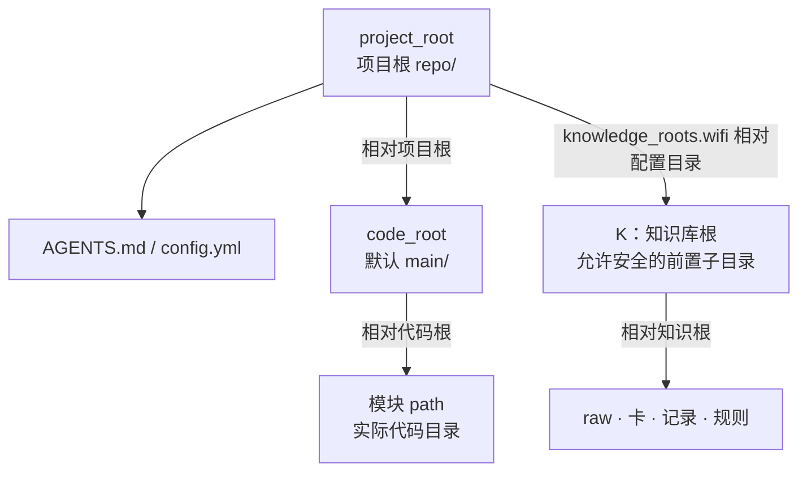
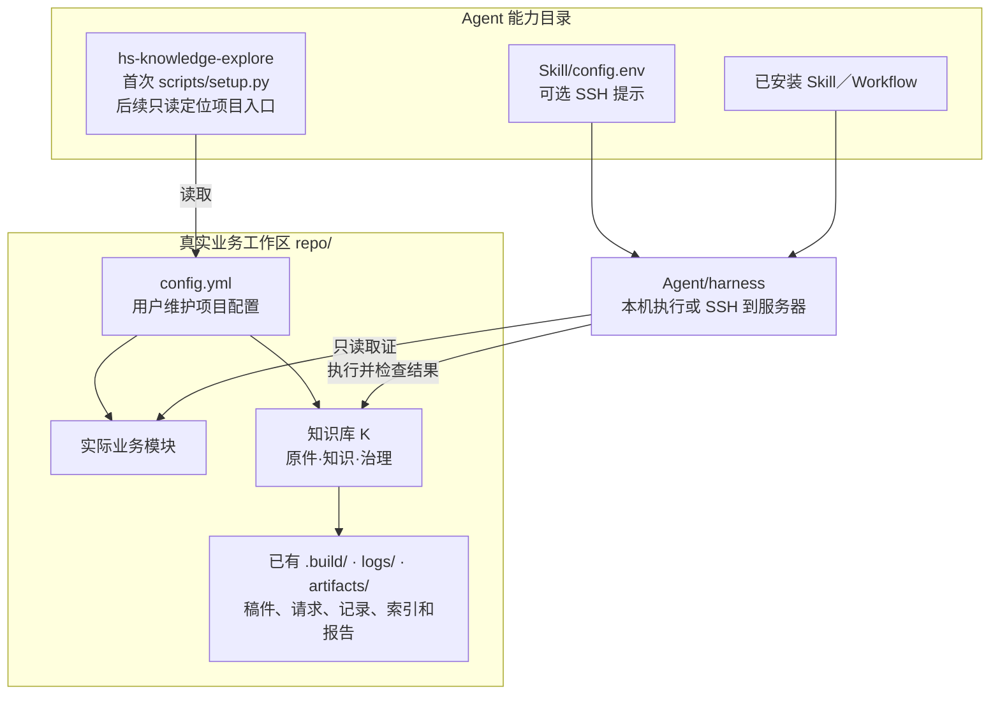
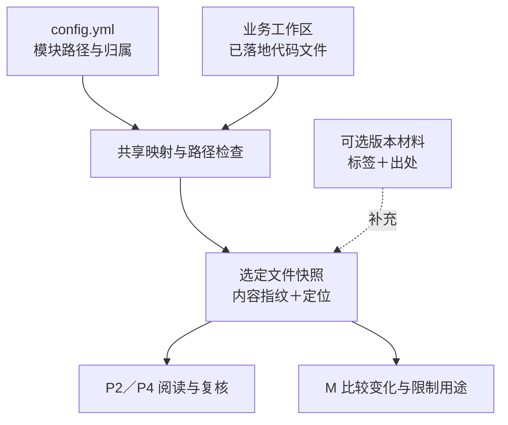
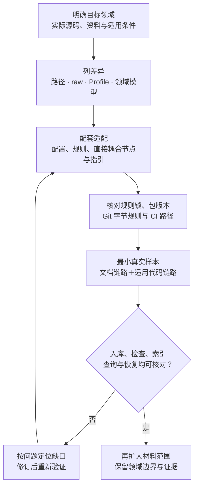

# 知识库关键点

本文说明如何以当前 **WiFi-MP 领域实现**为起点，适配其他领域的代码仓、资料分类、知识卡和配套能力。其他领域可以复用这里的流程和工具机制，但领域身份、适用范围及部分路径规则仍需配套改造、验证；目录改名或安装同名 Skill 不表示已经完成跨领域适配。

系统分层见[架构设计](HiMate知识库架构设计.md)，节点流程见[详细设计](知识库详细设计.md)，日常操作见[使用说明](使用说明.md)。本文的改动判断见第 2 节，Skill 配套范围见第 3 节，迁移顺序见第 4 节；第 1 节保留它们共用的路径与核验基础。下文 P2／P4、M 等编号沿用详细设计。

| 目标领域与当前项目的差异 | 先判断什么 |
|---|---|
| 源码不在 `main/`，模块文件夹名称不同 | 通常通过 `code_root`、`modules[].path` 映射真实目录，保留已有源码布局 |
| 原件种类、知识分类不同 | 区分现有目录内新增内容、增加 raw 类别和增加卡片 Profile，分别改对应规则与能力 |
| 芯片、端、Target 或领域标识不同 | 检查 WiFi 专用 Schema、配置发现、派生模型和取证约束，不能只改配置标签 |
| 希望同包支持多个领域 | 先补领域选择和规则装载；当前实现不能靠增加一个配置键自动获得这些能力 |

## 1. 工作区路径与部署边界

### 1.1 路径基准

| 名称 | 路径含义 |
|---|---|
| `project_root` | 项目根，示意为 `repo/`；保留业务仓的 `AGENTS.md` 和项目 `config.yml`，可管理多个 Git 仓；`AGENTS.md.example` 是接入示例 |
| `code_root` | `config.yml` 中的代码根，相对 `project_root`，默认 `main` |
| 模块 `path` | 相对 `code_root` 的实际目录，可覆盖一个或多个子仓 |
| `K` | 知识库根，由 `config.yml` 的 `knowledge_roots.wifi` 相对配置目录解析；默认 `himate-knowledge-wifi-mp/`，可增加安全的前置目录；raw、卡、记录及领域规则使用根内相对路径 |
| `S`、`F` | Agent 已安装的 Skill、Workflow 目录，由 harness 使用，运行不依赖项目根分发源码 |
| `S/hs-knowledge-explore/` | 全库能力入口与路由；首次准备和只读发现按需执行，可选 SSH `config.env` |
| 外部版本材料 | 可补充文件的版本标签与出处；不替代实际文件核对 |

### 1.2 知识库与代码位于同一工作区

整个项目只有两部分：真实业务工作区中的知识根、业务仓 `AGENTS.md` 与用户维护的 `config.yml`，以及 Agent 自己目录中已安装的 Skill／Workflow。根 `AGENTS.md` 说明业务架构与开发约定；本开发仓仅本地维护它，共享分发 `AGENTS.md.example`，部署时按真实路径合并四项位置说明和 explore 入口指针。全库能力路由归 `hs-knowledge-explore`，不要求把知识库能力表复制进业务仓说明。默认使用机器已有全局 Python；业务产物沿用已有 K 布局，不外放。

Agent 按已安装 `hs-knowledge-explore` 的指引选择知识库能力；首次需要准备环境时运行其 `scripts/setup.py`：依赖已齐则直接复用，缺失或版本不符时才安装到当前全局解释器，随后读取配置。后续缺少入口信息时才调用只读项目接口，定位代码仓、知识根并加载真实 `AGENTS.md`、`config.yml`；已有有效上下文不重跑发现或 setup。setup 不落地接入示例，不创建私有虚拟环境、catalog、registry 或机器 binding，也不要求用户执行登记步骤。业务 CLI 不要求 catalog；规则摘要默认取当前锁，仍核验规则文件，不增加第二套配置。操作见[使用说明](使用说明.md#首次准备运行依赖)。

| 配置／产物 | 位置与职责 |
|---|---|
| 项目配置 | 用户手填根 `config.yml`，知识根相对该文件，模块相对代码根 |
| SSH 提示 | `hs-knowledge-explore` 自己的 `config.env`，账号、端口、服务器项目根等供 harness 使用 |
| 稿件与操作请求／结果 | 实际执行端 K 已有 `.build/` |
| 正式处理、来源与恢复记录 | 实际执行端 K 已有 `logs/` |
| 可重建索引与报告 | 实际执行端 K 已有 `artifacts/` |

跨机器时，setup 返回 SSH 入口提示；harness 建立连接后，须确认执行端的全局 Python 与对应 Skill 脚本实际可调用，再从服务器原生路径运行 `setup.py --local` 或业务节点，并检查结果。调用端的安装路径不能直接当作远端路径，setup 不上传脚本；实际能力不可用时报告缺口，特殊处理先与用户讨论，不另建专用 runner、目录或工具副本。提示本身不证明已连接、环境就绪或工作完成。

K 继续由确切 `config.yml` 解析，允许安全嵌套，不把知识根父目录当项目根。代码按真实模块读取，空模块列表不创造源码范围。目录和模块标签不证明版本、宏、构建或产品适用。

普通本地运行和直接 Git 快照消费不要求原机器的私有登记。shared 索引构建请求可直接提供 `knowledge_commit`，按实际 Git 仓根核对卡、规则、来源锁和引用，结果只声明 `repository_snapshot`，query 复验所用代次记录的快照；构建时若显式提供签名发布回执，另外核验受信 adapter 与签名的身份真实性。签名身份与上游 Skill／CI 是否通过是不同信息。历史记录按确切 Git 内容和指纹恢复；当前配置有错误、歧义或不安全路径时不能用历史分支绕过，也不据此允许任意仓外读取。

换机需要的是可恢复的正式资产：原件及附件、卡及导航、来源锁、配套规则、处理历史和有效使用限制；代码及采用的构建／运行材料按实际模块另行取得。`.build/`、事务目录和机器索引是本机产物，不充当唯一依据。先用仅含拟提交资产的工作区验证 lint、回源、索引重建与查询，再清理已结束操作的私有材料；`logs/` 内不同子目录的保存边界见[详细设计 §6.4](知识库详细设计.md#64-哪些内容上库哪些用于本机执行)。

当前查询频道由请求 `channel` 选择，缺省为 local；`config.yml` 的 `query.default_channel`／`allowed_channels` 不控制运行时默认或访问权限。

### 1.3 项目视图与文件核验边界

`config.yml` 维护模块路径、芯片、端、特性与用途。代码目录按统一的文件取证规则处理，同一模块覆盖多个子目录时，分别固定选定文件的内容和定位。

外部版本材料通过可选 `version` 记录明确提供的标签并保留出处，含义以原材料为准。缺失字段保持 unknown，不阻断当前文件的静态源码核验，也不冒充某个已发布产品版本。

当前核验比较原配置、实际路径和工作树文件内容指纹，不能只读 Git 已提交对象而漏掉未提交修改；旧结论也不能因目录标签相同就继续有效。涉及构建／运行断言时，Agent 将采用的配置、Target、材料文件和逐 Claim 引用作为 `code_contexts` 固定进索引，查询直接复查实际字节。这是生成的业务数据，不是另一份用户手填配置，也不是 local-check／apply 已通过的证明。静态源码结论和纯文档无需为此提供构建材料。缺少真实路径、Target 条件或必要材料时保留缺口；标签只帮助定位，不能证明宏开启、构建成功或协议兼容。

人工测试可逐个调用 Skill；OpenFlow 负责 Workflow 的顺序、角色隔离和交棒合法性。Skill 不要求 Workflow run／node／attempt、流程 manifest、catalog 登记或上游 passed 票据；本次输入文件及内容绑定、来源／代码范围、索引完整性和写入安全仍须核对。apply 自身运行固定检查与 CAS，记录真实落位事实，不自动声明已独立复核或生成 supported 验收摘要；恢复仍核原视图、事务与备份，不依赖可选复核文件继续存在。

## 2. 目录与领域规则如何适配

### 2.1 源码布局变化：先改映射，不改真实目录

`main/` 是默认值。目标代码仓可以保留自己的顶层目录和多仓布局，由配置描述实际位置；不用为了套用知识库，把源码目录重命名为 `main/` 或重新整理成 WiFi 的目录结构。

| 变化 | 配套工作 |
|---|---|
| 代码根不是 `main/` | 更新 `code_root`，它相对 `config.yml` 所在项目根；实际代码就在项目根时可用 `.` |
| Host、Device、算法或其他模块的文件夹名称不同 | 更新 `modules[].path`，它相对代码根；登记真实存在的模块，不按示例创建虚构目录 |
| 知识根改名或在工作区内增加前置目录 | 更新 `knowledge_roots.wifi` 的路径值及文档指针；这是物理路径配置，领域键本身仍有第 2.4 节的约束 |
| 执行机器或服务器仓根变化 | 按实际安装位置更新 explore 的本机 `config.env`，由 harness 核实执行端路径和能力；不把调用端路径当成服务器路径 |

路径仍须满足同一工作区、相对路径和无链接等约束，依据[模块声明检查](../governance/contracts/validation.py#L346)与[知识根定位](../governance/contracts/validation.py#L422)。

**路径能配置，不代表已有数据会自动迁移。** 当前按工作区相对路径派生 repo/module 身份；改代码根或模块路径可能改变这些身份和配置指纹。已有卡片、来源登记、代码上下文和索引须重新核对，按正常更新或明确的数据迁移处理，保留历史原字节。[身份派生依据](../governance/contracts/validation.py#L477)

知识根改名还要验证历史恢复：旧式 Git 恢复会检查保存路径与当前 K 的前缀；普通来源引用的确切原版也须在新工作区可恢复，原机保留的证据对象不能成为唯一依据。不能只验证新文件可读，就认定旧版引用仍可恢复。[恢复路径依据](../governance/contracts/source_resources.py)

目标业务仓也要按实际目录合并 Git 忽略、字节保持和 CI 路径规则。本开发仓的 [`.gitignore`](../../.gitignore) 含 `main/*` 占位及 WiFi 知识根前缀，[`.gitattributes`](../../.gitattributes) 对受锁文件保留原字节；这些开发仓规则不能整份覆盖目标仓原有的代码跟踪策略。新目录的运行产物排除、规则摘要和换行处理都要单独核对。

### 2.2 扩展 docs-raw：类别和格式分别处理

当前原件根为 `docs-raw/`，允许 `conventions`、`chips`、`storys`、`specs`、`protocols`、`troubleshooting` 六类。其他领域先判断能否沿用现有类别，再决定是否新增顶层类别。

| 扩展方式 | 是否要改运行实现 |
|---|---|
| 在现有类别下增加普通子目录 | 扫描已递归支持；通常只需放置原件、补充领域分类说明并验收实际输入 |
| 新增、改名或删除顶层 raw 类别 | 要同步扫描、主件与附件捕获、适用的历史恢复和治理声明 |
| 接入新的文档格式、编码或外部来源 | 要另做提取、定位、来源恢复或获取适配，新增文件夹不会增加这些能力 |

新增顶层类别的直接改动点为：

- `hs-knowledge-source-scan` 的 [RAW_DIRS 与扫描范围检查](../../skills/common/knowledge/hs-knowledge-source-scan/scripts/scan.py#L9)。
- `hs-knowledge-source-capture` 的 [RAW_CLASSES 与主件／附件准入](../../skills/common/knowledge/hs-knowledge-source-capture/scripts/capture.py#L22)。
- 公共契约中适用的 [旧式 Git 原件恢复范围](../governance/contracts/source_resources.py#L139)。
- [registries.yaml 的 allowed_raw_roots](../governance/schemas/registries.yaml#L19)、规则锁、分类文档及相关 Skill／Workflow 指引。当前扫描和捕获各自使用代码白名单，单改该 YAML 声明不会启用新类别。

原件类别和卡片类型是两个维度；新增资料类别通常仍是 `kind: raw`，一个原件也可以产生多种卡，不需要为每个 raw 文件夹增加一种 Profile。[来源类型声明](../governance/schemas/sources.schema.json#L26)

当前文档主件支持非空 UTF-8 MD/TXT、每页有文字层的 PDF 和可提取的 DOCX；扫描图、其他格式或 `sources/` 外链不会因换领域自动接入。新增适配须同时验证原字节、提取文本、locator 与历史复现；保留不透明附件字节不表示已解释其内容。[文档提取依据](../../skills/common/knowledge/hs-knowledge-source-capture/scripts/capture.py#L25)

源码目录改名和代码语言也要分开判断。源码捕获使用显式 UTF-8／GB18030 文本适配并生成行定位，读取文本不表示完成了新语言的语法、语义或 CodeGraph 验证；换语言时分别核对这些能力。[源码捕获](../../skills/common/knowledge/hs-knowledge-source-capture/scripts/code_capture.py#L287)、[解码与行定位](../governance/contracts/source_resources.py#L6)

### 2.3 扩展 knowledge：先复用卡结构，再决定是否增加类型

当前七类 Profile 为 `entity`、`flow`、`protocol`、`rule`、`command`、`runbook`、`glossary`。目标领域可以继续用它们表达对象、流程、协议、规则、命令、排障和术语，先补充本领域内容与导航。[现有 Profile](../governance/schemas/profiles.yaml)

| 变化 | 需要配套修改的内容 |
|---|---|
| 沿用现有 Profile，新增目标领域知识卡 | 使用现有 Card/Claim 格式、输出范围和导航规则；不因业务内容变了就改索引算法 |
| 只调整某类卡的必填章节 | 修改 `profiles.yaml`、对应模板和规则锁；评估已有卡的兼容与修订，章节检查已从规则读取 |
| 改变某个 Profile 的默认输出目录 | 修改 change-plan 的 Profile→目录映射和允许目标范围，核对导航、链接和索引；已有卡移动须显式迁移 |
| 新增或重命名一种 Profile | 同步 frontmatter 的 Profile 枚举、`profiles.yaml`、对应模板、规划目录映射、导航、规则锁与测试 |
| 新增适用维度、Claim 字段、locator 或检索字段 | 扩展相应 Schema、解析和引用／范围校验；确实参与检索的新字段，再修改索引与查询逻辑 |
| 改变顶层 `knowledge/`、`governance/` 或正式卡格式 | 属于布局／协议改造，检查、扫描、规划、落位和索引等多处均需适配，不能作为普通目录改名处理。[根目录检查](../governance/contracts/checks.py#L159)、[索引扫描](../../skills/common/knowledge/hs-knowledge-index-build/scripts/node.py#L420) |

直接目录耦合在 [planning.py 的 PROFILES 映射及目标范围检查](../../skills/common/knowledge/hs-knowledge-change-plan/scripts/planning.py#L13)。已有卡不能借一次普通更新隐式换路径，见[迁移检查](../../skills/common/knowledge/hs-knowledge-change-plan/scripts/planning.py#L125)。Profile 枚举和章节声明必须一致，见[规则一致性检查](../governance/contracts/validation.py#L247)；章节解析见 [parse_card](../governance/contracts/knowledge.py#L54)。

**新增同结构 Profile，不必机械地改索引和查询算法。** 当前索引保存 Card/Claim 元数据及选定词项，查询按代次清单读取并解析卡片，没有为七类卡分别编写检索分支。保留相同业务结构时，先验证新 Profile 能规划、检查、入库、索引及查询；增加新的检索含义时才修改相应实现。[索引字段](../governance/contracts/indexing.py#L92)、[查询读取](../../skills/common/knowledge/hs-knowledge-query/scripts/node.py#L337)

反过来，新增适用条件不能只让 Schema 接受字段：当前条件存在性与范围匹配有明确维度，必须同步它们及相应查询输入，才能影响结论资格。[条件与范围匹配](../governance/contracts/knowledge.py#L253)

### 2.4 更换领域：核对 WiFi 专用假设

当前实现中的以下限制需要由适配开发者处理，不能交给业务用户通过随意改标签解决。

| 当前固定点 | 目标领域的适配范围与依据 |
|---|---|
| `knowledge_roots` 只允许唯一 `wifi` 键 | 联动 workspace Schema、explore setup／发现、公共配置定位、来源恢复及代码捕获。修改路径值与更换领域键是不同工作。[Schema](../governance/schemas/workspace.schema.json#L15)、[setup](../../skills/common/knowledge/hs-knowledge-explore/scripts/setup.py#L77)、[发现](../../skills/common/knowledge/hs-knowledge-explore/scripts/node.py#L69)、[公共定位](../governance/contracts/validation.py#L422) |
| `knowledge_domain: wifi` 与 `contract_family: aiot-wifi` | 领域 Schema、派生上下文、代码域检查、契约声明、装载校验及规则锁须匹配。改文件夹名称或标题不会改变这些身份。[派生领域](../governance/contracts/validation.py#L479)、[取证检查](../../skills/common/knowledge/hs-knowledge-source-capture/scripts/code_capture.py#L92)、[契约族声明](../governance/contracts/__init__.py#L5)、[规则装载](../governance/contracts/validation.py#L183) |
| `chip12`、`chip08`、`chip07c` 模型 | 模块配置虽能写其他芯片字符串，当前会记录域外标签缺口，且仍只为这三类派生 Target；卡片 Context 的 chip 枚举也限定三类或 null。新增标签不等于模型适配。[标签与派生](../governance/contracts/validation.py#L459)、[卡片枚举](../governance/schemas/frontmatter.schema.json#L164) |
| `host`／`device` 与相应 Target／pair 关系 | 若目标领域采用其他端或配对模型，要联动模块 sides、卡片 Context、派生视图及旧式兼容检查；用户仍填写真实模块，不恢复为手工登记 WiFi 六 Target／三 pair。[端检查](../governance/contracts/validation.py#L371)、[Target 派生](../governance/contracts/validation.py#L498) |
| WiFi 的术语、原件提炼问题、示例与核验提示 | 适配领域 AGENTS、分类说明、模板、写作／复核指引、回归问题和代码图谱指引；保留未知范围与证据要求，不把 WiFi 的结论换名后当成新领域事实 |

受锁契约、Schema、Profile、模板或规范发生变化时，审查兼容版本并更新 `framework.lock.yaml` 摘要；同步运行包与固定 CI 的受信规则。不要改写历史记录以伪装成在新规则下完成的处理。[逐文件规则核验](../governance/contracts/validation.py#L183)

## 3. 哪些 Skill 和 Workflow 可以复用

当前能力的**处理机制可以复用，分发包仍需与目标领域规则配套**。优先集中适配公共契约，再修改具有直接目录／领域约束的节点；不要把同一个枚举复制到每个 Skill 里。

| 能力 | 可复用的机制 | 需要配套处理的部分 |
|---|---|---|
| `hs-knowledge-explore` | 知识库任务路由、按需 setup 和只读发现 | 第 2.4 节的领域根选择实现；目标领域的入口、配置示例和路由指引 |
| `hs-knowledge-source-scan`、`hs-knowledge-source-capture` | 增量观察、原字节与指纹捕获、附件及旧版恢复 | raw 白名单、文档／编码适配、领域配置与代码域绑定，见第 2.2、2.4 节 |
| `hs-knowledge-change-plan`、`hs-knowledge-view-materialize`、`hs-knowledge-candidate-inspect`、`hs-knowledge-candidate-revise` | 计划、完整候选视图、检查与修订衔接 | 新 Profile／输出范围先改规划器；其他候选节点复用其结果与领域契约，不必各加一份类型分支；配套改提炼和复核指引 |
| `hs-knowledge-local-check`、`hs-knowledge-merge-check` | 确切文件、条件、逐 Claim 依据和检查结果绑定 | 目标领域的代码上下文、Target、端与适用条件；涉及构建／运行的结论还须有相应真实材料。merge-check 是可选兼容复查，不是当前固定 CI 入口 |
| `hs-knowledge-lint`、`hs-knowledge-maintain` | 固定检查、变化识别、旧卡及来源核验 | 装载目标领域规则，复核路径、来源、条件及变更资格；领域规则改变后重做相应回归 |
| `hs-knowledge-apply`、`hs-knowledge-recover`、`hs-knowledge-governance-handoff`、`hs-knowledge-publish-handoff` | 同批落位、事务恢复、确切视图与交接 | 保持或适配知识／治理根、记录结构、来源恢复和发布边界；不能沿用已经失效的配置与内容绑定 |
| `hs-knowledge-index-build`、`hs-knowledge-query`、`hs-knowledge-query-regression` | Card/Claim 索引、同代精读和目标查询回归 | 新领域范围规则和回归问题；结构不变时主要复用规则，增加检索字段或语义时才改索引／查询 |
| `hs-codegraph-setup` | 按真实模块准备图谱并核对 MCP 的操作指引 | 新领域模块、语言与实际 CodeGraph 支持；它是说明 Skill，不承担知识库文档提取 |

上述候选、检查、落位和查询节点通过实际 K 装载规则，并通过同级已安装能力继续调用；共同契约的修改会影响整条链路，所以“该节点没有 WiFi 目录常量”不表示其可脱离领域规则独立通用。[同级能力调用依据](../../skills/common/knowledge/hs-knowledge-source-scan/scripts/support.py#L446)

固定 CI 继续从可信基线执行 K 的 `check.py`，迁移时同步规则与作业路径；不要根据 Skill 名称把 merge-check 接回默认 CI。[兼容能力边界](../../skills/common/knowledge/hs-knowledge-merge-check/SKILL.md)

OpenFlow Workflow 可以复用节点顺序、角色和交棒结构。以 ingest 为例：原件或术语变化时更新领域名称、分类和节点指引；新增采集、审核或核验阶段时，才改编排及产物契约。Skill ID、实际安装位置和返回业务数据必须配套，不能只复制一份 Workflow YAML。[现有 ingest 编排](../../workflows/common/knowledge/hs-knowledge-ingest/workflow.yaml)

这些通用命名的 Skill ID 可以继续使用。同一安装父目录的同名包只有一份实现；若各领域改版互不兼容，应在明确的安装范围使用配套版本。希望一套共享包服务多个领域时，须先实现领域选择、规则装载和直接硬编码适配，再逐域验证。当前不能在一个 `knowledge_roots` 中简单并列多个领域，也不能把同名包覆盖安装当成多领域支持。

## 4. 迁移顺序与验收

新领域建立自己的原件、正式卡、来源登记、处理记录和索引。可以复用框架与模板，WiFi 的业务原件、知识结论、旧索引和回执不能因此成为新领域的有效材料；需要迁移历史内容时，逐项保留身份、授权范围和可恢复依据。

| 验收对象 | 至少核对什么 |
|---|---|
| 路径与部署 | 实际模块能定位；空映射、错误路径和越界路径保持正确结果；真实业务 AGENTS、远端能力和执行端路径已核实 |
| 文档生产与消费 | 用目标领域原件验证 ingest 业务链路、独立内容复核、固定检查、入库、索引验证与目标查询，再按回执精读和恢复来源 |
| 适用代码链路 | 核对目标领域的模块、条件与确切源码；源码变化能使旧的当前实现依据失效，历史／指导性用途不被误判为当前实现 |
| 本轮扩展点 | 新 raw 类别验证默认与限定扫描、嵌套目录、主件／附件及历史恢复；新 Profile 验证章节、规划路径、导航、索引与查询 |
| 更新与恢复 | 新原件增量、原件未变的明确修卡请求、中断续办、规则变化及目录迁移后的旧引用分别验证；不靠改写旧记录获得通过 |
| 版本与权限 | 实际安装包、规则锁、CI 受信基线和样例材料匹配；领域数据与访问权限由真实部署落实，目录名和频道配置不提供 ACL |

机制回归与部署验收分开记录：机制验证可逐个调用 Skill，核对相同业务输入输出；按本方案部署的日常 ingest 仍通过 OpenFlow 运行，另行验明实际 Workflow、角色、交棒和停点。节点测试通过不表示宿主编排已接入。

先用最小样本确定适配有效，再扩大入库范围。纯文档链路不要求虚构芯片、端或业务源码；它通过只证明该链路与材料范围内的结果，不能替代目标领域的代码模型、宿主接入或权限验收。
