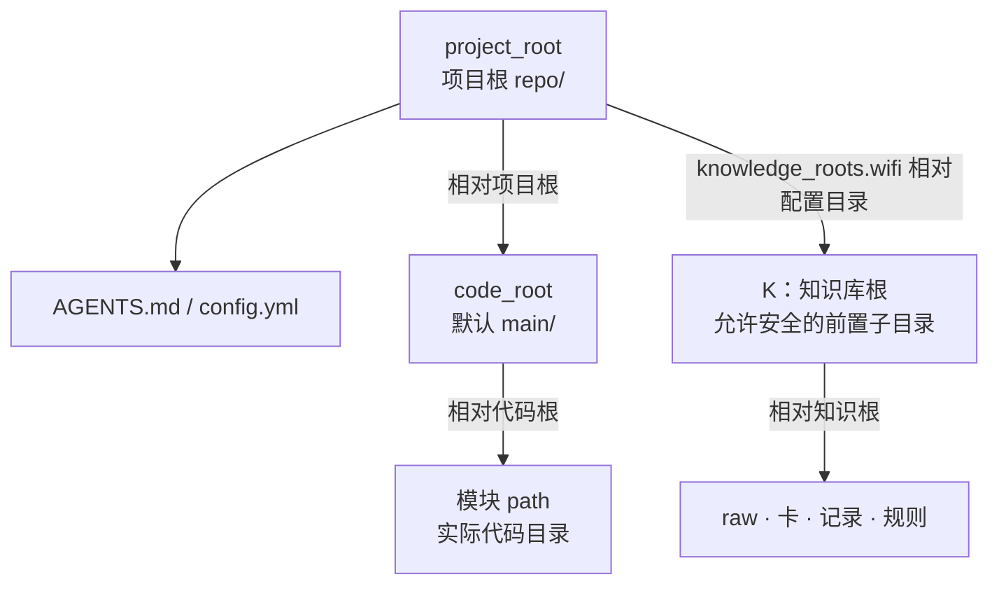
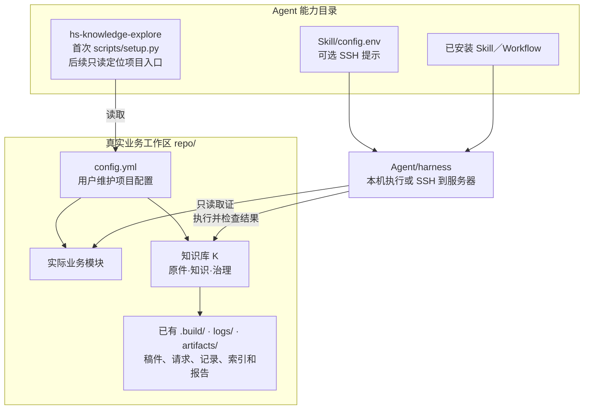
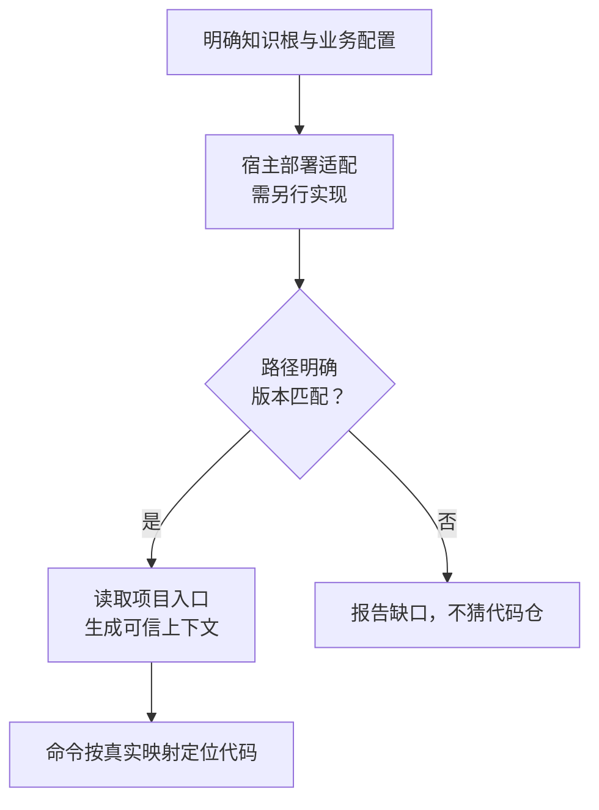
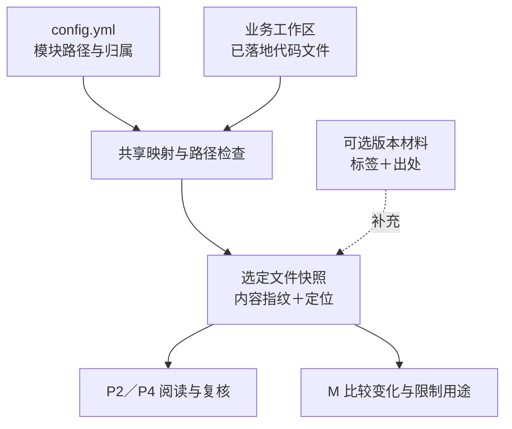

# 知识库关键点

本文集中说明工作区路径、部署方式与文件核验边界。系统分层见[架构设计](HiMate知识库架构设计.md)，流程与节点实现见[详细设计](知识库详细设计.md)，安装和操作见[使用说明](使用说明.md)。下文 P2／P4、M 等节点编号沿用详细设计。

## 1. 工作区路径与部署边界

### 1.1 路径基准

| 名称 | 路径含义 |
|---|---|
| `project_root` | 项目根，示意为 `repo/`；放置 `AGENTS.md` 和 `config.yml`，可管理多个 Git 仓 |
| `code_root` | `config.yml` 中的代码根，相对 `project_root`，默认 `main` |
| 模块 `path` | 相对 `code_root` 的实际目录，可覆盖一个或多个子仓 |
| `K` | 知识库根，由 `config.yml` 的 `knowledge_roots.wifi` 相对配置目录解析；默认 `himate-knowledge-wifi-mp/`，可增加安全的前置目录；raw、卡、记录及领域规则使用根内相对路径 |
| `S`、`F` | Agent 已安装的 Skill、Workflow 目录，由 harness 使用，运行不依赖项目根分发源码 |
| `S/hs-knowledge-explore/` | 知识库项目接口：首次 setup，后续定位代码仓、知识根和上下文；可选 SSH `config.env` |
| 外部版本材料 | 可补充文件的版本标签与出处；不替代实际文件核对 |

### 1.2 默认：知识库与代码位于同一工作区

整个项目只有两部分：真实业务工作区中的知识根、`AGENTS.md` 与用户维护的 `config.yml`，以及 Agent 自己目录中已安装的 Skill／Workflow。默认使用机器已有全局 Python；业务产物沿用已有 K 布局，不外放。

首次运行 `hs-knowledge-explore` 的 `scripts/setup.py`：依赖已齐则直接复用，缺失或版本不符时才安装到当前全局解释器，随后读取项目入口。后续缺少入口信息时调用该 Skill 的只读项目接口，定位代码仓、知识根并加载 `AGENTS.md`、`config.yml`；已有有效上下文不重复 setup。setup 不创建私有虚拟环境、catalog、registry 或机器 binding，也不要求用户执行登记步骤。业务 CLI 不要求 catalog；规则摘要默认取当前锁，仍核验规则文件，不增加第二套配置。操作见[使用说明](使用说明.md#首次准备运行依赖)。

| 配置／产物 | 位置与职责 |
|---|---|
| 项目配置 | 用户手填根 `config.yml`，知识根相对该文件，模块相对代码根 |
| SSH 提示 | `hs-knowledge-explore` 自己的 `config.env`，账号、端口、服务器项目根等供 harness 使用 |
| 稿件与操作请求／结果 | 实际执行端 K 已有 `.build/` |
| 正式处理、来源与恢复记录 | 实际执行端 K 已有 `logs/` |
| 可重建索引与报告 | 实际执行端 K 已有 `artifacts/` |

跨机器时，setup 返回 SSH 入口提示；harness 建立连接后，须确认执行端的全局 Python 与对应 Skill 脚本实际可调用，再从服务器原生路径运行 `setup.py --local` 或业务节点，并检查结果。调用端的安装路径不能直接当作远端路径，setup 不上传脚本；实际能力不可用时报告缺口，特殊处理先与用户讨论，不另建专用 runner、目录或工具副本。提示本身不证明已连接、环境就绪或工作完成。

K 继续由确切 `config.yml` 解析，允许安全嵌套，不把知识根父目录当项目根。代码按真实模块读取，空模块列表不创造源码范围。目录和模块标签不证明版本、宏、构建或产品适用。

普通本地运行和直接 Git 快照消费不要求原机器的私有登记。shared 索引构建请求可直接提供 `knowledge_commit`，按实际 Git 仓根核对卡、规则、来源锁和引用，结果只声明 `repository_snapshot`，query 复验所用代次记录的快照；构建时若显式提供签名发布回执，另外核验受信 adapter 与签名的身份真实性。签名身份与上游 Skill／CI 是否通过是不同信息。历史记录按确切 Git 内容和指纹恢复；当前配置有错误、歧义或不安全路径时不能用历史分支绕过，也不据此允许任意仓外读取。

当前查询频道由请求 `channel` 选择，缺省为 local；`config.yml` 的 `query.default_channel`／`allowed_channels` 不控制运行时默认或访问权限。

### 1.3 例外：知识库位于业务仓外

项目入口从 `config.yml` 所在工作区定位知识根和模块，WiFi 映射仍要求位于该工作区内。`hs-knowledge-explore` 的 `config.env` 仅提示 harness 连接哪台机器，不扩展项目数据布局。仓外知识库需要另行适配；增加一个连接字段或返回 SSH 提示不代表这种部署已经实现。

适配须核对能力／规则版本；执行器从明确可信位置加载，项目入口仍为 `AGENTS.md` 与 `config.yml`。K 内部引用仍相对 K，默认模块解析仍限于已确定工作区的 `code_root`；不新增任意仓外代码读取，也不据此接入仓外 raw 或网页来源。

### 1.4 项目视图与文件核验边界

`config.yml` 维护模块路径、芯片、端、特性与用途。代码目录按统一的文件取证规则处理，同一模块覆盖多个子目录时，分别固定选定文件的内容和定位。

外部版本材料通过可选 `version` 记录明确提供的标签并保留出处，含义以原材料为准。缺失字段保持 unknown，不阻断当前文件的静态源码核验，也不冒充某个已发布产品版本。

当前核验比较原配置、实际路径和工作树文件内容指纹，不能只读 Git 已提交对象而漏掉未提交修改；旧结论也不能因目录标签相同就继续有效。涉及构建／运行断言时，Agent 将采用的配置、Target、材料文件和逐 Claim 引用作为 `code_contexts` 固定进索引，查询直接复查实际字节。这是生成的业务数据，不是另一份用户手填配置，也不是 local-check／apply 已通过的证明。静态源码结论和纯文档无需为此提供构建材料。缺少真实路径、Target 条件或必要材料时保留缺口；标签只帮助定位，不能证明宏开启、构建成功或协议兼容。

人工测试可逐个调用 Skill；OpenFlow 负责 Workflow 的顺序、角色隔离和交棒合法性。Skill 不要求 Workflow run／node／attempt、流程 manifest、catalog 登记或上游 passed 票据；本次输入文件及内容绑定、来源／代码范围、索引完整性和写入安全仍须核对。apply 自身运行固定检查与 CAS，记录真实落位事实，不自动声明已独立复核或生成 supported 验收摘要；恢复仍核原视图、事务与备份，不依赖可选复核文件继续存在。
