# HiMate 知识库详细设计

本文承接[架构设计](HiMate知识库架构设计.md)，按“用户入口 → 输入与结果 → 流程节点 → 文件职责”展开。生产、治理、消费是职责分段；生产与本地治理合在一条 ingest 工作流中，消费按需查询，另以只读 lint Workflow 巡检正式库及其来源／代码引用并出报告。上库由人手工提交、触发固定 CI 并评审合入，属于工作流结束后的操作。详细设计沿用概要中的节点顺序。

文中的“本地入库／本机索引”指数据所在的实际执行端。部署保留真实业务仓的根 `AGENTS.md`，按 `AGENTS.md.example` 合并知识库位置说明与 explore 入口指针；配置、知识库留在业务工作区，Skill／Workflow 位于 Agent 自己的目录。`hs-knowledge-explore` 承担全库能力路由，首次准备和后续项目发现脚本均按需执行；目标代码仓在远端时，Agent 通过 OpenFlow／宿主已有 SSH MCP 在服务器执行脚本与仓库操作。请求、稿件、记录与索引沿用 K 已有目录。操作见[使用说明](使用说明.md)。

## 第一部分：概要设计

## 1. 用户入口与流程总览

### 1.0 命令之前：Agent 的项目能力发现

`hs-knowledge-explore` 是全库能力入口，集中介绍和路由知识库任务。Agent 阅读其指引，结合业务仓约定和配置选择具体能力；已有有效信息直接复用，不必运行脚本。首次准备时，其 `scripts/setup.py` 检查当前全局 Python 依赖：已齐直接复用，缺项才安装到同一解释器，再读取根 `config.yml`；后续仅在上下文缺失时使用只读 CLI 定位代码仓和知识根，读取真实 `AGENTS.md` 与配置。远端执行使用 OpenFlow／宿主已有 SSH MCP，实际项目根、全局 Python、已安装脚本位置及命令结果由 Agent/harness 按执行端核实。

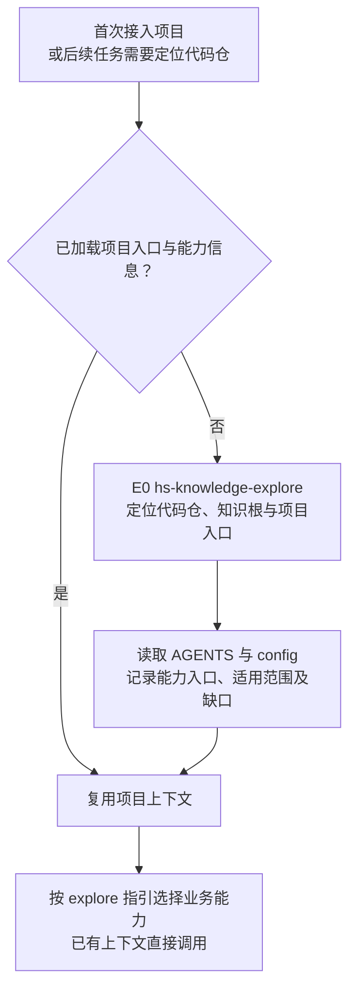

首次准备与 E0 位于业务链路之外，分别解决运行依赖和项目入口。项目设置由用户维护在根 `config.yml`；跨机器连接由 OpenFlow／宿主已有 SSH MCP 提供，知识库不另设连接配置、私有环境或登记文件。初始化结果以实际执行为准。已有环境和上下文后直接使用业务能力；explore 中的 CodeGraph 首次初始化见 §5.11。

### 1.1 从命令进入流程

统一用户接口以 `knowledge` 为逻辑命令名，职责按下表约定；宿主适配层负责命令分派和执行，不把 Skill 或 Workflow 目录名自动视为已安装命令。日常下发方式见[使用说明](使用说明.md#1-三个常用命令)，公开节点参数见对应 Skill 文档。

```text
knowledge <入口> [参数]
```

知识库随代码仓一并管理，工作区根有 `AGENTS.md` 和 `config.yml`，实际知识根 K 由 `knowledge_roots.wifi` 相对配置目录解析；平铺目录只是默认示意，允许安全的前置子目录。全局依赖可用且具备项目上下文后执行入口，不需要另做业务 `init` 或启动常驻服务；节点核对当前规则和本次业务输入，不重复执行 E0。raw 路径相对 K，代码引用按工作区模块映射解释。

| 用户要做什么 | 命令格式 | 执行什么 | 得到什么、何处停止 |
|---|---|---|---|
| 首次导入或更新知识 | `knowledge ingest [--source <raw文件或目录>]` | `hs-knowledge-ingest` Workflow，P1—P7 | 扫描、备料、确定语义计划并成稿；P5 独立审阅及完整检查后，机械转写记录并安全入库，本地索引全验、冻结查询通过且活动代激活成功后结束；未完成则保留停点 |
| 单独检查已有稿件或知识库 | `knowledge lint [--view <候选视图引用>]` | `hs-knowledge-lint` Skill，L1—L5 | 默认检查正式知识、导航和引用；可指定候选视图，输出问题清单，不修稿、不做语义复核、不入库 |
| 手动或周期巡检正式库引用 | 手动／外部调度启动 `hs-knowledge-lint` Workflow | 同名 Workflow 的 `check_formal` → `audit_references` 两个 Skill 节点，见 §3.1 | 保留原 lint 默认全库报告，补充逐卡／Claim 的来源、当前代码与历史引用差异，生成 JSON／Markdown 报告后结束 |
| 回答知识问题 | `knowledge query "<问题>" [--target <Target>]` | 消费 Q1—Q5，代码事实走 Q6 | 带依据、范围和缺口的回答 |

人工可逐个调用Skill，按业务输入传递实际文件；OpenFlow负责Workflow的顺序、角色分工、出口和交棒合法性。下文P1—P7描述ingest完成条件，不是Skill内部的前驱通过门禁。日常用 `ingest` 更新、`query` 查询；独立lint和CI复用确定性规则。同名lint Workflow只编排巡检，保持Skill默认formal/full。`status`、`index rebuild`、`recover`是逻辑维护名称，与实际动作的映射见 §6.3，不表示已安装同名终端命令。

日常执行 `knowledge ingest` 即可，默认扫描六类允许的 raw 目录。`--source` 仅用于临时缩小到某个文件或子目录；不填写时无需用户逐个指定文件，也无需分别调用六次。

P4在 `.build/` 直接形成完整稿件及输入快照，只负责生产一致性；P5由独立reviewer审阅内容、计划及适用代码依据，再执行一次完整质量检查。补料或运行故障保留原操作事实，输入未变且停点有效才续办；退回改稿或输入变化后建立新操作、计划和视图，重新完成P5，不要求用户另启lint。原件与业务代码始终只读。

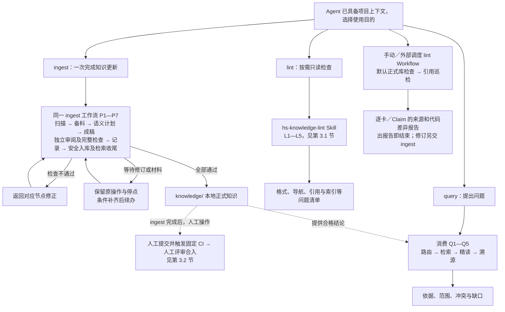

P3保存作者语义计划，P4直接成稿，P5统一独立内容审阅、适用代码核验、一次完整质量检查及候选冻结查询，P6登记处理记录，P7发布已审字节和必要正式证据，内容核验后保存正式成功记录，再完整验证真实索引、冻结查询和原CAS激活，清本批可删暂存后结束。默认独立lint与CI复用确定性规则。仅记录批以记录校验及落位为止，defer／失败继续保留欠账；无变化且无义务则no-op。lint到报告为止，人工提交、CI和合入不是ingest完成条件。

### 1.2 首次建库与增量更新用同一入口

首次提炼原件和后续更新都执行无参数的 `knowledge ingest`：首次没有已治理基线的原件都进入处理，之后只处理新增、变化和正式记录中尚未解决的事项。不要求用户选择另一条 `init`、`update` 或 `sync` 命令；如果仓库已经带有合格知识卡，未变化的原件无需重新提炼。

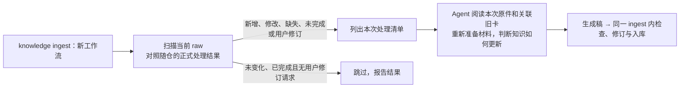

| 场景 | 调用与处理 |
|---|---|
| 第一批原件 | 执行 `knowledge ingest`，自动扫描六类目录；无基线的来源进入首次处理 |
| 新增文件或原件升级 | 仍执行 `knowledge ingest`；自动识别新增与变化，沿用逻辑来源 ID，比较原字节指纹，不只看修改时间 |
| 只想处理一个文件或某个子目录 | 才使用可选的 `--source` 缩小本次范围，其余目录本次不扫描、不推断缺失 |
| 原件未变，但用户要求修订已有卡 | 仍进入 ingest；把反馈和目标卡列为待办，P2 显式准备相关原件与旧卡，再按新操作完成复核、检查和入库 |
| 上次在 P1—P6 中断，另开新工作流 | 只看正式状态重新扫描和准备，不采用上次未发布的稿件或日志；尚未正式处理的来源仍会进入待办 |
| 明确继续原会话或原 P7 操作 | 沿明确的本轮引用继续；P7 根据正式发布结果补齐缺失阶段，不重复已经发布的内容 |
| 改名、版本目录替换、原件删除 | 先确认是否同一逻辑来源及影响范围，知识退役仍走候选和治理 |
| 目录不可读、离线或扫描未完成 | 报告该范围缺口，不当作文件已删除或无变化，也不推进该范围扫描水位 |
| 仅索引损坏 | 使用 `index rebuild`；不重新提炼 raw，不改知识结论 |

扫描范围固定为 `docs-raw/{conventions,chips,storys,specs,protocols,troubleshooting}/`，忽略 `.gitkeep`、`AGENTS.md` 等控制文件，不扩展到 `sources/`、仓外映射、候选区或正式知识区。`--source` 也须落在这些允许根内。

扫描与提炼分开：P1 判断文件有没有变化，不判断知识结论该怎么改。系统保留原件处理记录，Agent 再按清单读取材料；详细记录与步骤见第 2.1 节。输入未变化但用户明确要求修订、正式记录仍有欠账、治理规则变化或实际来源／代码／配置不再匹配时，也不能直接跳过。旧执行目录中的“未完成”不会自行成为新工作流的输入。

### 1.3 能力和资产放在哪里

`repo/` 为项目根目录的示意名称，实际目录名称和存放位置不限。

```text
repo/
├── AGENTS.md / config.yml              业务仓约定与项目映射
├── AGENTS.md.example                   本项目分发的知识库接入示例
├── main/                              业务代码工作区
├── skills/common/knowledge/            开发分发用 Skill 源包，部署时可移走
├── workflows/common/knowledge/         开发分发用 Workflow 源包，部署时可移走
└── himate-knowledge-wifi-mp/           知识库根 K
    ├── docs-raw/                       只读原件
    ├── governance/
    │   ├── templates/                  知识卡、导航和处理记录模板
    │   ├── schemas/ · contracts/       字段约束与共用规则
    │   ├── specs/                      编写与治理规范
    │   └── sources.lock.yaml           正式来源身份
    ├── knowledge/                      正式知识卡和导航
    ├── .build/                         候选与操作暂存
    ├── logs/                          证据快照、复核及事务记录
    ├── artifacts/                     可重建索引与同代正文
    ├── evals/                         检索回归与链路验证
    └── docs-llm-wiki/                  系统设计与使用文档
```

上树展示开发分发源码，业务仓不必保留根能力源码。K 为领域资产根，S／F 为 Agent 已安装能力位置。首次准备脚本在 `S/hs-knowledge-explore/scripts/setup.py`；项目配置在根 `config.yml`，远端项目由 Agent 通过 OpenFlow／宿主已有 SSH MCP 在实际执行端调用当地已安装脚本。默认全局 Python，产物沿用 K 的 `.build/`、`logs/`、`artifacts/`。节点默认核验当前规则锁，内部复用同进程公共函数与同一套实际业务数据，不要求 catalog 登记或额外目录。

| 组件 | 负责什么 |
|---|---|
| Skill | 可独立调用的业务能力，检查本次数据、执行动作并返回结果；不判断 Workflow 交棒。节点提供 CLI，explore 另包含 Agent 执行的首次准备指引 |
| Workflow | 由 OpenFlow 管理节点顺序、角色隔离、判断出口、交棒、退回与恢复停点，不复制业务算法 |
| Template | 提醒作者补齐内容，统一表达，不预填事实或成绩 |
| Script | 固定字节、校验引用、执行受控读写与检索 |

### 1.4 共同设计约束

| 对象 | 设计约束 |
|---|---|
| 文档来源 | 接受 `docs-raw/{conventions,chips,storys,specs,protocols,troubleshooting}/` 内已落地原件；链接、网页、仓外映射不进入此链路 |
| 适用范围 | 具体产品结论按实际模块映射、Target 和逐 Claim 条件核对；历史／指导性分析绑定确切文件快照与内容指纹，版本、Target 或构建材料未知时保持 unknown，不推广为产品实现 |
| 纯文档结论 | 完成独立 Agent 内容复核以及格式、来源和导航检查后可落为 stable；免代码实现核验 |
| 代码结论 | 本地逐条核对源码、引用和实际需要的配置条件后 stable；源码分析不统一要求编译产物。具体 Target 的当前实现须核对实际配置映射及适用条件；编译、运行或实测效果须有相应证据 |
| 检索资格 | 按生命周期、用途、实际来源及当前配置范围筛选 Claim；提交／合入是独立事实，来源、代码、材料或依赖失效时限制相关结论 |
| 权限 | 目录、包摘要和回执各有校验职责，不构成 OS 级全面封锁；访问控制由实际仓库、执行用户、宿主和工具权限落实 |

## 2. ingest 工作流：从原件变化到本地入库

**入口：**`knowledge ingest`，默认扫描六类 raw；需要缩小范围时才用 `--source`。**输出：**本地 `knowledge/` 中的 stable 知识，或保存了材料、稿件和停点的未完成操作。扫描、写稿、检查、修订及入库按同一 OpenFlow 工作流编排；人工测试可依次调用同一批 Skill。

### 2.1 完整流程与节点判断

流程起点是Agent已知业务约定和知识根，缺项才通过explore前置发现。ingest恰好7个Skill节点，P5由独立reviewer执行，其余由coder执行；不在P3／P4另开复核节点。

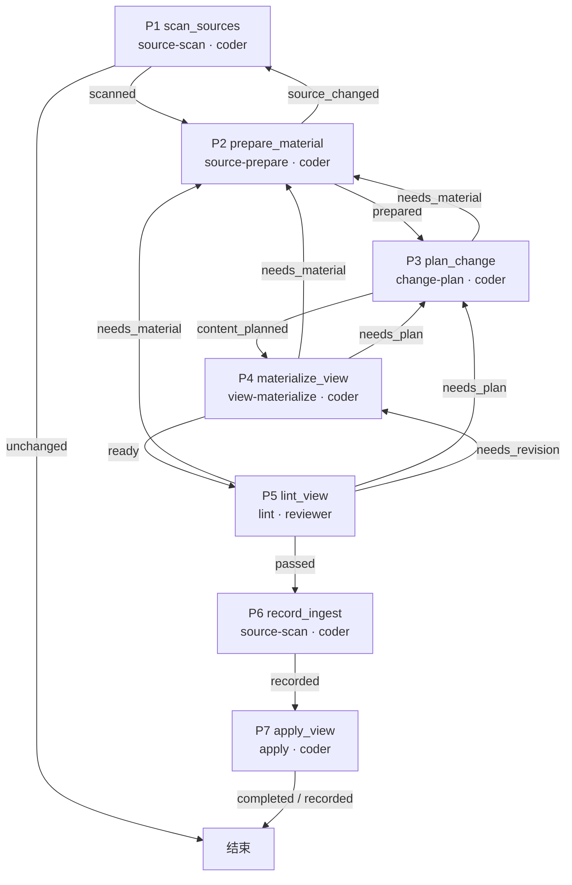

| 阶段 | 能力与动作 | 交付和边界 |
|---|---|---|
| P1观察 | source-scan.scan | 只对照当前原件、正式处理历史和维护限制；不备料、不制造记录、不发现旧私有操作或收尾 |
| P2备料 | source-prepare.prepare | 固定扫描单元或显式来源目标，组织新旧原文、旧卡、代码／配置与缺口；可独立调用；缺料定向补齐，采用输入漂移回P1 |
| P3计划 | change-plan.plan | 作者记录逐Claim、归卡、保留、skip／defer和冻结查询预期，不生产完整字节、不自行复核 |
| P4成稿 | view-materialize.run / revise / describe | 直接生成或修订卡、导航、来源锁及完整视图，固定输入快照与处置预览；只负责生产一致性 |
| P5审阅与质量 | lint.review | 独立审阅全部稿件、计划、新旧证据及实质skip，核代码证据绑定，再执行一次完整质量检查和候选冻结查询；不修稿 |
| P6记录 | source-scan.record | 校验处理覆盖和实际引用，准备待入库记录；不要求上游通过票据 |
| P7执行 | apply.batch | 核实际输入、路径、旧基线、字节及记录，同批落位；写后重建索引基线，完整验证真实索引、冻结查询、同代read和原CAS激活 |

主线使用6个包，query、explore、maintain独立保留，共9包。程序通过同进程公共函数复用，不委派兄弟CLI；Skill不要求Workflow身份、catalog或前序passed记录。

P5的材料／定位缺口回P2，语义／适用范围／归卡问题回P3，稿件／格式／导航问题回P4。补料不默认全扫；P3／P4遇来源问题先交P2核对，只有P2的 `source_changed` 出口回P1更新受影响范围和真实清单。P3／P4／P6可内部修正可确定的问题，异常无可用结果则保留宿主等待，不以假出口结束。

正常内容只有P5完整通过才由编排者进入P6/P7，但P7不核通过票据，也不重跑质量判断；它自己检查实际安全条件。纯skip／defer／失败的仅记录批仍沿本次语义计划和处置表达，不带失败稿件、不伪造passed；P7只发布处置及其必要依据，保留欠账，不带失败稿件，也不建索引。无变化且无义务的扫描直接结束。

明确当前操作实际写入中断先按原协议恢复。新Workflow不搜索或采用旧稿；已发布但索引／查询或清理未完时，仅按明确引用续办P7，不重新提炼或apply；修改已入库结论另建操作。旧apply.run保持原完整固定检查和结果语义，原journal决定恢复模式。

#### 原件处理记录保存什么、放在哪里

“原件处理记录”绑定实际扫描观察与本批处置，不依赖 Agent 的会话记忆，也不另手填一份“已入库=true”的事实。有处理义务时，无产卡、失败、暂缓的处置同样留痕；完整无变化且无义务的扫描不制造正式记录。

| 记录位置 | 记录内容及用途 |
|---|---|
| `logs/ingest/` | 已落位处理批的原始扫描清单、完整性、路径与内容指纹，以及逐单元处置和操作引用；据此识别已处理范围及欠账。记录由P7落位并纳入版本管理，不是每次scan的日志 |
| `governance/sources.lock.yaml` | 正式卡已经接纳的来源身份和确切版本；保存过原件副本不等于进入这份正式登记 |
| 正式卡内的 `sources` 与 Claim 引用 | 哪些卡、哪些结论使用哪个原件版本；反向关联从正式卡重建，不重复维护另一份关系真源 |
| `.build/operations/<op>/` | 本批请求、来源副本、材料、稿件、检查报告和待发布记录；新事务及备份也在本批 `transaction/` 中。它们用于本轮交接和明确续办，不参与下一次普通扫描 |
| 旧 `logs/operations/` | 仅保留旧版事务的配套读取与明确恢复；不再作为新批次的默认写入位置或扫描依据 |
| `logs/evidence/published/`、`logs/publications/`、`logs/events/` | 新正式必要证据、发布结果及有效业务限制按清单保全；旧证据路径保持兼容，不能按日志整体删除 |

要分别记录**本次看到的原件版本**、**已由正式卡接纳的版本**和**当前处理节点**。P6 只生成待发布的处理记录。P7 先发布并核验内容与必要依据，再保存正式处理事实，随后完成适用的本地索引、目标查询和清理。内容已经发布与整批已经完成分别记录，不提前混为同一状态。人工上库时将记录与知识内容一同提交。跳过、失败、暂缓及未覆盖事项也要保留在处理记录中，提交时一并纳入；某来源被一张卡引用，不表示整份原件已全部提炼。

#### Agent 具体读什么

| P1 发现的情况 | 交给 Agent 的阅读材料 | Agent 的判断 |
|---|---|---|
| 新增原件 | 本次原文及相关主题已有卡 | 是否有可沉淀知识，应该新建还是补充现有卡 |
| 原件修改 | 本次原文、各关联旧卡实际引用的旧版原文、差异和旧卡 | 哪些结论改变、哪些仍成立，选择 update、merge、split 或不改卡并记录理由 |
| 原路径缺失 | 保留的旧原文、关联旧卡和其他可用证据 | 是改名、资料暂不可达还是内容退役；不因文件少了就自动删卡 |
| 原文未变但用户要求修卡 | 当前原文、指定旧卡及反馈依据 | 显式准备相关单元与旧卡，按新操作重判结论；不因观察结果 unchanged 就跳过本次修订 |
| 原文未变但正式记录仍有欠账 | 当前原文、相关正式卡及暂缓／失败／未覆盖的明确原因 | 按本次任务重新判断欠账；不从上次私有草稿推断未写下的修订意图 |

P1—P6 尚未发布的材料可以在新工作流中重新准备，不要求恢复旧草稿。用户明确继续原操作时，才采用它的确切交接材料；若 P7 已发布，则按正式发布结果补齐收尾，不能因旧 `.build/` 消失就重复落位。实际未结束的写事务仍遵守原有恢复保护。旧版原文按各卡引用取回，同一原件可能仍有多个版本被不同卡采用。

举一个示意：某说明把超时从“5 秒”改为“8 秒”，P1 只发现文件内容变了；P2 准备新旧原文和使用该来源的旧卡；P3 由 Agent 核对条件及范围后决定怎样改稿。P4 写稿、P5 检查通过后，P6 生成待发布记录；P7 发布并核验新版知识和依据后保存正式记录，再验证索引、目标查询并清理本批暂存；后续人工上库见 §3.2。

只有在相同范围内完整扫描成功，才能把“上次有、这次没有”的路径列为缺失。目录不可读、扫描中断或 `--source` 范围之外不能推断删除。阅读期间原件或正式卡又变化时，重新准备材料或修改预览；不沿用旧内容继续入库。

### 2.2 六决策如何选择

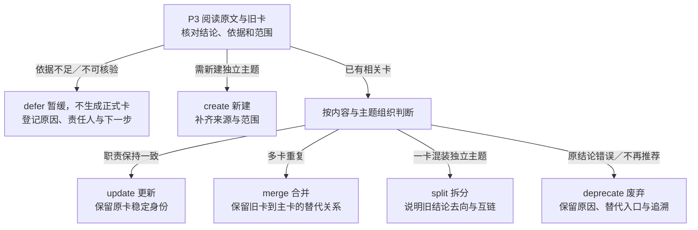

已完整阅读本次材料且没有知识增量时，登记 skip 及已审范围、理由；它是无产卡的处理结果，不新增为第七种卡片变更决策。defer 表示仍欠材料或核验，保留未完成事项；不能因已经留记录或已有卡引用该原件就跳过。P1 的“未变且已完成”另注明为扫描跳过，避免与已审无增量混淆。

全部正式变更都须经过候选和治理，废弃也不能直接改 `knowledge/`。Agent 基于已读材料写出结论，脚本检查并固定内容。

### 2.3 六类 raw 如何选择入口与模板

六类资料默认由一次 `knowledge ingest` 共同扫描，差异是提炼问题和卡模板，而不是命令。一个原件可以产生多种卡，按结论性质选择，不按目录名强制唯一 Profile。

| 原件目录 | 优先提炼什么 | 常用模板 | 更新时重点比较 |
|---|---|---|---|
| `docs-raw/conventions/` | 对象、强制约束、建议和例外 | rule、glossary | 规则条款、批准状态、适用范围 |
| `docs-raw/chips/` | 芯片职责、机制、限制和术语 | entity、flow、glossary | 芯片及版本条件，设计声明与实现证据 |
| `docs-raw/storys/` | 场景、流程、设计决策和经验 | flow、entity、runbook | 需求或流程变化，结论是否仍适用 |
| `docs-raw/specs/` | 接口契约、状态、流程和约束 | entity、flow、rule | 接口与行为变更，不能把任务完成标记当代码证据 |
| `docs-raw/protocols/` | 协议机制、字段、状态机和条件 | protocol、entity、glossary | 条款版本，标准规定与产品支持的区别 |
| `docs-raw/troubleshooting/` | 问题现象、排查步骤、定位链路和解决经验 | runbook、flow | 环境与触发条件、根因依据、措施与验证结果，保留未解决及未验证部分 |

问题定位与排查经验宜保留“问题现象 → 环境与触发条件 → 排查过程 → 根因或当前判断 → 解决方法 → 验证结果”。卡片按实际依据区分观察、推测和已验证结论；历史案例的有效措施不能直接证明其他版本或环境也适用。

输入格式与资料类别分别判断：非空 UTF-8 MD/TXT、每页有文字层的 PDF、DOCX 段落/表格可提取；扫描图、图中事实或其他不可解读部分记缺口。`docs-raw/sources/` 的链接不进入目录扫描，也不因放在列表内就自动联网。

<a id="3-lint-skill-与固定-ci"></a>

## 3. lint 巡检、只读检查 Skill 与固定 CI

lint Skill同时提供P5的 `review` 和独立固定检查；`knowledge lint` 默认选择后者。同名lint Workflow供手动或外部周期调度，先沿用Skill默认formal/full，再调用maintain的只读 `audit-references` 补充引用差异报告，不代替ingest、不自动修订或入库。`S/hs-knowledge-lint/` 是Skill，`F/hs-knowledge-lint/` 是两个节点的巡检Workflow，两者按目录和调用方式区分。

### 3.1 lint 的检查流程

#### 正式库巡检 Workflow

巡检以“检查并报告”为边界，宿主接入与实际部署另行核实。调度由外部系统触发，不在知识库内增加runner、定时器或Workflow子调用。

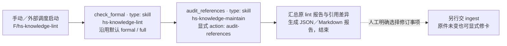

| 节点 | 输入与动作 | 结果与出口 |
|---|---|---|
| `check_formal` | 原 `hs-knowledge-lint` Skill；传入实际知识根、规则、新报告位置及确切来源输入，存在当前代码卡时按实际配置准备 `inputs.code_checkout`；不传 `view_ref` 或局部 `scope` 改变默认 formal／full | 输出原 L1—L5 报告，保留相对知识根的 `lint_report_ref`；发现问题或缺材料仍保留真实状态，不靠更换检查模式取得通过 |
| `audit_references` | 显式调用 `hs-knowledge-maintain --action audit-references`，传入独立 `operation_id` 和 `lint_report_ref`；读取原 lint 报告、正式卡、来源锁、实际配置与可读的来源／代码文件 | 按卡、Claim、来源及代码文件列出原定位、快照／旧 hash、当前 hash、差异、检查范围与缺口；声明 code_ref 时另列当前 code_navigation，并保留 current／guidance／historical 用途；保存 JSON／Markdown 后结束 |

原 lint 报告有效时，即使报告为 failed／incomplete，引用巡检仍汇总其结果和实际可执行项；原报告缺失、损坏或无法绑定本次对象时，第一节点保留 OpenFlow 原生等待，不伪造报告或向后交棒。第二节点只有在实际 JSON／Markdown 报告已保存、读取并核对 `phase: reported` 及真实 status／complete／统计后才结束；运行故障而未产生有效报告时同样保留等待。必需业务文件无法读取时报告未完成范围，不把空集合当作全库无问题。两步之间或巡检过程中材料变化时注明不一致，不能将不同时点的观察声明为同一稳定快照。

巡检沿卡／Claim 的显式来源和代码范围核对，不扫描未配置源码，也不声称发现未引用 helper、调用者或宏定义的全部语义影响。文件 hash 不同首先表示依据已变化，不自动判定原结论错误；历史／指导性引用仍核对其确切旧证据是否可恢复、定位是否有效，不因与当前 `main/` 不同而批量刷新。代码路径缺失、定位失配、配置范围改变、原版不可恢复和当前源不可读分别报告。原 L4 继续覆盖导航／链接／关系及临时索引可构建性；巡检不重建或激活查询活动索引。

活动卡的每个代码来源须填 code_ref，缺失由固定 lint／CI 报 CODE_REF_REQUIRED 后交 ingest 补齐；历史来源恢复及 deprecated 卡保留原四字段兼容。当前导航与旧证据、字节差异分列。guidance 符号仍唯一可定位时，插行或函数体变化不产生导航修复义务；缺失、歧义或解析不可用保留实际问题。current 实现限制不能由导航成功解除。字段及示例见[卡片规范](../governance/specs/cards.md#代码来源的可选符号补充)。

两个节点只生成报告及必要临时产物，不修改 `knowledge/`、来源锁、事件／维护水位或活动索引，也不调用 maintain 的写事件／advance 动作。完成报告不代表已修复、已入库或已上库。修订由人明确把报告中的卡／Claim 和问题交给 ingest，沿既有材料准备、复核、检查和落位流程处理。

#### 原 lint Skill：L1—L5 固定检查

**输入：**P4 生成的完整候选视图，或已有正式知识库；**输出：**绑定检查对象与规则版本的问题报告。候选按“现有正式区 + 拟写入 − 拟删除”组成检查视图，检查链接时不要求候选先落入 `knowledge/`。

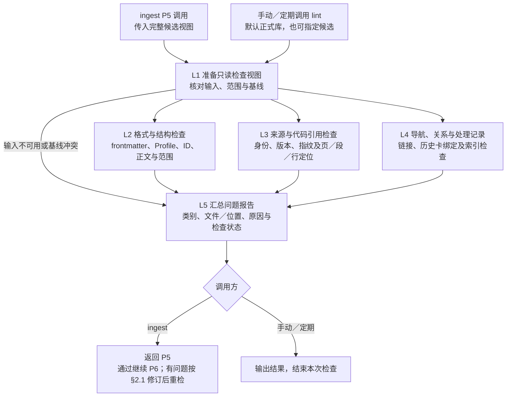

| 检查节点 | 固定脚本的判断逻辑 |
|---|---|
| L1 检查对象 | 正式库直接读取确定版本；候选核对操作、计划、视图、来源集合和拟写字节，拒绝越界、冲突写删或旧基线不一致。未完成事务报告需先恢复，不在 lint 中恢复 |
| L2 格式与结构 | 解析 YAML，校验必填字段、类型、枚举及 Profile 必需章节；核对卡／Claim ID、正文锚点和范围引用，`unknown` 不作全范围适用 |
| L3 源文档引用 | 核对卡与来源锁的身份、版本和定位，候选使用视图内含拟新增登记的来源锁；从确切副本恢复原文，校验指纹及引用的行、页、段、表格或附件可读，不以同名新文件代替旧原版 |
| L3 代码固定引用 | 对提供的确切代码版本核对仓库、路径、文件指纹及行段；检查 Target／构建引用是否符合实际配置。作者在P3确定结论与依据，P5独立核对代码是否支持结论；P4只组织实际字节 |
| L3 代码符号导航 | 活动卡的每个 code 来源缺 code_ref 时报 CODE_REF_REQUIRED；核固定旧证据中的符号／行段绑定及当前唯一定位，missing／ambiguous 失败，unavailable 未完成。此固定项不依赖 code_gate 或 Claim 采用，也适用于文档背景卡；历史恢复及 deprecated 卡保留兼容，不判断技术语义 |
| L4 导航与关系 | 检查 `index.md`、链接／锚点、唯一 ID、目标卡／Claim、替代关系与依赖环；受管导航须与完整检查视图一致 |
| L4 处理记录 | 核对 `logs/ingest/` 的覆盖、采用版本与 Card／Claim 绑定；当前卡已更新时，使用确切历史卡正文核对旧记录，不改写历史事实 |
| L4 索引可构建性 | 只在临时目录构建索引，全量核对结构、版本和卡／Claim／词项／关系记录；普通独立lint及CI不依赖私人P3查询。P5内容审阅另在同次临时索引上执行冻结查询，不切换活动索引 |
| L5 汇总结果 | 列出已通过、失败、因输入缺失未完成及不适用项；缺材料不能记为通过。候选整体不可用时先报输入问题，其余可执行检查尽量汇总，便于一次修正 |

`index.md` 是纳入检查的导航文件，SQLite 是临时构建的检索产物。默认 `lint` 动作与固定CI只执行确定性检查，不要求私人内容审阅记录；ingest的 `review` 动作另保存实际审阅声明，核对适用代码依据并执行候选冻结查询。两种用途都不改知识、来源锁、维护水位或活动索引。固定检查通过仅表示所列项目合规；独立内容／代码语义复核由P5的reviewer完成，问题按 §2.1 返回，P6只转写已定处置。

### 3.2 上库：固定 CI 检查后合入

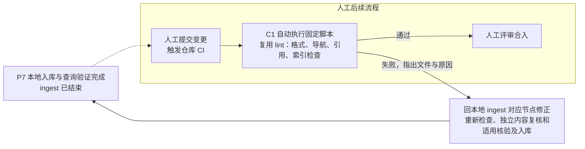

人工提交后触发仓库 CI；CI 自动运行已有 lint 的固定检查脚本和共用函数，不另开发一套检查，也不增加业务代码编译任务。CI 不加载 Agent 或 Workflow，不重复内容语义复核，不自动修改卡片。脚本失败则返回本地修正，再由人提交重跑；通过后由人评审合入。

| CI 检查项 | 复用 lint 的哪部分 | 固定脚本做什么 |
|---|---|---|
| 格式与身份 | L2 | 检查 frontmatter、字段／枚举、Profile 章节、卡与 Claim ID、正文定位及范围引用 |
| 导航与关系 | L4 | 检查 `index.md`、链接／锚点、跨卡／Claim 引用、替代关系与依赖环 |
| 来源登记与引用 | L3 | 检查卡与 `sources.lock.yaml` 的身份、版本和定位结构一致；需要关联当前代码时，对 CI 提供的最新业务代码固定 checkout 核对路径、行段及文件指纹，不符则返回本地重检 |
| 索引可构建性 | 共用索引构建与校验函数 | 在临时目录生成检索索引，检查结构、记录及卡片映射一致性；产物不必提交，不切换查询服务的活动索引 |

CI 输入是本次提交及作业明确提供的代码／原文，不依赖开发机的 `.build/`、安装 catalog 或私人日志。L1 改用提交文件作为检查对象；原文页段恢复仅在取得确切原版时检查，未取得时明确未执行的范围。必需输入缺失则 CI 不通过；本地代码语义判断及文档内容复核在P5独立完成，P6 登记处理结果。

CI 问题绑定提交、文件和位置，作为下一次本地 ingest 的待修订输入，即使 raw 未变也需处理；修复产生新操作，再经 P5—P7。已经完成的入库事务保留原结果，不重新 apply。

## 4. 消费流程：从问题到证据回答

**入口：**`knowledge query "<问题>"`，使用已有项目上下文，可补 Target 和用途；**输入：**问题、范围和已治理知识，**输出：**带证据的回答及明确缺口。已有有效活动索引但没有合格候选时正常返回空结果；尚未构建／激活索引或索引失效时明确报告不可用，不将缺索引伪装为“没有知识”，也不隐式触发 `ingest` 或自动发布。

### 4.1 路由与检索节点

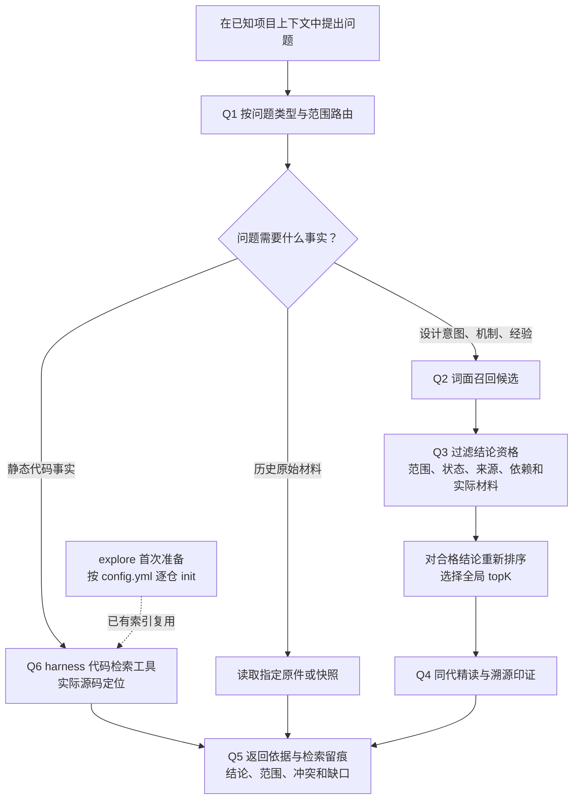

| 节点 | 能力与资源 | 判断逻辑 |
|---|---|---|
| Q1 问题路由 | 主 Agent、explore 指引、已加载的业务约定与 `config.yml` | 按问题选择知识卡、代码图谱或原件；不推断未知 Target，不重复执行 E0 |
| Q2 词面召回 | `hs-knowledge-query`、SQLite | 只产生候选，得分不表示事实概率 |
| Q3 过滤与排序 | 同一查询 Skill、治理规则和当前业务材料 | 先筛合格 Claim，再计分取 topK；unknown 不作范围通配 |
| Q4 精读与溯源 | 查询 Skill、同代正文；Agent 按需读取来源 | query 返回合格 Claim 正文与来源地址，内部核验实际依据；Agent 按问题打开原文或源码，说明实际读过的范围 |
| Q5 回答与留痕 | 查询结果、Search Receipt；主 Agent 综合 | 区分来源陈述、代码事实和推断，报告冲突与缺口 |
| Q6 源码定位 | 主 Agent、harness 提供的代码检索工具及实际文件 | 按模块映射读取所问版本的源码；图谱不证明宏开启、构建或运行结果 |
| 首次代码图谱准备 | `hs-knowledge-explore`、现有项目上下文及执行端已有的 CodeGraph CLI | 按 `config.yml` 中配置的真实代码仓逐个初始化，已有可用索引复用 |

首次初始化是 explore 的准备动作，见 [§5.11](#511-explorecodegraph-首次初始化)。CodeGraph MCP 由 harness 提供，图谱查询按实际可调用能力使用；项目只负责逐仓初始化，后续工具调用沿用 harness 能力。

### 4.2 变化如何反馈到三条链路


`hs-knowledge-maintain` 是三条链路共用的维护能力。它区分“当前实际来源状态”和“卡片实际采用的版本”，不能仅因原件更新就宣称知识已同步；机械失效标记的解除也不代表已完成内容复核。

## 第二部分：详细设计

## 5. 按节点展开文件设计

节点编号沿用 §2.1：P1扫描、P2备料、P3语义计划、P4成稿、P5独立审阅及完整检查、P6机械记录、P7安全入库与检索收尾。下文只说明文件承担什么逻辑；Skill路径相对 `S`，领域文件路径相对 `K`。

### 5.0 入口、Workflow 与共用规则

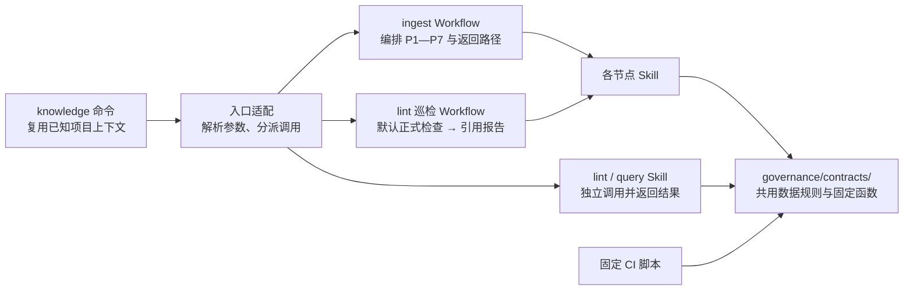

| 文件 / 位置 | 设计职责 |
|---|---|
| 宿主命令适配 | 将 `ingest`、`lint`、`query` 分派到对应能力，传入实际路径和业务输入；规则默认取当前锁，也可显式固定摘要 |
| `F/hs-knowledge-ingest/workflow.yaml` | 由 OpenFlow 编排节点、角色、交棒、问题返回、仅记录分支及有界修订／续办；按真实 P5 报告决定是否进入 P6、P7 |
| `F/hs-knowledge-lint/{workflow.yaml,layouts.yaml}` | 两个 `type: skill` 节点 `check_formal`、`audit_references`，直接调用同名lint Skill默认formal/full与maintain的只读动作；不调用ingest子Workflow，出报告即结束 |
| 节点 `SKILL.md` | 说明输入、动作、输出与返回原因；脚本执行其中可固定的步骤 |
| Agent/harness | 使用已安装能力，在目标代码仓所在端执行；远端通过宿主已有 SSH MCP 调用脚本，传业务输入并检查命令结果；不要求创建调用登记，不代替 OpenFlow 编排或内容阅读 |
| `governance/contracts/` | 统一身份、来源、范围、记录和检查规则，供 Skill 与 CI 复用 |

公开能力统一使用 `hs-knowledge-` 前缀；下表列推荐动作，兼容别名不作为额外流程节点。

| Skill | 主入口与独立动作 | 职责位置 |
|---|---|---|
| source-scan | 默认 `scan`；`record`、`status` | P1观察、P6转写及只读进度；不备料 |
| source-prepare | 默认 `prepare`；`capture`、`resolve`、`resolve-source` | P2定向备料、独立捕获与确切来源恢复 |
| change-plan | 默认 `plan` | P3保存作者语义计划和查询预期 |
| view-materialize | 默认 `run`；`revise`、`describe` | P4保存完整字节、修订新稿或描述已保存对象 |
| lint | 默认 `lint`；`review`、`record-review`、`code-check`、`code-recheck`、`verify-evidence` | 独立固定检查、P5审阅及适用检查，或单独记录审阅／核验代码证据 |
| apply | `batch`；`index-build`、`index-verify`、`index-activate`；`regression`、`regression-verify`；`prepare-submission`、`verify-submission`；默认兼容 `run` 及 `inspect`、`resume`、`rollback`、`verify-result` | P7安全事务和检索收尾；独立索引、回归、只读提交核对及原事务恢复 |
| query | 默认 `search`；`read`、`receipt` | 独立查询、同代精读与检索回执 |
| explore | 只读发现CLI；按需执行 `scripts/setup.py` | Agent能力路由、项目发现及首次准备指引，不是ingest业务节点 |
| maintain | 默认 `inspect-context`；`audit-references`、`register-source-change`、`register-code-change`、`recover-events`、`status`、`advance` | 影响定位、只读巡检、事件与机械freshness维护 |

旧独立成稿检查、改稿、交接、代码复核、索引、回归、恢复及提交清单能力已归入这些入口，不再通过旧Skill串行调用。P1旧 `prepare`、P3旧字节规划及内容 `review` 请求只报告迁移位置，不替代上述职责。

P5由独立reviewer使用lint承接审阅和完整质量检查，按问题类别返回P2／P3／P4；默认独立lint只做固定检查。没有知识变更的skip、defer或失败也先经过P5对处置和适用项的审阅，再由P6机械转写、P7校验落位；不把失败内容记为通过或夹带入库。流程节点和等待状态由OpenFlow留存，Skill核对本职业务数据，不认证交棒。

### 5.1 E0：命令前帮助 Agent 阅读项目入口

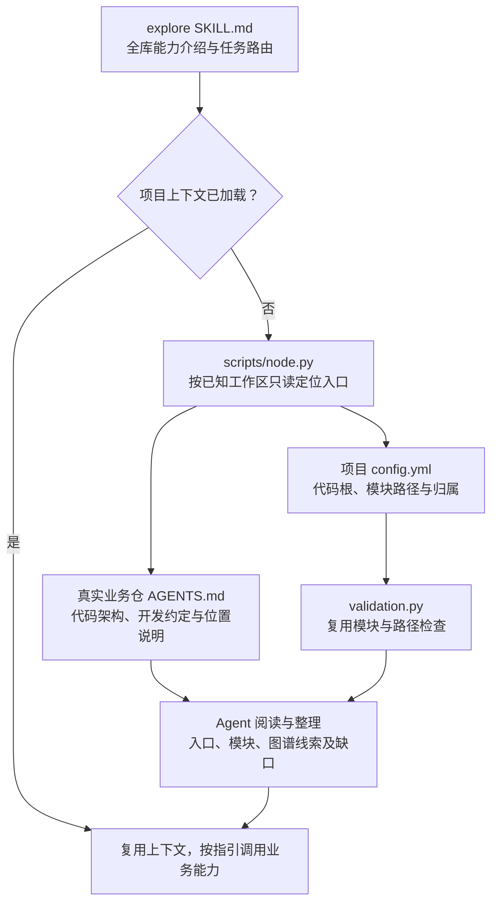

图中 `hs-knowledge-explore/SKILL.md` 是全库能力入口，介绍任务、选择原则及能力指针；业务根 `AGENTS.md` 维护业务仓本身的架构与约定。`scripts/setup.py` 仅按需检查全局依赖并读取配置，不复制或合并 `AGENTS.md.example`；`scripts/cli.py`／`node.py` 按实际路径只读定位代码仓、知识根，读取真实根与领域 `AGENTS.md`，不回退读取 `.example`。领域配置校验复用 `governance/contracts/validation.py`。跨机器使用 OpenFlow／宿主已有 SSH MCP，项目设置只维护根 `config.yml`，不另生成机器绑定。

`code_root` 相对项目根，模块 `path` 相对代码根；同一模块可覆盖多个代码仓，共享模块可关联多个芯片和端。公共映射函数统一核对路径范围并整理实际模块文件，不要求用户逐项填写六 Target／三 pair 或重复代码根授权。代码取证按模块映射读取实际文件，不要求仓管理元数据。芯片、端和特性是归属线索，不证明实际宏、构建或协议条件。

首次 setup 完成后可长期复用环境；后续上下文缺失时只执行 E0 定位，不重复安装依赖。已有有效上下文则直接选择业务命令。P2／P4 再固定本次实际源码和条件；E0 不属于 ingest 的 P1，普通发现入口不安装、不登记、不启动服务。图谱是否可用由真实查询判断。

### 5.2 P1 / P2：扫描原件，准备新旧材料

P1 列出本次待处理原件；P2 找出需要阅读的候选卡，准备新旧对照材料。候选卡附带关联原因，不等于必须修改的卡。

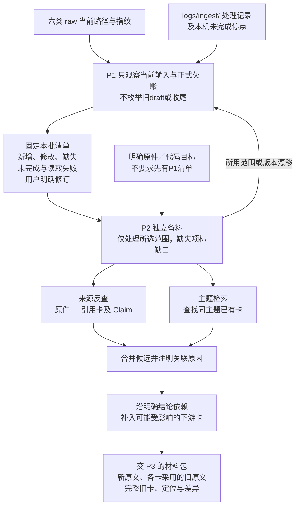

| P2 如何找卡 | 依据与边界 |
|---|---|
| 来源反查 | 以来源身份反查正式卡的 `sources` 与 Claim 引用，找出引用版本和原文定位；处理记录的关联卡摘要可帮助定位，实际关系以卡内引用为准 |
| 主题检索 | 根据标题、章节及初步阅读中的实体、协议、接口、符号和范围检索；新增原件没有历史引用，主要走此路，旧原件新增主题也要补查 |
| 依赖扩展 | 沿明确的跨卡／Claim 依赖查找下游结论；普通“相关链接”不自动扩散，是否受影响由 P3 判断 |

用户明确要求修订已有卡时，Agent 从本次清单中显式传入关联 `unit_ids` 和 `candidate_card_ids`；即使观察结果为 unchanged，也重新准备这些原件与旧卡，在 P3 记录本次 content 修订理由并纳入独立复核。

P2可独立从显式来源目标开始，也可读取固定扫描清单；前者只形成定向观察，不伪造扫描完整性或变化分类，正常Workflow的P6仍绑定真实扫描清单。P5退回补料时使用新操作，传 `existing_material_ref`、`previous_view_ref`、`revision_reason` 和明确补充目标，保存新材料版本并保留旧引用，不因缺料重扫全库。所用源、旧卡、配置或规则漂移时读取 `needs_scan/affected_scope`，经P2的 `source_changed` 回P1，不能以旧清单冒充补齐。

P2在材料包 `candidates` 中保留旧卡的 `card_digest` 和 `card_ref`。更新、合并、拆分或退役涉及旧卡时，Agent 将其整理为 `historical_card_objects`：旧卡 SHA-256 对应当前操作中确切旧正文的绝对路径，路径从本次材料引用解析。该输入由Agent交P5检查并固定为P7实际输入快照，无需用户手工准备或先提交 Git。

卡内来源须能说明“哪条结论采用哪个版本的哪段原文”。只有整篇引用或定位不清时，将整卡列为阅读候选；不能凭文本差异直接排除其他章节条件变化的影响。P3 读出新主题或依赖时回 P2 补查，检索无命中不直接等于应新建卡。

P2 保留旧来源项内已有的 code_ref，并提供实际源码供作者确认函数、类型、枚举／成员或宏的身份和必要消歧信息。CodeGraph 可辅助找候选，但不能用内部节点 ID 或搜索首个同名结果代替定义。捕获包／快照保持原格式，新增字段在 P4 的代码 sources 项填写；不从文档流程名推断符号，也不猜宏活动分支。

| 文件 / 位置 | 设计职责 |
|---|---|
| `hs-knowledge-source-scan/scripts/scan.py` | 枚举六类允许目录，按可选 `--source` 缩小范围；对照路径、指纹和处理结果，固定本批清单及扫描完整性，供 P6 对账 |
| `hs-knowledge-source-prepare/scripts/entry.py`、`governance/contracts/source_materials.py` | 汇总捕获包、来源反查和候选卡；显式选取未变原件及指定卡，保存旧卡正文、指纹与各卡采用版本 |
| `governance/contracts/records.py` | 区分观察版本、已完成范围、实际采用情况与待办，不能因已记录新指纹就跳过未完成项 |
| `governance/contracts/source_operations.py`、`governance/contracts/source_resources.py` | 保存本次原字节、可读文本和定位；按各卡实际引用恢复旧原文并准备差异，读取期间变化则重新准备 |
| `governance/contracts/source_materials.py`、`knowledge.py` | 从正式卡重建来源反查，按显式 `topics` 和 `candidate_card_ids` 找阅读候选，再沿明确依赖扩展；不调用query的问答入口，不按回答资格过滤卡状态 |
| 主 Agent | 按原文标题、章节及初步阅读补充主题或明确候选；无命中不直接决定新建，候选关联原因不等于知识更新判断 |
| `governance/contracts/source_operations.py` | 按真实映射取得所需代码、快照、文件与配置；未知项保留缺口 |
| `.build/operations/<操作>/` | 保存本批清单和材料引用，以及候选卡、关联原因、各卡采用版本及差异，供 P3 阅读 |

旧原文按每张卡实际采用的版本取回，不能统一使用“上次扫描版本”；缺失或读取失败项不伪造本次原文，恢复旧引用并标明缺口交 P3。只有同范围完整扫描成功才推断路径缺失；改名、删文件或删段落不直接等于结论废弃，可能是移位或资料缩编，须由 P3 核实。未变但有欠账或上下文失效的来源仍需处理（见 §5.10）。

| 找卡示例（示意） | P2 的结果 |
|---|---|
| 《认证说明》将 chip12 Host 超时由 5 秒改为 8 秒 | 来源反查找到《超时规则》，沿明确依赖补入《重试流程》；两张卡均待 P3 阅读，尚未决定都改 |
| 新增《认证诊断说明》，尚无任何卡引用它 | 按认证、超时、日志等主题找到已有《认证诊断》；P3 再决定补旧卡还是建立独立新主题卡 |

### 5.3 P3：阅读材料，判断结论与变更计划

P3先按目标卡归并本批材料，逐条比较事实、适用条件和依据，再统一保存语义计划。OpenFlow将同一卡交一个作者串行融合，独立卡可在同一批内并行阅读／起草；P4统一组织本批卡片、导航和来源锁，不另开并发ingest或并发正式落位。作者标签描述责任，不是Skill判断交棒合法性的身份凭证。

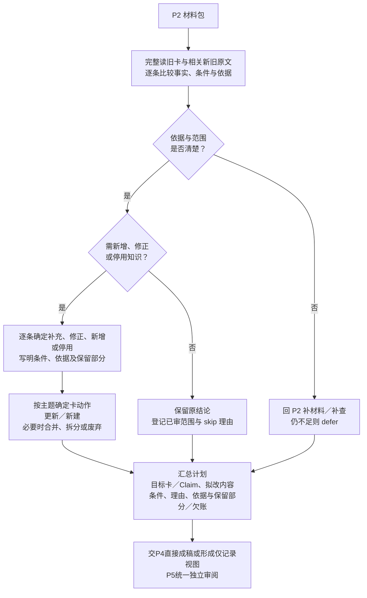

| 逐条比较的结果 | 内容处置与计划 |
|---|---|
| 事实及条件未变，且用户未要求改稿 | 保留；已审无增量记 skip，不因原件版本变化重写所有卡或统一替换来源版本 |
| 新原文补充已有主题 | update，说明补哪条结论、来源和适用条件，融合进旧内容 |
| 原结论的数值、行为或条件改变 | update 受影响 Claim，说明新旧适用范围；其他结论保留，不将一个芯片的变化推广到其他芯片 |
| 出现独立新主题，已有卡无合适归属 | create；先完成查重和主题边界判断，不能仅因来源是新文件就建新卡 |
| 新旧来源冲突或必要依据不足 | 先核对芯片、Host／Device、版本和配置差异；补材料仍无法判断则 defer，不能默认新来源覆盖旧来源 |
| 经核实已有结论失效 | 修订或停用对应 Claim；仅当整卡职责均失效时 deprecate，并说明旧结论去向及替代入口 |

内容判断后再检查卡的组织：同主题卡重复才merge，一卡混装独立主题才split，并保留旧Claim去向。普通update保持卡的稳定身份，多源重叠融合、互补补全；导航与来源锁由P4统一装配，处理记录由P6转写、P7落位。多源组织参考CANNBot的[同卡实施单元](https://gitcode.com/cann/cannbot-knowledge/blob/c92c66ee695090c44487f56bd051d2607c58b27a/.agents/skills/knowledge-ingest/references/incremental-sync.md#L14)。

P3保存作者的语义决定和逐Claim理由，P5统一独立复核计划、完整稿件、归卡及实质skip；未变原件的明确修订同样纳入。作者与复核者分工由宿主／人工测试者安排，记录只保存实际样本、问题及未审范围，不认证身份或充当前序passed票据。发现遗漏／错归回P2/P3，未审范围不得冒称已复核。

内容计划同时固定 `target_queries`：每例包含独立的问题和预期命中／排除／顺序，显式选择 `purpose` 和实际上下文。current要求Claim为 `usage: current` 且范围匹配；implementation还要求实现或测量依据，代码链接本身不能把design升级成implementation。设计背景通常用guidance；design也不因证据类别就一律排除current，仍按实际usage、范围及来源判断。指定旧版本用historical；省略时API仍默认current，不自动包含guidance-only Claim。新增／修改结论的正向用例建议以 `expected_claim_ids` 绑定实际 `CardID#ClaimID`，负向用例保留排除或空结果断言，不强填正向Claim。P3保存计划前拒绝非法用途；P5对最终候选实际执行原例，预期不满足回P3，不能自动降低用途凑通过。OpenFlow沿用原冻结用例；apply独立regression动作仍校验并执行本次明确传入的断言，不要求apply通过凭证。资格机制见 §5.9。

| 文件 / 对象 | 设计职责 |
|---|---|
| 主 Agent、`hs-knowledge-change-plan/SKILL.md` | 按上述顺序阅读、比较与归卡；说明修改和保留的理由，需要新材料或候选时回 P2 |
| `hs-knowledge-change-plan/scripts/plan_v3.py` | 保存逐Claim语义计划、覆盖、用途和目标查询；不生产候选字节，不承担独立复核 |
| `hs-knowledge-change-plan/scripts/planning.py` | 只接受作者语义计划；具体字节决定直接交P4，独立复核交P5 |
| `hs-knowledge-lint/SKILL.md`、`hs-knowledge-lint/references/review-guide.md` | 供P5的独立reviewer核对内容、归卡、skip及适用代码依据；P3不调用该复核过程，图谱仅提供定位线索 |
| `governance/templates/{entity,flow,protocol,rule,command,runbook,glossary}.md`、`governance/contracts/knowledge.py` | 提供七类卡结构和 Card／Claim／范围／关系表达，供计划与 P4 共用 |

**接续 §5.2 的超时示例：**P3 的计划应细到结论，而非将两张候选卡全部标成 update。

| 目标卡／结论 | 阅读判断 | 给 P4 的计划 |
|---|---|---|
| 《超时规则》：chip12 Host 等待上限 5 秒 | 新原文明示该条件下改为 8 秒 | update 对应 Claim，列出新原文定位及条件；其他芯片结论保留 |
| 《重试流程》：超时后重试，未写具体秒数 | 重试触发条件仍成立 | 保留，记已审理由，不生成该卡的修改 |

若《重试流程》实际写了“5 秒后重试”，该步骤也列入 update。若 8 秒只是文档中的设计要求，计划只表述要求；有实际代码及配置依据后才写成代码事实，无法补齐就缩窄结论或 defer 对应单元。skip 不增加第七种卡变更动作，defer 与未覆盖部分保留欠账，其他已形成明确变更的单元可继续 P4。

### 5.4 P4：直接成稿、修订并固定完整视图

P4读取P3语义计划和P2实际材料，直接生产最终字节；支持create、update、merge、split、deprecate、defer及相关旧卡修订，保留旧Claim去向。它只核作者输入、字节、导航、来源锁、基线和视图的一致性，不判知识质量或代码语义，不运行全库lint或复现另一节点规划器。

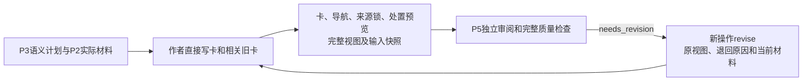

| 文件／对象 | 职责 |
|---|---|
| `hs-knowledge-view-materialize/scripts/materialize.py` | run、revise、describe的薄入口 |
| `governance/contracts/production.py` | 直接装配具体六决策及完整字节，核唯一写删和旧基线，生成导航／来源锁、处置预览、视图及修订记录；describe只描述确切保存对象 |
| `governance/contracts/input_snapshot.py` | 固定规则、正式文件、业务记录、采用旧对象和当前选定输入；比较实际项目及文件集合，不只比较一个摘要 |
| `governance/templates/index.md` | 导航表达模板；导航随本批卡片写入 |
| `.build/operations/<操作>/` | 保存实际候选正文、plan/final-view、输入快照和可追查修订理由；正式区尚未修改 |

分发导航使用不依赖当前卡片数量的中性说明。P4只识别并替换标准旧空库行首句，保留项目自写文字、同句余文及其他链接；根导航仅在该旧说明实际变化时进入候选写集。P5审阅完整导航，P7继续发布已审字节，不在落位后另改说明。

同一操作重入只核对并读取已保存的确切请求、输入和展示字节。P5退回时使用新 `operation_id`、`previous_view_ref` 和 `revision_reason`：回P2先保存补料新版本，再保存新计划；回P3可采用未变且与旧稿精确绑定的材料；仅回P4时可采用旧稿精确绑定的未变语义计划及材料。原scan、处理单元身份及旧工件字节不覆盖，新稿重新交P5；来源范围／版本漂移经P2回P1。候选可预先表达stable/deprecated最终字节，只有P7实际落位才成为正式知识。

新旧原文、代码和配置须按实际映射取证，未知版本／Target／构建保持unknown。P4记录作者怎样使用这些材料，P5独立reviewer逐Claim判断其是否支持结论；图谱只提供定位线索。

活动卡的每个 code 来源在原 `evidence_ref/source_id/snapshot_id/locator` 之外填写 code_ref，Claim.source_refs 继续引用原 evidence_ref；历史来源恢复及 deprecated 卡仍允许原四字段。一个来源项表达一个符号，同文件多个符号使用不同 evidence_ref。纯文档不强制连代码，P5 按实际内容判断是否遗漏必要入口；不支持的符号保留缺口，不能用 file／range 兜底。完整卡稿、input_snapshot 和 final-view 的字节摘要自然绑定该字段；source_set_digest 仍只表达采用的来源快照集合，不另造符号通过凭证。P4 不替换旧定位或认证导航，P5 执行公共固定检查。

### 5.5 P5 / L1—L5：独立审阅与一次完整质量检查

ingest的P5调用 `hs-knowledge-lint --action review`；独立reviewer完整阅读计划、稿件、新旧原文及代码条件，复核归卡和实质skip，保存样本、问题和未审范围，再执行一次完整固定质量检查。代码／混合视图必须携本次逐Claim的代码审阅依据，确定性校验复用 `code_review.py`。P5不修稿，也不以作者姓名、Workflow身份或上游passed声明代替实际证据。默认独立lint和巡检 `check_formal` 仍为只读formal/full，CI只运行固定函数；保持L1—L5编号。

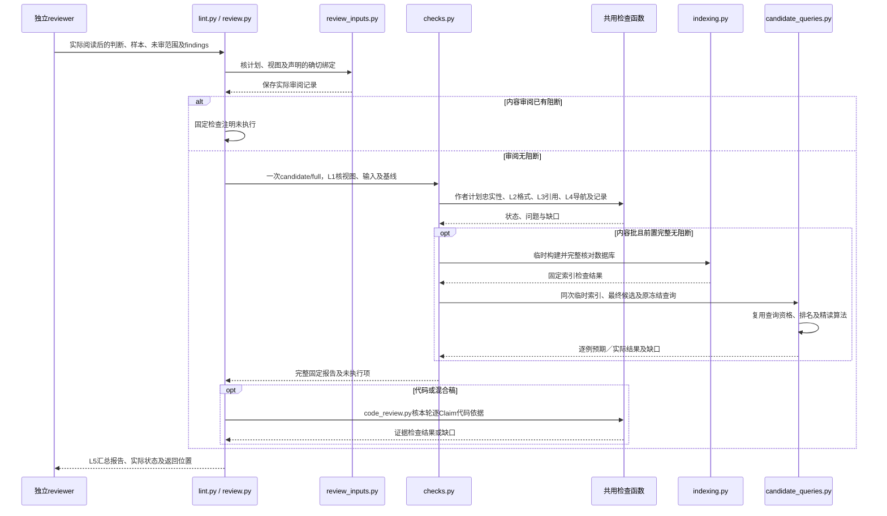

前置必需项完整执行且无阻断后才验证索引；内容审阅在该临时数据库仍可用时执行P3原冻结查询。查询使用完整合成候选卡、来源锁、stage证据和候选维护状态，真实代码／配置仍按原工作区核验，不能把旧活动库当作新候选。检查复用同一查询算法和已全验数据库，不另建一份索引、不创建或激活正式代；报告与内部预览结果只留本批stage，不作为正式Search Receipt。报告包含未完成及未执行项。文件位置与检查细节如下。

| 节点 | 文件 | 设计职责 |
|---|---|---|
| P5审阅 | `hs-knowledge-lint/scripts/review.py`、`governance/contracts/{review_inputs.py,code_review.py}` | 记录独立Agent审阅，核计划／视图／样本及逐Claim理由、证据和实际代码条件；固定校验不代替语义判断 |
| 入口 | `hs-knowledge-lint/SKILL.md`、`hs-knowledge-lint/scripts/lint.py` | review承接P5；默认仍选择候选／正式库和全库／局部范围，调用固定规则并返回真实报告 |
| L1 检查视图 | `governance/contracts/checks.py` | 候选按“正式区 + 拟写入 − 拟删除”展开，核对操作、文件内容、允许目标及旧基线；正式库直接读取确定版本 |
| L1 作者计划与处置 | `governance/contracts/production.py` 的 `validate_candidate` | 在P5检查语义计划到实际稿件的忠实性、六决策、旧Claim保留与去向、处置预览；不在P4重跑这组质量判断，正式库／CI不要求私人生产计划 |
| L2 格式结构 | `governance/schemas/`、`governance/contracts/{validation.py,knowledge.py}` | 检查 frontmatter、Profile 章节、ID、正文锚点及范围引用 |
| L3 来源引用 | `governance/contracts/source_resources.py` | 核对视图内来源锁、确切原版、指纹、页／段／行定位；声明 code_ref 时核旧证据绑定及当前导航，不推断语义支持 |
| L3 符号解析 | `governance/contracts/code_symbols.py` | 对已取得的实际 C/C++ 字节解析声明的符号、作用域和可选签名；区分 resolved／missing／ambiguous／unavailable，不执行代码、猜条件分支或调用 MCP |
| L4 导航关系 | `governance/contracts/{checks.py,knowledge.py}` | 检查导航、链接／锚点、跨卡／Claim 引用、替代关系与依赖环 |
| L4 处理记录 | `governance/contracts/{checks.py,records.py}` | 检查记录覆盖及历史卡绑定；按 P2 保留对象恢复旧正文，不把旧记录强行套到新卡字节 |
| L4 索引 | `governance/contracts/indexing.py` | 内容批前置阻断项清除后临时构建，全量核验数据库版本、集合及每行值，见 §6.2；P5候选查询复用同次数据库，不切换活动索引 |
| P5 候选查询 | `governance/contracts/{candidate_queries.py,query_runtime.py}` | 在最终候选上执行原冻结用例，核对资格、命中／排除、顺序、Claim预期和同候选精读；正式lint／CI不要求私人计划 |
| L5 报告 | `hs-knowledge-lint/scripts/lint.py`、`hs-knowledge-lint/artifacts/templates/result.md` | 输出对象／规则身份、模式／范围、各项执行状态与问题；问题含稳定检查 ID／错误码、等级、文件／位置和原因 |

| 固定检查类别 | 失败／未完成条件 | ingest 的修订位置 |
|---|---|---|
| `view` | 越界路径、重复／冲突写删、内容或旧基线失配 | P4；缺原始材料回 P2 |
| `format` | YAML 重复键、Schema／Profile 不符、ID／范围结构非法、正文冲突标记 | P4；范围选择问题回 P3 |
| `source` | 来源未登记、指纹／定位失配为错误；必需原版未取得或读取失败为未完成 | P2 补材料；引用选择问题回 P3 |
| `relation` | 目标不存在、ID 重复、替代自指、依赖环、导航缺漏、链接／锚点失效 | P3 决定关系，P4 修订表达 |
| `records` | 既有记录覆盖、Card／Claim绑定或本批处置预览不符；缺少必需历史正文时未完成 | P2补旧卡对象；本批处置判断回P3、预览表达回P4，既有处理事实先核实，不改写历史取得通过 |
| `index` | 卡／Claim收录漏项／重复、元数据／词项／关系记录失配、索引／规则版本不符；P5原冻结查询预期不满足 | 内容问题回P3／P4；冻结预期不满足回P3；构建或输入不可用停P5并保留真实诊断 |

OpenFlow 调用的完整 lint 与固定 CI 执行合成视图的仓库级检查，包括删除／改名后的反向引用、父导航和全局 ID。手动局部检查只对列出的对象负责，报告不得表示全库通过。纯文档免代码语义门禁，已声明 code_ref 的公共固定导航检查仍适用；必需输入缺失列未完成，前置失败而未执行的索引检查也须注明。

P5的 `index.build` 检查行另保存 `candidate_queries`，包括原用例摘要、逐例purpose、预期与实际卡／Claim、精读结果及资格缺口。`TARGET_QUERY_EXPECTATION_FAILED` 是阻断并返回P3；`TARGET_QUERY_INPUT_UNAVAILABLE` 为未完成，不能靠改查询绕过缺失材料。负向用例按其排除／空结果断言判断，混合卡按本例预期Claim判断。独立正式lint和CI沿原输入边界检查，不需要私人P3产物；候选查询通过不代替发布后的实库复验。

仅记录批仍审阅本批计划、skip／欠账与处置预览，并核输入和适用记录项；格式、来源、关系及索引等内容项明确为不适用，不展开失败稿件或构建临时索引。`record-review`只记录审阅声明，`code-check/code-recheck/verify-evidence`只承担所选代码证据用途，均不能冒称完整P5通过；正式库／CI不因缺少这些私人记录而阻断。

P5接收P2提供的 `historical_card_objects`，完整检查历史卡、记录与当前稿件的实际绑定；P7只比较已固定输入及安全写入条件，不重跑这组质量检查。旧记录有确切卡片SHA时优先核对该正文；没有卡片SHA时，依据原扫描与已采用来源指纹、该CardID全部声明的Claim选择一致正文，不能仅凭同ID选新卡或从多版拼接。确切旧正文无法取得时，`records.coverage` 报告 `RECORD_HISTORY_UNAVAILABLE`，回P2补材料，不要求先提交业务变更。

退出码统一为：`0`＝所选范围内必需项完整执行且无阻断，`1`＝发现阻断问题，`2`＝必需输入未取得，或规则、运行器、报告不可用。材料缺口回P2，运行故障保存停点；建议项不阻断。空／损坏报告、状态与退出码不一致均按运行失败处理。OpenFlow读取本轮独立审阅及适用的candidate/full报告，无未解决阻断才进入P6；新稿重新经过P5。P6的record动作不以lint通过票据作为调用条件，实际传入的报告仍须与本次视图绑定。结果语义参考CANNBot的[检查协议](https://gitcode.com/cann/cannbot-knowledge/blob/c92c66ee695090c44487f56bd051d2607c58b27a/.agents/skills/knowledge-lint/references/checks.md#L34-L48)，独立lint到报告为止。

### 5.6 P6：登记唯一的原件处理记录

P6读取真实扫描、P3语义计划和P4处置预览，机械转写已定的 `record_action`、卡／Claim引用、理由、已审范围及欠账，在 `.build/operations/<操作>/ingest-record.yaml` 生成并校验待入库记录，声明 `logs/ingest/<记录ID>.yaml` 目标。它不重新决定新建、更新或skip；P7才随本批事务正式落位，不另建第二份来源与卡关系真源。

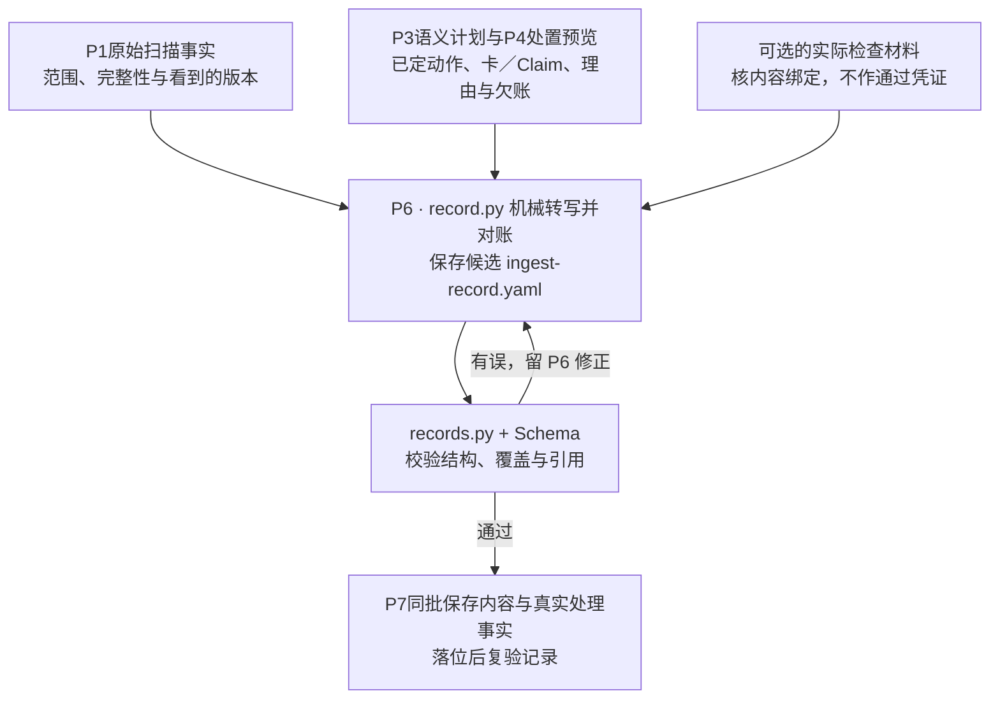

正常Workflow只转写已经P5审阅的处置；完整无变化的P1扫描直接结束，不单独生成P6记录。Skill另允许显式处置的独立记录用途，但同样必须覆盖真实清单，不能借此替换已绑定预览。`lint_ref`可选，提供时核对确切视图绑定；`skip_sample`保留实际抽样声明，不认证独立性或上游passed。未执行的审阅／检查不补记为通过。

| 文件 / 位置 | 设计职责 |
|---|---|
| `hs-knowledge-source-scan/scripts/record.py` | 对账真实清单与已定预览，原样转写语义处置、动作、引用和欠账；拒绝用请求覆盖作者已定判断 |
| `governance/templates/ingest-record.yaml` | 提供记录结构，不预填检查通过、已入库或已合入 |
| `governance/schemas/records.schema.json`、`governance/contracts/records.py` | 校验结构与覆盖，拒绝漏项、重复及清单外自报完成；产卡项反查最终卡／Claim 的实际来源版本 |
| `.build/operations/<操作>/ingest-record.yaml` | P6 校验后的待入库记录，尚未写入正式区 |
| `logs/ingest/<记录ID>.yaml` | P7 正式落位的可提交记录；其他人拉取后可直接理解处理事实 |

| 记录内容 | 需要说明什么 |
|---|---|
| 扫描事实 | 真实清单身份、范围、完整性、原件路径和所见指纹；返工记录保留原scan及 `origin_scan_operation_id`，不伪造新扫描 |
| 处理范围与结果 | 各处理单元采用的决策、所覆盖部分、跳过／暂缓／失败理由、欠账及下一步 |
| 关联知识 | 卡／Claim 身份及变更摘要；实际采用的来源版本以卡内引用和来源锁为准 |
| 检查与进度 | 操作 ID、规则与内容视图身份、实际已执行的检查及材料、停点；未执行项如实说明，执行过抽查时保留范围和结果，不据记录存在推断已通过复核 |

| 处理结果 | 登记与后续 |
|---|---|
| 内容就绪 | 从实际视图核实卡／Claim 与来源绑定；OpenFlow 依据检查结果决定后续，真实入库事实由 P7 补记 |
| skip | 区分扫描跳过与已审无增量，记录版本、范围和理由；OpenFlow 安排的实质抽查如实留痕，未抽项不冒充复核通过，record 不要求抽样票据 |
| defer | 材料或结论不足，保留欠账，不能推进对应范围完成状态 |
| 失败／未覆盖 | 记录问题与未处理部分，保留后续候选和停点 |

每个真实扫描单元有唯一处置，卡片合并／拆分不改变扫描单元身份；多种卡动作时，P3须先明确 `record_action` 并保全全部动作明细，P6不猜选其中一种。一源可以关联多卡，具体已审范围和未覆盖部分仍须说明，已有一张卡引用或仅观察到新指纹不代表整份完成。实际采用关系仍以卡／Claim和来源锁为准。

P6生成后立即固定校验，机械转写错误留P6修正；P7据实保存落位结果并复验，不提前宣称提交／合入，也不要求记录包含自身提交哈希。返工记录核实原scan、实际材料和前序稿摘要；不能只自报一个原操作ID。若作者判断、卡、导航或来源锁要变，保留当前阻断并另建明确修订，经对应P2／P3／P4和P5形成新视图，不能在P6改已审稿。读取失败可以缺指纹并说明；失败是合法处理事实，不能因此将失败稿件记为已入库。

### 5.7 P7：安全事务、真实索引与检索收尾

正常主线使用 `hs-knowledge-apply --action batch`，输入为本次确切view_ref和适用的ingest_record_ref。batch不要求上游passed票据，不重复P5完整质量判断；自己检查实际输入快照、规则、路径、写删集合、旧基线、最终字节和记录绑定。

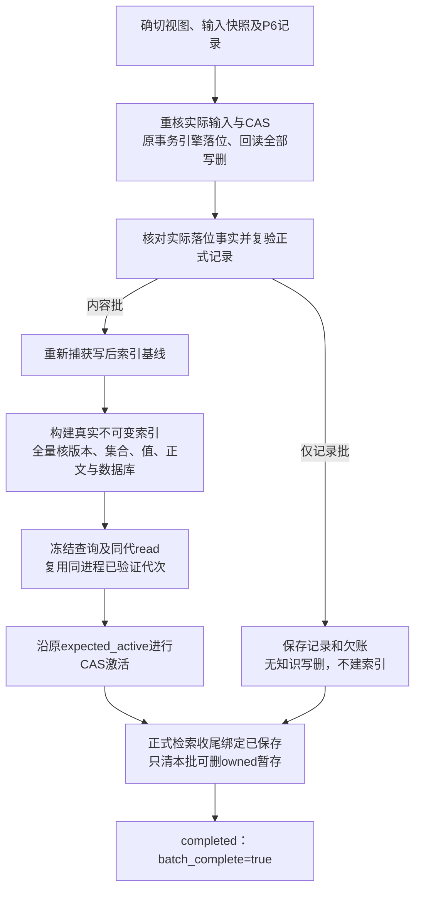

| 文件／对象 | 职责 |
|---|---|
| `hs-knowledge-apply/scripts/{entry.py,transaction.py,transaction_v3.py}` | 路由并复用唯一事务引擎；安全路径核实际字节、来源对象、记录和CAS；旧run仍执行完整固定检查，不被请求JSON关闭 |
| `governance/contracts/ingest_execution.py` | 固定批次意图、视图／journal／结果绑定、输入快照、写后基线及分阶段续办；记录批不夹带失败稿件 |
| `governance/contracts/index_runtime.py`、`indexing.py` | 构建并完整验证实际索引，核所有映射和值、同代正文、不可变文件指纹；重核写后输入及活动指针CAS |
| `governance/contracts/query_regression.py`、`query_runtime.py` | 执行冻结用例并同代读取；独立回归可直接给确切代与明确oracle，不要求作者／apply历史 |
| `.build/operations/<操作>/batch-{intent,build}.json` | 本轮执行中固定批次意图、确切候选代及原 `expected_active`；只用于明确续办，完成后可清理，不是历史完成依据 |
| 旧 `.build/operations/<操作>/batch-complete.json` | 仅供旧 batch 配套协议兼容读取；新发布路径的历史完成事实保存在正式 `completion.json` |
| `.build/operations/<操作>/transaction/` | 新事务journal、apply-result和backups；真实未完事务按原协议恢复，稳定writer锁另置`.build/runtime/writer.lock`，不清理锁；旧`logs/operations/`仅显式兼容 |
| `governance/contracts/{staging,publication}.py` | 限定stage→final映射和读取；保存正式发布闭包、实际收尾与有界清理，不搜索旧私有op |
| `logs/publications/<操作>/{manifest,completion}.json` | 正式内容manifest与后续检索／清理完成回执；清后结果、目标status和提交核对的正式依据 |
| `logs/evidence/published/` | 新发布所需的内容寻址原件、提取定位、旧卡及采用材料，按清单保全，不随stage清理 |
| `governance/contracts/submission.py` | 整理本批精确写删清单，只读核实际Git HEAD／commit／blob、删除和提交范围；不提交、推送或合入 |

P1—P6本批新文件，包括事件拟稿、来源／旧卡／代码／构建／运行副本、提取定位、审阅报告及请求／输出，仅在本批 `.build/operations/<op>/`。P4/P5提前固定stage→final映射与完整字节；P7发布同一字节，不改写ref、重新提取或重封已审卡。`publication_plan_digest`绑定含stage地址的执行计划，`content_digest`绑定不含stage依赖的正式投影，manifest再绑定正式资产闭包。正式成功处理记录在对应内容发布和核验后保存，不能由P6预制applied或单卡落盘提前推进来源处理基线。

适用检索收尾完成后，先持久保存正式收尾事实，再清本批明确owned且可删的stage。借用前序材料、明确保留及用途不明项保留并列原因；不反扫所有历史猜reader，不删其它op、正式依据、当前索引、稳定锁或开发环境。可删集合完成后才`batch_complete=true`；不要求.build空，小型最终CLI响应可以留存。eligible删除失败为cleanup_pending，保持published/content_applied事实，batch_complete=false；重入只补实际缺失检索阶段或清理，不重复apply或重建已完成索引。罕见P7半写自动修复、整目录原子切换及未到P7的孤儿stage周期GC不在本轮保证内。

来源变更事件沿P2冻结的旧来源锁基线和old→new转换发布，不在写后来源锁上重新发现差异。仅记录批不更新来源锁，冻结事件提案为空，不发布未正式采用snapshot的事件；defer／failed等欠账仍进入正式处理记录，当前来源字节及用途限制继续独立生效。独立maintain显式登记可按明确bundle的stage映射保全所需来源对象，不顺带发布借用旧卡或其它无关映射。

逐文件落位必须回读摘要后才标installed，记录committed前再核全部写入与删除。回读不符保留原事务及备份，不把系统调用返回成功等同持久化保证。输入快照比较真实项目及文件集合，只允许journal确切记录的本批新字节；不能以一个摘要、用户passed声明或换用当前基线绕过漂移。

写后重新capture索引输入，不能用写前旧正式集合拒绝自己的合法新字节，也不能忽略采用的旧对象、原件、代码／配置变化。真实索引全验与查询共用同进程公共函数；内部已验证代次对象只在该进程内复用，每个频道仍重核引用及产物指纹，不接受JSON passed证明。独立index-build/index-verify/index-activate保持其实际索引、安全写者及CAS边界，不重跑全库知识质量。

独立 `regression` 拒绝空用例、非法用途或无明确断言，支持命中、排除、顺序和Claim级预期。批次沿P3原冻结用例；查询通过后仍须原expected_active激活。`regression-verify` 重跑原报告案例并校验代次／用例绑定，不再次激活；查询失败保留已committed内容和原活动代，不伪报completed。故障只续办实际停点，响应丢失先核报告、激活观察和真实指针，不能重设CAS基线或重放apply。

`inspect/resume/rollback/verify-result` 仍在apply。旧run保留完整固定检查及原事实层次；新batch的安全模式只能由内部调用及真实journal重入决定。真正未完旧事务按原配套版本恢复，已committed不得因新规则或暂存丢失重写；回滚保留外部编辑。完整batch历史完成事实不等于当前语义或后续活动代仍有效。

仅记录批只校验和落位合法记录，保留skip／defer／failed及未覆盖事实，不将失败稿件正式化、不构建索引或假称P5通过。无变化无义务的P1 no-op不新增记录。

本地完成返回本批精确文件清单。可选 `prepare-submission` 可独立依据实际视图／落位字节准备清单，`verify-submission` 核真实HEAD、提交对象、逐文件blob、实际删除与变更范围；agent记录、摘要或SHA字符串不能自证submitted。只读Git固定禁止hook／外部diff／fsmonitor／lazy-fetch及网络协议。由人实际提交、触发固定CI和合入，各事实分别记录；本机缓存不是跨机恢复的唯一依据。

### 5.8 C1：固定 CI 与 lint 共用检查函数

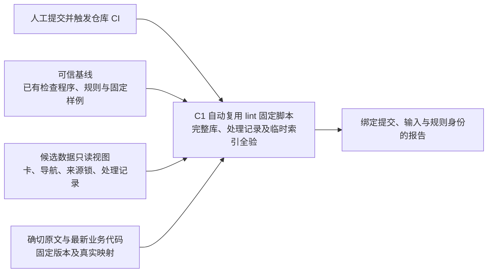

| 文件 / 对象 | 设计职责 |
|---|---|
| `K/check.py` | 从可信版本读取，检查候选完整视图并核验报告；遵循 §5.5 范围、等级与 0／1／2 结果协议 |
| `K/check.sh` | 选择作业提供的 Python 并转调 `check.py`，不实现另一套检查 |
| `governance/contracts/checks.py` | 复用可信版本的格式、导航、关系及来源引用规则；对候选提交适配输入，不依赖本机操作 |
| `governance/contracts/records.py` | 检查记录结构及本批新增／变更记录与来源、卡的关系；历史引用按记录引入时的 Git 内容或明确版本解释 |
| `governance/contracts/indexing.py` | 从候选数据构建临时索引，按 §6.2全量核验结构、版本、集合与每行值；不执行P3的冻结业务查询或切换活动索引 |
| 仓库 CI 作业 | 用受保护配置选择可信基线程序／规则，再叠加允许的候选数据；准备固定原文、实际业务代码文件及映射，版本只采用作业明确提供的材料 |

候选卡、导航、来源锁与记录是数据，不导入其中的程序；路径解析后仍须在允许根内，拒绝符号链接／子模块逃逸。可信基线由仓库受保护配置指定，候选提交不能替换本次门禁的作业、程序或规则。此边界参考 CANNBot 的[基线检查快照](https://gitcode.com/cann/cannbot-knowledge/blob/c92c66ee695090c44487f56bd051d2607c58b27a/.gitcode/workflows/cannbot-knowledge_actions.yml#L59-L75)，本项目同时覆盖正式来源锁和处理记录。

规则变更按普通代码变更运行固定接受／拒绝样例、现有知识回归和兼容性检查，候选规则仅作为被测对象，不能批准同批知识。新格式不兼容时按“先接纳兼容新旧格式的规则 → 迁移知识 → 退出旧格式”推进；原有拒绝样例不能随候选规则被删除来取得门禁通过。

CI 复用 lint 已有的固定脚本及共用检查函数，`check.py`／`check.sh` 只适配 CI 的输入和调用，不新增独立检查算法或业务代码构建任务。它不运行 Agent 或写入动作；原文、代码及配置引用以作业明确取得的版本核对，必需输入缺失或规则不兼容则不通过。CI 不依赖开发机 `.build/`、私人日志、私人复核记录或活动索引。

### 5.9 Q1—Q6：路由、查询、同代精读与回答

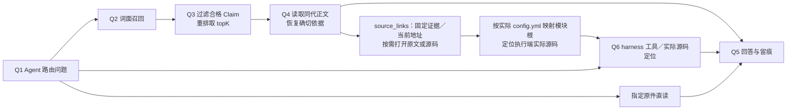

| 文件 / 对象 | 设计职责 |
|---|---|
| 主 Agent、explore 指引、已加载的业务约定与 `config.yml` | Q1 选择知识卡、代码或原件入口，Q5 综合证据并说明范围、冲突和缺口 |
| harness 代码检索工具、实际代码文件 | Q6 按模块目录定位源码；explore 负责首次逐仓初始化，见 §5.11 |
| `hs-knowledge-query/scripts/node.py`、`governance/contracts/query_runtime.py` | 前者是薄适配，后者统一执行search/read/receipt、资格过滤、全局topK和同代精读，供P7回归同进程复用；直接核实际材料，不追查apply／merge／复核通过链 |
| `governance/contracts/index_runtime.py`、`indexing.py`、`artifacts/` | 完整核对实际索引、同代正文、manifest及指纹，Q4按确切代次读取，不只信任活动指针摘要 |
| `governance/contracts/source_operations.py`、`source_resources.py` | query内部直接恢复确切原文与代码定位，不调用source-prepare CLI；独立来源恢复才使用该Skill的resolve-source动作 |
| `governance/contracts/code_symbols.py` | 与固定检查、维护共用符号解析；查询内部核验 code_navigation，对外来源链接分别保留旧证据地址、当前位置及实际状态 |
| `hs-knowledge-query/artifacts/templates/result.md` | 输出结论、引用、范围与检索 Receipt；记录命中、索引代及缺口 |

Q6 同样按代码所在执行端定位和读取。服务器源码通过 SSH 定点取得所问文件、版本和调用证据，或使用宿主已真实配置的远端代码检索能力；缺少该接入时记录缺口，不在调用端通过共享盘建立另一份索引。工具参数按实际 Schema 使用，执行部署规则不为第三方工具虚构远端参数，也不把图谱关系当作宏、构建或运行证明。

卡头的 `Claim.text_ref` 将断言绑定到流程中的正文片段，`Claim.source_refs` 再选择本卡 `sources` 中的确切证据；不同关键步骤可使用不同来源与行段，同一步也可同时引用规范原文和实际代码。头部结构化引用即可支持回源，正文链接是可选展示。固定检查验证身份、范围与定位可恢复，具体帧体格式或函数是否支持该步骤由作者及独立内容复核判断；把整条流程绑定到宽泛文档位置不会自动获得步骤级语义对应。

`search` 返回候选卡身份、合格 Claim、允许显示的标题／摘要、卡片 `path/card_ref` 及 `card_digest`；带原回执的 `read` 返回同代合格 Claim 正文和上述卡片地址，不把整卡中未合格的结论带出。两者的 `source_links` 只给来源地址，不展开来源对象、原文／源码片段或原件 Base64。Agent 需要印证细节时按链接回源；列出链接不等于已经阅读来源。

| 字段 | 后续定位用途 |
|---|---|
| 卡片 `path`、`card_ref`、`card_digest` | 两个地址均相对实际知识根 K；`path` 是逻辑卡路径，`card_ref` 指向所选代的确切卡文件。逻辑路径可能已有新版，同代正文沿原回执及 `card_ref` 读取 |
| `source_links[].evidence_ref`、`kind` | 识别该来源链接及材料类型；完整来源／Claim 绑定仍保存在卡头与索引中 |
| `source_links[].evidence` | 固定原证据的 `base/path/locator` 地址及小型 `sha256` 指纹；Git 地址另有实际所需的 `commit/repo_id`，不能拿当前文件代替旧证据 |
| `source_links[].current` | 当前经核验可用的文件地址；代码路径、定位及摘要来自同一次导航的实际文件观察（含旧 locator 对路径的覆盖）。声明符号仅 resolved 带当前范围，ambiguous 可在有实际文件摘要时保留地址但定位为 null；未读得文件摘要的 missing／unavailable 返回 null。raw 已变时不套用旧行号 |
| `navigation_status`、`current_source_matches` | 分别表示符号定位状态及该 current 文件与固定 evidence 的整文件摘要是否匹配；current 为 null 时匹配值也为 null。内部查询资格的原 resource 检查不变 |

每个地址按自身 `base` 解释 `path`：`knowledge_root` 相对实际 K，`workspace` 相对实际配置选定的项目根，`repository` 相对 `repo_id` 的授权 scope，`git` 指向确切本地 commit 与仓内路径；代码 Git 地址带 `repo_id`，raw 省略时指项目 Git。不能按 K 的父目录猜项目位置。定位保留原生语义：代码／MD／TXT 使用行段，PDF 使用页，DOCX 使用段落／表格行，不能把这些页段当成提取 TXT 的行号。证据地址指实际原件而非悄悄换成提取文本，需要解释保留对象或恢复确切原版时，按卡头与来源锁的实际绑定使用现有来源恢复能力。query 内部继续调用公共函数恢复来源、核对字节／符号／用途资格并在输出前复查，不调用兄弟 Skill CLI；这些内部完整结果不直接复制到返回值。

来源恢复先读取快照声明的固定 Git 版本或保留对象；该路径不可用时，只从正式来源锁内唯一登记的资源读取当前文件。raw／附件限六类允许目录，代码按当前项目映射解析；当前文件必须同时匹配原快照的 SHA-256 和字节数，不能用新版替代缺失旧版。raw 当前文件缺失或已升级时，可在已登记路径的本地 Git 历史中有界查找确切原版，最多检查 1000 个路径变更提交；不联网、不追随改名到其他路径，历史不全或超出范围仍报告缺口。提取文本及定位缓存缺失时，从这些已验证的原字节按固定适配器重建，并核对原来冻结的提取／定位指纹；适配器不可用或结果不一致时保留缺口。返回的 `original_ref` 标明本次实际取得原版的位置，不沿用已不存在的本机对象路径。

Q6 按 `source_links` 地址声明的基准及实际 `config.yml` 核对源码位置；地址需要仓身份时，使用其 `repo_id` 匹配现有可信项目上下文的授权 scope。新模块布局下 scope 通常对应项目根下的 `code_root` 与模块 `path`；旧配置中的 scope 也可能是包含多个模块的代码仓，不能机械地把相对文件拼到某个模块根、K 或项目根。按需读取真实片段并核对位置，旧证据地址不替代当前配置核对。只有文档来源、代码尚未捕获或函数仍未知时，记录缺口并继续实际源码检索，不能从流程名称编造代码入口。

来源声明 code_ref 时，旧 snapshot／locator 仍核对当时字节及引用位置，查询内部按同一登记路径解析实际文件并复查 code_navigation；`source_links` 投影经过核验的地址和状态，不携带完整 code_ref 或解析对象。未声明符号的旧格式及 raw 链接使用 `navigation_status: not_applicable`，旧代码行段只有在当前字节完全匹配时才能作为当前位置。函数作用域／参数类型、枚举及成员、宏形态等仅作身份选择，精确定义见[卡片规范](../governance/specs/cards.md#代码来源的可选符号补充)。`.h` 默认按 C，C++ 头文件可显式指定语言；不能可靠解析或不能唯一选择时保留缺口，不试多个语言猜中一个。新行号不回写旧 locator，内部图谱节点 ID 不成为卡片身份。

快照或 `code_identity.revision` 固定历史依据，不会让 CodeGraph 自动切换源码版本。实际索引与该快照不一致时，图谱结果只能作为定位线索；所问旧版本仍需读取可恢复的确切证据，当前行为则核对当前实际文件及条件，不因查询而切分支或改写源码。

查询 `purpose` 接受 current、implementation、guidance、historical，省略时默认 current。它选择用途资格，不修改卡的 `usage`、适用范围或证据：

| 用途 | 资格边界 |
|---|---|
| current | Claim 必须为 current 用途，当前来源／代码及适用条件仍有效；未知适用范围不作通配 |
| implementation | 在 current 的要求上另需实现或测量类证据，不把设计声明当作实际产品行为 |
| guidance | 可使用指导性背景，保留未知范围、上下文缺口及待复核提示；仍核对来源、依赖和内容绑定 |
| historical | 核对所选代次及确切旧证据，可解释已退役内容；不表示当前推荐或当前实现 |

`search` 产生带完整性与来源绑定的 Search Receipt，记录有效频道、代次、用途、上下文、命中卡字节及合格 Claim。新回执在上述精简结果上计算摘要，不重复保存完整来源载荷。延续这次正式 search 的 `read` 使用 `receipt_ref` 和原命中卡，可缩小到原命中的非空 Claim 子集，不能增加未命中结论或改变频道／代次／用途／上下文；也不能拿 evaluation 记录冒充正式 search。旧回执的展开来源格式仍可按原记录及结果摘要读取，规则绑定照常检查，升级规则不自动放行陈旧回执，也不改写或重签旧字节。无回执的独立 read 按其请求重新评估，不继承某次 search 的命中资格。

多 Claim 的 read 返回合格断言列表与来源链接并集，未在每项断言中重复输出 `source_refs`；search 的链接还可能含依赖卡依据。需要确认具体流程步骤时，以原 search 回执和单个 `claim_ids` 精读，链接即限定为该 Claim 的直接引用。无 `receipt_ref` 的独立 read 不按 `claim_ids` 缩小；卡头及编译 Claim 的逐来源绑定继续保留，按链接读取材料不扩大原查询资格。

同代读取还核对实际manifest与正文指纹。活动索引切换后，沿有效回执仍读取原代；输出前重查实际来源、依赖、资格和限制，变化时明确拒绝。直接指定候选generation_ref仅供evaluation，正式search使用活动代；标题、摘要和关键词同受Claim资格约束。无合格候选、证据不足、运行故障及预算截断分别报告，未完整扫描不冒称全局无命中。公共来源解析失败保留真实诊断，不降为成功空命中或擅自改卡；确切来源缺失、当前字节失配按相关Claim报告。Receipt不授予访问或发布权，权限由实际仓库、宿主和工具落实。

本地与跨机查询都按实际卡／索引、确切来源和当前业务材料判断，不要求另一台机器的 apply、复核或 acceptance 记录。current／implementation 的代码 Claim 直接核对当前配置、模块／Target 范围和工作树文件；采用 build／runtime 材料时，从代次的 `code_contexts` 复查实际文件指纹及逐 Claim 的证据类型和范围，材料改变只限制相关结论，不靠上游 passed 替代。historical／guidance 保留确切旧依据及用途限制，纯文档不因此要求代码材料。

有 code_ref 时，查询输出前复查导航身份及状态；链接中的 current_source_matches 比较实际返回 current 文件与固定 evidence 的整文件摘要，无 current 时为 null，不沿用原 resource 路径的比较结果。内部资格仍按原 resource 规则核验，resolved 不替代当前实现核验。guidance 的普通代码字节变化不直接否定文档背景结论；条件定义、缺符号或解析不可用按实际导航状态报告。完整 metadata、Claim.source_records 和冻结正文保留字段，不增加 SQLite 表；新规则下重建派生索引，不修改旧代。

新拉取工作区没有 `artifacts/` 的活动代时，先从正式卡、来源锁及实际业务材料重建、验证并激活本机索引，再执行 search／同代 read。索引重建不重新提炼原件，也不恢复原机的查询 Receipt；旧 Receipt 指向的代次和正文已清理时须发起新查询。来源恢复所需的主件、附件、旧版原文、固定提取适配器及采用的代码／构建／运行材料仍须可用，不能因新建了索引就跳过，完整保存与换机条件见 §6.4。

shared 索引构建可直接指定真实 Git `knowledge_commit`，核对卡、规则和来源锁的实际 blob，结果仅为 `repository_snapshot`，不声称发布者身份、CI 或远端合入已通过。query 复验所用代次记录的快照；构建时若显式提供发布签名回执，通过既有发布信任接口核验受信 adapter 与签名的身份真实性；这是发布数据边界，不是 Workflow 交棒，也不成为普通本地部署的前置步骤。建索引和查询不依赖原生产机的验收摘要；提交／合入状态据实另报。

### 5.10 M：来源变化与结论有效性

```mermaid
flowchart LR
    ENTRY["进入 ingest／query"] --> COMPARE["比较实际代码、Target／配置与规则身份<br/>以及来源版本和已有待办"]
    COMPARE -->|"一致且依据有效"| USE["继续当前操作"]
    COMPARE -->|"变化、未知或已有问题"| M["M 定位受影响 Claim<br/>登记待复核及使用限制"]
    M --> QUERY["query 过滤或提示范围缺口"]
    M --> REVISE["ingest 返回 P2—P4 修订"]
```

| 文件 / 位置 | 设计职责 |
|---|---|
| `hs-knowledge-maintain/scripts/maintain.py`、`governance/contracts/maintenance.py` | 前者是薄适配，后者只读定位影响，或按显式动作登记事件、恢复未完事件及推进机械freshness；不靠query或来源捕获的兄弟CLI串联 |
| `governance/contracts/reference_audit.py` | 实现显式 `audit-references`：汇总默认formal/full报告，逐卡／Claim绑定旧定位、旧hash和当前观察，声明 code_ref 时另报导航状态，保存JSON／Markdown；保持默认inspect-context，不写事件、水位、卡、来源锁或活动索引 |
| `governance/contracts/knowledge.py`、`records.py` | 共用影响关系、复核对象与结果的表达 |
| `logs/events/` 与本机执行记录 | 保存影响判断、待办及本机应用进度，供查询及时过滤与 ingest 续办 |

P1 负责 raw 变化发现；P2／P4、apply 和 query 在各自使用材料时，直接核对模块映射、选定源码、所需 Target 及采用的构建／运行文件。模块路径或归属变化不能仅因源字节未变而忽略；版本保持 unknown 时仍按实际文件依据核对。M 结合来源引用和明确的变化事件定位受影响 Claim，依赖传播不包含普通“相关链接”；不能以“raw 未变”跳过代码变化，也不将版本号相同等同于语义必然有效。

query直接核实际来源、当前配置及明确维护限制；处理进度或复核记录不是查询放行条件。maintain的 `inspect-context` 从当前卡／来源和已保存事件定位影响，处理记录结构问题作为材料缺口报告，不据其缺少通过票据推断结论失效。`audit-references` 分开调用，只巡检报告，不自动登记失效事件或解除限制。`advance` 按实际引用和当前源字节清除已解决的机械freshness，不要求apply、活动代或复核通过记录，也不宣称语义已复核；语义／适用性问题仍交内容修订。未完事件通过 `recover-events` 核实际文件并恢复，不能删除pending或仅改水位冒称完成。

`inspect-context` 按 Claim 用途解释来源观察：historical 仍实际恢复并核对确切旧证据和定位；恢复成功后，当前源码漂移及绑定这些旧来源的机械 freshness 标记不产生当前修订义务，也不因此把未变 raw 标为 unfinished。guidance 声明 code_ref 且当前符号仍唯一可定位时，不因纯插行或函数体变化制造导航修复义务；字节差异仍如实报告。该判断不读取此前 skip、复核通过或交接凭证，不删除事件或清除水位。旧证据不可恢复、显式语义／适用性限制及其依赖问题仍保留；current 实现限制、未声明符号的旧卡及原件真实变化沿原规则处理，不能靠符号存在解除。

### 5.11 explore：CodeGraph 首次初始化

CodeGraph 首次初始化并入 `hs-knowledge-explore` 的准备指引，由 Agent 使用执行端已有的 CLI 完成。`scripts/setup.py` 保持依赖检查和配置读取职责；CodeGraph MCP 由 harness 提供，图谱查询以实际可调用能力为准。项目不新增 MCP 注册、配置流程或后续调用教程。

```mermaid
flowchart TD
    START["explore 首次准备"] --> MAP["读取 config.yml<br/>code_root + modules.path"]
    MAP --> EMPTY{"配置了真实代码仓？"}
    EMPTY -->|否| GAP["报告未配置<br/>不扫描整个代码根"]
    EMPTY -->|是| CHECK["解析实际目录并去重<br/>逐仓检查已有索引"]
    CHECK -->|已有可用索引| KEEP["复用"]
    CHECK -->|缺索引| INIT["在该仓目录执行 codegraph init"]
    KEEP --> RESULT["汇总逐仓结果及缺项"]
    INIT --> RESULT
```

`code_root` 相对项目根，`modules[].path` 相对代码根。复用已有配置解析与路径校验，只处理声明且实际存在的目录，按解析后的目录去重；不按芯片或 Host／Device 标签重复初始化。`modules: []` 不扫描或初始化整个 `main/`，路径缺失时报告缺项。父子目录分别配置时各自处理，不以祖先目录的索引代替本目录的初始化状态。

跨机器时使用 OpenFlow／宿主已有 SSH MCP，在源码所在端的原生目录执行。Agent 核对当地 CLI 帮助，逐仓执行 `codegraph init`；已有可用索引复用，缺 CLI 或初始化失败时保留逐项诊断，重试只补未完成项。该准备动作不新增联网安装、升级、强制重建或宿主配置步骤。

操作指引维护在 `S/hs-knowledge-explore/SKILL.md`，不增加独立 Skill、知识 CLI 或 ingest 节点。各代码仓的 `.codegraph/` 是执行端可重建派生索引，不上库、不作为正式知识来源。交付时报告已初始化、已复用及未完成的代码仓；真实代码索引结果与静态能力包检查分别记录，初始化完成不代表知识语义、构建或运行结论已经验证。

## 6. 共用规则与运行约束

### 6.1 Skill 与 Workflow 的最小文件分工

| 校验类型 | 负责位置 | 具体范围 |
|---|---|---|
| 流程校验 | OpenFlow 的 Workflow；人工测试时由人掌握顺序 | 前驱步骤、流程出口、角色隔离、交棒合法性 |
| 业务校验 | 各 Skill 自己的脚本与领域契约，lint／固定 CI 复用固定函数 | 卡片格式、来源与代码范围／指纹、引用、导航、索引、查询断言及安全写入 |

节点只读取当前任务实际需要的业务文件并核对内容一致性，不再追查“上一步已通过”的证明链，不生成 Workflow manifest。缺少或被篡改的业务输入仍会拒绝；无流程门禁不代表忽略实际数据错误。

```mermaid
flowchart TD
    WF["workflow.yaml<br/>编排节点与返回路径"] --> NODE["节点 Skill"]
    NODE --> DOC["SKILL.md<br/>输入、动作与出口"]
    NODE --> SCRIPT["scripts/<br/>固定步骤与公开入口"]
    NODE --> REF["references/ · artifacts/templates/<br/>按需提供指南与结果模板"]
    SCRIPT -->|复用| CORE["governance/<br/>共用解析、检查与数据规则"]
```

目录职责见 §1.3，节点编排见 §5.0。仅在能力需独立复用时拆分 Skill。节点结果须明确通过、失败或缺材料。OpenFlow 按实际结果判断流程出口；人工测试由人决定下一步。

### 6.2 共用契约、模板与索引函数

```mermaid
flowchart TD
    LINT["P5审阅后的完整检查／独立lint"] --> CHECKS["contracts/checks.py<br/>固定检查与结果协议"]
    CI["C1 固定 CI"] -->|复用| CHECKS
    CHECKS --> CORE["共用解析、引用、记录<br/>与索引函数"]
    CORE --> RULE["Schema · Profile · Registry<br/>字段、类型与受控范围"]
    LOCK["framework.lock.yaml"] -. 配套版本与指纹 .-> CORE
```

| 文件组（均在 `governance/`） | 唯一职责 |
|---|---|
| Schema：`schemas/{frontmatter,sources,workspace,records}.schema.json` | 字段形状、类型及允许字段 |
| Profile：`schemas/profiles.yaml` | 七类卡的适用类型、必需字段组合与章节；引用 Schema 字段定义 |
| Registry：`schemas/registries.yaml` | 受控名称、允许目录及定位种类；项目代码根、模块及归属唯一来自 `config.yml`，逻辑 Target 由映射整理 |
| Contract：`contracts/{knowledge,source_resources,records}.py` | 跨字段／文件的身份、范围、关系、来源恢复和处理记录一致性 |
| `contracts/validation.py` | 共用 YAML、Markdown、路径与模块解析；按确切配置与 WiFi 映射核对项目根，整理目录归属与范围；拒绝歧义、重复键、越界与链接，不在各 Skill 复制规则 |
| `contracts/code_symbols.py` | 惰性使用配套 C/C++ 解析依赖；按实际字节、语言和符号选择返回导航状态，仅在一次操作内复用解析，不保存另一份符号真源 |
| `contracts/checks.py` | 固定检查注册、问题码／等级、范围与结果协议，供P5、独立lint和CI复用 |
| `contracts/{runtime,input_snapshot,production,review_inputs,code_review}.py` | 公共上下文、确切输入、直接生产和审阅证据绑定；不导入兄弟Skill私有实现 |
| `contracts/{ingest_execution,index_runtime,query_runtime,candidate_queries,query_regression,submission,maintenance,reference_audit}.py` | 同进程执行、索引、查询、候选预检、回归、只读提交核对、维护与巡检；公开CLI为薄适配 |
| `contracts/indexing.py` | 共用构建、全量验证、SQLite 只读 URI 与同代正文函数；统一 UNC、扩展长路径与 URI 转义，保持写入与 query 读取协议一致 |
| `templates/`、`specs/` | 七类卡、导航与处理记录的写法和语义说明；独立内容复核记录由节点契约说明，不另设机器枚举或必填规则 |
| `framework.lock.yaml` | 固定领域规则、Schema 与工具文件的版本／指纹；节点默认读取该锁并逐文件核验，可显式传 rules-digest。Skill 包与依赖摘要由实际文件自动记录，不以 catalog 登记作为运行条件 |

规则职责参考 CANNBot 的[Schema／Profile／Registry／Contract 分工](https://gitcode.com/cann/cannbot-knowledge/blob/c92c66ee695090c44487f56bd051d2607c58b27a/governance/specs/schemas.md#L3-L20)。Markdown 共用解析器保留原行号，排除代码示例中的伪链接；标题锚点按固定规则生成并消歧，Claim 使用稳定锚点。链接同时核对文件和目标锚点。

```mermaid
flowchart TD
    INDEX["indexing.py<br/>同一代索引完整核验"] --> VERSION["结构与版本<br/>数据库完整性、Schema／分词器<br/>规则身份一致"]
    INDEX --> SET["全量收录集合<br/>按同一规则重算卡／Claim<br/>无遗漏、重复或多余映射"]
    INDEX --> CONTENT["内容与检索记录<br/>正文／元数据指纹一致<br/>同代正文与记录重算一致"]
    PREVIEW["P5 candidate_queries.py<br/>读取P3原冻结业务预期"] --> QUERY
    REGRESS["P7 query_regression.py<br/>读取P3冻结的业务预期"] --> QUERY["实际查询及同代读取<br/>范围、资格与明确断言"]
    INDEX -. "提供确切同代数据" .-> QUERY
```

索引核验不能仅核对行数。临时索引核验检查确定性数据库内容；P5内容审阅还在同次候选数据库上执行P3原冻结的命中、排除、顺序和Claim预期及精读，提前阻断无法满足的计划。P7继续对发布后的真实索引执行原业务预期及同代读取，两次查询使用同一资格／检索算法；这些检查都不替代语义判断。独立正式lint／CI不依赖私人冻结用例。候选代、查询及激活顺序见 §5.7，P5和CI只生成各自临时产物。规则不兼容或加载失败时返回未完成，不静默退回旧规则。

### 6.3 命令分派与工作流续办

命令分派见 §1.1、§5.0，ingest 完成边界见 §5.7。本节只讨论用户明确继续原操作；新工作流仍按正式状态重新开始。未完成的交接材料留在本批暂存，P6 转写待发布处置，P7 保存真实发布与收尾进度。周期巡检由外部系统触发 `F/hs-knowledge-lint/`，按 §3.1调用两个节点并报告，不嵌套Workflow、不自行修订或上库。独立lint仍可单独调用，巡检运行结束不等于全库健康。

```mermaid
flowchart LR
    STATE["明确继续原操作<br/>读取其实际停点"] -->|内容问题| REVISE["预算内继续修订<br/>重复同错且无进展则停止"]
    STATE -->|缺材料／退回| MATERIAL["保存缺口或退回原因<br/>补齐后核对基线与停点"]
    STATE -->|运行／版本故障| ENV["保留输入与未执行项<br/>条件恢复或明确重试"]
    STATE -->|写入中断| TX["优先恢复原事务<br/>核对已落位部分"]
    STATE -->|检索收尾未完成| TAIL["运行故障：只重试收尾<br/>内容错误：形成新修订"]
```

同一依据下重复同类错误且无进展，或预算耗尽时停止修订。补齐材料或修订稿件后，核对原件、规则、代码及相关基线再继续；运行故障不靠反复改卡消除。已完成的知识写入不重复 apply；检索收尾发现内容错误时，按 §5.7 形成新修订。

九个Skill以受锁公共函数同进程复用业务算法，不产生兄弟CLI串行等待。宿主管理实际执行端进程和总预算，区分模型API等待、SSH连接、远端进程和业务计算。Git只读命令等实际子进程仍有独立限时；超时保留运行停点，不能通过反复改卡或重放写入消除。

以下是宿主可选的逻辑维护名称，不是本项目安装的同名终端命令；实际调用已安装Skill的公开CLI，遵守同一执行端和权限边界。

| 逻辑用途 | 实际能力与动作 | 边界 |
|---|---|---|
| `knowledge status` | source-scan的 `status` | 只读保存的进度、原操作和缺口，不重建或新验索引 |
| `knowledge index rebuild` | apply的 `index-build`、`index-verify`，再选 `index-activate` 或 `regression` | 从正式资产重建并核验本机代次；直接激活或由regression在断言通过后激活，都沿原expected_active，不重复激活或重新提炼／apply内容 |
| `knowledge recover --operation <操作ID> --action <动作>` | apply的 `inspect`、`resume`、`rollback`、`verify-result`；新batch按原停点续办 `batch` | 恢复原事务模式和确切输入；committed后只续办检索收尾，不重放写入 |

普通scan的 `actionable_unit_ids` 来自当前原件、正式处理记录及维护限制；不枚举旧draft、journal、generations或回归报告。`finalization_pending`和`historical_finalization_unknown`保留兼容空数组，`execution_history.status=not_inspected`；P1只有scan→prepare／unchanged。它不是全库卡审计，不恢复上次未记录的措辞意图；新Workflow再次明确要求修订时，即使raw未变仍进入P2。

`status`带 `target_operation_id` 时只读该op固定协议槽位及明确引用闭包。新已发布op优先读取正式manifest/completion，不要求已清旧view／journal；不会反查所有正式record寻找不同文件名、猜adopted successor或跨op独立index/regression。旧batch intent→build→complete确切链保留续办定位；无明确链的旧独立结果为unknown。普通target不因无关坏历史产生catalog_gaps。无target的status本身是显式全局历史总览，可以枚举并报告坏历史；top-level complete仅说明所查事实可读，不表示知识健康或所有阶段完成。

| 明确已保存事实 | 只读target判断 |
|---|---|
| 未结束或不可读的指定事务 | recover_transaction／检查原事务，不凭摘要覆盖真实journal |
| verified rolled_back终态 | not_applicable；要重试内容需新操作 |
| batch intent无事务 | resume_batch |
| batch committed、无build | rebuild_index |
| 精确build及原expected_active、缺完成 | resume_queries，保留真实null，不重设CAS |
| 正式publication存在、收尾未完 | 保留published事实，仅续缺失阶段 |
| 适用检索已完、cleanup_pending | 只重试本批限定清理，batch_complete仍false |
| 正式 completion 的检索与清理完成 | 核对正式保存的查询、激活及完成事实，返回历史执行 complete；不由此断言当前索引或语义仍有效 |
| 仅正式processing record | 保留来源处理事实；本机索引状态unknown，必要时显式重建 |

stage_status、completion与缺口分别表达；unknown不是pass。saved_facts_only／index_health:not_examined不代替P7真实数据库和查询核验。当前Workflow明确ref返工或原P7续办保留，不为新Workflow自动选旧产物。普通scan仍要求所依赖的正式处理记录有效，正式欠账、失败、未覆盖和冲突分支不会因删除stage消失。

规则升级不改写历史：其他操作的旧规则终态 journal 仅用于判断写入是否结束，不替代当前规则的数据检查；真正未完成的旧事务先按原配套规则恢复。当前规则重新核对实际卡、来源和配置，旧索引不兼容时重建；apply.index-build不要求先重新取得apply／复核票据。需要内容修订时，OpenFlow 用新操作处理相关 `rules_changed` 单元并安排复核、检查和入库；已 committed 的字节不能当成未写入重复原事务。

`verify-result` 的 current 用途要求当前规则身份匹配；historical 可核对旧规则下保存的完整性，但不返回当前可用资格。即使卡正文未改字节，新规则下仍重新执行适用业务检查；历史报告、处理记录、journal、apply-result 和索引不自动改摘要或重签。已有卡符合当前规则时可直接重建索引，不为补流程凭证重复 apply。旧事务与配套规则无法安全恢复时保存阻断，不编辑旧文件消除不兼容。

正常执行使用 Agent/harness 已有能力；`hs-knowledge-explore` 首次通过 setup 检查全局依赖，后续作为项目接口定位代码仓与知识根。目标代码仓在远端时，先由用户或部署维护者在 OpenFlow 配置、启用 SSH MCP 并验证实际可调用，连接凭据由宿主管理；操作见[远端执行准备](使用说明.md#12-远端执行先配置-openflow-ssh-mcp)。远端须已有全局 Python 和配套已安装 Skill，Agent 再通过 SSH MCP 在服务器原生项目根执行脚本与仓库操作；调用端路径不能当远端入口。同机执行不要求 SSH。setup 只处理当前执行端的依赖和项目配置，不配置 SSH MCP 或部署远端能力。缺少执行端能力时报告缺口，特殊安装位置或传输方案先与用户讨论。

跨机器连接、认证、权限和命令结果由 harness 检查；节点继续核对自身来源、规则和业务内容。正常节点无需 catalog／registry／binding，内部复用同进程受锁公共函数，使用实际执行端的Python。OpenFlow 管理流程执行身份和出口，Skill 只返回实际业务结果，不生成 Workflow manifest。普通节点和 lint 保留各自结果格式与退出语义，实际 status／phase／诊断才说明本次业务结果。

执行端在 K 内持久保存本次请求、响应、报告和事务材料；节点的 `--output` 指执行端的实际响应文件，harness 如保留调用端副本，应标明它只是副本，不因此建立另一套部署目录。`view_ref`、`apply_result_ref`、receipt 等按执行端 K 解释；lint 的绝对 `report_ref` 也属于执行端，传给要求 K 相对引用的后续接口时按该端 K 解析，不能拿调用端副本代替或改签报告。

一次 ingest 固定执行端且最多一个写者，由宿主／Workflow 调度约束；实现不是对整条链持有一个覆盖所有访问的 OS 锁。apply／recover、维护写入和索引激活等关键段复用协作写锁、事务状态及内容／活动指针 CAS。多 query 使用独立 `operation_id` 和输出，不与其他调用复用可变暂存；Workflow run／node／attempt 仅由 OpenFlow 管理，不是 Skill 请求的必需字段。查询读取同代正文并在输出前复查实际来源、材料和范围。并发写入、代次切换或来源变化可能使查询明确阻断，不能承诺所有并发请求都成功，也不能阻止不遵守协议的外部工具写文件。

SSH 结果不明时，由 harness 核对原执行端进程、操作记录、journal 和活动代，再决定续办；不能推断远端未执行或重复已提交写入。执行预算不由setup或请求中的来源内容改写。首次准备和执行方式见[使用说明](使用说明.md#首次准备运行依赖)。

### 6.4 哪些内容上库，哪些用于本机执行

```mermaid
flowchart TD
    OUTPUT["本批内容与依据"] --> SHARED["正式资产及可恢复依据<br/>原件、卡、规则、来源锁、处理与限制状态"]
    SHARED --> EVIDENCE["logs/publications与evidence/published<br/>正式manifest／completion及必要证据"]
    EVIDENCE --> LIST["按本批清单提交<br/>保留引用所需的历史版本"]
    OUTPUT --> LOCAL["本机执行材料与派生产物"]
    LOCAL --> BUILD[".build/operations/op<br/>稿件、视图、事务及备份<br/>P7限定清理；旧格式显式兼容"]
    LOCAL --> INDEX["artifacts/ · 查询 Receipt<br/>索引、同代正文与查询留痕"]
    LIST --> CLONE["其他用户拉取正式资产<br/>取得配置声明的业务代码和采用材料"]
    CLONE --> CHECK["核对来源与正式库<br/>重建、验证并激活本机索引"]
    CHECK --> USE["query／read 与增量 ingest<br/>缺材料时保留明确缺口"]
```

| 内容 | 保存与提交边界 |
|---|---|
| 项目 `config.yml`、业务仓 `AGENTS.md` 与 `governance/` | 项目映射、入口和配套规则随仓维护；来源锁须含正式卡实际采用的来源身份、原件位置、版本、摘要、大小及恢复说明；本开发仓的根入口例外见 §1.3 |
| `docs-raw/` 的主件及附件 | 按授权范围纳入业务仓；被引用版本必须能取得确切字节。当前同路径文件须核对摘要和大小，不能用改名后的同名文件或新版替代旧版 |
| `knowledge/`、`logs/ingest/` | 卡、各级导航及处理记录一并纳入版本管理；保留记录声明的前序链和旧卡版本，其他用户据此识别已完成范围及欠账 |
| `logs/events/` | 包含来源影响、待办及显式使用限制；保留有效业务状态，不按目录名将其当作可删日志。未完成事件还可能引用本机证据，须先完成或保全相关材料 |
| 被引用的旧版原文、旧卡及固定提取信息 | 按确切指纹保留必要依据；即将被覆盖且历史记录仍需要的旧卡按内容摘要归档。仅供本次阅读、未被正式业务采用的候选副本不永久发布。不能以未来可能存在的 Git 历史替代唯一原版；缺失须报告未完成，不改写旧来源或记录消除缺口 |
| 配置声明的业务代码、采用的 build／runtime 材料及 `code_contexts` | 按真实模块和原有仓库策略提供。它们可能由其他业务仓或受控材料位置管理；引用了这些材料的 Claim 必须在消费端重新取得并核验，不能将原机索引或 `.build/` 当作唯一存档 |
| `.build/` 与旧 `logs/operations/` | 本机交接和执行材料，不上库。新 P7 完成适用检索后只清理本批可删文件；原会话、未完写事务或明确借用的材料按实际用途保留，不能全局删目录 |
| `logs/publications/<op>/`、`logs/evidence/published/` | 新正式manifest/completion及必要证据按清单纳入业务仓，清理后仍保留；不混入Skill能力包，不将它们当缓存删除 |
| 旧`logs/evidence/{objects,checked-code,extractions,locators}/` | 本机原件／源码副本与可重建的提取／定位缓存，不上库；已完成操作可在确认确切原版仍可恢复、固定适配器可重现冻结指纹后清理。其他显式采用的证据文件按各自用途保留，不能据此整体删除 `logs/evidence/` |
| `artifacts/`、查询 Receipt、`.codegraph/` | 本机派生索引、同代正文和查询留痕，可重建或按需保存；删除后重建并激活知识索引、重新查询，代码图谱按需另行准备 |
| `.gitignore` 与提交清单 | 排除本机暂存、事务／备份和派生索引，保留正式来源、卡、处理链及有效限制；忽略规则不补齐缺失依据，也不移除已经被 Git 跟踪的文件 |

常规清理属于 P7，只处理本批明确拥有且已不再需要的文件；借用、受保护或用途不明的文件保留并说明，不扫描全局历史，也不删除其他操作的材料。清理失败不回滚已发布内容，不声称整批完成。旧未完事务仍需明确检查恢复，不能以删目录代替处理。需要保留旧查询或审计时另行保全其确切材料；“可重建索引”不表示旧代次和旧回执可原样重建。

跨机验收使用只含正式publication／published证据、拟提交资产及所需 Git 历史的隔离工作区，不复制原机 `.build/`、`logs/operations/`、上述四类证据缓存或 `artifacts/`。按 §5.7／§5.9 核对来源与当前适用材料，运行正式库 lint、索引重建／全验／激活、目标查询和 read 回源，再执行一次 scan，确认已完成原件仍识别为已处理。缺少的旧版、附件、源码、提取适配器或 build／runtime 材料须以真实缺口呈现，不把纯文档通过扩大为全部代码结论通过。

历史处理记录按对应版本解释，不随当前卡变化重写指纹；本机索引状态不代表他人进度，能力包不携带领域原件、知识和运行日志。其他机器不要求原生产机的私有流程凭证；配套能力及运行依赖仍须安装。节点只记录真实检查或写入事实，不因 apply 成功自动宣称 supported／独立复核通过。OpenFlow 管理内容复核与交棒，共享内容由仓库评审接纳，CI 仍只查固定业务项。
