# HiMate 知识库详细设计

本文承接[架构设计](HiMate知识库架构设计.md)，按“用户入口 → 输入与结果 → 流程节点 → 文件职责”展开。生产、治理、消费是职责分段；生产与本地治理合在一条 ingest 工作流中，消费按需查询。上库由人手工提交、触发固定 CI 并评审合入，属于工作流结束后的操作。详细设计沿用概要中的节点顺序。

文中的“本地入库／本机索引”指数据所在的实际执行端。部署由真实项目中的知识库、根 `AGENTS.md`／`config.yml`，以及 Agent 自己目录中的 Skill／Workflow 两部分组成。`hs-knowledge-explore` 首次检查全局依赖并读取项目入口，后续按需定位代码仓和知识根；跨机器 SSH 提示来自该 Skill 的 `config.env`，由 harness 连接和执行。请求、稿件、记录与索引沿用 K 已有目录。操作见[使用说明](使用说明.md)和[执行说明](../tools/deploy/EXECUTION.md)。

## 第一部分：概要设计

## 1. 用户入口与流程总览

### 1.0 命令之前：Agent 的项目能力发现

`hs-knowledge-explore` 是知识库的项目接口。首次使用其 `scripts/setup.py` 检查当前全局 Python 依赖：已齐直接复用，缺项才安装到同一解释器，再读取根 `config.yml`。后续缺上下文时，使用该 Skill 的只读 CLI 定位代码仓和知识根、读取 `AGENTS.md` 与配置；已有有效信息直接复用，不重复 setup。SSH 配置只提供连接提示，实际脚本位置、连接和执行结果由 Agent/harness 按执行端核实。

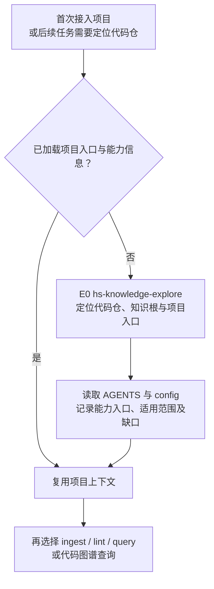

首次准备与 E0 位于业务链路之外，分别解决运行依赖和项目入口。项目设置由用户维护在根 `config.yml`，跨机器信息保存在已安装 explore Skill 的 `config.env`，不再维护私有环境或登记文件。SSH 提示不代表连接已验证，图谱线索不代表索引或 MCP 可用；这些由实际执行结果判断。已有环境和上下文后直接使用业务能力；CodeGraph 的可选准备见 §5.11。

### 1.1 从命令进入流程

统一用户接口以 `knowledge` 为逻辑命令名，职责按下表约定；宿主适配层负责命令分派和执行，不把 Skill 或 Workflow 目录名自动视为已安装命令。日常下发方式见[使用说明](使用说明.md#1-三个常用命令)，公开节点参数见对应 Skill 文档。

```text
knowledge <入口> [参数]
```

知识库随代码仓一并管理，工作区根有 `AGENTS.md` 和 `config.yml`，实际知识根 K 由 `knowledge_roots.wifi` 相对配置目录解析；平铺目录只是默认示意，允许安全的前置子目录。全局依赖可用且具备项目上下文后执行入口，不需要另做业务 `init` 或启动常驻服务；节点核对当前规则和本次业务输入，不重复执行 E0。raw 路径相对 K，代码引用按工作区模块映射解释。仓外部署例外见[知识库关键点 §1.3](知识库关键点.md#13-例外知识库位于业务仓外)，不作为默认流程。

| 用户要做什么 | 命令格式 | 执行什么 | 得到什么、何处停止 |
|---|---|---|---|
| 首次导入或更新知识 | `knowledge ingest [--source <raw文件或目录>]` | `hs-knowledge-ingest` Workflow，P1—P7 | 扫描变化、准备并复核／核验完整稿、调用 lint；登记记录并 stable 入 `knowledge/`，本地索引全验、目标查询通过且活动代激活成功后结束；未完成则保留停点 |
| 单独检查已有稿件或知识库 | `knowledge lint [--view <候选视图引用>]` | `hs-knowledge-lint` Skill，L1—L5 | 默认检查正式知识、导航和引用；可指定候选视图，输出问题清单，不修稿、不做语义复核、不入库 |
| 回答知识问题 | `knowledge query "<问题>" [--target <Target>]` | 消费 Q1—Q5，代码事实走 Q6 | 带依据、范围和缺口的回答 |

当前测试可由人工逐个调用 Skill，按其业务输入传递实际文件；后续由 OpenFlow 调用 ingest Workflow，负责顺序、角色分工、出口和交棒合法性。下文 P1—P7 描述这条编排的完成条件，不是各 Skill 内部的前驱通过门禁。日常用 `ingest` 完成更新，用 `query` 使用知识；`lint` 可独立只读调用，复用 ingest 和 CI 中的确定性规则。`status`、`index rebuild`、`recover` 属维护入口，见第 6.3 节。

日常执行 `knowledge ingest` 即可，默认扫描五类允许的 raw 目录。`--source` 仅用于临时缩小到某个文件或子目录；不填写时无需用户逐个指定文件，也无需分别调用五次。

ingest 在 P4 整理 `.build/` 内的完整稿件，复用固定预检，并完成独立内容复核和代码依据核对；P5 再调用 lint 检查确切待入库视图。补材料或重试运行故障时保留原操作与确切视图，输入未变且停点仍有效才续办；退回改稿或输入变化后建立新操作、新计划和新视图，重新复核、检查，不要求用户另启 lint。原件与业务代码始终只读。

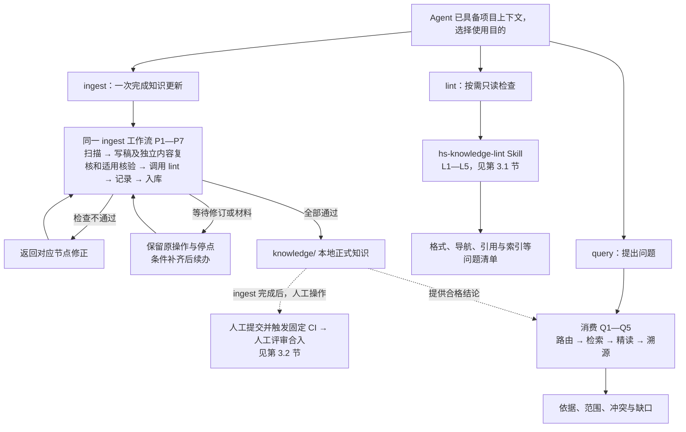

ingest 在 P3／P4 完成内容准备与独立内容复核和适用核验，P5 调用只读 lint，P6 登记处理记录，P7 本地入库、完整验证索引、执行本批目标查询并成功激活该代后结束。独立 lint 与 CI 复用同一套确定性检查脚本和函数。仅记录批次以记录校验、落位完成为止；defer 或失败事项仍保留未完成状态。无变化且无显式修订请求时返回无需更新。lint 到报告为止；人工提交、CI 与合入不作为 ingest 的完成条件。

### 1.2 首次建库与增量更新用同一入口

首次提炼原件和后续更新都执行无参数的 `knowledge ingest`：首次没有已治理基线的原件都进入处理，之后只处理新增、变化和未完成事项。不要求用户选择另一条 `init`、`update` 或 `sync` 命令；如果仓库已经带有合格知识卡，未变化的原件无需重新提炼。

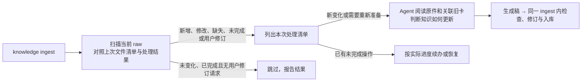

| 场景 | 调用与处理 |
|---|---|
| 第一批原件 | 执行 `knowledge ingest`，自动扫描五类目录；无基线的来源进入首次处理 |
| 新增文件或原件升级 | 仍执行 `knowledge ingest`；自动识别新增与变化，沿用逻辑来源 ID，比较原字节指纹，不只看修改时间 |
| 只想处理一个文件或某个子目录 | 才使用可选的 `--source` 缩小本次范围，其余目录本次不扫描、不推断缺失 |
| 原件未变，但用户要求修订已有卡 | 仍进入 ingest；把反馈和目标卡列为待办，P2 显式准备相关原件与旧卡，再按新操作完成复核、检查和入库 |
| 上次已有处理记录但未结束 | 按实际进度续办：复用有效稿、先恢复未完成事务，或仅重试索引；不能因“捕获过”就跳过 |
| 改名、版本目录替换、原件删除 | 先确认是否同一逻辑来源及影响范围，知识退役仍走候选和治理 |
| 目录不可读、离线或扫描未完成 | 报告该范围缺口，不当作文件已删除或无变化，也不推进该范围扫描水位 |
| 仅索引损坏 | 使用 `index rebuild`；不重新提炼 raw，不改知识结论 |

扫描范围固定为 `docs-raw/{conventions,chips,storys,specs,protocols}/`，忽略 `.gitkeep`、`AGENTS.md` 等控制文件，不扩展到 `sources/`、仓外映射、候选区或正式知识区。`--source` 也须落在这些允许根内。

扫描与提炼分开：P1 判断文件有没有变化，不判断知识结论该怎么改。系统保留原件处理记录，Agent 再按清单读取材料；详细记录与步骤见第 2.1 节。输入未变化但用户明确要求修订、处理未结束、治理规则变化或实际来源／代码／配置不再匹配时，也不能直接跳过。

### 1.3 能力和资产放在哪里

`repo/` 为项目根目录的示意名称，实际目录名称和存放位置不限。

```text
repo/
├── AGENTS.md / config.yml              项目入口与映射
├── main/                              业务代码工作区
├── skills/common/knowledge/            开发分发用 Skill 源包，部署时可移走
├── workflows/common/knowledge/         开发分发用 Workflow 源包，部署时可移走
└── himate-knowledge-wifi-mp/           知识库根 K
    ├── docs-raw/                       只读原件
    ├── governance/
    │   ├── templates/                  知识卡、导航和处理记录模板
    │   ├── schemas/ · contracts/       字段约束与共用规则
    │   ├── specs/                      编写与治理规范
    │   └── sources.lock.yaml           正式来源身份
    ├── knowledge/                      正式知识卡和导航
    ├── .build/                         候选与操作暂存
    ├── logs/                          证据快照、复核及事务记录
    ├── artifacts/                     可重建索引与同代正文
    ├── tools/deploy/                  已有部署兼容、执行说明和回归
    ├── evals/                         检索回归与链路验证
    └── docs-llm-wiki/                  系统设计与使用文档
```

上树展示开发分发源码，业务仓不必保留根能力源码。K 为领域资产根，S／F 为 Agent 已安装能力位置。首次准备脚本在 `S/hs-knowledge-explore/scripts/setup.py`；项目配置在根 `config.yml`，SSH 连接提示在该 Skill 的 `config.env`，由 harness 实际执行。默认全局 Python，产物沿用 K 的 `.build/`、`logs/`、`artifacts/`。节点默认核验当前规则锁，内部辅助调用使用同级已安装 Skill 与同一全局 Python，不要求 catalog 登记或额外目录。

| 组件 | 负责什么 |
|---|---|
| Skill | 可独立调用的业务能力，检查本次数据、执行动作并返回结果；不判断 Workflow 交棒。节点提供 CLI，首次 CodeGraph setup 为纯说明包 |
| Workflow | 由 OpenFlow 管理节点顺序、角色隔离、判断出口、交棒、退回与恢复停点，不复制业务算法 |
| Template | 提醒作者补齐内容，统一表达，不预填事实或成绩 |
| Script | 固定字节、校验引用、执行受控读写与检索 |

### 1.4 共同设计约束

| 对象 | 设计约束 |
|---|---|
| 文档来源 | 接受 `docs-raw/{conventions,chips,storys,specs,protocols}/` 内已落地原件；链接、网页、仓外映射不进入此链路 |
| 适用范围 | 具体产品结论按实际模块映射、Target 和逐 Claim 条件核对；历史／指导性分析绑定确切文件快照与内容指纹，版本、Target 或构建材料未知时保持 unknown，不推广为产品实现 |
| 纯文档结论 | 完成独立 Agent 内容复核以及格式、来源和导航检查后可落为 stable；免代码实现核验 |
| 代码结论 | 本地逐条核对源码、引用和实际需要的配置条件后 stable；源码分析不统一要求编译产物。具体 Target 的当前实现须核对实际配置映射及适用条件；编译、运行或实测效果须有相应证据 |
| 检索资格 | 按生命周期、用途、实际来源及当前配置范围筛选 Claim；提交／合入是独立事实，来源、代码、材料或依赖失效时限制相关结论 |
| 权限 | 目录、包摘要和回执各有校验职责，不构成 OS 级全面封锁；访问控制由实际仓库、执行用户、宿主和工具权限落实 |

## 2. ingest 工作流：从原件变化到本地入库

**入口：**`knowledge ingest`，默认扫描五类 raw；需要缩小范围时才用 `--source`。**输出：**本地 `knowledge/` 中的 stable 知识，或保存了材料、稿件和停点的未完成操作。扫描、写稿、检查、修订及入库按同一 OpenFlow 工作流编排；人工测试可依次调用同一批 Skill。

### 2.1 完整流程与节点判断

**流程起点：Agent 已读取项目 `AGENTS.md`，知道代码仓、知识库及能力入口，随后执行 `knowledge ingest`。** 缺少这些信息时，先在命令前由 `hs-knowledge-explore` 辅助定位入口、引导 Agent 阅读 `AGENTS.md`（见 §1.0）；它不属于 ingest，也不是 P1。

P1 同时读取“现在目录里有哪些原件”和“这些原件以前怎么处理”，比较路径和内容指纹（hash），并关联已有来源身份，列出新增、修改、缺失及未完成事项。它只发现文件变化；一份原件可能对应多张卡，是否需要改卡、改哪些结论由 Agent 阅读后判断。

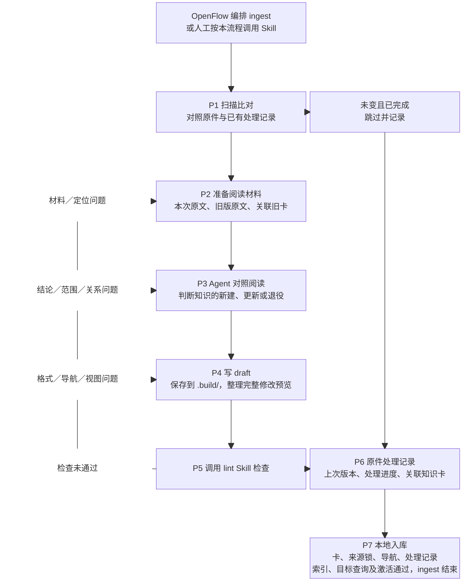

| 节点 | 谁负责 / Skill | 做什么、交付什么 |
|---|---|---|
| P1 扫描比对 | `hs-knowledge-source-scan --action scan` | 在已知知识库路径下，对照原件处理记录列出文件变化，合并未完成操作、用户修卡请求及待修订问题；原件未变的显式修订仍进入 P2，不发现或绑定项目，不调用 `hs-knowledge-explore` |
| P2 准备阅读材料 | `hs-knowledge-source-scan --action prepare`；内部复用 source-capture 及来源恢复接口 | 汇总本次原文、旧版原文和关联旧卡；原件未变的修订显式选择单元和目标卡，保留旧卡确切正文供后续检查 |
| P3 阅读并判断更新 | 主 Agent + `hs-knowledge-change-plan` | Agent 阅读材料、写明受影响结论和理由；程序检查、保存六决策计划，不代替内容理解 |
| P4 保存知识稿与完整视图 | `hs-knowledge-view-materialize`、`hs-knowledge-change-plan`、`hs-knowledge-candidate-inspect`，代码另用 local-check | 保存完整候选，执行本职业务预检；OpenFlow 安排独立内容复核和代码核验分工。正式区保持不变，governance-handoff 只描述确切视图 |
| P5 调用 lint 检查 | `hs-knowledge-lint` | 只读检查完整拟写视图，返回格式、引用、导航、索引等问题；内部流程见 §3.1 |
| P6 登记处理记录 | `hs-knowledge-source-scan --action record` | 对账来源、处理范围、关联卡、检查结果及操作 ID，在 `.build/operations/` 生成并校验记录，声明 `logs/ingest/` 目标；由 P7 随本批事务正式落位 |
| P7 本地入库 | `hs-knowledge-apply`、`hs-knowledge-recover`、索引与 query 能力 | 将知识卡、导航、来源锁与处理记录同批落位；本地索引全验、目标查询通过且该代成功激活后结束。仅记录批次校验并保存记录；中断恢复原事务 |

#### P5 检查失败，直接返回哪里

| 问题 | 返回节点与处理 |
|---|---|
| 原版、定位、代码或配置材料缺失 | P2 补齐；无法取得时交 P3 缩窄或暂缓相关结论 |
| 结论、适用范围、合并／拆分／替代关系有误 | P3 重判并更新计划，再到 P4 生成新稿 |
| frontmatter、章节、链接、导航或视图不一致 | P4 修正；涉及结论与范围的改动先回 P3 |
| 原件、代码、规则或正式基线已变化 | 返回对应材料或计划节点，形成新视图；未完成写入先由 P7 恢复原事务 |

修订由 ingest 调用 `hs-knowledge-candidate-revise`，同步计划、稿件和完整视图，再经 P5 重检。OpenFlow 根据 P5 的实际报告选择修订出口；完整检查通过后按“P6 登记处理记录 → P7 本地入库与检索验证”调用。P6／P7 不另核验前驱 Skill 是否通过。未完成操作续办前核对原件、规则、代码及相关基线；已入库返回原结果，不能因重试或暂存丢失重复写入。

需修订的稿件仍返回 P2／P3／P4。若本次只登记跳过、defer 或失败事实，则由 P6 形成“仅记录”批次：知识卡、导航及来源锁的写删集合为空，不携带未通过稿件，也不把 P5 标成通过。记录自身固定校验通过后才交 P7；记录上库不把 defer 或失败改记为处理完成。

#### 原件处理记录保存什么、放在哪里

“原件处理记录”是以下记录的汇总，不依赖 Agent 的会话记忆，也不另手填一份“已入库=true”的事实。扫描和无产卡、失败、暂缓的处理结果同样需要留痕。

| 记录位置 | 记录内容及用途 |
|---|---|
| `logs/ingest/` | 每次扫描范围、是否完整、看到的路径与内容指纹，以及本次处理结果和操作引用；据此发现新增、变化、缺失及未完成项。处理记录纳入版本管理，随知识变更一并上库 |
| `governance/sources.lock.yaml` | 正式卡已经接纳的来源身份和确切版本；保存过原件副本不等于进入这份正式登记 |
| 正式卡内的 `sources` 与 Claim 引用 | 哪些卡、哪些结论使用哪个原件版本；反向关联从正式卡重建，不重复维护另一份关系真源 |
| `.build/operations/` 与 `logs/operations/` | 前者保存待检查稿和操作材料，后者保存真实落位、恢复及结果；台账引用这些记录判定实际进度 |
| `logs/evidence/`、`logs/events/` | 保留可读旧版原文，以及来源变化对已有结论的影响与复核状态 |

要分别记录**本次看到的原件版本**、**已由正式卡接纳的版本**和**当前处理节点**。P6 先登记本次处理结果；P7 实际写入后据实补记“已入库”，再完成适用的本地索引与目标查询，不提前记为完成。人工上库时将记录与知识内容一同提交。跳过、失败、暂缓及未覆盖事项也要保留在处理记录中，提交时一并纳入；某来源被一张卡引用，不表示整份原件已全部提炼。

#### Agent 具体读什么

| P1 发现的情况 | 交给 Agent 的阅读材料 | Agent 的判断 |
|---|---|---|
| 新增原件 | 本次原文及相关主题已有卡 | 是否有可沉淀知识，应该新建还是补充现有卡 |
| 原件修改 | 本次原文、各关联旧卡实际引用的旧版原文、差异和旧卡 | 哪些结论改变、哪些仍成立，选择 update、merge、split 或不改卡并记录理由 |
| 原路径缺失 | 保留的旧原文、关联旧卡和其他可用证据 | 是改名、资料暂不可达还是内容退役；不因文件少了就自动删卡 |
| 原文未变但用户要求修卡 | 当前原文、指定旧卡及反馈依据 | 显式准备相关单元与旧卡，按新操作重判结论；不因观察结果 unchanged 就跳过本次修订 |
| 原文未变但上次未完成 | 上次操作结果、待检查稿及所需证据 | 先判进度：待检查稿有效则继续，未完成事务先恢复，已落位但索引失败则只重建索引 |

只有尚未开始落位、且已丢失或失效的知识稿才重新准备，并重新复核、检查。不能因 `.build/` 丢失就忽略事务结果、重复入库。旧版原文按各卡引用取回，同一原件可能仍有多个版本被不同卡采用。

举一个示意：某说明把超时从“5 秒”改为“8 秒”，P1 只发现文件内容变了；P2 准备新旧原文和使用该来源的旧卡；P3 由 Agent 核对条件及范围后决定怎样改稿。P4 写稿、P5 检查通过后，P6 登记处理结果，再由 P7 将新版知识与处理记录一并本地入库，并验证索引与目标查询；后续人工上库见 §3.2。

只有在相同范围内完整扫描成功，才能把“上次有、这次没有”的路径列为缺失。目录不可读、扫描中断或 `--source` 范围之外不能推断删除。阅读期间原件或正式卡又变化时，重新准备材料或修改预览；不沿用旧内容继续入库。

### 2.2 六决策如何选择

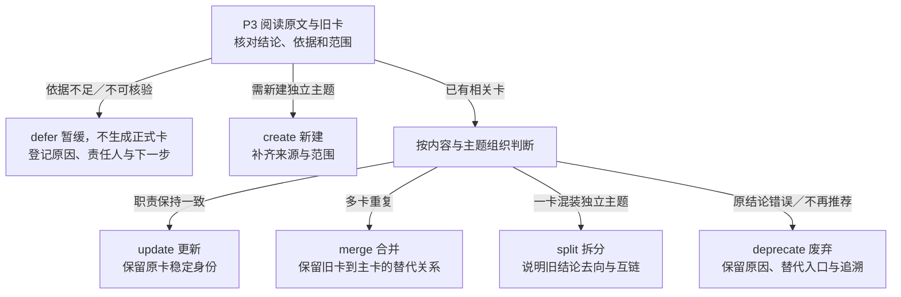

已完整阅读本次材料且没有知识增量时，登记 skip 及已审范围、理由；它是无产卡的处理结果，不新增为第七种卡片变更决策。defer 表示仍欠材料或核验，保留未完成事项；不能因已经留记录或已有卡引用该原件就跳过。P1 的“未变且已完成”另注明为扫描跳过，避免与已审无增量混淆。

全部正式变更都须经过候选和治理，废弃也不能直接改 `knowledge/`。Agent 基于已读材料写出结论，脚本检查并固定内容。

### 2.3 五类 raw 如何选择入口与模板

五类资料默认由一次 `knowledge ingest` 共同扫描，差异是提炼问题和卡模板，而不是命令。一个原件可以产生多种卡，按结论性质选择，不按目录名强制唯一 Profile。

| 原件目录 | 优先提炼什么 | 常用模板 | 更新时重点比较 |
|---|---|---|---|
| `docs-raw/conventions/` | 对象、强制约束、建议和例外 | rule、glossary | 规则条款、批准状态、适用范围 |
| `docs-raw/chips/` | 芯片职责、机制、限制和术语 | entity、flow、glossary | 芯片及版本条件，设计声明与实现证据 |
| `docs-raw/storys/` | 场景、流程、设计决策和经验 | flow、entity、runbook | 需求或流程变化，结论是否仍适用 |
| `docs-raw/specs/` | 接口契约、状态、流程和约束 | entity、flow、rule | 接口与行为变更，不能把任务完成标记当代码证据 |
| `docs-raw/protocols/` | 协议机制、字段、状态机和条件 | protocol、entity、glossary | 条款版本，标准规定与产品支持的区别 |

输入格式与资料类别分别判断：非空 UTF-8 MD/TXT、每页有文字层的 PDF、DOCX 段落/表格可提取；扫描图、图中事实或其他不可解读部分记缺口。`docs-raw/sources/` 的链接不进入目录扫描，也不因放在列表内就自动联网。

## 3. lint Skill 与固定 CI

lint 是可复用的只读检查 Skill：ingest 的 P5 自动调用，也可通过 `knowledge lint` 手动调用，或由定期任务调用。它运行固定脚本、汇总结果；内容修订、独立内容复核、代码语义核验及入库仍由 ingest 负责。

### 3.1 lint 的检查流程

**输入：**P4 生成的完整候选视图，或已有正式知识库；**输出：**绑定检查对象与规则版本的问题报告。候选按“现有正式区 + 拟写入 − 拟删除”组成检查视图，检查链接时不要求候选先落入 `knowledge/`。

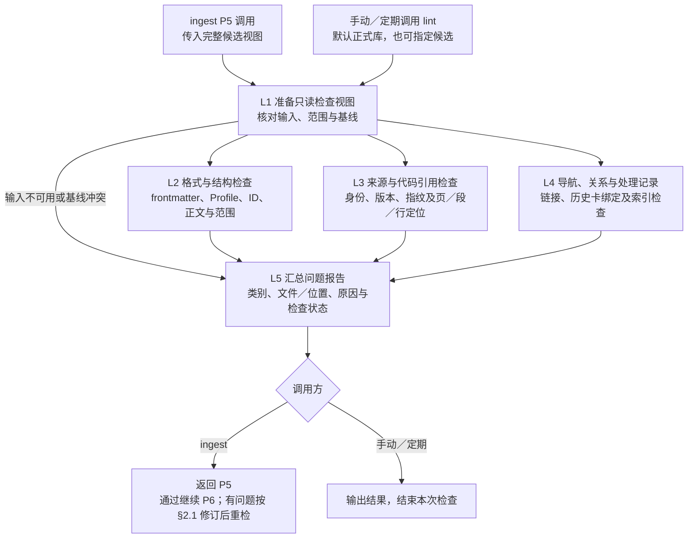

| 检查节点 | 固定脚本的判断逻辑 |
|---|---|
| L1 检查对象 | 正式库直接读取确定版本；候选核对操作、计划、视图、来源集合和拟写字节，拒绝越界、冲突写删或旧基线不一致。未完成事务报告需先恢复，不在 lint 中恢复 |
| L2 格式与结构 | 解析 YAML，校验必填字段、类型、枚举及 Profile 必需章节；核对卡／Claim ID、正文锚点和范围引用，`unknown` 不作全范围适用 |
| L3 源文档引用 | 核对卡与来源锁的身份、版本和定位，候选使用视图内含拟新增登记的来源锁；从确切副本恢复原文，校验指纹及引用的行、页、段、表格或附件可读，不以同名新文件代替旧原版 |
| L3 代码固定引用 | 对提供的确切代码版本核对仓库、路径、文件指纹及行段；检查 Target／构建引用是否符合实际配置。代码是否支持结论由 ingest 在 P3／P4 判断 |
| L4 导航与关系 | 检查 `index.md`、链接／锚点、唯一 ID、目标卡／Claim、替代关系与依赖环；受管导航须与完整检查视图一致 |
| L4 处理记录 | 核对 `logs/ingest/` 的覆盖、采用版本与 Card／Claim 绑定；当前卡已更新时，使用确切历史卡正文核对旧记录，不改写历史事实 |
| L4 索引可构建性 | 只在临时目录构建索引，核对结构、记录、正文指纹和卡／Claim 映射；不切换本地查询的活动索引 |
| L5 汇总结果 | 列出已通过、失败、因输入缺失未完成及不适用项；缺材料不能记为通过。候选整体不可用时先报输入问题，其余可执行检查尽量汇总，便于一次修正 |

`index.md` 是纳入检查的导航文件，SQLite 是临时构建的检索产物。正式库模式不要求候选操作、交接材料或安装 catalog；lint 仅可生成临时产物和报告，不改知识、来源锁、复核记录、维护水位或活动索引。检查通过仅表示所列固定项合规；ingest 接收问题后按 §2.1 修订；内容复核／代码语义核验在 P3／P4 完成，P6 只登记处理记录。

### 3.2 上库：固定 CI 检查后合入

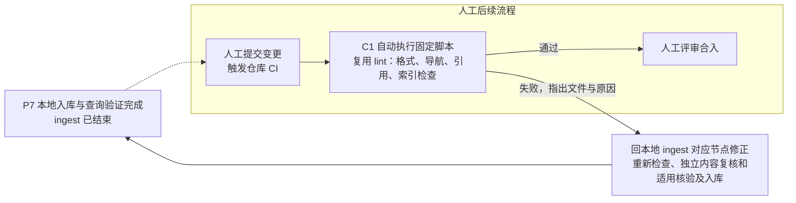

人工提交后触发仓库 CI；CI 自动运行已有 lint 的固定检查脚本和共用函数，不另开发一套检查，也不增加业务代码编译任务。CI 不加载 Agent 或 Workflow，不重复内容语义复核，不自动修改卡片。脚本失败则返回本地修正，再由人提交重跑；通过后由人评审合入。

| CI 检查项 | 复用 lint 的哪部分 | 固定脚本做什么 |
|---|---|---|
| 格式与身份 | L2 | 检查 frontmatter、字段／枚举、Profile 章节、卡与 Claim ID、正文定位及范围引用 |
| 导航与关系 | L4 | 检查 `index.md`、链接／锚点、跨卡／Claim 引用、替代关系与依赖环 |
| 来源登记与引用 | L3 | 检查卡与 `sources.lock.yaml` 的身份、版本和定位结构一致；需要关联当前代码时，对 CI 提供的最新业务代码固定 checkout 核对路径、行段及文件指纹，不符则返回本地重检 |
| 索引可构建性 | 共用索引构建与校验函数 | 在临时目录生成检索索引，检查结构、记录及卡片映射一致性；产物不必提交，不切换查询服务的活动索引 |

CI 输入是本次提交及作业明确提供的代码／原文，不依赖开发机的 `.build/`、安装 catalog 或私人日志。L1 改用提交文件作为检查对象；原文页段恢复仅在取得确切原版时检查，未取得时明确未执行的范围。必需输入缺失则 CI 不通过；本地代码语义判断及文档内容复核在 P3／P4 完成，P6 登记处理结果。

CI 问题绑定提交、文件和位置，作为下一次本地 ingest 的待修订输入，即使 raw 未变也需处理；修复产生新操作，再经 P5—P7。已经完成的入库事务保留原结果，不重新 apply。

## 4. 消费流程：从问题到证据回答

**入口：**`knowledge query "<问题>"`，使用已有项目上下文，可补 Target 和用途；**输入：**问题、范围和已治理知识，**输出：**带证据的回答及明确缺口。已有有效活动索引但没有合格候选时正常返回空结果；尚未构建／激活索引或索引失效时明确报告不可用，不将缺索引伪装为“没有知识”，也不隐式触发 `ingest` 或自动发布。

### 4.1 路由与检索节点

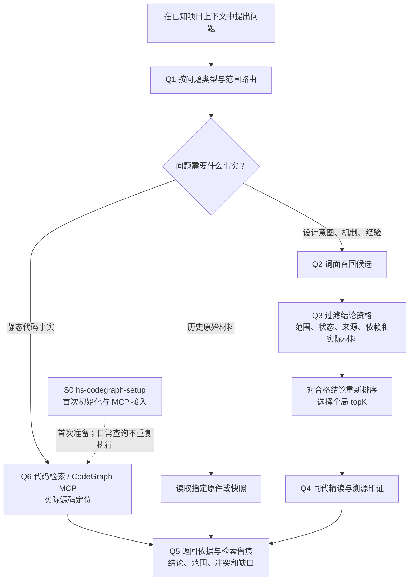

| 节点 | 能力与资源 | 判断逻辑 |
|---|---|---|
| Q1 问题路由 | 主 Agent、已加载的 `AGENTS.md` 与 `config.yml` | 按问题选择知识卡、代码图谱或原件；不推断未知 Target，不重复执行 E0 |
| Q2 词面召回 | `hs-knowledge-query`、SQLite | 只产生候选，得分不表示事实概率 |
| Q3 过滤与排序 | 同一查询 Skill、治理规则和当前业务材料 | 先筛合格 Claim，再计分取 topK；unknown 不作范围通配 |
| Q4 精读与溯源 | 查询 Skill、同代正文、来源恢复能力 | 阅读结论、条件、失效边界、验证方法，核对确切证据 |
| Q5 回答与留痕 | 查询结果、Search Receipt；主 Agent 综合 | 区分来源陈述、代码事实和推断，报告冲突与缺口 |
| Q6 源码定位 | 主 Agent、官方 `codegraph_explore` MCP；不可用时实际文件检索 | 根据模块映射显式指定项目路径，读取所问版本的符号、调用与源码；图谱不证明宏开启、构建或运行结果 |
| S0 首次 setup | `hs-codegraph-setup`、现有项目上下文及 CodeGraph CLI | 用户要求首次准备时，按 `config.yml` 逐模块初始化并验证 MCP；不在 query 中隐式安装或建图 |

S0 是消费能力的部署准备，文件与动作见 [§5.11](#511-s0--q6codegraph-首次-setup-与源码定位)。日常 Q6 直接使用官方 MCP；缺索引或宿主未接入时报告缺口，并可继续实际源码检索。

### 4.2 变化如何反馈到三条链路

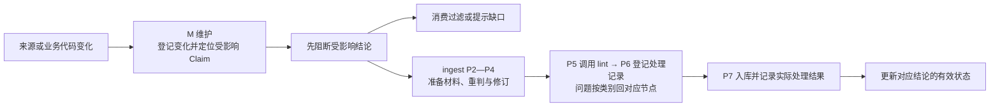

`hs-knowledge-maintain` 是三条链路共用的维护能力。它区分“当前实际来源状态”和“卡片实际采用的版本”，不能仅因原件更新就宣称知识已同步；机械失效标记的解除也不代表已完成内容复核。

## 第二部分：详细设计

## 5. 按节点展开文件设计

节点编号沿用 §2.1：P1 扫描、P2 材料、P3 判断、P4 稿件、P5 调用 lint、P6 处理记录、P7 本地入库与检索验证。下文只说明文件承担什么逻辑；Skill 路径相对 `S`，领域文件路径相对 `K`。

### 5.0 入口、Workflow 与共用规则

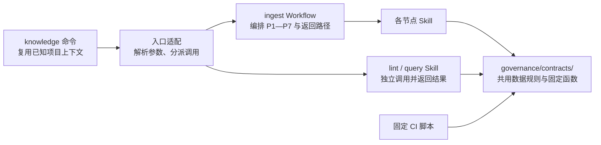

| 文件 / 位置 | 设计职责 |
|---|---|
| 宿主命令适配 | 将 `ingest`、`lint`、`query` 分派到对应能力，传入实际路径和业务输入；规则默认取当前锁，也可显式固定摘要 |
| `F/hs-knowledge-ingest/workflow.yaml` | 由 OpenFlow 编排节点、角色、交棒、问题返回、仅记录分支及有界修订／续办；按真实 P5 报告决定是否进入 P6、P7 |
| 节点 `SKILL.md` | 说明输入、动作、输出与返回原因；脚本执行其中可固定的步骤 |
| Agent/harness | 使用已安装能力，按项目配置和可选 SSH 提示选择实际执行端，传业务输入并检查命令结果；不要求创建调用登记，不代替 OpenFlow 编排或内容阅读 |
| `governance/contracts/` | 统一身份、来源、范围、记录和检查规则，供 Skill 与 CI 复用 |

lint 只承担检查，ingest 按问题类别返回 P2／P3／P4，运行故障则保存当前停点。没有知识变更的 skip、defer 或失败可汇总到 P6，只登记真实结果，再由 P7 校验并保存记录；这不代表内容通过 P5。流程节点和等待状态由 OpenFlow 留存；Skill 结果及数据一致性复用 Contract，流程交棒由编排者判断。

### 5.1 E0：命令前帮助 Agent 阅读项目入口

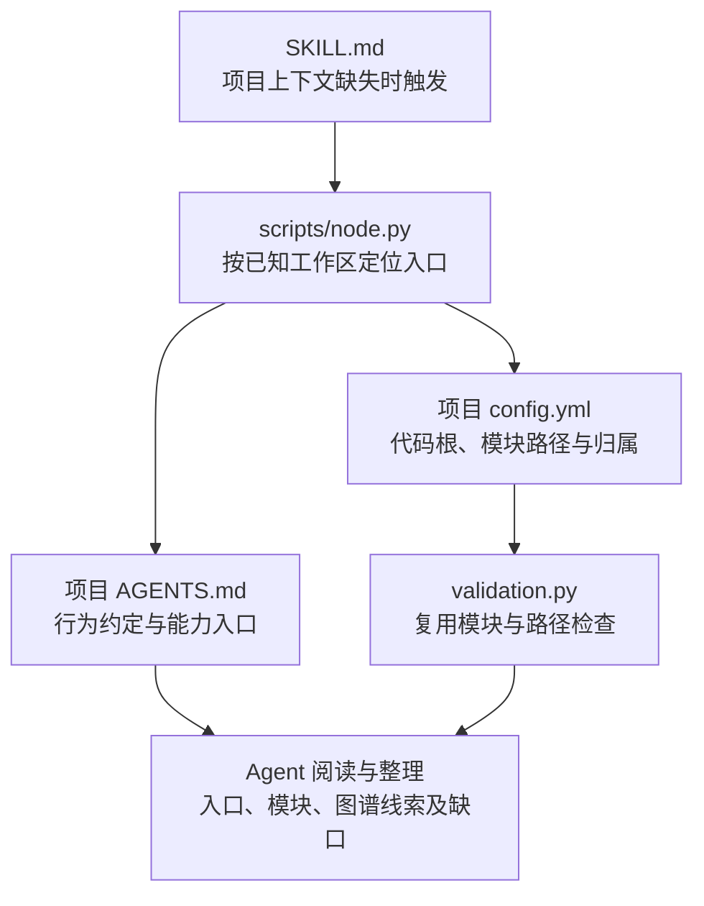

图中 `hs-knowledge-explore/` 同时提供首次准备和后续项目定位。`scripts/setup.py` 检查现有全局依赖并读取配置；`scripts/cli.py`／`node.py` 按实际路径只读定位代码仓、知识根及入口文件，领域配置校验复用 `governance/contracts/validation.py`。跨机器连接提示放本 Skill 的 `config.env`，项目设置只维护根 `config.yml`，不另生成机器绑定。

`code_root` 相对项目根，模块 `path` 相对代码根；同一模块可覆盖多个代码仓，共享模块可关联多个芯片和端。公共映射函数统一核对路径范围并整理实际模块文件，不要求用户逐项填写六 Target／三 pair 或重复代码根授权。代码取证按模块映射读取实际文件，不要求仓管理元数据。芯片、端和特性是归属线索，不证明实际宏、构建或协议条件。

首次 setup 完成后可长期复用环境；后续上下文缺失时只执行 E0 定位，不重复安装依赖。已有有效上下文则直接选择业务命令。P2／P4 再固定本次实际源码和条件；E0 不属于 ingest 的 P1，普通发现入口不安装、不登记、不启动服务。图谱是否可用由真实查询判断。

### 5.2 P1 / P2：扫描原件，准备新旧材料

P1 列出本次待处理原件；P2 找出需要阅读的候选卡，准备新旧对照材料。候选卡附带关联原因，不等于必须修改的卡。

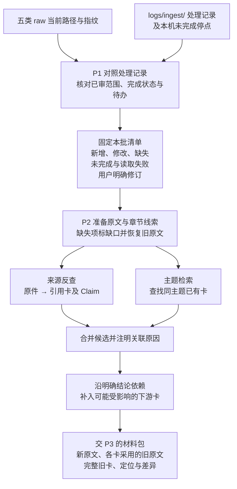

| P2 如何找卡 | 依据与边界 |
|---|---|
| 来源反查 | 以来源身份反查正式卡的 `sources` 与 Claim 引用，找出引用版本和原文定位；处理记录的关联卡摘要可帮助定位，实际关系以卡内引用为准 |
| 主题检索 | 根据标题、章节及初步阅读中的实体、协议、接口、符号和范围检索；新增原件没有历史引用，主要走此路，旧原件新增主题也要补查 |
| 依赖扩展 | 沿明确的跨卡／Claim 依赖查找下游结论；普通“相关链接”不自动扩散，是否受影响由 P3 判断 |

用户明确要求修订已有卡时，Agent 从本次清单中显式传入关联 `unit_ids` 和 `candidate_card_ids`；即使观察结果为 unchanged，也重新准备这些原件与旧卡，在 P3 记录本次 content 修订理由并纳入独立复核。

P2 在材料包 `candidates` 中保留旧卡的 `card_digest` 和 `card_ref`。更新、合并、拆分或退役涉及旧卡时，Agent 将其整理为 `historical_card_objects`：旧卡 SHA-256 对应当前操作中确切旧正文的绝对路径，路径从本次材料引用解析。该输入由 Agent 传给适用预检、最终 lint 和 P7，无需用户手工准备或先提交 Git。

卡内来源须能说明“哪条结论采用哪个版本的哪段原文”。只有整篇引用或定位不清时，将整卡列为阅读候选；不能凭文本差异直接排除其他章节条件变化的影响。P3 读出新主题或依赖时回 P2 补查，检索无命中不直接等于应新建卡。

| 文件 / 位置 | 设计职责 |
|---|---|
| `hs-knowledge-source-scan/scripts/scan.py` | 枚举五类允许目录，按可选 `--source` 缩小范围；对照路径、指纹和处理结果，固定本批清单及扫描完整性，供 P6 对账 |
| `hs-knowledge-source-scan/scripts/prepare.py` | 汇总捕获包、来源反查和候选卡；显式选取未变原件及指定卡，保存旧卡正文、指纹与各卡采用版本 |
| `governance/contracts/records.py` | 区分观察版本、已完成范围、实际采用情况与待办，不能因已记录新指纹就跳过未完成项 |
| `hs-knowledge-source-capture/scripts/capture.py`、`governance/contracts/source_resources.py` | 保存本次原字节、可读文本和定位；按各卡实际引用恢复旧原文并准备差异，读取期间变化则重新准备 |
| `governance/contracts/knowledge.py` | 从卡／Claim 引用重建来源反查与明确依赖；派生索引可重建，不另维护关系真源 |
| 主 Agent、`hs-knowledge-query/scripts/node.py` | 按原文线索检索同主题卡并补查；整理用检索覆盖范围内卡的各状态，不能因问答默认过滤而漏掉待修订卡，也不据此赋予回答资格 |
| `hs-knowledge-source-capture/scripts/code_capture.py` | 按真实映射取得所需代码、快照、文件与配置；未知项保留缺口 |
| `.build/operations/<操作>/` | 保存本批清单和材料引用，以及候选卡、关联原因、各卡采用版本及差异，供 P3 阅读 |

旧原文按每张卡实际采用的版本取回，不能统一使用“上次扫描版本”；缺失或读取失败项不伪造本次原文，恢复旧引用并标明缺口交 P3。只有同范围完整扫描成功才推断路径缺失；改名、删文件或删段落不直接等于结论废弃，可能是移位或资料缩编，须由 P3 核实。未变但有欠账或上下文失效的来源仍需处理（见 §5.10）。

| 找卡示例（示意） | P2 的结果 |
|---|---|
| 《认证说明》将 chip12 Host 超时由 5 秒改为 8 秒 | 来源反查找到《超时规则》，沿明确依赖补入《重试流程》；两张卡均待 P3 阅读，尚未决定都改 |
| 新增《认证诊断说明》，尚无任何卡引用它 | 按认证、超时、日志等主题找到已有《认证诊断》；P3 再决定补旧卡还是建立独立新主题卡 |

### 5.3 P3：阅读材料，判断结论与变更计划

P3 先按目标卡归并本批材料，再逐条比较结论的事实、适用条件和依据，最后汇总卡的变更计划。OpenFlow 将同一卡交一个作者串行融合，独立卡可在同一批内并行阅读／起草；编排者统一收尾计划、导航和来源锁，不另开并发 ingest 或并发正式落位。作者标签描述责任，不是 Skill 判断交棒合法性的身份凭证。

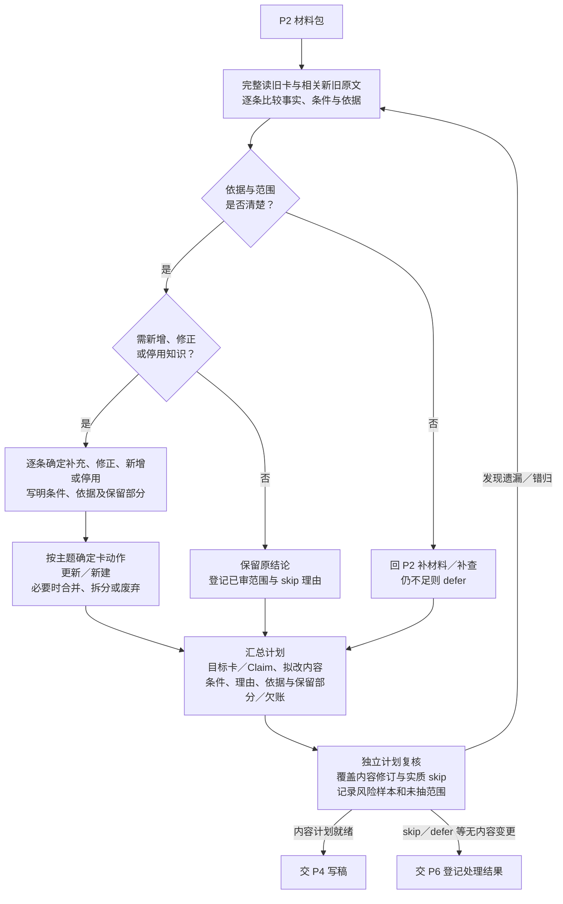

| 逐条比较的结果 | 内容处置与计划 |
|---|---|
| 事实及条件未变，且用户未要求改稿 | 保留；已审无增量记 skip，不因原件版本变化重写所有卡或统一替换来源版本 |
| 新原文补充已有主题 | update，说明补哪条结论、来源和适用条件，融合进旧内容 |
| 原结论的数值、行为或条件改变 | update 受影响 Claim，说明新旧适用范围；其他结论保留，不将一个芯片的变化推广到其他芯片 |
| 出现独立新主题，已有卡无合适归属 | create；先完成查重和主题边界判断，不能仅因来源是新文件就建新卡 |
| 新旧来源冲突或必要依据不足 | 先核对芯片、Host／Device、版本和配置差异；补材料仍无法判断则 defer，不能默认新来源覆盖旧来源 |
| 经核实已有结论失效 | 修订或停用对应 Claim；仅当整卡职责均失效时 deprecate，并说明旧结论去向及替代入口 |

内容判断后再检查卡的组织：同主题卡重复才 merge，一卡混装独立主题才 split，并保留旧 Claim 的去向。普通 update 保持卡的稳定身份，多源重叠合并、互补补全；导航、来源锁和处理记录由编排者统一收尾。多源组织参考 CANNBot 的[同卡实施单元](https://gitcode.com/cann/cannbot-knowledge/blob/c92c66ee695090c44487f56bd051d2607c58b27a/.agents/skills/knowledge-ingest/references/incremental-sync.md#L14)。

在 OpenFlow 编排中，独立复核者阅读原文、旧卡和计划，核对修订及归卡判断，并按风险抽查实质 skip；原件未变但用户要求的 content 修订同样纳入。人工测试由人安排阅读和复核分工。review Skill 保存本次明确的样本、问题及未审范围，不通过作者／复核者名字或独立上下文标签证明角色隔离；P6 也不要求抽样通过票据。遗漏或错归按实际问题回 P2／P3，材料不足则 defer，未审范围不冒称已复核。

内容计划同时固定 `target_queries`：每例包含独立的问题和预期命中／排除／顺序，显式选择 `purpose`，按需给出上下文与预期 Claim。current／implementation 用于有相应当前依据的结论，设计背景用 guidance，指定旧版本用 historical；省略时 API 仍默认 current，不自动包含 guidance-only Claim。P3 保存计划前拒绝非法用途，P7 回归入口也检查；OpenFlow 应沿用计划中的原例；回归 Skill 校验并执行本次明确传入的查询断言，不要求 apply 通过凭证。资格机制见 §5.9。

| 文件 / 对象 | 设计职责 |
|---|---|
| 主 Agent、`hs-knowledge-change-plan/SKILL.md` | 按上述顺序阅读、比较与归卡；说明修改和保留的理由，需要新材料或候选时回 P2 |
| `hs-knowledge-change-plan/scripts/plan_v3.py` | plan 保存逐 Claim 计划与目标查询，校验数据覆盖和用途；review 保存声明的审阅范围、问题和确切计划／视图绑定，不校验流程角色身份 |
| `hs-knowledge-change-plan/scripts/planning.py` | 将六决策和候选内容装配为变更计划，核对拟写删、旧基线及引用；不代替内容理解 |
| `hs-knowledge-local-check/SKILL.md`、`hs-knowledge-local-check/references/review-guide.md` | 指导批次抽查及内容复核；逐 Claim 核对真实定义、调用和所需宏／Target 条件，缺口缩窄或暂缓；图谱仅提供定位线索 |
| `governance/templates/{entity,flow,protocol,rule,command,runbook,glossary}.md`、`governance/contracts/knowledge.py` | 提供七类卡结构和 Card／Claim／范围／关系表达，供计划与 P4 共用 |

**接续 §5.2 的超时示例：**P3 的计划应细到结论，而非将两张候选卡全部标成 update。

| 目标卡／结论 | 阅读判断 | 给 P4 的计划 |
|---|---|---|
| 《超时规则》：chip12 Host 等待上限 5 秒 | 新原文明示该条件下改为 8 秒 | update 对应 Claim，列出新原文定位及条件；其他芯片结论保留 |
| 《重试流程》：超时后重试，未写具体秒数 | 重试触发条件仍成立 | 保留，记已审理由，不生成该卡的修改 |

若《重试流程》实际写了“5 秒后重试”，该步骤也列入 update。若 8 秒只是文档中的设计要求，计划只表述要求；有实际代码及配置依据后才写成代码事实，无法补齐就缩窄结论或 defer 对应单元。skip 不增加第七种卡变更动作，defer 与未覆盖部分保留欠账，其他已形成明确变更的单元可继续 P4。

### 5.4 P4：形成完整稿件，完成独立内容复核

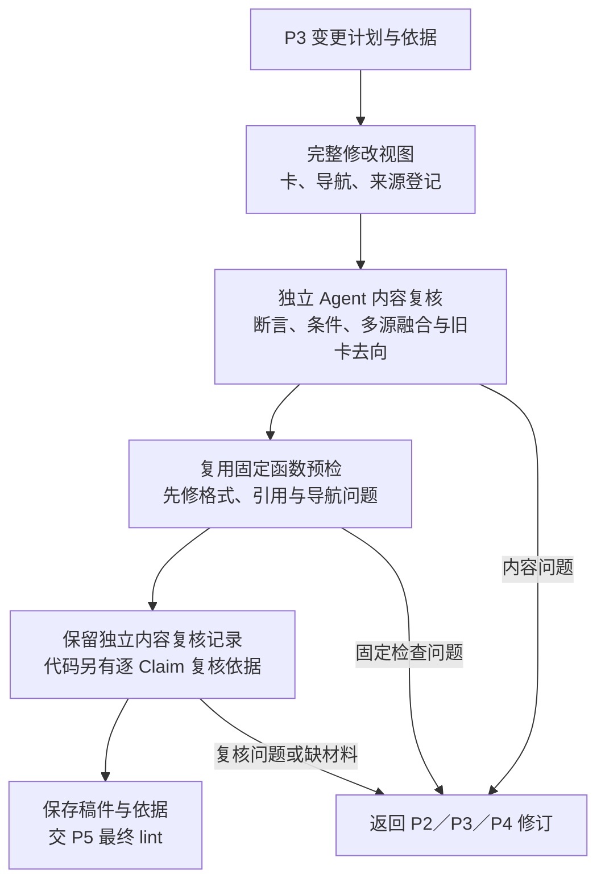

| 文件 / 位置 | 设计职责 |
|---|---|
| `hs-knowledge-view-materialize/scripts/materialize.py` | 按计划整理拟写入／删除清单、旧基线及完整文件内容，形成可重现的视图 |
| `governance/templates/index.md` | 生成随卡修改的导航；来源锁的拟新增版本也纳入同一视图 |
| `hs-knowledge-local-check/references/review-guide.md` | P3/P4 共用复核指南：核对关键断言、条件、多源融合，并抽查本批 skip 与归卡裁决；已有裁决结果未变时复用，问题注明位置、依据及修改原因 |
| `hs-knowledge-change-plan/scripts/plan_v3.py` | 保存本次全视图内容复核，核对计划、视图、来源清单与声明的样本范围；独立角色由 OpenFlow 安排，记录不是 apply 放行票据 |
| `hs-knowledge-local-check/scripts/check.py` | 校验 Agent 复核记录的逐 Claim 依据、最终视图与源码上下文绑定；核对引用及所需配置，不自行判断知识语义，也不要求复核者公钥或签名 |
| `hs-knowledge-candidate-inspect/scripts/inspect_candidate.py` | 核对候选字节、计划可重现性、引用和基线，报告文档／代码／混合类型及未完成事务；后续调用和恢复顺序由 OpenFlow 决定 |
| `hs-knowledge-governance-handoff/scripts/handoff.py` | 只读描述确切视图及其来源／基线，不要求 candidate-inspect 已通过，不判断交棒；当前 ingest Workflow 不将其设为固定节点 |
| `hs-knowledge-candidate-revise/scripts/revise.py` | 根据退回原因同步修订计划、稿件与视图，保留修订理由 |

在 OpenFlow 编排中，新增或实质变更代码结论由独立于作者的新上下文复核者只读卡、原文／代码及计划，输出问题，作者修订至无未解决的阻断项；纯文档按同一准则安排独立审阅，再继续固定检查与入库。人工测试由人安排上述分工。组织方式参考 community Reference producer 的[独立内容复核](https://gitcode.com/cann/cannbot-skills/blob/d075d3735535399d7fc6a5fa18b43191bb1546a9/plugins-community/cannbot-knowledge/skills/ops-knowledge-reference-ingest/SKILL.md#L65-L73)，固定脚本只检查确定性项。

Agent 的代码复核记录保存逐 Claim 判断及理由、来源定位、所需材料和对应稿件／上下文；作者、复核者及独立上下文标签可作描述。local-check 校验理由、证据、未解决问题以及确切内容绑定，不追查作者链，也不核对名字是否不同。作者回避及上下文隔离由 OpenFlow／宿主落实，记录不认证身份或知识语义，不要求 reviewer 公钥或签名。

P2／P4 按已配置模块只读取得选定文件的确切快照、内容指纹和行段。多个代码目录使用同一套文件取证规则；版本只采用明确提供的材料，未提供就保持 unknown，不阻断当前文件的静态源码核验。模块标签不代替逐 Claim 的条件核验，版本材料按[知识库关键点 §1.4](知识库关键点.md#14-项目视图与文件核验边界)留存出处。

历史／指导性源码结论可绑定确切源码依据完成独立复核，未知 Target、宏或构建信息保持 unknown。它只说明这份源码表达的逻辑，不证明具体产品当前适用或已编译运行。current／implementation 结论须核对模块映射与实际 Target 条件，静态源码支持的结论仍不统一要求编译产物；编译、运行或实测断言才要求相应证据。已提供的配置、当前工作树源码和采用的构建／运行材料按实际字节及指纹核对；源码未提交的修改同样算变化，不能只检查 Git 中的旧 blob。

预检使用 §5.5 同一组固定函数，让完整稿件先满足结构要求；P5 对最终视图再次检查。文档经独立内容复核后直接继续，混合稿另需代码部分核验。内容、来源、规则或基线变化后以新操作更新视图，重新复核受影响部分，不沿用旧字节的依据。用户可在执行中要求退回，或在入库后要求新建修订操作；已落位事务保留原结果。

稿件仍位于 `.build/`。视图可预先表达 stable / deprecated 的最终内容，只有 P7 实际落位后才成为正式知识。

### 5.5 P5 / L1—L5：调用只读 lint Skill

ingest 与手动／定期检查调用同一个 `S/hs-knowledge-lint/` Skill；CI 直接复用共用固定函数。检查按 L1—L5 展开，规则由 `checks.py` 静态登记，不能由候选内容声明跳过。

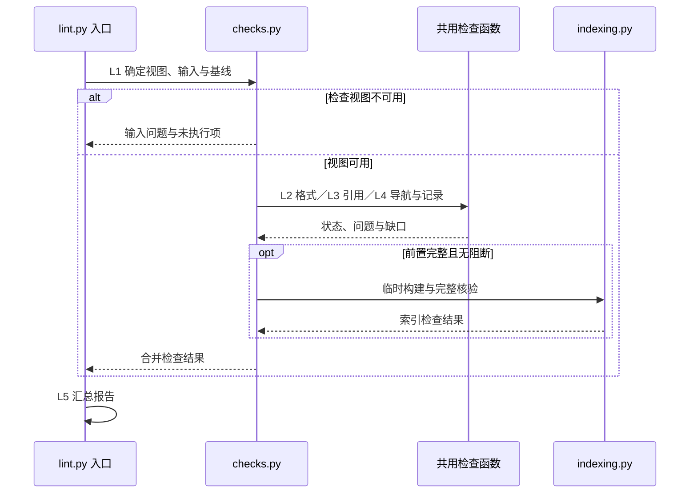

前置必需项完整执行且无阻断后才验证索引；报告包含未完成及未执行项。文件位置与检查细节如下。

| 节点 | 文件 | 设计职责 |
|---|---|---|
| 入口 | `hs-knowledge-lint/SKILL.md`、`hs-knowledge-lint/scripts/lint.py` | 选择候选／正式库与全库／局部范围，调用固定规则并返回统一报告 |
| L1 检查视图 | `governance/contracts/checks.py` | 候选按“正式区 + 拟写入 − 拟删除”展开，核对操作、文件内容、允许目标及旧基线；正式库直接读取确定版本 |
| L2 格式结构 | `governance/schemas/`、`governance/contracts/{validation.py,knowledge.py}` | 检查 frontmatter、Profile 章节、ID、正文锚点及范围引用 |
| L3 来源引用 | `governance/contracts/source_resources.py` | 核对视图内来源锁、确切原版、指纹、页／段／行定位及代码固定引用；不推断语义支持 |
| L4 导航关系 | `governance/contracts/{checks.py,knowledge.py}` | 检查导航、链接／锚点、跨卡／Claim 引用、替代关系与依赖环 |
| L4 处理记录 | `governance/contracts/{checks.py,records.py}` | 检查记录覆盖及历史卡绑定；按 P2 保留对象恢复旧正文，不把旧记录强行套到新卡字节 |
| L4 索引 | `governance/contracts/indexing.py` | 前置阻断项清除后临时构建，完整核验版本、集合、正文与查询记录，见 §6.2；不切换活动索引 |
| L5 报告 | `hs-knowledge-lint/scripts/lint.py`、`hs-knowledge-lint/artifacts/templates/result.md` | 输出对象／规则身份、模式／范围、各项执行状态与问题；问题含稳定检查 ID／错误码、等级、文件／位置和原因 |

| 固定检查类别 | 失败／未完成条件 | ingest 的修订位置 |
|---|---|---|
| `view` | 越界路径、重复／冲突写删、内容或旧基线失配 | P4；缺原始材料回 P2 |
| `format` | YAML 重复键、Schema／Profile 不符、ID／范围结构非法、正文冲突标记 | P4；范围选择问题回 P3 |
| `source` | 来源未登记、指纹／定位失配为错误；必需原版未取得或读取失败为未完成 | P2 补材料；引用选择问题回 P3 |
| `relation` | 目标不存在、ID 重复、替代自指、依赖环、导航缺漏、链接／锚点失效 | P3 决定关系，P4 修订表达 |
| `records` | 记录覆盖或 Card／Claim 绑定不符；缺少必需历史正文时未完成 | P2 补齐旧卡对象；当前处理记录自身问题回 P6，历史事实不重写 |
| `index` | 合格集合漏项／重复、正文或查询记录失配、索引／规则版本不符 | 内容问题回 P3／P4；构建故障停 P5 |

OpenFlow 调用的完整 lint 与固定 CI 执行合成视图的仓库级检查，包括删除／改名后的反向引用、父导航和全局 ID。手动局部检查只对列出的对象负责，报告不得表示全库通过。纯文档的代码检查列不适用；必需输入缺失列未完成，前置失败而未执行的索引检查也须注明。

最终 lint 接收 P2 提供的 `historical_card_objects`，P7 的 `check_inputs` 复用同一组固定输入。若当前正文已变且没有可用的确切旧正文或 Git 历史，`records.coverage` 报告 `RECORD_HISTORY_UNAVAILABLE`，回 P2 补齐材料，不要求为此先提交业务变更。

退出码统一为：`0`＝所选范围内必需项完整执行且无阻断，`1`＝发现阻断问题，`2`＝必需输入未取得，或规则、运行器、报告不可用。材料缺口回 P2，运行故障保存停点；建议项不阻断。空／损坏报告、状态与退出码不一致均按运行失败处理。OpenFlow 仅在完整全库报告通过后选择内容进入 P6 的出口；修订后重跑 P5。P6 的 record Skill 不以 lint 已通过作为调用条件，实际传入的报告仍须与本次视图绑定。结果语义参考 CANNBot 的[检查协议](https://gitcode.com/cann/cannbot-knowledge/blob/c92c66ee695090c44487f56bd051d2607c58b27a/.agents/skills/knowledge-lint/references/checks.md#L34-L48)，独立 lint 到报告为止。

### 5.6 P6：登记唯一的原件处理记录

P6 汇总扫描、跳过、提炼、暂缓和检查结果，在 `.build/operations/<操作>/ingest-record.yaml` 生成并校验待入库记录，声明 `logs/ingest/<记录ID>.yaml` 目标；P7 才随本批事务正式落位。它就是 §2.1 的“原件处理记录”，不另建第二份来源与卡关系真源。

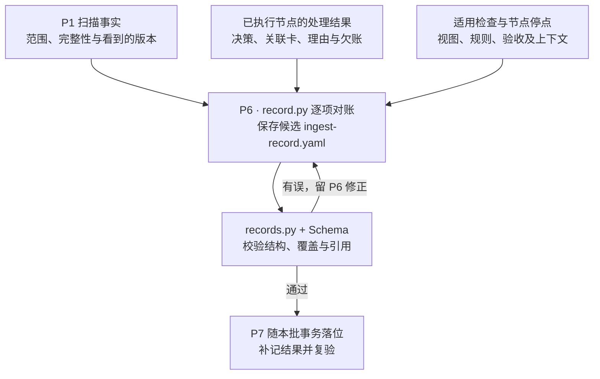

图中只汇总实际执行结果；扫描跳过可直接登记，未执行的复核／检查不补记为通过。`lint_ref` 和 `skip_sample` 是可选材料；提供时核对本次内容绑定，不要求上游 passed 或独立者凭证。原始复核结果由编排侧按实际调用保存。

| 文件 / 位置 | 设计职责 |
|---|---|
| `hs-knowledge-source-scan/scripts/record.py` | 将本批清单与各节点结果逐项对账，生成待提交记录；跳过、读取失败和未覆盖事项也有处置 |
| `governance/templates/ingest-record.yaml` | 提供记录结构，不预填检查通过、已入库或已合入 |
| `governance/schemas/records.schema.json`、`governance/contracts/records.py` | 校验结构与覆盖，拒绝漏项、重复及清单外自报完成；产卡项反查最终卡／Claim 的实际来源版本 |
| `.build/operations/<操作>/ingest-record.yaml` | P6 校验后的待入库记录，尚未写入正式区 |
| `logs/ingest/<记录ID>.yaml` | P7 正式落位的可提交记录；其他人拉取后可直接理解处理事实 |

| 记录内容 | 需要说明什么 |
|---|---|
| 扫描事实 | 本批清单身份、范围、是否完整、原件相对路径、来源身份与看到的版本／指纹 |
| 处理范围与结果 | 各处理单元采用的决策、所覆盖部分、跳过／暂缓／失败理由、欠账及下一步 |
| 关联知识 | 卡／Claim 身份及变更摘要；实际采用的来源版本以卡内引用和来源锁为准 |
| 检查与进度 | 操作 ID、规则与内容视图身份、实际已执行的检查及材料、停点；未执行项如实说明，执行过抽查时保留范围和结果，不据记录存在推断已通过复核 |

| 处理结果 | 登记与后续 |
|---|---|
| 内容就绪 | 从实际视图核实卡／Claim 与来源绑定；OpenFlow 依据检查结果决定后续，真实入库事实由 P7 补记 |
| skip | 区分扫描跳过与已审无增量，记录版本、范围和理由；OpenFlow 安排的实质抽查如实留痕，未抽项不冒充复核通过，record 不要求抽样票据 |
| defer | 材料或结论不足，保留欠账，不能推进对应范围完成状态 |
| 失败／未覆盖 | 记录问题与未处理部分，保留后续候选和停点 |

每个本批处理单元有唯一处置；P3 拆分单元仍须覆盖原选中范围，未分配部分列未覆盖。一源可以多卡、分段完成，已有一张卡引用或仅观察到新指纹均不代表整份完成。实际采用关系仍以卡／Claim 和来源锁为准。

P6 生成后立即固定校验，错误留 P6 修正；P7 据实补记落位结果后复验，不提前宣称提交／合入，也不要求记录包含自身提交哈希。记录引用的视图与来源不得被悄悄替换；需要改卡、导航或来源锁时，由 OpenFlow 回 P4／P5 形成并检查新视图。观察记录可尚未登记来源，读取失败可缺指纹并说明；“内容检查失败”是合法处理事实，不能据此将失败稿件记为已入库。

### 5.7 P7：知识与处理记录同批本地入库

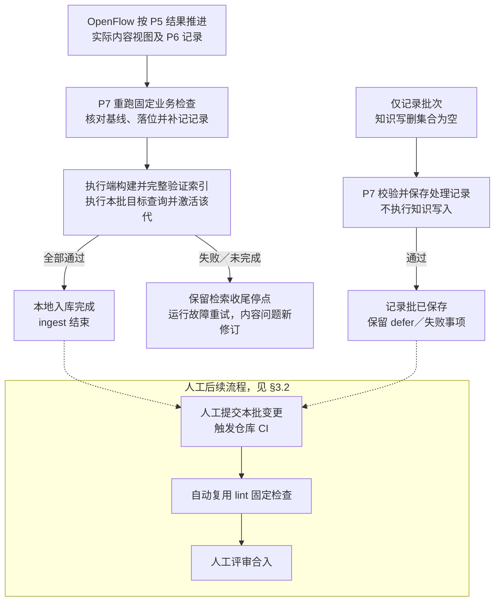

| 文件 / 对象 | 设计职责 |
|---|---|
| `hs-knowledge-apply/scripts/transaction.py` | 核对最终视图，实际运行完整固定业务检查，核对来源恢复条件和旧基线；不要求上游复核／lint 已通过的凭证；同批写入卡、导航、来源锁及记录，核验落位并复验补记后的记录 |
| `hs-knowledge-recover/scripts/recover.py` | 根据原事务检查、续做或回滚；保留外部修改，不创建新事务冒充恢复 |
| `logs/operations/<操作>/` | 执行端持久事务日志、备份和结果，用于中断恢复；调用端响应副本不能替代它们 |
| 人工上库清单 | 本地结束时列出本批正式内容及 `logs/ingest/`；由人按清单提交，不整体提交工作区或 `logs/`。可选交接工具不作为 ingest 完成门槛 |
| `hs-knowledge-index-build`、`hs-knowledge-query-regression` 与 query | 构建并验证候选索引，执行本批目标回归和同代读取，再按活动指针基线激活；全部成功后完成内容批的 ingest |

OpenFlow 安排完整 lint 后再调用 P7；apply Skill 自身针对实际拟写内容运行完整固定业务检查，不查验前驱节点凭证。单独调用内容 apply 以 `operation_id` 和 `view_ref` 为业务输入；`ingest_record_ref` 可将记录并入同批事务，复核和 lint 材料为可选绑定数据。旧卡更新继续携带 P2 保留的 `historical_card_objects`，不能只提交已更新的新卡正文。正常批先 P6 登记，再 P7 落位、补记并复验；本机索引完整验证、本批目标查询通过且该代成功激活后，ingest 成功结束并给出本批文件清单。写入失败按原事务保存或恢复，检索检查未完成则保留收尾停点。Git 提交、触发 CI 和合入由人后续执行，不要求工作流先取得提交或 CI 结果。

仅记录批次先保存无法继续事项的停点，卡／导航／来源锁写删集合为空，卡内容视图、内容复核与代码依据列不适用；OpenFlow 可按 §5.3 安排实质 skip 抽查，record／apply 只校验记录覆盖、版本、引用和允许写入范围，不要求抽查通过凭证。记录实际落位后结束，无需构建索引、执行目标查询或取得 Git 提交。不携带失败稿件、不伪造 P5 通过；记录保存成功不把 defer 或失败改成已完成，无变化的重复扫描不制造新处理记录。人工提交时沿用同一本批清单。

本地入库按来源锁核对已捕获原件的确切对象、指纹和大小，不要求原件先有 Git 提交。当前代码结论另核实际配置、工作树文件和采用材料；必要输入可从业务上下文解析并固定在 journal。可选复核文件后来删除不阻断按固定视图、备份和 CAS 安全恢复。写入成功只表示字节已落位，apply 不自动生成 supported／独立复核 acceptance 摘要。人工上库时须使采用的原版可从约定 Git 版本或同组持久位置恢复，并为固定 CI 提供确切输入；本机临时副本不能作为跨机恢复的唯一依据。

索引构建独立核对当前卡、来源锁和完整数据库，不要求先有 apply／merge-check／复核通过记录。需要构建／运行证据的代码 Claim，可通过 `code_contexts`（兼容名 `code_evidence`）传入按卡 ID 固定的 `code_identity`、`config_digest` 和逐 Claim 的 `claim_evidence`；这些是 Agent 从实际文件准备的业务数据，不是第二份手填配置。静态源码结论与纯文档不增加构建材料要求。

索引构建返回固定 `generation_ref` 和当时的 `expected_active`。Agent 原样传给查询回归节点，先验证候选代和本批目标查询，再通过比较并交换（CAS）将该代设为 active；只有原先没有活动代时 `expected_active` 才为 null。指针或基线变化时拒绝激活并保留停点，不把“查询通过但激活失败”报告为 ingest 完成。

索引完整验证后按计划用途执行目标查询：相应用途下合格的新增 stable Claim 可召回；current／implementation 不混入 draft、deprecated、guidance-only 或不符当前范围的 Claim，historical 可读取符合历史规则的旧结论。回归在明确的候选代上使用 evaluation，read 验证同代正文；这不把未激活候选变成正式查询入口。无命中先核对用途、范围、资格及预期，不放宽过滤来取得通过。构建或读取故障只重试检索收尾；完整索引上的查询仍不符预期时定位原因，内容错误以新修订回 P3／P4 和 P5—P7，保留原入库事实，不重复原 apply。未完成写入先恢复原事务；人工提交重试先核对 Git，已形成提交不重复执行。

本地 stable、已提交、CI 通过、实际合入分别判断。CI 失败以提交和问题位置形成新修订输入，重新经过 P2／P3／P4 与 P5—P7，保留旧操作结果。

### 5.8 C1：固定 CI 与 lint 共用检查函数

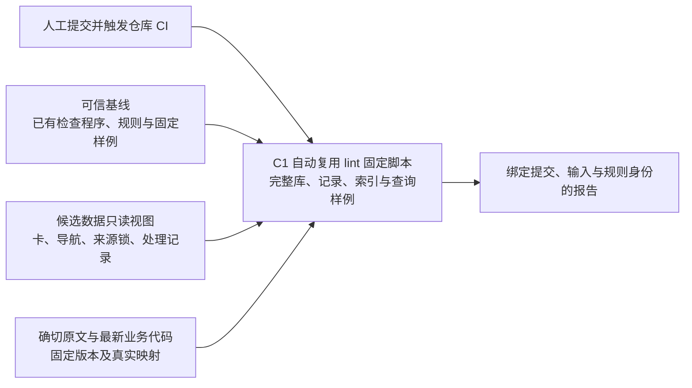

| 文件 / 对象 | 设计职责 |
|---|---|
| `K/check.py` | 从可信版本读取，检查候选完整视图并核验报告；遵循 §5.5 范围、等级与 0／1／2 结果协议 |
| `K/check.sh` | 选择作业提供的 Python 并转调 `check.py`，不实现另一套检查 |
| `governance/contracts/checks.py` | 复用可信版本的格式、导航、关系及来源引用规则；对候选提交适配输入，不依赖本机操作 |
| `governance/contracts/records.py` | 检查记录结构及本批新增／变更记录与来源、卡的关系；历史引用按记录引入时的 Git 内容或明确版本解释 |
| `governance/contracts/indexing.py` | 从候选数据构建临时索引，执行 §6.2 全量核验与固定查询回归，不切换活动索引 |
| 仓库 CI 作业 | 用受保护配置选择可信基线程序／规则，再叠加允许的候选数据；准备固定原文、实际业务代码文件及映射，版本只采用作业明确提供的材料 |

候选卡、导航、来源锁与记录是数据，不导入其中的程序；路径解析后仍须在允许根内，拒绝符号链接／子模块逃逸。可信基线由仓库受保护配置指定，候选提交不能替换本次门禁的作业、程序或规则。此边界参考 CANNBot 的[基线检查快照](https://gitcode.com/cann/cannbot-knowledge/blob/c92c66ee695090c44487f56bd051d2607c58b27a/.gitcode/workflows/cannbot-knowledge_actions.yml#L59-L75)，本项目同时覆盖正式来源锁和处理记录。

规则变更按普通代码变更运行固定接受／拒绝样例、现有知识回归和兼容性检查，候选规则仅作为被测对象，不能批准同批知识。新格式不兼容时按“先接纳兼容新旧格式的规则 → 迁移知识 → 退出旧格式”推进；原有拒绝样例不能随候选规则被删除来取得门禁通过。

CI 复用 lint 已有的固定脚本及共用检查函数，`check.py`／`check.sh` 只适配 CI 的输入和调用，不新增独立检查算法或业务代码构建任务。它不运行 Agent 或写入动作；原文、代码及配置引用以作业明确取得的版本核对，必需输入缺失或规则不兼容则不通过。CI 不依赖开发机 `.build/`、私人日志、私人复核记录或活动索引。

### 5.9 Q1—Q6：路由、查询、同代精读与回答

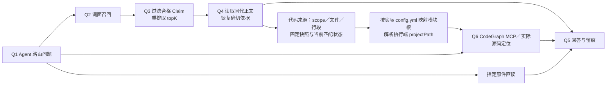

| 文件 / 对象 | 设计职责 |
|---|---|
| 主 Agent、已加载的 `AGENTS.md` 与 `config.yml` | Q1 选择知识卡、代码或原件入口，Q5 综合证据并说明范围、冲突和缺口 |
| 官方 CodeGraph MCP、实际代码文件 | Q6 按模块目录定位符号与调用；首次准备交 S0，日常不重复 setup，见 §5.11 |
| `hs-knowledge-query/scripts/node.py` | Q2 召回候选；Q3 直接核对状态、用途、当前配置／Target、工作树源字节、采用材料和依赖限制，之后取全局 topK；不追查 apply／merge／复核通过链 |
| `governance/contracts/indexing.py`、`artifacts/` | 将索引、正文与指纹绑定到同一代，供 Q4 读取命中时的完整内容 |
| `hs-knowledge-source-capture` 的来源恢复能力 | 按卡的确切来源版本读取原文／代码定位，不替换为同名新文件 |
| `hs-knowledge-query/artifacts/templates/result.md` | 输出结论、引用、范围与检索 Receipt；记录命中、索引代及缺口 |

Q6 同样按代码所在执行端定位和读取。服务器源码通过 SSH 定点取得所问文件、版本和调用证据，或使用宿主已真实配置的远端代码检索能力；缺少该接入时记录缺口，不在调用端通过共享盘建立另一份索引。工具参数按实际 Schema 使用，执行部署规则不为第三方工具虚构远端参数，也不把图谱关系当作宏、构建或运行证明。

卡头的 `Claim.text_ref` 将断言绑定到流程中的正文片段，`Claim.source_refs` 再选择本卡 `sources` 中的确切证据；不同关键步骤可使用不同来源与行段，同一步也可同时引用规范原文和实际代码。头部结构化引用即可支持回源，正文链接是可选展示。固定检查验证身份、范围与定位可恢复，具体帧体格式或函数是否支持该步骤由作者及独立内容复核判断；把整条流程绑定到宽泛文档位置不会自动获得步骤级语义对应。

当前 `search` 的 `data.matches[].sources[]` 和 `read` 的 `data.sources[]` 已是来源恢复结果，通常不必再调用 `resolve-source`。代码定位使用下列字段：

| 字段 | 后续定位用途 |
|---|---|
| `source_kind`、`resource.repo_id`、`resource.path` | 识别代码来源及逻辑仓／模块，取得相对该 scope 的文件路径 |
| `source_ref.locator` | 取得固定源码行段；文档使用其原生页、段落或表格行定位 |
| `snapshot`、`text` | 核对快照摘要、已知版本及恢复出的具体片段；新模块来源的 `snapshot.code_identity.workspace_path` 可提供项目内位置线索 |
| `current_source_matches`、`limitations` | 说明当前字节是否匹配固定依据及读取限制；未知、变化和历史限制继续保留，不以字节匹配替代适用性或代码语义核验 |

Q6 用 `resource.repo_id` 匹配现有可信项目上下文的授权代码 scope，先以该 scope 根与 `resource.path` 解析源码文件的真实绝对路径，再按当前 `config.yml` 选择包含该文件的已配置模块根作为 `projectPath`。新模块布局下 scope 通常对应项目根下的 `code_root` 与模块 `path`；旧配置中的 scope 也可能是包含多个模块的代码仓，不能机械地把相对文件拼到某个模块根、K 或项目根。定位后依据真实片段与 locator 取得函数，快照中的位置线索不替代当前配置核对。只有文档来源、代码尚未捕获或函数仍未知时，记录缺口并继续实际源码检索，不能从流程名称编造代码入口。

快照或 `code_identity.revision` 固定历史依据，不会让 CodeGraph 自动切换源码版本。实际索引与该快照不一致时，图谱结果只能作为定位线索；所问旧版本仍需读取可恢复的确切证据，当前行为则核对当前实际文件及条件，不因查询而切分支或改写源码。

查询 `purpose` 接受 current、implementation、guidance、historical，省略时默认 current。它选择用途资格，不修改卡的 `usage`、适用范围或证据：

| 用途 | 资格边界 |
|---|---|
| current | Claim 必须为 current 用途，当前来源／代码及适用条件仍有效；未知适用范围不作通配 |
| implementation | 在 current 的要求上另需实现或测量类证据，不把设计声明当作实际产品行为 |
| guidance | 可使用指导性背景，保留未知范围、上下文缺口及待复核提示；仍核对来源、依赖和内容绑定 |
| historical | 核对所选代次及确切旧证据，可解释已退役内容；不表示当前推荐或当前实现 |

`search` 产生带完整性与来源绑定的 Search Receipt，记录有效频道、代次、用途、上下文、命中卡字节及合格 Claim。延续这次正式 search 的 `read` 使用 `receipt_ref` 和原命中卡，可缩小到原命中的非空 Claim 子集，不能增加未命中结论或改变频道／代次／用途／上下文；也不能拿 evaluation 记录冒充正式 search。无回执的独立 read 按其请求重新评估，不继承某次 search 的命中资格。

当前多 Claim 的 read 返回断言列表与来源并集，未在每项断言中重复输出 `source_refs`；search 的来源还可能含依赖卡依据。需要确认具体流程步骤时，以原 search 回执和单个 `claim_ids` 精读，返回来源即限定为该 Claim 的直接引用。无 `receipt_ref` 的独立 read 不按 `claim_ids` 缩小；这属于现有输出边界，不表示卡头的逐 Claim 来源绑定丢失。

同代读取还核对实际 manifest 与正文指纹。即使活动索引已切换，沿有效回执读取的仍是原代；输出前再查实时来源、依赖、资格及有效性水位，变化时明确拒绝，而非保证旧回执永远可读。直接指定候选 `generation_ref` 仅供 evaluation；正式 search 使用活动代。标题、摘要和关键词同样受 Claim 资格约束。无合格候选、证据不足及预算截断须分别说明，未完整扫描不伪装全局无命中。权限由实际仓库、宿主与工具落实，Receipt 不授予访问或发布权。

本地与跨机查询都按实际卡／索引、确切来源和当前业务材料判断，不要求另一台机器的 apply、复核或 acceptance 记录。current／implementation 的代码 Claim 直接核对当前配置、模块／Target 范围和工作树文件；采用 build／runtime 材料时，从代次的 `code_contexts` 复查实际文件指纹及逐 Claim 的证据类型和范围，材料改变只限制相关结论，不靠上游 passed 替代。historical／guidance 保留确切旧依据及用途限制，纯文档不因此要求代码材料。

shared 索引构建可直接指定真实 Git `knowledge_commit`，核对卡、规则和来源锁的实际 blob，结果仅为 `repository_snapshot`，不声称发布者身份、CI 或远端合入已通过。query 复验所用代次记录的快照；构建时若显式提供发布签名回执，通过既有发布信任接口核验受信 adapter 与签名的身份真实性；这是发布数据边界，不是 Workflow 交棒，也不成为普通本地部署的前置步骤。建索引和查询不依赖原生产机的验收摘要；提交／合入状态据实另报。

### 5.10 M：来源变化与结论有效性

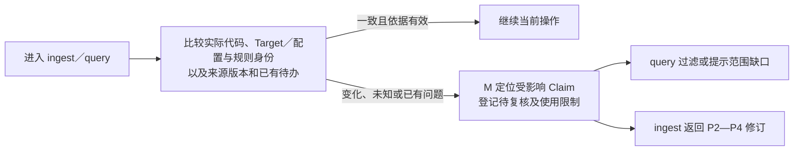

| 文件 / 位置 | 设计职责 |
|---|---|
| `hs-knowledge-maintain/scripts/maintain.py` | 根据原件／代码变化，沿来源、Claim 和依赖定位影响，登记待复核与使用限制 |
| `governance/contracts/knowledge.py`、`records.py` | 共用影响关系、复核对象与结果的表达 |
| `logs/events/` 与本机执行记录 | 保存影响判断、待办及本机应用进度，供查询及时过滤与 ingest 续办 |

P1 负责 raw 变化发现；P2／P4、apply 和 query 在各自使用材料时，直接核对模块映射、选定源码、所需 Target 及采用的构建／运行文件。模块路径或归属变化不能仅因源字节未变而忽略；版本保持 unknown 时仍按实际文件依据核对。M 结合来源引用和明确的变化事件定位受影响 Claim，依赖传播不包含普通“相关链接”；不能以“raw 未变”跳过代码变化，也不将版本号相同等同于语义必然有效。

query 直接核实际来源、当前配置及明确的维护限制；处理进度或复核记录不是查询放行条件。maintain 的 `inspect-context` 从当前卡／来源和已保存事件定位影响，处理记录结构问题作为材料缺口报告，不据其缺少通过票据推断当前结论失效。`advance` 按实际引用和当前源字节清除已经解决的机械 freshness 标记，不要求 apply、活动代或复核通过记录，也不宣称语义已复核；语义／适用性问题仍交内容修订。OpenFlow 安排 P2—P7 的复核和落位，历史问题按指定旧依据解释。

### 5.11 S0 / Q6：CodeGraph 首次 setup 与源码定位

`hs-codegraph-setup` 只负责首次代码图谱准备。S0 根据现有项目配置初始化本地派生索引，检查宿主 MCP 接入，并告诉 Agent 后续如何使用；Q6 直接使用官方 MCP，不另封装查询 Skill，也不加入 ingest Workflow。

这里的本地指源码所在执行端。服务器项目的准备命令通过 SSH 在服务器原生模块目录运行，索引和官方 MCP 进程也留在服务器；调用端通过宿主已经支持并实际配置的方式接入远端官方 MCP。缺这种连接时记录待接入，源码定位可继续通过 SSH 读取，不能改用映射盘和调用端本地索引。instruction-only setup 不作为公开知识节点 CLI，也不新增官方 API 的远端参数。

```mermaid
flowchart TD
    START["用户要求首次 setup"] --> MAP["复用已校验项目上下文<br/>config.yml → code_root → modules"]
    MAP --> EMPTY{"有真实且可用的模块？"}
    EMPTY -->|"没有"| GAP["返回未配置／缺失项<br/>不扫描整个代码根"]
    EMPTY -->|"有"| CHECK["确认实际 CLI 版本与帮助<br/>逐模块检查已有索引"]
    CHECK -->|"缺索引"| INIT["在明确模块目录运行官方 init<br/>逐项检查实际结果"]
    CHECK -->|"已有可用索引"| KEEP["复用，不全量重建"]
    INIT --> MCP["复用已有 MCP，或给出宿主接入片段"]
    KEEP --> MCP
    MCP --> PROBE["宿主加载后逐根执行只读查询<br/>区分索引就绪与 MCP 就绪"]
    PROBE --> GUIDE["输出模块 → projectPath 映射<br/>成功、失败、待接入与后续用法"]
```

#### 配置、索引根与重复执行

输入为已确定的项目根、`config.yml`、Agent 的实际工具能力及用户的 setup 请求。`code_root` 相对配置所在项目根，模块 `path` 相对代码根；只使用配置声明的真实目录。已加载且仍有效的模块映射直接复用；缺少映射时调用 E0，复用 `validation.workspace_layout` 的路径、重复项、链接及缺失检查，不另维护一套配置解析规则。

每个已配置模块目录作为一个索引根，显式解析为绝对路径后逐项处理，不按芯片或 Host／Device 标签复制建图。`modules: []` 不创建图谱；缺失目录报告缺口，不猜目录、不创建源码树。父子模块分别配置各自索引根并提示覆盖重叠，不把父目录最近找到的索引当作子模块已经初始化，也不擅自提升到整个 `code_root`。索引目录及使用的排除规则需要核对，父子索引不构成权限或语义隔离。

先检查实际 CodeGraph 的版本及子命令帮助；每模块执行前重新核对配置身份和实际目录，复用共享路径校验，防止缓存映射对应的目录已缺失或被替换为链接。再在明确模块目录中执行官方 `status`、必要时 `init`。已有健康索引直接复用；旧版、损坏、空图或失败项保留实际诊断，不通过删除、强制重建、解锁或升级消除错误。中断后再次 setup，重新检查逐项状态，只补未完成部分。代码变化后的增量同步属于日常 CodeGraph 使用，首次 Skill 不创建定时任务或自建 watcher。

#### 官方 MCP 与后续 Q6 使用

本项目适配的是 [colbymchenry/codegraph](https://github.com/colbymchenry/codegraph)。官方将[项目初始化](https://colbymchenry.github.io/codegraph/getting-started/installation/)与 Agent 接入分开；[MCP 服务](https://colbymchenry.github.io/codegraph/reference/mcp-server/)由宿主启动 `codegraph serve --mcp`，默认提供 `codegraph_explore`。setup 优先复用已接入的服务；未接入时生成符合实际宿主格式的配置片段。用户请求已包含该宿主接入时才合并写入，保留其他服务，也不在逐模块循环中运行全局安装器。

`projectPath` 使用实际解析的模块绝对路径；其参数及服务默认根必须按实际工具 Schema 核对。一个支持多项目的服务可以查询多个已初始化根，不必为每个芯片注册服务；多根可查询不表示都会自动监听，setup 需交付实际版本的监听范围及其他根的官方 `sync` 用法，或明确每根服务配置。宿主无法暴露多项目查询时，按其实际能力给出明确根的服务配置，不猜工具前缀或默认项目。宿主需要重新加载时标记待接入，不自行重启用户会话。

每个索引根选择一个已存在且可索引的文件或符号做只读查询，核对返回路径确属目标模块；仅目录存在、`init` 退出成功或 MCP 工具可见均不足以报告全部完成。结果分别记录索引状态、MCP 调用结果和未验证项。正常消费时，Q6 先按模块映射传入 `projectPath`，使用图谱返回的源码和调用关系；遇到索引过期、源码省略、未覆盖文件或不支持的条件时读取对应实际文件。宏、构建、跨仓与 Host／Device 协议结论继续按确切源码和条件核实。

#### 文件分工、分发与验收

| 文件 / 对象 | 设计职责 |
|---|---|
| `S/hs-codegraph-setup/SKILL.md` | 首次触发、模块遍历、已有索引复用、逐项结果与完成条件；由 Agent 调用现有工具，不新增知识 CLI |
| `S/hs-codegraph-setup/references/codegraph.md` | 官方命令依据、宿主 MCP 片段、`projectPath` 示例及版本差异处理；按需阅读 |
| E0 与 `governance/contracts/validation.py` | 复用可信项目上下文和已有模块路径校验；setup 不复制领域契约 |
| 既有开发分发／安装接口 | 保留纯说明 Skill 的元数据与文件摘要检查；入口为 `SKILL.md`，不伪装成 CLI 节点，不要求正常用户增加登记步骤 |
| `K/evals/validate_design.py` 与部署测试 | 检查新能力可分发、可由真实 Skill loader 发现，现有节点包的 CLI／结果契约要求继续完整校验 |
| 各模块的 `.codegraph/` | 本机可重建索引，不上库、不作为知识来源；不混入能力分发包 |

验收覆盖空模块、多个独立模块、父子模块、已有索引、路径缺失／链接、CLI 不可用及 MCP 待加载；首次 Skill 的行为用隔离工作区验证。能力分发不执行 CodeGraph 或修改宿主。真实部门代码索引和实际 Agent 的 MCP 调用另留运行证据，不能用 Skill 结构校验或合成材料替代。

## 6. 共用规则与运行约束

### 6.1 Skill 与 Workflow 的最小文件分工

| 校验类型 | 负责位置 | 具体范围 |
|---|---|---|
| 流程校验 | OpenFlow 的 Workflow；人工测试时由人掌握顺序 | 前驱步骤、流程出口、角色隔离、交棒合法性 |
| 业务校验 | 各 Skill 自己的脚本与领域契约，lint／固定 CI 复用固定函数 | 卡片格式、来源与代码范围／指纹、引用、导航、索引、查询断言及安全写入 |

节点只读取当前任务实际需要的业务文件并核对内容一致性，不再追查“上一步已通过”的证明链，不生成 Workflow manifest。缺少或被篡改的业务输入仍会拒绝；无流程门禁不代表忽略实际数据错误。

```mermaid
flowchart TD
    WF["workflow.yaml<br/>编排节点与返回路径"] --> NODE["节点 Skill"]
    NODE --> DOC["SKILL.md<br/>输入、动作与出口"]
    NODE --> SCRIPT["scripts/<br/>固定步骤与公开入口"]
    NODE --> REF["references/ · artifacts/templates/<br/>按需提供指南与结果模板"]
    SCRIPT -->|复用| CORE["governance/<br/>共用解析、检查与数据规则"]
```

目录职责见 §1.3，节点编排见 §5.0。仅在能力需独立复用时拆分 Skill。节点结果须明确通过、失败或缺材料。OpenFlow 按实际结果判断流程出口；人工测试由人决定下一步。

### 6.2 共用契约、模板与索引函数

```mermaid
flowchart TD
    PRE["P4 预检"] -->|复用| CHECKS["contracts/checks.py<br/>固定检查与结果协议"]
    LINT["P5／独立 lint"] -->|复用| CHECKS
    CI["C1 固定 CI"] -->|复用| CHECKS
    CHECKS --> CORE["共用解析、引用、记录<br/>与索引函数"]
    CORE --> RULE["Schema · Profile · Registry<br/>字段、类型与受控范围"]
    LOCK["framework.lock.yaml"] -. 配套版本与指纹 .-> CORE
```

| 文件组（均在 `governance/`） | 唯一职责 |
|---|---|
| Schema：`schemas/{frontmatter,sources,workspace,records}.schema.json` | 字段形状、类型及允许字段 |
| Profile：`schemas/profiles.yaml` | 七类卡的适用类型、必需字段组合与章节；引用 Schema 字段定义 |
| Registry：`schemas/registries.yaml` | 受控名称、允许目录及定位种类；项目代码根、模块及归属唯一来自 `config.yml`，逻辑 Target 由映射整理 |
| Contract：`contracts/{knowledge,source_resources,records}.py` | 跨字段／文件的身份、范围、关系、来源恢复和处理记录一致性 |
| `contracts/validation.py` | 共用 YAML、Markdown、路径与模块解析；按确切配置与 WiFi 映射核对项目根，整理目录归属与范围；拒绝歧义、重复键、越界与链接，不在各 Skill 复制规则 |
| `contracts/checks.py` | 固定检查注册、问题码／等级、范围与结果协议，供预检、lint 和 CI 组合复用 |
| `contracts/indexing.py` | 共用构建、全量验证、SQLite 只读 URI 与同代正文函数；统一 UNC、扩展长路径与 URI 转义，保持写入与 query 读取协议一致 |
| `templates/`、`specs/` | 七类卡、导航与处理记录的写法和语义说明；独立内容复核记录由节点契约说明，不另设机器枚举或必填规则 |
| `framework.lock.yaml` | 固定领域规则、Schema 与工具文件的版本／指纹；节点默认读取该锁并逐文件核验，可显式传 rules-digest。Skill 包与依赖摘要由实际文件自动记录，不以 catalog 登记作为运行条件 |

规则职责参考 CANNBot 的[Schema／Profile／Registry／Contract 分工](https://gitcode.com/cann/cannbot-knowledge/blob/c92c66ee695090c44487f56bd051d2607c58b27a/governance/specs/schemas.md#L3-L20)。Markdown 共用解析器保留原行号，排除代码示例中的伪链接；标题锚点按固定规则生成并消歧，Claim 使用稳定锚点。链接同时核对文件和目标锚点。

```mermaid
flowchart TD
    INDEX["indexing.py<br/>同一代索引完整核验"] --> VERSION["结构与版本<br/>数据库完整性、Schema／分词器<br/>规则身份一致"]
    INDEX --> SET["全量收录集合<br/>按同一规则重算卡／Claim<br/>无遗漏、重复或多余映射"]
    INDEX --> CONTENT["内容与检索记录<br/>正文／元数据指纹一致<br/>同代正文与记录重算一致"]
    INDEX --> QUERY["固定查询回归<br/>范围过滤、资格限制<br/>与同代读取"]
```

索引核验不能仅核对行数，固定回归不证明内容语义；查询资格另按当前条件过滤。候选代构建、P3 指定的目标查询及激活顺序见 §5.7；lint 与 CI 仅生成临时产物。能力与规则不兼容或加载失败时返回未完成，不静默退回旧规则。

### 6.3 命令分派与工作流续办

命令分派见 §1.1、§5.0，完成边界见 §5.7。执行停点随节点结果保存，未走到 P6 时也不丢失；可提交摘要由 P6 汇总。定期 lint 只调度同一个 Skill，不自行触发修订或上库。

```mermaid
flowchart LR
    STATE["读取原操作<br/>识别实际停点"] -->|内容问题| REVISE["预算内继续修订<br/>重复同错且无进展则停止"]
    STATE -->|缺材料／退回| MATERIAL["保存缺口或退回原因<br/>补齐后核对基线与停点"]
    STATE -->|运行／版本故障| ENV["保留输入与未执行项<br/>条件恢复或明确重试"]
    STATE -->|写入中断| TX["优先恢复原事务<br/>核对已落位部分"]
    STATE -->|检索收尾未完成| TAIL["运行故障：只重试收尾<br/>内容错误：形成新修订"]
```

同一依据下重复同类错误且无进展，或预算耗尽时停止修订。补齐材料或修订稿件后，核对原件、规则、代码及相关基线再继续；运行故障不靠反复改卡消除。已完成的知识写入不重复 apply；检索收尾发现内容错误时，按 §5.7 形成新修订。

`knowledge status` 汇总实际进度；`knowledge index rebuild` 只重建执行端索引；`knowledge recover --operation <操作ID> --action <动作>` 检查、续做或回滚原事务。这些是配套维护入口，仍遵守同一执行端和权限边界。

规则升级不改写历史：其他操作的旧规则终态 journal 仅用于判断写入是否结束，不替代当前规则的数据检查；真正未完成的旧事务先按原配套规则恢复。当前规则重新核对实际卡、来源和配置，旧索引不兼容时重建；index-build 不要求先重新取得 apply／复核票据。需要内容修订时，OpenFlow 用新操作处理相关 `rules_changed` 单元并安排复核、检查和入库；已 committed 的字节不能当成未写入重复原事务。

即使卡正文未改字节，新规则下仍重新执行适用业务检查；历史报告、处理记录、journal、apply-result 和索引不自动改摘要或重签。已有卡符合当前规则时可直接重建索引，不为补流程凭证重复 apply。旧事务与配套规则无法安全恢复时保存阻断，不编辑旧文件消除不兼容。

正常执行使用 Agent/harness 已有能力；`hs-knowledge-explore` 首次通过 setup 检查全局依赖，后续作为项目接口定位代码仓与知识根。跨机器时先按其 `config.env` 由 harness SSH 连接，再使用实际执行端可调用的已安装 Skill 脚本；调用端 Windows 路径不能当远端入口，setup 也不上传脚本。缺少执行端能力时报告缺口，特殊安装位置或传输方案先与用户讨论。既有 `tools/deploy/` 接口只用于兼容与开发验证，不作为正常主线。

跨机器连接、认证、权限和命令结果由 harness 检查；节点继续核对自身来源、规则和业务内容。正常节点无需 catalog／registry／binding，辅助调用按已安装同级 Skill 路径使用同一全局 Python。OpenFlow 管理流程执行身份和出口，Skill 只返回实际业务结果，不生成 Workflow manifest。普通节点和 lint 保留各自结果格式与退出语义，实际 status／phase／诊断才说明本次业务结果。

执行端在 K 内持久保存本次请求、响应、报告和事务材料；节点的 `--output` 指执行端的实际响应文件，harness 如保留调用端副本，应标明它只是副本，不因此建立另一套部署目录。`view_ref`、`apply_result_ref`、receipt 等按执行端 K 解释；lint 的绝对 `report_ref` 也属于执行端，传给要求 K 相对引用的后续接口时按该端 K 解析，不能拿调用端副本代替或改签报告。

一次 ingest 固定执行端且最多一个写者，由宿主／Workflow 调度约束；实现不是对整条链持有一个覆盖所有访问的 OS 锁。apply／recover、维护写入和索引激活等关键段复用协作写锁、事务状态及内容／活动指针 CAS。多 query 使用独立 `operation_id` 和输出，不与其他调用复用可变暂存；Workflow run／node／attempt 仅由 OpenFlow 管理，不是 Skill 请求的必需字段。查询读取同代正文并在输出前复查实际来源、材料和范围。并发写入、代次切换或来源变化可能使查询明确阻断，不能承诺所有并发请求都成功，也不能阻止不遵守协议的外部工具写文件。

SSH 结果不明时，由 harness 核对原执行端进程、操作记录、journal 和活动代，再决定续办；不能推断远端未执行或重复已提交写入。既有节点 timeout 预算不由 setup 改变。首次准备和执行方式见[执行说明](../tools/deploy/EXECUTION.md)。

### 6.4 哪些内容上库，哪些用于本机执行

```mermaid
flowchart TD
    OUTPUT["本批产物"] --> SHARED["正式内容与可共享处理记录"]
    SHARED --> LIST["按本批清单纳入版本管理"]
    OUTPUT --> LOCAL["本机执行材料与派生产物"]
    LOCAL --> BUILD[".build/operations/<br/>稿件、视图、报告与停点"]
    LOCAL --> LOG["logs/operations/ 等<br/>备份、原始复核与证据"]
    LOCAL --> INDEX["artifacts/ · 查询 Receipt<br/>索引、同代正文与查询留痕"]
```

| 内容 | 保存与提交边界 |
|---|---|
| `knowledge/`、`governance/sources.lock.yaml`、`logs/ingest/` | 本批正式内容、来源登记和处理记录，一并纳入版本管理 |
| `.build/operations/` | 本机材料、稿件、视图、检查报告与执行停点，不上库 |
| `logs/operations/`、原始复核／证据日志 | 本机恢复和业务证据留痕，不整体上库；P6 可记录实际已执行事项的摘要与引用，不生成独立复核通过凭证 |
| `artifacts/`、查询 Receipt | 本机派生索引和查询留痕，可重建或按需保存，不当作正式处理记录 |
| `.gitignore` 与提交清单 | 放行 `logs/ingest/`，排除暂存、备份和派生索引；按本批清单提交 |

原件跨机恢复条件见 §5.7，其他机器按 §5.9 核对实际仓库内容、来源和适用材料，不要求原生产机的私有流程凭证。历史处理记录按对应版本解释，不随当前卡变化重写指纹；本机索引状态不代表他人进度，能力包不携带领域原件、知识和运行日志。节点只记录真实检查或写入事实，不因 apply 成功自动宣称 supported／独立复核通过。OpenFlow 管理内容复核与交棒，共享内容由仓库评审接纳，CI 仍只查固定业务项。
