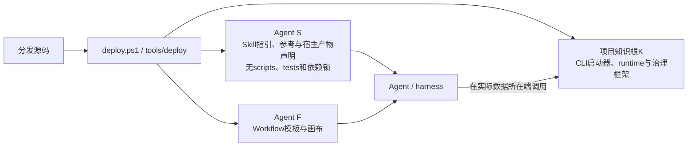
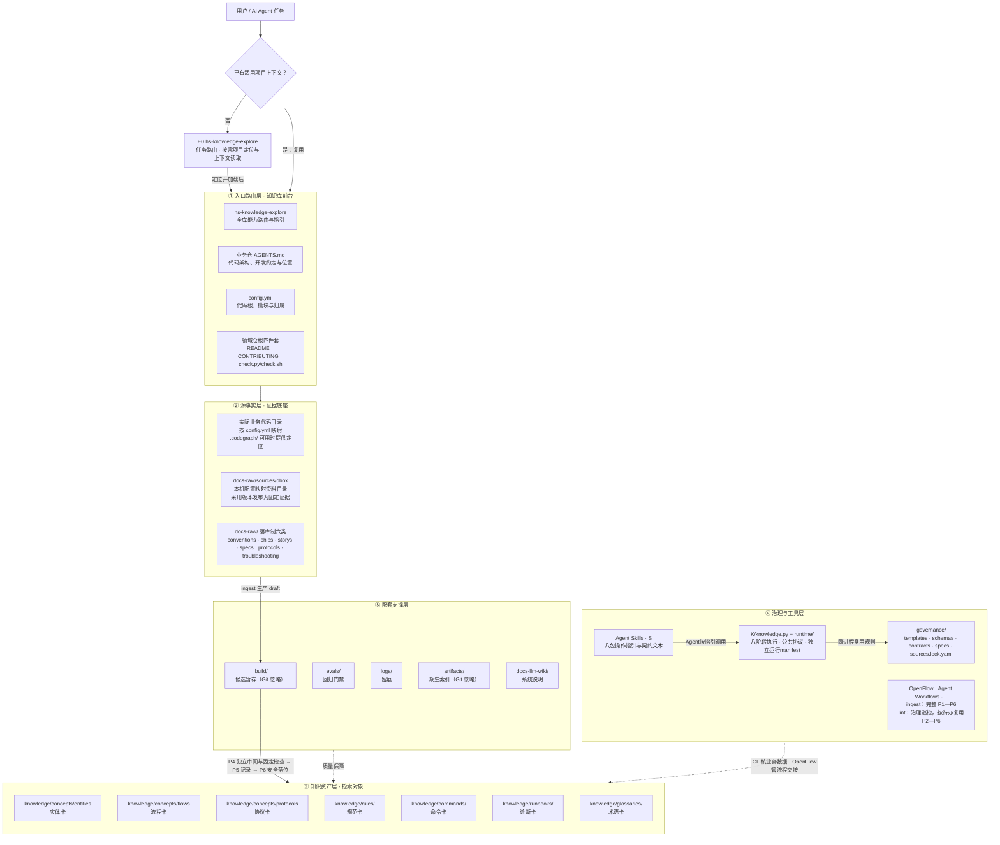
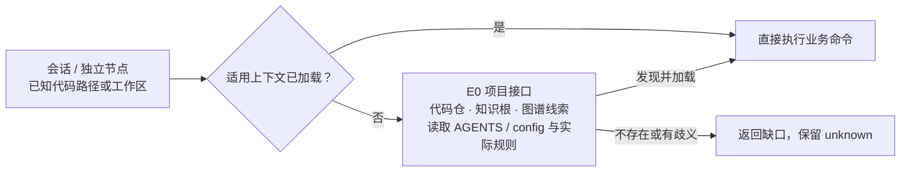
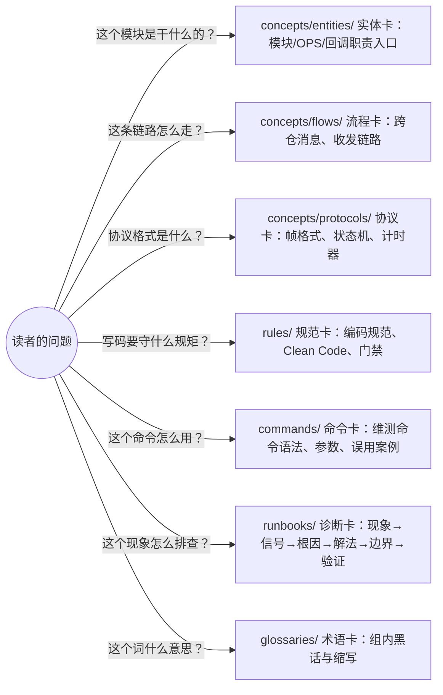
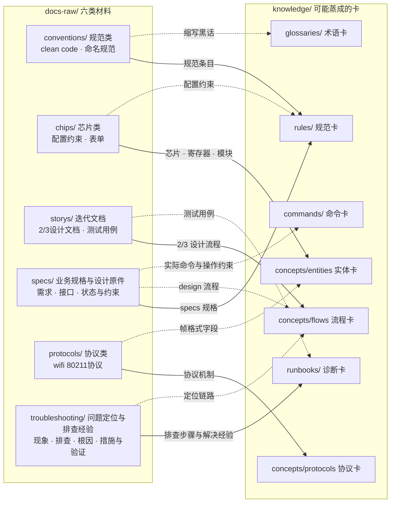
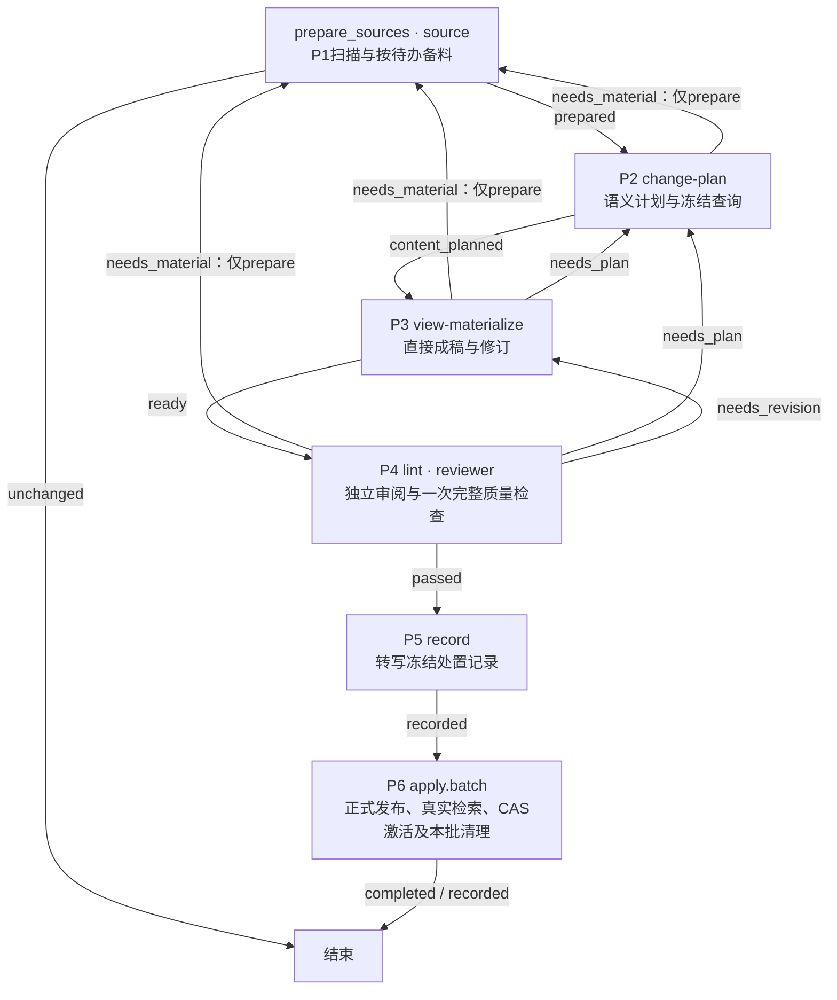
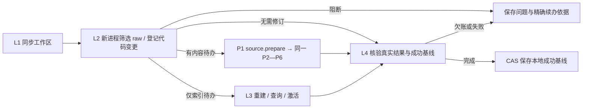
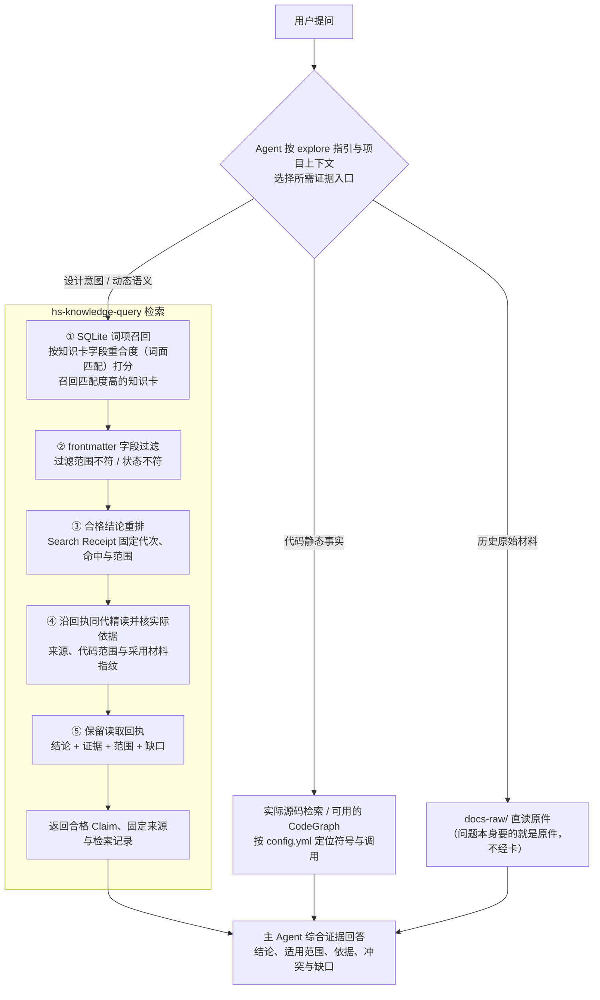

# HiMate知识库架构设计

可按Skill指引逐个调用仓内阶段命令，CLI核对本职业务数据和固定检查；OpenFlow负责流程顺序、角色隔离及交棒合法性。节点不要求Workflow身份、catalog登记或上游通过凭证。

## 5.3 HiMate knowledge目录架构

本节统一维护开发源码、实际安装产物和模块职责。其他设计文档按职责引用本节，不再维护另一份总目录树。Skill源包提供指引、参考及必要宿主声明，知识系统测试统一归K的evals；执行实现和依赖锁随K分发。源码组织与安装时生成的宿主兼容视图分别说明。

本节以 `repo/` 表示项目根目录，实际目录名称和存放位置不限。开发分发源码及新项目默认将领域知识根集中在 `repo/himate/`，WiFi 为 `himate/himate-knowledge-wifi-mp/`。下树按该布局示意；实际知识根 K 由项目 `config.yml` 的 `knowledge_roots.wifi` 相对配置目录解析，允许安全的前置子目录，与业务代码共同管理。开发仓保存 Skill／Workflow 分发源码，Agent 安装指引和编排；真正执行实现随 K 的启动器与 `runtime/` 分发，执行端不依赖 Skill 脚本或项目根能力源码副本。业务工作区可包含 Host、Device、特性和算法等多个代码模块；知识库按配置中的相对路径读取实际文件，以内容指纹核对引用。

当前入口按同一业务工作区读取根 `config.yml`，项目配置全部由用户在这份文件维护。`hs-knowledge-explore` 提供 ingest、query、lint 等任务选择与指引，K 的 `knowledge` CLI 执行八阶段固定动作；它不调用模型，内容判断和 P4 独立审阅仍由 Agent／Workflow 完成。首次部署使用分发仓根 `deploy.ps1`，每个实际执行端分别准备 Python 与锁定依赖并运行 doctor。目标代码仓在远端时，Agent 通过 OpenFlow／宿主已有 SSH MCP 在服务器原生 K 运行同一 CLI，不逐次上传 Skill 脚本。正常业务不要求登记；裸命令通过可选 install-command 在每个执行端注册一次。

部署升级将框架与业务资产分开：受管指引／编排、仓内启动器与runtime及治理四个纯框架子树成套同步，移除过时文件／退役包；原件、卡与导航、来源锁、日志和本机运行状态保留。安装根的部署清单只帮助安装器识别上次包名，不参与业务加载或机器绑定。已有项目继续尊重 `config.yml` 指定的安全知识根，包括旧平铺或自定义多级目录；部署不自动搬迁业务库、改写旧引用或重签历史记录。`himate/` 不是新的项目根，`main/`、能力分发源码与 `config.yml` 仍位于 `repo/`。升级边界见[知识库关键点 §1.2](知识库关键点.md#12-知识库与代码位于同一工作区)，操作与预览见[使用说明](使用说明.md#2-首次环境安装)。

### 5.3.1 当前开发源码与实际安装产物

- AGENTS.md：具体业务仓的代码架构、开发约定与位置说明；由该工作区维护
- AGENTS.md.example：本项目分发的接入示例，供合并 main、config.yml、知识根及设计文档四项说明
- config.yml：项目架构映射，登记代码根、模块相对路径及芯片／端／特性／用途
- main/：真实代码工作区
- skills/common/knowledge/：开发分发用的节点能力源码，部署位置由 Agent 决定
- workflows/common/knowledge/：开发分发用的 ingest 与治理 lint 巡检工作流源码
- himate/himate-knowledge-wifi-mp/：WiFi 领域根；`himate/` 归集各领域的 `himate-knowledge-xxx/`
  - knowledge/：知识卡，唯一检索对象，处理后知识的仓库
  - docs-raw/：源文档，原始证据层（LLM 只读）
  - governance/：治理文件夹，存放契约，模板，规范等
  - .build/ · logs/ · evals/ · artifacts/ · docs-llm-wiki/：知识根内的配套支撑层

```text
repo/
├── AGENTS.md                      # 业务仓说明，本开发仓仅本地维护
├── AGENTS.md.example              # 分发接入示例，合并到业务仓已有说明
├── deploy.ps1                     # Windows 交互部署入口，位于分发仓
├── tools/deploy/                  # 部署、ZIP 与依赖检查；tests/验证该工具自身
├── tools/knowledge/               # 运行包清单等显式开发维护工具
├── config.yml                     # 代码根、模块相对路径与归属
├── main/                          # 业务代码工作区，可包含多个模块
├── skills/common/knowledge/             # 开发分发源码，部署时放入Agent Skills
│   ├── hs-knowledge-explore/             # 能力路由、只读发现与CodeGraph准备
│   │   ├── SKILL.md                     # 方法与阅读路由；其他指引包有相同资源类别
│   │   ├── references/                  # 参考；results/是展示指南和模板唯一真源
│   │   └── artifacts/*.yaml             # 必要宿主声明；不保存第二份MD正文
│   ├── hs-knowledge-source/              # P1扫描与备料；明确目标的来源操作
│   ├── hs-knowledge-change-plan/         # P2语义计划及冻结查询
│   ├── hs-knowledge-view-materialize/    # P3直接成稿、修订与描述
│   ├── hs-knowledge-review/              # P4独立审阅；按需只读固定检查
│   ├── hs-knowledge-record/              # P5转写既定处置；不重新判断内容
│   ├── hs-knowledge-apply/               # P6正式发布、检索收尾、本批清理及只读提交核对
│   ├── hs-knowledge-query/               # 独立查询与同代精读
│   ├── hs-knowledge-maintain/            # 独立事件、机械限制与引用审计
│   ├── hs-knowledge-patrol-sync/         # L1 同步实际工作区
│   ├── hs-knowledge-patrol-plan/         # L2 生成巡检待办
│   ├── hs-knowledge-patrol-reindex/      # L3 只修复派生索引
│   └── hs-knowledge-patrol-complete/     # L4 核验完成并推进成功基线

├── workflows/common/knowledge/ # 开发分发源码，部署时放入 Agent Workflows
│   ├── hs-knowledge-ingest/   # P1—P6：原件到 stable 的完整流程
│   └── hs-knowledge-lint/     # 同步／差异筛选 → 复用入库 → 实际完成与基线
└── himate/                       # 领域知识容器；配置基准仍为项目根
    └── himate-knowledge-wifi-mp/       # WiFi 领域根，无嵌套 .git
        ├── AGENTS.md / README.md / CONTRIBUTING.md
        ├── knowledge.py / knowledge.cmd / knowledge.sh  # 仓内跨平台命令入口
        ├── runtime/
        │   ├── manifest.json / requirements.lock.txt   # 运行实现与依赖分别固定
        │   └── himate_knowledge/
        │       ├── cli.py / protocol.py / stage_dispatch.py
        │       └── stages/            # 八阶段单份实现；apply保留历史事务适配
        ├── check.py / check.sh         # 固定 CI 入口，复用共用检查函数
        ├── docs-raw/                 # 原始证据，Agent 只读
        │   ├── conventions/          # 编码规范
        │   ├── chips/                # 芯片材料
        │   ├── storys/               # 迭代设计和测试材料
        │   ├── specs/                # 项目需求与设计原件
        │   ├── protocols/            # 内部协议
        │   ├── troubleshooting/      # 问题定位与排查经验
        │   └── sources/              # dbox本机目录映射；3ms/wiki外链预留
        │       ├── dbox.example.yml  # 共享空模板：格式版本与path
        │       ├── .gitignore        # 精确忽略dbox.local.yml
        │       └── dbox.local.yml    # 执行端私人地址，不上库
        ├── governance/
        │   ├── AGENTS.md / index.md
        │   ├── templates/            # 七类卡、导航与处理记录模板
        │   ├── schemas/              # 字段形状、Profile 和受控枚举
        │   ├── contracts/            # 共享机器规则
        │   ├── specs/                # 编写、复核和生命周期规范
        │   └── sources.lock.yaml     # 逻辑来源、固定版本和恢复信息
        ├── knowledge/                # 唯一知识正文根
        │   ├── AGENTS.md / index.md
        │   ├── concepts/
        │   │   ├── entities/         # 模块、OPS、回调职责
        │   │   ├── flows/            # 跨仓消息和收发链路
        │   │   └── protocols/        # 帧格式、状态机和计时器
        │   ├── rules/                # 规范
        │   ├── commands/             # 命令
        │   ├── runbooks/             # 排障
        │   └── glossaries/           # 术语
        ├── .build/                   # 候选暂存，Git 忽略
        ├── logs/                     # 共享处理／限制事实与本机执行留痕分开保存
        ├── evals/                    # 知识系统开发验证，业务运行不依赖
        │   ├── stages/<stage>/       # 阶段业务用例，保留阶段命名域
        │   ├── contracts/ / cli/ / workflows/ / integration/
        │   ├── tooling/              # 运行器、选择器、报告和基准工具的守护
        │   ├── support/              # 公共材料、CLI调用与阶段Harness
        │   ├── benchmarks/           # 独立性能负载和采样工具
        │   ├── run_acceptance.py / validate_design.py
        │   └── requirements-dev.lock.txt
        ├── artifacts/                # 可重建索引和报告，Git 忽略
        └── docs-llm-wiki/             # 系统设计与使用说明；自身 SDD 仅本地维护
```

实际安装产物按使用者拆分：



`S`、`F` 的安装不要求复制开发测试或兼容脚本。主业务测试直接调用仓内CLI，隔离夹具显式提供运行与规则闭包；分发测试另行构建和运行真实ZIP，不能用开发夹具代替发行产物验证。结构调整与验收约束见[详细设计 §6.5](知识库详细设计.md#65-开发测试归属与迁移验收)。

节点 Skill 和 Workflow 随 WiFi 知识库维护：

上树展示开发分发源码。Agent 的 `S`、`F` 目录分别安装 Skill 指引与 Workflow 编排；八个底层阶段实现位于 K 的 `runtime/himate_knowledge/stages/`，共用 `protocol.py`，不要求执行端安装 Skill 脚本。首次部署使用分发仓根的 `deploy.ps1`：选择本机 Python、安装指引和编排，并将含启动器／runtime 的知识 ZIP 在所选项目路径解压；不使用 SSH，也不验证远端 Python。实际业务任务在目标代码仓所在端执行，产物仍在 K 已有 `.build/`、`logs/`、`artifacts/`。ingest Workflow 完成 P1—P6，CLI 提供各阶段固定动作；文档和代码均独立内容复核，代码及混合稿另做适用代码核验。

服务器项目先由用户或部署维护者在 OpenFlow 配置、启用 SSH MCP，并验证实际可调用；凭据由宿主管理，见[远端执行准备](使用说明.md#12-远端执行先配置-openflow-ssh-mcp)。Agent 在服务器原生 K 调用仓内入口，该端只需准备 Python 与 `runtime/requirements.lock.txt` 中的依赖，并用 doctor 核对环境。Windows 从 Samba 映射盘运行仍产生跨网络文件访问；服务器执行由宿主 SSH 提供，CLI 不推断映射地址或自动连接。部署脚本只检查调用机，不验证远端环境。“本地入库”和“本机索引”均指实际执行端，生成物留在 K 原有目录。行为与恢复见[详细设计 §6.3](知识库详细设计.md#63-命令分派与工作流续办)，命令注册和操作见[使用说明](使用说明.md#22-仓内命令入口与诊断)。

### 5.3.2 目标目录与模块职责

上节的源码树是统一目录依据。下表定义模块职责，新增能力和测试遵循相同归属，不在Skill内重新建立执行脚本、测试或依赖锁。

Skill 源包以 `SKILL.md` 与 `references/` 为主体，不拥有执行脚本、测试或 Python 依赖锁。`artifacts/` 仅保存必要宿主YAML声明；指南与模板以 `references/results/` 为唯一真源，分发过程物化声明所引用的既有宿主路径。安装视图可有生成副本，开发源码不手工维护两份正文；声明身份、节点／出口及既有展示路径保持兼容。

| 模块／资源 | 唯一职责与依赖方向 |
|---|---|
| Skill | 提供方法和参考，指引 Agent 使用公开仓内命令；不被执行端作为代码或测试库导入 |
| Workflow | 定义节点顺序、角色、出口与返回路径；不复制业务算法或执行环境检查 |
| `K/runtime/` | 承担命令传输、阶段适配、运行身份和入口诊断；调用已经核验的治理公共函数 |
| `K/governance/` | 维护受锁业务规则、公共算法、Schema、规范与业务模板；固定检查和CI复用同一实现，不反向依赖Skill源码 |
| `K/evals/` | 管理知识系统测试、合成材料和基准；测试依赖实现与公开接口，业务运行不依赖evals |
| `tools/deploy/` | 管理打包、依赖预检、受管升级与回滚；自己的测试就近管理，发行产物不携带测试支持代码 |

`evals/` 的分类是开发组织，不是业务阶段或CI接入状态。阶段测试保留独立进程和命名域；主业务回归经过实际仓内CLI，公共材料与调用工具由 `support/` 提供，不导入另一份测试文件或 `conftest.py` 充当公共库。少量必要的旧传输兼容验证单独隔离，并随消费者退出；不将兼容脚本搬入知识根后继续作为主入口。

执行端运行依赖归 `K/runtime/`，知识开发测试依赖归 `K/evals/`。阶段锁当前仍参与身份和依赖检查，删去 Skill 的旧锁副本与合并运行包内部阶段锁是不同改动，后者须另核消费者。可信启动、命令传输、公共操作上下文、治理算法和历史事务各有职责；验证后可收敛重复安全与解析函数，但保留验锁前的依赖隔离、运行包与治理规则分别锁定、历史记录与回执不改签。文件整理不直接决定大规模搬迁治理算法。

### 5.3.3 契约资源与文档的唯一归属

| 资源类型 | 归属与消费约束 |
|---|---|
| 任务方法、写作／复核指南、结果展示模板 | 方法与参考归Skill的 `SKILL.md`／`references/`；展示MD以 `references/results/` 为唯一真源，宿主兼容视图由分发时生成 |
| 宿主产物声明 | `artifacts/*.yaml` 中的节点、出口、模板引用与展示位置等必要元数据，由宿主分发适配管理，保持声明身份和既有装载形状 |
| 业务机器契约 | 卡片、来源、处理记录等Schema和一致性规则归 `K/governance/`，不是宿主Markdown报告声明 |
| 业务运行产物 | 候选和请求／输出归 `.build/`，正式事实与必要依据归 `logs/`，可重建索引与报告归 `K/artifacts/`；不写回Skill源包 |

Skill 的 `artifacts/` 是宿主声明，不是 `K/artifacts/` 的运行产物。声明中的资源相对路径描述安装包内的 `artifacts/` 视图；源码校验按相同安全相对路径从 `references/results/` 找到唯一MD，部署再生成原路径文件。缺失、路径穿越、非文本或双份源正文均拒绝，不用 `../references/` 绕过路径规则。调整声明或宿主装载路径时仍须实际宿主验证；原字节与路径等价的打包核对只证明兼容形状，不能冒称真实OpenFlow验收。

| 共享文档 | 唯一维护内容 |
|---|---|
| 本架构设计 | 开发源码、安装产物、目标目录、模块职责与依赖方向 |
| [详细设计](知识库详细设计.md) | 状态机、节点行为、返工与恢复、读写保存边界、迁移顺序及验收条件 |
| [使用说明](使用说明.md) | 安装、配置、日常命令和排错操作 |
| [知识库关键点](知识库关键点.md) | 领域、源码布局、资料类别及卡片规则的适配约束 |
| README与各级AGENTS | 阅读路由与必须遵守的维护约定；引用上述正文，不再复制完整状态机或总目录树 |

目录职责是持续维护约束，开发任务、完成状态和验证成绩仍保存在本地SDD与task中。后续调整也应先迁移测试、基准、校验和分发消费者，再删除旧入口；验收清单集中见[详细设计 §6.5](知识库详细设计.md#65-开发测试归属与迁移验收)。


# 11 HiMate知识库架构

知识库随代码仓一并拉取；能力与本机依赖通过 `deploy.ps1` 部署，explore 提供任务路由和只读发现，不需要常驻服务。首次来源准备在真正执行端使用 source.configure 填写并验证一个 dbox 目录，文件已部署与来源就绪分别报告。`ingest` 默认处理六类仓内 raw 与已配置 dbox，经扫描、独立备料、作者计划和完整成稿，在 P4 集中独立内容／代码审阅及完整质量检查，P5 转写处理记录，P6 将确切字节安全落位并完成检索收尾；有问题时返回相应阶段。`lint` 是可单独调用的只读确定性检查入口，供手动修改和 CI 复用，不自动修稿或入库；`query` 消费知识。内容批完成本地入库、真实索引全验、冻结目标查询和活动代激活后，由人提交、触发固定 CI 并评审合入；仅记录批保存处置和欠账，不建索引。ingest Workflow的source请求可选限定来源；命令格式见[详细设计 §1.1](知识库详细设计.md#11-从命令进入流程)，OpenFlow 负责 Workflow 的调度和交棒校验；人工测试可逐个调用 Skill 并按实际结果继续。

ingest是原件到本地正式知识的完整流程；review Skill提供P4和独立检查指引，CI复用底层确定性检查函数，query负责消费。lint Workflow 供手动或外部周期治理：同步后重新加载规则，脚本筛选 raw 与登记代码变更，按待办复用 source.prepare 和 P2—P6，核验真实完成后推进成功基线。无待办结束，失败和欠账保留；独立 review Skill 保持原默认检查行为。实际宿主加载、内部同步适配和周期触发需按部署环境验证；这些能力不要求用户顺序执行。

前文"HiMate knowledge目录架构"回答的是"有哪些目录"，本章回答三个问题：**每个目录是干什么的？为什么要有这个目录？目录之间怎么协作？** 阅读顺序：11.1 建立动机认知（为什么需要知识库）→ 11.2 仓库架构（分层模型 + 目录职责）→ 11.3 知识生命周期（三条链路看目录协作）。

十三项Skill以任务目标划分：explore定位与路由；source扫描和备料；change-plan作内容决定；view-materialize保存稿件；review独立审阅/检查；record转写既定处置；apply发布和收尾；query检索/精读；maintain只供独立维护；巡检同步、计划、索引修复和完成核验各用一个小Skill。P1由source执行，P5独立加载record。`knowledge record`是独立公开命令，固定复用source阶段的record算法，`knowledge review`同样复用lint.review；十三项指引仍复用八份底层执行实现。

## 11.1 知识库收益

AIoT 业务横跨 WiFi、BGLE、定位、雷达、SLP、NFC、NPU、MCU 等十几个领域，代码规模大、协议密集、芯片迭代快，领域知识散落在 dbox/3ms/wiki 设计文档、迭代 story、内部协议和代码注释中。没有知识库时，Agent 每次任务都从零开始读代码、读文档：上下文爆炸、检索无门、结论无法溯源；多人多 agent 各自沉淀的经验无法复用，同样的坑反复踩。

知识库带来的收益：

| 收益 | 说明 |
|------|------|
| 检索增强 | 词面召回 + frontmatter 范围过滤，Agent 先路由再消费，把上下文预算花在刀刃上 |
| 结论可溯源 | 每张卡带 sources 锚点，回答可回溯到原始证据，抑制幻觉 |
| 经验可沉淀 | 一次调试经验固化为 runbook 卡，跨项目、跨 agent 复用 |
| 质量可治理 | lint 门禁 + 检索回归评测，知识有生命周期而非一次性文档 |
| 权限可控 | 按授权范围部署原件、知识卡和派生索引，由仓库与运行环境实施访问控制 |

## 11.2 知识库架构

知识库的目录划分不是文件夹的随意归置，而是治理规则的物理落地。四条原则各对应一对目录：

| 原则 | 回答的问题 | 对应目录 |
|------|-----------|---------|
| 事实与证据分离 | 卡片结论从哪里来？ | `knowledge/`（结论）↔ `docs-raw/`（证据） |
| 事实与规则分离 | 什么才算一张合格的卡？ | `knowledge/`（领域事实）↔ `governance/`（元规则） |
| 人读与机读分离 | 谁来浏览、谁来召回？ | `index.md`（人读导航）↔ `artifacts/`（机器索引） |
| 沉淀与暂存分离 | 什么入库、什么忽略？ | 上库目录 ↔ `.build/`（暂存，Git 忽略） |

项目与知识库按层协作：下图的 `AGENTS.md`、`config.yml` 相对项目根，`docs-raw/`、`knowledge/`、`governance/` 及运行支撑目录相对知识根 K；`S`、`F` 是 Agent 实际能力目录。`main/` 是默认代码工作区，真实业务目录按 `config.yml` 映射。总体架构如下：



各层与目录的对应关系：

| 层 | 一句话职责 | 承载目录/文件 |
|---|---|---|
| ① 入口路由层 | explore 提供能力路由；已知上下文直接复用，缺失时才发现 | `hs-knowledge-explore` 指引；业务仓 `AGENTS.md` · `config.yml` · 领域仓根四件套；脚本发现为可选前置 E0 |
| ② 源事实层 | 证据底座：代码事实 + 原始材料，喂知识层 | `main/` · `docs-raw/` |
| ③ 知识资产层 | 唯一检索对象：治理后的知识卡 | `knowledge/` |
| ④ 治理与工具层 | CLI执行固定动作，Skill指引Agent判断，OpenFlow编排顺序、角色与交棒 | `knowledge.py` · `runtime/` · `governance/` 的受锁公共契约 · Agent 的 `S`／`F` |
| ⑤ 配套支撑层 | 候选暂存 · 回归门禁 · 留痕 · 派生索引 | `.build/` · `evals/` · `logs/` · `artifacts/` · `docs-llm-wiki/` |

递进一句话：证据层喂知识层，契约层束知识层，技能层跑知识层，配套层验知识层，入口层路由知识层。

### 11.2.1 根目录架构

#### hs-knowledge-explore —— 全库能力入口与按需前置发现 E0

该 Skill 集中介绍知识库能力并按任务引导 ingest、query、lint 及维护入口。Agent 阅读其指引后，已有有效上下文即可直接使用相应能力；阅读指引不要求执行脚本。首次部署指向根 `deploy.ps1` 和[使用说明](使用说明.md#2-首次环境安装)，不由 Agent 自动执行 pip 或远端 setup；远端任务另核实际执行端的环境与能力。后续仅在上下文缺失时通过只读 E0 定位代码仓、知识根并读取业务仓 `AGENTS.md` 与配置，无需重复部署或登记。



只读发现依据显式配置、有限祖先路径或 harness 提供的既有上下文，不整盘猜测、不创建图谱或伪造配置。部署脚本负责能力、本机依赖与知识框架的安装，E0 只处理会话信息缺口；二者不属于 ingest，也不是每条命令的必调步骤。图谱线索和服务真实可用性分别核实，缺项保留 unknown。

#### AGENTS.md / AGENTS.md.example —— 业务仓说明与接入示例

根 `AGENTS.md` 介绍所在业务仓的真实代码架构和开发约定；未知业务结构只列大纲与 `...`，不编造模块。知识库接入只补 `main/`、`config.yml`、知识根和 `docs-llm-wiki/` 四项位置与职责，能力介绍和任务路由由已安装 `hs-knowledge-explore` 承担。

本知识库开发仓的根 `AGENTS.md` 仅本地维护，不作为统一文件分发；共享仓保留 `AGENTS.md.example`。部署时保留业务仓已有的 `AGENTS.md`，只按真实路径合并示例的四项说明和 explore 入口指针，不覆盖原有业务规则；没有文件时才将示例改名并按真实仓补全。默认复用已加载的业务约定、配置和知识库位置；只有上下文缺失才调用前置 E0。

参与链路：生产、治理和消费均遵守业务仓约定，并按 explore 指引选择知识库能力。

#### config.yml —— 项目代码架构映射

`code_root` 指定相对项目根的代码工作区，`modules` 登记相对代码根的模块路径，以及可选的 `chips`、`sides`、`features`、`description`。同一模块可覆盖多个子仓，共享模块可关联多个芯片和端；这些是配置事实，人和 Agent 共用一份架构说明。

无需手填仓库绝对路径、六 Target／三 pair 或重复代码根授权。取证按已登记范围读取实际代码文件，固定内容指纹和定位。版本只采用明确提供的材料，未知版本不阻断当前文件静态核验；模块标签帮助定位，不证明宏开启、构建或协议适用。参与链路：生产准备源码、本地核验、查询路由及变化维护共用同一套映射，具体规则见[知识库关键点](知识库关键点.md#1-工作区路径与部署边界)。

#### main/ —— 真实代码工作区

`main/` 是默认业务代码工作区；`config.yml` 以模块相对路径记录芯片、Host／Device、特性及用途，未知接入保持 unknown。业务代码保留实际目录结构，知识根和能力目录不另建嵌套 Git 仓。知识卡通过头部 `Claim.source_refs` 关联 `sources[]` 的确切证据；活动卡的每个代码来源必须在同一项填写 `code_ref`，保留原来源身份、固定快照和旧行段，再按符号解析当前文件位置。字段及示例集中见[卡片规范](../governance/specs/cards.md#代码来源的可选符号补充)，活动旧卡通过 ingest 补齐，历史恢复及 deprecated 卡保留兼容，不另建卡级符号表。纯文档不强制关联代码，P4 根据实际内容判断是否缺必要入口；只有规范依据时保留设计范围，不补造实现函数，也不用 file／range 符号兜底。

当前导航的 `code_navigation` 与固定证据、整文件字节一致性分别报告；插行或函数体变化不自动改旧定位，符号唯一可达也不证明知识语义、活动宏分支或产品当前实现。公共固定检查使用配套 C/C++ 解析器，CodeGraph 仅辅助 Agent 找候选、调用和实现；不把内部节点 ID 存进卡。可用的 `.codegraph/` 是源码端可重建的本地派生物，不上库；普通符号导航不自动初始化图谱。正文可点击链接不是上述结构化链路的前提。

参与链路：生产取证、本地代码语义核验、CI 固定身份比对及消费的代码交叉印证。

#### `skills/common/knowledge/` —— 项目入口与节点级能力

该路径是开发分发源码；实际指引位于 Agent 的 `S` 目录，由 harness 使用，不依赖项目根同名目录。Skill源码及安装包均不携带执行脚本、测试或Python依赖；知识测试和公共夹具统一在K的evals，职责及调整验收见[模块归属](#532-目标目录与模块职责)与[详细设计 §6.5](知识库详细设计.md#65-开发测试归属与迁移验收)。指南、模板和必要宿主声明按[资源归属](#533-契约资源与文档的唯一归属)管理。`hs-knowledge-explore` 承担全库能力路由，并提供部署与只读发现指引，领域事实仍只放知识库：

公开集合为13包；ingest使用6包，巡检另有4个单步指引，query、explore、maintain按明确任务使用。

| 技能 | 职责 | 公开动作 |
|---|---|---|
| `hs-knowledge-explore/` | 能力路由、只读发现和CodeGraph准备 | 部署指引；已有上下文复用 |
| `hs-knowledge-source/` | 默认同进程执行P1扫描与备料；执行端dbox配置、独立来源处理及只读进度 | run（默认）；configure / scan / prepare / capture / resolve / resolve-source / status |
| `hs-knowledge-change-plan/` | P2记录作者语义决定、保留范围和目标查询 | plan；不生产字节或复核 |
| `hs-knowledge-view-materialize/` | P3直接生产卡、导航、来源锁及完整视图，修订与描述 | run / revise / describe |
| `hs-knowledge-review/` | P4独立审阅及完整质量检查；按需只读检查 | knowledge review；独立检查及代码动作仍使用lint入口 |
| `hs-knowledge-record/` | P5转写已冻结的来源处置与待发布记录 | knowledge record |
| `hs-knowledge-apply/` | P6安全事务、实际索引和回归、恢复及只读提交核对 | batch；index-build / index-verify / index-activate；regression / regression-verify；prepare-submission / verify-submission；inspect / resume / rollback / verify-result；旧run保留原完整检查 |
| `hs-knowledge-query/` | 独立知识检索和同代精读 | search / read；延续search绑定原receipt |
| `hs-knowledge-maintain/` | 独立影响观察、事件、限制和引用报告 | inspect-context / audit-references / register-source-change / register-code-change / recover-events / advance / status |
| `hs-knowledge-patrol-sync/` | L1 只同步明确配置的工作区 | knowledge patrol sync |
| `hs-knowledge-patrol-plan/` | L2 只生成本轮差异与精确待办 | knowledge patrol plan |
| `hs-knowledge-patrol-reindex/` | L3 仅索引问题的派生索引修复 | knowledge patrol reindex |
| `hs-knowledge-patrol-complete/` | L4 核验实际完成并CAS推进成功基线 | knowledge patrol complete |

参与流程：OpenFlow 的 ingest Workflow 编排 P1—P6，内部调用 review Skill；人工测试由人按需要逐个调用，Skill 不校验前驱步骤、角色身份或上游 passed 票据。query 使用实际知识、来源和索引。上表是能力清单，不表示上库必须逐个执行；固定 CI 复用 lint 的确定性检查函数。`hs-knowledge-explore` 提供部署指引和按需只读项目接口；首次准备代码图谱时，Agent 按 `config.yml` 的真实代码仓逐个初始化 CodeGraph，MCP 及后续调用由 harness 提供，见[详细设计 §5.11](知识库详细设计.md#511-explorecodegraph-首次初始化)。

#### `workflows/common/knowledge/` —— 增量更新与治理工作流

该路径是开发分发源码；实际 Workflow 放在 Agent 的 `F` 目录，由 OpenFlow 按 Skill ID 编排并校验流程顺序、角色隔离和交棒合法性。Agent 按 Skill 指引调用实际 K 的对应阶段命令；CLI 不要求 Workflow run／node／attempt 身份或生成流程 manifest。Workflow 不装执行代码或领域事实，P4 仍由宿主安排独立 reviewer：

| 工作流 | 职责 | 一句话 |
|------|------|--------|
| `hs-knowledge-ingest/` | 首节点prepare_sources完成P1扫描与备料→P2 作者计划→P3成稿／修订→P4独立审阅与完整检查→P5 转写记录→P6 安全落位、索引、冻结查询、激活与本批清理 | P1—P6六个节点；内容批完成正式发布和本地检索闭环，仅记录批只落记录 |
| `hs-knowledge-lint/` | 同步并重载规则→raw/Git筛选→source.prepare及同一P2—P6→完成核验；仅索引问题复用索引维护 | 无待办结束，失败及欠账保留，成功基线只在实际完成后推进 |

ingest的P4由reviewer使用`S/hs-knowledge-review/`的`review`，其余节点为coder。治理`F/hs-knowledge-lint/`复用相同P2—P6、返工边和发布保护，不嵌套子Workflow。同步在独立进程执行，后续重新加载实际知识仓规则；子仓Git用于筛选登记文件，不推断未登记依赖。外部调度仅负责触发；内部MM同步配置与真实宿主加载须单独验收。

#### himate/himate-knowledge-wifi-mp/ —— WiFi 领域知识库

WiFi 原件、知识和治理默认集中在 `himate/himate-knowledge-wifi-mp/`，项目配置由根 `config.yml` 提供；Skill／Workflow 安装在 Agent 自己的目录，由 harness 调用。部署复用本机现有 Python 3.10–3.12；实际任务另核执行端环境，不要求私有运行环境或用户填写能力登记。产物使用既有 K 目录。目录不构成 ACL。

参与流程：ingest负责原件到本地知识，review指引审阅与检查，query消费合格结论。

### 11.2.2 各领域仓目录架构（以 wifi 为例）

本仓当前实现面向 WiFi-MP。其他领域可以借鉴目录、流程和治理机制，并按目标领域适配配置、原件分类、卡片规则及配套能力；具体改动判断和验证范围见[知识库关键点：目录与领域规则如何适配](知识库关键点.md#2-目录与领域规则如何适配)。

#### 领域仓根四件套

| 文件 | 职责 | 消费者 |
|------|------|--------|
| 领域 `AGENTS.md` | 知识边界与治理规则指针 | Agent 读取领域材料时 |
| `README.md` | 定位、实际能力、资料导航 | 人 |
| `CONTRIBUTING.md` | 生产、核验和贡献流程 | 贡献者 |
| `check.py / check.sh` | 固定 CI 检查入口，复用格式、导航、引用和索引构建规则 | 提交后的 CI 作业 |

四个文件提供领域阅读、贡献和固定检查入口，不承载知识内容；全库任务路由归 explore，领域知识与治理材料分别位于 `knowledge/`、`governance/`。

参与链路：`README.md` / `CONTRIBUTING.md` 是贡献者入口；`check.py / check.sh` 用于提交后的固定 CI 检查；领域 `AGENTS.md` 提供知识边界，生产、治理和消费均加载这些约定。

#### 仓内 CLI 与 runtime/ —— 执行实现

`knowledge.py`配套Windows的`knowledge.cmd`和POSIX的`knowledge.sh`。CLI自动锚定自身K、当前规则、操作和默认请求／结果位置，支持简短参数与原有JSON协议；八阶段实现位于`runtime/himate_knowledge/stages/`，由`stage_dispatch.py`同进程分派，七包共用`protocol.py`，apply保留历史事务适配。它不调用模型，P2内容决定、P3作者成稿及P4独立审阅仍由Agent／Workflow完成。

`runtime/manifest.json`固定实际运行源码与启动器，`runtime/requirements.lock.txt`固定依赖，治理规则另由`governance/framework.lock.yaml`固定。新结果保留逻辑Skill名称并声明CLI执行器和真实运行包摘要；旧journal、receipt和已发布记录不搬迁或重签。同步可能更新三者，后续阶段必须新起命令进程。裸`knowledge`需每执行端显式注册一次；`doctor`、注册和query/read/source/patrol/status操作见[使用说明](使用说明.md#22-仓内命令入口与诊断)。

#### knowledge/ —— 知识正文根（唯一检索对象）

整个知识库中**唯一参与检索的目录**。子目录按"读者带着什么问题来"切分，而非按代码目录切分：



目录按知识类型和读者问题组织，来源出处在卡内 `sources` 与来源锁登记；不能把 raw 分类或材料平台名当成卡类型。`AGENTS.md` + `index.md` 是领域规则与逐层导航。

**上库管理标准**：正式卡、各级导航、来源锁、采用的原件及附件和 `logs/ingest/` 处理链、正式发布记录及必要的已发布证据按本批清单提交；项目映射、规则、模板和测试按项目版本管理。`logs/events/` 含有效使用限制，保留其业务状态；`.build/`、`logs/operations/`、派生索引、私有恢复备份及原始复核／证据日志不整体提交。来源锁登记不等于原版已随仓提供：被引用旧版须可从 Git 历史或同组持久位置恢复，源码及采用的构建／运行材料须在消费端可达。其他用户拉取后核对共享资产并重建、验证及激活本机索引，不依赖原作者的私有计划、审阅报告、事务或缓存，也不继承其本机续办义务。历史处理记录和原件保留原字节，不为升级规则重签或覆盖。文档和代码结论须在 P4 独立内容复核，代码另按 Claim 核对源码及条件；固定 CI 仅检查确定性项，详见[保存与提交边界](知识库详细设计.md#64-哪些内容上库哪些用于本机执行)。

参与链路：治理链路（卡片落位上库）+ 消费链路（定位 / 精读）。

#### docs-raw/ —— 原始证据层（LLM 只读）

知识卡正文只写"结论 + sources 指针"，不复制原文段落；原件入口统一由 `docs-raw/` 的仓内分类或 dbox 逻辑路径表示。这一层的组织逻辑是**按材料性质分类，而不是按项目、时间或团队分类**——因为下游建卡时，第一个判断就是"这份材料是什么性质、该蒸成什么卡"。

两套存放形态：

- **本机目录映射（`sources/dbox`）**：`dbox.local.yml` 的一个绝对 `path` 指向执行端资料目录，脚本递归普通子目录；团队来源身份使用稳定逻辑路径和内容指纹，私人目录不进来源锁。模板和精确 ignore 上库，采用版本的必要原文字节沿现有 P6 发布为正式证据，不镜像整个目录。未配置、根不可达或扫描不完整不能当无变化，不跟随原生链接；3ms/wiki 网页登记与 dbox API 仍未接入。
- **落库制（conventions / chips / storys / specs / protocols / troubleshooting）**：内部公开、上库 Git 仓的文件，按 WiFi 组可能用到的材料类型分六类。

##### 分类对知识卡生成的影响

**分类不是仅"方便人管理"，它是知识生产-消费链的第一环**——材料分类决定建卡路由，建卡路由决定卡片元数据，卡片元数据决定检索召回：



实线是默认提炼方向，虚线是兼路由。图中的 specs 是已放入原件目录的业务规格与设计，不包含本项目本地 `docs-llm-wiki/sdd/`、`task.md`。一类材料可产生多类卡，最终按具体结论的性质选择 Profile；目录分类不能替代对正文、来源和适用范围的判断。

| 影响点 | 链路环节 | 分类错位后果 |
|--------|----------|--------------|
| 决定卡类型路由 | 生产：材料性质 → 卡 Profile（映射见上图） | 材料进错类 → 卡 type 判断错 → 卡结构（必填章节）错 |
| 决定溯源锚点 | 治理：卡片 `sources` 必须指向固定可核验位置 | 分类漂移 → 溯源路径漂移 → lint 机器化检查失效 |
| 决定召回过滤 | 消费：query 按 Claim 用途、Target／条件、状态、来源和依赖资格过滤 | 范围声明混乱 → "未知范围伪装通用"或漏召回 |

同时划清边界：**分类不保证卡的内容正确**——内容正确性依靠提炼与独立 Agent 内容复核；分类保证的是"每张卡能被路由到正确类型、溯源到固定位置、过滤出正确范围"三件可机器化审计的事。

参与链路：生产链路（材料分类与登记）+ 消费链路（溯源）。

#### governance/ —— 治理规则层（契约 SSOT）

`templates/`（七类卡、导航与处理记录模板）、`schemas/`（frontmatter / sources schema、profiles、registries）、`contracts/`（来源、成稿、审阅、索引、查询与维护等公共函数）、`specs/`（编写、复核、生命周期规范）、`sources.lock.yaml`（来源锁：声明版本/落点/hash/bytes/恢复说明）。生产、治理、消费**共用同一套受锁契约**；仓内阶段在同进程复用公共函数，不启动兄弟Skill CLI、不导入已安装Skill的私有脚本，也不维护私有规则例外。

P1的代码上下文采集属于本层机械备料，只固定实际配置、入口和采用文件，不扩大E0发现范围或代替P4审阅。巡检计划可将已变且可读文件中的部分解析限制交既有ingest复核，公共符号解析、独立检查和完成水位仍保留严格边界。

参与链路：生产链路（建卡时套它的模板）+ 治理链路（契约为治理全程供给规则）+ 消费链路（过滤时按它的规范）。

#### 配套设施

| 目录 | 一句话职责 | 为什么单独设 |
|------|-----------|--------------|
| `.build/` | 本批捕获材料、稿件、检查报告、待发布记录和新事务／备份（ignored） | 前五个节点只暂存，按明确引用交接；半成品不进入正式知识或下一次普通扫描 |
| `evals/` | 检索案例、回归执行与接受/拒绝测试 | 质量门禁：改索引/改契约必须先过回归 |
| `logs/` | `ingest/` 保存正式处理事实，`events/` 保存有效影响与限制，`publications/` 和 `evidence/published/` 保存正式发布记录及必要依据 | 随仓业务事实与本机执行留痕分开；旧 `operations/` 仅用于旧事务兼容，不能整体删除日志或以其存在作为放行资格 |
| `artifacts/` | 执行端派生索引、同代正文和验证报告（Git 忽略） | 按实际卡、来源和业务材料重建；完整核对集合、内容与指纹，不依赖上游通过证明链 |
| `docs-llm-wiki/` | LLM WIKI 系统说明 | 讲"系统怎么用"；禁止成为第二份领域事实库 |

参与链路：`.build/` 生产链路暂存；`evals/` 治理链路回归 · CI 门禁复跑；`logs/` 治理链路留痕；`artifacts/` 消费链路机器召回；`docs-llm-wiki/` 不参与链路，讲链路本身。

## 11.3 知识库使用链路

目录共同支撑 ingest、治理巡检、独立只读 lint 和 query。OpenFlow 编排顺序、角色隔离与交棒，Skill 校验实际业务输入和输出；固定 CI 是独立作业。

<a id="流程一ingest--七个节点完成本地入库"></a>

### 流程一：ingest —— P1—P6六个节点

Agent已具备业务仓约定及知识根，缺上下文才由explore前置发现。主线恰好6个`type: skill`节点，P1节点`prepare_sources`用source包顺序完成扫描与备料两个动作；P2—P6职责不变。P4仍是独立reviewer，其余为coder，角色与上下文隔离由宿主落实。



P1默认`run`先扫描：脚本按当前输入和正式欠账保存扫描清单、指纹、变化分类与完整性，Agent只传目标并消费确切引用。有待办再备料，返回`prepared`及`scan_ref/material_ref`；完整且没有待办、维护限制、缺口或明确修订目标才`unchanged`结束，不生成材料或记录。扫描与备料分别保留清单和材料，独立`scan`、`prepare`也继续可用。P2保存逐Claim的计划、理由、保留范围和查询预期，P3直接生产完整字节与输入快照，不安排质量或代码语义复核。

P4独立阅读原文、旧卡、计划和完整稿件，审查知识结论、归卡、全部来源／维护处置及实质skip，并对代码Claim核对实际条件和证据，披露抽样和未审范围；仅记录欠账也要审理由、缺口和下一步。内容无阻断时，同次调用执行一次完整固定检查；已有内容阻断时注明固定项未执行。记录不认证身份，流程不要求上游passed票据。

P2／P3／P4缺料返回首节点时，明确调用`prepare`，携确切旧材料、前序稿和实际理由定向补齐，不先执行默认`run`或重扫；材料缺口可交P2决定处置。采用的原文、旧卡、代码、配置或规则漂移时，留在该节点说明停点，按变化对象刷新有效输入；`affected_scope`是诊断路径，不能全部直接作为raw扫描`source`。返工以新operation保存新材料／计划／稿件，保留仍有效的原扫描及单元身份，不覆盖或重签旧工件，新稿重新进P4。纯环境故障原地等待，响应丢失先核真实执行事实，不盲目重启入口。

P5机械转写P2/P3已冻结的处置、理由、卡／Claim引用和欠账，不重作内容决定。P6.batch重核输入快照、路径、旧基线、写删字节和记录，复用原事务引擎安全落位，不重跑P4完整质量检查。写后固定实际索引输入，完整验证真实代，执行原冻结查询和同代read，按原expected_active完成CAS激活并回读。正常连续执行只复用同进程、确切字节绑定的核验对象，重启重新全验；重试省略参数也不能重设原CAS基线。完成事实须绑定本批写入、原查询及真实活动指针或其历史链，不能仅凭JSON通过摘要宣称完成。仅记录批不带失败稿件、不建索引，保留暂缓／失败欠账。中断按原journal模式和真实停点续办，不重复已落位写入；旧apply.run仍保留原完整固定检查，旧规则事务使用原配套版本恢复。

本地完成后由人按本批清单提交并触发固定CI、评审合入。`prepare-submission` 只整理实际字节与删除，`verify-submission` 只读真实HEAD、commit、blob及变更范围；不执行Git写入，不把本地完成等同提交、CI或远端接纳。只有同范围完整扫描才能推断原路径缺失，不自动删知识。

<a id="流程二lint--只读检查与引用巡检报告"></a>

### 流程二：审阅检查与治理巡检

`hs-knowledge-review` 是 Agent 的审阅与检查指引，固定实现通过仓内 `knowledge lint` 调用。P4使用knowledge review，由独立Agent审阅并调用完整固定检查；默认独立lint与C1继续只做确定性检查和报告。lint不修稿或apply，CLI不代替语义判断。C1 直接使用知识库的 `check.py`／`check.sh` 与受锁领域规则，不依赖 Agent 的能力目录。


来源引用 核对快照、文件指纹、路径、行页段及范围绑定；活动卡的每个代码来源缺 code_ref 时报 CODE_REF_REQUIRED，另核旧证据中的符号绑定及当前导航，独立于 code_gate 和 Claim 采用，文档背景卡同样适用。历史恢复及 deprecated 卡保留原四字段兼容。missing／ambiguous 为失败，unavailable 为未完成，能定位不表示支持结论。文档和代码内容复核集中由P4独立reviewer完成，混合卡不能整体免核验。导航与索引 检查受管导航和派生结构，必要时临时构建验证，不切换活动索引。

手动或外部周期调度启动 `F/hs-knowledge-lint/` 进行增量治理。同步和观察分成两个 CLI 进程，避免同步知识仓后继续使用旧规则。raw 使用现有扫描/备料算法，代码先按各仓 Git 的提交及工作区修改面筛选登记文件，再比较实际 hash 和符号；首轮、规则/配置/正式卡变化或缺少旧提交时全查登记文件。Git 不可用可降级精确 hash，不把读取失败当成无变化。



代码引用按用途分流：current 整文件改变仍需复核；guidance 的符号唯一可定位时保留旧证据并返回当前位置，插行不用重写旧行号；historical 旧证据可恢复则保留历史用途。函数/文件删除、改名、歧义、配置失效和解析不可用分别记录，不猜测新入口。变化 raw 与旧卡修订材料取并集；未登记的间接语义依赖不在当前范围。P4 保留独立 reviewer，P6 保留事务、真实索引/冻结查询、CAS 激活和本批清理。只在实际完成后推进成功水位；P6 已发布未完必须按精确原引用续办。详见[详细设计 §3.1](知识库详细设计.md#31-lint-的检查流程)。

C1 位于提交之后，复用这些确定性检查及必要的 SQLite 构建验证；代码变化只核已固定文件的 hash、路径和范围。不匹配则失败返回本地修正，不自动修稿或重新组织 Agent 语义复审。
### 流程三：query —— 知识消费

输入是问题与已有项目上下文，可补 Target 或指定历史版本，输出是带证据的回答。Agent 按 `hs-knowledge-explore` 的任务指引，结合业务仓约定与项目配置，按**所需证据**选择入口：



图中展示证据入口，主 Agent 根据问题综合材料；代码事实以所问版本的实际源码确认。下表沿用项目根／知识根 K 的路径基准；能力位置以 Agent 的实际目录 `S`、`F` 为准。

查询用途与 stable 状态分开判断：current／implementation 直接核对实际来源、当前模块／Target 范围和工作树源码字节；涉及构建／运行断言时，还复查索引中 `code_contexts` 固定的实际材料和逐 Claim 引用指纹，不要求apply或代码复核通过票据。静态源码结论和纯文档不增加构建材料要求，guidance／historical 不把未知条件提升为产品当前事实。

来源中声明的 code_ref 随完整 metadata 和 Claim.source_records 进入同代索引，查询内部复核实际 code_navigation，不新增 SQLite 表。对外只提供合格卡片内容、确切代内 card_ref 及 source_links 地址和状态，来源原件按需读取；不在查询响应或新回执中展开来源全文、Base64 或完整来源解析对象。当前符号位置在查询中复查；missing、ambiguous、unavailable 保留真实状态和缺口，不伪装成唯一定位。新规则下重建派生索引，不改写旧 generation；普通代码变化不自动重写文档背景卡，导航也不代替 current／implementation 原有核验。

作者在P2固定目标查询、用途及预期，P6沿用原计划；apply的独立regression动作也可直接执行明确输入的查询断言，启用仍绑定候选代原expected_active。query的search回执固定频道、索引代、用途、上下文及命中Claim，read沿原回执同代读取并核实际依据，不能因活动代变化偷换结果，也不能把回执当成永久授权。

shared 索引可在构建时按 `knowledge_commit` 核对实际 Git 快照，query 复验所用代次的快照，结果只声明 `repository_snapshot`；显式提交签名发布回执时另核受信发布身份，不由此证明上游流程或 CI 已通过。OpenFlow 按同一 K 单个 ingest 编排；query 可并发，写入仍由事务锁和 CAS 保护，活动代切换或内容变化时可明确拒绝，机制见[详细设计 §5.9](知识库详细设计.md#59-q1q6路由查询同代精读与回答)。

#### 目录 × 链路参与矩阵

| 目录/文件 | ingest（原件 → 本地正式知识） | lint / 固定 CI（只读检查） | query（卡 → 答案） |
|---|---|---|---|
| `AGENTS.md` / `config.yml` | 项目约定、代码根与模块归属 | 适用规则、实际代码上下文和条件缺口 | 路由与范围依据 |
| 实际业务代码目录 | 代码取证与P4独立内容复核 | 固定引用与文件身份检查 | 源码交叉印证 |
| Agent Skills（`S`） | P1—P6的阅读、判断、成稿、独立复核及命令调用指引 | 独立lint指引；固定CI直接复用K内规则 | 检索、精读、来源恢复与回答指引 |
| K内启动器与`runtime/` | 八阶段固定执行、实际输入输出和安全入库，CLI不调用模型 | lint固定检查与patrol阶段；固定CI仍用check.py | query/read及真实来源资格核验 |
| Agent Workflows（`F`） | OpenFlow 编排 P1—P6，校验顺序、角色与交棒 | lint Workflow 脚本筛选变更并复用入库，核实际结果后推进成功基线；固定 CI 不调用 Workflow | — |
| `knowledge/` | 查重、关联卡和 P6 精确入库 | 正式卡格式与引用检查 | 唯一正文检索对象 |
| `docs-raw/` | 只读原件 | 来源一致性复核 | 原件与证据溯源 |
| `governance/` | 模板、来源和卡契约 | 共同规则、来源锁与记录约束 | 范围、来源、依赖与业务材料一致性 |
| `.build/` | P1—P5 本批材料、计划、完整稿及新事务／备份 | 本次检查报告与临时视图 | 本机检索暂存 |
| `evals/` | — | 索引和检索回归 | 回归用例 |
| `logs/` | P6 发布的处理事实、有效限制、必要原版及完成记录 | 核对正式记录与实际引用 | 从正式依据恢复来源；不依赖旧稿件或私有事务 |
| `artifacts/` | 查重时使用已有索引 | CI 内部构建、验证的派生索引 | 机器召回与同代正文 |
| `docs-llm-wiki/` | 系统设计与操作说明 | 系统设计与操作说明 | 系统使用说明 |

### 入库暂存、正式发布与清理边界

新工作流根据当前来源、随仓的正式处理记录和有效限制决定待办。P1—P5 生成的材料、稿件、检查报告和待发布记录都放在本批 `.build/operations/<op>/`，不提前改变正式知识。原会话继续或同一工作流返工时，可以使用明确传递的本轮材料；另开工作流不会搜索旧草稿。


正式依据位于 `logs/evidence/published/`，发布与完成记录位于 `logs/publications/<op>/`。必要旧版原文、被覆盖且仍被历史引用的旧卡须能精确恢复；只供阅读的候选副本和一般执行日志不永久发布。新事务与备份留在本批暂存，协作写锁固定在 `.build/runtime/writer.lock`。

内容已发布与整批完成分开表达。清理失败保留已发布事实，报告 `cleanup_pending`，`batch_complete` 仍为 false；明确重试原 P6 时只补缺失阶段。借用、受保护或用途不明的文件保留并说明，不要求 `.build` 全空。

查询、提交核验和已完成操作的状态读取使用正式发布记录，不要求原机旧稿、事务或索引。消费端仍需配套能力、真实代码与实际业务材料，并重建本机索引；历史完成不等于当前规则下仍具备资格。独立 review Skill 保持只读检查，治理 Workflow 复用入库并核实际完成后保存本地成功基线。孤儿暂存的周期回收和罕见 P6 部分写入自动修复后置，现有写入保护继续保留。
