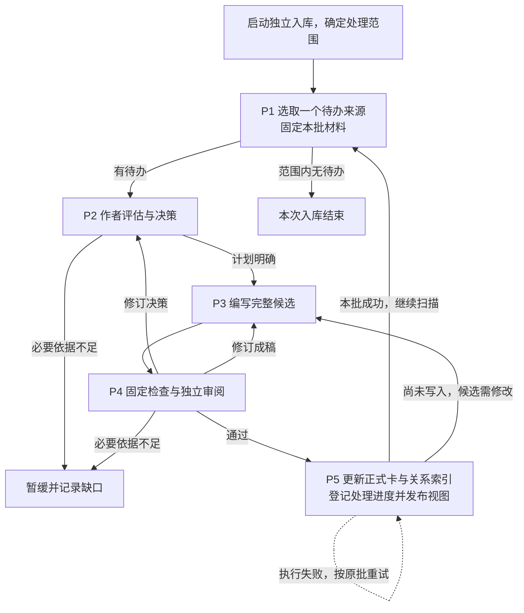
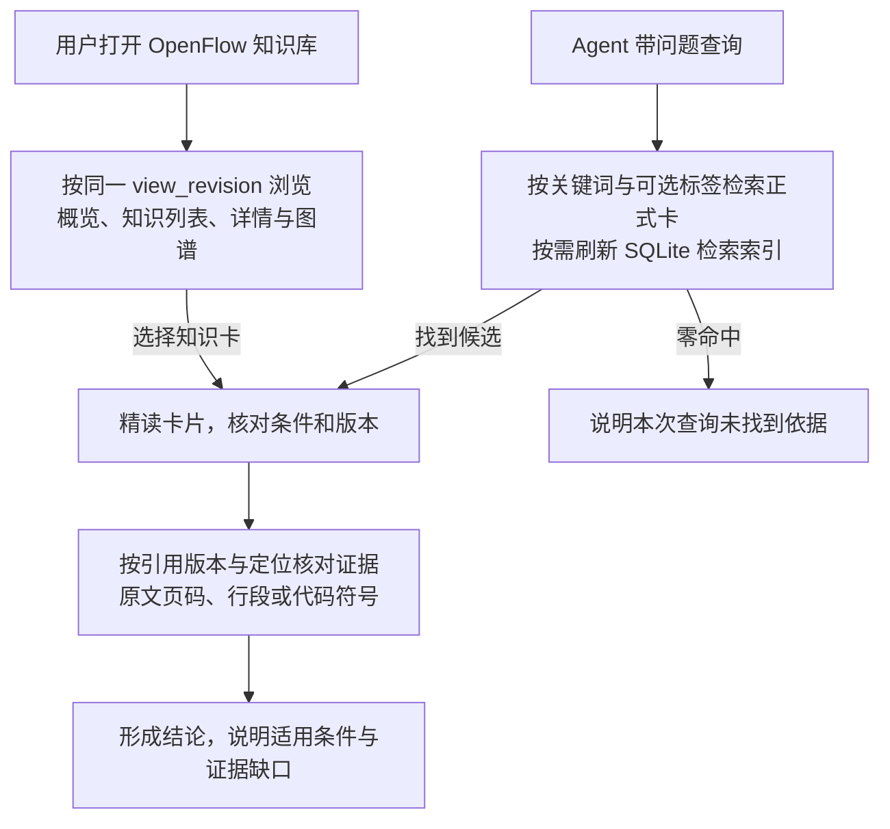
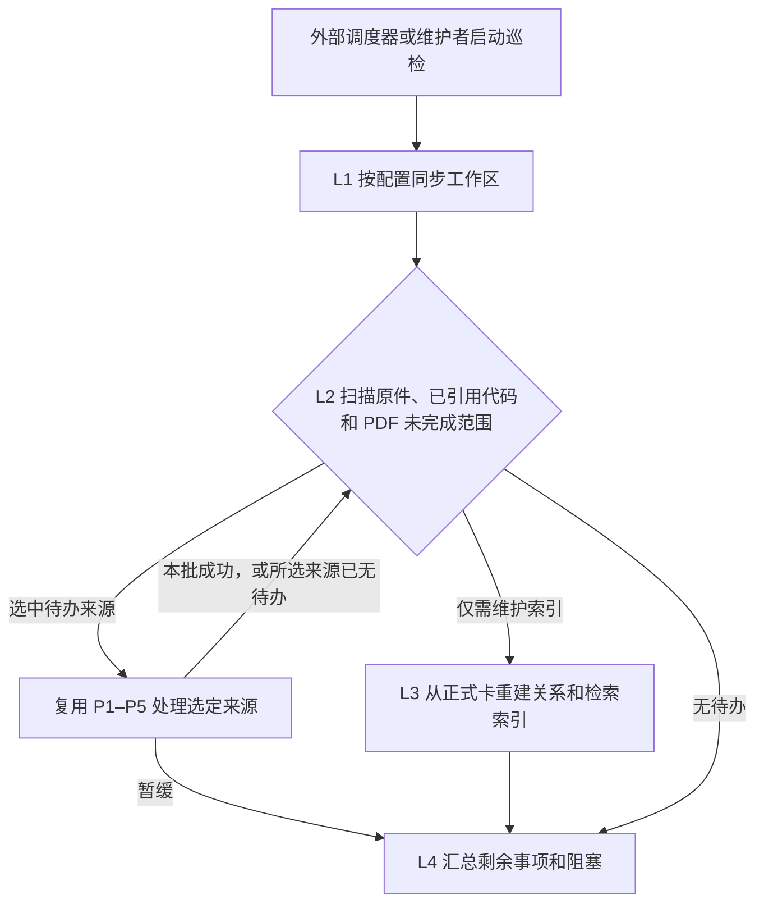

# HiMate 知识库架构设计

实现基线为 HiMate 工具包 `0.22.6` 和 OpenFlow F176。日常操作见[使用指南](HiMate知识库使用指南.md)，节点契约和页面交互分别见[详细设计](HiMate知识库详细设计.md)与 [OpenFlow F176](https://github.com/xmkid/OpenFlow/pull/29)。

## 1. 系统目标

HiMate 将设计文档、规格和代码分析整理为可追溯的知识卡，帮助 Agent 在开发和问题定位时找到相关结论、适用条件及实现入口。原件保存完整材料，卡片按主题提炼重点，索引提供快速定位，三者共同支撑知识使用。

系统以单个知识根为管理边界。文档更新通过 ingest 处理，周期治理通过 lint 发现原件和已引用代码的变化，查询通过精确词项、显式标签及整卡退役筛选定位候选。每个知识根串行执行内容更新，定时触发由执行环境提供。

OpenFlow 知识库工作台提供原件管理、正式知识浏览和宿主环境安装。用户在工作台绑定知识根，Agent 通过已安装的 Skill 和 Workflow 执行入库、巡检和回源。原件保存和正式知识发布是两个各有回执的阶段。

独立 ingest 在用户选定范围内逐批运行 P1—P5，P5 成功返回 P1，范围无待办才正常结束。lint 由 L2 选择来源并复用 P1—P5，成功或所选来源已无待办后回 L2，暂缓时汇总阻塞。P5 确认尚未写入正式库且候选需要修改时回 P3 再审，执行失败保留原批次重试。工作流调度沿用现有来源处理事实。

## 2. 知识与来源模型

### 2.1 原件、卡片与引用

来源文档位于 `docs-raw/`，其中 `agent-notes/` 保存 Agent 生成的分析稿。正式卡位于 `knowledge/`。一份文档可以形成多张主题卡，一张卡也可以融合多份文档和多个代码入口。卡片保存结论、条件、理由和必要证据，而完整来源通过引用读取。

卡头承担稳定身份、文档与代码关系，以及可选标签和整卡生命周期。新卡的三个必填字段、两个可选字段及示例由 `hs-knowledge-view-materialize` Skill 随包提供。标题和知识内容放正文，字段由 CLI 校验。

来源登记使用统一的 `source_id` 标识文件，卡头的 `doc_id`、`code_id` 引用相应文件 ID。章节、页码和行段位于引用项中；同一代码文件中的多个函数可以分别引用。普通内容更新沿用文件身份，内容版本由 SHA-256 表示。

正文保留主题结论、适用条件、版本、不同性质的依据及必要缺口。分别记录标准条款、设计要求、代码观察与测量结果。条件可涉及芯片、Host／Device、构建、特性和协议版本，采用实际证据确认的范围。旧卡的显式结构化知识保持可读，正常更新时迁入相应正文，读取和重建索引不改写旧字节。

WiFi 原件按项目资料用途归档，现有分类和材料入口见[原始资料导航](../docs-raw/index.md)。正式卡按可复用主题组织，领域现有实体、流程、协议、规则、命令、排查手册和术语七类，见[知识导航](../knowledge/index.md)。

### 2.2 持久资产与派生索引

`governance/sources.lock.yaml` 保存来源 ID、实际路径、代码编码，以及各文件最近一次完整处理的存在性、内容 hash、时间和可用 Git 定位。分批 PDF 另有可选 `processing: {source_sha256, reviewed_pages}`，只保存同版本累计完成评估并发布的物理页段。这些正式事实与卡片一起保留，无产卡的已评估范围也可登记，不依赖解析缓存存活。

`artifacts/knowledge.sqlite` 保存文件表、卡片表、引用关系及检索词项。它支持按文件查关联卡、按卡查全部来源，以及列出被卡引用的文档或代码文件。数据库属于派生资产，可从来源登记和正式卡重建；Agent 通过 CLI 查询关系。

工作台的概览、卡片与图谱读取发布视图。面板用 `view_revision` 维持一次查询、翻页、精读和图谱浏览的一致性。发现发布视图版本变化时重新取数。原件树与上传回执反映实际保存的文件，可以先于正式知识更新。

### 2.3 内容版本与处理进度

扫描以当前文件的 SHA-256 与最近成功处理的 hash 比较，区分新增、修改和删除；同版本 PDF 仍有 processing 时也属于待办。选中文件的原始副本与 hash 来自同次读取，本轮作者和审阅者使用该副本。P1 从 PDF 最早未评估页按字量准备宽候选，默认无页数帽；P2 按自身上下文、图表、条款和产卡量自主选择结束页，无须一次读完候选。P4 审阅实际选定范围，P5 成功后才合并该范围覆盖，仅覆盖全篇才推进整文成功 hash 并移除 processing；外部文件改版后不沿用旧覆盖。

Git 用于按需读取已有历史版本。来源提交可以辅助定位原文，但日常判变直接使用文件内容。卡片、原件和代码在周期治理完成前可能存在版本差异，使用者应按任务需要核对实际来源。

## 3. 执行组件

| 组件 | 负责内容 |
|---|---|
| Workflow | 节点顺序、执行角色、分支、返工和巡检循环 |
| Skill | 单步目标、必要材料、随包参考、写作模板和交付要求 |
| 工具包 CLI | 参数处理、文件操作、关系查询、固定检查和索引维护 |
| `governance/contracts/` | 来源解析、卡片解析、版本检测、符号定位和检索算法 |
| OpenFlow 工作台 | 知识库绑定、环境安装进度、原件上传与分类确认、正式知识浏览和引用预览 |
| 作者 Agent | 阅读材料、选择六决策、按主题写卡 |
| 审阅 Agent | 独立核对事实、条件、遗漏及知识归属 |

CLI 执行文件、结构解析、定位与固定检查，可调用预先准备的本地 Docling/OCR 模型；知识判断、图意理解与内容审阅由 Agent 完成，不自动调用远程视觉服务。Skill 包由 `SKILL.md` 和按需阅读的 references 组成；执行代码、依赖和测试集中在对应工程目录。运行包与治理规则分别由 `runtime/manifest.json`、`governance/framework.lock.yaml` 记录版本和文件摘要。

文档解析由统一模块交付 Markdown 阅读稿、结构 JSON、定位、图片及缺口。PDF 全量解析位于现有 `artifacts/ingest/parsed/` 命名空间，按来源身份、原件 hash 和实际解析配置校验复用；缺失或损坏时生成新材料，不覆盖已经交接的固定 manifest。缓存可删除重建，不保存唯一进度。P1 在 `.build` 准备页材料包，通过固定 manifest 引用和带次数、明细入口的缺口摘要交接，不重复全书图片与缺口元数据。P2—P4 先读取实际范围，图示仍回到原 PDF 或页预览核对；摘要不改变 partial 状态，也不表示图形提取已修复。非 PDF 解析仍位于 `.build/materials/parsed/` 并随批次清理。转换稿不重新登记为另一份 raw 来源，OCR 和转换成功不等于图意已经审阅。

## 4. 核心业务协作

### 4.1 入库流程

用户可为整批资料手动选定分类并直接保存，也可采用默认的 AI 建议，在同一窗口逐份确认或调整。原件保存到 `docs-raw/` 后即可浏览，正式知识由后续入库或巡检发布。



每批围绕一个来源。PDF 可分批评估物理页，P5 成功后登记本批覆盖，覆盖全篇才更新整文成功版本。已完整评估且无需改卡的批次经独立审阅后也可登记处理进度。见[完整流程与节点判断](知识库详细设计.md#21-完整流程与节点判断)。

### 4.2 消费流程



普通 Agent 检索按需维护检索索引。OpenFlow 浏览使用 P5 或显式重建生成的发布视图，视图版本变化时重新取数。证据按引用版本回源，精确版本不可用时提示用户。见[消费流程与检索规则](知识库详细设计.md#4-消费流程从问题到证据回答)和[OpenFlow 正式知识视图](知识库详细设计.md#41-openflow-正式知识视图)。

### 4.3 治理流程



巡检批次成功后回 L2，由巡检重新选择待办来源。L3 只维护派生索引，L4 报告剩余进度和阻塞。Git 提交、推送和 CI 合入由业务仓流程负责。见[lint 的检查流程](知识库详细设计.md#31-lint-的检查流程)和[Git 提交与可选 CI 检查](知识库详细设计.md#32-git-提交与可选-ci-检查)。

## 5. 工作区与数据组织

### 5.1 路径基准

`repo/` 表示 manifest 工作区根，可包含多个实际 Git 仓。`himate/` 可包含多个领域知识根，每个知识根各自维护 `AGENTS.md` 和 `config.yml`。调用方选定知识根后，CLI 读取该目录的配置。

模块映射按每个模块自身的 `chips`、`sides` 组合自动派生 Target，不维护固定芯片列表，也不跨模块补造组合。同一芯片同时登记 Host 和 Device 时派生配对，兼容策略仍为未知；缺少标签时只登记代码范围。缺失模块仍保留已声明的 Target，但没有可引用的实际代码绑定。修改 `modules` 后重新读取配置即更新这些映射，无须另行登记 Target；配置标签不证明实际构建、宏或协议条件。

`code_root` 相对知识根，默认布局为 `../../main`。`modules[].path` 相对代码根，描述允许引用的实际模块。代码工作区基准取 `code_root` 开头 `../` 指向的上级目录。以 `../../main` 为例，该基准是 `repo/`。

登记代码时，未填写 `repo_id` 的 `path` 相对上述代码工作区基准，例如 `main/<module>/<file>.c`。填写 `repo_id` 时，路径相对对应的已配置代码仓。文档路径相对知识根，位于 `docs-raw/`。登记和预览的命令示例见 `hs-knowledge-view-materialize` 随包的 `references/source-commands.md`。

### 5.2 运行位置与组件分发

执行端从已安装的工具包启动 CLI，并通过 `--knowledge-root` 指定实际知识根。工具根由启动入口确定，知识根决定配置、原件、卡片、索引和其他业务输出。OpenFlow 工作台的宿主以 `OPENFLOW_KNOWLEDGE_TOOLKIT_ROOT` 查找工具包，可用 `OPENFLOW_KNOWLEDGE_PYTHON` 指定解释器，通过 Python 调用该工具包的入口。页面绑定独立保存知识根路径，使用宿主可访问的绝对路径。Agent 通过 SSH 在另一台机器执行时，使用该机器自己的 Python、CLI 入口、知识根和源码路径。

工具包提供安装入口、运行依赖、共用规则、CLI 和离线模型。能力包提供自带参考与模板的 Skill，以及引用 Skill ID 的 Workflow。Agent 在节点加载对应 Skill，结合任务输入查阅随包材料并调用已安装的 CLI。

部署使用 Python 3.10–3.12。工具包和能力包可分开存放。Windows 的 `deploy.ps1` 与 Linux 的 `deploy.sh` 共用 Python 后端，默认从同级 `himate-skills/` 安装，也可显式指定能力包及宿主安装目录。默认将 Skill 安装到 `~/.openflow/config/skills` 和 `~/.cac/skills`，将 Workflow 安装到 `~/.openflow/config/workflow-templates`。该部署入口同时处理锁定依赖，传入知识根时准备 `artifacts/models/docling-cpu/`，准备成功后替换同名能力包。参数见工具包的 `tools/deploy/README.md`。

工作台通过公开 CLI 的 `doctor --environment-only --json` 检查宿主环境。「安装环境」统一调用 `setup --jsonl`，由 CLI 创建或复用执行账户的专用 Python 环境，在该环境补齐锁定依赖并复查。终端和工作台都由 CLI 选择实际执行环境，npm 已注册的启动器会继续使用。环境检查和安装可以在绑定前执行，能力包和 OCR 模型由部署脚本单独准备。

Windows 将启动器注册到宿主运行账户的用户 PATH，已在运行的进程仍沿用启动时的环境。Linux 默认将启动器装到 `~/.local/bin`，终端和服务按各自的 PATH 查找。工作台的业务调用使用已配置的 Python 和工具包入口，因此终端的 PATH 状态和工作台的工具定位各有检查结果。

### 5.3 HiMate Knowledge目录架构

```text
repo/                                      业务 manifest 工作区示例
├── main/                                  实际代码工作区
└── himate/
    ├── himate-knowledge-wifi-mp/           知识根
    │   ├── AGENTS.md / config.yml          领域指引和项目配置
    │   ├── docs-llm-wiki/                  架构、详细设计和使用说明
    │   ├── docs-raw/                       原件与本机来源映射
    │   ├── knowledge/                      正式卡与导航
    │   ├── governance/sources.lock.yaml    来源身份、版本及处理进度
    │   ├── .build/                        本批材料、计划与候选
    │   └── artifacts/                     索引、回执、解析缓存与运行模型
    ├── himate-skills/                      独立能力包
    │   ├── skills/                         步骤指引、参考与写作模板
    │   └── workflows/                      节点、角色、交接、出口与画布
    └── himate-tools/                       独立工具包
        ├── deploy.ps1 / deploy.sh          Windows / Linux 部署入口
        ├── knowledge.py / knowledge.cmd / knowledge.sh
        ├── runtime/                       CLI、发行清单与依赖锁
        ├── governance/                    共用算法、Schema、规范与框架锁
        ├── tools/deploy/                  环境检查、安装实现和离线模型
        ├── evals/                         开发验证
        └── docs-llm-wiki/                  部署和面板接口开发文档
```

目录图给出默认领域布局，实际知识根由配置选择。七类卡片沿用 `knowledge/index.md` 的类型目录；导航按需维护，卡片查询和来源关系由数据库提供。

### 5.4 数据生命周期

| 数据 | 生命周期 |
|---|---|
| 原件、正式卡、来源登记 | 随知识库长期维护 |
| `.build/` | 当前批次原件副本、PDF页材料包、非PDF解析及计划/候选；P1 初始化，P5 成功后清理，保留根README，失败保留以便同轮重试 |
| `artifacts/knowledge.sqlite` | 可从来源登记和正式卡重建的派生索引 |
| `artifacts/ingest/parsed/` | PDF 派生解析缓存，按版本与配置校验复用；可删除重建，正在审阅的固定材料丢失时重新备料审阅，不丢正式进度 |
| `artifacts/ingest/latest.json`、`query/`、`patrol/`、`sources/` | 运行回执、检索和巡检报告、按需恢复副本；按实际使用情况清理 |
| `artifacts/source-read/` | 临时文档阅读使用独立 ID，消费后释放并有界回收过期产物 |
| `tools/deploy/models/` | 随 Git 提交的模型清单和权重；8 个必需模型约 416.18 MB，大权重分片保存，部署自动校验并合并 |
| `artifacts/models/` | 部署从内附模型安装、复用或显式下载后独立维护的运行模型，入库和阅读清理均保留 |
| Python 环境 | 在 `.build` 之外独立准备和维护 |

执行端保留来源登记和正式卡即可重建查询数据库。原件是否能回到某个旧版本，还取决于对应 Git 历史或已保留材料是否可用。

独立回源使用 `source extract`，在 `artifacts/source-read/<read_id>/` 生成材料，可限制 PDF 页范围；它不清理 `.build`，不推进处理 hash。读取结束使用 `source release` 释放指定 ID，长时间阅读可 `source renew`，`source cleanup` 只回收过期且不在转换中的任务。不同读取目录、入库暂存、检索报告和模型目录互不清理。新执行端从原件重新转换；原件缺失时不把缓存视为永久归档。

新任务的运行回执集中在 `artifacts/`，无需独立 `logs/` 目录。项目已有的历史记录、备份及来源引用的证据按原路径保留；`logs/evidence/` 中仍被引用的旧证据不能随缓存清理。

### 5.5 框架更新与目录清理

发布新工具包后由执行端切换版本。已开始的写任务沿用本轮工具版本，失败任务保留 `.build/` 以便续办。领域知识通过业务仓和入库流程更新。

| 内容 | 更新方式 |
|---|---|
| `knowledge/`、`docs-raw/` | 保留正式卡、导航、原件及本机来源映射；由业务变更和入库流程维护 |
| `governance/sources.lock.yaml` | 保留来源身份、完整成功事实及PDF累计覆盖，不能用发行包中的空登记覆盖 |
| 知识根的 `AGENTS.md`、`config.yml` | 按实际项目维护，框架升级时合并项目已有约定和配置 |
| `runtime/`、工具包启动器与检查入口 | 按同一发行版本替换程序文件，运行环境独立维护 |
| `governance/` 中算法、Schema、规则及 `framework.lock.yaml` | 随工具包更新并保持摘要一致，领域特有说明从知识根读取 |
| 知识仓的 `docs-llm-wiki/` | 维护架构、业务流程、使用说明和领域资料分类 |
| 工具包的 `docs-llm-wiki/`、`evals/` | 维护 CLI 契约、开发文档和验收测试。本地 SDD 和任务草稿由 Git 忽略 |
| `tools/deploy/models/` | 清单与匹配权重一同更新和交付，不以新清单搭配旧权重；二进制按离线分发方式补齐 |
| 已安装的同名 Skill、Workflow 包 | 从能力包由部署脚本完整替换，其他包保留 |

空闲时可清理已消费报告、可重建数据库和 Python/测试工具缓存。`artifacts/` 可能同时存放模型、环境和本机材料，不整目录删除；临时原件阅读使用专用释放与过期回收命令。已有备份和历史证据按项目保留规则单独管理。

## 6. 运行一致性

一个知识根同一时刻执行一条 ingest 或 lint 内容更新链路。P2、P3 在本轮暂存中完成计划和完整候选，P4 独立审阅，P5 使用已审结果发布。PDF 发布本批后先登记该批覆盖，只有全篇完整处理成功才更新整文成功 hash；引用了同一卡的其他文件按各自任务完成处理。页段覆盖是处理事实，不是内容理解或技术结论正确性的机械证明。

查询与内容更新可以共存，读取正式库并使用独立搜索报告，不接触 `.build`。CLI 的数据库刷新和检索使用常规 SQLite 短事务协调；遇到正在落位或重建的命令时短暂等待，完成后再读取。正式卡及来源登记使用单文件原子替换，文件与数据库更新仍按顺序完成。

工作台按绑定标记隔离不同知识根的请求。正式视图暂时被占用时提示稍后重试，视图版本不匹配时刷新当前页面数据。回源预览优先使用引用记录的版本与定位，精确版本不可用时在界面显示对应状态。

PDF 本批范围或非 PDF 全文已完整评估但没有知识增量，也可以登记为处理完成。目录、空白和参考页须核实后才算无增量，卡片引用页和补读上下文不自动代表整页已评估。缺少必要依据时保留缺口，等待补充后处理。索引维护负责重建派生数据，来源内容版本和累计覆盖由对应文件的入库任务推进。

周期巡检提供持续对齐：先处理原件和已引用代码的变化，再刷新需要维护的索引，最后报告实际剩余事项。处理频率由使用环境按知识变化速度和成本设置。

## 7. 知识使用与权限

检索以完整正式卡为单位，采用精确词项、显式标签和退役筛选，不按 Claim 用途或复杂条件资格过滤。结果附卡片入口和来源关系，供 Agent 精读并回到原文或实现。评分只表示相关性；知识是否适用于当前问题，由正文条件、版本和实际依据决定。

不同群组分别管理知识根、可引用代码范围及执行环境，并通过实际存储权限和运行账户控制访问。原件、卡片、数据库、缓存和记录应处于一致的访问边界；标签与检索条件用于选择内容范围。

原件格式、引用位置和版本恢复规则见[详细设计](知识库详细设计.md#57-来源恢复与定位)。
