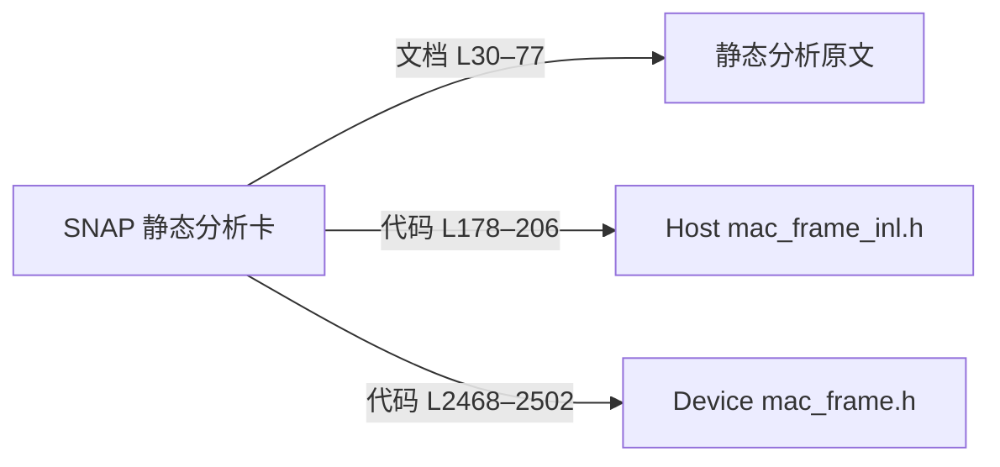

# OpenFlow 面板与知识图谱适配建议

2026-11-06。面向适配开发者的设计建议；本文未实现面板或服务 API。

建议首版把“找到知识、读懂限制、追到依据”连起来：搜索和卡片列表作为入口，局部引用图帮助探索，正文与原文侧栏帮助判断。可借鉴 Obsidian 的局部深度、搜索过滤、颜色分组和方向箭头，以及它对显式反向链接与名称共现的区分。[Graph view](https://obsidian.md/help/plugins/graph)、[Backlinks](https://obsidian.md/help/plugins/backlinks)；定位反查可参考 Logseq 的块引用计数与按页展开。[Block Reference](https://github.com/logseq/docs/blob/master/pages/Block%20Reference.md)

## 首版页面与交互

| 页面 | 建议展示与操作 | 解释边界 |
|---|---|---|
| 知识概览 | 卡片数、目录类型、标签、生命周期、被引用来源数；点击统计进入清单 | 导航和 README 不算知识卡；引用分布不是测试覆盖率 |
| 搜索与卡片详情 | 关键词/标签筛选，正文、条件、来源引用、相关卡；点击打开局部图 | `score` 是词项命中权重，不是可信度或准确率 |
| 来源与引用图 | 卡→文档/代码、来源→引用卡反查；点击行段、页码或原生 locator 预览 | `processed_exists` 是上次处理记录，当前可读性和 hash 需另核查 |
| 运行与巡检 | OpenFlow 节点、CLI 回执、当前来源、已审范围、剩余内容、失败与巡检项 | 宿主节点状态和 CLI `phase` 分开显示；机械通过不代表内容正确 |

图默认从当前卡展开一跳，可切到两跳或全局；支持文档/代码/关联卡开关、入链/出链列表、标签过滤、孤立点开关。节点图标区分卡、文档、代码，颜色区分卡类型；点击保留正文侧栏，展开有数量上限和截断提示。拖动只改变布局。

## 当前样本与正式连线

当前 7 卡为 4 protocol、2 rule、1 flow，引用 10 个唯一来源：6 文档、4 代码。聚合后为 **17 节点、12 条卡源证据边**；边内保留 **45 处定位**（39 文档、6 代码）。计数来自本分支[实际卡片](../knowledge/index.md)与[来源登记](../governance/sources.lock.yaml)，是样本规模，不是质量评分。

另外有 5 条旧格式显式 `related_to`，可选叠加并保留原名；它不等于更新、因果或实现关系，新卡也未必有该字段。正文链接可标为“正文链接”；同标签、关键词共现、共用来源只用于筛选或相关候选，不自动生成正式语义边。每条正式边都应能查看原始声明与定位。

下面是 [SNAP 卡](../knowledge/rules/wifi-snap-encapsulation-static.md) L11–26 的三个实际引用；箭头表示“引用”，没有 Host→Device 调用边。



新卡应支持现行五字段：必填 `id/doc_ref/code_ref`，可选 `tags/lifecycle`；标题读正文 H1。不要要求 `profile/claims/scope` 才能展示。旧卡实际声明的 Claim、用途、条件和限制完整可见，缺失字段不补成已验证或跨芯片通用。[卡片规范](../governance/specs/cards.md) L5–33。

## 现有 CLI 与适配边界

在独立样本的知识根，用已部署的 Python 3.10–3.12 执行：

```powershell
python knowledge.py source list --json
python knowledge.py read wifi-snap-encapsulation-static --json
python knowledge.py search "mac_set_snap" --json
'{"source_id":"code-faa30bbcd54c6906317c"}' | python knowledge.py source list --input - --json
python knowledge.py status --json
python knowledge.py doctor --json
```

`source list` 返回 `data.files`，按 `source_id` 查询返回 `data.source/data.cards`；`read` 返回正文、metadata 和引用。[实现](../governance/contracts/library.py) L91、L223。此类读取可刷新派生 SQLite，search 还写查询工件，并非完全无磁盘写入。

以下是**建议新增、尚不存在的只读服务接口**；前端不直接操作 SQLite：

| 接口组 | 最小返回 |
|---|---|
| `overview` | 统计、快照版本、采集时间 |
| `cards` / `cards/{id}` | 分页清单、详情；搜索复用现有查询 |
| `graph` | 稳定 ID、边类型、原始定位；支持根节点、深度、类型、上限和截断 |
| `sources/{id}` / `content` | 来源元数据、反查卡、按 locator 阅读；校验根边界与登记编码 |

## 运行数据与缺口

CLI 统一返回 `status/phase/data/diagnostics`；`status` 根据本地 task/latest 文件给出 prepared/completed/idle，不能还原 OpenFlow 的 P2/P3/P4 节点执行。运行页需关联宿主 run/node 记录和 CLI 回执，不能按退出码或“卡已出现”判定全文完成。[封装](../runtime/himate_knowledge/protocol.py) L45–48、[status](../runtime/himate_knowledge/cli.py) L143–154。

`ingest scan` 会清理本批 `.build` 并选择待办，不能用于面板轮询；`pending_at_least` 是下限，不是待办总数。[scan](../governance/contracts/ingest.py) L407–486。PDF 按实际已审页与本轮总页数展示，单批完成和 `source_complete` 分开；不要以批次数计算全文完成率。

没有历史快照、请求用量、耗时或 P4 评分时不画趋势、热门搜索、成本或质量分。检索权重只解释命中排序。[评分实现](../governance/contracts/library.py) L20、L131。代码引用只提供定位，来源 hash 一致也不能证明结论正确；未知构建、宏与产品范围继续显示为未知。首版交付以清单、局部图和原文联动为主，取得真实宿主记录后再增加运行统计。
