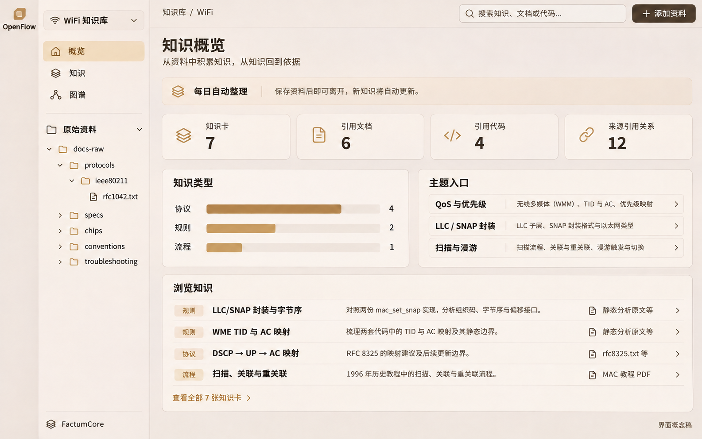
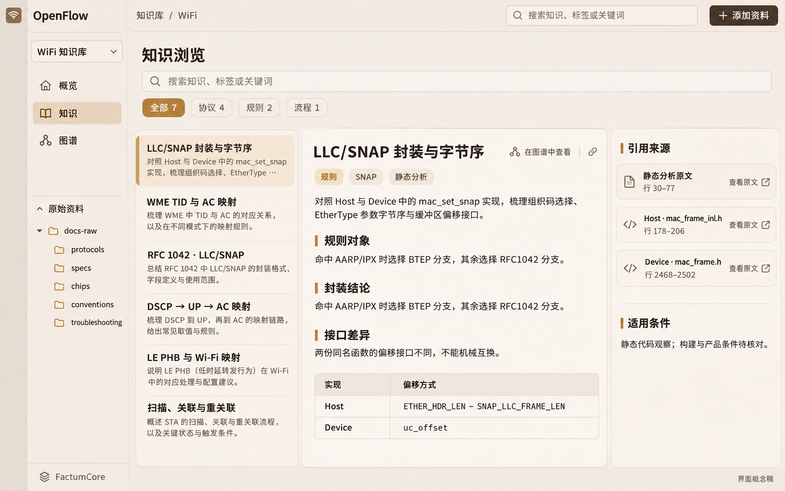
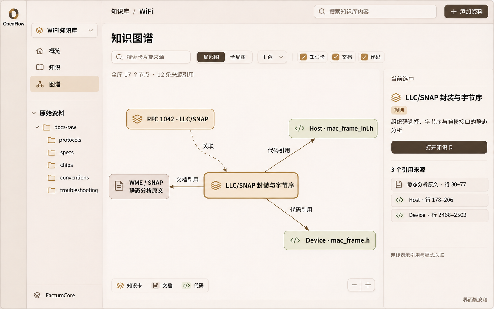
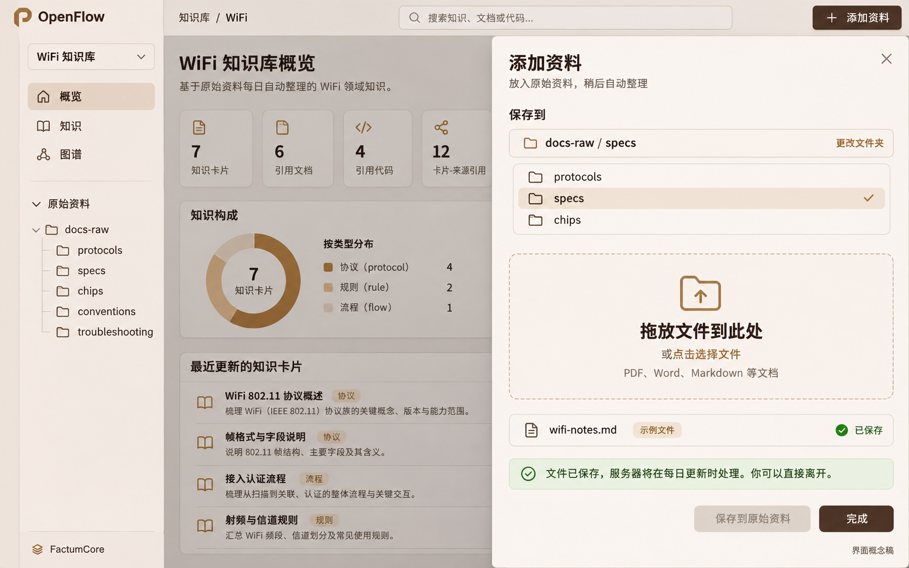

# OpenFlow 知识库面板设计

2026-11-06。本文记录已确认的产品流程、页面效果、双方接口职责及图谱规模约束，供 FactumCore 与 OpenFlow 开发者适配。页面布局已由用户确认；接口与性能预算是待实现、待验收的设计，不表示当前版本已经具备这些能力。

## 1. 产品流程与范围

用户将完成的文档放到服务器对应知识根的 `docs-raw/`，操作即结束。服务器每日 CI 运行现有入库流程，处理变化来源并更新正式知识。面板上传成功只表示原件保存成功，不触发即时入库，也不要求用户等待成卡。

流程为：**保存文档 → 服务器 raw 原件 → 每日 CI 入库 → 正式知识与已发布读视图 → 概览 / 知识 / 图谱**。

界面只保留三个主视图：**概览、知识、图谱**。原始资料目录作为共用侧栏，“添加资料”作为共用抽屉，不新增独立入库页面。CI 的运行、独立审阅、续办和恢复由后台维护流程负责，普通用户页面不提供 P1—P5 操作、作者/审阅者选择、即时执行、任务队列或调度设置。

本期交付目标是文件投递与知识消费。直接编辑正式卡、原件重命名/移动/删除、模型抽取实体关系、自动社区发现、任意全量图导出及新 CI 调度器的实现不在本面板首期范围。现有 CI 如何部署仍由后台运维配置，不由“添加资料”触发。

## 2. 用户场景

1. 作为资料提交者，我希望选择原件文件夹并保存文件，以便完成投递后直接离开。
2. 作为资料提交者，我希望看到实际原件目录和保存结果，以便确认文档已经到达服务器，而不是只留在会话附件里。
3. 作为资料提交者，我希望同名文件的相同内容被识别、不同内容明确选择更新或另存，以便保留正确的来源身份。
4. 作为阅读者，我希望从概览看到有哪些知识并点击进入清单，以便快速找到主题。
5. 作为阅读者，我希望搜索、阅读完整知识卡并打开准确原文或代码定位，以便核对条件和依据。
6. 作为阅读者，我希望从当前卡逐步展开关联，并从来源反查引用卡，以便探索知识而不面对一张无法阅读的大图。
7. 作为阅读者，我希望大图显示已展示数量、剩余入口和分页列表，以便来源关联很多时仍能找到需要的内容。
8. 作为阅读者，我希望 CI 更新期间仍能使用上一版完整知识视图，以便概览、列表、图谱和详情相互一致。

## 3. 页面与效果图

四张图是已确认的布局参考；部分标题为展示简称、抽屉中的新文件为示例。数据与规模策略以本文契约为准，不以图片文案替代业务依据。视觉沿用 OpenFlow 的暖色底、深棕主按钮和琥珀选中态。

### 3.1 概览

展示知识卡数、被引用文档/代码文件数、来源引用关系数、知识类型分布和主题入口。数字与分布可以点击进入相同筛选条件下的知识/来源清单；不添加没有历史数据支持的增长、正确率或模型置信度图表。

当前适配样本有 7 卡、6 份被引用文档、4 个被引用代码文件、12 条卡源引用关系。类型分布为协议 4、规则 2、流程 1；这些是样本统计，不是所有新卡必须声明的卡头字段。原件文件总数与被引用文档数分别统计。

### 3.2 知识

列表与阅读区并列，提供关键词、类型/目录和标签筛选；选中后显示完整正文、条件和来源侧栏。点击引用打开原文定位，点击“在图谱中查看”围绕当前卡进入局部图。分页和检索结果的截断应可见。

现行新卡头为必填 `id/doc_ref/code_ref`、可选 `tags/lifecycle`，标题取正文 H1；缺少 `profile/claims/scope` 不影响展示。旧卡实际声明的条件、Claim 和历史定位完整保留，不补造适用条件。[卡片规范](../governance/specs/cards.md)、[搜索和读取契约](../skills/hs-knowledge-query/references/public-api.md)。

### 3.3 图谱

默认围绕当前卡的一跳关系；没有当前卡时从搜索、主题或分组入口选择起点。图与正文侧栏联动，支持文档/代码/卡间链接筛选、入链/出链查看、展开邻居和收起分支。全库规模与当前可见规模分别显示。

当前样本的基础来源图为 17 节点（7 卡、6 文档、4 代码）和 12 条卡源边，边内合计 45 处定位（39 文档、6 代码）。另有 5 条旧 `related_to` 可选显示；这 5 条不计入“12 条来源引用”。

图中“全局图”表示全库浏览入口：小图在预算内可完整呈现，大图按目录/类型等汇总后下钻，不能无界加载全库。图片中的 17 节点样本不代表未来仍把全部节点同时绘制。具体限制见第 7 节。

### 3.4 共用原始资料侧栏与添加资料抽屉

侧栏展示知识根下的实际目录树，支持打开原件预览；各页面右上角均可打开“添加资料”。抽屉选择服务器目标文件夹，拖放或选择文件，主动作是“保存到原始资料”。

完成文案：**“文件已保存，服务器将在每日更新时处理。你可以直接离开。”** 成功后可立即关闭抽屉；不显示等待成卡的进度条。处理结果由之后发布的知识视图反映。

## 4. 数据与职责边界

正式知识以卡片、来源登记和原件为依据；概览与图谱是派生视图，不维护第二套知识事实。原件清单由实际目录枚举后合并登记状态，不能只调用 `source list`，否则尚未登记的新文件不会出现。

| 对象 | 定位与身份 | 展示规则 |
|---|---|---|
| 原件文件 | 知识根下相对文件引用、当前 SHA256；登记前 `source_id` 可为空 | 保存后立即可见，不等待 CI；导航、模板及不支持格式可浏览，但不得冒充可处理正文 |
| 已登记来源 | `source_id/kind/path/repo/encoding`，已处理 hash 和可选处理范围 | 同路径更新保持身份；同字节不同路径不自动视为同一来源；上次存在状态不等于当前可读 |
| 正式卡 | 稳定卡 ID、相对路径、完整正文、实际引用与标签 | 命中、默认 stable、代码引用均不证明技术结论正确 |
| 图节点/边 | 知识根内的卡 ID、来源 ID、明确边类型 | 文档引用、代码引用、实际卡间链接分别标识；同标签或共用来源不自动生成语义边 |
| 汇总节点/边 | 目录或类型分组键、成员数、已有边的聚合计数 | 只作导航，标明“汇总”，不新增知识结论；标签多归属不得直接累加成唯一节点总数 |
| 知识读视图 | `view_revision`、生成时间、统计口径 | 概览、卡列表、图谱及详情按同一版本读取；当前物理 raw 文件另外保持实时可见 |

普通文档路径相对知识根，代码路径按项目配置解析；代码按已登记编码读取。当前样本代码包含 GB18030，不能统一按 UTF-8 预览。PDF 页、文本行、表格坐标等使用原生定位；临时解析图像路径不成为永久证据。

raw 侧栏预览当前文件；从卡片/图边打开的引用预览则携带其已知的预期来源 hash、历史定位或 snapshot 引用。当前字节与预期 hash 不同，应按实际历史/副本恢复；旧字节不可恢复时显示“来源版本已变化／旧版不可用”，不能把新文件套入旧行号。读投影保留实际可核实的来源版本绑定；旧引用无法确认版本时明确标为未知，不拿当前文件 hash 补造历史依据。

## 5. 双方接口与保存流程

### 5.1 最小分工

FactumCore 提供版本化 JSON 业务契约，OpenFlow 后端向页面统一暴露 HTTP/文件接口，再调用实际数据执行端的业务能力；本期不要求额外部署第二个常驻 HTTP 服务。

下表为**拟议能力组，尚未实现的公开接口需另行开发**；逻辑名称不表示已有同名 CLI 命令或路由。

| 能力组 | FactumCore 提供/补齐 | OpenFlow 提供/补齐 |
|---|---|---|
| `capabilities` | 知识根、相对根、可写范围、支持格式和有效限制 | 当前项目/知识根/服务器执行端绑定，界面入口 |
| `materials.list/read` | 有界目录/文件枚举、登记状态合并、原文按编码/定位读取 | 可折叠目录树、文件选择、预览和分页 |
| `materials.save` | 目标及文件策略校验、完整落盘后的文件引用/hash 回执 | 通用文件传输、落点选择、保存反馈和同名冲突交互 |
| `cards.list/search/read` | 分页清单、检索和完整卡读取 | 列表、正文、筛选和引用侧栏；现有 search/read 语义继续沿用 |
| `overview.get` | 当前已发布版本的统计与主题入口 | 概览与筛选跳转 |
| `graph.overview/neighbors` | 汇总/局部的有界图数据、版本、分页与截断信息 | 图渲染、渐进展开、收起、缓存和图/正文联动 |
| `graph.edge/sources.read` | 边定位分页、来源反查、已知预期来源 hash/历史引用及有界原文片段 | 点击边/来源后的详情与准确定位；旧版缺失明确反馈 |

源码层面 OpenFlow 已有通用目录浏览、文件预览和工作流能力，但当前图片附件上传不等于 raw 文档投递；通用文本预览也不能直接满足 GB18030。FactumCore 已有 source/search/read 和内部 Catalog，可复用语义；目前没有公开的原件投递、分页列卡、overview 或 graph 契约。本轮不把这些源码观察描述为宿主联调通过。

### 5.2 文件保存

1. 页面使用已绑定的服务器知识根和所选相对目录，OpenFlow 接收文件字节。
2. 上传暂存位于 CI 扫描范围之外；完整传输与校验后，在同文件系统原子落到目标 raw 路径。只有最终落盘成功才反馈“已保存”。
3. 同路径同内容返回“已存在”；不同内容明确选择更新原来源或另存，不静默覆盖。更新携带预期旧 hash；版本已变化时返回冲突，保留用户文件供重选。
4. 上传不执行 `ingest scan`、不创建工作流、不等待 CI。登记前以相对文件引用和 hash 确认保存，`source_id` 允许暂缺。
5. 若 CI 正在处理该来源版本，更新不能破坏其固定输入；通过后台版本/写入协调确认可落盘，否则保留上传暂存并返回可重试冲突，不在普通页面引入任务队列设置。

目录与上传不得借聊天附件路径、客户端绝对路径或外部 dbox 逻辑挂载代替已绑定的服务器 raw。MD/TXT 编码等检查沿用产品实际能力；浏览器上传限额由能力描述给出，不直接套用解析器默认输入上限。

## 6. 每日 CI 与读取一致性

CI 独立运行现有入库流程，按内容 hash 识别变化并续办未完成范围。共享 `.build` 下，同一知识根的整轮写流程串行；P5 失败保留现场，在原节点恢复，不能为刷新界面或处理下一文件先执行 scan。零新增卡可能是合法结果，PDF 单批完成也不等于全文完成。

为了支持千级知识浏览与有界图查询，新增派生的只读投影/邻接索引：卡和来源的轻量字段、卡源边、显式卡间边、定位数量、度数和分组统计。它由正式文件重建，不写回卡头或形成新的权威知识库。

CI 在完成可验证的正式提交检查点后生成一致读视图，原子发布新的 `view_revision`；构建失败继续服务上一版。读取中的页面固定版本；发现新版本时提示刷新，不在浏览过程中静默拼接不同版本。详情若不能提供请求版本，应明确要求刷新。没有可用视图时显示准备/不可用状态，不能返回伪造的空库。

新保存的 raw 不依赖此视图立即可见，“已保存”和“已成知识”分别表达。CI 原件读取及读投影生成使用知识根写入协调，避免在跨文件提交中间发布混合数据。派生投影是可重建运行产物，不随配图或业务原件一起提交 Git。

## 7. 图谱规模与性能设计

### 7.1 借鉴范围与瓶颈

交互参考 Obsidian 的局部图、深度、筛选和反向链接；没有复用其私有渲染器，也没有其性能保证。[Obsidian Graph view](https://obsidian.md/help/plugins/graph)、[Backlinks](https://obsidian.md/help/plugins/backlinks)。

是否卡顿同时取决于邻接查询、传输与对象构造、布局、绘制/标签、交互更新和设备像素比。全库有一千节点不意味着每次要画一千节点；一跳也可能因为某个公共来源被上千卡引用而过大。

成熟库可以作为基础，但不是性能承诺。Sigma 使用 WebGL，并明确列出边效果和拾取等成本；Cytoscape 也指出标签、边和高 DPR 的成本。[Sigma 性能说明](https://www.sigmajs.org/how-to/technical/performance/)、[Cytoscape Performance](https://js.cytoscape.org/#performance)。

### 7.2 初始预算

以下是实现约束和待压测起点，**不是已测成绩，也不是第 301 个节点必然卡顿的阈值**。

| 项目 | 初始值与规则 |
|---|---|
| 默认局部图 | 1 跳，最多 100 节点 / 200 边，根节点保留 |
| 单次邻居展开 | 最多 50 个新增邻居，稳定 cursor 继续；来源反查也提供分页列表 |
| 单视图硬上限 | 累积最多 300 节点 / 600 边；服务器每次返回及浏览器合并都执行限制 |
| 深度 | 默认 1，明确选择后可到 2；深度不能绕过节点/边预算 |
| 全局入口 | 图在默认预算内可完整显示；超出任一默认预算按目录/类型汇总下钻，汇总结果本身也受限 |
| 图载荷 | 默认响应目标不超过 256 KiB UTF-8 JSON，任何单次图响应硬上限 1 MiB |
| 详细内容 | 图中只带稳定 ID、种类、短标题、边类型及定位数量；正文、源码、图片和完整定位点击后读取 |

界面同时显示全库总量与已展示量。若全量总数没有可用统计，显示未知或下限，不用返回条数冒充总数。达到上限时保留当前选择和位置，引导收起、筛选或切换分页列表，不继续自动叠加，也不静默移除已选节点。

### 7.3 数据查询与分页

图请求包含知识根、`view_revision`、局部/汇总模式、根 ID、方向、种类过滤、深度、节点/边预算与可选 cursor；服务端约束最大值。响应提供实际节点/边、有效预算、`truncated`、截断原因、`has_more/next_cursor` 和统计口径。版本或筛选条件改变后，旧 cursor 不能混用。

服务端在邻接查询和遍历时就停止，使用按来源/卡 ID 建立的索引及稳定排序；高扇出节点分块读取，避免先完整 BFS、解析全部卡或扫描全部邻居后再切片。需要排序或统计的度数/分组计数随 CI 预聚合；不能为了标注“还有多少”临时展开所有邻居。

当前 `Catalog.all_cards()` 会全量解析卡，`cards_for/files_for` 返回完整集合，搜索 top_k 也不等于底层只读取 top_k。[Catalog](../governance/contracts/catalog.py)、[现有查询](../governance/contracts/library.py)。**新图接口与大库分页不能仅包装这些调用再截断**；应在派生投影/SQL 层先选有限 ID 与轻字段，再读取所选详情。索引首次构建与重建在后台完成，不放进图页每次请求。

一条“卡→来源”边合并同一文件的多个引用，`locator_count` 表示具体定位数量；边详情独立分页。禁止返回只有一个端点的悬空边；节点或边预算不足时明确截断并允许继续探索。汇总边由已有关系聚合，不推断支持、冲突、调用或标准符合性。

### 7.4 布局、渲染与资源释放

- 使用成熟 Canvas/WebGL 图库，不以每节点一个复杂 DOM 卡片实现图面；完整阅读内容留在侧栏。候选为 Cytoscape 或 Sigma，先做真实宿主小型 PoC，再锁库和版本；本轮不引入依赖或自研渲染器。
- 只布局当前可见子图。复杂力导向放 Web Worker，设置时间/迭代预算，完成后停止；新邻居增量加入，保留已有位置。Graphology 提供 worker 布局能力，可作候选。[官方布局说明](https://graphology.github.io/standard-library/layout-forceatlas2.html)。
- 低缩放只显示选中项和少量关键标签，边标签按选中/悬浮显示；常规使用简单线形，避免为装饰持续动画和重复重排。
- 选择/悬浮更新相关元素，不卡住正文、文件保存或页面切换；离页停止布局/绘制循环，取消或丢弃过期请求。
- 按知识版本、根与筛选条件缓存有界子图和位置；旧版本失效，缓存不能无限累积。无 WebGL 或性能不足时可简化图形，并保留相同筛选下的引用列表与原文阅读。

## 8. 验收与实施顺序

### 8.1 页面与文件行为

验收从真实页面/公开业务接口进行，不用仅断言组件内部字段代替用户路径：

1. 四张参考图对应三个主视图和一个共用抽屉；不存在上传后立即执行、任务配置或等待入库的必经操作。
2. 新文件保存到服务器 raw 后立即可见，登记前没有 source_id 也能浏览；读取目录不调用会清理 `.build` 的 scan。
3. 中断上传不会把半文件暴露给 CI；同路径同内容幂等，不同内容需要明确选择，旧 hash 不匹配时报冲突。
4. 保存成功可以离开；后续独立运行 CI 后，卡片/来源/图读视图一致更新。CI 不由上传请求调用。
5. 搜索、读卡、反查、图谱定位与原件相符；GB18030、PDF 页、文档行、幻灯片/表格等按实际支持格式验证，未验证格式不能统称预览通过。原件更新但 CI 尚未处理时，旧卡引用不得静默打开新字节的旧行号；旧版缺失/绑定未知有明确结果。
6. CI 部分完成、处理后零新增卡、来源缺失、读视图构建失败分别保留真实状态；上一成功视图可用，错误不显示为零结果。

### 8.2 图谱性能验收

必须在实际交付的 OpenFlow 宿主上记录浏览器/构建版本、CPU/GPU、分辨率/DPR、冷/热缓存与网络。分别记录 API、对象构造、布局、绘制和交互耗时，不以第三方 demo 或当前 17 节点截图替代验证。

| 数据场景 | 必须验证 |
|---|---|
| 真实样本 17 节点、12 条来源边、45 处定位 | 引用、可选旧关联、正文与原文跳转正确 |
| 全库 1,000 节点 / 约 3,000 边 | 默认请求与首次绘制仍有界，连续展开和筛选正常 |
| 全库 10,000 节点 / 约 30,000 边 | 不下载全图；局部预算不随全库扩大，汇总下钻和版本切换可用 |
| 单一来源至少 2,000 个引用卡 | 首次只取有限邻居，cursor 不重复/漏项；查询读取量不能等于全部度数 |
| 可见 300 节点 / 600 边及高密度原图 | 两种预算独立生效，缩放/平移/选中与侧栏可用 |
| 连续展开、收起、切页与高 DPR/软件渲染 | 累积/字节限制、布局停止、旧请求失效及内存回落有证据 |

待 PoC 验证的初始目标：默认局部首屏可交互 P95 ≤ 1.5 秒；硬预算视图平移/缩放帧时间 P95 ≤ 33 ms；选择到侧栏反馈 P95 ≤ 200 ms。基准中单列远端执行与网络时延，并记录后端实际读取的行数/对象数。若目标设备不达标，先降低预算/标签复杂度并保留引用列表；不得省略测量后宣称“千节点不卡”。本轮只完成设计与配图，未执行这些性能测试。

### 8.3 实施顺序

1. 先打通原件真实目录、文件保存及知识读取，确保服务器根与来源定位正确。
2. 形成每日 CI 的一致读投影，接入概览、分页知识清单与详情。
3. 用有界局部图完成渲染 PoC 和上述规模矩阵，确定图库/版本/预算，再交付全局汇总与渐进探索。

现有测试分支包含用于适配的真实源码、卡片与必要原件；产品机制回归、真实资料核对、宿主 UI 和性能验收分别报告。本设计不以已有 UT 通过或样本 hash 一致代替后两者。

## 9. 调研依据

| 参考 | 借鉴范围 |
|---|---|
| [Microsoft LLM Wiki](https://github.com/microsoft/llmwiki#bulk-ingest) | 原件树与 Wiki 阅读；其拖入后即时处理不沿用于本方案 |
| [RAGFlow Dataset](https://ragflow.io/docs/v1.0.0-rc3/dataset_overview) | 文件、知识产物和维护记录分层；参考文档为 1.0.0-rc3 |
| [Dify 知识维护](https://docs.dify.ai/en/cloud/use-dify/knowledge-base/maintain-knowledge-base) | 可操作的概览与来源状态；不复制其重复文件策略 |
| [AnythingLLM 文档](https://docs.anythingllm.com/chatting-with-documents/introduction) | 区分附件、永久资料和处理结果 |
| [Obsidian Bases](https://obsidian.md/help/bases)、[Graph](https://obsidian.md/help/plugins/graph) | 同一知识的列表/阅读/局部图视角 |
| [Google Notebook 导图](https://support.google.com/gemininotebook/answer/16212283?hl=en) | 主题导航交互；生成导图与证据引用图保持不同含义 |
| [LightRAG](https://github.com/HKUDS/LightRAG#webui-entries-and-the-default-entry)、[DeepWiki](https://docs.devin.ai/work-with-devin/deepwiki) | 邻居探索、知识目录和源码回源；不直接迁移其知识生成模型 |

以上第三方能力来自官方文档/源码核验，不是本项目逐套部署成绩。图谱渲染依据与约束见第 7 节；产品接口仍应按实际运行版本联调。
