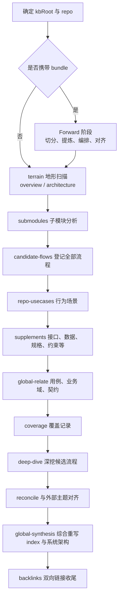
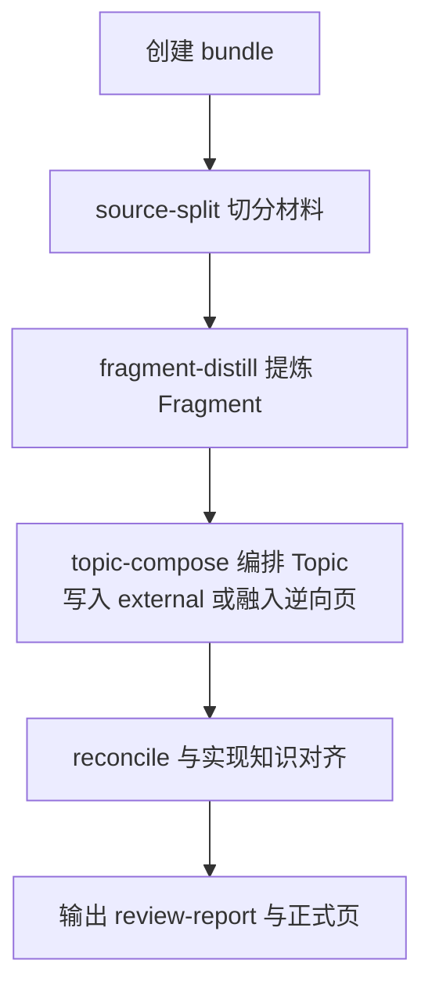
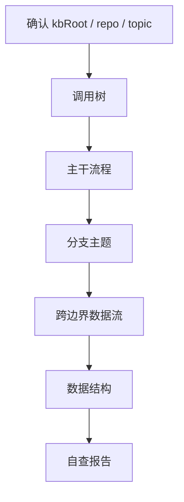
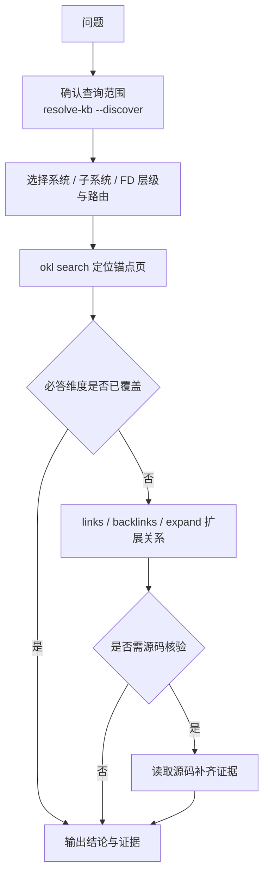
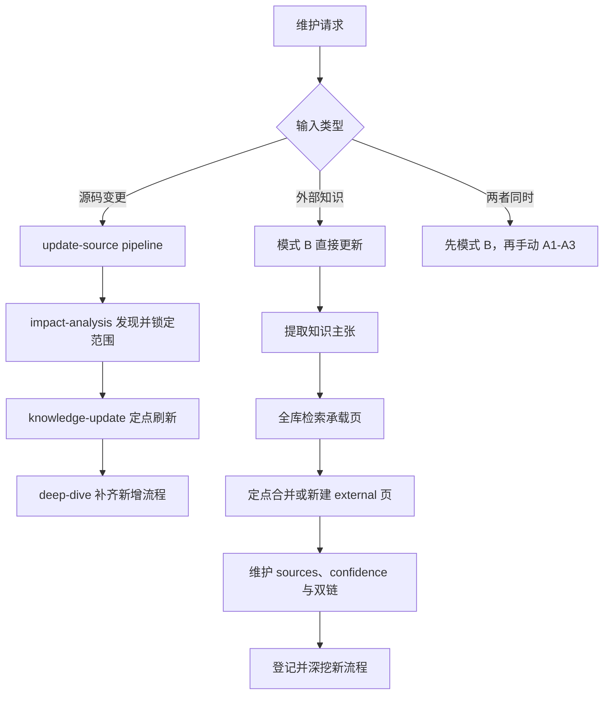
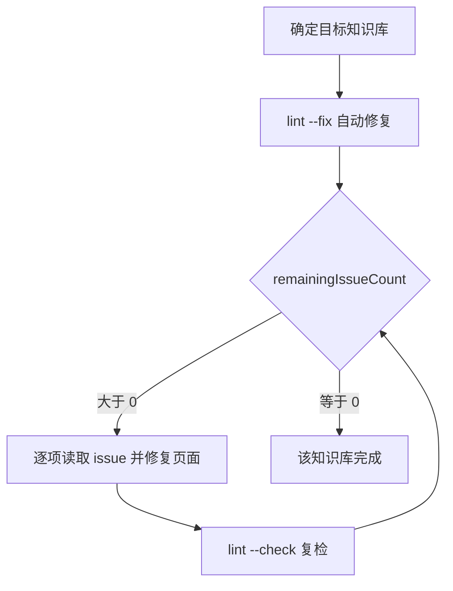

# OKL 知识库实现调研

实现基线为 OpenKnowledgeLibrary `0.2.1`。本文说明 OKL 如何把代码事实、外部材料和业务理解沉淀为可追溯的 Obsidian 知识库，并说明知识从生成、消费到维护的完整生命周期。日常使用方式见 [README](README.md) 与用户使用手册。

## 1. 系统目标

OKL 面向参与真实软件设计与开发的 Agent，提供分层、分粒度的工程知识底座。需求理解需要系统架构与业务域，方案设计需要模块职责与跨仓契约，编码实现需要入口、数据结构与主干流程，检视与影响分析需要沿关系推导影响面，问题定位需要故障模式与日志语义。

系统以单个知识库根 `{kbRoot}` 为管理边界。代码与外部材料通过入库链路生成正式知识页，通过查询链路被只读消费，通过更新与治理链路随代码和认识演进。知识页之间以 Obsidian 双链互联，页面本身既服务 Agent 程序化检索，也服务团队阅读维护。

OKL 不是一次性代码扫描报告，而是一套知识建模方法：五视图目录与模板、状态机编排的分阶段构建、双向链接的影响传播，以及可增量演进的长期资产。

## 2. 知识与来源模型

### 2.1 目录与页面模型

知识库由 `global/`、`repos/{repo}/`、`external/`、`test/` 四类正式知识区，以及 `index.md`、`log.md` 两个入口与流水文件组成。

- `global/` 承载跨仓上层抽象：端到端用例、业务域、跨边界契约、系统架构与覆盖记录。
- `repos/{repo}/` 承载单仓知识：概览、架构、接口面、数据模型、规格、约束、资源分析、术语、行为场景、子模块与深挖流程。
- `external/` 承载无法由逆向主题页连贯容纳的独立知识，按能力、流程、架构、组件、契约、数据状态、质量规则、决策、规程和规格分类。
- `test/` 承载测试决策知识，区分跨场景共享的测试资产与按场景组织的领域测试模式。

页面骨架由 pipeline 的 produce 声明和 `okl scaffold` 模板决定，写入规则由 `okl-authoring` 统一约束。目录与模板基于软件架构的五视图方法，页面按主题组织而非按源码文件组织。

### 2.2 证据与关系

每条结论必须落到源码、文档或输入材料证据。模板声明 `sources` 时填写可长期定位的 `path:func()` 形式，不使用易漂移的行号；证据不足时填写 `confidence: low` 并在正文说明缺口。

知识页之间的关系使用知识库根相对路径的 `[[...]]` 双链，不带 `.md`。源码、函数和文件路径只能写成 inline code 或 `sources`，不得写成双链。链接必须唯一解析到真实页面，新页面至少有一个已有页面链入。

目标设计、当前实现与实现差距是三类不同语义：代码事实优先，设计材料中的目标、理由与规则按其证据角色保留，不把目标改写成"源码已经如此实现"。

### 2.3 知识来源

知识来源分为三类：源码仓库、外部材料（文档、需求、设计、决策、评审结论）和已有知识库。源码通过 ingest、deep-analysis、update 进入知识库；外部材料通过 forward 或 update 的模式 B 进入；已有知识通过 update、lint 与查询中的源码回溯持续校准。

## 3. 执行组件

| 组件 | 负责内容 |
|---|---|
| Skill | 单步目标、业务输入、质量约束与写作规则 |
| `okl-fsm` | 通用 pipeline 状态机循环：取指令、执行、提交产物、诊断 gate |
| `okl` CLI | 确定性机械动作：状态推进、脚手架、检索、链接、lint、日志、安装 |
| Pipeline 定义 | 阶段顺序、依赖、产物路径、模板、gate 与参数 |
| Stage instruction | 当前阶段的阅读材料、分析维度与产物要求 |
| Gate | 产物存在性、链接完整性、自报完成、Forward 与深挖进度校验 |
| 子 Agent | 并行处理子模块、子系统、深挖流程与多知识库 lint |

Skill 只描述业务意图与约束，不重复实现状态机。所有使用 pipeline 的 Skill 必须通过 skill tool 调用 `okl-fsm`，通用状态流转、produce/scaffold 与 gate 处理只在 `okl-fsm` 中定义。

CLI 承担文件、结构解析、定位与固定检查；知识判断、图意理解与内容审阅由 Agent 完成。Agent 目录中的 Skill 是流程描述副本，修改它不改变 CLI 行为；运行时资源优先读取 `~/.okl/assets/`，缺失时回退到 npm 包内 `assets/`。

## 4. 核心业务协作

### 4.1 构建与入库流程

`okl-ingest` 对单个目录执行首扫建库，先建立广度再补深度。目标目录默认以最后一级目录名作为 `{repo}`，已存在同名 repo 时必须换名，不覆盖、不合并。携带外部材料时，ingest pipeline 内置 Forward 阶段先消化再融合，不额外调用 `okl-forward`。



阶段通过 `requires` 形成依赖，通过 `produces` 声明产物路径与模板。`when: bundle` 的阶段仅在存在外部材料时执行。ingest 是幂等的：未变源码重跑产生等价笔记，已有内容合并而非覆盖。

### 4.2 外部材料 Forward

`okl-forward` 把外部材料提炼为 Topic。先查找可连贯承载的 `global/`、`repos/` 页并融入其语义章节；有独立阅读价值且无法由逆向页承载的内容写入 `external/{category}/{title}.md`。一个精确规则只设一个主维护位置。



同一 bundle 可包含多份文档，本轮所有调用复用同一 bundle 标识。已审阅的 `review-report.md` 可通过 `forward inspect-report` 校验并恢复对应 bundle 后继续状态机。

### 4.3 深度分析

`okl-deep-analysis` 针对单个函数、算法或业务流做逐阶段源码追踪，产出流程六件套，默认连续执行到全部生成，不跳过、不提前结束。



六件产物固定为 `调用树.md`、`主干流程.md`、`分支主题.md`、`跨边界数据流.md`、`数据结构.md`、`自查报告.md`。不适用成员也必须生成，标 `confidence: low` 并注明不适用，不静默省略。消息类流程默认继续定位对端处理逻辑。

### 4.4 消费与查询

`okl-query` 是只读检索，不运行 ingest、update 或 deep-analysis，不写知识库。查询先读取路由表选择 `primary_route`，必要时增加 `secondary_route`；路由只决定首选入口、必答维度与完成信号，不规定固定工具顺序。



底层 CLI 始终以单个 `kbRoot` 为范围。跨层查询由 Skill 读取系统库 `catalog.yaml`，选择相关系统库后切换 `kbRoot` 编排。查询输出包含 `confidence`、`source_lookup_performed`、`source_lookup_reason` 与 `kb_evidence`，正文引用的知识页必须全部列入证据。

源码回溯仅在知识库证据不足、互相矛盾或影响核心结论时进行；源码与知识冲突时以源码为准，并指出知识页可能过时。

### 4.5 增量更新

`okl-update` 只刷新被影响的页，不全量重建。它有两种模式，并支持混合输入。



模式 A 依据变更类型映射受影响页面，通信类变更在全部知识库中双侧追踪，找不到下游时标 `confidence: low` 并记录缺失证据。模式 B 扫描完整材料后统一处理冲突，对完整冲突集一次性询问用户，非冲突项不因等待而停止合并。混合输入保持一次 update，先合并外部知识，再用源码校验并刷新实现事实。

综合重写页（`index.md`、`system-architecture.md`）只在跨仓结构变化时重写；只新增页只在出现新边界、新域或新场景时新增；覆盖记录负责接合待接合边与刷新覆盖度。

### 4.6 健康治理

`okl-lint` 对目标知识库执行自动修复、逐项修复和复检闭环，只有最终 `issueCount` 为 `0` 才算完成。



Lint 包含六类检查：`links` 断链与链接解析、`frontmatter` 元数据、`template` 模板结构、`composite` 组合规则、`filename` 文件命名、`sources` 来源陈旧与缺失。多个知识库可并行处理，同一知识库只能由一个 Agent 写入；主 Agent 不采信未附最终检查结果的完成声明。

不得因为 `ok` 为 `true`、只剩 warning、CLI 已部分自动修复或 issue 数下降而提前结束。

## 5. 仓库与数据组织

### 5.1 源码架构

```text
OpenKnowledgeLibrary/
├── skills/                    15 个 Skill：路由、构建、消费、维护、写作与语法
├── agents/                    子 Agent 定义：深挖、查询、子模块、子系统
├── assets/
│   ├── pipelines/             9 条 pipeline 定义（YAML）
│   ├── instructions/          各阶段指令：ingest、forward、deep-analysis、update 等
│   ├── templates/             页面模板与知识库骨架
│   ├── gates/                 gate 实现（.mjs）与公共校验库
│   └── configs/               运行时配置
├── scripts/
│   ├── cli/                   参数解析、命令注册、命令处理与输出
│   ├── kernel/                pipeline 引擎、produce、gate、state、错误
│   ├── composition/           运行时装配、produce 目录、Web 运行时 API
│   ├── capabilities/          知识库、Forward、Obsidian、评估与观测能力
│   └── platform/              资源、文件、安装、环境与状态
├── src/web/                   React 知识库工作台
├── dist/                      构建产物：okl 与 okl-install 入口
└── docs/                      使用手册与安装说明
```

CLI 通过命令注册表分派命令，主路由只负责查找，参数校验与业务调用由独立 Handler 承担。pipeline 定义、阶段指令、模板与 gate 属于运行时资源，可复制到 `~/.okl/assets/` 定制；重新安装或升级会全量覆盖该目录。

### 5.2 知识库产物结构

```text
knowledge/
├── index.md                       知识库全貌与导航
├── log.md                         操作流水，只追加
├── global/
│   ├── use-cases/                 端到端业务场景
│   ├── domains/                   业务域概念字典
│   ├── contracts/                 跨边界契约
│   └── architecture/              系统架构与覆盖记录
├── repos/{repo}/
│   ├── overview.md / architecture.md
│   ├── api-surface.md / api-depend.md / data-models.md
│   ├── specifications.md / constraints.md / resource-analysis.md
│   ├── glossary.md / human-interfaces.md
│   ├── candidate-flow.md          流程清单与深挖进度
│   ├── usecases/                  仓内行为场景
│   ├── submodules/{topic}/        子模块分析产物
│   └── flows/{topic}/             深挖流程六件套
├── external/                      独立外部知识，按类别分目录
└── test/                          测试决策知识
```

### 5.3 数据生命周期

| 数据 | 生命周期 |
|---|---|
| 正式知识页、`index.md`、`log.md` | 随知识库长期维护 |
| `global/`、`repos/`、`external/`、`test/` | 由 ingest、forward、update、deep-analysis 增量演进 |
| `candidate-flow.md` | 登记所有已识别流程；深挖完成后状态翻为已深挖 |
| `flows/{topic}/` 六件套 | 深挖产物，随源码变化由 update 刷新 |
| `.okl/forward-work/{bundle}/` | 当前 Forward 批次的切分与中间产物 |
| `~/.okl/update-runs/{run}/` | 单次源码更新运行的 `impact.md` 与 `result.md` |
| `~/.okl/assets/` | 运行时资源副本，升级时整体替换 |
| `dist/` | 构建产物，由 `npm run build` 生成 |

知识库识别只依据目录同时包含 `repos/` 与 `global/`，不依据目录名、`index.md`、`log.md` 或 `.okl` 判断。显式 `--kbRoot` 可指向尚未初始化的路径，供首次 ingest 使用。

## 6. 运行一致性

所有使用 pipeline 的 Skill 复用同一组参数，通过 `okl pipeline next` 获取当前阶段指令与产物要求，执行后调用 `okl pipeline done` 提交。`done` 返回 `done: false` 时按 gate 修复当前阶段并用同一阶段重试，不跳到下一阶段；`blocked: true` 不得当作完成。

产物通过 `okl scaffold` 获取目标绝对路径与模板文本，`scaffold` 不写盘，由 Agent 填写后写入。已有内容合并而非直接覆盖。

同一知识库的写入任务串行执行，避免并发改写。查询与内容更新可以共存：查询只读正式库，不接触构建中间产物。写入型任务完成后按执行 Skill 指定的 lint 收尾。

## 7. 设计取舍与边界

- **状态机与业务分离**：pipeline 只描述阶段、依赖、产物与 gate，Skill 只描述业务意图与质量约束，避免流程规则散落在多个 Skill 中。
- **机械动作与判断分离**：CLI 只做确定性动作，知识判断、图意理解与内容审阅由 Agent 完成，不自动调用远程视觉服务。
- **先广度后深度**：ingest 先建立可用的全局广度，再通过 deep-dive 补聚焦深度；单次 ingest 建议覆盖 5~50 万行代码。
- **增量而非快照**：update 只动受影响页面，ingest 幂等重跑产生等价结果，人工编辑通过合并保留。
- **证据优先**：结论必须可追溯，证据不足降置信而非臆造；目标设计与当前实现分开表达。
- **人机共享**：知识页是标准 Markdown 与 Obsidian 双链，机器可检索遍历，团队可阅读维护。
