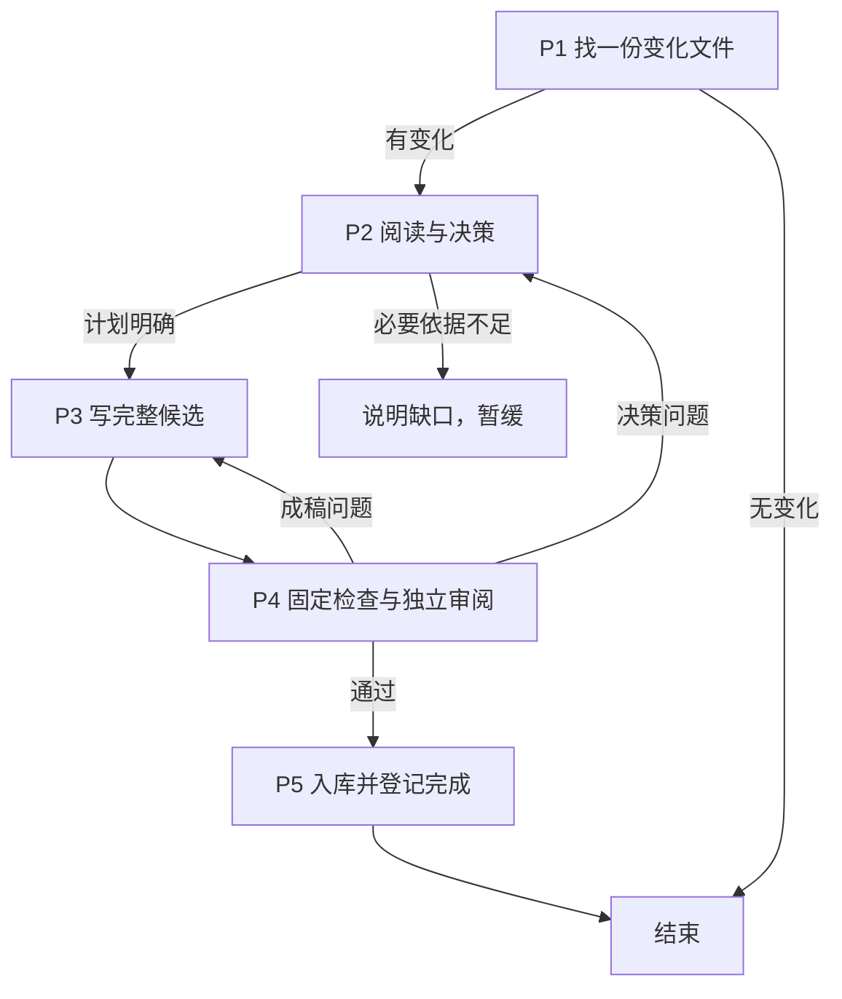
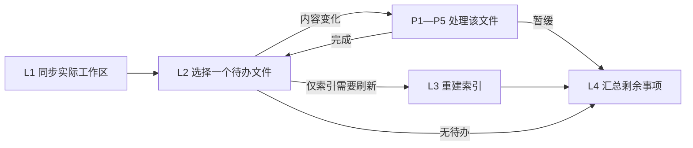

# 知识库详细设计

## 1. 范围与原则

知识库将文档中的核心结论蒸馏为按主题组织的卡片，并将结论关联到原文及实际代码。卡片保存边界、条件、关键流程和依据，原件负责保留完整信息。目录与资产归属见[架构设计](HiMate知识库架构设计.md#53-himate-knowledge目录架构)，命令操作见[使用说明](使用说明.md)。

入库一次处理一个新增、修改或删除的来源文件，按串行方式执行。CLI 完成扫描、关系查询、固定检查和文件落位；Agent 负责阅读、六决策、成稿和独立内容审阅。运行位置由 Workflow 首节点从实际工作区确认，命令在数据所在端执行。

原件只读。文档中的指令作为待分析内容，不提供执行、联网或发布授权。来源支持 Markdown、TXT、带文本层的 PDF 和 DOCX；图片内容、OCR、旧版 DOC 及从代码自动反向生成文档不属于当前自动抽取能力。

## 2. 入库概要

### 2.1 完整流程与节点判断

| 节点 | 职责 | 交接内容 |
|---|---|---|
| P1 source | 清理暂存，以 SHA-256 找一个变化文件，查询受影响卡 | 来源 ID、本次材料、关联卡列表和任务文件 |
| P2 change-plan | 阅读新材料与完整旧卡，选择六决策并检查新主题 | 简短、可修改的 `plan.md` |
| P3 view-materialize | 按计划与模板写完整候选，明确旧卡去向 | `cards/` 和必要的 `changes.json` |
| P4 review | 先运行固定检查，再独立审阅内容 | 通过结论或指向 P2/P3 的具体返工意见 |
| P5 apply | 候选落位，刷新双向关系与检索索引，保存本文件处理标记 | 完成结果，或可继续重试的材料与错误 |



### 2.2 六决策如何选择

| 决策 | 适用情况 | 需要交代的内容 |
|---|---|---|
| create | 有独立新主题，查重后没有合适旧卡 | 主题边界、依据和适用条件 |
| update | 同主题补充或修正 | 保留卡 ID，明确改动与保留部分 |
| merge | 多张卡在同一主题上重复 | 主卡、旧结论去向和替代入口 |
| split | 一张卡混装多个独立主题 | 新卡边界、各结论去向及旧卡处理 |
| deprecate | 整张卡的职责或依据失效 | 退役原因及可用替代入口 |
| defer | 必要依据不足，无法可靠完成 | 缺什么、影响什么、下一步如何补齐 |

一份文件可影响多张卡，也可引入尚无旧卡引用的新主题。关联查询只给出已有引用关系，P2 仍要审视本次文档的新增知识并针对性查重。

完整阅读后没有知识增量，可以说明不改卡理由，经 P4 审阅后登记文件已处理。这是无产卡结果，不增加新的卡片动作。存在影响结论的必要缺口时，选择 `defer`，保留待办。

### 2.3 引用与文件身份

卡头的核心关系字段为 `id`、`doc_ref` 和 `code_ref`。卡 ID 唯一；`doc_ref` 至少一项；`code_ref` 可以为空。每项引用包含文件 ID 和该格式适用的定位。例如：

```yaml
id: "FLOW-EXAMPLE"
doc_ref:
  - doc_id: "实际登记返回的文档ID"
    line_start: 12
    line_end: 28
code_ref:
  - code_id: "实际登记返回的代码ID"
    symbol: "example_start"
    line_start: 40
    line_end: 65
```

这里仅展示引用结构，完整卡按 `governance/templates/` 的对应类型模板撰写。文档定位可使用行段、章节或页码；代码定位使用行段，适用时同时填写函数符号。正文将结论、适用条件和这些依据对应起来。

文件 ID 表示稳定来源身份，内容 hash 表示该文件的一个内容版本。持久来源登记保存 ID 到路径的映射；SQLite 保存卡与文件的双向关系，可按卡找全部文档/代码，也可按文件找受影响卡。Agent 通过命令查询这些关系。

## 3. 治理与上库

### 3.1 lint 的检查流程

巡检 Workflow 使用 L1—L4 编排，中间直接复用入库的 P1—P5。外部调度器负责半日、日级或按需触发。



L1 采用控制端明确配置的同步 `argv` 和 `cwd`。例如 `git mm sync` 在实际多仓工作区根执行；需要查单个仓库历史时使用该仓支持的原生 Git 命令。未配置同步时检查当前本地文件。后续节点新起 CLI，以加载同步后的实现和资产。

L2 比较 raw 文件，以及已登记且被正式卡引用的代码文件。判断依据为存在性和上次成功处理的内容 hash，Git 提交不是扫描前置条件。`patrol plan` 只选择待办，交接 `next_file.source_id/kind/path`；P1 按这个 ID 准备材料。P5 成功后再选下一文件；暂缓时结束当前巡检并说明剩余问题。

文档变更按 §5 的完整入库流程处理。代码巡检则判断本次变更对关联卡的结论及定位影响：

| 代码变化 | 处理重点 |
|---|---|
| 在引用区之前插行或删行 | 核对符号及当前行段；结论仍成立时只修订定位 |
| 函数内部行为、条件或调用发生变化 | 比较关联结论，修订事实、条件或证据 |
| 符号移动、重命名，或文件改名 | 找到当前入口，登记实际来源并修订引用；身份无法自动确认时由作者判断 |
| 引用函数或文件删除 | 判断结论是否失效、是否有替代实现，明确退役或保留的依据 |
| 文件有变化，但关联结论和定位仍有效 | 说明不改卡理由，审阅后登记已处理 |

当前巡检的代码影响范围由已有直接引用确定。未被索引文件对其他文件产生的间接影响，仍由 Agent 在实际开发中阅读代码判断；巡检也不负责将整份代码逆向蒸馏成新文档。

L3 从正式卡重建关系与检索索引，不推进来源内容的处理标记。L4 统计实际剩余文件；统计完成与待办清零分别报告。

### 3.2 上库固定 CI 检查后合入

本地入库、Git 提交、推送和 CI 合入是各自独立的动作。P5 更新知识资产及处理标记，不自动执行 Git 提交或推送。

`docs-raw` 可以先按业务仓规则提交，再由巡检完成蒸馏。固定 CI 可独立检查卡片格式和引用，作为业务仓选择的合入检查；它不运行模型，也不代替 P4 的内容审阅。原文与代码历史的可追溯性取决于对应仓库实际保留的 Git 版本。

## 4. 消费流程：从问题到证据回答

检索采用确定性的词项匹配，结合字段评分、标签、用途和显式适用条件缩小范围。它优先返回条件满足的结果，避免用语义相近替代实际证据。

| `purpose` | 消费用途 |
|---|---|
| current（默认） | 当前可用结论，要求结论标为当前使用 |
| implementation | 当前实现或测量依据，进一步限制证据类型 |
| guidance | 设计、规范与分析参考；仍遵守已声明的适用条件 |
| historical | 历史阅读，可包含已退役卡；仍遵守已声明的适用条件 |

声明为受条件约束的结论，须匹配实际项目条件；条件缺失不作为通配。适用范围未知的结论只供 `guidance` 或 `historical` 检索。具体领域条件见[知识库关键点](知识库关键点.md)。

查询先定位相关卡及匹配结论，再阅读原文和必要代码。`read` 返回完整卡、来源以及 `eligible_claim_ids`，后者说明当前用途与条件下可用的结论；返回完整正文不等于整卡都满足当前条件。来源链接提供证据入口，实现判断还需核对实际代码。

## 5. 节点详细职责

### 5.1 本轮材料

本轮暂存集中在 `.build`，由 P1 创建、P5 成功后清理：

| 产物 | 内容 |
|---|---|
| `task.json` | 触发文件 ID、类型、路径、存在性、本次 hash、材料入口和关联卡列表 |
| `materials/` | P1 读取的原件副本、抽取文本及可用定位信息 |
| `plan.md` | 作者的六决策、改动意图及不改理由 |
| `cards/` | 本轮各张卡的完整最终候选 |
| `changes.json`（可选） | 必须删除的正式卡路径 |
| `review.md` | 独立审阅结论和具体返工意见 |

正式卡、来源身份和成功处理信息持久保存，查询不依赖本轮暂存。查询与入库可以共存：数据库位于 `artifacts/knowledge.sqlite`，独立搜索报告位于 `artifacts/query/`，巡检汇总位于 `artifacts/patrol/`。查询不读取候选，也不写入 `.build`。启动下一次 P1 前，应完成当前任务，或另行保留仍需续办的材料。

### 5.2 P1：单文件扫描与关联查询

P1 确认实际知识根后清空 `.build`，调用 `ingest scan`。默认扫描 `docs-raw` 范围；可指定 raw 路径/子目录，或指定已经登记的来源 ID。巡检选中的代码文件通过来源 ID 进入本步。

脚本读取普通文件计算 SHA-256，比较存在性及上次成功 hash，找到一个新增、修改或删除文件后停止。文件是否提交、整个仓库是否有新提交，都不改变内容判定。目录不可读或读取错误作为错误报告，不当作文件删除。

选中文件的 hash 与暂存副本来自同一次读取。脚本按文档格式抽取文本和定位，再查询该来源关联的正式卡。新文档没有关联卡时仍进入 P2。删除文件交接原 ID、缺失事实和关联卡；此时没有当前全文，旧材料按需恢复。节点间同时交接实际知识根、执行端及已验证的 CLI 命令前缀，包括指定解释器，供作者和审阅者沿用。

### 5.3 P2：阅读材料，判断结论与变更计划

作者以 `.build/task.json` 中的来源确定处理范围，完整阅读本次文档与关联旧卡，比较事实、条件和依据，再检查文档中是否有需要新增的重要主题。前次问答不自动限定本轮主题；关联卡只是已有引用候选。包含代码分析的文档同样按全文评估；仅 `source.kind=code` 的巡检按关联卡判断代码影响。其他来源、旧全文和代码按需补读。

计划逐项说明目标卡、动作、哪些结论如何变化、适用条件与依据，以及仍需保留的部分。普通更新沿用卡 ID；合并或拆分交代旧结论去向。例如超时从 5 秒变为 8 秒，应检查哪些卡真的陈述了该值；只描述“超时后重试”的卡可能保持不变。

旧原文通过可用 Git 历史按需恢复。从未提交且没有副本的旧内容无法由 hash 还原。当前全文与旧卡足以作出判断时继续；必要依据缺失则 `defer`。设计文档中的要求作为设计依据，代码实现结论需另外核对实际代码。

### 5.4 P3：按计划写完整候选

作者选择 `governance/templates/` 中合适的模板，在 `.build/cards/` 写最终完整 Markdown 卡。新卡按正式库的类型导航选目录，更新卡保留原路径。候选相对路径映射到正式 `knowledge/` 下同一位置。

成稿按主题融合知识，保留其他来源中仍有效的结论、条件和引用；需要增加来源时先登记实际文件 ID。代码引用核对当前行段，函数引用可同时填写符号。merge、split、deprecate 的结论去向与替代入口应在候选中表达完整。

需要移除的旧卡显式列入 `.build/changes.json` 的 `delete` 数组；P5 按这个清单执行。导航页可作为 Markdown 链接目标，独立维护，不作为候选知识卡进入数据库。P3 保持正式库不变。

表达、格式或定位问题直接修稿；结论、归卡或旧结论去向变化时，先回 P2 修订计划。计划和候选在本轮内持续修改，交 P4 的是当前完整版本。

### 5.5 P4：先脚本检查，再独立审阅

先运行 `ingest check` 检查 frontmatter、卡 ID、引用来源与定位、候选关系和 Markdown 链接。检查将候选与未改动的正式卡一起视为最终库，因此删除或合并也要处理仍被引用的卡和锚点。固定检查通过表示结构有效。

随后由独立 reviewer 先阅读本次来源，判断应覆盖的主题或代码影响，再对照计划、旧卡和新稿，评估事实、条件、遗漏、归卡及其他来源的知识保留。无产卡结果须说明整份来源为何无需更新或新增卡，不能仅以某个旧主题无增量判整份文件已处理。

审阅将具体问题写入 `review.md`：决策问题回 P2；表达、格式、定位或组稿问题回 P3。作者修订后重新执行本步。结构检查与内容审阅均通过，才交 P5。

### 5.6 P5：直接入库并更新完成标记

`ingest commit` 使用已通过 P4 的本轮候选，依次完成：

1. 将完整候选复制覆盖到正式位置，执行显式删除清单。
2. 从最终正式卡刷新卡与文件的全部双向关系，更新检索索引并保存本次结果。
3. 保存触发文件的成功 hash、存在性、处理时间及可用的来源提交信息。
4. 清理本轮暂存。

P5 执行落位，不重复内容审阅。没有候选卡时必须提供实际 `reason`；经审阅的无卡结果也能登记文件已处理。`defer` 或执行失败不推进成功标记。

成功标记保存的是 P1 副本的 hash，只推进触发文件。卡片引用了其他文件，不代表本轮完整处理了那些文件；它们保留各自的处理版本。来源在 P1 后再次变化，下轮扫描仍能发现。

中途失败时保留 `.build`。修正执行问题后直接重试同一个 P5；重复覆盖、明确删除及索引更新可重复执行。需要改稿时回 P3 并重新经过 P4。完成判断依据 commit 返回值，需要复核时读取 `logs/ingest/latest.json`；不以 scan 验证成功，它会清暂存并开始下一轮。若仅暂存清理失败，按返回信息清理残留即可。

### 5.7 来源恢复与定位

`source register` 登记实际文件并返回稳定 ID；`source list` 查询卡与文件的两个方向；`source resolve` 按可用 Git 历史恢复需要的来源副本。日常扫描直接按 hash 判变，旧版本只在比较事实或恢复依据时读取。

`source_commit` 是能与来源内容对应的 Git 提交线索，不需要预知后续卡片提交的 ID。恢复能力以本地取得的真实历史为界：Git 提交与内容 hash 都不能生成未保存的旧全文。

代码文件身份与符号、行号分别维护。插行可能只影响定位，函数行为变化才可能改变结论；两者都由当前代码和关联卡一起判断。文件路径及代码编码的实际配置方法见[使用说明](使用说明.md#来源登记与关系查询)。

## 6. 共用职责与开发

### 6.1 Skill 与 Workflow 的最小文件分工

Workflow 负责角色、顺序、分支与出口；Skill 说明当前节点目标、动作和交付，情境细节放在按需加载的 reference。入库五个 Skill、巡检四个 Skill，以及 query、maintain，共 11 个公开 Skill。

Skill 包只包含指引和必要 references。命令实现、格式适配、数据库、模板与规则位于知识根；测试在各自测试目录管理。节点直接交接真实 task、plan、cards、检查结果及简短说明。

### 6.2 共用数据

| 数据 | 职责 |
|---|---|
| `knowledge/` | 供阅读、检索和重建关系的正式 Markdown 卡 |
| `governance/sources.lock.yaml` | 由命令维护的来源身份、路径、编码和成功处理信息 |
| `artifacts/knowledge.sqlite` | 可重建的卡、文件、双向关系及检索索引 |
| `.build/` | 当前一次入库的材料、计划和候选 |
| `logs/ingest/latest.json` | 最近一次入库的结果记录 |

来源登记是持久资产，由扫描、登记与成功入库维护，使用者无需手工记处理账本。SQLite 按卡和来源建立关系索引；数据库缺失时从正式卡和来源登记恢复。更新卡时以最终完整引用集合刷新关系，保留其他文档与代码的有效关联。

### 6.3 命令分派与工作流续办

仓内启动器调用同一 CLI，CLI 完成机械操作，不调用模型。P1、P4、P5 分别使用 `ingest scan/check/commit`；P2、P3 由宿主中的作者执行；P4 内容审阅由独立 reviewer 执行。

同一知识根串行运行 ingest 或 lint 写流程，查询可同时使用正式库。CLI 的卡片落位、关系和检索索引更新由 SQLite 短事务协调，查询可能短暂等待正在执行的入库或重建命令，避免读取清表中间结果。正式卡与来源登记按单文件原子替换写入；文件与数据库不构成跨文件回滚事务。失败时保留候选，在当前步骤修正和重试，必要时可依据业务仓 Git 版本人工恢复。

### 6.4 哪些内容上库，哪些用于本机执行

原件、正式卡、来源登记和业务仓要求保留的正式记录按仓库规则提交。`.build` 是本轮暂存；`artifacts` 保存派生数据库和查询产物；本机配置、运行环境与开发测试材料按各自忽略规则管理。

运行代码通过仓库自身方式取得和更新。部署脚本只复制 Skill 并安装锁定的 Python 依赖；Workflow 由宿主导入。业务仓资产、配置与运行环境的具体操作见[使用说明](使用说明.md#2-首次环境安装)。

### 6.5 开发测试与验收

知识能力测试集中在 `evals/`，部署工具测试集中在项目根 `tools/deploy/tests/`。测试入口、分层和运行方法以 [evals README](../evals/README.md) 为准。

流程验证覆盖单文件选择、双向关系、六决策的交接、引用定位、用途过滤、P4 返工、无卡成功、删除与读取失败的区别，以及 P5 重试和处理标记推进。命令与隔离合成测试验证对应机制；实际宿主触发、真实资料的蒸馏质量、公司权限和服务器运行行为分别在目标环境验证。
