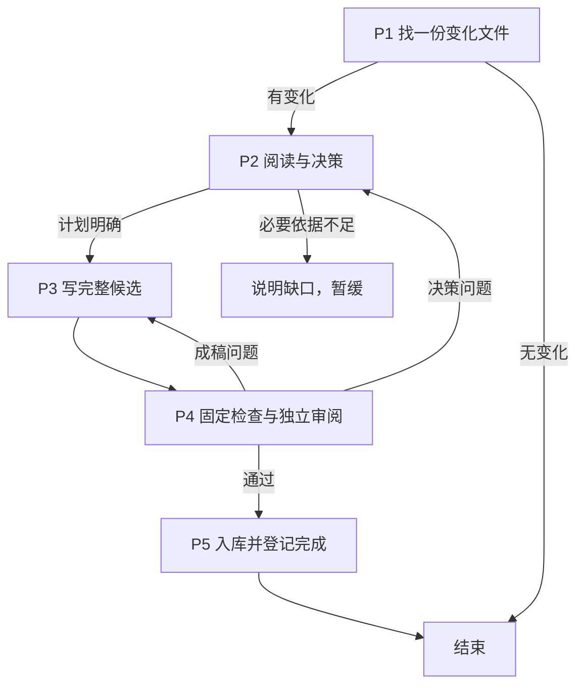
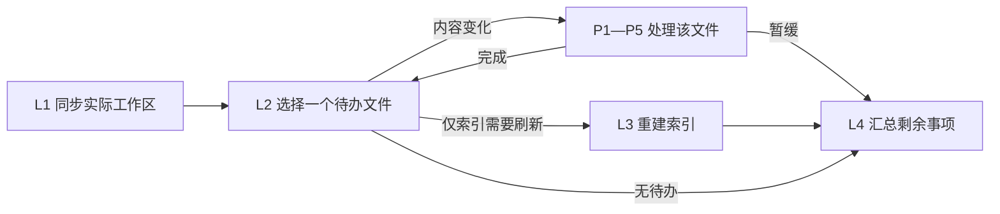
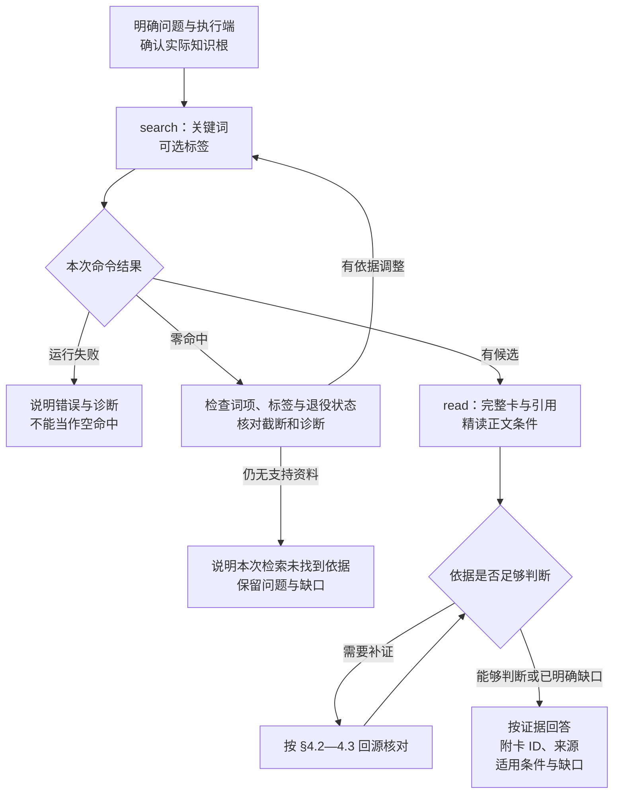
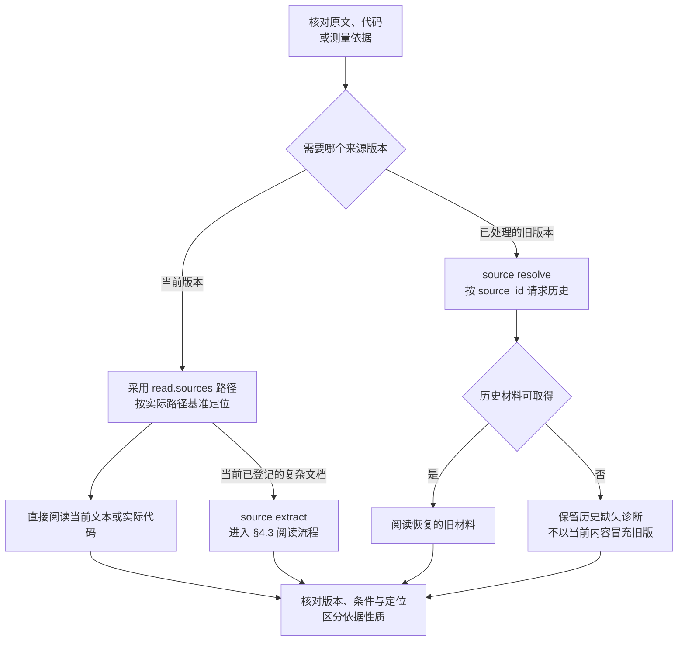
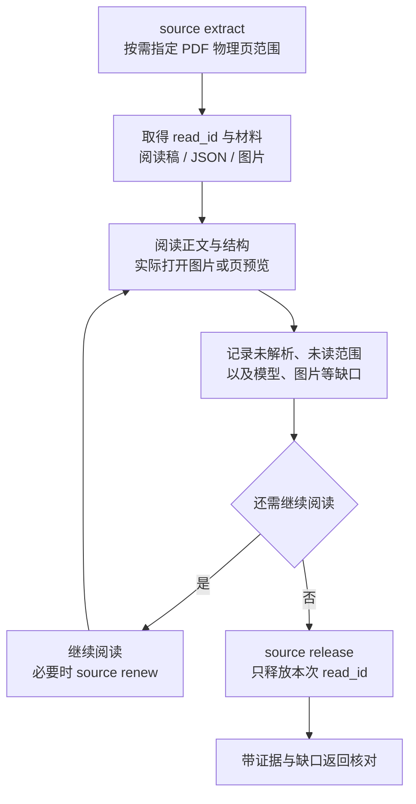
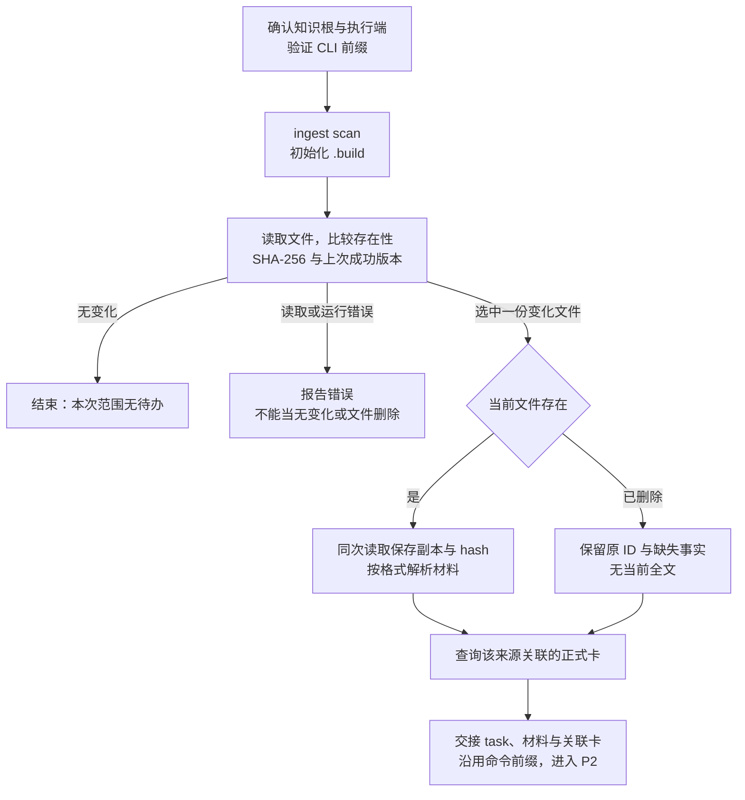
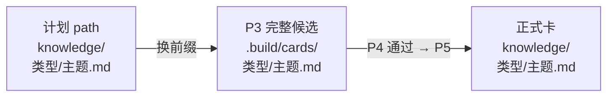
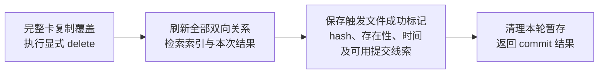

# 知识库详细设计

## 1. 范围与原则

知识库将文档中的核心结论蒸馏为按主题组织的卡片，并将结论关联到原文及实际代码。卡片保存边界、条件、关键流程和依据，原件负责保留完整信息。目录与资产归属见[架构设计](HiMate知识库架构设计.md#53-himate-knowledge目录架构)，日常操作见[使用说明](使用说明.md)。

入库一次处理一个新增、修改或删除的来源文件，按串行方式执行。CLI 完成扫描、关系查询、固定检查和文件落位；Agent 负责阅读、六决策、成稿和独立内容审阅。运行位置由 Workflow 首节点从实际工作区确认，命令在数据所在端执行。

原件只读。文档中的指令作为待分析内容，不提供执行、联网或发布授权。Markdown/TXT 直接读取；PDF、DOCX、XLSX、PPTX、HTML、CSV 和常见图片使用 Docling 生成阅读材料。默认部署安装 Docling 多格式解析与 OCR 完整依赖并校验本地模型，不完整模型优先从内附权重离线准备，未携带时需预置或显式下载，解析默认仍为 native，不运行 OCR；扫描件通过显式 standard 配置使用预置模型。缺模型及未读取内容报告缺口，不在业务命令中下载。旧版 DOC 等未启用格式需先转换，代码不自动反向生成文档。

## 2. 入库概要

### 2.1 完整流程与节点判断

| 节点 | 职责 | 交接内容 |
|---|---|---|
| P1 source | 清理暂存，以 SHA-256 找一个变化文件，查询受影响卡 | 来源 ID、本次材料、关联卡列表和任务文件 |
| P2 change-plan | 阅读新材料与完整旧卡，选择六决策并检查新主题 | 简短、可修改的 `plan.md` |
| P3 view-materialize | 按计划与模板写完整候选，明确旧卡去向 | `cards/` 和必要的 `changes.json` |
| P4 review | 先运行固定检查，再独立审阅内容 | 通过结论或指向 P2/P3 的具体返工意见 |
| P5 apply | 候选落位，刷新双向关系与检索索引，保存本文件处理标记 | 完成结果，或可继续重试的材料与错误 |



### 2.2 六决策如何选择

| 决策 | 适用情况 | 需要交代的内容 |
|---|---|---|
| create | 有独立新主题，查重后没有合适旧卡 | 主题边界、依据和适用条件 |
| update | 同主题补充或修正 | 保留卡 ID、原路径和原 lifecycle，状态变化由 P2 明确决定 |
| merge | 多张卡在同一主题上重复 | 主卡、旧结论去向和替代入口 |
| split | 一张卡混装多个独立主题 | 新卡边界、各结论去向及旧卡处理 |
| deprecate | 整张卡的职责失效 | 退役原因、历史适用范围及可用替代入口；局部过时只改对应正文 |
| defer | 必要依据不足，无法可靠完成 | 缺什么、影响什么、下一步如何补齐 |

一份文件可影响多张卡，也可引入尚无旧卡引用的新主题。关联查询只给出已有引用关系，P2 仍要审视本次文档的新增知识并针对性查重。

完整阅读后没有知识增量，可以说明不改卡理由，经 P4 审阅后登记文件已处理。这是无产卡结果，不增加新的卡片动作。存在影响结论的必要缺口时，选择 `defer`，保留待办。

### 2.3 引用与文件身份

新卡采用三个必填、两个可选的简洁卡头，模板固定展示五项；字段、定位和旧卡兼容规则以[卡片规范](../governance/specs/cards.md)为准。例如：

```yaml
id: "FLOW-EXAMPLE"
doc_ref:
  - doc_id: "实际登记返回的文档ID"
    line_start: 12
    line_end: 28
code_ref:
  - code_id: "实际登记返回的代码ID"
    symbol: "example_start"
    line_start: 40
    line_end: 65
tags: []
lifecycle: stable
```

这里仅展示引用结构，完整卡按 `governance/templates/` 的对应类型模板撰写。文档定位可使用行段、章节或页码；代码定位使用行段，适用时同时填写函数符号。正文将结论、适用条件和这些依据对应起来。

文件 ID 表示稳定来源身份，内容 hash 表示该文件的一个内容版本。持久来源登记保存 ID 到路径的映射；SQLite 保存卡与文件的双向关系，可按卡找全部文档/代码，也可按文件找受影响卡。Agent 通过命令查询这些关系。

## 3. 治理与上库

### 3.1 lint 的检查流程

巡检 Workflow 使用 L1—L4 编排，中间直接复用入库的 P1—P5。外部调度器负责半日、日级或按需触发。



L1 采用控制端明确配置的同步 `argv` 和 `cwd`。例如 `git mm sync` 在实际多仓工作区根执行；需要查单个仓库历史时使用该仓支持的原生 Git 命令。未配置同步时检查当前本地文件。后续节点新起 CLI，以加载同步后的实现和资产。

L2 比较 raw 文件，以及已登记且被正式卡引用的代码文件。判断依据为存在性和上次成功处理的内容 hash，Git 提交不是扫描前置条件。`patrol plan` 只选择待办，交接 `next_file.source_id/kind/path`；P1 按这个 ID 准备材料。P5 成功后再选下一文件；暂缓时结束当前巡检并说明剩余问题。

文档变更按 §5 的完整入库流程处理。代码巡检则判断本次变更对关联卡的结论及定位影响：

| 代码变化 | 处理重点 |
|---|---|
| 在引用区之前插行或删行 | 核对符号及当前行段；结论仍成立时只修订定位 |
| 函数内部行为、条件或调用发生变化 | 比较关联结论，修订事实、条件或证据 |
| 符号移动、重命名，或文件改名 | 找到当前入口，登记实际来源并修订引用；身份无法自动确认时由作者判断 |
| 引用函数或文件删除 | 判断结论是否失效、是否有替代实现，明确退役或保留的依据 |
| 文件有变化，但关联结论和定位仍有效 | 说明不改卡理由，审阅后登记已处理 |

当前巡检的代码影响范围由已有直接引用确定。未被索引文件对其他文件产生的间接影响，仍由 Agent 在实际开发中阅读代码判断；巡检也不负责将整份代码逆向蒸馏成新文档。

L3 从正式卡重建关系与检索索引，不推进来源内容的处理标记。L4 统计实际剩余文件；统计完成与待办清零分别报告。

### 3.2 Git 提交与可选 CI 检查

本地入库、Git 提交、推送和 CI 合入是各自独立的动作。P5 更新知识资产及处理标记，不自动执行 Git 提交或推送。

`docs-raw` 可以先按业务仓规则提交，再由巡检完成蒸馏。业务仓可按自身 CI 配置调用公开的 `knowledge.py lint` 检查正式卡片格式和引用；知识包不提供独立 CI 启动器，检查程序的隔离与信任边界由业务仓 CI 配置负责。固定检查不运行模型，也不代替 P4 的内容审阅。原文与代码历史的可追溯性取决于对应仓库实际保留的 Git 版本。

## 4. 消费流程：从问题到证据回答

`hs-knowledge-query` 内部按“明确问题 → 搜索 → 精读 → 回源核对 → 回答”执行，以下是同一个 Skill 的操作步骤，不新增 Workflow 节点。

### 4.1 搜索与精读



| 环节 | 规则 |
|---|---|
| 搜索范围 | 只检索正式卡；全部查询词组须在同一卡命中，可分布于不同段落；可选标签精确 AND 匹配 |
| 排序与筛选 | 确定性词项与字段评分，分数只表示相关性；不做语义近似，不按用途、Claim 或复杂适用条件过滤 |
| 生命周期 | 默认排除显式退役卡，可额外包含；旧 draft 不自动升为 stable，也不进入搜索 |
| 精读入口 | 已知 ID 可直接 `read`，不依赖搜索报告；允许读退役卡和只读旧 draft，返回完整正文、原始卡头、规范化引用与来源入口 |
| 证据判断 | 命中、stable 或 code_ref 不证明适用、已实现或已测量；设计要求、代码观察和测量结论分别核对，不补造作者未声明的用途、范围或 Claim |
| 查询隔离 | 使用本次返回值及 `report_ref`；报告保存在 `artifacts/query/`，不读写 `.build`，不入库、不初始化代码图谱 |

参数、评分和旧参数迁移错误见 [Query API](../skills/hs-knowledge-query/references/public-api.md)。

### 4.2 按版本回源核对



当前来源直接读取，不要求 Git；旧版本才按可用历史恢复。`source extract` 解析当前已登记文档，不能在恢复历史后用同一来源 ID 提取当前内容，冒充旧版证据。路径基准及请求格式见 [Query API](../skills/hs-knowledge-query/references/public-api.md#精读)。

### 4.3 解析材料的阅读与释放



大 PDF 优先限定必要页段；矢量图可能没有独立图片，此时显式页范围可生成 `page_preview`，仍须实际打开。OCR 文字、图片链接或预览生成成功都不等于已理解图意。解析选项、预算与定位边界见 [§5.7](#57-来源恢复与定位)。消费后主动释放，不用 `ingest scan` 回源或清空整个 `artifacts`。

## 5. 节点详细职责

### 5.1 本轮材料

`.build` 保存单轮交接材料；P1 初始化，P5 成功后清理。

| 产物 | 生成 → 消费 | 内容 |
|---|---|---|
| `task.json` | P1 → P2—P5 | 触发文件 ID、类型、路径、存在性、hash、材料入口与关联卡 |
| `materials/` | P1 → 作者、reviewer | 原件副本、抽取文本、结构、图片、定位与产物摘要 |
| `plan.md` | P2 → P3、P4 | 首部候选 ID/路径清单，正文六决策、改动意图与不改理由 |
| `cards/` | P3 → P4、P5 | 本轮各卡的完整最终候选 |
| `changes.json`（可选） | P3 → P4、P5 | 明确删除的正式卡路径 |
| `review.md` | P4 → 作者、P5 交接 | 独立审阅结论、返工意见与未审范围 |

正式数据不依赖暂存：数据库在 `artifacts/knowledge.sqlite`，查询报告在 `artifacts/query/`，巡检汇总在 `artifacts/patrol/`。查询可与入库共存，只读正式库，不读候选或写 `.build`。开始下一次 P1 前，应完成当前任务，或另行保留待续办材料。

### 5.2 P1：单文件扫描与关联查询



| 约束 | 处理方式 |
|---|---|
| 选择范围 | 默认 `docs-raw`，可指定 raw 路径/子目录或已登记来源 ID；巡检代码沿用选中的 ID，找到一个变化文件后停止 |
| 判变依据 | 文件存在性与内容 hash；是否提交、仓库是否有新提交不参与判定；新文档没有关联卡也进入 P2 |
| 解析交接 | `task.source.parsed` 指向 `.build/materials/parsed/` 的阅读稿、JSON、图片与摘要；本轮只转换一次，不保留跨轮转换缓存，不默认渲染全部整页图片 |
| 阅读要求 | 按页段分批阅读全文并实际看图，复杂表格结合结构 JSON，记录未审范围；OCR 不代替图意判断 |
| 显式重处理 | 具体来源 ID 加 `reprocess: true` 开始一轮；不篡改成功 hash 模拟变化；后续沿用已验证的解释器与命令前缀 |

### 5.3 P2：阅读材料，判断结论与变更计划

作者先完整评估本轮来源，再决定哪些知识进入哪张卡；六决策的适用情况见 [§2.2](#22-六决策如何选择)。

| 计划要素 | 要求 |
|---|---|
| 阅读范围 | 以 `task.json` 为准，读本次文档全文与完整关联旧卡；前次问答不限定主题，关联卡不涵盖全部新增知识；其他来源、旧全文与代码按需补读 |
| 代码影响 | 仅 `source.kind=code` 按关联卡核对结论与定位；包含代码分析的文档仍按全文评估 |
| 候选清单 | `plan.md` 首部 YAML frontmatter 写 `cards: [{id, path}]`；只列本轮完整候选，不列未改卡和仅删除的旧文件，无候选写 `cards: []` |
| ID 与目录 | `path` 相对知识根，采用 `knowledge/...md`；更新保留 ID、原路径和原 lifecycle，新卡按 `knowledge/index.md` 现有类型导航选目录 |
| 决策正文 | 逐项写动作、结论变化、条件、依据、保留内容与旧知识去向；标签/状态变化显式决定，修订退役卡不自动恢复使用 |
| 依据边界 | 当前全文与旧卡足以判断时继续；设计要求保持设计属性，实现结论另核代码；必要依据缺失时暂缓 |

| 评估结果 | 后续 |
|---|---|
| 需要产卡 | 交 P3 写完整候选；merge/split 说明旧结论去向 |
| 完整评估后无知识增量 | 说明整份来源无需更新或新增卡的理由，仍经 P4；不能仅凭某个旧主题无增量结束本文件 |
| `defer` | 记录必要缺口与补齐方式，不登记处理完成 |

### 5.4 P3：按计划写完整候选



| 成稿事项 | 要求 |
|---|---|
| 模板与落位 | 用 `governance/templates/` 对应模板，按计划 ID/路径写完整卡；不重选目录，不加 `path` 卡头；`cards: []` 不生成候选，P3 不改正式库 |
| 内容融合 | 保留其他来源仍有效的结论、条件和引用；设计、规范、代码观察、测量依据与缺口分别落在对应正文，合并/拆分/退役写全去向与替代入口 |
| 引用核对 | 新来源先登记实际 ID；核对当前代码行段，可同时填写符号；图示实际看图，正式引用使用原件 ID 与真实位置，保留旧定位语义 |
| 旧卡更新 | 将显式 scope、Claim 条件、用途、历史依据及验证要求迁入正文，再采用简洁头；保留稳定 ID、有效锚点、链接、别名与搜索词，有效关系转为正文链接；不批量迁移 |
| 删除与导航 | 需移除的旧文件写入 `changes.json` 的 `delete` 数组；导航独立维护，可作为链接目标，不作为候选知识卡入库 |
| 同轮修订 | 表达、格式、定位或偏离计划的路径拼写在 P3 修；计划 ID/路径、结论、归卡或旧知识去向要变，先回 P2；修改后重新交 P4 |

### 5.5 P4：先脚本检查，再独立审阅

```mermaid
flowchart TD
    A["ingest check<br/>核对预计最终库"] -->|检查失败| F["按具体问题修复<br/>材料变化先重新备料"]
    F --> A
    A -->|通过| B["独立 reviewer<br/>来源 → 计划、旧卡、新稿"]
    B --> C{"内容审阅结论"}
    C -->|决策或事实问题| P2["回 P2 修订计划"]
    P2 --> P3["回 P3 修订完整候选"]
    C -->|表达、定位或格式问题| P3
    P3 --> A
    C -->|缺必要依据| D["记录缺口与未审范围<br/>暂缓"]
    C -->|通过| P5["写 review.md，交 P5"]
```



| 核对对象 | 要求 |
|---|---|
| 机器结构检查 | 计划与候选 ID/正式路径一一对应，检查卡头、引用来源与定位、关系及 Markdown 链接；删除/合并后仍须处理入链与锚点，不另推断路径类型 |
| 返工分界 | 候选漏写、多写、表达、定位、组稿或落位拼写问题回 P3；决策、事实、条件、归卡或计划决定变化回 P2；独立 reviewer 不代作者改稿 |
| 内容审阅 | 核对事实、条件、依据、遗漏、归卡、其他来源知识保留、旧结构迁入正文与 P2 的状态决定；整卡退役须成立 |
| 同一份材料 | 按 task 固定的 manifest 摘要与原件 hash 核验；材料丢失/变化须重新备料和审阅，不重转后冒充已读材料；其他引用来源的临时解析在同次检查内复用 |
| 图与无产卡结果 | 图示必须实际打开，记录未审图片/页段；无产卡也审整份来源是否完整评估，不能以局部无增量代替 |

具体结论与返工意见写入 `review.md`。结构与内容均通过才交 P5；旧 PDF 文本行号、DOCX 原生段落及冻结快照继续按原定位语义核对。

### 5.6 P5：直接入库并更新完成标记

`ingest commit` 直接使用已通过 P4 的候选，不重跑质量检查或内容审阅。



成功 hash 来自 **P1 副本，只推进触发文件**；其他被引用来源保留各自处理版本。P1 后原件再次变化，下轮扫描仍能发现。

| 情况 | 处理与续办 |
|---|---|
| 无候选但已完整处理 | 提供实际 `reason`，经 P4 的无卡结果也可登记完成 |
| `defer` 或执行失败 | 不推进成功标记；执行失败保留 `.build`，修正后直接重试同一个 P5，不回 P1；覆盖、明确删除及索引更新可重复执行 |
| 需要改稿 | 回 P3，重新经过 P4 后再入库 |
| 仅清理暂存失败 | 按返回信息处理残留，不重新开始整轮 |
| 判断成功 | 看 commit 返回值，需复核时读 `artifacts/ingest/latest.json`；不用 scan 验证，它会清暂存并开启下一轮 |

### 5.7 来源恢复与定位

回源阅读的步骤见 [§4.2](#42-按版本回源核对) 和 [§4.3](#43-解析材料的阅读与释放)；以下保留命令职责与定位约束。

| 操作 | 用途与限制 |
|---|---|
| `source register` | 登记实际文件并返回稳定 ID |
| `source list` | 查询卡与文件的双向关系 |
| `source resolve` | 按可用 Git 历史恢复需要的旧来源；`source_commit` 是对应内容的提交线索，不是未来卡片提交 ID，hash 和提交线索不能生成未保存的旧全文 |
| `source extract` | 按当前已登记来源 ID 生成独立阅读目录，可指定 PDF 物理页范围；不调用 P1、不触碰 `.build`、不登记入库完成 |
| `source renew/release` | 延长或释放本次 `read_id`；ready 租约默认 1800 秒，到期入口失效，消费后主动释放 |
| `source cleanup` | 仅回收过期且无活跃转换锁的阅读目录，不批量清空 `artifacts` |

| 解析与定位边界 | 规则 |
|---|---|
| 本地解析 | native 不做 OCR；standard 需预置模型，业务命令不安装或下载；临时解析/图片路径不能作为正式卡唯一依据 |
| PDF 页面预览 | 仅显式物理页范围生成，`role: page_preview`，固定 1.5 倍；单次最多 8 页、累计 1600 万像素与 16 MiB PNG，并受总产物配额约束；超限/失败报告未生成页，不掩盖原图片缺口，不修改原 Docling 结构 |
| 全量与页段定位 | 全量 P1 或未指定范围的读取不渲染整本；页段 `element` 绑定范围，不能与全量同编号元素互换；正式 PDF 引用采用物理页或页段 |
| 非默认 element 配置 | P1 使用非默认配置时，locator 的 `parser` 复制 manifest.profile.options，使本轮清理后仍可按同一配置读取；旧快照保留原语义 |
| 代码位置 | 文件身份与符号、行号分别维护；插行可能只改定位，行为变化才可能改结论，由当前代码与关联卡共同判断 |

文件路径和代码编码的配置见[来源操作](../skills/hs-knowledge-source/references/materials.md)。日常扫描仍按 hash 判变，历史只在比较事实或恢复依据时读取。


## 6. 共用职责与开发

### 6.1 Skill 与 Workflow 的最小文件分工

Workflow 负责角色、顺序、分支与出口；Skill 说明当前节点目标、动作和交付，情境细节放在按需加载的 reference。入库五个 Skill、巡检四个 Skill，以及 query、maintain，共 11 个公开 Skill。

Skill 包只包含指引和必要 references。命令实现、格式适配、数据库、模板与规则位于知识根；测试在各自测试目录管理。节点直接交接真实 task、plan、cards、检查结果及简短说明。

### 6.2 共用数据

| 数据 | 职责 |
|---|---|
| `knowledge/` | 供阅读、检索和重建关系的正式 Markdown 卡 |
| `governance/sources.lock.yaml` | 由命令维护的来源身份、路径、编码和成功处理信息 |
| `artifacts/knowledge.sqlite` | 可重建的卡、文件、双向关系及检索索引 |
| `.build/` | 当前一次入库的原件副本、转换文字/结构/图片、计划和候选 |
| `artifacts/source-read/` | 与入库及检索报告隔离的临时原件阅读，按 ID 释放、续期与过期回收 |
| `artifacts/ingest/latest.json` | 最近一次入库的结果回执，不承担来源处理账本职责 |

来源登记是持久资产，由扫描、登记与成功入库维护，使用者无需手工记处理账本。SQLite 按卡和来源建立关系索引；数据库缺失时从正式卡和来源登记恢复。更新卡时以最终完整引用集合刷新关系，保留其他文档与代码的有效关联。

搜索派生表按内部格式版本和卡内容签名判断是否需要重建；旧格式即使卡未改动也会升级。重建成功后才发布格式标记，失败回滚并报错；只更新搜索缓存，不删除整个数据库、不改来源登记或成功处理版本，也不重写正式卡与历史快照。

### 6.3 命令分派与工作流续办

仓内启动器调用同一 CLI，CLI 完成机械操作，可执行已经准备的本地 Docling 结构/OCR 模型，不自主调用生成式模型作知识判断。P1、P4、P5 分别使用 `ingest scan/check/commit`；P2、P3 由宿主中的作者执行；P4 内容审阅由独立 reviewer 执行。依赖和模型在执行端部署准备，统一包含 Docling 多格式解析与 OCR；业务任务不临时安装或下载。部署步骤见[使用说明](使用说明.md#首次安装)，参数见[部署工具说明](../tools/deploy/README.md)。

同一知识根串行运行 ingest 或 lint 写流程，查询可同时使用正式库。CLI 的卡片落位、关系和检索索引更新由 SQLite 短事务协调，查询可能短暂等待正在执行的入库或重建命令，避免读取清表中间结果。正式卡与来源登记按单文件原子替换写入；文件与数据库不构成跨文件回滚事务。失败时保留候选，在当前步骤修正和重试，必要时可依据业务仓 Git 版本人工恢复。

### 6.4 哪些内容上库，哪些用于本机执行

原件、正式卡、来源登记和业务仓要求保留的正式记录按仓库规则提交。转换 Markdown、JSON、全部图片默认不上 Git，也不自动写回 docs-raw。`.build` 是本轮暂存；`artifacts` 保存派生数据库和查询产物，临时原件阅读消费后释放；本机配置、运行环境与开发测试材料按各自忽略规则管理。

知识包在知识根内包含部署入口、skills、workflows和tools。部署先展示 OpenFlow Skill、CAC Skill、OpenFlow Workflow 三个默认目录，支持回车采用或输入自定义地址，并收集已有项目入口的覆盖选择，默认 y，n 保留。确认后默认沿用 pip 配置安装锁定的 Docling 多格式解析与 OCR 完整依赖，复用完整运行模型或验证内附清单与权重后离线安装。准备均成功后才删除本次同名包并复制新包，再把 config.yml 与 AGENTS-code-root.md 按选择复制到知识根的 ../..，作为项目 config.yml 和 AGENTS.md。依赖或模型准备失败不动旧包或入口，其他包与源模板保留。manifest 根不要求为 Git 仓，具体操作见[使用说明](使用说明.md#首次安装)。

### 6.5 开发测试与验收

知识能力、共用算法与部署工具的开发测试统一在知识根的 `evals/`，其中部署测试位于 `evals/deploy/`；同一知识根的 `tools/deploy/` 保留部署实现、说明与离线模型包。测试入口、分层和运行方法以 [evals README](../evals/README.md) 为准。

流程验证覆盖单文件选择、双向关系、六决策交接、引用定位、整卡词项与标签检索、退役筛选、旧卡读取和搜索缓存升级、P4 返工、无卡成功、删除与读取失败的区别，以及 P5 重试和处理标记推进。命令与隔离合成测试验证对应机制；实际宿主触发、真实资料的蒸馏质量、公司权限和服务器运行行为分别在目标环境验证。
