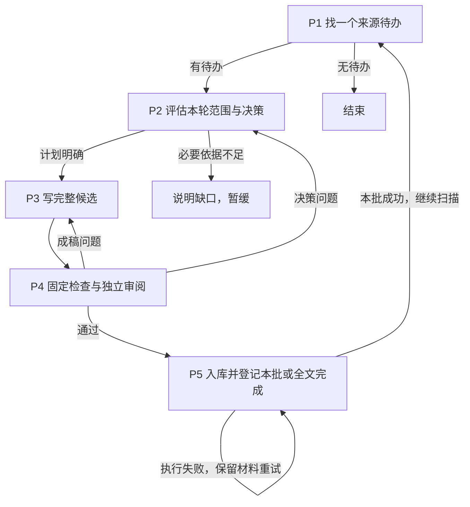
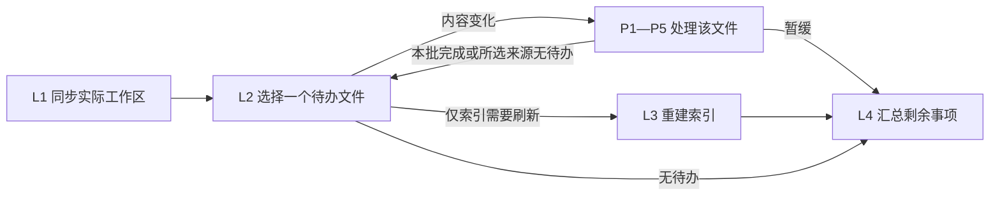
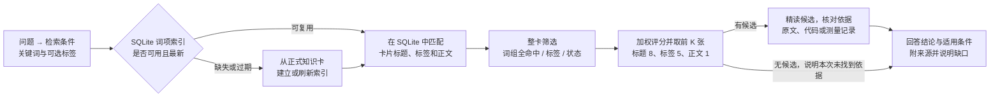
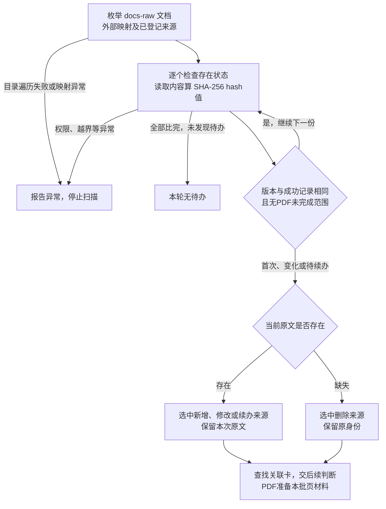
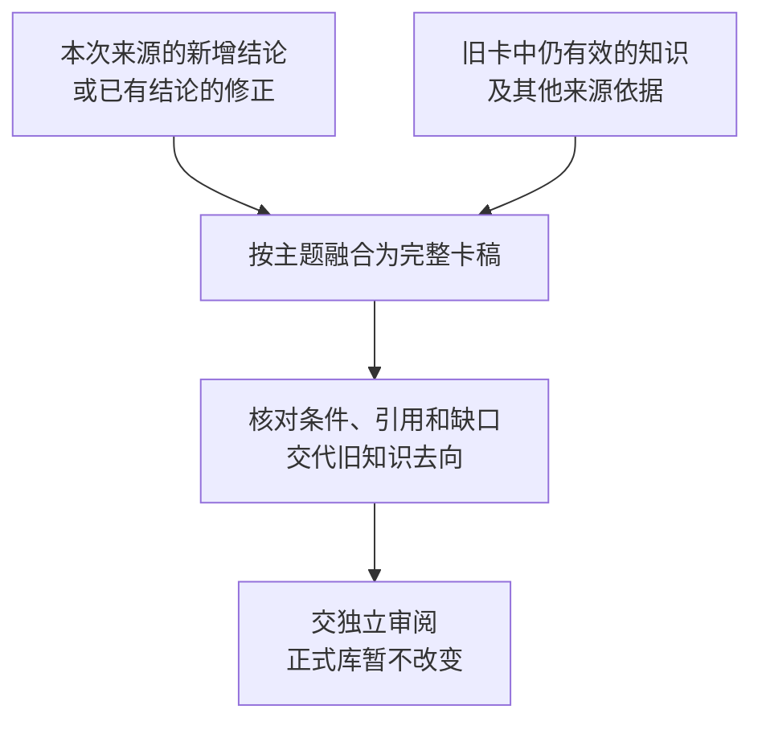
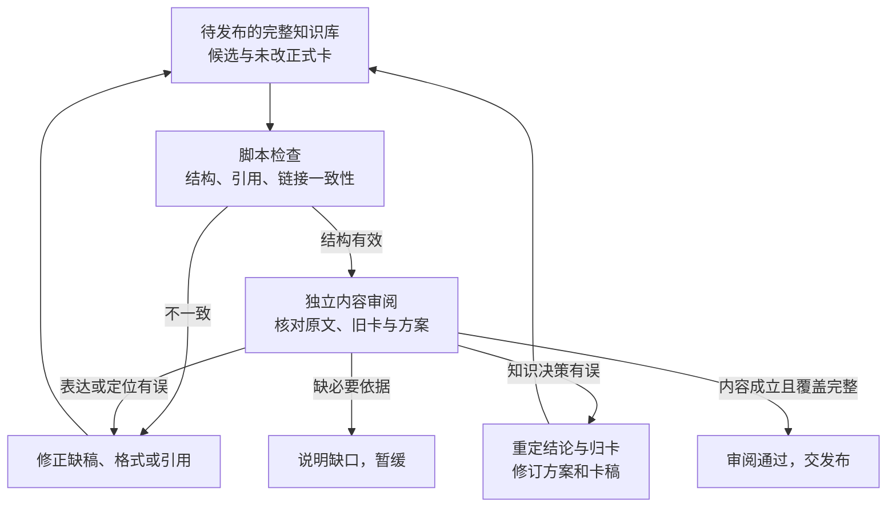

# 知识库详细设计

## 1. 范围与原则

知识库将文档中的核心结论蒸馏为按主题组织的卡片，并将结论关联到原文及实际代码。卡片保存边界、条件、关键流程和依据，原件负责保留完整信息。目录与资产归属见[架构设计](HiMate知识库架构设计.md#53-himate-knowledge目录架构)，日常操作见[使用说明](使用说明.md)。

入库在本次选定范围内串行处理待办，每批处理一个新增、修改、删除来源或同版本 PDF 的一批未评估页；成功后继续扫描，范围内无待办才正常结束。CLI 完成扫描、关系查询、固定检查和文件落位；Agent 负责阅读、六决策、成稿和独立内容审阅。PDF 由 P1 给起点和宽候选，P2 按自身上下文与材料复杂度自由选择实际结束页，脚本不作主题判断。运行位置由 Workflow 首节点从实际工作区确认，命令在数据所在端执行。

原件只读。文档中的指令作为待分析内容，不提供执行、联网或发布授权。Markdown/TXT 直接读取；PDF、DOCX、XLSX、PPTX、HTML、CSV 和常见图片使用 Docling 生成阅读材料。默认部署安装 Docling 多格式解析与 OCR 完整依赖并校验本地模型，不完整模型优先从内附权重离线准备，未携带时需预置或显式下载，解析默认仍为 native，不运行 OCR；扫描件通过显式 standard 配置使用预置模型。缺模型及未读取内容报告缺口，不在业务命令中下载。旧版 DOC 等未启用格式需先转换，代码不自动反向生成文档。

## 2. 入库概要

### 2.1 完整流程与节点判断

| 节点 | 职责 | 交接内容 |
|---|---|---|
| P1 source | 清理暂存，以 SHA-256 hash值 和正式进度找一个待办来源，查询受影响卡 | 来源 ID、本次材料、关联卡列表和任务文件；PDF 含起点、宽候选与页索引 |
| P2 change-plan | 阅读本轮计划范围内全部材料与完整旧卡，选择六决策并检查新主题 | 简短、可修改的 `plan.md`；PDF 显式声明 source_pages |
| P3 view-materialize | 按计划与模板写完整候选，明确旧卡去向 | `cards/` 和必要的 `changes.json` |
| P4 review | 先运行固定检查，再独立审阅内容 | 通过结论或指向 P2/P3 的具体返工意见 |
| P5 apply | 候选落位，刷新双向关系与检索索引，保存本批覆盖或全文处理标记 | 本批完成及来源是否完整完成，或可继续重试的材料与错误 |



跨批保持用户最初指定的文件、目录或来源 ID；未指定来源时继续普通扫描，不把上一批 source_id 变成任务范围。沿用实际执行端、解析设置和阅读预算，只有 reprocess 在首次扫描消费。P2 暂缓时以阻塞结束并说明剩余，不能作为无待办完成；P5 失败不回 P1 清理材料。

### 2.2 六决策如何选择

| 决策 | 适用情况 | 需要交代的内容 |
|---|---|---|
| create | 有独立新主题，查重后没有合适旧卡 | 主题边界、依据和适用条件 |
| update | 同主题补充或修正 | 保留卡 ID、原路径和原 lifecycle，状态变化由 P2 明确决定 |
| merge | 多张卡在同一主题上重复 | 主卡、旧结论去向和替代入口 |
| split | 一张卡混装多个独立主题 | 新卡边界、各结论去向及旧卡处理 |
| deprecate | 整张卡的职责失效 | 退役原因、历史适用范围及可用替代入口；局部过时只改对应正文 |
| defer | 必要依据不足，无法可靠完成 | 缺什么、影响什么、下一步如何补齐 |

一份文件可影响多张卡，也可引入尚无旧卡引用的新主题。关联查询只给出已有引用关系，P2 仍要审视本次文档的新增知识并针对性查重。

本批 PDF 范围或非 PDF 全文完整评估后没有知识增量，可以说明不改卡理由，经 P4 审阅后登记已处理。这是无产卡结果，不增加新的卡片动作。目录、空白和参考页须核实后才算无增量；未读不能当无增量。存在影响本批结论的必要缺口时，选择 `defer`，保留待办。

### 2.3 引用与文件身份

新卡采用三个必填、两个可选的简洁卡头，模板固定展示五项；字段、定位和旧卡兼容规则以[卡片规范](../governance/specs/cards.md)为准。例如：

```yaml
id: "FLOW-EXAMPLE"
doc_ref:
  - doc_id: "实际登记返回的文档ID"
    line_start: 12
    line_end: 28
code_ref:
  - code_id: "实际登记返回的代码ID"
    symbol: "example_start"
    line_start: 40
    line_end: 65
tags: []
lifecycle: stable
```

这里仅展示引用结构，完整卡按 `governance/templates/` 的对应类型模板撰写。文档定位可使用行段、章节或页码。代码定位使用行段，带符号时核对完整符号范围。单条 `code_ref` 可对应正文中的一个段落，在该段用来源 ID 和符号或行段指明对应项。

文件 ID 表示稳定来源身份，内容 hash 表示该文件的一个内容版本。持久来源登记保存 ID 到路径的映射；SQLite 保存卡与文件的双向关系，可按卡找全部文档/代码，也可按文件找受影响卡。Agent 通过命令查询这些关系。

## 3. 治理与上库

### 3.1 lint 的检查流程

巡检 Workflow 使用 L1—L4 编排，中间直接复用入库的 P1—P5。外部调度器负责半日、日级或按需触发。



L1 采用控制端明确配置的同步 `argv` 和 `cwd`。例如 `git mm sync` 在实际多仓工作区根执行；需要查单个仓库历史时使用该仓支持的原生 Git 命令。未配置同步时检查当前本地文件。后续节点新起 CLI，以加载同步后的实现和资产。

L2 比较 raw 文件，以及已登记且被正式卡引用的代码文件。判断依据为存在性、上次完整成功处理的内容 hash 及同版本 PDF 未完成覆盖，Git 提交不是扫描前置条件。`patrol plan` 只选择待办，交接 `next_file.source_id/kind/path`；P1 按这个 ID 准备材料。P5 本批成功或 P1 发现该来源已无待办后回 L2 再选下一待办，同一 PDF 仍可继续；由 L2 判断无待办再交 L4，不将独立 ingest 的回边套到巡检中。暂缓时结束当前巡检并说明剩余问题。

文档变更按 §5 的完整入库流程处理。代码巡检则判断本次变更对关联卡的结论及定位影响：

| 代码变化 | 处理重点 |
|---|---|
| 在引用区之前插行或删行 | 核对符号及当前行段；结论仍成立时只修订定位 |
| 函数内部行为、条件或调用发生变化 | 比较关联结论，修订事实、条件或证据 |
| 符号移动、重命名，或文件改名 | 找到当前入口，登记实际来源并修订引用；身份无法自动确认时由作者判断 |
| 引用函数或文件删除 | 判断结论是否失效、是否有替代实现，明确退役或保留的依据 |
| 文件有变化，但关联结论和定位仍有效 | 说明不改卡理由，审阅后登记已处理 |

当前巡检的代码影响范围由已有直接引用确定。未被索引文件对其他文件产生的间接影响，仍由 Agent 在实际开发中阅读代码判断；巡检也不负责将整份代码逆向蒸馏成新文档。

L3 从正式卡重建关系与检索索引，不推进来源内容的处理标记。L4 统计实际剩余文件；统计完成与待办清零分别报告。

### 3.2 Git 提交与可选 CI 检查

本地入库、Git 提交、推送和 CI 合入是各自独立的动作。P5 更新知识资产及处理标记，不自动执行 Git 提交或推送。

`docs-raw` 可以先按业务仓规则提交，再由巡检完成蒸馏。业务仓可按自身 CI 配置调用公开的 `knowledge.py lint` 检查正式卡片格式和引用；知识包不提供独立 CI 启动器，检查程序的隔离与信任边界由业务仓 CI 配置负责。固定检查不运行模型，也不代替 P4 的内容审阅。原文与代码历史的可追溯性取决于对应仓库实际保留的 Git 版本。

## 4. 消费流程：从问题到证据回答

Agent 根据问题确定关键词与可选标签，在 SQLite 的正式知识卡索引中查找相关资料，再结合完整卡片和来源判断答案。



| 逻辑 | 规则 |
|---|---|
| 索引何时建立 | 首次查询缺索引、正式卡内容变化或索引规则版本变化时自动建立/刷新，正常查询复用；正式入库也更新索引，无需用户手工预建 |
| 匹配哪部分 | 标题、标签、完整正文；旧卡保留的摘要、别名和搜索词也补入正文检索范围。原件用于回源核对，不作为这里的搜索对象 |
| 词项如何命中 | 采用固定分词与精确词项匹配；中文按相邻双字拆分，单字保留，英文和标识符按完整词项匹配。同一卡必须命中全部查询词组，可跨字段、跨段落 |
| 筛选哪些卡 | 可选标签要求全部精确匹配；默认排除整卡退役资料，旧 draft 不参与搜索；适用条件留给精读判断，不据此隐藏相关卡 |
| 如何计分 | `8 × 标题命中词项数 + 5 × 标签命中词项数 + 正文命中词项数`；同一词项在同一卡的同一字段只计一次，重复出现不加分，跨字段可以相加 |
| 如何排序 | 分数降序，同分按卡 ID 稳定排序；默认前 10 张，可指定 1—100 张 |
| 如何形成答案 | 分数表示词项相关性。Agent 核对正文条件、版本和原文/代码/测量依据；命中、stable 状态或代码引用都不直接证明答案适用或已实现 |

例如，单个中文词项“扫描”同时命中标题、标签和正文时贡献 `8 + 5 + 1 = 14` 分；正文多次重复不再加分。运行失败应说明错误，零命中只表示本次查询未找到支持资料。查询只读正式库，不读取入库候选；参数及来源阅读操作见 [Query API](../skills/hs-knowledge-query/references/public-api.md)。

## 5. 节点详细职责

### 5.1 本轮材料

一轮围绕一份来源的本批范围展开，材料按职责交接，正式库在审阅通过前保持不变。非 PDF 和来源删除沿用整文件处理；PDF 一轮为 Agent 从宽候选自主选定的连续物理页段。

| 材料 | 用途 |
|---|---|
| 来源身份与本次版本 | 固定本轮处理的文件、存在状态与内容 hash，避免处理过程中换成另一版本 |
| 原文与关联旧卡 | 供作者和审阅者核对新知识、已有结论及其依据；需要时含解析文字、结构和图片 |
| PDF 页材料包 | 给出原件总页数、最早未评估页、结束上限及逐页材料；缺口按次数与明细入口摘要交接，完整解析保留在固定缓存 |
| 编辑方案 | 确定哪些卡要变、如何归卡、保留什么，以及不改卡的理由 |
| 完整候选卡 | 展示本轮处理后的完整内容，不只交零散修改片段 |
| 删除事项 | 明确哪些旧卡文件需要移除；来源删除不自动等于卡片删除 |
| 独立审阅意见 | 给出通过、返工或缺口结论，并保留未审范围 |

本轮副本、页材料包、计划和候选在 `.build`；PDF 完整解析缓存在 artifacts，正式累计进度在来源登记，SQLite 是可重建索引，查询不依赖暂存。失败任务应保留材料重试；开始新一轮前，先完成当前任务或另行保存仍需使用的材料。交接格式见各节点 Skill 的 references。

PDF task 使用固定 manifest 的紧凑引用，不复制全书 images/gaps；来源、配置、manifest 与文件摘要仍完整校验。缺口按类别保留次数、少量定位示例及完整明细入口，页索引的图片溯源只保留本页。原始明细和 partial 状态保留在固定缓存中，摘要不表示提取问题已消除；`parse` 与独立 `source extract` 的原完整接口不变。

PDF 位图在 Docling 转换后按需用已有 PDFium 补取缺失像素，匹配实际页和经 Form、裁剪、旋转变换后的边框，保留遮罩；无法可靠匹配则保留缺口。所有 PDF 图片按像素和尺寸摘要复用 PNG，每次绘制的定位独立保留，避免碎片重复生成大量文件。Markdown、结构与清单使用同一本地资产；图片策略和 PDFium 版本固定到 profile，新旧缓存分代且不改变正式续办进度。此步骤不自动渲染整本 PDF，完整矢量图和文字关系仍用按需原页预览核对。

PDF 页边行号由共用解析层按物理页位置、窄列对齐、连续递增和等距排列保守识别，并检查正文间隔及同列文字、列表、表格、代码和图片等结构歧义。确认后标为装饰层，从 Markdown、text.txt、页面汇总和阅读包省略；原件、结构原文和元素定位保留，按元素读取仍可取得行号。判断不足时保留，几何与行号完全相同的有意义数字列仍有识别局限。文字策略也进入 profile，缓存升级不推进来源覆盖。

### 5.2 P1：单文件扫描与关联查询

扫描脚本先枚举 `docs-raw` 中支持格式的文档及已配置的外部资料，再结合来源登记逐个比较；已登记但不再出现的文件也要检查，才能发现删除。



**发现版本变化或 PDF 未完成范围，只是选出待办。** 作者还要判断本批哪些结论需要改、是否有新增主题，经审阅和发布成功后才登记覆盖；只有全篇闭合才更新整文成功 hash。不直接覆盖卡片，也不提前把文件标为已处理。删除来源同样交给后续判断，不自动删除关联卡。

| 来源形态 | 当前扫描行为 |
|---|---|
| 普通原件 | 按文件内容与存在状态判变，与 Git 是否提交无关；AGENTS.md、README.md、index.md 等约定说明文件及不支持格式不作为待处理原件 |
| `docs-raw/sources/` 等目录中的目录符号链接 | 报错，不沿链接递归扫描；把 `sources/dbox` 做成目录软链接也不会成为可跟随的外部入口 |
| 普通原件的文件符号链接 | 目标仍在知识根内时可以读取；越出知识根则报错。根内文件断链按来源缺失处理，仍须后续判断，不自动删卡 |
| 外部 dbox 资料 | 通过 `docs-raw/sources/dbox.local.yml` 映射到执行端真实目录；`sources/dbox` 是逻辑路径，不要求磁盘上存在同名目录，不靠软链接扩展范围 |
| 外部目录的链接与故障 | 映射根及其文件路径不允许经过符号链接或重解析点；外部根不可用、不可读时报告错误，不能把整棵目录判成文档删除 |

扫描找到一个来源待办后停止；没有旧卡关联的新文档也进入后续阅读。可指定来源范围或显式重处理一份未变文件，不篡改成功 hash 模拟变化。原文副本与本次 hash 来自同次读取，后续复用 task 固定的材料。

PDF 总页数从同版原件获取，不能使用可能只转换了一部分的页数。P1 从同版本覆盖中计算最早未评估页，按 scan JSON 的 review_text_budget 准备宽候选，默认 400000 等效字符：ASCII 计 1，其它 Unicode 字符计 4，约为英文 40 万字符或中文 10 万字，不是精确 token 数。逐整页纳入，达到或跨过阈值后停止，不截断页、不因单页过长拒绝。review_page_budget 默认不设，仅显式传 1–1000 的整数时卡页。

task.pdf_review 交接 total_pages、reviewed_pages、remaining_pages、start_page、end_page、page_budget、text_budget、text_units、packet_ref 和 page_index_ref。page_budget 为 null 表示不限页数，text_units 为实际候选字量；end_page 只是候选上限。页索引逐页提供 text_units、image_count、table_count 和材料入口，缺页明确报告。Agent 先看索引再分段读取，不要求一次加载全部候选；80k token 是上下文软目标，不是机械检查。

### 5.3 P2：阅读材料，判断结论与变更计划

核心判断是：**这份来源带来了什么知识变化，应该归到哪些卡，哪些旧知识必须保留。** 六种编辑决策见 [§2.2](#22-六决策如何选择)。

| 判断 | 处理原则 |
|---|---|
| 阅读多大范围 | PDF 从 P1 起点开始，按自身上下文、图表、条款和产卡量自由选择不超过候选上限的结束页，只完整评估选定范围；非 PDF 按全文评估。前次问答不限定主题，关联卡只是已有引用候选，还要识别重要新主题并查重 |
| 是否涉及代码变化 | 巡检直接触发的代码变更按关联卡核对结论和定位；包含代码分析的文档仍按本轮文档范围评估 |
| 如何归卡 | 按主题选择新增、更新、合并、拆分、退役或暂缓；局部过时只修对应结论，合并/拆分交代旧知识去向 |
| 保留哪些身份与内容 | 方案固定本轮候选的 ID 和归属；更新保留原 ID、路径和生命周期，标签/状态变化明确决定，修订退役卡不自动恢复使用 |
| 依据是否够用 | 本批材料与旧卡足够时继续，跨章定义、图表、其他来源及历史按需补读；设计要求保持设计属性，实现结论另核代码 |
| 哪些问题需要回源 | 在短计划里分开记录要保留的设计条件和关键实现问题。交接适用模块和已有线索，只有函数名也可交给 P3 定位。代码会改变编辑决策时才提前补读，已核实的位置和观察随计划交接 |

| 判断结果 | 后续 |
|---|---|
| 有知识增量 | 明确改卡方案，交 P3 写完整候选 |
| 本批范围评估后无需改卡 | 说明无须更新或新增卡的理由，仍经独立审阅，再登记覆盖或整文处理完成 |
| 必要依据不足 | 暂缓，说明缺什么、影响什么及如何补齐，不登记完成 |

PDF 计划在现有 cards 清单旁显式填写实际 `source_pages: [[start, end]]`，每轮一个连续物理页区间，从 task 起点开始且结束不超过候选上限；缺字段不默认全文或整个候选包。目录、空白和参考页经核实无增量也在该范围完成。只有选定范围经评估、P4 和 P5 后才计覆盖；补读前文、跨章或其它来源引用不反向推导覆盖，也不强制所有引用都在本批范围内。

### 5.4 P3：按计划写完整候选



| 成稿要求 | 原则 |
|---|---|
| 遵循方案 | 按已确定的卡片身份、目录和领域模板成稿；无需产卡时不造候选 |
| 保留有效知识 | 不用本次文档覆盖掉其他来源仍成立的结论、条件和引用；旧卡中的有效条件、用途、历史依据及验证要求迁入正文 |
| 保留可追溯性 | 保留有效 ID、定位、锚点、链接、别名和搜索词；新增来源先登记，代码核对实际位置，图示实际查看，引用回到原件而非临时图片 |
| 核对实现 | 复用计划或原文定位，缺路径时在适用模块按函数名查找。按计划查到关键问题已有足够依据为止，每个问题优先保留一处够用的代码引用。其余设计条件和例外仍按原文归因 |
| 明确旧卡去向 | 必须移除的旧文件单独列明；导航独立维护，不作为知识卡入库；不顺便批量改写未涉及的卡 |
| 修订如何返回 | 表达、格式或定位问题直接修稿；结论、归卡、身份或知识去向要变，先修订编辑方案；新稿重新审阅 |

### 5.5 P4：先脚本检查，再独立审阅



| 审阅重点 | 原则 |
|---|---|
| 结构检查 | 候选与方案一一对应，PDF 还核对版本、source_pages、原 PDF 总页数及候选边界；删除/合并后仍须保证入链和锚点有效。结构有效只说明可以继续内容审阅 |
| 独立判断 | 审阅者先读本轮完整范围，再对照方案、旧卡和新稿；核对事实、条件、依据、遗漏、归属、其他来源知识保留及状态决定，不代作者改稿 |
| 核对代码依据 | 脚本校验卡头的来源和定位。独立审阅先按已登记路径和行段核对段旁引用及关键结论，定位不足、歧义或冲突影响结论时再补查。段落与依据是否对应由独立审阅判定 |
| 材料一致 | 作者和审阅者使用同一版本原文与解析结果；材料丢失或摘要变化时重新备料、重新审阅，不能重转后冒充原已读材料 |
| 图片与无产卡 | PDF 实际页段内图示打开原 PDF 或页预览核对，缺口摘要和 image_count=0 不证明图意已理解；候选外未选图元留待续办。无产卡也要确认本批已完整评估，不能以某个主题无增量代替。缺失提取不等于空白，本批必要内容未审不能通过 |
| 返工分界 | 决策、事实、条件或归卡问题先回 P2。表达、格式、定位或组稿问题回 P3。改后重跑固定检查，独立复核修改及受影响的结论，结论与依据均未变的部分复用本轮已有审阅结果 |

### 5.6 P5：直接入库并更新完成标记


发布使用已经审阅的候选，不重复内容判断；写入前仍机械校验 PDF 本轮范围和 P1 同版材料，避免直接 apply 或旧计划绕过必填范围。成功版本来自 **P1 选中的原文，只推进触发来源**，不临时重读可能已变化的 live 原件；引用了其他来源不代表已经处理那些文件，原文随后再变仍会被下一轮发现。

PDF 在卡片和索引更新成功后，按区间并集登记本批覆盖；尚未覆盖全篇时仅保存 processing，不推进上次整文成功字段。覆盖完整 1–N 页后才更新 processed_hash 并移除 processing。phase completed 表示本批发布完成，source_complete=false 时交付剩余范围并由独立入库的 P1 或巡检的 L2 继续调度；不能以本批完成宣称整个任务已结束。目录、空白和参考页可经评估无产卡后完成，不需要另建忽略状态。重复登记不重复计数，失败和 defer 不推进。

| 情况 | 处理 |
|---|---|
| 无产卡但本批已完整处理 | 有实际不改卡理由且已审阅，也可登记本批范围；PDF 计划仍须声明 source_pages |
| 暂缓或发布失败 | 不提前登记成功；失败保留本轮材料，修复执行问题后直接重试 P5，不重新扫描 |
| 需要改稿 | 回 P3，并重新经过 P4；涉及知识决策变化时先回 P2 |
| 完成确认 | 看本轮发布结果的 source_complete；部分成功只代表本批已完成。仅收尾清理失败时处理残留，不重新开始整轮，不用下一轮扫描来验证上一轮成功 |

### 5.7 来源恢复与定位

回源是为了核对结论的真实依据；当前资料、历史版本和临时阅读材料分别处理。

| 核对对象 | 原则 |
|---|---|
| 当前来源 | 按来源登记定位真实文档或代码；外部资料采用执行端映射，不猜目录 |
| 历史来源 | 只从实际保留的 Git 历史或旧材料恢复；文件 ID 和 hash 不能还原从未保存的旧全文，不能拿当前内容冒充旧版 |
| 文档与图表 | 文字、结构和图片结合阅读；大 PDF 按需要的物理页分批查看，矢量图可用页预览辅助，OCR 或生成预览不等于看懂 |
| 引用位置 | PDF 物理页、文本行、章节及代码符号各用对应定位；局部页段的元素编号不能当全量定位，旧快照按原语义保留 |
| 临时材料 | 阅读产物不作为正式卡唯一依据；消费后释放，长时间阅读可续期，只清理该次或已过期材料，不清空整个运行目录 |
| 代码变更 | 文件身份与符号、行号分别核对；插行可能只影响定位，行为变化才可能影响结论 |

命令、交接字段、解析配置与配额放在 [来源操作](../skills/hs-knowledge-source/references/materials.md)、[编辑方案](../skills/hs-knowledge-change-plan/references/request.md)、[候选组织](../skills/hs-knowledge-view-materialize/references/request.md) 和 [Query API](../skills/hs-knowledge-query/references/public-api.md#文档与图片回源)，按需查阅。


## 6. 共用职责与开发

### 6.1 Skill 与 Workflow 的最小文件分工

Workflow 负责角色、顺序、分支与出口；Skill 说明当前节点目标、动作和交付，情境细节放在按需加载的 reference。公开 Skill 包括入库五个、巡检四个，以及 query、maintain、capture。

Capture 在宿主中按用户明确要求生成分析稿，落盘到实际知识根的 `docs-raw/agent-notes/`。分析稿上库后，定时巡检 L2 按普通来源发现变更，复用现有 P1–P5。知识增量和归卡由 P2 判断。

Skill 包只包含指引和必要 references。命令实现、格式适配、数据库、模板与规则位于知识根；测试在各自测试目录管理。节点直接交接真实 task、plan、cards、检查结果及简短说明。

### 6.2 共用数据

| 数据 | 职责 |
|---|---|
| `knowledge/` | 供阅读、检索和重建关系的正式 Markdown 卡 |
| `governance/sources.lock.yaml` | 由命令维护的来源身份、路径、编码、完整成功信息及可选 PDF processing 累计覆盖 |
| `artifacts/knowledge.sqlite` | 可重建的卡、文件、双向关系及检索索引 |
| `.build/` | 当前批次的原件副本、PDF页材料包、非PDF解析、计划和候选；清理保留根README |
| `artifacts/ingest/parsed/` | PDF 全量解析的可重建缓存，按原件 hash 和实际 parser profile 校验复用，不保存唯一进度 |
| `artifacts/source-read/` | 与入库及检索报告隔离的临时原件阅读，按 ID 释放、续期与过期回收 |
| `artifacts/ingest/latest.json` | 最近一次入库的结果回执，不承担来源处理账本职责 |

来源登记是持久资产，由扫描、登记与成功入库维护，使用者无需手工记处理账本。processing 仅含 source_sha256 和 reviewed_pages，读写处严格校验并规范化区间；查询按来源 ID 合并返回，不新增 SQLite 列或另一份进度文件。没有 processing 不自动表示完成，仍须核对当前版本与完整成功 hash；显式 reprocess 的当前评估仍未结束时，即使旧完整 hash 相同，也继续发现剩余范围。SQLite 按卡和来源建立关系索引，数据库缺失时从正式卡和来源登记恢复。更新卡时以最终完整引用集合刷新关系，保留其他文档与代码的有效关联。

搜索派生表按内部格式版本和卡内容签名判断是否需要重建；旧格式即使卡未改动也会升级。重建成功后才发布格式标记，失败回滚并报错；只更新搜索缓存，不删除整个数据库、不改来源登记或成功处理版本，也不重写正式卡与历史快照。

### 6.3 命令分派与工作流续办

仓内启动器调用同一 CLI，CLI 完成机械操作，可执行已经准备的本地 Docling 结构/OCR 模型，不自主调用生成式模型作知识判断。P1、P4、P5 分别使用 `ingest scan/check/commit`；P2、P3 由宿主中的作者执行；P4 内容审阅由独立 reviewer 执行。依赖和模型在执行端部署准备，统一包含 Docling 多格式解析与 OCR；业务任务不临时安装或下载。部署步骤见[使用说明](使用说明.md#首次安装)，参数见[部署工具说明](../tools/deploy/README.md)。

同一知识根串行运行 ingest 或 lint 写流程，查询可同时使用正式库。CLI 的卡片落位、关系和检索索引更新由 SQLite 短事务协调，查询可能短暂等待正在执行的入库或重建命令，避免读取清表中间结果。正式卡与来源登记按单文件原子替换写入；文件与数据库不构成跨文件回滚事务。失败时保留候选，在当前步骤修正和重试，必要时可依据业务仓 Git 版本人工恢复。

### 6.4 哪些内容上库，哪些用于本机执行

原件、正式卡、来源登记和业务仓要求保留的正式记录按仓库规则提交。转换 Markdown、JSON、全部图片默认不上 Git，也不自动写回 docs-raw。`.build` 是本轮暂存；`artifacts` 保存可重建数据库、PDF 解析缓存和查询产物，临时原件阅读消费后释放；本机配置、运行环境与开发测试材料按各自忽略规则管理。删除 PDF 派生缓存不删除来源登记中的累计覆盖，正在审阅的固定材料丢失则重新备料审阅。

知识包在知识根内包含部署入口、skills、workflows和tools。部署先展示 OpenFlow Skill、CAC Skill、OpenFlow Workflow 三个默认目录，支持回车采用或输入自定义地址，并收集已有项目入口的覆盖选择，默认 y，n 保留。确认后默认沿用 pip 配置安装锁定的 Docling 多格式解析与 OCR 完整依赖，复用完整运行模型或验证内附清单与权重后离线安装。准备均成功后才删除本次同名包并复制新包，再把 config.yml 与 AGENTS-code-root.md 按选择复制到知识根的 ../..，作为项目 config.yml 和 AGENTS.md。依赖或模型准备失败不动旧包或入口，其他包与源模板保留。manifest 根不要求为 Git 仓，具体操作见[使用说明](使用说明.md#首次安装)。

### 6.5 开发测试与验收

知识能力、共用算法与部署工具的开发测试统一在知识根的 `evals/`，其中部署测试位于 `evals/deploy/`；同一知识根的 `tools/deploy/` 保留部署实现、说明与离线模型包。测试入口、分层和运行方法以 [evals README](../evals/README.md) 为准。

流程验证覆盖单文件选择、双向关系、六决策交接、引用定位、整卡词项与标签检索、退役筛选、旧卡读取和搜索缓存升级、P4 返工、无卡成功、删除与读取失败的区别，以及 P5 重试和处理标记推进。命令与隔离合成测试验证对应机制；实际宿主触发、真实资料的蒸馏质量、公司权限和服务器运行行为分别在目标环境验证。
