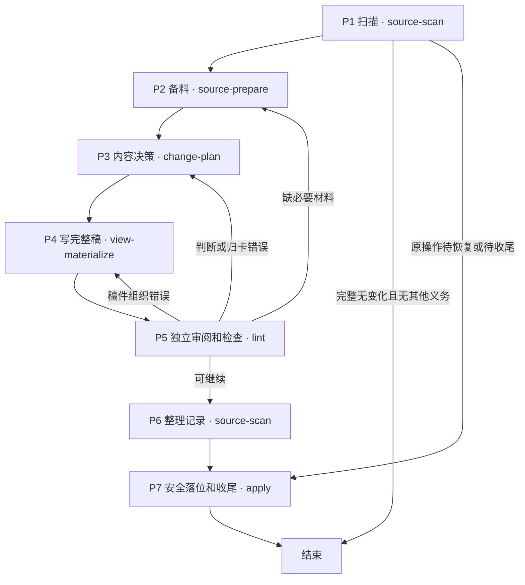
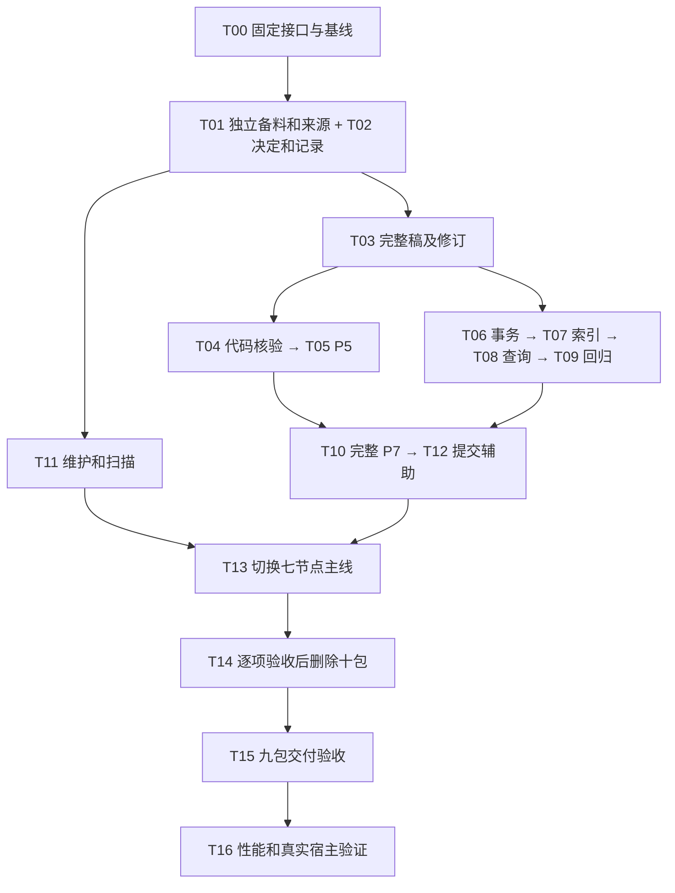

# ingest 七阶段重构 SDD 计划（评审稿）

2026-10-28。基于 `c058db3` 的现行实现。**本轮只做规划，尚未修改 Workflow、实现或删除 Skill。**

已确认的分工：主线按 P1—P7 运行；P1 扫描和 P2 备料分别使用两个 Skill；P5 负责独立审阅和完整质量检查，问题退回对应阶段；新 P7 负责安全写入、索引和检索收尾，Workflow 保证先走 P5，P7 不要求上游“通过票据”。

本轮调整为 **9 个目标 Skill：原18包中保留8包、迁移后删除10个旧包，再新增1个独立备料包 source-prepare（暂定名）**。主线使用六包，另外三包为 query、explore、maintain。P1／P2 拆分已确认，具体新动作名称和旧入口退役时点仍需在实施前固定；不以包数最少作为优化目标。

本次 SDD 的六份全文按要求暂存项目根目录，正常跟踪并提交上库。开发完成后，再按后续指示移入文档目录并设置 Git 忽略。本文作为总览，建议先看第 3、4 节的保留／删除表，再看第 8 节的实施顺序。

| SDD 工件 | 内容 |
|---|---|
| [需求](2026-10-28-ingest-seven-stage-requirements.md) | 用户路径、R01—R10 需求及范围边界 |
| [设计](2026-10-28-ingest-seven-stage-design-proposal.md) | 七阶段职责、输入输出、退回／恢复和 P5／P7 契约 |
| [Skill 迁移矩阵](2026-10-28-ingest-seven-stage-skill-migration.md) | 18 个 Skill 逐包决定、能力去向及 D1—D10 删除条件 |
| [实施任务](2026-10-28-ingest-seven-stage-task-plan.md) | T00—T16 任务、依赖和完成条件 |
| [验证计划](2026-10-28-ingest-seven-stage-validation-plan.md) | V01—V44 待执行用例、已有测试来源和证据层次 |
| [交付影响](2026-10-28-ingest-seven-stage-delivery-impact.md) | 依赖锁、规则、模板、路由、运行副本、升级及回退 |

关联：[七阶段职责设计](ingest七阶段重构设计.md)、[当前重复检查分析](ingest流程与重复检查说明.md)、[现行详细设计](himate-knowledge-wifi-mp/docs-llm-wiki/知识库详细设计.md)。本文不替代现行规范，实施时再同步正式设计。

## 1. 本次重构必须满足什么

| 需求 | 目标及完成条件 |
|---|---|
| R01 七阶段 | ingest 主线恰有七个节点，P1／P2分用扫描和备料Skill；无变化只扫即结束，待恢复或待收尾直接定位 P7；内容问题退回 P2／P3／P4，补材料不固定重扫 |
| R02 检查集中 | 一个候选版本正常只在 P5 做一次完整 lint；计划、实质跳过、成稿和必要代码依据由独立复核者审阅；独立 lint／CI 保持固定脚本用途 |
| R03 安全收尾 | 新 P7 不重跑整库质量 lint，保留写入保护；实际索引、查询、启用完成才报告整批完成；仅记录批不建索引 |
| R04 执行独立 | 最终九包不启动兄弟 Skill CLI，不导入兄弟包私有脚本，不追查上游角色或 passed 链；备料可接受清单或明确目标；允许读取业务输入及调用共用函数 |
| R05 功能不丢 | 每个旧 Skill 的公开动作、重要输出、指南和行为测试有去向；原prepare及source-capture能力直接迁入独立备料包和公共函数；删除前验证替代入口的独立用途 |
| R06 团队协作 | 共享正式资产足以支持另一工作区增量处理和消费；原生产者的缓存、私有复核、事务日志及索引不是前置 |
| R07 历史及升级 | 旧正式记录和历史结果保持原字节；未完成旧事务有原配套版本恢复路径；已写入内容不被重复写入 |
| R08 可测去重 | 消除重复生产、重复 full、逐卡重复全库关系检查和连续重复索引全验；记录实际次数及分阶段耗时，不预先承诺提速比例 |
| R09 独立用途 | 查询、维护、确切旧来源恢复、独立建索引、检索回归、事务恢复和提交清单核对都有可用入口 |
| R10 分发闭合 | Workflow、入口路由、产物模板、依赖／规则锁、测试和说明与九包目标一致，包含新增备料包；活动路径不依赖删除目录 |

原件只读、读取授权、卡身份、六种卡动作及当前／指导性／历史用途的边界继续保留。不新增 runner、catalog／registry、统一状态服务或强制真人确认。

## 2. 新主线：每一轮进去和出来是什么

下表先说明业务动作；括号里的名称是对应 Skill。P1 只负责发现待办，P2 独立负责准备材料。P6 暂沿用 source-scan 的 record 动作，其职责归属在 T00 另行复核，本轮不连带新增第十包。

| 阶段与 Skill | 入阶段前的状态 | 具体做什么 | 结束后的状态／输出 |
|---|---|---|---|
| P1 扫描（source-scan） | 有知识根、原件范围、共享处理历史和可观察的维护／本机进度 | 比对实际文件与处理清单，发现新增、变化、缺失、欠账及待续办事项；说明扫描是否完整 | 本批待办和缺口。真正无变化结束；原事务待恢复或收尾直接 P7 |
| P2 备料（新增 source-prepare，暂定名） | 有扫描清单或明确备料／修订目标，但原文、旧版本或相关旧卡未备齐 | 捕获本批真实原件、附件及必要代码；恢复确切旧版；整理相关旧卡、来源和依赖；核所用输入，不重复全量扫描 | 固定材料包、实际输入指纹及明确缺口；独立备料不冒称已完成P1扫描 |
| P3 内容决策（change-plan） | 有材料和待处理单元 | 作者决定结论、条件、归卡、保留／修改／退役；逐单元决定提炼、跳过或暂缓；固定目标查询与预期 | 内容计划、完整处置清单和查询预期 |
| P4 写完整稿（view-materialize） | 有计划、材料及作者写好的卡；修订时有旧稿和理由 | 一次组织卡、导航、来源登记、写删集合、输入及旧文件指纹；输出处置预览 | 一份完整候选稿，正式区未变；旧稿不覆盖 |
| P5 审阅与检查（lint） | 有材料、计划、处置预览、完整稿及查询预期 | 独立审阅计划、归卡、实质跳过和成稿；代码稿核对实际代码依据；执行一次完整固定检查 | 审阅范围、固定报告和明确问题。缺材料回 P2，判断错回 P3，稿件错回 P4 |
| P6 整理记录（暂用source-scan，T00复核归属） | 候选和处置已明确，有 P5 的实际审阅结果 | 机械转写已有处置、理由、范围及欠账；核对新记录结构和内容绑定，不重判结论 | 待落盘处理记录，尚不声称已写入 |
| P7 安全落位及收尾（apply） | 有明确业务输入、候选稿、记录、查询预期及写入基线；或有原操作停点 | 安全事务写入；构建实际索引，检查实际数据；执行冻结查询；核对原活动指针并启用；中断按事实续办 | 正式写入事实、实际收尾状态、报告及本批文件清单；仅记录批只落记录 |

图表示正常内容批。已明确材料不足、只记录欠账的批次，P5 审查记录事实和适用项，不无限退回备料。运行故障留在实际停点；P7 后才发现内容问题时另建修订，不重放已写入事务。

P1／P2 不合节点：无变化可只扫，缺材料可只补。备料 Skill 直接承接原 prepare 和 source-capture 的实际能力，内部复用公共函数，不新增调用旧 Skill 的包装。P5 只缺材料时回 P2，P2 只核实际采用输入；只有范围／版本改变才回 P1 更新清单。按明确目标独立备料不要求 P1 通过票据，也不声称完成全量扫描。拆包本身不保证提速。

## 3. 最终保留和新增哪些 Skill

以下名称统一省略前缀 `hs-knowledge-`；原有八包保留、新增一个备料包，最终共九个，不把两个 Workflow 算作额外 Skill。

| 目标 Skill | 新版职责及需要补充的内容 | 使用位置 |
|---|---|---|
| **source-scan**（保留） | scan负责变化发现和清单；status观察事实；prepare迁出；record暂保留，T00复核其处理历史职责归属 | P1；P6暂沿用record；独立扫描和进度观察 |
| **source-prepare**（新增，暂定名） | 承接原prepare的材料组织，以及source-capture的真实捕获、提取、确切旧版恢复和解析；来源算法由公共层直接供其他能力复用 | P2；独立按清单或明确目标备料、捕获及来源恢复 |
| **change-plan** | 保留作者的内容判断、六种卡动作、逐单元处置及冻结查询；独立复核归 P5，字节写入清单装配归 P4 | P3 |
| **view-materialize** | 一次生产完整稿；补修订、处置预览、候选摘要、写删集合和完整输入绑定；取消反复调用其他 Skill 重新生产同一稿件 | P4 |
| **lint** | 补 P5 完整独立审阅指引、审阅输出和退回分类；吸收 local-check／merge-check 的代码证据核验；保留独立只读 lint 和固定 CI 复用 | P5；独立检查 |
| **apply** | 补完整 P7 入口；吸收仅索引重建／全验／启用、检索回归、事务恢复和提交清单核对；各用途可独立调用 | P7；独立索引维护和恢复等 |
| **query** | 保留检索、结果回执和同代精读；改用共用来源／索引函数，去掉对其他 Skill CLI 的调用 | 日常独立查询 |
| **explore** | 保留项目发现、任务路由、按需环境准备、连接提示和首次代码图谱准备；更新为九包及两个 Workflow 的入口 | 按需入口，不是每次 ingest 必走节点 |
| **maintain** | 保留变化登记、状态观察、限制传播／解除、事件恢复和只读引用巡检；内部消除兄弟 Skill CLI 调用 | 跨批次维护；lint Workflow 的引用巡检 |

保留 maintain 的原因是它有跨批次的状态写入和事件恢复，不能全部塞进只读 lint；也不能全部塞进 P1，使每次扫描再次承担完整维护。explore 负责找对入口及环境，query 负责消费，它们也不属于本批内容生产。

现有独立 lint Workflow 包含“正式库 lint + maintain 引用巡检”两项职责，继续保留。将 ingest 的质量检查集中于 P5，不等于删除日常巡检或维护能力。

## 4. 哪些 Skill 迁移后删除，里面的东西搬到哪里

**以下十个包都不能先删后补。** 每一行同时覆盖正常 ingest 和原来的独立用途；过渡期旧入口可以暂留，最终不永久保留委派空壳。

| 删除条件 | 旧 Skill | 必须留下的能力与新位置 | 删除前要证明什么 |
|---|---|---|---|
| D1 | **source-capture** | 原件／附件／真实配置内源码捕获、显式编码与版本、固定提取、hash／大小／定位、bundle 与单来源解析 → **新增source-prepare**，与原prepare材料组织直接合并；确切旧版恢复 → **共用来源函数**，供 query／maintain／P7 直接使用；变化事件继续按维护规则登记 | 新入口能独立备料、捕获和恢复历史，P5补料不固定重扫；UTF-8／显式 GB18030、支持格式及附件的原字节和定位保持；缺旧版、缺授权、当前不一致分别报告；不依赖旧目录或委派壳 |
| D2 | **candidate-inspect** | 候选类型、实际字节、写删范围及输入绑定 → **P4**；原有质量检查 → **P5**；事务停点、路径及旧版本冲突 → **P7** | 三类职责都有承接；不把原来“重算计划→重生产稿→重做 full”的整条链复制进去 |
| D3 | **candidate-revise** | 补材料／重新判断 → **P2／P3**；新操作、新稿、旧稿关联和修订理由 → **P4 修订入口**；修订后重审 → **P5** | 用户纠正和审阅退回均可形成新稿；旧稿、旧报告不覆盖、不改绑；仅记录和全部暂缓分支仍可处理 |
| D4 | **local-check** | Agent 逐条代码结论复核指引、非空理由、源码／配置／范围和静态／构建／运行证据绑定 → **lint 的 P5 及独立代码证据核验** | 纯文档豁免、混合稿代码分区、当前／历史、未知条件及退役状态都有正反例；脚本不会隐式编译或运行，也不认证角色身份 |
| D5 | **merge-check** | 显式按最新代码重新复查，以及历史复查的证据边界 → **lint 独立复查动作**；固定 CI 保持其可信脚本入口 | 改代码或配置可发现失配；旧证据不偷换当前文件；没有 Git merge 副作用，也不保留新的包装层 |
| D6 | **governance-handoff** | 候选稿、计划、来源集合、基线及续办提示的描述 → **P4 候选摘要输出** | 信息可读且绑定同一稿件；缺稿件明确报错；Workflow 不再要求一份交棒文件作为资格证明 |
| D7 | **publish-handoff** | 本批正式文件及写删清单 → **apply 完成输出**；真实提交的 commit／blob／删除及变更范围只读核验 → **apply 显式可选动作** | 内容批、仅记录批清单都准确；无关改动、旧提交和字节失配可发现；不自动 commit／push／merge，不把实际提交作为 ingest 完成前置 |
| D8 | **index-build** | 独立 build／verify／activate、不可变代次、实际数据库及正文全验、local／shared、代码上下文、原活动指针与启用观察 → **apply 仅索引动作及共用索引函数** | 干净消费副本无需原作者的 view、计划、处理请求或私有 journal，也能独立建索引；不重新 ingest，不写正式知识；事务屏障和冲突保护仍有效 |
| D9 | **query-regression** | 独立回归及报告复验、明确查询预期、用途／范围、命中／排除／顺序、无截断、逐命中同代精读 → **apply 收尾及独立回归动作**，复用共用检索函数 | ingest 使用 P3 原查询，独立调用使用明确用例；失败不启用，报告复验不隐式启用；原活动指针基线不被替换；query 不承担写指针 |
| D10 | **recover** | inspect／resume／rollback、原事务及备份、外部修改保护、已提交终态 → **apply 原事务动作** | 部分写入和响应丢失能按原事实恢复；已写入不重放；真正旧规则未完事务能取得原配套版本；不靠保留 recover 包委派 apply |

这里只删除重复入口和失去职责的包装。六种卡动作——新建、更新、合并、拆分、退役、暂缓——继续由 P3 决定、P4 表达、P5 检查；旧结论去向和卡身份不能因入口合并而丢失。

来源恢复也不能简化为“读取当前文件”。原件变了、原作者缓存不存在时，仍须按明确版本、真实 hash 和大小恢复所采用的确切原版，再复现固定提取与定位；无法恢复就报告缺口，不隐式联网或换成最新版。

## 5. 具体去掉哪些重复，哪些检查仍要留

| 现行问题 | 新版安排 | 仍保留的必要检查 |
|---|---|---|
| 同批字节写入清单计算四轮、完整稿生产两轮 | P3 只表达作者判断，P4 一次装配完整稿；P5 检查该实际稿件，不重演生产链 | 输入结构、实际内容绑定、写删范围和旧版本指纹 |
| 预检、技术检查内部、最终 lint、apply 都跑完整质量检查 | 正常候选只在 P5 跑一次完整 lint；出问题形成新候选后重审 | 各动作自身合法性；P7 安全写入检查；独立 lint 仍可主动运行 |
| apply 每校验一张卡都重新检查全库关系 | 关系质量规则集中 P5 一次检查 | P7 检查实际写入对象、允许路径和前后字节，不再逐卡全库关系扫描 |
| P7 索引构建、回归、启用链对同一真实代次连续多次全验 | 同进程、固定输入和未变产物下复用一次真实代次全验结果；重启／漂移时重新核验 | 启用锁内仍检查当前输入、有效性状态和原活动指针；成功后回读 |
| 同一次 full 内对历史记录强校验后，限制重建再遍历校验 | 同一调用内复用已解析且绑定确切输入的记录数据 | 独立执行或输入变化不能沿用旧结果 |
| P1 查历史收尾时提前全验旧索引 | P1 定位本机待续办及未知状态，选定原操作后由 P7 核验实际候选代 | 共享处理历史、维护欠账及当前来源观察仍要做；未检查不能报“无问题” |

P5 的临时索引与 P7 的真实索引对象不同，不能简单删掉其中一个。P6 的待写入记录与 P7 补实际写入事实后的记录也不同，各自结构和绑定检查都要保留。

写锁、未完事务屏障、写前全写集对比、备份后再核对、事务记录、逐文件及最终回读仍由 P7 保留。去重不等于只相信某份旧报告。

## 6. 共用函数与团队协作的边界

“Skill 没有执行依赖”表示不从一个 Skill 进程启动另一个 Skill，也不通过私有脚本路径偷用其实现。来源解析、记录解析、卡数据、索引和检索放到现有领域共用层；各保留包直接调用。Skill 指引、Workflow 交棒和普通业务数据依赖仍存在。

九包目标不要求写成一个大脚本。apply 内部仍分事务、恢复、索引、回归、启用及提交核对模块；独立索引动作不加载一套空的 ingest 流程。source-scan 与 source-prepare 分别说明扫描和材料准备的输入输出；公共来源函数保留实际捕获副作用及恢复边界。P6 的 record 归属另审，不借本次拆分扩大决策。

正式卡、来源锁、约定的处理历史及有效维护事件按既有规则共享；`.build/`、本机事务／备份、索引和私有来源缓存继续是本机资产。另一工作区看到共享已处理记录，不应被要求恢复原生产者的私有操作。它只处理自己的实际索引和维护状态。

P5 后到 P7 写入前，需要核对这次真正审阅所依赖的材料、已有卡、来源、代码／配置、规则和写入基线的指纹。写入后，索引针对新正式区建立自己的基线；不能用旧正式区指纹阻断自己刚写入的结果。指纹描述业务内容，不是通过票据。

固定 CLI／CI 不启动模型，也不要求原生产者私有审阅证明。Agent 的独立语义审阅由 P5 宿主安排；脚本只能核对材料和声明的结构、内容绑定及固定规则。

## 7. 删除目录以外，还要迁移什么

| 资产 | 迁移要求 |
|---|---|
| Skill 指引和公开 API | 迁移触发用途、请求字段、默认动作、错误／成功含义、只读及写入边界；新动作名称在 T00 固定 |
| 产物与模板 | 审阅结果、代码证据、修订关系、候选摘要、回归报告、恢复结果和提交清单随职责迁移；历史产物不改签 |
| 依赖和规则锁 | 按实际内容更新运行／开发依赖锁与规则锁；不沿用已失真的摘要 |
| 测试和测试运行器 | 先迁业务预期和负向用例，再删原测试目录；更新运行器的发现路径，避免少跑测试被误当优化 |
| Workflow 和布局 | ingest 切成七节点并核对真实 owner 和返回路径；独立 lint 的只读引用巡检保留 |
| 入口及共享文档 | explore、业务入口示例、总体／详细设计、能力清单和使用指南统一；不重写历史分析里的旧名 |
| 实际运行副本 | 源码、Agent 已安装能力及 OpenFlow 已保存模板分别核对；改源码不等于旧会话自动使用新版 |
| 升级与恢复材料 | 保存原配套规则／能力版本及旧未完操作的处理方式；不靠删除日志清除问题 |

当前实际有 18 个 active Skill、两个 Workflow、23 份产物 YAML 和每包运行／开发依赖锁。这些是现状盘点，目标产物数量由迁移后契约决定，不能直接按删包数量相减。两个没有 `SKILL.md` 的历史确认目录不算 active Skill。

当前源码已没有历史部署安装器；按现有 explore/setup 和宿主实际能力加载方式调整，不为这次重构新建安装登记体系。

## 8. 实施任务及依赖

所有任务当前均为**待实施**。先扩展保留包、迁移及验证能力，再切 Workflow，最后删除旧包。下面每项都应以可独立验证的变化交付；发现单项过大时继续拆分。

| 任务 | 做什么 | 前置任务 | 完成依据 |
|---|---|---|---|
| T00 固定基线和接口 | 逐动作盘点；固定九包的目标动作、输入输出、成功含义、旧版本恢复和性能对比条件；另审P6记录归属 | 无 | P1/P2分工明确；十个删除决策均有替代入口、所需资产及对应验收；不虚填通过结果 |
| T01 独立备料及来源迁移 | 新建source-prepare，直接承接原prepare和source-capture；捕获、提取、确切旧版恢复及共用来源函数迁入目标位置 | T00 | D1及V44通过；可按清单或明确目标独立备料，补料不固定全扫；query／maintain／P7直接复用公共函数 |
| T02 决定及记录 | P3 完整处置和查询预期；P6 机械转写；仅记录及维护欠账表达 | T00 | 不漏单元、不重判，不把未完成写成已处理 |
| T03 完整稿及修订 | P4 一次组织完整稿、输入绑定、摘要和新旧稿关联 | T01、T02 | D2 的生产部分、D3、D6 及六种卡动作有替代覆盖 |
| T04 代码证据迁移 | lint 承接代码审阅指引、固定证据核验及独立复查 | T01、T02、T03 | D4、D5；正式 lint／CI 不依赖私有审阅 |
| T05 P5 统一审阅 | 独立 reviewer、一次完整 lint、审阅输出及退回分类 | T04 | 材料／判断／稿件分别正确退回；语义阻断注明未执行项 |
| T06 安全事务及恢复 | 新写入路径去整库质量复查；保留冲突、锁、备份、回读和原事务恢复 | T02、T03 | D2 的安全部分、D10；故障时不覆盖外部字节、不假报成功 |
| T07 独立索引 | apply 仅索引入口及共用索引模块；分开实际数据全验与知识质量 lint | T01、T06 | D8；不需要原 view／P3／P6，不重写正式知识 |
| T08 查询共用算法 | query 直接复用来源／索引／检索函数，保留原用途和精读协议 | T01、T07 | 独立查询无兄弟 CLI；当前／历史、错误及并发读取不回归 |
| T09 独立检索回归 | apply 承接明确案例、报告复验、同代精读及原活动指针基线 | T07、T08 | D9；不放宽预期换取通过，复验与启用分开 |
| T10 完整 P7 | 同一入口组合事务、实际索引、回归和启用；保存停点及续办事实 | T05、T06、T07、T09 | 每个持久停点能继续；只写完不报整批完成；不重复写入 |
| T11 维护和扫描 | 保留维护用途及 lint 巡检；减少 P1 提前全验；消除内部嵌套调用 | T01、T02 | 状态与写事件边界不变；无原机日志的消费端不继承生产者义务 |
| T12 提交辅助 | 迁移本批文件清单和显式只读提交核对 | T06、T10 | D7；准确核对真实提交，不执行 Git 写入 |
| T13 切换主线 | 七节点、布局、真实角色、explore 路由、共享说明和模板一起切换，P1/P2分用两个Skill | T05、T10、T11、T12 | 新路径不再使用旧十包或旧prepare入口；独立 lint Workflow 仍可用 |
| T14 删除十包 | 先在隔离安装中验证仅九包及升级路径，逐行验 D1—D10；迁测试／模板，清活动引用后删除旧目录 | T01—T13 覆盖完成 | 每项删除均有替代入口和删前隔离验证结果；保留业务历史及旧版恢复路径 |
| T15 九包交付复验 | 删除后的最终分发、干净环境、升级、共享副本、锁和旧版本恢复机制复验 | T14 | 含新备料包的最终产物实际无旧目录且全用途可用；没有旧 PATH、私有导入或缓存兜底 |
| T16 性能及真实宿主 | 同条件改前改后数据；实际 OpenFlow、SSH 及可用 API 环境验证 | T15、实际环境可用 | 分开报告脚本、API、SSH、交棒耗时和未验证范围 |

下图是任务的汇总依赖，精确前置以上表为准。

T00 保存可复现的改前版本和测量条件；实施时先取得改前数据，再与新版比较。T16 的真实环境结果不能用静态检查或合成测试替代。

## 9. 验证计划：先保行为，再看速度

配套[验证计划](2026-10-28-ingest-seven-stage-validation-plan.md)已列出 V01—V44 共 44 项**计划用例**并关联 R01—R10、已有测试及任务，不是本轮通过了 44 项测试。主要覆盖如下：

| 用例 | 要验证什么 |
|---|---|
| V01—V08 | 七节点、正常文档／代码／混合批、三类退回、一个候选正常一次完整 lint |
| V09—V16 | 审阅后输入漂移、P6 转写、仅记录、真实欠账、跳过范围、无变化、用户修订、P7 不依赖通过票据 |
| V17—V25 | P7 各停点、写前冲突、并发读写、静默写入失败、硬退出恢复、响应丢失、尾部失败、索引篡改及启用竞态 |
| V26—V32 | 独立索引／回归、确切来源恢复、维护限制、独立 query、只读巡检、固定 lint／CI 的独立性 |
| V33—V38 | 真实 Git 干净副本、共享白名单、旧规则恢复、物理移除十包、九包分发升级、实际运行无兄弟调用 |
| V39—V40 | 同条件性能和实际 OpenFlow／SSH／API 验证 |
| V41 | 六种卡动作、旧结论保留／退役及合并拆分映射 |
| V42 | 本批提交清单、真实 commit／blob／删除及无关变更范围的只读核对 |
| V43 | 维护变化登记中断、事件恢复、缺 payload／证据及仅解除机械限制 |
| V44 | P1/P2分Skill；无变化只扫、按明确目标独立备料、P5只回P2、补料不全扫、输入漂移回P1，新增包不依赖旧CLI |

验证分三层报告：静态结构、隔离合成机制、真实宿主。合成审阅记录只能证明协议和返回机制，不能证明模型理解正确或宿主真的创建了独立 reviewer。实际远端、SMB／权限、硬件和 CI 合入需要各自对应环境的证据。

旧测试跟随业务行为迁移：修改调用入口，但保留原正文、hash、定位、断言映射、真实 Git clone、故障字节和负向预期。测试运行器当前会从包目录发现测试，删包前必须迁移，不能把测试数量下降当作检查变快。

性能分别记录总耗时、各阶段墙钟、模型等待、CLI 启动数及时间、SSH 往返、来源读取与索引计算。固定来源字节、知识规模、查询预期、硬件和解释器，注明冷热状态、样本数与重试。当前约 1.5 小时是现场反馈，本轮没有实测并确认其构成。

## 10. 什么时候才允许删除和宣布完成

每个旧包删除前，都应同时具备：

1. 对应 D 条件的替代公开入口及实际验证结果，包含原独立用途。
2. 请求、结果、模板、指引及关键业务测试已迁移；旧测试目录不是唯一覆盖。
3. 目标九包、两个 Workflow 和活动路由不再引用它；新增备料包具备实际能力，没有私有 import 或 CLI 兜底。
4. 旧历史保持原字节，真正未完旧操作可用原配套规则和能力恢复。
5. T14 先在隔离安装中验证目标九包及升级路径；业务端实际安装能力和 OpenFlow 模板有明确切换清单。删除后再由 T15 复验最终交付产物。

先验证新入口，再切换主线，最后收缩目录。切换失败时回到原配套版本；已有新写入按其原事务和停点处理，不能仅把 YAML 换回旧版后重复入库，也不能靠删日志消除待办。

本次规划完成表示能力归属、迁移次序和验收条件可供评审。实施完成需要 T01—T15 的实际结果；耗时改善和真实宿主结论需要 T16 的实际证据。
