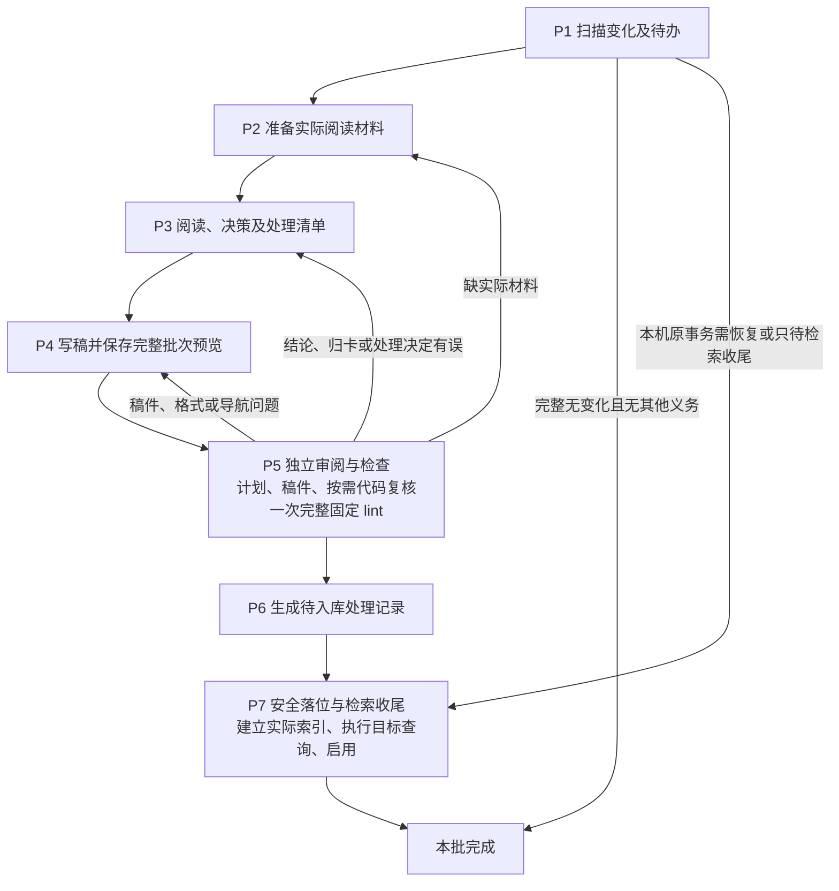

# ingest 七阶段重构设计（讨论稿）

2026-10-28。状态：P5／P7 的职责分工已确认，接口和兼容细节仍待对齐。本文用于设计评审，尚未实施，不替代现行执行规范。逐包保留／删除、能力迁移、实施任务和验收条件见[SDD 计划](ingest七阶段重构SDD计划.md)。

**已确认的核心分工：**P5 负责独立审阅和知识质量检查；新 P7 独立调用只保证安全落位和检索收尾；Workflow 保证先走 P5，P7 不要求上游通过票据。

本文提出七阶段的职责、输入输出、退回和恢复方式，以及推荐的能力重构方案。候选接口及迁移安排仍可调整；本次仅发布本文，没有修改 Workflow 或实现。

依据[当前详细设计](himate-knowledge-wifi-mp/docs-llm-wiki/知识库详细设计.md) §2.1、§5.2—§5.7、§6.3 及实际调用链。目标是主线保持 P1—P7，业务检查集中于 P5 lint，问题按类型退回前面阶段，减少 Skill 之间的执行依赖。当前重复调用的分析见[重复检查说明](ingest流程与重复检查说明.md)。

## 1. 推荐方案

主线固定七个 OpenFlow 节点。P1/P2/P3/P4/P6/P7 由作者／执行者负责；P5 由独立复核者负责。单个节点可以执行本阶段的多个内部动作，但不通过临时改角色来冒充独立复核。

图只表达正常内容批和 P5 的内容退回。运行故障保留原停点；事务恢复及索引续办在 P7 内按真实进度选择，不为重试重新写一遍知识。

P1 识别出本机原事务待恢复，或已入库而索引／查询／启用未完成时，直接按原操作交 P7，不经过 P2—P6 重新提炼或登记。只有其他工作区提交的共享处理记录、没有本机执行事实时，不推断需要恢复原生产者；消费端自己的索引状态按实际情况检查或重建。

## 2. 七阶段的输入、职责和输出

| 阶段、主 Skill | 输入前状态／实际输入 | 本阶段负责什么 | 结束后的实际输出 |
|---|---|---|---|
| P1 扫描：`hs-knowledge-source-scan` 的 scan 动作 | 已知知识根及可选 raw 范围；正式处理历史、现有维护状态及本机操作记录可读取 | 观察原件／必要上下文变化，识别新增、修改、缺失、处理欠账和待续办事项；确定范围完整性 | 固定扫描清单、待办、明确缺口和续办线索。没有变化且无其他义务则结束，不制造记录 |
| P2 备料：同一 Skill 的 prepare 动作 | 扫描清单、用户修订目标、已识别的维护事项 | 捕获本批实际原文，恢复相关旧版本，找关联旧卡和明确依赖，按需准备代码／配置材料 | 材料包、完整旧卡、来源和定位、版本差异、必要材料指纹及缺口 |
| P3 决策：`hs-knowledge-change-plan` 的 plan 动作 | P2 的材料包及本批所有待处理单元 | 作者判断结论、条件、归卡、修改与保留范围；逐单元决定提炼／跳过／暂缓等；冻结本批目标查询及预期 | 内容计划、逐单元处置清单、查询预期。这里只保存作者判断，不再另设提前独立审计划节点 |
| P4 写稿：`hs-knowledge-view-materialize` 的统一生产入口 | 内容计划、实际材料、作者写好的卡；退回时另带旧稿及修订理由 | 直接组织卡、导航、来源登记、写删集合、旧版本和批次预览；冻结本阶段实际依赖的输入指纹 | 一份完整候选稿及处置预览，正式区不变。内部不再调用其他 Skill 重新生产计划或稿件 |
| P5 审阅与检查：`hs-knowledge-lint` | 本批扫描／材料／内容计划／处置预览／完整候选稿；按需实际代码和配置；冻结查询预期 | 独立 reviewer 审计划、归卡、实质 skip 和成稿；代码稿按需核对逐条断言；然后执行一次完整固定检查，汇总问题 | 独立审阅记录、固定 lint 报告、实际覆盖与未审范围、问题位置和建议退回阶段。候选内容仍只读 |
| P6 记录：`hs-knowledge-source-scan` 的 record 动作 | 已固定且经过 P5 审阅的逐单元处置清单及本批实际结果 | 将已有决定机械整理成待入库记录，不重新判断该新建、更新还是跳过 | 待入库记录及其目标路径／内容摘要；仍不写正式记录 |
| P7 落位与收尾：`hs-knowledge-apply` 增加完整批次入口 | 完整候选稿、待入库记录、实际材料和原文件指纹、冻结查询；续办时另有本机真实事务／代次事实 | 安全落位；按实际停点构建并核验候选索引、执行目标查询、启用并回读 | 事务结果、索引代次、回归和启用事实。只有实际收尾完成才报告整批完成 |

新主线复用五个主 Skill，不另建统一 runner、安装登记或新的流程身份系统。进一步建议最终保留这五包及 query、explore、maintain，共八包；另外十包在独立用途、模板和测试迁移完成后删除。过渡期旧入口暂留，不作为永久兼容空壳；逐包去向见 [SDD 迁移表](ingest七阶段重构SDD计划.md#4-哪些-skill-迁移后删除里面的东西搬到哪里)。

## 3. “检查集中 P5”的准确边界

### 3.1 全部知识质量审查集中 P5

P5 负责内容是否成立、是否漏项／错归、实质 skip 是否合理、卡片是否忠于计划，以及格式、Profile、引用、导航、关系和历史处理数据等完整质量检查。

移除当前 P3 的提前独立计划复核节点；其审阅范围并入 P5，不遗漏未产卡的跳过／暂缓单元。移除 P4 独立预检、技术检查、代码核验、修订调度节点：必要工作分别进入 P4 生产动作、P5 审阅检查及返回路径。

新 P7 主线不再运行 `validate_final_cards`／`checks.run(scope='full')` 重新审核全库质量，也不调用 lint。

索引共用函数也要拆清必要解析与完整质量规则：P7 可以解码建立索引必需的字段，但不通过旧解析／构建调用链再次执行整库 Profile、关系、历史覆盖等审查。否则只是把重复检查从入库路径挪到索引路径。

### 3.2 每个动作仍保留完成本职工作所必需的检查

| 所在阶段 | 保留内容 | 原因 |
|---|---|---|
| 所有公开入口 | 输入可读取、必要字段存在、引用与本次对象一致、规则可加载、路径在允许范围 | 没有这些信息，无法正确执行本职动作；不等于再审一遍知识 |
| P1/P2 | 扫描完整性、实际指纹、读取期间原件是否变化、旧版能否取得 | 形成可靠待办和阅读材料，未知不能冒充无变化 |
| P4 | 生成字节和摘要一致、允许写删目标、完整输入集合可描述 | 保证交出去的稿件确实是作者刚保存的那一份 |
| P6 | 新记录的最小结构、处置清单完整转写、引用和内容绑定 | 新对象是 P5 后才生成的，不能依赖未来对象已被检查的假设 |
| P7 写入 | 输入指纹未变、原文件版本比对、写锁、未结束事务屏障、备份、日志、写后回读 | 防止写错文件、覆盖他人修改、部分落位或误报成功 |
| P7 索引和启用 | 实际新建数据库的完整性和同代一致性、冻结查询的实际结果、启用时原活动指针与当前状态、指针回读 | 这些对象／结果在 P5 后才产生，P5 无法提前证明它们实际正确 |

P5 的临时索引检查用于检查待入库内容可被正确索引；P7 验证刚生成的真实索引。两者对象不同。优化目标是 P5 一次临时检查、P7 一次正常连续执行中的实际代次全验，消除阶段内部的重复全验；不是承诺整个任务只出现一次所有种类的检查。

## 4. P5 中 Agent 与脚本的分工

P5 的主 Skill 说明扩展为“完整候选稿的独立审阅与固定检查”。独立运行 lint CLI 的原有固定检查用途继续保留。

1. OpenFlow 将 P5 交给独立 reviewer。它实际阅读原文、旧卡、内容计划、处置清单和成稿；代码稿另核实际源码／配置及断言需要的材料。
2. reviewer 保存审阅记录：结论与理由、问题和位置、实质 skip 样本及未审范围、逐条代码依据、确切内容／来源绑定。名字或角色标签不能证明独立性，独立任务和上下文由宿主安排。
3. 没有已知阻断问题时，调用一次 lint 固定脚本。代码复核记录的结构、引用、证据类型及确切字节绑定校验也集中在这套固定契约中。
4. P5 汇总审阅与机器报告。语义问题已经阻断时可直接退回，明确标注固定检查未执行，不为错误稿再建立临时索引。

lint CLI 始终不启动 LLM，不联网获取原文，不写卡，也不直接执行返回 P2/P3/P4。它输出确定性结果和问题事实；P5 的 Agent 汇总建议，OpenFlow 执行返回。

本次代码审阅记录的结构／绑定检查适用于 P5 候选审阅。正式库独立 lint／CI 不因缺少原生产者的私有审阅记录而失败，也不通过这些记录的 passed 状态判断结论资格。

CI 仍只复用确定性函数，不运行 Agent，不读取生产者私有复核票据。固定报告通过不等于内容语义已被独立复核；只有这次 P5 实际两部分都完成，Workflow 才走内容批的正常成功出口。

一次检查指一个确切候选版本的一次正常 P5 执行。修稿形成新版本后必须重新进 P5；未变判断可以作为阅读参考，但不能将旧报告改绑到新稿上。

## 5. Skill 独立与业务数据衔接

### 5.1 取消执行依赖

新主线中，各 Skill 不再启动另一 Skill 的 CLI，也不直接导入另一 Skill 的私有脚本。当前“技术检查→保存稿件→验证计划→重新生成计划”等调用链拆除。

需要共享的文件读取、来源恢复、内容装配、索引和检索算法，通过领域公共函数复用。优先复用现有 `governance/contracts/`，按实际的多个调用者提取共用逻辑；不把被删节点的复杂性复制到多个 Skill，也不新增通用调度引擎。

P2 和独立来源捕获能力可以复用相同来源函数；P4 和旧的计划／修订工具可以复用相同内容装配函数；P7、独立索引／查询／回归工具可以复用相同算法。副作用和本职输出仍由各公开入口控制。

### 5.2 保留业务数据依赖

P4 需要 P3 的作者计划，P5 需要完整候选稿，P7 需要具体待写字节。这些是输入材料，不是 Skill 运行依赖。

后续 Skill 不检查“某节点是否通过”、Workflow run/node/attempt、作者链、上游角色或通过票据。不增加“拿着 passed lint_ref 才准写”的机制。正常顺序、独立复核及退出由 OpenFlow 管理。

### 5.3 P5 后输入变化的处理

P4 的批次预览同时固定本次完整检查所需的输入指纹，包括适用规则、正式卡集合和来源锁、本批原文／旧卡／材料及所需代码／配置。它描述业务输入，不是通过凭证。

P5 核实这份输入与实际材料一致；缺必需材料或需要额外证据时退回补齐，不悄悄改变待审对象。P7 使用同一份输入描述，重新观察当前指纹与原文件版本；变化时停止原批写入，按问题返回重新审阅，不将通过报告当作当前状态。

这里要区分两套状态：写入之前，核对 P4 固定的正式区旧状态；写入完成后，候选索引固定实际写后集合和当前状态，启用时核对这一套写后值。不能拿旧状态与本批刚写入的新卡／来源锁比较，也不能在续办时任意重设已固定的候选代或原活动指针。

这只是本批写入的一致性保护，不给日常 query 新增全库通过门槛，也不改变 receipt、用途和同代读取的既有协议。

## 6. 返回、记录及恢复

| 发现的问题／状态 | 处理位置 |
|---|---|
| 原文／旧版／源码／配置等必要材料缺失，定位不可恢复 | 回 P2；材料影响原判断时再经过 P3/P4 |
| 结论、范围、归卡、合并拆分、实质 skip 或查询预期有误 | 回 P3 重判，再经 P4 保存新稿 |
| 已定计划无误，但卡片表达、格式、导航、来源登记或稿件组装有误 | 回 P4 修稿，再经 P5 |
| lint 加载失败、超时、依赖不可用或响应不明 | 保存当前候选和停点，查明实际执行状态后重试；不自动改卡 |
| P6 机械生成记录失败 | 留 P6 修正生成问题；不得趁机重作处理决定，决定改变时回 P3/P5 |
| P7 写入中断 | 按原事务恢复／回滚，保留外部修改；不建立新事务冒充恢复 |
| P7 卡已落位，索引尚未完成 | 保留原入库事实，只续办索引 |
| P7 候选索引已有，查询或启用未完成 | 沿原代次、查询预期及原活动指针基线续办，不重复入库 |
| SSH 断连、响应丢失或执行结果不明 | 先核原执行端进程、原操作日志、代次和实际启用观察，再决定是否续办；不能仅因断连重启入口。事务已完成则只补收尾，查询报告通过但无启用事实仍不算整批完成 |
| 已入库后确认内容有误 | 新修订操作回 P2/P3/P4，经 P5/P6/P7；原入库事实不改写 |

P3 在写稿前形成逐单元处置清单，至少包含单元、处置、理由、观察／采用版本、覆盖范围、关联卡／断言、欠账和下一步。P4 将其纳入批次预览，P5 审这份已有清单。P6只转写；P7补记真实完成事实并核对新记录及落位结果。

没有内容写删、只有实质 skip／defer／failed／uncovered 时，P4可输出空内容写集和处置预览；P5审处置及适用固定项，内容／代码／索引项说明不适用；P6/P7只保存记录。记录保存成功不把未完成内容改成已完成。

材料缺失若阻断产出知识，回 P2；若本批明确只登记这个缺口及欠账，P5 可以在核实理由、范围和已有事实后交 P6，不要求先补齐材料才能记录缺口。实质 skip 仍需要足够依据，不能把缺材料伪装为“已审无增量”。

完整无变化且无修订、维护或收尾义务时，P1直接结束。用户明确修订即使 raw 未变，也进入新操作，重新准备相关原文和旧卡。

## 7. P7 入口选择

| 方案 | 优点 | 代价／限制 |
|---|---|---|
| 一个 OpenFlow 节点依次调用现有入库、索引、回归三种 CLI | 接口改动较少，先减少 Agent 交棒 | 仍多次冷启动和加载；现有回归继续嵌套 CLI；难在一次调用中共享已核验的实际索引状态 |
| 在已有入库 Skill 增加完整批次动作，同进程组合事务、索引、回归和启用 | 一次入口处理完整 P7，复用实际快照和解析，明确保存各子阶段停点，符合取消 Skill 嵌套调用目标 | 需要提取共用索引／查询函数，调整输出和恢复测试；工作量较大 |

推荐第二种。动作名在接口实现设计时确定；不新建独立 runner 或第八个必走节点。

新动作顺序：核对明确输入 → 安全落位并保存事务结果 → 构建实际候选索引并完整验证 → 执行原冻结查询和同代读取 → 锁内核对当前指纹与原活动指针 → 启用、回读并保存事实。

新动作正常连续执行可以复用同进程验证结果；进程重启后不继承内存状态，对要复用的实际候选代重新核验，再从真实停点继续。任何时候都不能用新的活动指针值覆盖原基线以求通过。

## 8. 独立使用和兼容影响

这次不只是 YAML 合并，至少改变三项现行职责：提前计划复核合并到 P5；P5 的 Agent 指引承接完整独立审阅；新 P7 主线不再做全库质量 lint。

新 P7 动作成功表示本次安全写入及实际检索收尾完成，不自行宣称独立语义复核、CI、Git 提交或合入。质量审查是否执行由 Workflow 的 P5 安排，不能因调用 P7 成功生成一份虚假的审稿认证。

独立调用新的安全写入／批次动作，也不能被宣传成替代 P5 的完整质量检查。当前 `fixed_business_checks` 等事实层次必须按实际执行更新。

兼容建议：过渡期保留旧事务 run/inspect/resume/rollback 等动作及其已有行为，新 Workflow 使用新增入口；旧入口若仍完整检查，应如实保留旧的结果语义，不能悄悄降级为只写入。最终保留哪些旧动作、如何退役须在接口任务中固定；十个旧包按 SDD 的逐项删除条件迁移后删除。

旧正式处理记录、来源锁、历史审阅及事务记录保持原字节。真正未结束的旧规则事务用原配套实现恢复；新规则不能把旧 committed 内容当作未写入重放。公共函数或机器规则改变时需同步规则锁和相应验证，不重签历史记录。

## 9. 实施拆分和验收重点

实施任务已在 [SDD 计划](ingest七阶段重构SDD计划.md#8-实施任务及依赖)中拆为 T00—T16，当前全部待实施。总体按依赖顺序分五块：

1. 定义七阶段输入输出、处置预览、输入指纹及 P7 完成语义；同步总体／详细设计中的阶段和返回图。
2. 拆除 P2/P4 的 Skill CLI 嵌套调用，统一一次生产完整稿件；保留来源准备、独立工具与兼容入口。
3. 建立 P5 独立审阅和一次完整 lint 的入口指引／输出，集中代码记录绑定及完整质量规则，调整 P6 的机械转写。
4. 实现 P7 新完整入口和共享索引／检索函数，去掉新主线中的重复质量检查及连续重复全验，保持恢复和并发保护。
5. 收敛 Workflow／布局为七节点，更新各 Skill、包／规则锁、说明与测试；逐项验收能力迁移，再删除明确的十个旧包，并验证最终八包形态。

重点通过公开入口验证正常文档／代码批、退回 P2/P3/P4、仅记录批、明确修订、无变化、写入中断、已入库后收尾失败、响应丢失、输入漂移、跨工作区消费和旧入口兼容。合成复核记录只能证明机制，宿主确实创建独立 reviewer、真实 API 等待及 SSH 运行需单列实测。

结构和性能验收分开：新主线七节点；一个候选版本正常只在 P5 调用一次完整 lint；新主线不启动兄弟 Skill CLI；P7没有整库质量 lint。再测逐阶段墙钟、公开 CLI 启动数和实际运行时等待，不用节点数推算固定提速比例。

## 10. 尚需对齐的接口细节

核心职责分工已确认，后续重点对齐：

1. P5 独立审阅记录、固定 lint 报告的具体字段和问题分类，以及独立 lint／CI 的适用范围。
2. P7 完整批次动作的入口和完成状态、原事务／候选代续办方式，以及旧事务接口的兼容安排。
3. 共用函数的实际拆分、输入指纹覆盖范围、分步切换和验收用例；避免只是合并七个画布节点，内部仍保留原来的重复调用。
