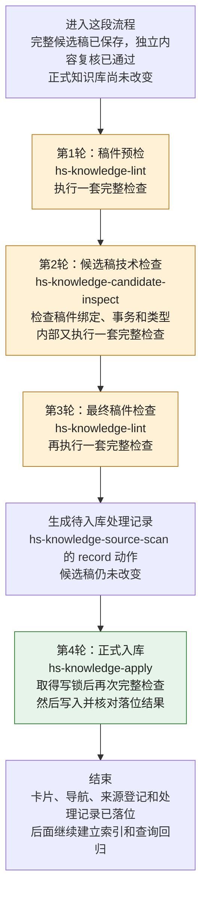
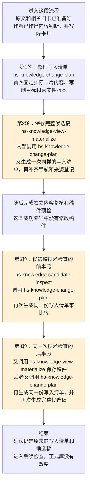
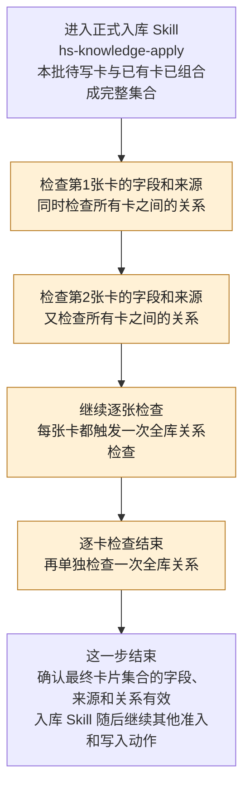
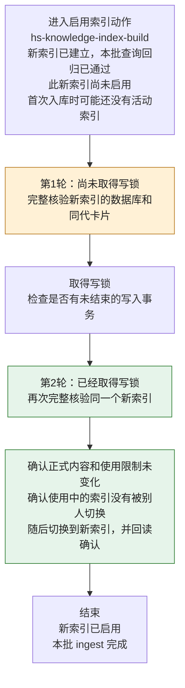

# ingest 流程与重复检查说明

本文按实际 Skill 说明四组较明确的机械重复：每轮进入时已有什么、应当完成什么、结束后应有什么，以及重复发生在哪里。

审查日期：2026-10-28。依据仓库版本 `7e1e956da97b10fe262624367995dd3ea1a5f53e` 的设计与实现。范围是**纯文档入库、正常一次通过、没有中途改稿或重试、本机索引**。以下次数来自源码调用链，不代表实测耗时；去重方案尚未实施。

## 阅读约定

图中先写中文动作，再写实际 Skill 名。**同一个 Skill 可能被多次调用，一个 Skill 内部也可能调用另一个 Skill**；因此，图中的每一轮不一定是独立的 OpenFlow 节点。

三个状态先说明：

| 名称 | 实际含义 |
|---|---|
| 写入清单 | 作者写好卡片后，脚本固定“哪些文件要写入或删除、具体内容是什么、原正式文件是什么版本”。对应 `plan.json` |
| 完整候选稿 | 本批拟修改的卡片，加上导航、来源登记和写入前条件。保存在 `.build/`，正式知识库尚未改变 |
| 启用新索引 | 把已经构建、检查并通过查询回归的新索引设为后续查询使用的版本 |

本文所说“同一份候选稿重复检查”，还要求期间相关正式文件、来源、规则和检查材料均未变化。仅候选稿文件名相同，不足以证明所有输入相同。

## 1. 同一份候选稿，先后做四轮完整检查

这里的“完整检查”包括格式、来源引用、导航和关系、历史处理记录，以及临时建立索引并核验。

### 当前顺序

### 每轮的职责和状态

| 轮次、实际 Skill | 进入 Skill 前 | 本轮应做什么 | 成功结束后 |
|---|---|---|---|
| 第1轮：稿件预检，`hs-knowledge-lint`；流程节点 `lint_preflight` | 完整候选稿和独立内容复核结果已有；尚未入库 | 提前发现格式、来源、导航、关系及索引结构问题 | 有一份针对本稿的完整检查报告；稿件和正式库均未修改 |
| 第2轮：候选稿技术检查，`hs-knowledge-candidate-inspect`；流程节点 `inspect_candidate` | 上一轮预检已通过；同一份候选稿仍在 | 核对实际稿件与写入清单一致、原正式文件未变、没有待恢复事务，并区分文档稿／代码稿 | 文档稿被标为可以继续；仍返回原候选稿，没有改稿或入库 |
| 第3轮：最终稿件检查，`hs-knowledge-lint`；流程节点 `lint_view` | 技术检查已完成；纯文档路径中间没有修改候选稿 | 生成最终完整检查报告，供后面登记和入库使用 | 最终完整报告通过；稿件和正式库仍未修改 |
| 第4轮：正式入库，`hs-knowledge-apply`；流程节点 `apply_view` | 最终检查已通过；另有新生成的待入库处理记录 | 在写锁保护下检查实际待写内容，核对原文件，备份、写入、回读，并补记真实处理结果 | 卡、导航、来源登记和正式处理记录同批落位，事务完成 |

### 重复点

**最明确的是第1、2、3轮中的完整检查部分。** 第2轮原本有自己独有的技术核对，但实现又运行了一遍与前后 lint 相同的完整检查；第3轮随后仍检查同一份候选稿。

这里不是三次人工内容审阅，而是脚本多次执行相同的一组规则。每轮正常通过时，还会各自建立并核验一个临时索引。

**可讨论的去重方向：**将“技术检查独有的项目”和“一次完整稿件检查”组织在同一阶段，保留真实检查报告。若需要提前发现格式问题，可保留轻量预检，而不提前跑整套索引检查。

第4轮应保留写入边界的复查：它针对即将真正落位的内容，并取得了写锁。待入库处理记录在这里另行校验、补记后再校验；不能用前面的一份通过报告直接跳过这些动作。

依据：[实际流程顺序](workflows/common/knowledge/hs-knowledge-ingest/workflow.yaml#L129)、[技术检查中额外执行完整检查](skills/common/knowledge/hs-knowledge-candidate-inspect/scripts/inspect_candidate.py#L159)、[入库时完整检查](skills/common/knowledge/hs-knowledge-apply/scripts/transaction_v3.py#L74)。

## 2. 为了验证同一份稿件，反复生成同一份写入清单

这一组发生在“作者已经写好卡片”之后。这里的写入清单固定的是文件和具体内容；作者对原文、结论和归卡的判断已经在前面完成。前面的内容计划由 `hs-knowledge-change-plan` 的 `plan` 动作保存为 `semantic-plan.json`，不计入下面4轮。

### 当前顺序

### 每轮的职责和状态

| 轮次、实际 Skill | 进入本轮前 | 本轮应做什么 | 成功结束后 |
|---|---|---|---|
| 第1轮：整理写入清单，`hs-knowledge-change-plan` 的默认 `run` 动作，位于流程节点 `materialize_view` 的写稿工作中 | 作者的内容判断、实际卡片稿件和原文材料已有 | 检查并固定卡片具体内容、来源、写删目标和原文件版本 | 首次得到写入清单；正式库未改 |
| 第2轮：保存完整候选稿，`hs-knowledge-view-materialize`；流程节点 `materialize_view` | 上一轮写入清单已有；完整候选稿尚未保存 | 确认清单可用，补齐导航和来源登记，保存完整候选稿 | 完整候选稿及其展示文件已有，正式库未改 |
| 第3轮：候选稿技术检查，`hs-knowledge-candidate-inspect` 内部调用 `hs-knowledge-change-plan` | 写入清单、完整候选稿和展示文件均已有；内容复核和预检已完成 | 确认候选稿确实对应这份写入清单，相关输入和原文件没有变化 | 得到已核验的原写入清单；技术检查尚在继续 |
| 第4轮：同一次技术检查又调用保存候选稿，实际是 `hs-knowledge-candidate-inspect` 调用 `hs-knowledge-view-materialize`，后者再调用 `hs-knowledge-change-plan` | 本次技术检查刚核验过同一份写入清单；候选稿也已存在 | 确认现有完整候选稿与清单应该生成的内容一致 | 再次得到相同的完整候选稿，并与原稿比较；正式库未改 |

### 重复点

当前“确认清单正确”的实现，会重新走一遍生成清单的过程。因此，上表出现了**写入清单计算4轮，完整候选稿生成2轮**。

**最明显的是第3轮接着第4轮：同一个技术检查 Skill 刚核验了写入清单，又调用保存稿件的 Skill；后者再次核验、重新生成这份清单。**

**可讨论的去重方向：**在同一次技术检查中，复用刚取得并核验过的清单，直接核对候选稿应有的文件、内容、导航、来源和原文件版本，避免再次绕一遍“生成清单→保存稿件”。应保留检查能力，而不是仅相信旧的通过标记。

这4轮都是脚本计算；不能据此理解成模型重新阅读原文、作了4遍内容判断。

依据：[保存候选稿时核验清单](skills/common/knowledge/hs-knowledge-view-materialize/scripts/materialize.py#L15)、[技术检查先核验清单](skills/common/knowledge/hs-knowledge-candidate-inspect/scripts/inspect_candidate.py#L38)、[技术检查随后再次生成候选稿](skills/common/knowledge/hs-knowledge-candidate-inspect/scripts/inspect_candidate.py#L148)、[核验清单时重新生成清单](skills/common/knowledge/hs-knowledge-change-plan/scripts/planning.py#L164)。

## 3. 正式入库 Skill 内，每检查一张卡都重查整个关系图

这一组只发生在**同一次 `hs-knowledge-apply` 调用内部**，不是多个 Workflow 节点。

### 当前做法

### 每轮的职责和状态

| 实际调用 | 进入时状态 | 本轮应做什么 | 成功结束后 |
|---|---|---|---|
| `hs-knowledge-apply` 内部逐卡检查 | 完整的最终卡片集合已在内存中，期间没有改这个集合 | 每张卡检查自己的字段、来源和适用属性 | 每张卡自身有效 |
| 同一次 `hs-knowledge-apply` 中，循环后的关系检查 | 上述逐卡检查完成，同一个卡片集合仍在 | 对整个集合统一检查引用、替代、依赖及是否形成环 | 整个卡片集合的关系有效 |

### 重复点

当前逐卡检查函数收到完整集合后，**每张卡都会触发一次全库关系检查**；循环后又做一次。

最终有 C 张卡，这个函数内就检查 C＋1 次全库关系。例如最终集合有42张卡，就检查43次。

**可讨论的去重方向：**逐卡继续检查各自字段和来源，完整关系图集中在循环结束后检查一次。这是本清单中范围最小、输入相同最明确的一处重复。正式入库的写锁、备份、写入前比对和写后回读照常保留。

依据：[入库 Skill 的逐卡循环和额外关系检查](skills/common/knowledge/hs-knowledge-apply/scripts/transaction.py#L103)、[逐卡函数内部再次检查整个关系图](himate-knowledge-wifi-mp/governance/contracts/knowledge.py#L145)。

## 4. 启用新索引时，拿写锁前后各完整核验一次

正式卡已经入库，索引也已经建立并通过本批查询回归后，才来到这一组。

外层是 `hs-knowledge-query-regression`，即“执行查询回归的 Skill”。它在回归通过后，内部调用 `hs-knowledge-index-build` 的启用索引动作。

### 当前做法

### 每轮的职责和状态

| 轮次、实际 Skill | 进入本轮前 | 本轮应做什么 | 成功结束后 |
|---|---|---|---|
| 第1轮：启用新索引，`hs-knowledge-index-build` 动作内部、取得写锁之前 | 收到已通过查询回归的新索引和原活动索引身份；首次可能为空 | 先完整核验候选索引 | 候选索引被验证过；还没取得写锁，也还没启用 |
| 第2轮：同一次启用动作，`hs-knowledge-index-build` 取得写锁之后 | 可能经历了锁等待；期间状态可能变化 | 核对事务，再完整核验候选索引；检查正式内容、使用限制和当前索引是否仍符合切换条件，随后切换并回读 | 新索引真实启用，保存启用结果 |

### 重复点

**同一次启用动作，对同一个新索引，在拿锁前后分别完整核验。** 两轮之间没有本动作需要使用第一次核验结果完成的其他业务操作。

**可讨论的去重方向：**直接取得写锁后执行一次完整核验及全部切换条件检查，保留切换后的回读。独立的“检查索引”动作仍可单独使用。

这里保留拿到锁后的核验，因为锁等待期间内容或状态可能变化；先前的查询通过，也不能替代真正切换时的判断。

依据：[回归通过后调用启用动作](skills/common/knowledge/hs-knowledge-query-regression/scripts/node.py#L134)、[同一次启用中的两次完整核验](skills/common/knowledge/hs-knowledge-index-build/scripts/node.py#L355)。

## 建议先讨论的改动

| 顺序 | 对应本文章节 | 候选改动 |
|---|---|---|
| 1 | 第3组 | 逐卡检查保留；全库关系图统一检查一次 |
| 2 | 第4组 | 启用索引时，保留写锁内的完整核验，省去紧邻的锁外完整核验 |
| 3 | 第1组 | 将连续三轮前置完整检查合并，或保留轻量预检加一次完整检查；入库边界复查保留 |
| 4 | 第2组 | 技术检查复用本次已经核验的写入清单，减少重新生成清单和候选稿 |

这些是待验证的去重方案。实施时要分别验证：相关输入变化能被发现、单独调用各 Skill 仍有明确行为、未结束事务可恢复、正式写入与索引切换仍受保护。不能只凭一份历史通过报告省略当前检查，也不能用调用次数推算固定提速比例。
